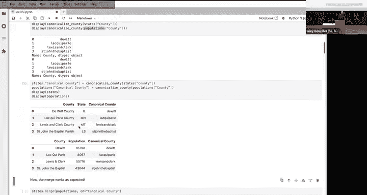
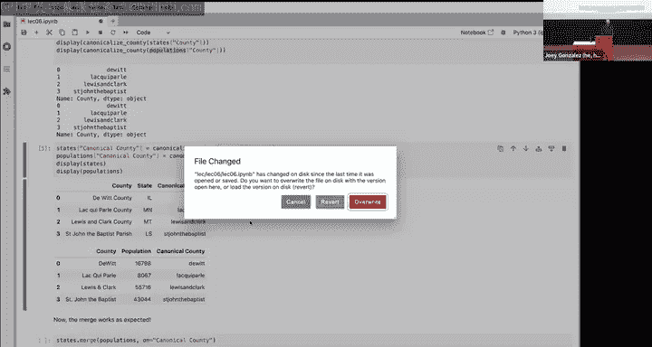
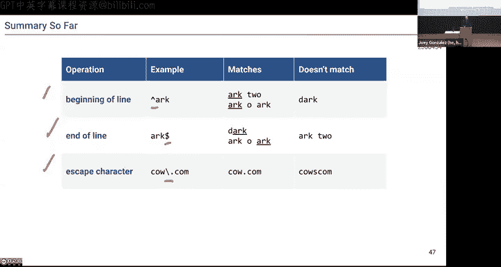
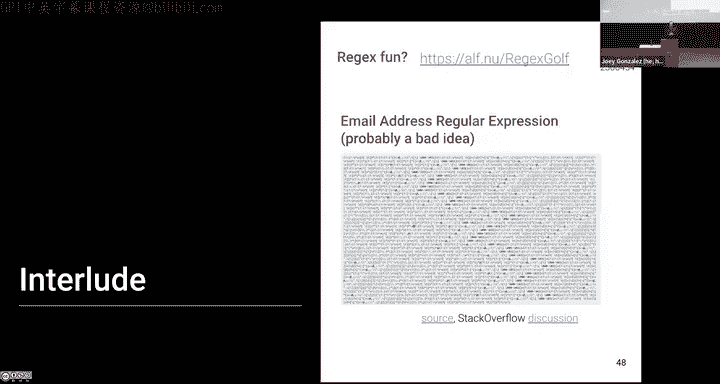

# 课程6：数据探索分析与文本处理 🧭


在本节课中，我们将要学习数据探索分析（EDA）的剩余关键部分，并深入了解如何处理文本数据，特别是字符串操作和正则表达式。

## 数据探索分析（EDA）收尾

上一节我们介绍了数据的结构和粒度，本节中我们来看看数据的范围、时间性以及数据真实性。

### 数据范围（Scope）

数据范围指的是你的数据在多大程度上代表了你想要研究的问题。你需要明确目标总体是什么，以及你的数据与这个总体之间的关系。

以下是需要考虑的关键点：
*   **数据与总体的重叠**：你的数据可能只覆盖了总体的一部分，或者包含了一些超出总体范围的无关数据。
*   **过滤数据的风险**：过滤掉看似无关的数据时，可能会无意中移除属于目标总体的样本，从而影响分析的代表性。

### 数据时间性（Temporality）

数据是动态变化的，理解数据收集的时间背景至关重要。时间戳或日期字段的含义可能并不直观。

以下是需要注意的方面：
*   **时间戳的真实含义**：一个时间戳可能代表事件发生的时间、数据录入系统的时间，甚至是数据库管理员导出数据的时间。你需要仔细阅读文档或与相关人员沟通来确认。
*   **周期性模式**：许多数据（如用户活动、网站流量）会呈现日、周、月等周期性变化。分析时需要考虑这些模式。
*   **时区问题**：合并来自不同时区的数据时，必须进行时区转换和标准化，以确保时间的一致性。Python的 `datetime` 库是处理此类问题的有力工具。
*   **特殊日期值**：警惕像 `1970-01-01`（Unix时间纪元）或 `2000-01-01` 这样的日期，它们常常被用作缺失值的占位符。

### 数据真实性（Faithfulness）

在查看数据时，应保持怀疑态度，数据可能已被篡改或收集有误。

以下是一些常见的警示信号：
*   **异常的行数或列数**：例如，恰好有 65,536 行（旧版Excel的行数限制）或 256 列。
*   **重复条目**：重复的行或列。
*   **拼写错误**：同一字段（如州名、地址）存在多种不一致的写法（如 “California”, “CA”, “california”）。
*   **单位不统一**：价格、温度、重量等单位未标准化（如美元 vs 韩元，摄氏度 vs 华氏度）。
*   **缺失值的奇怪编码**：缺失值可能被编码为 `0`、`9999`、`-99.9` 等，而不是标准的 `NaN` 或 `None`。

### 处理缺失值

处理缺失值是EDA中常见且重要的步骤。

以下是几种主要策略：
1.  **删除缺失值**：直接删除包含缺失值的行或列。这是最简单的方法，但可能会丢失重要信息，特别是当“数据缺失”本身具有意义时。
2.  **标记缺失值**：保留数据，但明确将其标记为缺失（如设为 `NaN`）。你甚至可以创建一个新列来记录原列是否缺失。
3.  **数据插补**：用估算的值填充缺失值。
    *   **均值/中位数插补**：用该列其他非缺失值的均值或中位数填充。
    *   **热卡插补**：从相似记录中随机抽取一个值进行填充。
    *   **回归插补**：使用机器学习模型基于其他列来预测缺失值。
    *   **多重插补**：多次进行插补（如热卡插补），以评估插补带来的不确定性。

**注意**：你的插补选择会影响下游统计分析的结果和偏差，应谨慎考虑数据缺失的原因。





### EDA 总结

进行EDA时，应系统性地检查以下方面：
*   **检查数据和元数据**：阅读文档，理解数据来源和含义。
*   **理解数据结构**：包括格式、组织方式、记录粒度、字段类型（存储类型和概念类型）。
*   **评估数据范围和时间性**。
*   **识别和处理数据真实性问题**。
*   **应用可视化和统计方法**：探索变量间的关系，验证假设，发现异常。
*   **记录所有操作**：**切勿直接修改原始数据**。所有转换和清洗步骤都应在副本上进行，并在笔记中详细记录原因和步骤，以确保分析的可复现性。

---

## 文本数据处理（Wrangling Text）

文本处理是EDA中常见的一部分。我们主要关注两个目标：**规范化**和**信息提取**。

### 为何要处理文本？

1.  **规范化**：使字符串格式一致，以便进行合并等操作。
    *   **示例**：一个表中的“Dewitt County”和另一个表中的“DewittCounty”需要统一格式才能正确连接。
2.  **信息提取**：从长字符串或非结构化文本中提取特定信息。
    *   **示例**：从服务器日志 `[26/Jan/2024:10:15:30]` 中提取日期部分。

### 字符串方法

Python提供了基础的字符串操作方法，Pandas则提供了向量化版本，可对整个数据列高效操作。

**基础Python字符串操作示例**：
```python
text = "Hello World"
print(text.lower())      # 输出：hello world
print(text.replace("World", "Data")) # 输出：Hello Data
print(text.split(" "))   # 输出：['Hello', 'World']
```

**Pandas向量化字符串操作示例**：
```python
import pandas as pd
df = pd.DataFrame({'county': ['Dewitt County', 'Santa Clara County']})
df['county_lower'] = df['county'].str.lower()
df['county_no_spaces'] = df['county'].str.replace(' ', '')
```

### 正则表达式

当简单的字符串方法不够灵活或强大时，就需要使用正则表达式。它是一种用于定义搜索模式的微型语言。

#### 基础语法

*   **字面字符**：`abc` 匹配字符串 “abc”。
*   **或操作**：`a|b` 匹配 “a” 或 “b”。
*   **重复**：
    *   `*`：匹配前面的元素零次或多次。`ab*a` 匹配 “aa”, “aba”, “abba”...
    *   `+`：匹配前面的元素一次或多次。
    *   `?`：匹配前面的元素零次或一次。
    *   `{n}`：匹配前面的元素恰好 n 次。
    *   `{n,m}`：匹配前面的元素 n 到 m 次。
*   **分组**：`()` 用于分组，并定义捕获组以供提取。
*   **字符类**：
    *   `[abc]`：匹配 a, b 或 c 中的任意一个字符。
    *   `[a-z]`：匹配任何小写字母。
    *   `[^abc]`：匹配除 a, b, c 之外的任何字符。
    *   `\d`：匹配任何数字，等价于 `[0-9]`。
    *   `\w`：匹配任何字母数字字符，等价于 `[a-zA-Z0-9_]`。
    *   `\s`：匹配任何空白字符（空格、制表符等）。
*   **特殊字符**：
    *   `.`：匹配除换行符外的任意单个字符。
    *   `^`：匹配字符串的开始。
    *   `$`：匹配字符串的结束。
*   **转义**：`\` 用于匹配元字符本身，如 `\.` 匹配字面意义的点号。
*   **贪婪与非贪婪**：默认情况下 `*` 和 `+` 是“贪婪的”，会尽可能多地匹配。在其后添加 `?` 可变为“非贪婪”，即尽可能少地匹配。例如：`<.*?>`。

#### 在Python中使用正则表达式

使用 `re` 库或 Pandas 的字符串访问器。

**示例：查找所有匹配项**
```python
import re
text = "My SSN is 123-45-6789 and another is 987-65-4321."
pattern = r'\d{3}-\d{2}-\d{4}' # 匹配社会安全号码格式
matches = re.findall(pattern, text) # 返回：['123-45-6789', '987-65-4321']
```



**在Pandas Series中使用**
```python
df['ssn_matches'] = df['text_column'].str.findall(pattern)
```



**示例：使用捕获组提取信息**
```python
log = "[26/Jan/2024:10:15:30] Request received"
pattern = r'\[(\d{2})/(\w{3})/(\d{4}):(\d{2}):(\d{2}):(\d{2})\]'
match = re.search(pattern, log)
if match:
    day, month, year, hour, minute, second = match.groups()
    # day='26', month='Jan', year='2024', ...
```

**在Pandas中使用`.str.extract`**
```python
df[['day', 'month', 'year']] = df['log_column'].str.extract(pattern)
```

**示例：替换（用于规范化或清理）**
```python
html_text = "<div>Hello <b>World</b></div>"
clean_text = re.sub(r'<[^>]+>', '', html_text) # 移除所有HTML标签
# clean_text = 'Hello World'
```

**在Pandas中使用`.str.replace`（需启用正则表达式）**
```python
df['clean_text'] = df['html_column'].str.replace(r'<[^>]+>', '', regex=True)
```

### 注意事项

*   **使用原始字符串**：在定义正则表达式模式时，建议使用原始字符串（前缀 `r`），如 `r'\d+'`，以避免Python字符串字面量中的反斜杠转义问题。
*   **正则表达式很强大但复杂**：它们是“只写一次”的语言，难以阅读和调试。务必使用参考表，并利用在线测试工具（如 regex101.com，选择Python风格）进行练习和调试。
*   **并非万能**：对于解析结构化的数据格式（如HTML、XML、JSON），应优先使用专门的解析库（如 `BeautifulSoup`, `json`），而不是尝试用正则表达式处理所有情况。

---

## 总结


本节课中我们一起学习了数据探索分析的最后几个关键概念：数据范围、时间性和真实性，并掌握了处理缺失值的多种策略。随后，我们深入探讨了文本数据处理，从基础的字符串方法到强大的正则表达式，学习了如何对文本进行规范化和信息提取。这些技能对于清洗和准备真实世界的数据至关重要。下一周，我们将进入数据可视化的学习，将这些分析结果以直观的方式呈现出来。