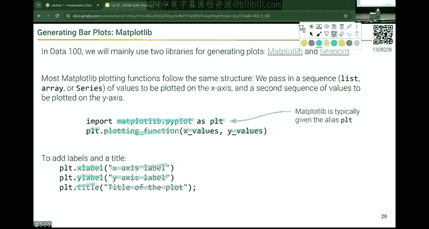
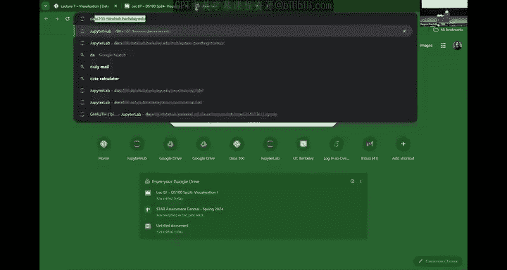
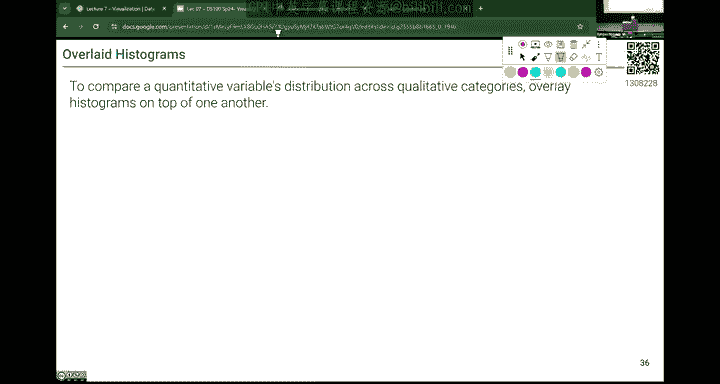
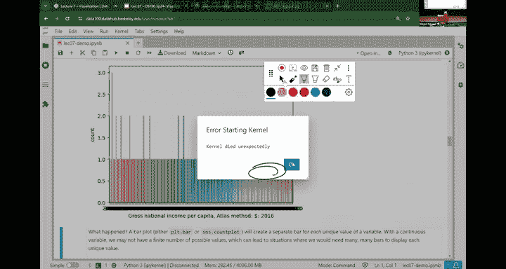
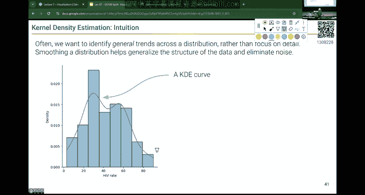

# UCB《数据100数据科学原理与技术｜Data 100 Principles and Techniques of Data Science 24SP》中英 - P7：-07-Data 100 Spring 2024 Lecture 7.zh_en - GPT中英字幕课程资源 - BV1Bc2dYCEbc

Alright。Good morning everyone welcomelcome to another data 100 lecture Go ahead and log into slido so we can start today's lecture this lecture and also the next one this week is going to be a little bit more fun and then we're going to take things to the next level making it more fun going into probabilities and going into the modeling in the next couple of weeks as well before I dive into things I also want to share the results of the week tree survey with you so periodically we're going to send you these surveys in the weekly overview post and then we're going to share the results with you to the extent that we can so what specifically the two questions that we're interested in kind of sharing with you is the workload so what's your perception of the workload in data 100 we see kind of a nice normal distribution that most of the students kind of feel that。

😊，The workload is manageable it's three out of on a scale of one to5 one being extremely heavy workload and five being minimal workload and then the other part is that we will generally ask about how much time you're spending on homework so it looks like that at the time of this survey which was the time that you already submitted homework 1A and 1 B the number of hours that you spend on on the homework generally for most of the students was under six hours which is also good news for us we'll keep working on creating new content creating new engaging assignments that are kind of related to the topic that we'll teach and you're going to get another very fun and kind of new homework coming your way this Friday so with that out of the way let's get into the content for today's lecture we're going to talk about visualization so this week is specifically in the next。

😊，s not to lectures today and also in the next lecture I'm going to talk about visualization and I'll talk about visualization from the perspective of what are the visualization libraries that we can use and what kind of considerations should we make when we're trying to make a plot and what kind of plots do exist and then how to use them and then we're going to also go and talk a little bit about the theories behind creating different plots。

 how to make most of all the information channels that are available to you on a plot so that your plots are as informative as possible if you're trying to use them in your reports after you go around this entire data science lifecycle and you're trying to share the reports of the entire lifecycl with a stakeholders or generally with the community。

😊，So today I'm going to start by talking about goals of visualization because goals of visualization is very important for you to think about how much time should you spend on creating different plots and then what kind of plots are needed depending on the variables that you're plotting or your're visualizing in your data science lifecycle I kept saying data science lifecycle this is because there are two types of visualization that we'll visualization test that we'll do and we'll look at in data 100 and they all depend on which stage of the data science lifecycle we're in so remember that in the exploratory data analysis we said that okay we're going to go around this cycle of data acquisition collecting data and then cleaning the data and then exploring the data to make sure that our data is clean and processed enough that it's ready for the next phase that we have in the prediction or inference or what I。

😊，Saay in short as the modeling phase and then there is also another category or another that we'll do visualization in which is at the time that you're done with the entire data science data science lifecycle and you want to export the result to another external observer and you want to share the result you you might want to also use visualization in order to convey a coherent message to that so this is where we are we and we spend a lot of time on different data structures that would hold your data in the first four lectures we talked about exploratory data analysis we talked about regular expressions in the previous lecture and now we are at the point that okay now that I process my data how do I know that I'm ready to move on to the next phase how do I visualize my data which is kind of visualization is also part of the exploratory data analysis phase as well。

😊，So the topics that I'm going to talk about today are not going to be entirely new to you so some of these topics or this visualization plot you've seen them data in data8 and you've also seen them in homework one so specifically if you remember these plots。

 the first two plot are line plot and a scatter plot from data8 and then the third one is what you have created in homework one so you kind of are familiar are with line plots the scatter plots and histograms but we're going to go a little bit deeper and we're going to basically take a look at industry standard Pyth libraries that will help us to make all of these visualizations and then we're going to spend a little bit more time talking about histograms and how can we plot different distributions。

😊，The general goal that we were trying to achieve with all of these plotting that we have done before was to just get a general sense of the data。

 so we wanted to see what the trend in our data looks like and then communicate these trends with the viewer。

 whether the viewer would be someone who is grading or homework or someone that is looking at the result of your analysis and are trying to understand what went down in the entire analysis or data data science lifecycl that you went through。

I talked also a little bit about goals of visualization and I showed you two specific points in the data science lifecycle that we're using visualization for。

 the first goal or the first step is kind of internal so you are trying to create visualization so that you can help your own understanding so you are in the exploratory data analysis phase。

 you are processing your data now you want to take a look at the trend of your data and then make sure that you have all the right data that you wanted。

 you have removed all the outliers and what are the outliers where are the outliers situated and then be able to remove them and just generally figuring out if your data is ready for the modeling phase that we'll talk about next so the goal of visualization here is that the visualization should be clear but it also should be lightweight because you don't want to spend too much time on just creating a very simple visualization that shows you some information about the trend in your data so it's fine to。

a clear but lightweight process that you can iteratively call and create as you're going through this cycle of going back to the data acquisition。

 coming back to thelor exploratory data analysis and going around this cycle。

 you should be able to itreatively create those visualizations and then reflect on those visualizations and then figuring out if there is any additional process and that you need to do or not。

😊，The second goal of the visualization is to communicate result with others。

 this is really after the entire data science lifecycle this is the phase that you have done the model and you're trying to communicate the entire result with someone that didn't went through this entire lifecycl and the goal here is again to communicate the results so your visualization should be very clear properly documented we always make sure that all of the ax that we have in our plots are labeled and the plot also has a nice informative title and all and then we're also considering accessibility in our plot and making sure that we are using and we're providing enough context in our visualization in a way that it utilizes all the possible information channels that we have in our visualization。

😊，So all that said， what we're going to learn in today's lecture and also in the next lecture is that as I'm talking about visualization。

 I'm not talking about creating some pretty plots， I'm talking about the entire thinking that goes through the entire process of before creating any visualizations。

 we'll take a look at what we're trying to plot， what type of variable it is。

 what kind of information do we want to gather from it。

 do we want to just look at the trend do we want to extract outliers。

 what are the goals of this visualization that we're trying to do。

 and then we'll take the step of deciding about the type of the plot and then we'll make the visualization that we want depending on depending on the task that we have at hand。

😊，So all that said， what we're going to see in the first visualization lecture is to introduce it to different types of plots so we'll see specifically two different libraries plotting libraries we'll see how we can use them in order to plot different types of to visualize different types of variables and then we'll actually take a look at the code and the implementation for it in the next lecture I'm going to talk a little bit more about the theory behind creating visualizations。

 what are different considerations of using proper color， proper channels。

 proper orientation and of and all of those kinds of theories that we're going to see in the next lecture and then I'm going to also talk about transformation because a lot of time we just want to make sure that the data is oriented or transformed in a way that when I'm going to plot the data every information is visually apparent in the entire plot and we don't have something that we call。

😊，Overpdding， so we'll see an example of overping in the next lecture。

But let's take a look at the first piece so we're going to take a look at different variables visual that we want to create visualization for and then we'll take a look at again the Python libraries that will do that for us specifically I'm going to start by visualizing distributions but before talking about visualizing distributions I want to tell you what the distribution is if you've taken probability in a statistics course probably determine familiar to you but if not generally a distribution is a summary of what's happening in your data how many unique values do you have and what's the probability of each one of those unique values appearing in your entire data so thinking about the distribution formally the distribution needs to have two properties one is that one property is that it has information about difference the set of values that a variable in a distribution can take。

And then the second property is that it needs to have the frequency with which each one of these values show up in your distribution so let's see an example so say for example we have faculty in different departments at Cal and let's assume that each faculty is only affiliated with only one department if we're thinking about the distribution of the faculty in different departments so that we see which department is better staff compared to another departments so that later on we can take a look at the faculty to a student ratio and all of those considerations the distribution that we're looking at is the unique number of departments right so the unique number of departments is technically the values that any faculty affiliation can take。

And then the frequency with which each one of those departments is going to show up is that the number of faculties that we have in each one of those departments。

So in this case， if you'll take a look at all of the faculty that we have at Cal。

 each one of them is associated with one department so each individual actually accounts。

 and if you look at this entire distribution in aggregate。

 the total sample size is going to be equal to the total number of faculty that we have at Cal if you're looking at proportions。

 what's happening is that the proportion of faculty in each one of those departments basically reflects the frequency of the department showing up in this entire distribution of faculty affiliation to different departments at Cal is specifically。

So putting it into the mathematical term， if you're looking at the distribution and we have a set of values for each one of those values。

 we have the frequency or the probability of those values showing up if you're looking at all of those frequencies and we sum up all of those probability or frequency values。

 they should add up to be equal to 100% because each individual is going to be associated to one and only one category or one one value of that variable and then if you're counting overall then you should be able to count everyone at least exactly one category and that will give you the 100% probability across this entire population。

 if you're not working with proportions or probability。

 if you just sum up every you should be able to have the sum all of the instances to be equal to the total values that you have in your sample with the example of faculty again if you。

Every faculty you just list them as their department affiliation and you sum up all of the affiliations that you have。

 the number should be equal to the number of faculty that we have and if you sum up the frequencies of the faculty in each one of the departments it should add up to be equal to 100% because each faculty exactly has one and only one department affiliation。

So I'm going to give you a few examples kind of knowing what the distribution is， which is。😊。

And different characteristics that we had for it， it has unique values。

 it has a set of unique values and there is frequency associated to each one of those unique values and the sum up all of those instances should be equal to the entire sample size or looking at the proportions they should add up to be equal to 100% let's take a look at this example and also the next slido example and tell me if you think this is a proper distribution in this case。

😊，So this is an example of not so bad plot again we're going to take a look at what makes a good plot and what makes a bad plot but this is a pretty informative plot it tells you。

That。The values that you're seeing is the percentage of US teens who say they ever posted about their whatever that category is on social media and then you have different categories and then what you're seeing is all of those numbers which based on the description。

 those numbers are percentages， is this a proper distribution or not。Okay。

 let's see what you think this is not a proper distribution anyone from this portion wants to make a guess why it's not a proper distribution。

一。走么的。So the answer is it adds up to be more than 100% so there are different categories that's right there's percentage allocated to each one of those categories reflecting the frequency of each one of the categories coming up。

 but if you basically go ahead and some of all of these percentages it adds up to be more than 100% how about this other one。

So this is a plot of share of American adults in each one of the income tiers。

 income tiers being upper， middle and lower。Before we see the result， I want to go back to this。

Previous distribution to be plotted there is one issue that the summation adds up to be more than 100% the other issue that we have is that because each individual can select more than one category and each individual is going to be counted more than once that's why it adds up to be equal to more than 100% there are cases that you can have an individual to be able to count to more than two categories。

 but is still somehow magically the summation of all of these percentages adds up to be equal to 100% because for example one individual might not select anything one individual might select more than one category so there are two different criteria here is that the summation should add up to be equal to 100% because each individual should be counted exactly in one of those categories so looking at this other example this is a probability distribution because that criteria that I said is going to hold。

Here each individual is going to be counted into exactly one of these categories and each individual should be in one of these categories。

 one person cannot be in two of these income tiers at the same time， Do you have a question。一出して。

It has to be exhaustive in the sense that like everyone has to risk。

 you have to have a sample for every individual in your population。啊。Like on the last plant here。

 it' like。被道这。啊。That's correct， so for the purpose of looking at so we have a sample and we're trying to visualize the sample in our data frame。

 if you're assuming that there is no null values and all of the interests are there and you're trying to plot that distribution in that case you will have a response or you have a value associated to all of those values。

 any null values is going to or we can drop all of those null values and then we're going to plot everything else。

 which in this case is going to basically mean that theoretically can an individual be allocated to more than one category or not。

 which in this case again， the answer is that this is a distribution for the reasons that we basically looked at it together。

So why did I talk about all of these these two examples and talking about the variable type is important in terms of plotting distributions or plotting any kind of columns that we have in our data frame it's because what we discussed in previous two lectures was that our variables can be of two different types we've seen qualitative variables and we have seen quantitative variables and depending on the type of variable that we're dealing with different types of visual the visualization plots are going to be more important and we're going to see examples of like how can we make a decision based on a variable type that what kind of plot do we want to use and then we'll see counterexamp that the same plots might not work on another type of variable if we use them in those cases so qualitative quantitative we have a bunch of numerical values think about that as for quantitative variables and for qualitative variables think about having some kind of。

Some kind of ordinal or nominal kind of categories and those categories can be limited in terms of how many unique values we might have when we're talking about plotting a distribution for qualitative variables the best plot that we can use as a bar plot so think about bar plot as like having different bars that we have for different categories and the height of the bars corresponding to the proportion of the data points that belong to each one of those categories that we talked about so this is kind of plotting that that entire distribution that we talked about before there is also a caveat here that for discrete quantitative variables if the number of options that we have or or the unique values that we have for discrete quantitative variable is a small say for example we only have options of one。

2 three we can still use bar plots because the number of categories is limited。

And still we can create nice bar plots that we can look at the height of the bars to distinguish between all of those categories。

 but here categories are discrete great values that we have。

So with the example that we've seen before， this was an example of a bar plot。

 so with the bar plot as I said the height encodes some kind of a proportion or the probability of that category coming up a lot of time color doesn't encode any information but sometimes color does encode information so here the gold color doesn't encode any kind of information and the widths of the bar in this example also doesn't encode any information。

 but it can also be cases that you might want to to utilize the widths of widths of the widths of the bars to encode some kind of information but it's very rare that we use that in bar plot but we'll mostly use that with histograms that we're going to take a look at towards the end of today's lecture。

😊，So for the demo today we're going to take a look at the World Bank dataset set。

 so this is kind of a very huge data set with a lot of different attributes that are looking at some socialist statistics about countries and territories around the world and then you can for example see different countries you can see continents and again you will see some socialist statistics about what's happening with people who are living in those countries。

 around the world。😊，So we're going to start by taking a look at how can we make a barpl for some quantitative for some qualitative variable that we have in this data set that we talked about and in data 100 in today's lecture at least I'm going to talk about two plotting libraries I'm going to talk about Matpllootlib and I'm going to talk about Seaborn and we'll see the similarities between Matplotlib and Seaborn and in the next lecture I'm going to briefly talk about it' heard plotting library just so that you've seen them but it's really up to you for Homes and Homes and projects which one you want to use and you'll get a sense of which one is easier for you to use and you can make sense of that a little bit more so we'll just get some practice with them today。

If I want to create a bar plot with matte plot lip。

What I just need to do is I need to create I need to call a plotting library that is associated with creating a barpl and I need to pass two sequences。

 so I need to say what is the sequence of values that should be plotted on X axis and what's the sequence of values that should be plotted under Y axis and when I say sequence I mean it can be an array。

 it can be a list or it can be a series object， but because mostly our data is stored in series objects when I'm trying to plot one column I can directly use a series object and pass those series objects that would be plotted under x axis under y axis automatically to the barpl and then barpl or bar plot function is going to be able to visualize that for me So how。

Exactly， can I code this generally with Matpllib you just import Matpllib as import Matfllib Ppl so you will see importing Matfllib Ppl as PLT and PLT is the normal kind of a conventional alias that we're using for matfllib Ppl and then technically you can use this axis or in order to call any kind of plotting function so any kind of function that I'll tell you today and also in the next lecture you can look at the documentation of Matpllib figure out which one of them you want to use and then look at the attributes and then be able to pass those attributes here or arguments here and those arguments are going to be plotted in appropriate kind of axis or the domains on the plot so in this case I just need to pass whatever sequence of values that should be plotted on the X axis and whatever sequence of values that should be plotted under the Y axis。

We will also make sure in data 100 that all of our axes and our plot entirely are labeled。

 so well basically call and set the attribute X label with whatever label that we want to put on the X axis we'll set the Y label again in a similar way and then we'll also set the title kind of a descriptive descriptive title for the entire plot so this is irrespective of whether you're creating it for your own or you're creating the plot for just reporting purposes this is very important that you have all the information on your plot so that you don't confuse yourself as well。

So let me go to the code， actually。

And then I starts showing you how it works in practice。How is the going on slider？Good， wonderful。

Okay so some importanted statements as usual， and then this is the data set that you also have access word underscore bank that CSV that I'm loading and I'll load it into a data frame that I call WB word bank and taking a look at the head of this data you'll see that there are 47 columns here and if you take a look not all of these columns are also shown here because there's just 47 of them that can be plotted in this frame and that's why you see these dots here that basically says that there are more than all of these columns that are visually shown in this head if I take a look at this shape there is 166 countries in this data frame and again 47 different features for these countries but taking a look most of these columns except for the ones that I can see there are quantitative data variables right except for the。

Country and continent so if I want to create some kind of a bar plot that shows me the distribution of the countries in different continents right what I can use is I can look at that a specific column of continent be able to identify what are the unique values for the continent and what's the frequency of each one of them happening my in my dataset which technically means that those frequencies are going to be the number of countries in those continents and then what I can do is I can create a bar plot on the x axis I'll have those labels or those unique values for the continents and then on the y axis I can have all of those frequency values associated with each one of those bars。

We have seen a function that can do that for us that gives us the unique set of values and it gives us the frequency values right the function was value accounts if you remember so i'm going to directly utilize this and what you see with the what this value accounts is that it has the index being all of these unique values and then the values actually here is going to be all of those frequencies right so I'm going to go ahead and create。

😊，This object directly from。The same data frame。I'll say continent， and then say。Value accounts。

And then we'll take a look。 so now I have this。The series object actually is stored in the continent。

 so now I can directly go ahead， get the index， plot the index on the x axis and get all of these values and plot those values on the y axis so what I can do is I can say that okay since Macpllib was imported as PLT I'll use it to actually call the function in this library and the function that we'll use in this case for barplot。

Is very complicated。 It's bar， right， And then what I need to pass to this bar function is I pass the sequence of x value sequence of y values x is what x is the index of this continent。

 series object that I created。 So I'll go ahead and say。

Continence dot index is my x value and the height of each one of those bars is going to be equal to continentence dot values。

let's take a look at how it looks like。So this is going to give me all of those continents on the x axis and all of those frequencies on the y axis pretty neat with only one function right what I don't like here is that my axises are not label then my my plot doesn't have a title which is not very professional what I can do is I can go ahead and say that okay PLT。

 X label set the label on the X I'll say continents。Continence。And then I'll say， okay， PLT， that vi。

Go ahead and tell me that this is frequency and PLT that title。And then I'll say frequency。Of。

Countries。In each continent。and when I do this， now I have continent as the x label frequency as the y label and then the title nicely kind ofwritten at the top。

Okay still there is one thing that I'm not super happy about which is this text thing that keeps showing up here。

 this is kind of plotting not plotting but printing the object that that is being plotted as this string object So here it tells me that okay the last thing the last object that was plotted was this frequency of the countries and then it basically talks about the coordin over that that's located and if I want to suppress that and I don't want to print that I can just end this line with a semicolon I'll run it again and then that text description is gone。

Okay， usually we'll put that semicolon at the last line of the entire visualization block。

 and then it will basically suppress any kind of textual printing that will accompany the plot that we're using。

Okay， pretty cool stuff。 There is also a way that we could use panda's native plottdding。

 So if I just go ahead and just on the fly， I'm want to create something pretty quick。

 I can say that， okay， I had this word bank。😊，Of content and the stuff。 And then I want to say that。

 okay， go ahead， do value count。 And you're just working on a homework。

 You just want to quickly see what's there。 You can just say that， okay， go ahead and plot it。

As the kind of the plot being a bar plot。And then I will go ahead and plot it for you。

 So there is also a native way of doing it。 You will see later that you can still label X axis and y axis here。

 Y later， let's do it here。 I can directly go ahead and say， okay。

 let's use the accessor from from Macfllib， and I can say， okay， X label be equal to。

Continents and so on and so forth。 I'll copy the rest from the top here so that you see that these functions actually nicely work with each other right although the plotting itself was done in pandas。

All right， since we're in the demo let me actually show you the Cborn version of it because the Cborn is very similar to MApllootlibb the only difference is that it has its own conventions but there is like one to one correspondence between the convention that MApllolibb uses and the convention that Cborn uses and it's pretty consistent between all of the plotting functions that it's using so instead of us passing those sequences for the x and y directly Cborn generally takes the entire data frame and then it will ask for you for the label of each one of the columns that you want to plot on the x axis and under y axis it will do the calculation。

 it will plot it in a nice way， it will also label the stuff most of the time itself but you just need to also put a title at the top so let me show you how it looks like the version of barplot in Cborn is called countplot and what did I use？

😊，For seaborn I imported seaborn as S and S。 This is also the normal alias that we're using for seaborn so I'll go ahead here down and I'll say that okay。

 S and S please give me count plot and you can say by that you can kind of guess by the name of this。

Count plot that it will actually go and be nice and do the accounting for us。

 So I don't need to do the accounting myself in the way that I was calling value accounts to give me the accounts of countries in each one of those continents。

 But instead， what it gets is it gets。The entire data frame。

 so I'm just using also argument names so that you can kind of remember it that the entire data is being passed my entire data is WB and I'll say that okay。

 on the X axis， I'm going to give you the label that you should use for the X axis here and then on the X axis I want to say that okay。

 continent well the continent。Conuntinance。It was continent。And then we'll go ahead and plot it。

Actually， let me go ahead， suppress it。 Okay， wonderful。

 So you see it's a kind of a fancy looking kind of a bar plot。 It has all of those colors。

 it automatically went ahead and labeled my x axis and y axis Why could it label the X axis because it was the label that I passed directly so it knows that the label for that column is continent and then why is it labeling the y axis。

 it knows that it's doing the count thing and what's being plotted is the count so you can go ahead and change it to whatever you want if count is not an accurate term or like you have a better description for the x label you can do that。

 but technically it will do all of those is stylistic kind of additions to your plot automatically let me also show you that I could actually go ahead and just use this PLt or Macpl lab in order to get access to the aes of the plot。

And then I'll have access to X label。 I'll have access to the Y label。 I'll have access to the title。

 And exactly in the same way that I change the labels for X and Y and the title with the with the panda's native plotting。

 I can still do that with Cborn。 So I'll run this。 You'll see that now the title is showing up here。

 So this is how these two libraries are really interconnected。

 And there is like one convention that one uses。 There is another convention that the other one uses。

 but they're also integrated together in a way that you can use functionality of one of them to manipulate the plot that the other one is created in the same way that Im labeling X and Y and the title this way here。

😊，I could actually go ahead and hear say that。I want the continents to be under Y axis。

What's your guess， What's going to happen here？It would just rotate it so instead of vertical bars i'll have horizontal bars so let's run it and see so pretty cool stuff if you read the documentation things are pretty intuitive if you follow the description you look at the definition of each one of these arguments on what they're doing and you can just utilize them in a way that you want to create a personalized plots yourself i'll keep it as X。

Since I used argument names here for Seaborn I also want to show you that here I could have actually said that this the first argument is x for the MApllib and then I can say that the Y in the barpl example is the height argument so again you have to read the documentation to kind of know what are those names but if you just pass it in the proper order you will think that the first one is x the second one is y but if you're using argument names just know that the names are X and height and this example I'll just run it so that you believe me that it does exactly the same thing do you have to importpl to use title。

The question is should you import Mac Plib to be able to change the plot titles for Seaborne。

 the answer is correct， if I didn't have PLT imported。

 this would have been unresolved identifier question。

I thought which because it seems like over the other So the question is how does it know which object are we working with so each time that we're creating a new cell and we're creating a new plot a new figure object is created so then technically by calling PLT and calling getting access to different axes of that plot we're getting access to that figure object right and so now you're seeing that different figure objects are being created so then technically it says that the current figure at hand I'm just going to go ahead get its x axis and put this label on top right it knows what's the current figure that we're running that we're writing on in the next lecture I'll show you demos of like how you can actually load sorry save these stuff so that you can save a fancy kind of version of these plots and like PNG files and then you can download。

Later again， if you want to use it in your assignments or if you want to use it。

 not in your assignments， but like in your reporting。

 you should be able to export everything that you're creating your self notebook。Okay。

 so you saw the first， you learned a lot about Seaborn and Mapl Lib and you've seen one function or two functions that are creating barpl in each one of these libraries。

So I'm going to quickly go over everything that we've done， all of these steps are in the slides。

 but I'm going to quickly say that we created this series objects object。

 we went ahead and used the index and values of this object in order to create。😊。

This bar plot using Macpllibb， we learned that we needed to pass the x values as the first argument and then the y values and the second argument or we could label them with x and height。

 and then those values would be plotted in appropriate locations even if the order is mixed then you pass like height first and then x next。

 although we don't recommend it。We also saw this native way of plotting， we just said that dot plot。

 we provided the kind we said that the kind is barpl and then we were able to get the same barpl。

 we saw seaborn， we saw that in order to import a Cborn that the Seaborn library we generally use SNS Elilias and then we said that okay any function that we want to plot in Cborn。

 I can just say SNS dot that plotting function， the convention with Cborn。

 the thing that's different than Macpllib is that it takes the entire data frame and we used the data。

 the name of the argument is data and then whatever else that you're going to pass to the X and Y are going to be passed afterwards again。

 the order is data X Y or you can just label them we data X and Y and then be able to use them with barpl we only needed to pass one of them。

 because oh sorry and then you saw that we could direct。

Use PLT function in order to get access to those ax these values。

 access these objects and then be able to put the label and the title and the plot。With the seaborn。

 we've seen that it was automatically doing the counting。

 I just passed my entire data frame and I said that okay， I want the continent to be on the X axis。

 go ahead and do the counting yourself using the count plot and it did this nice lighting for us。

I put a link to the documentation so every time that we see a plot there is a link to the documentation I just want to show you the how to read this documentation so it says seaborn dot count plot so that's why you're using SNS's the count plot and then you're passing the data you're passing the X you're passing y we're going to take a look at one example next that it uses hue for the third channel so if you're plotting multiple different things more than two things that would fit in the X and y axis we'll just encode the third thing as with the colors so we'll use two different colors or multiple different colors in order to encode the third channel the rest of the stuff are not probably super necessary for you to know right now but just know that if you scroll down and if you're wondering about any of those arguments you can just go ahead and read that oh hot can I change the orientation。

This is another way that you could change the orientation as opposed to manually saying y equal to whatever in the example that they did with like horizontal bars。

 and then there are also really nice examples at the bottom that will make sense of all of those arguments that are top there so utilize it to the extent that you can and then as you get practiced things are going to make sense for you。

All right， moving on what happens I said barpl is useful for a case that I have qualitative variable right the continent was a qualitative variable that I had I was looking at the distribution of how many times each one of those content values are coming up in my entire data set what if I use it for quantitative variable so let's take a look at what happens let's say for example here I go ahead and grab one of these columns which is gross national income per capita whatever whatever and then you're seeing that for these 192 different rows that I have these are all the values these are all numerical values and how do I know that these are numerical values because it says that this series object is of type float。

😊，If I go ahead and use the countpl to countpl and pass this entire data frame and then also pass this entire column label as whatever that's going to be plotted which I'm not supposed to do then it will take a second to run and it will give me this kind of a nonsense plot here which technically what it's trying to do is it's trying to think about each one of those values that I have in the column as a category and then it tries to like sum up like the frequency of each one of those categories and because I just have so many different unique values in the set。

 that's why I'm seeing all of those spikes and all of those different categories and a lot of overpling that's happening right here and I'm not able to read those index values that I have on the X axis so this is why we' are not using barplot for quantitative variables but。

We can use it for discrete quantitative variables where the number of options is a small if you have like five different options of that discrete quantitative variable then visually you can show them。

 that's why we are not using bar plot for quantitative values and this is exactly the plot that you just saw。

So what do we do with quantitative variables then what we will do is we are going to plot the distribution or the trend in the data using some other functions the functions that we'll see are box plot violin plot and histograms and you've seen histograms a lot in data aid because they loves histograms but we're going to revisit them one more time today and then we'll see how we can use Macpllib and seaborn in order to create again histograms or box plots or violin plot so what is a box plot what is a violin plot they look very similar。

😊，And they are showing you informations about quarttels。 what is a quarttel？Partt means four。

 This means that I'm going to create four buckets of my data。 I'll sort my data。

 I have a quantitative value right， so I'll sort all of those quantitative values I'll segment them into four buckets and then I'll say that okay I'm going take a look at each one of these buckets and then visualize some indicators in my sorted distribution as where the end of the first bucket as where the end of the second bucket whereas the end of the fourth bucket and third bucket and so on and so forth and then visually show what's happening on my plot。

What do we use in order to plot them Seaborn has nicer versions of creating box blood and violin plots so that's why we showed you examples that SNS that box plot just passing the data directly passing the variable or the label for the column that you're trying to plot here so here I'm saying that I want the variable to be plotted on the y axis this is going to be like a vertical box plots so that it's going to go ahead create a sorted version of my distribution and then it's going to again divide into four categories and then plot them and so on and so forth you can take a look at the documentation there is a version with violin plot which is very similar but it also has density function on top of those information about the quartiles in the plot。

So I said quartel， what did I mean by quartel， So again dividing the entire data into four chunks。

 we would say that the first quartel or Q1。Wwhich I'm showing it here this is my1 again think about this as a sortded value on the x axis Q1 or the first quatel is 25th percentile meaning that 25% of the data is below this checkpoint so that's what we're defining as Q1 Q2 or the second quatel is our 50th percentile which you all know it as median so this is right here my Q2 this is technically means that 50% of the data is below this checkpoint and 50% of the data is above this value there is also a third quatel or upper quatel which I'm showing it here with Q3 which is showing us that 25% of the data is above this Q3 and 75% is below this value and what's important about these cartels is the interquatel range that we're defining as the distance between。

Q1 and Q3 Why is it important Because that carries 50% of the data right Why is it carrying 50% of the data Because here we said we have 25% here we said we have 25% so whatever is remaining in this blue region is 50% of the data so we want to say that like the meat of our data or the center of our data how spread it is so if the delta between Q1 and Q3 is a small we have a very small and a small intercartel range so our data is very centered around the median otherwise if the delta is large the data is distributed so you have a sense that your data is going to have a wider distribution as opposed to a more center distribution so the concept that I talked about is called intercartetel rangech which is the third cartel minus the first cartel or Q3 minus Q1 so this range right here。

Is going to be interqurttel range for me。What did you see in box blood what you saw in the box plot was the box itself carries information about Q1 Q2 Q3。

 so the bottom of the box is Q1， the line in the middle of the box is Q2 or your median and then the top part of the box is Q3。

😊，What are those extended bars going up and down those are called visers and viss are defined as 1。

5 times inter quartile rangech at above the Q3 or below the Q1 so again the definition here is that the point for this top visker is going to be Q3 plus 1。

5 times interquartile range and then for this lower whisksker this is equal to Q1 minus 1。

5 times inter quartile rangech。Why are those whiskers important because anything outside of the whisker is going to be labeled as outlier so I'm not going to explain why but if you're curious about why which chose 1。

5 times whatever and why we're thinking that anything outside of these whisksers can be labeled as outliers you can check out that link it has to do with some assumption of normal distribution and like empirically figuring out like what is the range of what is the rangech that should carry 99% of the data and what's outside of it is going to be labeled as outlier in this case and outliers are going to be shown by those diamonds that you see on the plot。

So you can see here we are going to be able to have a very condensed definition or visualization for a distribution of a quantitative variable we can basically see what's the range of our data we can see what's the distribution of the data we can see intraquartetel range we can see how many outliers we have then technically once you have those whisker values we can go ahead and filter out your data for any point that's below the lower whisker and anything that's above the top bier there was a question somewhere yes。

说。Exactly， the question was that I'm just repeating for the recording that the height of this box is inter quaartile range that's why you are seeing that this height right here is 1。

5 times inter quartile range and the height here is also 1。

5 times inter quartile range so visually you can see this 1。5 times。ok。Paion。

The question is that median isn't necessarily in the middle of this box and the answer is no and that's a very good question which brings me to the violin plot in the violin plot then technically in addition to having information about all of those quartels that you see we also have information about the density or the frequency of each one of those values coming up so if we are at the region that this violin is or like the widths of the plot is wider that's a more frequent value and if the widths is narrower that technically is the least frequent value and technically you can have you can have a way that for example between Q1 and Q2 here you can have a very high frequency value high frequency of values and then technically the median is going to be pushed closer to Q1 as opposed to closer to Q3 okay。

That's how it can happen but I was trying to annotate it at the bottom of that inner part so this inner part is my entire box of the box plot so the bottom part is actually my Q1 the dot the white dot in the center is Q2 and the top part of that thick line is my Q3 and then you're also able to see whisksers where the whisksers。

 the whisksr is where this line ends here the top whisker and the bottom of the here and then you can see that the data is more centered towards the intercartel area and then it's a little bit narrower because the frequency is going to shrink towards the rest and then because here we have all of those outliers that's why the width is very narrow because the frequency is very small。

Alright， cool， very good questions。 We could also go fancy and have side by side。😊。

Box plots so for example here， if I go ahead and say that I am going to create a box plot and I'm going to give my entire data frame board bank and I'm going to say that on the X axis I want continents which is what we're seeing here that the continents are under X axis and I want to say that on y axis go ahead and create these box plots that these box plots are showing me the gross domestic product for each one of those continents so for each one of those continents it will go ahead filter for that continent itll get the gross gross domestic product or create a box plot and then it'll combine all of those box plots together color them differently so that you can visually distinguish make a distinction between that。

😊，Why is it helpful？Why is this helpful this section？

As opposed to going ahead and creating engagement of them individually for different continents。Yes。

😊，Good， yes， it's easier to compare them visually。 So visually you can compare medians。

 you can go ahead and get crazy and compare the Q1 of one of them with the median of another one and make any kind of conclusion that you want。

 This is a nice summary of figuring out what's happening。

 with this is specific quantitative variable with respect to different categories of another qualitative variable that we have as continents。

😊，So the next thing， we said that for quantitative variables， we can use box plots， violin plots。

 we know what they are， but we haven't talked about histograms in the language of data 100。

 and we should do that。The way that we're creating histograms is we draw kind of inspiration from bar plots remember barpls had different categories of items that we were counting frequency for each one of them we don't have that luxury with quantitative variables but instead what we can do is we can bin our values into predefined bins and then we basically count the frequency of the values that will fall into each one of those bins and then technically we're artificially creating those categories right then the same notion of bars can be used in this case there is a little bit of a caveat here that the area of each one of these bars should correspond to the proportion or the percentage of values that will fall into each one of these categories right and the summation of the areas of all of the bars should be equal to 100% because each one of the values that you have should be part of one of these bars or one of these。

cateategories and those categoriesries are all of those range categories that we have and then technically in order to make sure that we have the appropriate height here that the probability is going to then be equal to the probability of the values in each one of those segments is equal to the proportion of the values in that segment。

 we can go ahead and do the calculation using。😊，Using the width and height of this bin。 So。

 for example， in this case， if you're taking a look at this first bar。

I would say that the first bin has the widths of 16，410， so this point right here is 16，410。

 right that's the widths。So if I go ahead and say that okay。

 the hyp that the plot gave me is equal to 4。77 at times 10 to the negative5。

 if I want to calculate the probability or the proportion of the data points that are within zero up until 6000 and 410。

 I can just go ahead and multiply them and it will give me the value of 78% and visually if you compared this category with the other categories。

 you could see that you were expecting like around 80% of the data to be in the first category and the rest of the 20% be divided between other categories。

😊，So kind of to make sure that we're all on the same page with this area calculation and how this area corresponds to the probability。

 let's take a look at this example。Okay， so let me read the question。We have a histogram。

 we're looking at a look at bars in this histogram， we say that okay。

 let's look at one of those bars and that bar corresponds to a category for the bin between 110 and 115。

So what's the widths the widths is5 right between 110 and 115 if I tell you that the height of that bar。

 if you just look at the at the y axis is 0。02 and I also tell you that there are total of 1174 samples in my entire distribution。

 how would you tell me what would you tell me in terms of how many observations how many not frequency how many observations are。

Falling within this specific category question。I'm sorry。The widths， So the question is。

 if the widths of the bin is irrelevant， the widths of the bin。

Would be irrelevant if you're comparing two of the bars to each other now that I want to find a concrete example for this is a concrete answer for the exact number of samples in this category。

 it will be relevant because it was used in order to find out what should be the height。

Let's see the answer so let's see what your responses are so we had 1174 samples and we are going to be able to look at the proportion of yeah okay the proportion of calculate the proportion of that bar which is going to be equal to the probability of samples falling into that category the calculating the probability is going to tell me that the probability of that bin is going to be5 times 0。

02 which is going to give me 0。1 right 0。1。😊，Rio or like 10% of my samples are within that bin and knowing that total I had 1174 samples。

 multiplying that by the probability， the answer should be 117。

4 and that's the answer that I was hoping to get。😊，Okay。

 so that's why the widths was important because the widths was giving me the exact proportion and the exact proportion was used in order to give me the exact number question。

😊，Exactly generally makes sense to also round it if you have like concrete values but because you're just reporting in terms of on average you're expecting this to be the number you could also live it as 1700。

4 and then we'll see why that's the case so one thing that I want to show you is how to create histograms in code with cborn we would just directly say SNs do hist plot with map Gtlet we would just call PLt dot his the。

😊，The kind of the contract of how we are calling each one of them is exactly the same remember with Mac we were always passing two sequences we were always passing sequences of values so here I'm passing the sequence that's going to be plotted the x value and then here I'm defining something that's new to you I'm defining density to be equal to true because I don't want the y axis to give me the count values I want the y axis to also scale it in a way that in total the sum of all of those bars is going to be add up to be equal to100% or the area under the total area of the bars do add up to be equal to1。

With the with the seaborn and the his plot again I'm passing the entire data I'm passing the column name and then I'm also saying that the stat that I want you to use to normalize this plot is going to be density so normalize it in a way that this plot or this histogram is a density plot for me so that we have the same notion of probabilities and that distribution that we see and you can see the differences between them this one is created by mapplloot like this one is by seaborn you see there is stylistic differences but there are ways that we can also like defined edge color in mapplot live and then have nicer like edge colors for the bars so that you can distinguish them better but it's really a personal choice which one of those libraries you might want to use more frequently in your。

In your daily use。What did I say before in terms of。

Okay。

Let me show you one。Other demo here。 so these are all the histogram stuff or the violentolin plot stuff。

So okay， Mike carel has died。Good restart kernel。And run up to this to like itself cell。😔，嗯。Okay。

 so let's。Get what we wanted to get with histograms really quick。

And then I'll show you a trick so that we can use here or the color in order to in another channel in our plot。

interestinging。All right， so give me one sec。嗯。Restore care now。I do have a carel， so let's see。

Youpe。Nice resort。All right， wonderful， so this should work going all the way here。

 And this is also what you can use a lot of time we see in office hours that if you want to run everything from the beginning。

 you keep like running each one of them individually。

 you can just go to the cell that you want to run everything from the beginning up until that cell and then go here and then say。

😊，Run all above selected cell， and then you will see that all of them will have a star next to them。

 meaning that all of them are being run， and then here you will be able to basically run the cell that you want after all of them are run。

So what I want to show you next is that what if I want to take a look at the distribution of something based on northern hemisphere and southern hemisphere so I'm going to create a new column called hemisphere that has information about whether the continent is in the northern part or is in the southern part and then I'm going to do that based on this way of creating this new hemisphere column so you see that I'm saying that okay the value at this hemisphere column for all of the roads that are in the north list。

 so these are all the continents in the north list set that to be northern and then for the other ones that are in the south set that to be southern and then technically afterwards here I should be able to have a column called hemisphere so what I can do next is I can just directly go ahead here。

Actually。Where did let that go。Okay here sorry this was it I can here go ahead and say that I want to create this his plot。

 this histogram I'm passing you my entire data frame and I'm going to tell you that go ahead and plot the distribution of this gross national income per capita and then I'll say that make a distinction between the two categories that exist in the hemisphere column hemisphere is technically a qualitative value right it has type two values northern and southern and then technically we willll go ahead and assign different columns two different filtered versions of anything all the distribution of values for the northern hemisphere and for the southern hemisphere and that's how it can have overlay histograms overlay histogram that are again helpful in a case that you want to compare the two distributions you have a little bit of a collusions so things are on top of each other so it's not as easy to read but it will be very。

hellpful for you to compare the distribution， for example here you know that you have more northern hemisphere kind of countries on the lower end than on the higher end then on the lower end of the distribution。

So this is what I wanted to show you that you can use this h concept or he argument for you to be able to overlay histograms and plot two or more than one different columns together in a data frame and always we need to have a legend this thing right here that will show me what blooms and what orange means is called legend generally will be automatically added。

 you can also get access to changing the values that are being displayed on them on the legend but technically we need it to be as descriptive as possible so that we can tell apart what's happening with different colors on our plot。

So histograms are very useful and one of the reasons that they're useful is that visually it will give us a lot of information what kind of information it can give us it can give us about information about the skewewness of our distribution if the data has a bunch of different outliers or a bunch of different values on the higher end on the righthand side we would say that the data or the distribution has a right tail so this is a distribution that is right isd because it has a right tail so that's how you can tell distinguish between right iswed and left isd and the skewness of the entire distribution on the other hand if your data has a left tail so you have applying values to the left this is a left tail distribution so we'll say that the distribution is is skewed and the skewness is on the left if there is no clear right tail or left tail we'll say that the distribution is symmetric。

😊，And the symmetric distributions are very helpful。

 and we generally try to transform our data or filter our data in a way that our features are generally symmetric features that we can use them kind of in a more informative way in the modeling phase。

😊，And additional information that visually quickly pops out to us is mode mode basically tells you what value or what category of values has the highest frequency looking at the histogram it will basically is going to be the number of peaks that you have in the histogram so for example in the left histogram right here you have one peak we call this distribution unmodal distribution there is only one peak in the distribution and there is one mode in the distribution in the right- hand side we are kind of guessing that there are two peaks and we say that the distribution is bymod by means two and we don't go crazy and if there are like three or more different peaks we say trymodal and so on and so forth and we just say that if there are more than two different modes we will say that the distribution is multimodal。

One thing that I want to tell you before we kind of end today's lecture is that depending on the number of bins that I'm defining in my distribution。

 the mode information is going to change so for example here。I will say that。

I will say that okay go ahead and create a the his plot using seaborn I'll say that okay go ahead and use the data frame WB and I want to create a histogram of HIV rate this statistic that I want to see on the y axis should show me the density and here another argument that I'm using is bins so bins equal to five means that okay go ahead and break down this entire distribution into five different bins and looking at only five five bins you're looking at this distribution and you're guessing that okay this is a unimmodal distribution there is like one peak and not only that it's a unimmodal distribution it looks like that this distribution is symmetric there is no tail to the left or to the right。

😊，But I can go ahead and increase the number of bins I can say that okay I'm going to use 10 bins here in this case。

 so you're seeing that now I have more granular information and the bins are smaller but the number of bins is larger but then technically here you're seeing that I have two modes here I can go ahead and get crazy and then say that I want 20 bins with 20 bins probably you're seeing more modes or more peaks there's one here。

 there's one here， there's one here and you can also count this one as another kind of。

As another kind of peak in the distribution。 So what I'm trying to get at is。

Coming up with this information this summary information using histograms is pretty tricky because it depends on how we are categorizing our data What we're going to take a look in the next lecture is going to be how can we use kernel density estimates in order to automate this process we're going to have some estimation over the entire distribution of our data so that we can get that information in a smooth and in a probabilistic way so this is what you're going to say in the next lecture we have histograms and overlay on top of the histogram you see this is smooth curve that we call it kernel density estimate in the next lecture we'll see how we can make it we'll see more different versions of plotting functions and we'll talk about the theory behind using all information channels in the plots。

Thank you for coming， See you on Thursday。

