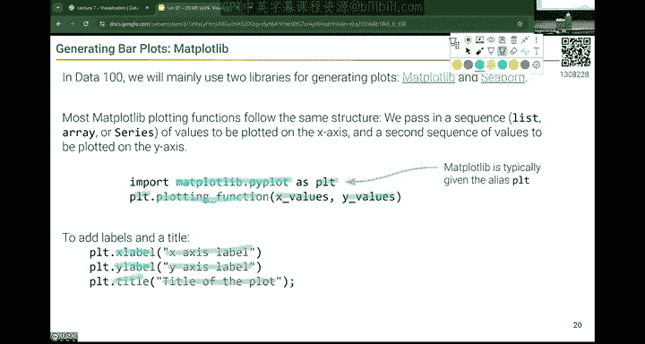
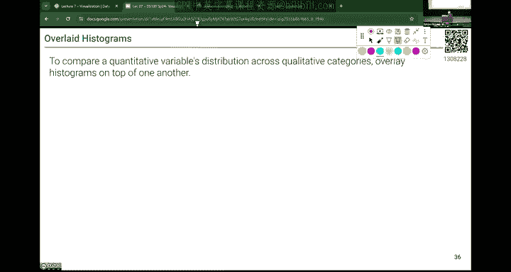
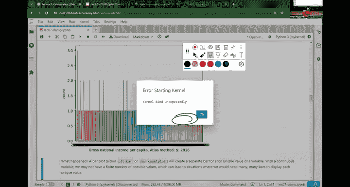
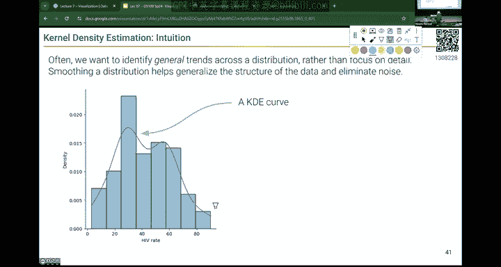

# 课程7：数据可视化基础 📊


在本节课中，我们将学习数据可视化的核心目标、不同类型的图表及其应用场景。我们将重点介绍如何使用Python库（如Matplotlib和Seaborn）来创建条形图、箱线图和直方图，并理解这些图表背后的数学概念。

---

## 概述

数据可视化是数据科学工作流中至关重要的一环。它主要有两个目标：一是在探索性数据分析阶段帮助我们自己理解数据；二是在分析完成后，向他人清晰地传达结果。本节课我们将学习如何根据变量的类型（定性或定量）选择合适的图表，并使用Python库来实现它们。

---

## 数据可视化的目标

上一节我们提到了数据可视化的两个主要阶段。本节中，我们来看看这两个阶段的具体目标。

数据可视化服务于数据科学生命周期的不同阶段：

1.  **探索性数据分析**：此阶段的目标是帮助分析者自身理解数据趋势、识别异常值并判断数据是否已准备好进入建模阶段。此时的图表应清晰且易于快速生成，以便在数据清洗和处理的迭代过程中反复使用。
2.  **结果传达**：在完成整个数据分析流程后，需要将结果呈现给未参与分析过程的利益相关者或公众。此时的图表必须非常清晰、标注完整、易于理解，并充分利用所有可用的视觉通道来传递信息。

---

## 变量类型与图表选择

选择正确的图表类型取决于我们想要可视化的变量类型。变量主要分为两类：**定性变量**和**定量变量**。

### 定性变量的可视化：条形图

对于定性变量（如类别、部门），**条形图**是最佳选择。条形图用不同高度的条形来表示每个类别的频率或比例。

以下是创建条形图的几种方法：

**使用Matplotlib：**
```python
import matplotlib.pyplot as plt
plt.bar(x=category_series.index, height=category_series.values)
plt.xlabel('Categories')
plt.ylabel('Frequency')
plt.title('Distribution of Categories')
plt.show()
```




**使用Seaborn：**
```python
import seaborn as sns
sns.countplot(data=df, x='category_column')
plt.xlabel('Categories')
plt.ylabel('Count')
plt.title('Distribution of Categories')
plt.show()
```

**使用Pandas原生绘图：**
```python
df['category_column'].value_counts().plot(kind='bar')
plt.xlabel('Categories')
plt.ylabel('Frequency')
plt.title('Distribution of Categories')
plt.show()
```

> **注意**：条形图也可用于**离散型定量变量**，前提是其唯一值的数量较少（例如，评分1-5分）。对于具有大量唯一值的连续型定量变量，使用条形图会导致图表难以阅读。

---

### 定量变量的可视化：箱线图与直方图

对于定量变量，我们使用不同的图表来展示其分布和统计摘要。

#### 箱线图

箱线图基于**四分位数**来展示数据的分布。四分位数将排序后的数据分为四个等份。

*   **第一四分位数**：第25个百分位数，记作 **Q1**。
*   **第二四分位数**：中位数，第50个百分位数，记作 **Q2**。
*   **第三四分位数**：第75个百分位数，记作 **Q3**。
*   **四分位距**：**IQR = Q3 - Q1**，包含了中间50%的数据。

箱线图中的“箱体”展示了Q1、Q2（中位数）和Q3。上下延伸的“须”通常定义为：
*   上须：**Q3 + 1.5 * IQR**
*   下须：**Q1 - 1.5 * IQR**

落在须之外的数据点通常被视为**异常值**，并在图上以点标记。

**使用Seaborn创建箱线图：**
```python
sns.boxplot(data=df, y='numeric_column')
plt.ylabel('Value')
plt.title('Box Plot of Numeric Column')
plt.show()
```

#### 小提琴图

小提琴图是箱线图的一种增强形式，它不仅显示了四分位数，还通过宽度变化展示了数据的**概率密度分布**。较宽的部分表示数据点更集中，较窄的部分则表示数据点更稀疏。

#### 直方图

直方图通过将数据范围划分为连续的**区间**，并计算每个区间内数据点的数量（频率）来近似表示数据的分布。每个条形的**面积**（宽度 × 高度）代表该区间内数据点的比例，所有条形的总面积之和为1（或100%）。

**使用Matplotlib创建直方图：**
```python
plt.hist(df['numeric_column'], density=True)
plt.xlabel('Value')
plt.ylabel('Density')
plt.title('Histogram of Numeric Column')
plt.show()
```

**使用Seaborn创建直方图：**
```python
sns.histplot(data=df, x='numeric_column', stat='density')
plt.xlabel('Value')
plt.ylabel('Density')
plt.title('Histogram of Numeric Column')
plt.show()
```

#### 叠加直方图与分组箱线图

我们可以使用`hue`参数，根据另一个定性变量对数据进行分组，并绘制叠加的直方图或并排的箱线图，以便于比较。

**叠加直方图示例：**
```python
sns.histplot(data=df, x='numeric_column', hue='category_column', stat='density')
plt.xlabel('Value')
plt.ylabel('Density')
plt.title('Overlaid Histograms by Category')
plt.legend(title='Category')
plt.show()
```

**分组箱线图示例：**
```python
sns.boxplot(data=df, x='category_column', y='numeric_column')
plt.xlabel('Category')
plt.ylabel('Value')
plt.title('Box Plots by Category')
plt.show()
```

---

## 从直方图中获取信息





直方图能直观地揭示数据的几个关键特征：

*   **偏度**：如果数据有一个向右延伸的长尾，则分布是**右偏**的；如果长尾向左延伸，则是**左偏**的；如果大致对称，则是**对称分布**。
*   **众数**：分布中出现频率最高的值。只有一个峰的分布是**单峰**分布，有两个峰的分布是**双峰**分布，有多个峰的则是**多峰**分布。

> **重要提示**：直方图的外观（如偏度和众数的判断）很大程度上依赖于所选择的**区间数量**。区间太少会丢失细节，区间太多则会产生噪音。在下一讲中，我们将介绍**核密度估计**方法，它能提供更平滑、更稳定的分布估计。

---

## 总结

本节课我们一起学习了数据可视化的基础。我们明确了可视化的两个核心目标：探索数据与传达结果。我们根据变量类型（定性或定量）学习了如何选择合适的图表：定性变量常用条形图，定量变量则使用箱线图、小提琴图和直方图。我们还深入了解了这些图表背后的数学概念，如四分位数、概率密度，并掌握了使用Matplotlib和Seaborn库创建这些图表的基本方法。



在下一讲中，我们将深入探讨可视化设计的理论，包括如何有效使用颜色、形状等视觉通道，以及如何进行数据变换以使信息呈现得更清晰。