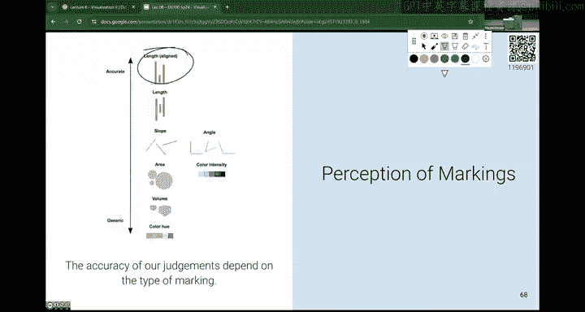
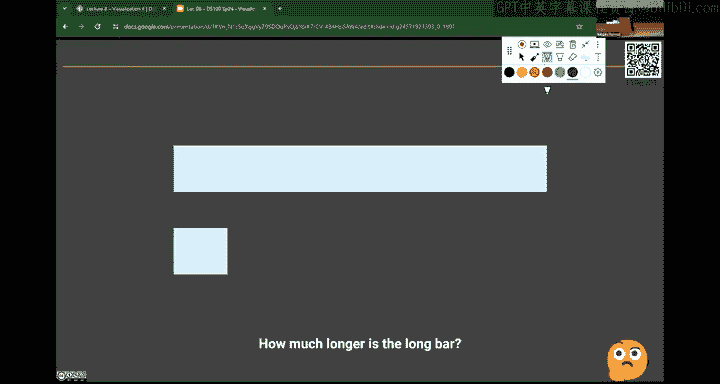
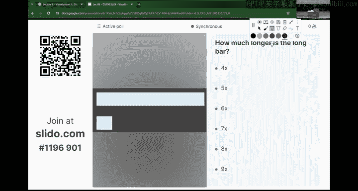
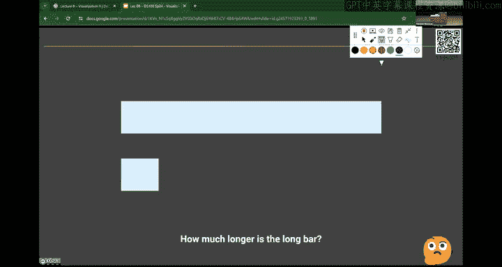
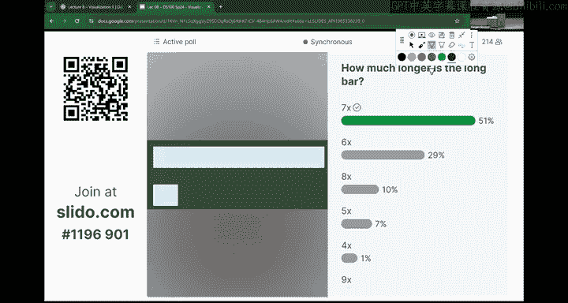
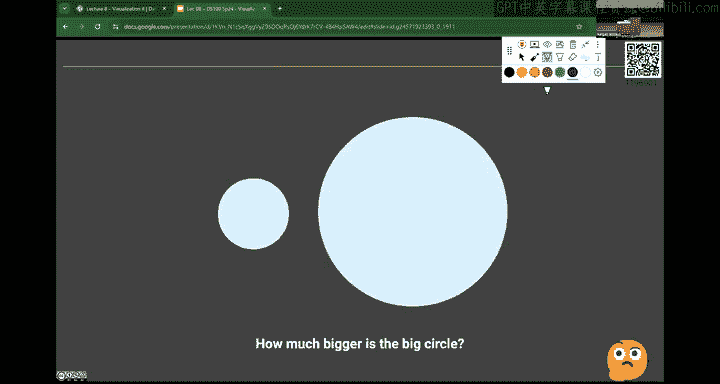
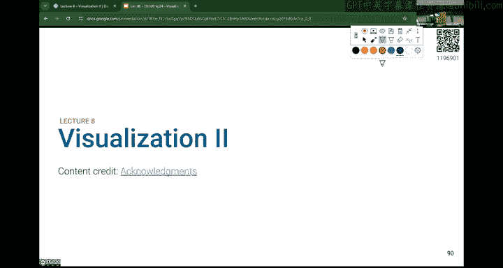

# UCB《数据100数据科学原理与技术｜Data 100 Principles and Techniques of Data Science 24SP》中英 - P8：-08-Data 100 Spring 2024 Lecture 8.zh_en - GPT中英字幕课程资源 - BV1Bc2dYCEbc

Alright。Good morning everyone。 Welcome to our lecture 8。

 So officially we're close to being done with one third of the quarter。 sorry。

 one third of the course。 So this is our second visualization lecture。

 We are going to start where we left off last time。 So remember we were talking about plotting oops。

😊，What happened here。OhThis whole thing was blank the whole time。 Okay。

 go ahead and get lockedgged in。 And you know the deal。

 And there's also all of these QR codes in each one of those slides。 So scan it。Get ready to go。

All right wonderful so visualization too we're going to talk about plotting distributions a little bit more we're going to talk about how we can plot the relationship between multiple different variables we're going to take a look at how we can make sure that we do transformation in a way that the plot that we're creating is going to be informative for the modeling piece that we're going to do after visualization remember the whole point of doing visualization is that it's also part of our exploratory data analysis so we need to make sure that we're comfortable with the scale that our data is in so that we can move forward with say the first thing that we'll do next week is going to be not next week like two lectures or true lectures from now is going to be linear regression so we will investigate whether we are ready and our data is in its scale that we can do visualization that we can do linear regression or not and then at the end of today's lecture there is kind of。

😊，Information generally on visualization theory so we're going to quickly go over some concepts that you have to remember about information channel and how to utilize information channel more effectively so this is where we are you're familiar with this plot second visualization lecture you know where visualization is going to come become handy it's in the ED piece and there is also the second purpose is for reporting as well so let's dive into kernel density estimation the topic that I started talking about the motivation behind it in the previous lecture but now we're going to talk about what it is exactly so remember when I was talking about histograms I was creating these histograms and I was telling you that okay there is a way that we can kind of define some concept of mode in our histogram and then you saw that depending on the number of bins that we have the mode。

😊，That we would observe in the histogram is going to change and then we said that we're going to use some smoothing function using a probability distribution kind of concept that removes all of those details but generally captures the trend in the data so what we're going to do today is we're going to think about a technique and we'll learn a technique that will do that for us and what is that technique think about having a histogram and you're basically throwing like his string on top and this string is going to take the format or the shape of this entire histogram but without depending on a lot of those details that you see in all of those bars that we have in the histogram。

😊，How do we do this we are going to use a probabilistic kind of approach in this case we're saying that in order for me to figure out at what at any given point。

 what is the probability for me to be able to have a given data point at that specific value we can define it using a probability function as opposed to just directly counting the exact number of values that we have in our data and then normalizing the height of these bars so that the area of all of those bars together do add up to be equal to 100% or be equal to1 what I'm going to do is I'm going to say that I'm going to basically design a probabilitybabilistic approach so that once I'm looking at every given data point and I look at the projection of that data point for example to my kernelal density estimate curve I will be able to just roughly tell you what is the probability that I have a data point at that specific point as opposed to。

😊，Directly looking at what is the proportion in our data set？

So how do we do this exactly we will use a three step approach and this three step approach basically assumes that the way that we're going to define this probability distribution function is that we will assume that for every given data point there is a probability assigned for me to be able to sample that data point again and we're going to define this randomness by a concept that's called kernel so think about me having one of the data points in my data。

 say that for example that data point is HIV rate at the value of at the value being equal to 20 and what it'll do is I'll say that what is the probability of me coming back the next time and sampling one more time from my entire data or from a distribution and be able to extract this same exact data point right so what I would say is that it is more likely for me to be able to capture this same data point you will see that there is a。

😊，Probability here at the center of this curve and for those who've taken probability distribution or statistics courses you know that this is a Gaussing curve or bill curve or a normal distribution that you've seen before with the center or with the mean being at that exact data point that I have and as I move away from that center the probability is going to drop what that means is that if I want to come back and sample a data point with high probability i'll get the same data point with the smaller probability I'll get a slightly higher value or a slightly lower value and as I move away from that center the probability is going to drop substantially that's why it's kind of modeled with this Gaussian curve that we have here。

😊，So this whole idea is kernelnal but this is only for one data point right how can I design a probability distribution function for my entire data because remember the goal was to go back and be able to just have a probability distribution function for the entire data set so that we have a summary of everything that's happening in the histogram generally so what I can do is technically again a three step process the first thing is that I'm going to assume that there is some randomness assigned to each given data point and I'm going to capture that randomness with this kernel that you see right here there are different properties for this kernel for example this kernel can be wide or can be very narrow depending on the bandwidth or a standard deviation that we're defining for this Gaussian the default value that is being used in seaborne is equal to one so technically a standard deviation is going to be set to be equal to one。

Like if you want to have a flat curve or a wider curve you can have a standard deviation or that parameter to be a larger value or can be a smaller value and you have a very sharp peak in that case I'm technically saying that I'm going to more constraint my model or my data set to give me exactly the same data point and I'm going to just have a very sharp peak there and if you give me a data point that's a little bit different then I'm going to give you a very low probability of you being able to sample that data point that you might observe next so what I'll do is I'll put this kernel on top of every given data point because all of the data points we're going to assume that there is some randomness assigned to all of them and I'm going to show you how we do that with a tree is that process the first step is again putting a kernel on top of every given data point so I'm going to show you an example with only five data points for。

licity for now we're not going to look at the entire data set and I'm going to say that okay for these five data points。

 I'm going to visualize them using something that's called rock plot。

 rock plot is going to give you just some indicators at that exact kind of location So for example here I'm saying that okay I have a bunch of different points go ahead and put rock indicators or those indicators with the height of01 at every given location that we have here。

 So these are five data points that I have right that's a rock plot that's my data。

 What I'm going to do is I'm going to say that each one of them there is randomness associated to each one。

 So let me go ahead and put the kernel on top of each one of them。

 So this is the first step So thinking about this smoothing。

 this probability set that I'm not really saying that either this data set or nothing or this data point or nothing。

 but I'm going to say that there is a probabilities more likely that you're going to give me that data but it's also I'm going to be a little bit flexible and accept。

😊，Slightly a smaller value or a slightly higher value than the data points that we have in our data set。

 this is just kind of simplifying assumptions that we're making so that we can make a probability。

Distribution function。Okay， I kept saying that I want to have a probability distribution function right meaning that when I look at all of these probability functions that I put on all of my data points and I look at them in aggregates I sum up all of these curves together。

 I want the area under the curve to to be equal to one or the integration of this function to be equal to one。

 but right now what you know from each one of these kernels is that the area under the curve of individual one of them is equal to one so if I sum up all of these I'll get a value of five。

Right so I need to scale things down and the scaling technically means that the probability of me being concerned with every given data point is one fifth of the entire data set because I have five data points right So there's a probability that I'm concerned with this is specific data point。

 And if I and that's that probability is one fifth。

 but then looking at that what is the probability that I get exactly the same value or slightly higher value or like a lower value So that's why each one of those curves need to be a scaled by a factor of onefi so that we basically have a proportional kind of probability assigned to every given data point if I had n different data points。

 the scaling factor should have been one over n right and then therefore I have I have a bunch of different small curves with the area under them being one over n so that later on I can sum them up together N。

curves with the area under the curve of one over and is going to give me the total area under the curve of one。

 which is what we're going to do in the thirdest step in the thirdest step we said that okay I modeled each one of those individual data points but let me go ahead and aggregate all of them so that I see how these data points that are clustered together or closer together are going to influence each other and then I have a higher probability for those range values and then I have lower probabilities for the ranges that are outside of the normal range that we have in our data set and that's how we will get a kernel density estimate。

 this is a density function， the area under the curve is equal to one。

 and then technically each data point that you have then technically can project it to this curve and then be able to find out what is the probability that you will be able to sample that data point right it's not really strict to the exact values that you have in the data。

😊，So going from the data that we have and then putting the kernelnal density estimate on top of the histogram that's the plot that we'll get on the right hand side one thing that you you might want to notice is there is like bumps at the points that we have those two bars right and the higher bar has a higher kind of peak right there so this is kind of an indication that we are doing some kind of smoothing here the other thing that you might want to notice is that the range of this function extends below the smallest value and above the highest value and this is natural because the range of the or the domain of the Gaussian function that we were applying to each one of those data points is just all of the xvalue so that's why we have all of those kind of small probability value is also extending in this area and also in this area and this is the whole idea of kernelnal density estimation it's just a smoothing function that we're putting on top。

of our data and it's going to give us a probabilistic view of the distribution in our data。

 and then we can basically measure the general trend in the data without dealing with the outliers and noises that we might have in the data。

😊，So this is a very sophisticated kind of function putting together all of those three steps What did I do I basically what I did was I put a kernel on top of each one of my data points if you take a look at for example this function right here or this blue curve that I have this is a kernel right what is that kernel that kernel says that I have a bandwidth or an alpha parameter of1 meaning that the width of this kernel is going to have a standard deviation of one so I'm not going to have a white kernel or I'm not going to have a narrow kernel the standard deviation or the bandwidth is going to be equal to1 that's what you're seeing as this subscript1 being annotated on the Kk stands for the kernel that we're dealing with and then I'm saying that for every x value across the X axis。

😊，I'm going to basically define this Gaussian kernel centered at the value of two because that's where my data point was。

 In fact， if you take a look at where the center was it was， I think around 2。

1 but for simplicity I put it here as two and that's how each one of those kernels are defined that's what you're seeing in this equation right here it says that okay go ahead and put the kernel we're assuming in this case that the kernel is the Gaussian kernel it's parameterized by alpha and alpha is the decision that you're making ahead of time this is the bandwidth parameter and then I'm saying that this function has two。

😊，Has two kind of arguments， one of them is fixed because you're basically fixing the Gaussing kernel at each one of those Xi values and Xs are your data points exactly the data points that you have in your data set and then you're saying that for every given X value across the X axis I should be able to calculate the probability value or the probability that this kernel is giving me。

😊，What do I do next the next step is that I need to scale all of these kernels by a factor of one over n because I have n different data points。

 the probability of me being concerned with one of them is one over n and then I'll go ahead and sum up all of these values together so that together I'll have that nice final curve that is kind of an aggregation of everything that we talked about but notice that this function is a function that I say takes in a parameter or decides about this parameter that we call it as a hyperparameter we're going to talk about what hyperparameter means。

😊，In four weeks but just know that this is something that we're going to decide ahead of time in this example I said alpha is equal to one that's the width of the kernel and then I'm saying that for every given data point for all of the values across the X axis I know my X values I know my alpha everything is known so I'll just put this value into the equation and then I should be able to get a probability value and that's what a kernel density estimation function is about。

😊，Let's now talk a little bit more about this kernel a kernel is nothing but a probability density function what is a probability density function it just needs to have it just needs to be defined for all values of X and then for all values of x the output should be non- negativegative so the probability density function should be greater than or equal to greater than or equal to0 and that the area under the curve should be equal to1 or if you integrate the function it should integrate to1 that's what we have with Gaussian kernel this is the equation for Gaussian kernel for those who've not seen it in a probability or task force I don't want you to know the details just look at the equation and makes sense of why this shape is this bell curve shape it is centered at X because when X is equal to X that's the time that the numerator is equal to0 and we have the maximum probability。

😊，That's why it's centered at X， this kernel and then you're also seeing that the widths of the kernel is controlled by this alpha parameter in this equation and that's how you can make sense of why by increasing alpha the widths is going to increase and the probability is going to the rate of the decrease of the probability as you move away from the center is going to decrease if your curve is wider compared to when it's a little bit of a sharper curve and everything else you。

Kind of visually can make sense of and know what the kernel is and what how we're using kernels in kernel density estimation。

So you might be asking me that why did I keep talking about Gaussian kernel mostly because Seaborn implements only Gaussian kernel as the backbone of the kernel density estimate plot or KDE plot。

 it used to have other types of kernels that you could basically as long as you would satisfy those conditions for the kernel。

 you could use them but it's no longer the case， and mostly not mostly it's going to use Gaussian kernel in the back end。

I talked a little bit about the bandwidth or this alpha parameter I said that if alpha is small we're going to have a sp here kind of Gaussians and that's exactly what's happening here so think about this data set what you're seeing very kind of tiny here is rock plot so I have those rocks and indications for each one of the data points but then you can kind of see that where I have a high density of those kind of markers then I have also a very kind of tall bin for that histogram so if I were to go ahead and put a bunch of these spiky curvebs like really next to each other and I scale all of them and I sum up all of them it's going to look something like this and it's going to be various spiky because those data points are going to be a little bit kind of distant from each other as you move away from that center of the distribution so that's why you're going to see a lot of like。

😊，Independent spikes in kind of a less populated kind of range of range of x this is an example that alpha was set to 01 if alpha is equal to one you will see that all of those noises that unnecessarily that I added now they've。

They're gone and you can kind of make sense of why that kernel densityity estimate is kind of an estimation of what you also see in the histogram。

 but if you keep increasing the alpha value to alpha equal to 2 and alpha equal to 10。

 all of those small details are going to be washed out and you're just going to be able to get this sense of the general trend in the data。

So this very high alpha is also not super ideal because we're not going to be able to extract the details that are necessary for us to understand a little bit just more than where the pickup the data is right so that's why picking alpha is going to be a hyperparameter that's going to be a little bit tricky so you might want to try different alpha values and then figure out which one of them captures the general trend of the data a little bit better kind of think about the case that with histograms were also doing we were also changing the number of bins so that like we see at what point we have the general trend kind of figured out this is kind of also the same and if you think about it a little bit deeply you can make sense of why bin sizes can correspond to the different alpha values or these bandwidth values that we have。

So I promise to show you another type of kernel I said Gaussian kernel is what we're using。

 but we're not generally with the kernel density estimate we're not bound to always use。

Gussian kernel， anything that is a kernel and fits to the criteria of being a probability distribution or probably a density function we can use and one example is box car。

 which is nothing but like a plot that you would see is like a box and the alpha that you can decide and then the alpha is going to basically say that put the box around the X with with the width of alpha and then also the height is going to be one over alpha because the area under this entire box is going to be equal to one so here is going to be alpha and then also here the height is one over alpha and the area again is going to be equal to one obviously if I try this box car kernel on top of the same data set that we had I'll that weirdly looking kind of plot。

That you might think that this resembles the histogram that we had， it looks like it。

 but it's not exactly the same， but again， it might be a little bit similar in practice whenever use it。

 and we're just showing it to you that you know that the general idea is just to put this kernel on top of the data points。

 scale them， sum them up， then you have a probability distribution for the entire data set that you have。

Okay。So now think about this slight question for you。 Which one of these following。Plots。

 ABCD are a valid kernel density plot。There is a very good question for those who are familiar with signal processing。

 the idea of kernel is similar to convolution， but if the term convolution doesn't ring a ball。

 ignore it。Okay， let's see。But do we got A。Yeah you get the correct responses on the chart so AC and these should be the top ones all right right the issue with B is that if you take a look at the area under the curve the height is so high at 0。

7 that the area under the curve visually you can expect and see that that is greater than one for the rest of them we guarantee that we generated them in a way that they are kernel density estimates and you can visually kind of double check what's happening with the area and so on and so forth question。

So what's a valid density plug， what's a valid kernel。Then still plot。 That's a good question。

 I think it depends on。Also， your data。 so if you know the distribution of the data。

And like there is a density plot that doesn't have anything to do with that distribution then technically they are different。

 but I didn't show you the original data， so your guess is basically that which one of them is a density plot yes technically。

 that's correct。All right wonderful moving on some plotting functions revisited there is a nice this plot function in Cborn from the slide of questions last time we kind of gathered that most of you are interested more about Cborn so Cborn is is a kind of a nicer implementation of a Macpllib that actually sits on top of Macpllib and that's why they really work well together and it has also some functions that are wrappers of other functions within Cborn as well so for example here you're seeing that I'm using this plot this plot is a wrapper on top of a bunch of different plots hispl KdeE plot and ECDF plot that I'm going to tell you what that is but technically what I can use is instead of calling hispl separately or calling KdeE plot which you can guess that it's creating is going to create KDE plot for us I would just directly say that okay I want。

😊，To pass my data， I'm passing the attribute that I want to be plotted and then I'm saying that the kind of the plot that I want to get out of you because you are a rapper on top of a bunch of functions is to give me the hist plot so it will automatically go ahead and call the histogram or the hist plot of Cborn and then it will give me the result in the output which you're seeing that that's a histogram here I'm saying that the stat is equal to density because by default the stat is equal to count it's kind of a little bit counterintuitive but technically if you just want to look at the spread of the data it doesn't matter if you're looking at the counts or the density values but if you're really concerned with just knowing what's the probability density at each given data point then technically you want to get you want to say that the stat or the scale on the y axis be density。

So let's see what the K D E version does。 changing the kind to be K D。 I'll say。

 I'll see this nice K D E。 The default alpha value here is equal to one。

 You can There are examples in the demo code for today that you can change。

You can scale the alpha or you can change the alpha directly and then you'll be able to get different levels of details from the KdeE plot what is this ECDF plot so kind equal to ECDF ECDF is empirical cumulative distribution function starting from the smallest value up to the largest value you will basically have a cumulative probability function which basically tells you what's the probability or the ratio of the data points that are small or less than or equal to that given data points so if we are looking at the highest value right here the corresponding probability here is equal to one so that's a cumulative distribution function that we see in the plot not probably super necessary but for you to see that it's kind of a nice functionality to have and you can easily use this plot instead of individually calling those other plots。

So so far what weve talked about was just visualizing distribution of one variable。

 but if I have multiple different variables so in data aid you've seen that we show the relationship between two variables using a scatter plots right remember these plots here that in data aid that we're talking about or we're going to visualize everything and we're going to show you that correlation is not causation and compare correlation values and then see like whether that matches the intuition that we have with the visual that we see a scatter plot we are also going to use a similar kind of version of a scatter plots in data 100。

 especially the notation that we're using in mappllib and Cborn is that a mappllib we can say dot a scatter and remember the convention of map thoughtlib was to get a sequence of values so I'm getting a sequence of x values。

 a sequence of y values and then I'll just go ahead and show you a scatter。😊。

plot of X versus y so every marker is a pair of values that I'm visualizing with Cborn we are calling a scatter plot function and this function again the standard of seaborn getting the data getting x and Y column labels and then if you want to use color as the third channel you can do that we've seen this with hemisphere example in the previous lecture this is where you can also join an additional kind of h channel so that you can visualize a categorical value to with the two quantitative values that you're visualizing comparatively using the scatter plot so this is what's going to happen if I go ahead and visualize two quantitative values here and then I'm saying that use the hue to visualize the continent which is the qualitative or categorical variable in this case so you see that different continents are going to be。

Visualize with different colors。So this is kind of a nice visualization， again。

 showing the relationship between two variables， highlighting also a third variable so the three things are being visualized here。

😊，One issue that we might have with the scatter plots and mostly with the scatter plots is overpling Overpling is this example so you see that I have a bunch of these data points really kind of plum together in one area and it's really hard for me to figure out even if I was doing the color coding for different continent is to figure out oh how many countries from each continent do I have because they're just going to be plotted on top of each other so making a distinction between them is generally not easy so we have to get creative in terms of avoiding overpling in a scatter plots the simplest way that we can do is by adding a noise and using something that's called jittering so what you're seeing in this case is that I'm creating two noise objects so one for all of the x values and one for all of the y values and they have different ranges because my x and y range is different so here。

😊，Rs between0 and 100 and then x has a range of between negative 15 to like 10 so that's why the range of the noise is different。

 but the bottom line is that at the time that I want to plot and I'm calling this the scatter plot I'll say that I'm passing you the X and then I'm adding the noise directly to X and then I'm passing you Y and then I'm directly adding all of those noise values that are corresponding that correspond to each one of those y values that I have and then I'll be able to visualize them so things are going to randomly spread a little bit it's not going to be super accurate but at least visually you will see what's happening in your data and points are not going to be really on top of each other。

But there are also other ways that we can visualize relationships or visualize relationship between two variables so that we can get a higher level information and kind of also at the same time avoid the overpuding issue that we have。

😊，Starting from two three lectures from now we're going to talk about linear models。

 what we can do with Seaborn is I can say that I want a linear model on top of the scatter plot that you're showing me for visualizing the relationship between two variables so I'm going to give you my data frame I'm going to give you X and y and then give me all this scatter points give me the linear regression line and also give me the confidence interval we're going to play with this LM plot a little bit later。

 but you will see visually by this linear regression line but you're like a there is a linear relationship or not or what's those confidence intervals and how you can interpret it and then go back in the EA cycle and then fix the relationship between these two variables so that you can do what what you want to do with a linear regression model。

You can also call joint plot these are too many plots that I'm covering but I promise you in the midterm and final exam we're going to give you a reference sheet that has all of these functions and description of all of them so as long as if you see joint plot you know that it's going to plot something jointly related between two variables you should be good and also this syntax of cborn versus Mattpllet but what does it do it gets again the same thing data frame x and y and then what it does is that it's going to give you this histogram also nice and the x and y axis which is going to show you the distribution across x and the distribution across Y。

😊，Why is it significant in this case because for example。

 if I look at the distribution of y and I see this high bar I know that majority of the y distribution should be in that specific range corresponding to that bar right so then I'll basically know that okay there is a lot of overping that's happening here kind of visualizing or like kind of making sense of comparatively what's happening in that region versus the rest of the region right so this is one way that you can in your mind see or identify overping and also compare the distributions obviously that you can get。

😊，So one thing that I also want to make note of is remember in the KDE plot I had those markers in the rock plot and I was putting kernels on top of each one of them。

 what if I do the same thing in two dimensional space for every dot I'll put a kernel。

 a 2D kernel on top and then I'll scale everything。

 I'll sum up everything so I have a 2D distribution。

 probability distribution over the entire data set。😊。

I can do that and I can visualize it in different ways One way is to just say that okay I'm going to go ahead and say that I want to get a hex plot so this is a joint kind of plotting but at the center I don't want to have those scatter points instead I just want to summarize how many of how many or what's the ratio of the data points that I have in each one of those hexagons that you see at the center so the darker areas correspond to more concentration。

 the lighter areas correspond to less number of samples in those cases so this is again a nice way of summarizing all of the overpling that was happening in the plot or I can go crazy and say that okay give me that 2D Kde plot that you were promising me right but is this 2D Kde plot this basically says that it's going to be this 2D probability density probability distribution function which technically。

I going to be darker in the in the areas that I have more points and then lighter color in the areas that I have less number of points and you see that it has color fill because I said that fill is equal to true otherwise it would just give you those。

Here's that you can basically make sense of those like edge colors and then see what's happening and how the trend is changing in terms of the probability of different regions changing as x and Y changes。

ok。Really powerful stuff this is the end of all of these kind of coding things that I wanted to show you we're going to talk about more fun stuff but before I move on the second part I also want to put it out there that there is a third library that we didn't cover which is called plotly it's python based using also JavaScriptscript which makes it really easy for you to in or use use it for kind of web applications you probably have seen me using different plots that I would be able to hover over something and show you what values in that location we will periodically use plotly in lecture also in the labs and in assignments because sometimes it's easier for you to be able to in with the plot be able to rotate the plot and see something in 3D when we move to 3D space and such so but it's not going to be super complicated you just read the function you'll know what it does because now you know。

😊，What categories of plotting generally we're using？Okay， moving on。

Remember we were talking about overping and the fact that overpling is going to make visualization complicated and we're not going to be able to understand what's happening in the underlying trend of the data one way of avoiding overping is by transformation and again we use it because a lot of time it's easier for us when the data is in a proper format without any overping that we can look at the trend。

 explain it for ourselves or be able to show the trends to some human observer that was not part of our ED and then they will be able to just understand the pattern right away so those patterns really have to be。

Clear in our plot and then there should not be any kind of overpting happening so this is a very bad example so you see that I'm plotting two different things here so I'm plotting gross national income per capita and then I'm showing adult literacy rate and you're seeing that there are two general issues with this data set first of all。

 the data is really smushed together and I'm not going to be able to for example identify what's happening here and there is no clear relationship between the x and y that I can directly explain there' is no linear relationship and then there should be a higher order relationship between x and Y but it's really hard to debug or understand what that is exactly so for these purposes we might want to make sure that we transform our data to a format that's easily that can be easily understood which is what we refer to as linearization so。

Linear relationships are the easiest kind of relationships that we can understand so what we will do is we will go through a process of transformation that linearizes our data so if I have for example G andI versus adult literacy rate I will walk you through a transformation phase and i'll show you why I do the transformations the way that I do so that I am showing you now here log of GNI versus adult literacy rate to the power of four and now looking at these transform the scales you can see a clear linear relationship between that again why is linear relationship interesting because it's really。

Easy to understand and explain now I can explain that if you increase x by this amount。

 y is expected to be increased by this other amount and also the fact that the first modeling algorithm that we're going to take a look next week is going to be linear regression so we'll see why that's going to be very helpful。

So let's see how we can do it， how can I linearize this as specific data and what do I mean by linearizing what are the issues that I have to resolve so that I have a linear relationship between whatever axes that I have on axis's values I have on x and whatever values that I'll have on y。

This is the first issue The issue is that I have some outlier values or these large values on the x axis right Why is that the case。

 why is that an issue if I want to have a linear relationship between X and Y if I wanted to go ahead and for example。

 find this line that generally captures the trend for the rest of the data it's not capturing so well。

 but like comparatively then it's not going to have a good performance for those outlier values or those large values So what I need to do is I need to make sure that most of the values on the x axis are within the same scale so I don't have super large values or super small values and bringing everything to a similar kind of distance distance to each other。

The second issue we have is with all of these data points that are kind of clbed together in the left side。

 top left side of the plot and the issue is that I have a lot of large y values together that I can make a distinction between them right so as x changes you're seeing that all of these y values are still top here so I don't know what's the significance of changing x in terms of how it would reflect in the change of the value of y。

So what we're going to do is we're going to take a look at these two pieces and then we'll see how we can address each one of them individually so let's address this issue first。

 so I said that I want to do a transformation obviously I only need to do a transformation under X axis that I want to proportionly bring all of the values comparatively close to each other。

What kind of transformation do you think I can use？Yes。Sorry， I have a hard time hearing you at the。

So the transformation that we need to do is under x values that's right。

 and we need to use the transformation function that technically is going to change large values more than changing a smaller values so we're going to use a transformation so let me show you here that is going to for example。

 looking at this large distance。A transformation that shrinks this distance to some smaller value。

 but at the same time when I'm looking at the distance between for example， two values right here。

 I want these values to shrink or these distances to shrink but I want them to be shrinking proportionally less so everything is going to basically going to reduce in value but proportionally I want to shrink large values more which what we know from math is that log transformation is going to do that for us I'll take a log of these values log of these large values is going to significantly reduce those values and log of these small values is not going to change those values that much that's why the scale is going to be a little bit closer to each other。

Right so that fixes that issue I have kind of a semi kind of uniform distribution of the data points across the x axis so I can directly say that okay there is this line or this linear relationship that I can define between x and y but is' still the issue of having these set of large values up here it still exists where a lot of these values as I'm changing x there is nothing happening with y but I need to be able to make a distinction between those y values a little bit better so I need to push them a little bit up so。

😊，This is kind of where we're going to look at the transformation of the y axis and also making sure that now we can push all of those high values of y a little bit further。

 and then we're also pushing a small values of y a little bit。

 but is still be able to make a uniform kind of distribution across the y axis。

So the transformation that we can use here is going to be the power transformation。

 so I would say that okay， if I calculate y to the power of4 or whatever value that we're plotting on the y to the power of4。

 then technically all of those y values that were cl together now their differences is going to be more clear and they're going to be spread it out a little bit more still I'm going to increase the small values of x as well。

 but then again it's going to create a very uniform distribution across the entire y axis so that's why you're seeing now this difference of this plot compared to what you saw here that you're seeing that all of those values up there now they're more spreaded out。

Okay， why was it helpful because now that I did the log transformation of x and power transformation of y。

 now my x dimension is technically log of x， my y dimension is y to the power of four from data8。

 you know that I can fit a linear regression now that it is linearized。

 the whole purpose of transformation was linearization， so I'm linearizing。

 now I can come up with a slope and inter step and then define this linear relationship。😊。

One thing that I might not be happy is like explaining things in terms of why to the power of four might be difficult so I can go ahead and do a reverse transformation and write this equation in terms of just why so I would say that y is equal to whatever it was before to the power of one over four and then I'll be able to now visualize the exact trend of the data now I can explain what's happening。

 otherwise it would have been very hard for me to look at that distribution and then say that okay I'm expecting that the model is going to be this complex model to the power of one over four it would have been impossible that's one of the reasons that we do visual that we do transformations and also we use visualization at the same time to just visually take a look at the data and then see how it's to spread it and then make sense of what kind of transformation we need to do。

Okay， how do we tell what kind of transformation we should do because it sounded like a magic that I was taking log or I was doing power transformation we can use something that's called twoki muscle or bulge diagram which all it is is that it tells you that if your data bulges one way you can use the transformations on the axis in data specific in data specific area and then be able to transform your data in a way that it linearizes itself you're going to get this also in your reference sheet for the midterm。

 but you should be able to utilize it and use it in practice in problems and also in your homeworks and lab so let's take a look at what happened but the example that I had remember that this was my data right if I'm generally looking at the trend of my data this is how my data was。

Was kind of shaped and it is kind of similar to this upper left area of this Tuki mu or bulge diagram and you can see on the transformations it's suggesting me that I can do Y transformation or I can do x transformation you can do only one or you can choose to do both but if you choose to do a transformation on the y axis only one type of transformation you'll apply to that so for example here it's telling me that okay you can transform your y axis by taking it to the power of two or three and it gives you a sense that it should be a power transformation to correct what you want so you can do power transformation which is exactly what we did so you can take one step do power transformation visualize your data see if your data is linearized or not if it was linear linearized good you don't need to do x transformation if it wasn't what was the issue with your。

X in in this is specific criteria， I can kind of see that with log transformation or a square root of x。

 then I could have corrected the issue with the x axis because of the shape of the data right all of those transformations are because of the shape of the data and if you take a look at all those transformations on how the data might have been bulged to different directions。

 you'll make sense of why they're there。😊，So that's why we use like。

 We use also power transformations。 but notice that。If I'm doing x transformation。

 I'll do one x transformation， if I do y transformation， I'll do only one y transformation。

 you don't need to have multiple y transformations right there is one shot transformation that we do and that in a lot of cases one of X and y should be enough in that is specific case that we saw the data was so messy that I had to do two transformations but most of the cases one should be enough。

Allright。Co， how are we doing on a slideo。嗯。😊，Sure yeah good wonderful so a lot of complex stuff we covered now we have half an hour of like informational session kind of thinking about as you're thinking about creating a visualization what goes into deciding what channels we want to use and how can we create a visualization in a way that uses all the informative channels of human perception more effectively so let's take a look we generally say that again all of these visualizations are for human either part of your ED or part of the reporting that you're doing here I basically plotted the age distribution as well as the amount of far that each individual each individual paid for Titanic right so just looking at this visualization this doesn't seem to be a very bad visualization because what I can gather from。

😊，This is that there are some people around40s who were willing to pay these high fares and there are some people on the older range of the age that were kind of the number of those individuals were smaller and they paid a little bit less than faire for Titanic right this is just a summary of the data I should be happy with it and I can move on but how did we decide to make this kind of a scatter plot or should this distribute this relationship between x and y using a scatter plot and why we do that in the first place if I wanted to see for example the maximum age or the maximum fare I could just go and get some summary statistic from the data and just be done with it this is a very nice example that you can see that there are 13 different data sets they're all visualized here all of them have the same x mean y mean a standard division across x a standard division across Y and the correlation between x and y。

But they are different data sets so that's why summary statistics are generally not enough and that's why as part of our process。

 we always want to visualize our result and visualize our EDA as well。😊。

But let's now talk about how these visualizations are being created so let's say that I had the data set of all of these individuals were who bought a ticket for Titanic and I have the age distribution of all of them there are some null values which is fine。

 but if I want to get a sense of what's happening generally in my data what's happening generally in the distribution it's really hard to just look at all of those age values and makes sense of what's happening right but instead if I use something as simple as this rock plot right here which shows me which it has one indicator per each one of those individuals and then it placed at the right place so for example there are all of these individuals that are around like 37 to 40 years old and there are multiple indicators and where there is like a thicker kind of line that means that there are more than one individual and there are some areas right here that there was no for example sample。

😊，So this immediately is going to be a better visualization for us as opposed to scrolling over the entire data set。

We could have gone and used two dimensions because this is only utilizing one dimension。

 only utilizes the y dimension I could have utilized two dimensions x and y and I could say that okay I'll put age on the x axis right here and I'm going to give you more a better summary as opposed to you visualizing visually figuring out the distribution of the lines I'm going to tell you that distribution or I'm going to tell you density or the count and then you'll be able to see what is the majority of the age ranges for those individuals and very details and so on and so forth right so this is why visualization is important and utilizingizing as much channel as possible in the in the plot is going to be very useful when you're summarizing your studies。

So how did we create the rock plots we had the data set for each one of those data points。

 we put a marker right the marker was those lines and then the second step is to do encoding so I would take each one of those markers and I would put it in the right place encoding was that okay if this marker is associated with the H 40 let me put it at this exact position that is associated with the H 40 and that's how one rock plot came along I could go and change the marker to like a circle and notice here that the difference here compared to the previous case is that in the previous case each one of those markers was kind of a one dimensionmenal marker like it was only marking one position right and because the plot was one dimensional it made sense but if I go ahead and say that okay I'll change the marker to circle and circle can represent twodial information。

it takes the space on the X axis and also it takes the space on the y axis and I do the same encoding that I did before I'm going to get this plot。

 which is not going to be as informative because I can't look at those densities that those line markers was giving that we're giving me but then a better place that I could utilize these circles would be in a case that I'm visualizing it 2D information this is how you're deciding between a scatter plot and you're deciding between the rock plot I have one thing to show I can just show it with one dimensional indicators using a rock plot I have two things to show that's why everything that we have at the scatter plots are shown by by kind of a twodisal markers that we have so here we're visualizing agent fair。

😊，We have those markers and the encoding instead of only one dimensional encoding here is going to be encoding4 h and4 fair and then we're going to put that dot somewhere on the plot right so think about this entire process that we have markers and then we have different channels that we're putting those markers in those channels in an appropriate way。

So this is a question for you， so going beyond two dimensions。

 we saw one dimension we saw two dimension， but going beyond two dimension， looking at this plot。

 how many channels of information do you think is being used here？And this is a slide up。

For those who missed the first one。So the question is looking at this plot。

How many channels are being utilized because we might want to think about how many channels generally exist and what are the best ways that we can utilize all of these channels。

 that's why we're looking at this。So let's take a look there are four channels here and your majority response is correct and all of those four is that we have encoding on the X axis。

 we have encoding on the y axis we have encoding of color and we have encoding of area right the area of all of these circles does encode something that means that for example it's calculating the number of samples that will fall within that category so that's why the area of the ball or the circle is going to be larger in those cases so we' are utilizing four channels but we're going to take a look at how many channels exist and how can we utilize different channels on the plot more effectively and what are examples of not careful kind of usage of all of those channels in different plots that we see。

😊，So the plot that you see here is an example that the length channel is not used。

Effectively this is a plot that basically looks at the car nationality and then also different cars and you're seeing that the issue here is that it creates these bar plots and the notion of bar plot is that the length should encode some information and here if you're ordering for example different countries in different order right and you're ordering them and the lengths of these bars is going to be taller or smaller then technically that you're encoding some kind of bias or unnecessary bias in the model so that's an issue with this example that the length channel is used for this kind of visualization but lengths is not an appropriate measure or channel to be used in this specific case。

So now let's take a look at how we can make sure that the axes that we have X and y are going to be properly used this is an example from 2015 from Planned Parenthood hearing that the issue was that Plan Parhood was accused of selling aborted fetal tissue and the issue was that they were showing two different phenomenon on the plot and they were arguing that the number of cancerous screenings dropped from around 2 to 900000 900。

000 from  2006 to 2013 and they were saying that the number of abortion cases it started from 289。

000 cases to 327，000 cases and the way that you were seeing the issue is being raised here or the way that this plot。

is not an honest or ethical plot is that they're putting those two lines on different axes。

 so what youre seeing is that although this value right here is very smaller than this value right here and in the other case。

 the 2 million was higher than the 289，000 number of cases。

 they use different scale in the beginning and also in the end so that those values are now changing and visually you would think that oh now the number of abortion cases is more than the cancerous screening which is kind of a misinformation using the plot。

😊，A better way to plot this was to just directly put all of those values on the same ax so for example here there is all of these service counts that are on the same ax not having a different a for this line or a different scale for this other line but putting all of them in the same axises so you can see that okay yes the number of abortion cases increased the number of cancer screening has declined but still there is far more cancer screening cases compared to abortion cases if you want to show that there was an increase versus there was a decrease for cancer screening cases you can also do this comparative study or comparative kind of plot and show that so one of them had a decline below zero and one of them had an increase。

😊，So that's about the scale One other thing to note is that if you're plotting something and you're focusing on one small region of the plot。

 you don't need to plot your entire data and you don't need to visualize the entire data so this is a plot from the number of COVID cases in New Zealand I think this is before Omicron wave and the issue is that the argument that they were trying to kind of show was how many cases they had at the peak of the original kind of wave but with this exact kind of plot that you're plotting everything on the X axis it's really hard to see that peak or like how many days you were on that peak so in the other case we would say that don't visualize everything visualize only the part that you're interested in so this is also something else that you can have in mind when you're using visualization as part of your EDA as well。

This is a plot from White House about COVID cases you see that theyre showing okay there is a trend from in in around December and what happened during the Christmas days and the issue with this plot is that it's not using the entire axises on on the y axis so always you can set the limit of your x axis and the y axis and then you can say that okay I want the limit of the x axis to be from this value to this value which is what we did in this case and you can also say that I want to have the y limit of my y axis to be。

 for example， in the range that captures most of the distribution in our data so that you can visually see the differences a little bit better okay so this is something that to have in mind in terms of scaling x and y using the same scale and also what to use for the limits of the x and Y axis that you have。

One more consideration is the color channel remember that in the plot that I showed you there were four information channels there was x and y there was color and there was area。

 so now let's see how we can encode the color in our visualization。

So this is a visualization that if you don't have any colorblindness condition。

 you would be able to read the letters or the number 74 in the center of this circle。

 but if I simulate this for you and then show you that okay if you have a certain kinds of colorblinness you won't be able to tell the differences so these are accessibility issues that you need to always have in mind and there are different coloring schemes that uses appropriate kind of coloring schemes so that we don't have these issues for people who have red green colorblinness and such。

So I'm going to go back and show you what they are on the left you see the Jebl Je color map Je color map has a lot of issues that we're going to talk about and one of the main issues that it has is with the redgr color blindness issue that you won't be able to tell the differences that much but it also has other issues that we'll take a look on the right you're seeing veritus which is kind of another enhanced version of jet color map which was created by Berkeley and we're going to talk about what the differences are and why veritus is a better color a better color map and actually Matloodlib now uses verus color map as opposed to Je which was historically being used in matlab and also matlolib。

😊，So let's take a look at the differences so if you take a look at this plot specifically here。

 so you see that different color maps are being used。

 the top row uses jet color map and the second row uses for example。

 the grayscale color map and you can see that for example here there is a nice transition between like the black color to the white color and also there is a nice transition here but if you color exactly the same pixel of values using the jet color map what you're going to see is this kind of a tiered color way that you would visually think that there are tiers or the actual distinction between those values。

 but there are actually no distinction between them it's an actually a various smooth transition from one value to one value to next generally。

😊，The other issues is that it washes out some of the details so for example here you would see that all of these light area vertical bars that we see in the graph we don't see them here with the jet color map so all of those details are washed out there is also an issue that if comparing for example this medical X-ray image that if a physician just looks at the grayscale medical image they would be able to see the differences and then there are also light areas that they should pay attention to and they'll pay attention to those areas obviously but what's happening with this jet color map is that it highlights regions that are not necessarily should be highlighted so for example here you would see that there is like literally is popping out to you as a red region that if you see if you show this to a physician they would basically quickly take a look at that area which is not an area that should be。

😊，That should be important and still here it's also colored as white。

 but they can also at the same time figure that for example。

 this area might be more important so it's not going to highlight it as like something so I catch it as red that digit color map is doing in this case。

Why jet color map is so bad and why word this is good it has to do with the concept of lightness I'm not going to go into the details of what lightness means。

 but technically what lightness means is that it says that the color map should be perceptually uniform meaning that if the lightness changes for a specific delta for example。

 say from this value to this value and I change for example the lightness in this range for the exact same delta so think about these two as similar delta values you're seeing for example here that the lightness starts from this point and then it goes all the way to this point so there is a huge kind of value change between these two but if I go ahead and map for example these two points you see that the differences is almost flat so there is no difference between them so this is why we say that jet color map is not perceptual。

Uiform color map as opposed to with the ver this color map you're seeing that obviously it's a straight line。

 so it should be perceptualally uniform every delta that you see the delta and the lightness is going to be exactly the same。

😊，So this is one issue why is it important， why is this non uniformformity is important it's because at the points that we have these crossings those are the points that is going to create those tiers and immediately jump to the next tier and changes the colors unnecessarily so that's part of the reason thats that's happening。

But generally thinking about the color， we have to utilize color in an effective way。

 remember when we were creating different plots were saying that we decide about the plots depending on the type of the variable that we have we use color also intentionally we would say that if we have a qualitative variable and we have categories to show let's go ahead and use qualitative color scheme so that for example here when I'm showing Viica and I'm showing Senosa I'm using different color entirely one blue and one red。

 but if I'm going to show intensities or a quantitative values I'm going to visualize it with a color scheme that can visualize magnitudes so you see that the magnitude of blue is going to change from the outer part to the inner part showing that the magnitude increases at the center。

😊，And actually there are two types of ways that we can visualize magnitudes。

 we can use sequential magnitudes that basically if you take a look at this sequence。

 it basically starts from a light color like white color and then it goes all the way to the most intense value in that color palette。

 or you can use diverging a scheme， meaning that if I want to make sure that I emphasize both ends of the extreme equally and I want to emphasize。

 for example， the small values equal to the high values in example， of for example。

 vaccination rates， high vaccination rate versus low vaccination rate。

 I will use diverging color map， I'll use high intensity of blue for one and high intensity of red for for。

For。The case that there is not enough vaccination and then I'll use basically light color such as white in the middle so that I should that the vaccination is kind of in the middle in in terms of the intensity it's not so extreme on any of both ends so think about sequential color map and also think about divergent color map when you're trying to kind of distinguish the differences as well。

These are the color maps on mat pluglib which basically has all of these things that we already talked about if you have a qualitative variable that you want to show you want to use qualitative color maps so you can take a look at all of those color maps most of them dont should not have an issue but color blindness if you use them and you should be able to distinguish between different categories easily even if you have color blindness these are perceptly uniform sequential color maps and you see veruses right here so it's sequentially it goes from green to yellow and then you'll see kind of perceptually uniform color maps which we discuss what that is you can also see divergin color maps right here so if you want to visualize or color quantities but you want to emphasize differences you would be able to also use these color schemes obviously and then just。

😊，Normal sequential color map is here so just know that there is a palette available to you on map vlib and you can choose between different color color maps and then be able to select the colors that you want to use in your visualizations。

😊，So the next thing that I want to talk about is markings because some form of marking is easier for human to understand as opposed to others why did I bring the example of length at first is because length is the easiest for human to visually understand and compare then we go a little bit more complex we would talk about slope we would talk about angles and then that's the second layer and then we go a little bit deeper。

 talk about areas talk about volume so things are going to get more complex as you go than down this list and then the most complex is going to be color use for human to visually understand the differences。

😊。

So let's practically take a look at what if lengths is actually in fact easier than the area to understand。

 so let's do practice and figure out how much longer is the long bar in this example。

I'll let you measure it for 30 second and then I'll move on to the slideo。

Okay， what do you say four times larger？5ve。Stix。Let's see。It's seven times larger。

 but majority of you were correct six or seven that's a reasonable number Now let's do practice with area how much bigger is the big circle compared to a small circle。

This is going to get challenging。Meajosure it for another 15 seconds。You have to do this。

 put it in different regions。

All right， let's see。Oh， was there no response， Oh sorry。I reveal the response。

 but now you know it's seven times larger， but it was supposed to be not so trivial but you get the point understanding the lengths is much easier than understanding the area and I'm going to show you a few examples that this kind of complexity of perception is going to be really important so here you're seeing that I'm utilizing or we're utilizing the length so it's easily we can tell a apart that the delta between Thursday and Friday and be able to understand which one is which one is larger but if you're looking at for example understanding the angle using pie chart things are going to get more complex so it's not easy for us to understand which one of them is going to be larger and what's the delta in those cases so that's why in data 100 we don't really like pie charts area is complex remember that we were doing that practice with the circle so you can see that here we have African countries by GDP and。

the plot or using the numbers you would see that the South Africa GDP is twice the GDP of Algeria。

 but just looking at those areas， it's not easy to understand that but if we were to plotted using the length。

 some notion of lengths using these scatter plots， we would be able to kind of tell apart that okay Algeria is halfway to South Africa and then be able to tell the difference between them that way for the very same reason that we're not comfortable with volume we also don't like word classs unless it's in a slide of questions that you might get in sumaries otherwise word cloud are also very complex to understand。

One of the items that was in the lengths was having the lengths from the same baseline if you jiggle the baseline then it's really hard to understand the differences between different categories。

 so quickly looking at this， you see it's really hard to understand the delta between these two areas because we just jiggle the baseline and it's really hard to understand this is also another example the baselines are all of these categories are placed on top of each other。

 but the better way of visualizing it it was to just individually plot each one of them so that we can tell the differences between CO CO2 emissions of different countries。

😊，If we have a condition that we want to visualize it's better to pair conditions together in a way that we can tell the differences so this is an example of men versus women income ratios or incomes depending on different different degrees that they have and if you just take a look at the differences that you see on this plot it's not really easy to understand the differences between them if that's a condition that you want to take a look just put that condition clearly on the plots so that you can visually see the differences between them and compare them together this is an example of superposition we plotted two things on the same plot together if we were more creative and we were just concerned with how the income gap changes as the degree as the degrees do change we might wanted to even go ahead and visualize the ratios as opposed to having two separate plots so here you would basically see that。

Generally the ratio stays the same for different degree objectives and it's not going to differentiate that much so I talked about superposition there are cases that we might want to put conditions next to each other that's called juxtaposition so this is the case that we use juxtaposition to put multiple things together in different conditions so that we can visually see the differences between them。

😊，The last thing is context if you're going to visualize a plot for publication you have to provide enough context close to where things are happening so for example here on the left this is a plot that might be suitable for your EDA that you have a legend you know what's happening in your plot but if you want to actually publish it。

 then you have to basically have more details close to all of the lines so that a reader can technically follow those legend as they're looking outside the trend。

 it needs to have access labels it needs to have title and everything should be in one place。

So we talked about a lot of things but the takeaways are everything that we do depends on the context now you have the tools and you know two libraries that you can make different plots。

 you know that depending on the type of the variable you can make different plot to show a distribution or to show the relationship between two variables and then we also told you that all of the plots that you're making。

 they need to have titled， they need to have access labels and they need to be really self-contained and also the takeaway is that if you're going to move towards a publication ready plot。

 you might need to make additional effort and use like different fancier versions of plotting so that the context is really conveyed in a more efficient way again in a publication ready manner。

😊，With that， this is the wrap of visualization。 we're going to come back next week and talk about a new chapter in data 100。

 Thanks for coming。😊。

