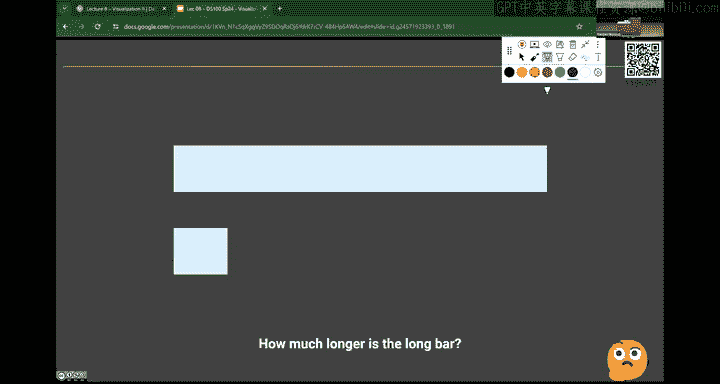
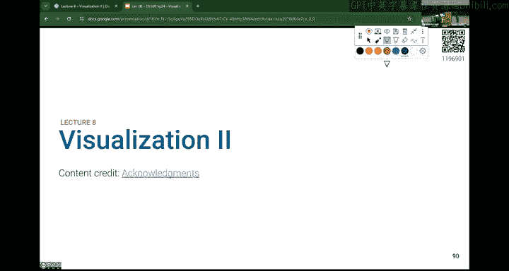

# 课程8：数据可视化进阶与理论 📊


在本节课中，我们将深入学习数据可视化的进阶技术与核心理论。我们将从核密度估计开始，探讨如何更有效地可视化数据分布，然后学习如何展示多个变量之间的关系，并理解数据变换的重要性。最后，我们将介绍一些可视化设计的基本原则，帮助你创建更清晰、更有效的图表。

---

## 核密度估计详解 🔍

上一节我们介绍了直方图及其局限性。本节中，我们来看看如何通过核密度估计来平滑数据分布，从而更好地捕捉数据的整体趋势。

核密度估计是一种概率方法，它不直接计算数据中每个值的精确数量，而是为整个数据集定义一个平滑的概率密度函数。这样，我们可以估计在任意给定值处出现数据点的概率。

核密度估计通过以下三步实现：

1.  **为每个数据点放置一个“核”**：假设每个数据点都存在一定的随机性。我们用一个概率密度函数（通常是高斯核或钟形曲线）来刻画这种随机性。这个核以数据点本身为中心，表示再次采样到该点或附近点的概率。
    *   **公式**：对于数据点 \( x_i \)，其高斯核函数为 \( K_{\alpha}(x - x_i) \)，其中 \( \alpha \) 是控制核宽度的参数（带宽）。

2.  **缩放每个核**：由于有 \( n \) 个数据点，每个数据点被考虑的概率是 \( 1/n \)。因此，我们需要将每个核曲线下的面积缩放为 \( 1/n \)。

3.  **聚合所有核**：将所有缩放后的核函数叠加起来，就得到了整个数据集的核密度估计曲线。这条曲线下的总面积等于1，是一个有效的概率密度函数。
    *   **公式**：最终的核密度估计函数为 \( \hat{f}(x) = \frac{1}{n} \sum_{i=1}^{n} K_{\alpha}(x - x_i) \)。

带宽参数 \( \alpha \) 的选择至关重要：
*   **\( \alpha \) 较小**：核很窄，曲线会呈现多个尖峰，可能过度拟合数据细节。
*   **\( \alpha \) 较大**：核很宽，曲线过于平滑，可能掩盖重要的数据特征。
*   **默认值**：在Seaborn库中，默认带宽通常设为1。

除了高斯核，理论上任何满足概率密度函数条件（非负且积分为1）的核都可以使用，例如“方框”核。但在实践中，Seaborn主要使用高斯核。

---

## 可视化多变量关系 📈

到目前为止，我们主要讨论了单变量的分布可视化。但在数据分析中，理解变量之间的关系同样重要。

以下是几种可视化多变量关系的常用方法：

*   **散点图**：这是展示两个定量变量关系最基本的方式。在Matplotlib中，使用 `plt.scatter(x, y)`。在Seaborn中，使用 `sns.scatterplot(data=df, x='col1', y='col2')`。你还可以通过 `hue` 参数用颜色引入第三个（通常是分类）变量。
*   **处理重叠点**：当数据点大量重叠时，散点图会变得难以阅读。解决方法之一是“抖动”，即为每个点的x和y坐标添加少量随机噪声，使它们稍微分开。
    ```python
    # 示例：添加抖动
    jittered_x = x + np.random.uniform(-0.5, 0.5, len(x))
    jittered_y = y + np.random.uniform(-0.5, 0.5, len(y))
    plt.scatter(jittered_x, jittered_y)
    ```
*   **联合图**：使用 `sns.jointplot` 可以同时展示两个变量的散点图以及各自边缘的分布（直方图或核密度估计图），有助于理解变量的单独分布及它们之间的关系。
*   **二维核密度估计图**：将核密度估计的思想扩展到二维空间，用颜色的深浅表示数据点的密度。可以使用 `sns.kdeplot` 或 `sns.jointplot(kind='kde')` 来实现。
*   **六边形图**：另一种处理大量重叠点的方法是 `sns.jointplot(kind='hex')`，它将平面划分为六边形，用颜色深浅表示每个六边形内数据点的数量。

---

## 数据变换与线性化 📐

可视化中的一个常见挑战是数据点过度拥挤或存在异常值，这会使趋势难以辨认。数据变换（特别是线性化）是解决这个问题的关键工具。

线性化的目标是，通过对一个或两个坐标轴的数据进行数学变换（如取对数、平方等），使得变换后的数据在图中呈现出清晰的线性关系。线性关系易于理解和建模，也是我们后续进行线性回归的基础。

如何进行变换？我们可以借助“塔基凸性图”作为指南：
1.  观察原始散点图的形状，判断其属于图中哪个象限的凸起模式。
2.  根据该模式对应的建议，对x轴和/或y轴施加相应的变换（如对数变换、幂变换）。
3.  通常一次只对一个轴进行一种变换即可，在复杂情况下可能需要对两个轴都进行变换。

**示例过程**：
1.  **问题识别**：原始图中，x轴（如国民总收入）存在少数极大值，y轴（如成人识字率）高端数据点拥挤。
2.  **x轴变换**：对x轴取对数，可以显著缩小大值之间的差距，使数据在x轴上分布更均匀。
3.  **y轴变换**：对y轴进行幂变换（如取四次方），可以拉大高端拥挤数据点之间的差距。
4.  **结果**：变换后，`log(x)` 和 `y^4` 之间呈现出良好的线性关系。之后可以通过逆变换，将模型解释回原始尺度。

---

## 可视化设计原则与理论 🎨

创建有效的可视化不仅关乎技术，也关乎设计。我们需要明智地利用人类视觉感知的多种“通道”来编码信息。

以下是核心的可视化编码通道，按人类感知的难易程度大致排序：
1.  **位置**：在共同基线上的长度最容易精确比较。
2.  **角度/斜率**：感知难度增加。
3.  **面积/体积**：人类不擅长精确比较面积或体积的大小。
4.  **颜色**：尤其是色相和饱和度，用于区分类别或表示强度，但需谨慎使用。

基于以上原则，需要注意以下设计要点：

*   **慎用颜色**：
    *   避免使用Jet等非感知均匀的色系，它们会扭曲数据并造成误解。应使用Viridis、Plasma等感知均匀的色系。
    *   考虑色盲用户的 accessibility，避免仅用红绿区分。
    *   根据变量类型选择色系：分类变量用定性色系，连续变量用顺序色系，强调两极分化用发散色系。
*   **选择正确的标记**：
    *   比较数值时，使用长度（如条形图）比使用面积（如气泡图）或角度（如饼图）更准确。
    *   饼图和三维图表通常不是展示数据的好选择。
*   **提供完整上下文**：
    *   图表应具备清晰的标题、轴标签和图例。
    *   对于出版级图表，可能需要将图例信息直接标注在数据线附近，方便读者阅读。
    *   确保坐标轴比例是诚实且合适的，不要为了强调某种观点而截断轴或使用双重标准。
*   **组织与对比**：
    *   **并置**：将不同条件下的图表并排放置，便于比较。
    *   **叠加**：将多个序列绘制在同一坐标系中，便于观察交互和总体趋势。

---





## 总结 ✨

本节课中我们一起学习了数据可视化的进阶内容。我们深入探讨了核密度估计的原理与实现，掌握了用散点图、联合图等多种方式可视化变量间关系的方法，并理解了通过数据变换实现线性化的重要性。最后，我们介绍了可视化设计的核心理论，包括如何有效利用位置、颜色等视觉通道，以及如何避免常见的设计陷阱，从而创建出既准确又易于理解的图表。



记住，可视化的最终目的是为了更清晰地洞察数据和更有效地传达信息。