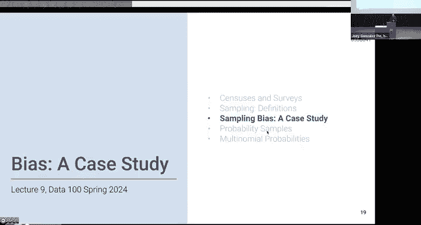
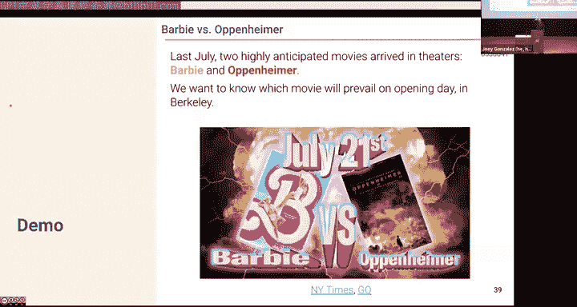
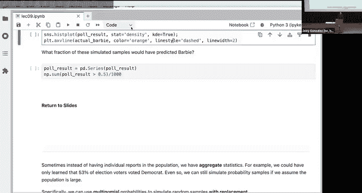
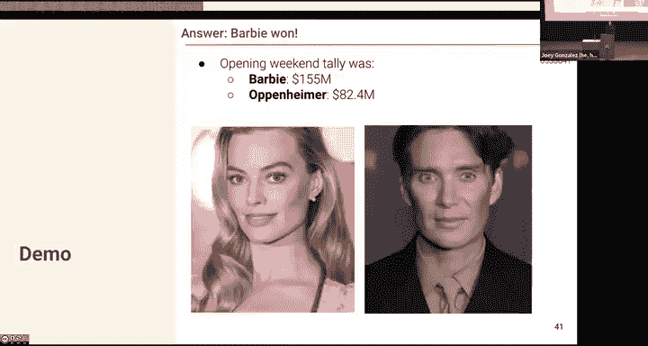
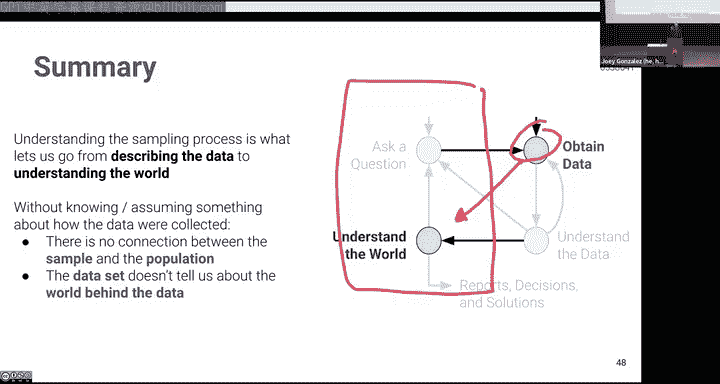

# UCB《数据100数据科学原理与技术｜Data 100 Principles and Techniques of Data Science 24SP》中英 - P9：-09-Data 100 Spring 2024 Lecture 9.zh_en - GPT中英字幕课程资源 - BV1Bc2dYCEbc

Right， let's get started today。Good morning， everyone。Please log into the slido。

 We have some fun questions， some surveys， if you will today。Today's lecture is about sampling。

I think， yeah， this is I guess the first lecture when we start to think about the world。

Up until now we've been thinking about data。Trying to understand our data。

But what does that mean about the world。Depens how we got our data today we'll start to ask questions about how we get our data and the implications they have on our understanding of the world。

Should be fine， It's a roadmap。These are the topics that I'll be covering so talk about censuses。

 surveys， some of the basic definitions of sampling。So the things that go wrong。

ll talk about bias in a case study。We'll talk about probability samples。And then hopefully。

 we'll talk a little bit about multi nomials as a way of calculating a certain kind of sampling。

 which I believe you need for your homework。 So I better get there。All right。

 so they said we've up until this point been thinking a lot about。

This half of the picture everything over here。 And this is all about the data。Right。

 but our goal in life often is to know about the world。World unless the data is the world。

 so if I have all the data。For everything I care about in front of me I don't care about the less size of this the picture because I have everything I same it is the world。

 but often we don't have the whole data so to go to the left side of this picture picture。

 we need to understand how the data came to be。So we're going to go back to this circle here and then about how we obtain the data。

As I said。How we obtain the data affects our ability to draw conclusions about the world。All right。

 so let's jump into censuses and surveys。So a census and you probably have if you're maybe from the United States。

 a specific idea in mind for census， but I'm going to talk about a census in general。

 it's a statistical concept。A data concept。 So a census is a complete count or survey of a population。

Is where you methodically get。Everyone where everyone could be， well。

 let's talk about everyone could be。So the population。

 so every individual in the population is included in your account or survey。

Population is the complete set of individuals we want to study。😡，对。

So I'm trying to understand data science students。My population isn't all people in the world Sa science students。

 right， so population is the thing we're trying to study。So some examples。

 maybe people living in a country， the US census will get to moment studies thatt population sort of。

It could be bacteria in one person's gut。 That's the thing you want to study。

 You get a little sample try and understand what bacteria are living there。

It could be trees for certain species you're trying to mu。It could be bolts on a bridge。

 people drive across these big bridges， all those bolts could fail， the population is all bolts。

 and then maybe I'll take a sample you know which from the sample can I say will any of these bolts fail？

It could be businesses， if you'rere a business school student。

 you' be studying the microlo behavior for small businesses。

Population could even be numbers it's a pretty cool study here of journals and people publish these Z statistics and they go well。

 our Z statistics are always extreme because that's why you wrote the paper so you're like what is the distribution of statistics should be a Gaussians that's what Z's are supposed to look like and it's not that population is all statistics and the questions I might ask about that population is know are they buying a normal distribution。

So hopefully Ive communicated this concept because throughout lecture I'll talk about individuals and it'll sound like I'm talking about people。

And I think in all the examples I have people as individuals， but in life。

 when you're building these models when you're doing data science。

 your population may not be individuals， it may it may not even be things， it might be concepts。

 numbers and so on。So a census is a complete count or survey of a population。I said。

 individual may not always refer to people。 so may not always refer to people。不改。

Those of you who are from the United States or been around here long enough might have heard of the census。

 so the United States actually has a law about computing a census。So every 10 years。

 we have the US decennial census。It was last held in April 2020。It is the population is。

Every person living in all 50 states。DC and USterritories， not just citizens。

It's mandated by the Constitution and participation is acquired。It's required participation。对。

It has very important use cases to allocation of federal funds。

Congressional representation and drawing congressional and state legislative districts。

There's an important。Census， an important measure of the population。

 this was built in the US Constitution because we need to make decisions about our world or the US at least and in order to make those decisions we need to have accurate data so it's pretty cool that even when writing a constitution we think about data collection and how it will affect the decisions we make。

But as we'll see in a moment， we didn know better。So。First， I want to fill in more more terms。

 So a census is a complete count。 we talked about that。 We talked about a population。

 and it's a count or survey。 So a survey is going to be a set of questions or measurements that you're going to take against each of the individuals in your。

In this case， in your senses， so in your entire population。

So census workers will go from house to house and survey individuals asking questions about you know。

Perhaps their， their income， their family size and so on to make better decisions about US policy。

Right， what's interesting in this sort of the first exposure to this concept is what is asked and how it is asked。

 So what and how。Effect how people respond， obviously， if I ask a question weirdly。

 I'm not going to give good answer， I might ask sensitive questions in which case people might lie。

And whether the respondent answers also depends on what I ask。

Right so that I might refuse to take the survey， I might try to hide away hide from the survey workers because I'm concerned about the questions you're asking。

 and this actually came up in the 2020 census when there was an effort to put a citizenship question on the census。

Remember， the census should be all people， not just you as citizens。But if you're not a US。 citizen。

And someone's asking you， hey， there this important federal document， a US citizen and you say no。

 you would be a little concerned。 they might use that document to。

Affect you at future points in your life。 And since it's court mandated， you know。

 Lying on this document could be a problem， too。So the US Supreme Court actually took this case on。

And they ultimately remove the citizenship question for a key concept we'll cover lecture today。

 which is how we frame these surveys has a big effect on the reporting biases。

This is an important topic， so important that we're covering it in just one lecture， in fact。

 only a fraction of a lecture， but it's actually so important there's a whole class around it。

 So if you are interested in sampling and surveys then actually if you are a data science major that's something you should probably be pretty interested in。

 definitely check out this do22 class。Right。So。I said a moment ago。

A census is a brilliant idea where we just measure everyone。But it's also a pretty flawed idea。

 In general， it's very hard to get a good census。 And the US census is， in particular。

 we spend hundreds of millions of dollars， maybe the billions to compute this total count every 10 years。

 And we still get it wrong。We undercount。So LA Time is a neat study of just undercounting of Latinos of Latino children。

 and they're underrepresented in these censuses。喂。Sometimes the process of doing the census is challenging。

 getting access to every household。Maybe you don't have a house。

 How do you find people So actually counting every person is very hard。 And again。

 people often don't want to be counted because they're concerned about retaliatory actions by the government that's doing this counting。

But you might ask here。If the US spent billions of dollars。

How does this poorly funded top newspaper run its surveys。

 how does it know that the US census undercounted？So there's a really powerful tool it's called sampling the whole point of this lecture。

 that actually allows us to get really deep insights into things that might be hard to get actually with the census。

I'll talk about that in a moment。So in fact， so the rest of this lecture be on how we can leverage sampling methods。

Sampling to get more accurate information than we can with a poorly constructed census。 Again。

 a perfect census。 if you can do it， you should do it。 That's amazing。

 But it's we'll talk about spoon。 It's expensive and it often hard to achieve。

So sampling is often the solution to these problems， and in fact。

 there is an effort by the statistical community and by the census community to actually push sampling as the way of running the US census。

 it would get a more accurate measurement。But the Constitution says no。

 and it's complicated because how we do sampling has a lot of complexity which you'll see in a moment and accounting for that the level of an entire country is tricky。

 so it was actually rejected and so even still today we don't do sampling for the US census we still tried to count every single individual and as a consequence today there's a lot of investment improving the quality of the count。

And state by state， people put money down to get this one statistic better。

 I think California spent 187 million to get a better account。In other states， like Texas spent。

so these counts matter， they affect policy。 they often underrepresent certain groups。

 there's inherent biases in doing a census incorrectly or not doing a complete census and says why sampling is pretty powerful and that is why the focus of lecture be on。

Going fast。 Any questions at this point。Anyone participate in a census？So asking questions is tricky。

 we'll come back that a moment， so no one's going to answer my question。It's fine。

So let me give some basic definitions of sampling and we'll go through some of these use cases。

So we're going to sample from a finite population， so a census is great and I already said it's expensive and difficult to execute and to execute well would mean to get every single person and often you can't and so your census ends up becoming a kind of sample。

 it's often a little bit biased because you try to get every single person and didn't account for those sampling biases。

So all voters。Yeah， this is a fun question for the present。

It would be nice to know who's going to win the upcoming election。

 A census would be perhaps the most accurate way to do that。

 you ask every single person in the United States what their opinion of the upcoming election is。

The problem is it's hard to do this。 It's expensive and doing it over and over again you know every week would be impossible。

 And even then that's maybe not the group that votes。

 So you have to figure out account for the you know the definition of your population So since it are hard a sample is usually the best way to purchase this and so a sample is going to be a subset of the population。

 we should say usually here of quotes because it might be。

Some of the elements of population and supplement include things are outside of your population as well。

It's usually something smaller， it's trying to be a subset of the population。

Asem is used to make inferences or predictions about the population。And so from day8。

 we had this definition of inference， it's somewhat used interchangeably when we started teaching data we tried to make a broader distinction between prediction inference。

 but today inference prediction is precisely this process of taking my data and trying to draw a conclusion about the world。

 often making an estimate of a particular value who will win the election and maybe even trying to quantify our uncertainty in that estimate。

So that's what we do with samples。And there are two big sources of error to think through。

 and that's a lot of today's lecture focus on。What is Ch there， So this is。I take random samples。

 they're going to vary， and I'm going to see different answers each time。

So that's the inherent variability of my sampling process leads to this chance。

The other systematic care。Often in one direction， so this is maybe my survey my sample of people in the class would bias my prediction for the outcome of the election because there's a systematic bias in the people that I'm sampling。

A lot of this bias comes from the sampling scheme itself。

 so how we set up this sampling process is often what introduces our bias。But other sources of bias。

 which we'll go through in today's lecture could be the effects of my questions on individuals and whether or not people choose to participate in the first place。

So all of this， understanding the source of error is what allows us to take this and go down to here to draw conclusions about the world。

In some sense， this box here or inference is this process of understanding the world from the data。

 the stuff on the right side of this figure。But， so here's some very important definitions。

 It will be used as we go through all these different sampling strategies。 First， the population。

So the population which you've already talked about is the group that we want to learn something about。

Gup of individuals， things， the thing we're trying to study。In in life。

 we seldom have full access to the population to do our measurement。 Again， if I did。

 if I measured the entire population， that would be a。甚至是。But I don't， I have to take a sample。

But before I take a sample， I should talk about my sampling frame。

 so this is the group for which the sample will be drawn or is drawn。

So before I take to before I take my sample， I should be able to think through。 Okay。

 so I'm trying to understand Berkeley undergrads， and I ask questions for people in this lecture。

 sampling frame。People in this lecture， right？What does that mean they have to be enrolled in this class most likely enrolled in this class they attend lecture so that's a very special group of students I have to understand the frame from which I ask and then if I ask a few people in the front row。

 that would be my sample so sampling frame is the space from which I have access to sample。

And then the individual is actually sample， I select。This is my sample picture here。是。Frame。

 sample a population。So typically， my。By definition， my sample is a subset of my sampling frame。

Right， and let's go through this for a moment and clear this side。

You'll notice here that the sampling frame。Doesn't have to be a complete match to the population。

 And in practice， it often isn't。 So what's this over here。These are people that I missed。

 I missed these people。 I can't see them in my sample。

 That's going to be a systematic bias in my sample。These people here or these individuals。

 things are not in my population。But could show up in my sample right here。

So you need to account for that potential bias as well。And then everyone here。This is sample。

It's helpful， at least the sample there are lines of my population in life。

 we probably won't know this breakdown。 This can be hard to know how to split your sample up。

And knowing what's over here， this space can often be challenging as well。

 what did I miss in my sampling？So there may be individuals in your sampling frame。

So there may be individuals inner way they're not in the population which is this group here there。

 we talked about this and we'll go through an example in a moment with you all actually and of course there's people over here or individuals that I didn't sample。

Or that I can't say。All right， so let's talk about bias in the context of this picture。

So if I had this picture here and I wanted to reduce the bias in my illustration。

Of the samples that I would produce。What could I do。How would I change this picture？

Think about it for a second。Thats so I'd like to move my sampling frame so it overlaps the population that would be controlling the systematic bias and samples that I produce。

And how to control this bias。How about chance error。Would I change in the picture for chance air。

Bigger circles， I like that。Which bigger circles should I make all them bigger？

H maybe I can make this one bigger， It's an interesting point I'm going to say the best way to control my chance error is this one right here so I make this circle bigger。

I get a better， bigger sample of my population。 So I'm reducing my chance there。

 I'm reducing the variability that I'd see across my samples。

AtSome point I make it too big or just this big。 I get really close to my sampling frame。

 And now I have another problem， right， still have this bias that have to control。

So the two source of error in our sampling process， the high level。Oh， finally， okay。

 so we have a slido and we we'll demonstrate this process right now。 So please do this slido。不。

You can't hear me properly online。 Well， you guys are filling this pull out。

 I'm going to go to zoom settings。嗯 do two。Actually should do this。

You're going to stop sharing and try to share without the audio。读。Spring。Under。嗯。

Let's share this one。笑亮。Okay。All right， so we did the poll。484 of you did the poll。 So that's my。

What's that，' my sample， I sampled 484 people。 I had this big question。

 How are people engaging lecture today， What is my population。I didn't say what my population was。

 What should my population be。That's right， I would like to know how people are engaging lecture in data 100。

Okay， so that's my population。What's my sampling frame？Think of a picture。Okay， let's see。

 So everyone enrolled in day 100 is the population。Everyone attending lecture today。Is that true？

Everyone who could respond to the poll good。 right， that's that's exactly right。

 So everyone who could respond to the poll is my sampling frame。 That was a little bit of a cheat。

 can't be more than that。That's certainly a super set of everyone who could answer my survey。

Let's talk about these areas。What's in here， These are students that are on what。In lecture。

We're also streaming hopefully still on zoom， so these are the people on zoom。

 so this is in lecture and this is in Zoom。可呃。This is probably a pretty big segment of people who watch the YouTube video。

 that's you。 So the YouTubeers。嗯。嗯。Subers。Zm YouTube， what's this？Professor Nargus， brilliant。

 I had not thought of that， okay， so Professor Nargus is here who else is here。Yeah。We're here。

 that's good。 I'm guessing my fans， maybe my parents， if they're watching lecture so yeah。

 so people who could have found out about this link but aren't in the class。So in my sample。

 I have all of these parts， right？And then here is everyone who responded on Sdo。

 which was 468 people。So this was the poll。Yeah， and so let's go back and look at that poll。

What did we find。That's excellent。So if I were to to draw conclusions to this play， I would say， wow。

 lecture is amazing。 we have 70% of people say that they attend lecture in person。But of course。

 what？What happened。Do I have a chance air here？Do you have a systematic bias。about it。

 What's my systematic bias。Well all the Youtubers， these people down here。Which， by the way。

 how do we get 6% anyway， Z people down here shouldn't know that I just ran the poll or maybe they ran it last。

 maybe I had to pull it in last night， but in general。

 I'm missing a large fraction of the population I cared about because my sampling frame considered only the people who had access to slider right now。

But I guess I should clarify that statement， it is only that people have access Sdo and who know about the pulp that it's up there。

Questions， is the audio fixed。Hope the area is fixed。你跟他点。M Mike， we should be good， okay。All right。

不 okay。So I think hopefully now you have an understanding of the basic idea of sampling。

 the population， the sampling frame， the sample。And this broad idea of chance air。

 the variability that I get from my sampling， and this systematic bias， this bias error。

Now it's look at a fun case study。 This is a pretty famous case study in the power of sampling。

 and it's the 1936 presidential election。

Who is the person on the left？Franklin D。 Roosevelt。WHe's the person on the right。

You've never heard of it。Yeah， he did not win that election， person rate is landed。Elf Landon， yeah。

 these two candidates， Roosevelt was up for reelection， Landin was a conservative。And there was。

A big effort to predict the outcome of this election。A lot of people are excited about it。

 and there was a tabloid called the Li Diigest magazine that had successfully predicted the last five elections。

 amazing。And they sent out a huge survey of 10 million individuals。

This is a biggest survey of its kind， I think， who they found from， who they contact。

 they contacted from phone books。 they found everyone， they went through phone books。

 They just called people。 They list they they list the magazine subscribers， whoever was subscribing。

 they reach out to them。And just to make sure they got everyone。They got country club members。

 and their lists。Okay， so it's a big survey， many of you are probably going hmm。

 is there bias in that survey process？Yeah， okay， let's see what happens。

Here's the outcome of the election， Roosevelt won， you all know that because you don't know the other person。

 he won by 61%。What do you think the survey found？But they predict。

Kind of think through the biases that might have been present in that data。

The digest thought that Roosevelt would lose。43%。10 million survey。

People reached was actually their sampling frame with the people they tried to contact。

 so they tried to contact 10 million people in their sampling frame。43%。Way off。 why。

1 million people。This is an important punchline。 and the reason we present this slide you're probably I can tell you why and you'll tell me why in a moment why this was so far all。

 but today there's this excitement around big data with vast amounts of data you can't go wrong。

 you can So understanding your sampling process and how you got that data makes a big difference there was a fairmount of hubris at this time that such a massive survey must be able to predict the outcome of an election and it was far from accurate。

All right， so why did it fail？As you might have already guessed。

That sample of the population was not representative。Why wasn't representative。

 The sampling frame we just discussed a moment ago was people in phone books。 What does that mean？

What do you need to have a phone to be in a phone book。You have a phone I should add in the old days。

 phones were connected to the wall and you had to have a house and they're very expensive。

 So that's not good。 Subscribe to the magazine。W subscribe to magazines。

I sure't know what that bias was， but back then I imagine this was probably not the vast majority of people。

 but maybe certainly the more literate and went to country clubs。That's kind of a Ed giveaway。Right。

 there's some bias here。That bias was the more affluent people that's who they ended up measuring。

 and they tend to vote Republican。So they said， Landin would win。So you're looking at this and going。

 how did they think this was a good idea？Great， but I'm sure when they present these numbers at time that this is the biggest。

 biggest survey it's kind。 We're going be able to predict the poll we've done it five times in a row。

 Roosevelt has no chance。对。And we've seen this hubris more recently， too。

 with a different kind of bias。Right。Important points。

 I told you this was the sampling frame that people they had access to。 as a matter issue， Only 2。

4 million people actually filled out the survey。Kind of bias。 So that's a 24% response rate。

 which by our standards is actually pretty good。 If you get a 24% response rate on your survey。

 Well done。 The problem is。There's some bias in how they were responding。

 they were not you know aggressively asking you， please fill out the survey。

 here's some money I really need you to fill a survey instead they're you know you can choose to do it or not。

So the non respondents。Also might have biased answer。

The new thing to think about as we do these surveys is who's going to actually complete the survey？

That's a new kind of bias we have to think about when doing these studies。There's another guy。Mr。

 George Gallup。Who decided to do something a little bit different。He was an upcoming statistician。

 which in the 1930s， statistics was still growing up。And he had an idea he would use a sample。

 very carefully constructed sample of 50，000 people。Which turns out to actually be too big。

 didn't actually need that many。And he was able to get pretty close the actual outcome。56%。

Not exactly it。 He probably suffered some of the same biases of the original literary digestpo。

 but I'm sure he tried to control for it as well。He actually went on to predict the Gallupm sorry the's literary digest bowl。

 44%， using just 3，000 people from his survey。So we could guess the sampling frame that the other pole was using and get a very good estimate of what they would complete from their own pole。

对。Spread of a mean thing to do。 the statistician comes down when your digest does this massive pull and he goes。

 I can guess your answer and I know what it's going to be and it's wrong and that's using sampling。

So he predicted。Their sampling frame and could use his little sample to figure out what happened inside of their sampling frame。

So's the fun story and again， the moral of this story。

 the thing you should take away important point from this lecture， one， senses are hard to get。Two。

 we've talked about these sampling process and forms of bias and we'll get into more of in a moment and three big lesson。

 big data doesn't mean accurate。Okay you need to think about how that big data was derived just because you have lots of it doesn't mean you have a good estimate for the thing you're trying to。

Big does help with our chance air， but it really doesn't help with our bias。

So let's talk about some common biases that came up here。So first is selection bias。

So this is systematically excluding。We're favoring particular groups。

So the selection bias in our previous example is what？

I'm favoring wealthy individuals in the literary digestpo。

 I'm favoring people have houses and phones that are connected to the wall。How do I avoid that？

A lot of this boils down to controlling your sampling frame。

 think carefully of the frame on which you're sampling。Finding ways to manage it。

You'll see in a moment， part of that is knowing your frame and then adjusting using waiting to your data to account for the kind of bias your frame is introducing。

Right， response bias。People are not always truthful。

And this is something that's come up in more recent elections。 When you ask people questions。

 they may not tell you the right answer like， I'm going to vote for a when they go to to vote。

 you know what， secretly， I'm going to vote for B。So people may not be truthful。

SoAnd that can lead to weird responses， it can also， me gos for example。

 it can also lead to people maybe not responding to your survey。

 which actually is another bias we'll talk about in a second。好。

I want to talk about a solution for this one。 It's kind of interesting。

 so you can avoid this by framing your questions carefully。诶。

There's another technique that has not been taught in this course before。

 So hopefully the staff will be upset for me。 I want to talk about one other cool trick you can use。

 It's called a randomized response。 So if I want to ask you a tough question， like。

 have you cheated on an exam before。It's going to be hard to get everyone to give me an accurate answer there。

 right？It's very easy to go， no， okay。So one thing you can do is you can do this randomized response。

Where I say， all right， I'm going hand you a coin。 You flip the coin。 It lands heads。

 you should say yes， no matter what。 you've shown the exam say yes。Lan's tail。 Be truthful。

How does that work？So you come back and go， Joey， I said， yes， okay， you cheated。 like， no。

 I flipped the coin It landed heads。I don't get to see the coin， it's very important。

 so I don't know what happens I told you you have to say yes it lands heads yeah I can't say you cheated because it landed heads so he told me。

But how would I figure out how many people cheat。How would you， when would you say no？

The only way to say no is if it lands tails。And because you're now able to be truthful， you said， no。

 I didn't cheat。So the fraction it says no。Is actually a good measure of the no portion。

 but it's masked。 So 50% of the time you meant to say no。But the qua landed head。

 So you had to say yes。So I just doubled the nose and I have a good estimate of how people cheated and didn't cheat on the exam。

So using probability， I can get around some of this， the challenges of truthfulness。

 And this is another， you know， power of randomization， which again。

 is what sampling is letting us do to get around some of some of these biases。Pause for questions。

Yeah so the randomized response is a way again of getting someone to answer a question when they don't want to be truthful and so you're giving them this ability to say it wasn't my fault。

 the coin said I cheat it， so I had to say yes， so it makes you more likely to be truthful because Ive given you if you said yes to I cheat it you go it's just the coin's fault but the power of this method this exempt or this simple method is that I can start to extract even though you said yes or no according to the coin when you said no。

 the coin had to have landed tails so I know that's 50% of the time and if you said no at that point I trust you because you had cover。

Let's say this again so let's say it lands tails and you did cheat well you can write yes there too because it doesn't matter because you're going to say it was a coins fault right so now you're free to be honest with your answer because I don't get to see the coin flipping and you do any of this stuff。

But I can now use your answer to actually make a prediction that would have been otherwise part to get。

Becauseuse if I said， hey， did you cheat， like， no， I'm not going to answer that。

 So it gives gives cover for the persons。 They can actually give an answer and let you still do the analysis。

 yeah。This setup okay， I might regret having decided to cover this。

 but okay let's see it once more so here's here's the game。I hand you a coin。

And I'm going to walk away， I'm not going to look at this process， and I say your instructions are。

 flip the coin。The lands head。Wite down。 I cheated。可。The lenss tails。

Right done what you actually did。I cheated。 yes， or no， I didn't cheat。

Now you hand it back to me and go，huh。Says here you cheated。You go， no， the coin landed heads。ok。

 fine。So you have cover in what you said so you're willing to maybe be more truthful and I can do statistics to figure out for the entire sample。

 what fraction of people might have said yes。By looking at the people who said no。

 and if you didn't say no， you have said yes， and I can calculate the fraction of no because I know the fraction of no has to have been。

All the people landed tails and then said no， so I have to double it for the people who landed heads because they would have said no。

 but they didn't get a chance， and now I know the number of people that said no。

We do not cover in future semesters。it's a good technique。

 so I thought it would be fun for you all to hear about it。

Right another issue is a non response bias， so people don't always respond。

They might choose to skip your question。It'sno did you cheat on the exam。

 no comment right or they might say， you know what， I don't want to do this poll。 It's too long。

 It's a real problem so because it's too long I don't have time of a busy person out do your poll So what do you get。

All the people who are really busy don't do your poll。You could ask。

 is your life free of stress And the majority of people go， yes， my life is free of stress。

It's because all the people who had stressful eyes didn't have time to fill out your poll。Right。

So not even's going to respond。How do you fix that？As example ready for the 2。

4 million people who or 10 million decide to respond。

 what can you do to make people respond to your full？Yes。

Incentivize them pointss on the exam is a common one。Keep them short， pay them。

A lot of strategies to incentivize people to take your poll。

 I will say as soon as you start paying people， you have another set of problems。

I will take your poll more than once， thank you I might even lie because I just want to fill this a out as many times as possible as I get money。

 but so be careful about incentive mechanisms as well。

 but that is one way to control your nonresse bias。Questions。

Great question can you get rid of a response bias by using anonymous surveys？

If I send out an anonymous survey to everyone in the class saying， did you cheat on the exam？

Would you answer that。Maybe you don't have to answer my question。 That's unfair。

 The The point is anonymous。It's sort of up to the interpretation of the person。

 I promise this is an anonymous Google form。对啊。I don't know。right， So。

 so people making something the anonymous is an important step to reducing the bias。

 the response bias。 So you should try to do that。 But if you ask very sensitive questions。

 even anonymity is not enough。So this statistical sense of randomness is a way to get around that。Oh。

 another another poll。Let's try this one。Is attending data1 heart lecture in person helpful in learning of course material。

Is this anonymous。好。This is anonymous， everyone。Not lying， It's not anonymous。And you know it。

I think we grade on these， right？I love this poll。Turns out 90% of people think my lectures are great。

 or at least helpful。What's wrong with this poll。Got all sorts of bias。

What were our list of biases before？Someone name of biasas。So have non response price， yeah。

Not response bias。Today when choose's not to respond， maybe not。

 I've incentivized you to respond because I believe your grade depends on it so not response bias it's not a problem。

The response bias itself。Yeah， you guys are so nice to me。If I made you flip a coin。

 maybe I'd have more nose， right？So people are not being honest。You can be honest， yeah。Still 11%。

 Okay， so please， be honest doesn't really fix the， the problem， right。So I have。

 I have a response bias What else。Yeah。Yeah， so I have a selection bias too the people who don't come to lecture aren't going to fill this out。

Well， they will fill out eventually， and I should look at that result， but in general。

 the number I have right now this 477 people as a selection bias as well。吃7。

Question did I frame my question in such a way that I've induced the bias。

 I force you to say yes or no。There's no kind of， maybe。Yeah， so how I frame my question。

 not optimal， maybe I could use a likert scale like on a scale of one to five。

 how helpful is lecture？5 being really helpful。 and one being。Worthless。So giving the user。

 the user the individual， the thing I'm measuring， the chance to be more informative in what they're saying could affect the measurement style that actually take。

有。Great question。 So suppose I run the survey， and I wait until the end of the week。 and I look at。

 by the way， thank you for being honest。 We went from 1 to 12%。

 So if I look at the the survey at the end of the week， could I account for some of these biases。啊。

Some of them。This response bias is kind of hard for me to address People aren't going to be truthful in the survey because theoretically。

 I can look up your email addresses from the survey。

But some of the other biases like the selection bias will hopefully improve。

 so as more and more people take the survey， we also have an incentive mechanism。

 so there's a high chance that people to complete the survey。Where the bias is。Response covered。

Incentiv bias。 Yeah， so the main bias here in this case is going to be the the response bias itself。

 People are not going to be honest answering this question。All right。

 so we talked about the gallup poll sampling frame here was civilian nonsitized so actually Gallup poll today so we still run the gallup poll you'll hear about polls for the rest of this year it's certainly in the US the sampling frame has changed it's civilian noninstitutionized population adults that doesn't necessarily mean voting adults so when you run these polls you have to account for the actual population you care about which is voting adults。

 but this is the sampling frame which we're looking at the added random digit dialing。

There's a selection bias， what do you need a phone？Times have changed。

 more people have phones today than they did back then。 My daughter's got a phone， and she's 5。

 but has no no phone plan。 So the the presence of phones and the selection bias has been a little bit reduced。

 but still a selection bias。嗯。Looking at households。

 they're going to randomly select households with more if there's more than one adult。

 they'll take one of the people， it be a selection bias and who picks up the phone。哎。

The non response bias is address by。Multiple times， you might get text as well。

 multiple texts they really want you to fill this out because they're trying to control this bias。嗯。

So many sorts of bias we've talked to who responds telling the truth and also in this case。

 we want to predict turnout we need to actually think about the voting population as distinct from the population of people in the United States as I said earlier today single digigit response rates on these things is actually pretty good。

So if you get， you know， this is 10 here so if you get in the order of you know7， eight，9。

 10% people responding， that's really good and that takes a lot of effort to get there。

The other thing that's kind of neat is that in order to get really accurate predictions of an election and these people are very much incentivized to do that。

 they have to account for a lot of these biases， they also have to account for biases that arise from just the voter turnout and then often you'll see aggregate polls that try to account for the biases of other polls and incorporate those in their polls as well。

And so there's some neat studies of how the polls themselves have transitioned over time。

 one of the kind of downsides they often have these proprietary secret algorithms that they're using to figure out these biases and address them。

The science of making these poles has improved quite a bit。 we've had some mistakes in the past 2016。

嗯。But over time， the technology has gotten better and I think there's increasing consistency in the polls and actually Nate Silver has a really really good blog has kind of analysis of how these polls evolved over time and the biases that they have reach of different polling institutions。

改。So that is the end of our focus on bias。 Are there any more questions。We have 30 minutes。

 which is great。 I think we'll will to cover the rest of the lecture。Perpretational biases。

 Good question。 I think right now we're thinking about the the sampling frame itself。

 when we do our analysis， we might be introducing additional biases。

 which willll actually cover later in the class。哦， the question yeah。

So writing a survey question is hard。 That's why I have a whole class dedicated to it。

 The question I wrote earlier was actually a little bit flawed that screaminging So writing a question clear enough so you get a meaningful answer is important that could introduce biases and often when you do these studies you'll go back and go I asked that question wrong Yes could have also met this and now I have to account for that my analysis。

We didn't cover that。 It's more of a right to good questions， but it does introduce bias。

 how you write the questions。All right， so probability samples。嗯。

The next thing you think through is what makes a sample and there's kind of two flavors of samples。

The first is the convenience sample。And it's called the convenient sample because it's whatever is convenient。

哎。What does that mean， here's a simple example of this。

 so scientists in New South Wales were trying to collect specimens of eucalyptus trees。呃。

And then they were recording them， so keep in a museum， they were recording them。

 the laitude launch of the specimens and they felt。Now， scientists are a little lazy。

What geographic distribution do you think they， they chose to collect their samples from。

Here's Sydney， where their office is located， and they found out the eucalyptus trees seem to be pretty centered around Sydney。

Is that amazing。Why is that。I who wants to drive out here， right？It's inconvenient。

So a convenient sample is a day that you have immediate access to this crops up also in settings where let's say you're at a big corporation and you happen to have some data about customers that's currently in your system。

 you go， well from that data I must conclude that the people that we are trying to sell to have these properties。

 right？Often， the convenient sample could have been a probability sample。

 which we'll talk about in a moment。 But I don't think about the sampling frame。

 I just take the data that I have。 What's convenient， And I don't account for the， the effect。

 the sampling frame my problem。So in this case， the sampling frame was how far I could drive for under 20 minutes。

 maybe because I'm lazy to collect my sample， and so I got this sampling frame。

It's my convenient sample， if I then go look at what the actual distribution of eucalyptus trees where I send some poor grads to drive very far out and collect some samples out here。

 I see a very different picture。So taking the effort to actually make the sample a more proper sample。

All right， so when we say random， we don't mean。Just go out and do something。

Rrananddom has a very specific definition。 I should go to attribute probabilities to the actions that I took。

 should be go to find my sampling frame and describe the chance that something appears in that frame。

Does not have hazard。So randomization。Is one of the key tools in this class。

 It's actually one of the key tools in science and statistics to account for a lot of these biases。

So let's talk about how to do that here， so the key trick here is to use a probability sample or a random sample you said randomization。

So what does that mean， So why sample random， So first， if I I， if I get a good random sample。

 I eliminate some of the biases my process instead of just you know。Seeing who's in the front row。

 I try to grab random from the entire audience。Doing that's actually a little tricky。

 So I need to use some source of randomness， but the idea is that my biases wouldn't then go into the selection process。

 So it's one way to reduce our biases。How we choose to randomize still could entries of bias。

 right So if I stratify my my random to say， well， I prefer these rows over those rows。

 I introduce an additional bias。 So just having randomness doesn't eliminate bias。

 but allows us to more effectively control for it。But maybe more importantly is this source serranness allows us to actually make statements about the chance error and in many cases the bias as well。

So thinking about the probability behind our actions allows us to quantify uncertainty。Interest。

So this is an important definition in a blue box。Exam worthy。For a probably simple。

 we have to be able to provide the chance。That any specified set of individuals will be in the sample。

That's a proper probability sample。That does not mean that all individuals need to be in the sample。

So I could have a probability sample that just I refused to sample this side of the room。

It's just saying that I can describe the chance that I would sample someone0 from the side of the room。

 And let's say uniformly from this side of the room。

And then the hope is that because we know these possibilitiesbil， we can better estimate our errors。

There's important caveats， the real world is often complex and you won't be able to exactly write down these probabilities。

 but the idea is that you can try to describe that process or make assumptions and model those probabilities。

 that's what enables you to have a probability example。So election polling。

I can try to account for people to don't answer。 I can say， well。

 I have a prior belief and maybe I'll do a small study for how often someone's likely to actually pick up the phone so I can account for that probabilitybilion。

 maybe when they pick up the phone， the chance they're going hang up again。

 I can account for that too so I can think through these probabilities which allow me to actually define the sampling process。

Likewise， know， if you're measuring bacteria in your stomach。

 it's pretty hard to know probability that any one particular bacteria might show up， but you say。

 well， I've taken a sample， I don' I take a sample。Or perhaps from a bowel movement。

 So I know that things that passed all the way through your stomach are in my sample。

 And so I can start to say， you know what's the probability that something makes it all the way through。

 and that is the the actual you know sample， probability of that sample from the sampling frame of the things that make it all the way。

F point is when we don't know these things， we still can make an effort to model these probabilities whereas if I just pick someone at random not at random just pick someone front the front of room that's convenient。

 I'm not thinking to these probabilities， I can't say the chance that these two individuals were in my sample or that anyone would have been in my sample。

不对。Bring fast。 Any questions on this random。We're gonna get some examples。

 let me keep going actually， and hopefully it'll become more clear。 Allright。

 So here's a simple example of a probability sample。 So I have three Ts， Alan Bennett and Celine。

 I'm going to to sample two of them。 So my sample size will be 2。 I'm going to choose a。

hi you're going to choose Allen with probably one， so Aen' is definitely my simple。

 and then I'll choose B or C with probably 0。5。So now I can write down all of these probabilities。

 So the probability of seeing the sample A B， I can write the du。5。

 probability of seeing the sample A C。 So I always get a balancein。 And then you know， probably 0。5。

 I get Cline 05。 the probability of seeing B C is。0。Because I always， I always include Alllan and my。

Some problembil。This is a probably simple。Not a great one because I'll never see this combination。

 and maybe I want to study that as well。I can write down the probabilities of each of these outcomes。

 That does what makes it a probability simple。I can measure chance error so I can see what variability I have in my outcomes because I can write down all these possibilities。

And I can say that this is a bias。Towards A's responses， because I understand the sampling process。

But one example was probably simple。There are two pretty standard random sampling schemes。

 the first is probably the most standard， which is called the simple random sample。

It is a sample where they draw uniformly at random。With that replacement。From my sampling print。

Simple， random sample and often called an S， S。Not only simple to do。

Really being able to draw uniformly random from a sampling frame can be hard。

But this is sort of the best you could get if I just want a really nice uniform sample of my sampling print。

Simple random sample。 Unfortunately， actually calculating the probabilities for outcomes in this can be challenging。

 So there's， there's an adjacent thing called the uniform random sample with。Replacement。

Which is kind of like the simple randomom sample。But one important caveat。

So in the simple random sample， if I'm pulling balls out of this cards out of this lottery machine。

 I don't put them back in。So I can't see the same card more than once。Indeed。

Uniform random sample with replacement。I put the card back in。Now。

 if I'm doing a survey for an election， and I say， who you going to vote for？And they ask you again。

 who you're going to vote for。 That seems sort of silly and wasteful， right， So in practice。

 we don't typically go ask the same person again。 Hey， I asked you last week。

 but my my random re generator says I should ask you again。So we don't do that。

 We typically do a simple random sample when we say， I've asked you last week。

 I'm not gonna ask you again。The problem is doing the mathematical calculations now every single sample depends on all the things that I've done before me。

 so it's more complicated， so when we do analysis you'll often make an assumption that I'm dealing with replacement and if my sampling frame is very large。

 the chance that I would have actually had sampled someone twice goes it becomes very small。

So this is often easier to compute probabilities。 and at the very end of the lecture。

 which I will get to。 we'll walk walk through how to compute these for particular。

The other thing I want to point out here， again， important definition is that in a simple random sample。

 every subset is equally likely。So it's not that every individual is equally likely。

 it's that every subset of individuals equally likely。We'll be more clear in a second。

 So I think I have an example。Alright， I do you have an example。 Okay。

 so here's another sampling scheme。Here's a roster。 These are all emojis。

A lot of people characters these days。 so have this is my my class roster I have1 1100 students in the class。

 I'm going to pick one of the first 10 students so I take use my first 10 students I suppose I pick student number three。

And then， and I picked that uniformly random from the that little box， right。

And I'm going to sample every 10 students in the roster。That's my sampling process。그。Alright。

 so some questions for you。Is this a probability sample？Is it probably simple。

 Can I write down the probabilities。 Does each student have the same probability of being selected。

And is this a simple random sample？Once more I save the process， then we're going do a slido。

 so I take the first 10 people on the roster。I flip a 10 sided dice die。 I get this， this character。

 and then I keep walking down the roster， 10 people at a time。Pick that person in my sample。

 walk down 10 people a time。 Pick that person。 so on。RightSo is this a probability simple。

 does a student have the same probability of being selected。

 does each student have the same probability of being selected， and is this a simple random？Okay。

 so there should be another slido。 I can't see the results until you all switch the next screen with the answers。

 so。Please do this slide up。If I switch away to the other side。

 but I still see is the side up hole still open。But if I go here。 Can you guys still need this itemo。

嗯。O put a picture that。Friend look。Is this probably simple？That is yes。

Because I can write down the probability of how each person is selected。

I presented in a very weird way， but here's another way to think about this。

I take the first 10 people and I say you're a group lead one through 10。

 and then I go down the rest of the list and say you're in group 1， you're in group  two。

 you're in group 3， you're in group four， you're so I'm in group one。

 so I'm basically just grouping all the students into 10 big groups。

And I'm picking one of the groups， and that's my sample class。

 so I can write down the probability of every outcome in that sampling process。

There's only 10 outcomes with probability，1/10th each， the rest will never happen。Yes。

 this it probably simple。Does each student have the same problem of being selected？

Let' a little trick here。Yes。😊，喂hy。Well， I broke the class into 10 groups。

Everyone got placed in one group， and I'm going to pick one of the groups at randomand。就。

There was an equal chance of getting in。That tricky， is this a simple random sample？Well。

 it was simple。It was random， it was not a simple random sample。Why is it not a important simple。

But remember I said there's this important caveat， exam Que style caveat。Simpple random sample。

 every subset has to be equally likely。But I broke the class into essentially 10 groups。

And it's not possible that two people that are in different groups could end up in the same sample。

So not every subset is equally likely。 Every individual is equally likely， but every pair is not。

So after I've set up these scheme， the chance that you and your best friend。

 if they're different groups get picked at zero。你好。The class roster was not a multiple1t。

 but the answer to two be no。Correct， well done。 So why would that be the case。Let me calculate that。

So I think I'd have a group with more people。calculate which the pro reach the people。

Not important sample。 That's always true， but is it is everyone equally likely。What story， yeah。

I knowt calculate it， I'm not sure。Yeah。So let's say the last group had one student。嗯。🤢。

That student's got a pretty high chance of getting selected。 but so yeah， I think the answer is no。

 I am correct。 I showed you by a silly counter example， where you got actually work it out。

So I have a smaller group， the people in that group get a little bit more likely chance of getting big。

The 1/10th gets spread across all the groups， and if there's this smaller group。

 the people in that group get more of that。Then I mess something up my drawing。呃，验收。I think。

Shoot I picked this first person， I can't pick this last person in my tent。Thats no， I'm so good。

 actually， yeah。Whateverever。So we be your question？That so I think my drawing is off。

 I see what your point is， So let me just go back to your secret question。 So if I pick this person。

 do I then go pick this person。Yeah， so I think I'm gonna start counting here right， So 10 over。

 which I do that rate，1，2，3，4，5，6，7，8。10， so my drawing is off。And error in my drawing。

 So this bar should have gone here。 Thank you。Change slides， Julie， yeah。

So I want to divide the class into equal groups of size， 10 equal groups。不 game。All right。

 so the clarification question， I'll just say this one more。

 the concern was raised that because I've drawn my picture poorly， if I pick this person。

 then I immediately picked this person。Technically， this person is nine steps away。

 so I'm off by one in my drawing， I should now go count 10。 so I pick this person。 I count 1，2，3，4，5。

6，7，8，9，10。 Pick this person。Okay， so if I pick this person， I go 1，2，3，4，5，6，7。8。

9 oops should have been this person。Thank you。 So there's an error in my slides。 I'm off by one。对的。

Technically， both answers would been correct because I explained it above correctly here。

 my drawing is wrong。Fortually。I probably had some confusion。 Okay。

 are there more questions on on Ed now from onr。Allright right， let's keep going。

So we have explanations for each these and it is a good question。

 so if this wasn't a nice multiple 10， we would have had introduced some bias on a uniform selection。

But it was， so everything worked out， so these are in fact the correct answers for this description。

 but my picture is wrong。Okay， so we're going do these。

 I'm gonna to keep going because I do wanna get to our demo。

 So our demo today is Barbie versus Oppenheimer， who has seen Barbie。We have seen an Oppenheer。

As is consistently made updated we have excellent。 Let's try this。

So I want to walk through an example of a setting where I have the census， again。

 doesn't happen in real life but then we can look at how these sampling frames affect our answer。

All right， so I've created。I have not created。 someone else created a really cool data set。

 which contains a lot of data， and it's supposed to represent all the people living in the city of Berkeley。

So this is a census of the entire population of the city of Berkeley。

 and they asked every person what their age was， whether or not they wear Birkenstocks。

 not sure why that's relevant。What movie they saw on the opening night because both Oppenheimer and Barbie opened at the same time。

 we had an extra column to make it easy， which is they saw Barbie true or false on the opening night。

So that is a census， we have everyone here， not normally something we get。

 but we're going to use that for this example。So from the census。

 we can figure out for the city of Berkeley。That 53% of people chose to see Barbie。Good choice。

That is the actual outcome。 that is truth， that is the truth in the world that again。

 we seldom have access to。Let's do some sampling。 Let's talk about my office hours。

 So I want to look at undergrads that are between 18 and 22。

 and I don't have very good attendance in my office hours。 So I chose 10。

I'm going to sample without replacement， so that is a simple random sample of this subgroup。喂。

I could look at the answer and get 。7。可能系。 if I run it again， I get a different number。9。

 keep running it。 What's going on。5。So two kinds of error happening there。

Chance air because I have a small sample because I looked at just people attending my office hours very convenient for me I didn't think through the probabilities and so I'm going to get very different numbers it varies a lot because again just 10 people and there probably is a bias well come back to now suppose I have access to all of the undergrads。

The city of Berkeley。We a number that's much more consistent， much bigger population。But， this is。

7% of the city of Berkeley population， which is not accurate， but yeah， so I got all the undergrads。

Variability is less， so chance answer went down。But the number is high， 73%。Now。

 another way I might have constructed a convenientd sample is maybe I'm at an elderly campus event。

So only people over 65。 Let's say100 people show。C 38。 See go to see Barbie。three。Be night。

So I look at that group， that other convenient sample， I see a very different answer。

Is there my sampling frame？The thing you know， this is my sampling frame here in this pandas code。

 And then this is my sample。Right， my sampling frame is shifting around the population。

 and I'm getting very different answers depending on how I construct my sampling frame。

 I'm using randomness， but I still have a problem because my sampling frame has a bias。

And I'm calling this convenient sample because this is what just happened to show up for me in my analysis。

rightAnd this convenience sample has a bias to be harder to address。We an sample。Is this too small。

So it's very small 100 people you could look at all the elderly。Y，37。

 if I run this a couple times what I see， it's consistently。Upenha。Which is also a very good movie。

I just watched it。Bigger population。Right， and it's still very raw。So let's look at bias。

So we're gonna to use Birken stocks， which I'll explain to me in a second。 Allright。

 so I'm gonna look at votes for Barbie。I want to look at the votes broken down by age and whether or not the person where brokenken stocks。

And I'm going to compute the mean of the Barbie columns。 Its a fraction voted for Barbie。

Get this table。 I can plot this。It's pretty picture。What do we see。This largely made up data set。

What's going on。Yeah， depending on how I construct my sampling frame， like look here。

 I'm going see a different answer， than if I look over here。 So looking at the elderly。

 like let's say this group here，65 and1。不。So age was affecting the bias。Asmbly print。

Is something else going on？People who wear Birkenstocks。嗯。

Atd a higher or lower chance of going to see Barbie。Why is that。Tsday。That could be an explanation。

 I actually don't know this is made up data， but there is an inherent bias in my data and if I had used any one of these features as a way to select data that would have affected my sampling frame and therefore the sample that I construct and the bias the resulting bias in my predictions。

Now Im want to show something kind of cool。 I'm going to set my simple random of samples to be small。

 but just take 800 individuals。I get a pretty accurate estimate。There's some variability。

 but it's pretty close to the original value， right， the actual value is this 53。

So just sampling using the sample。Sinceensus sample， size n replacement equals false。

 you don't need to say that's the fault value， but just to be very clear that replacement。

It's my simple random sample。 I guess I very close。And those of you who've taken data 8。

 we'll see that here， actually， sorry， jump ahead。啊。We just jump to the saw。 Yeah。

 so if you're taking data 8 you might have seen we do this bootstrap procedure where we resample in day 8。

 we're doing that imagining we have a from our sample。

 we have the population here we actually have the population So we're just gonna run the sampling experiment many。

 many times we run it a thousand times against the entire population and then figure out what's the distribution of what I see of the fraction people we chose to go see bare。

It's a pretty cool play。So this is the histogram of all the outcomes of1 thousand times running this sampling procedure。

 If I run the poll a thousand times， I'll get this spread。 Sometimes I'll be wrong， right？

 Sometimes I go， actually， it turns out this area right here。I would have said。

Rbie wins when she doesn't。Sometimes sorry， I was said uppenha wins when Barian back。

Here also in this plot， I have a K D E。 This is my kernel density estimator。

 So I give a smooth estimate so you can see how I use the histogram。I've showed the。

 I've shown the the correct value right here。 and I've shown the spread。

 so I can start to analyze the variability in my predictions by using this resampling procedure。

 I did that because I access the population in practice， you will not。 And so later in this class。

 we'll talk about ways to use sampling the bootsrap method to approximate this procedure with just our sample。

For those who use seaborn I have two ways to plot it， but we won't do that now。

 so I want to return to slides to make sure I give you what you need for your homework。

So this our Oppenheimer example。We looked at different populations and we saw different biases based on sorry。

 different sampling frames， and we saw different biases based on the choice of sampling frame。

And we show that a simple random sample allows us to get a pretty good estimate with a small amount of data。

So really being able to use randomness to get to address the bias in our sampling process。In the end。

 Barbie did better than not ever。 So this data。Mildly reflects reality。

It's enough Barbie right， the last thing I want to talk about is this multinoial probabilitybabilities so I said earlier that we it'll be helpful to think through what what is the probability of every possible sample we could get from a population in general that is hard to do but there's a when when I incorporate with replacement this process gets a little bit easier。

So in practice， we won't know the population， but it's helpful to think through this the sampling processes it'll give you the probability tools you need later in this class to do some more advanced reason。

So here' we look at this uniform random sampling with replacement of a distribution of individuals that have categorical labels。

 so I make the analysis really simple， and I can use multinoial probabilities。

 which are the cousin of the binommial that allow us to account for different sampling。

So let me let me show you an example。嗯。Should jump to the next slide， C here。We're hear。

 since we're almost at the time。Okay， so suppose I'm trying to calculate I have a population of marbles in a bucket and I want to calculate what's the probability of seeing a sample that looks like that that's this sample is saying I drew a blue marble。

 a green marble， three blue marble， a green marble and then a red marble。That sampling process。

So how would I calculate that？Sorry， I didn't do the population。 So the the。

 the the population in this case， actually， the thing I'm sampling from this would be the sampling frame has four blue marbles。

 two green marbles。嗯。不定。Sorry， I jumped ahead and that was a mistake。Yeah。

 so I gave you the distribution of marble， so red， green and blue。

 and I want to reason through they're probably getting that particular sample。1。So red is blue is 0。

6。Red or green is 03。And red is3， I think。都不用玩。That equals 01。 So the proportions in the population。

 Again， you don't typically know that， but let's say we did。

 We could then calculate the probability of seeing this exact sequence of draws。

 right And we do this using the product rule。 So I calculate the probability of seeing blue。

Right here， 0。6， probably of seeing green， 0。3， probably blue， 0。

6 and so on until I get to the end here， which is 0。1 for red I could write it like this。

 this is the probability of seeing that particular sequence。

But that should be familiar from probability。Now， if I say let's probably seeing four blue。

Two green and one red， but I don't care what order that happens in。And this is a sample。

 so I'm trying to figure out what's the probability of seeing a sample that with those proportions。

And to calculate this， we use both the product and the addition rule。

 so this is a multinoial probability。With the addition rule。

I'm calculating actually the product goal first。 So the product rule。

 I'm calculating the probability of seeing essentially this sequence， right。

 So is the probability of seeing four blue2 green and one red。

 But I need to account for all the permutations of that sequence that I could have seen because I don't care what water I see them。

And that is what this multinoial term here does。 It count for seven， choose 4。

For blue to choose two green and one red。This is a multinomial probability。

 and it's essentially adding up all the ways in which I can get sequences that result in this set of proportions。

So is this my multinomial。This is the general term。

 so if I'm choosing from a from a population has three possible category values。

And these here are my proportions of those categories in the population。

And then here are the counts of each of the marbles in my sample and it the case of the counts and is my sample size here and here that again the case for the counts。

 I can use this equation here to calculate the probability of that particular sample。

So multinoal draw。Again， we'll use this I when I start to reason about samples with replacement。

 which again， is the easier thing to calculate the chance of seeing that set of proportions。Alright。

 so I believe you need this for homework。 So I want to make sure I get that end of lecture。

 There's one demo。 Let me， let me just show you the demo， and we'll wrap up。Cause you need this for。

 for your sound as well。So we can sample from multinomial with these proportions so I want to draw 100 samples from a population with these proportions here that's from my example before。

 and this gives me what a sample would look like from that distribution so I sample from a bin that has 60% red 30% green or sorry blue 60% green 30% and red 1% I draw 100 samples 54 the marbles would be blue 34 green and 12 red I do this again I get a different sample so there's multinomial sampling and you'll need this for the upcoming assignment I have one minute left so I want to wrap up。

Right so we talked a lot today about different sampling strategies。

 the key point of this lecture was understanding how we obtain data。

 the biases and the sources of error and how that affects our ability to reason about the world in the coming lectures we're going to start to spend more time on the left side of this figure and reasoning about the world using statistical tools and prediction that will depend on our sampling process。

All right， see you all Thursday。

