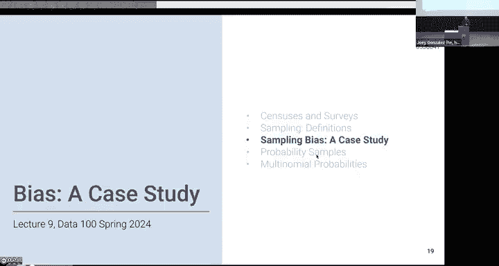
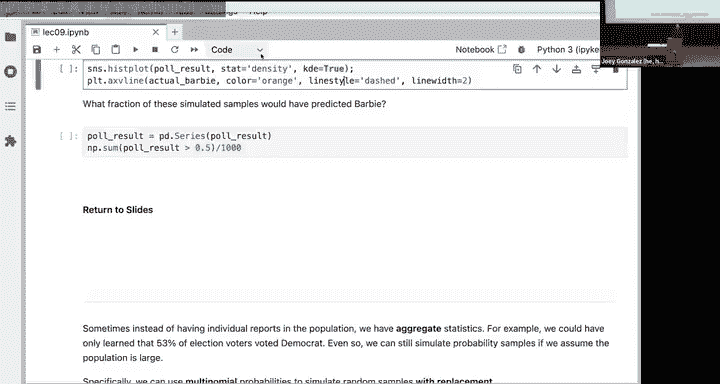
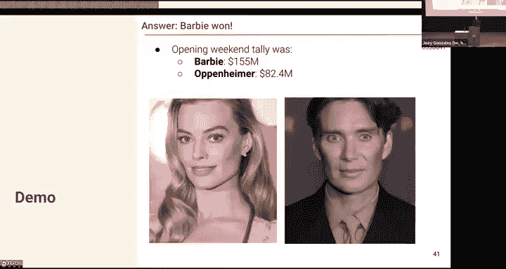
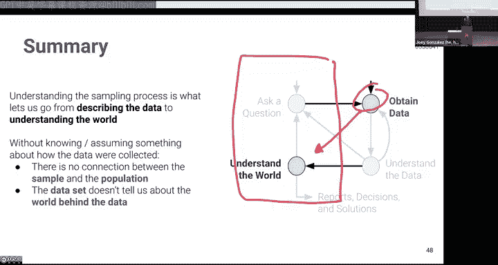

# 课程9：抽样与调查 📊

在本节课中，我们将学习数据科学中一个至关重要的环节：如何获取数据。我们将探讨普查与调查的区别，理解抽样的基本概念，并分析抽样过程中可能出现的各种偏差。通过学习，你将明白数据收集方式如何深刻影响我们对世界的理解和结论。

---

## 普查与调查 📋

上一节我们提到了从数据到世界的推理过程。本节中，我们来看看获取数据的两种基本方式：普查和调查。

**普查** 是对一个**总体**的完整计数或调查。总体是我们想要研究的全部个体（可以是人、事物、概念等）的集合。在普查中，总体中的每一个个体都应被包含在内。

**调查** 则是一组针对个体的问题或测量。普查工作者通常会进行调查来收集信息。

一个著名的普查例子是美国十年一度的人口普查。它由宪法规定，旨在统计居住在美国的所有人（而不仅仅是公民），其结果用于分配联邦资金、划分国会选区等。然而，即使投入巨大，完全准确的普查也极难实现，常常存在漏计等问题。

---

## 抽样的基本定义 🎯

既然完美的普查难以实现，我们通常使用**抽样**来了解总体。抽样是从总体中选取一个子集的过程，并用这个子集（样本）来对总体进行**推断**或**预测**。

在抽样中，有两个主要的误差来源需要关注：
*   **偶然误差**：由于抽样的随机性导致的误差。增大样本量可以减少这种误差。
*   **系统误差**：由于抽样方法或过程导致的、方向一致的偏差。这通常更难处理。

以下是理解抽样的几个核心概念：
*   **总体**：我们想要了解的全部对象。
*   **抽样框**：实际从中抽取样本的个体列表或范围。
*   **样本**：从抽样框中实际选出的个体集合。

理想情况下，抽样框应该与总体完全一致。但在现实中，抽样框可能无法覆盖整个总体（导致漏掉部分个体），也可能包含不属于总体的个体。理解这三者之间的关系是控制偏差的关键。

---

## 偏差的类型与案例研究 ⚠️

抽样过程中会产生各种偏差，影响结果的准确性。以下是一些常见的偏差类型：

*   **选择偏差**：系统性地排除或倾向于某些群体。例如，仅通过电话簿联系人的调查会偏向于拥有固定电话（通常更富裕）的家庭。
*   **回答偏差**：受访者可能不诚实。例如，在敏感问题上（如考试作弊）人们可能说谎。
*   **无回答偏差**：部分人选择不参与调查。例如，生活忙碌的人可能没时间填写长问卷，导致样本失去代表性。

一个著名的案例是1936年《文学文摘》杂志的总统选举预测。他们通过电话簿和杂志订阅名单发放了1000万份问卷，并预测兰登将击败罗斯福。结果罗斯福以61%的得票率获胜，预测完全错误。

失败原因在于其抽样框（有电话、订阅杂志、属于乡村俱乐部的人）严重偏向富裕的共和党选民，且仅有24%的回复率，存在严重的**选择偏差**和**无回答偏差**。相反，统计学家乔治·盖洛普仅用5万人的精心设计样本就做出了更准确的预测。

这个案例的启示是：**大数据并不自动意味着准确**，关键在于数据是如何获得的。

---

## 概率样本 🎲

为了控制偏差并量化不确定性，我们需要使用**概率样本**（或称随机样本）。

**概率样本**的定义是：我们必须能够说出任何指定个体集合被包含在样本中的**概率**。这并不意味着每个个体被选中的概率必须相同，而是整个抽样过程的概率是已知或可建模的。

最常见的概率抽样方法是**简单随机抽样**。它要求从抽样框中**无放回**地均匀随机抽取个体，并且每个可能的样本子集被抽中的概率都相同。

在数学计算中，有时我们会假设**有放回**的均匀随机抽样，因为当总体很大时，两次抽到同一个体的概率很低，且计算更为简便。

---

## 案例演示：伯克利电影偏好 🎬

我们通过一个模拟案例来理解不同抽样方法的影响。假设我们拥有伯克利市所有居民的普查数据，包括年龄、是否穿勃肯鞋以及《芭比》上映首夜是否观看了该电影。

已知普查的真实结果是：53%的居民观看了《芭比》。

如果我们进行不同的抽样：
*   **方便样本1**：只抽样参加我办公室时间的本科生（18-22岁）。结果波动很大（0.5, 0.7, 0.9），且可能存在偏差（来办公室的学生可能更特定）。
*   **方便样本2**：只抽样参加老年校园活动的人（>65岁）。结果稳定在0.37左右，明显偏向《奥本海默》。
*   **简单随机样本**：从全市居民中随机抽取800人。结果（约0.53）非常接近真实值，且通过重复抽样可以画出估计值的分布直方图，直观展示**偶然误差**。

这个演示表明，即使使用随机抽样，如果**抽样框**（如“所有本科生”、“所有老年人”）本身有偏，结果也会有**系统误差**。而一个好的简单随机样本能有效减少偏差。

---

## 多项分布概率 📉

为了从理论上计算某些抽样结果的概率，我们需要用到**多项分布**。当我们从总体中有放回地抽取个体，且个体属于多个类别时，多项分布可以告诉我们得到特定类别组合的样本的概率。

假设一个总体中，蓝色弹珠占60%，绿色占30%，红色占10%。我们进行7次有放回抽样。

得到“蓝、绿、蓝、蓝、绿、蓝、红”这个**特定序列**的概率是：
`P(序列) = 0.6 * 0.3 * 0.6 * 0.6 * 0.3 * 0.6 * 0.1`

如果我们不关心顺序，只关心得到“4蓝，2绿，1红”这个**结果**的概率，则需要计算所有能产生该结果的序列的概率之和。这由多项分布公式给出：
`P(4蓝,2绿,1红) = (7! / (4! * 2! * 1!)) * (0.6^4) * (0.3^2) * (0.1^1)`
其中 `(7! / (4! * 2! * 1!))` 是计算不同排列方式的组合数。

在Python中，我们可以用 `np.random.multinomial(n, pvals)` 来进行多项分布抽样，其中 `n` 是抽样次数，`pvals` 是各分类的概率列表。

---

## 总结 📝

本节课我们一起学习了数据收集的核心——抽样。
*   我们了解了普查与调查的概念及其挑战。
*   我们定义了总体、抽样框和样本，并区分了偶然误差与系统误差。
*   我们通过历史案例和模拟演示，深入探讨了选择偏差、回答偏差和无回答偏差。
*   我们引入了概率样本和简单随机抽样的概念，这是进行有效统计推断的基础。
*   最后，我们介绍了多项分布，为理解有放回抽样的概率计算提供了工具。

记住，数据不会凭空产生。理解数据是如何获得的，是做出可靠数据科学结论的第一步。在接下来的课程中，我们将更多地利用这些工具，从样本出发对世界进行统计推断和预测。