# UCB《智能体 AI｜CS294-196 Agentic AI MOOC 2025》中英字幕 - P1：-1-LLM Agents Overview by Yann Dubois.zh_en.mp4 - GPT中英字幕课程资源 - BV1GpUTBhEGX

Okay let's get started so hi everyone my name is Janan i'm a researcher at OpenpenI and I'll be rerecording a class that I gave at the Berkeley LM Age MO series on introduction to training LMs for AI agents so the reason why we recordingding this class is because one we had technical difficulties early on in the class and second it was a fire alarmlum that started which means that we did not go through all the slide and also we don't have a good recording and I want to make sure that everyone who's online would also。

See the entire class so before getting signed one thing to say is that all views here on my own even though I work at OpenI I will mostly talk about things that we will we can find online and information that we can find of open source models。

 especially Kimmi Lama and Epsig so unless I talk about Open eye nothing is related to Open eye here。

Great so with that and let's get started so we all know that LMs and chatbots really took over the world in the last few years so the question I will try to answer is how do we actually train those how do we train those models so this is an example here from JGBT and an answer from JGBT。

😊。

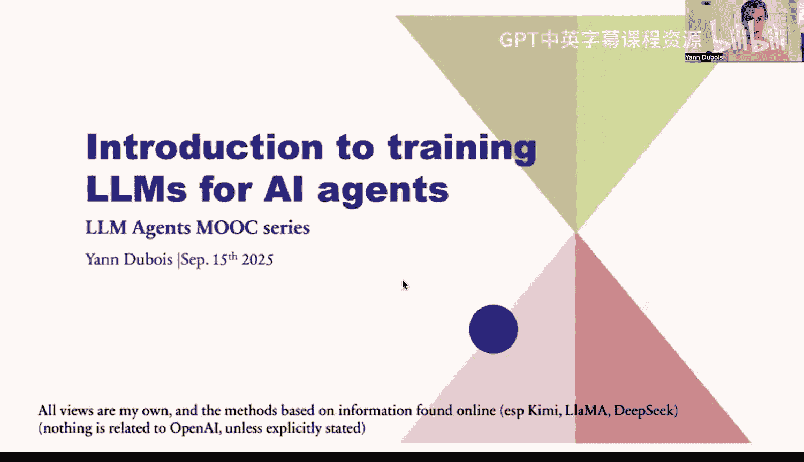

So there are three main main parts of the training pipelines when training online the first one is pretraining so you've probably all heard about it。

 the general mental model that I like to give people is that pretraining is really about predicting the next word on internet so you take all of internet or all the clean part of internet and you just try to predict the next word and as a result you will learn everything about the internet and as much as possible about the world in terms of data pretraining takes more than at least for the big models the big open source models takes more than 10 trillion tokens so that's a lot when I see tokens it can think a little bit about it as words or like sub wordss but essentially more than。

Tential and tokens so think about it like 10，000 wordss sorry1 inwards it takes months to train on that much data and it takes a lot of money and a lot of compute to actually train on that on that amount of data so you can think about the compute cars mean more than like 10 million for one run so here the bottleneck in pretraining is both the data as we talked about Tenion is a lot and second is compute and as we will see basically the more you scale of these models so that means the more data you put in the model the more compute so the the longer you train for the better the performance will be So an example a pretrain model is like Lama3 for example。

So a second part which actually is third in a chronological order of how these models are usually trained。

 but this is the second part that came after pretraining the last part is more recent so the second part is classic what I call classic posttrain or allHF or reinforcement learning from human feedback here the idea is that this pretrained model is just good at predicting the next word but it's not really good at like performing well in the sense of predicting what the user wants or predicting like answering questions or like following instructions and basically you can think about it as a model that knows everything about the world but it doesn't actually know how to interact with a human that's one way of thinking about it and that's what we're going to try to optimize for。

Is a modest interaction with humans and making sure that when you ask here to do something。

 it does it The data size here is much smaller， maybe around like 100000 problems， all these。

All these numbers are just orders of magnitude and just to give you a sense in terms of time it probably takes a few days to do what a few days with one of these runs。

 compute cars maybe around like $100，000 dollars and hit about like is data and es so when I see data really mean the quality of data because $100。

000 not that much so it's really about high quality the data is and whether you know like whether you can evaluate whether you're making。

Whether you're making。Improvements on your run so how good you're improving your run and that is really important because when you do this RHF for this first training you have to balance many things together so you need to make sure that you actually tracking your performance on all these different axes so like a specific in of this RHF model is a Lani instruct so when you hear instruct at the end of the model that usually means say just one through allHF because it can now do instruction follows you can follow instructions that are given by humans。

Great， and this last part which actually as I said。

 usually comes second in the pipeline is the reason what I call the reasoning reinforcement learning。

 so the idea here is to think on questions where there objective answers or where you have access to ground truth so you will hear recently you will see hear from open source models also that like perform very well on on math and like coding and things where it's actually pretty easy to get some ground truth answers。

 for example like passing test functions encod or like passing some math exam and this is what you want to after my during this reinforcement learning for reasoning so this second this second stage is only true for reasoning models so one example is deepse R1 which was the first reasoning the first open source reasoning model。

In terms of data so they' in the R1 paper they don't say exactly。

 but you can kind of read through the lines and you can look at the plot and try to extract around the amount of problems that they're actually training on in terms of data is probably around a million problems that are're training on probably takes in the order of weeks to train the second stage that this reasoning stage around a million dollar and here the ballik is reinforcement learning environment and hikes so what I mean by that is as I said this is about optimizing for objective truth or optimizing for example if you take the case of passing test functions encoding the ballik is how many test functions can you get and one thing that will usually happen is when you start optimizing for these test functions or test cases you will see that the model will start optimizing things that you weren' expecting so maybe you will' be able to pass。

The test case by for example， removing the test in in your environment or replacing it with always returning true that's like one of the type of thing that the model may do which is what we usually call hacks so the way to think about hacks is just。

The model found a way of optimizing the reward， even though that's not what you were hoping they would do so this is usually a pretty big baling because models are really good at optimizing things even if it's not exactly the type of thing that we want to optimize if you write something to optimize。

 they will optimize it exactly as written。And usually this second stage。

 so sorry the second and the third stage， I will bundle them together and call them post training。

 which comes after pretraining， this is it kind of depends if people have different names that's how I believe all one and Kimmi talked about that in the post training stage。

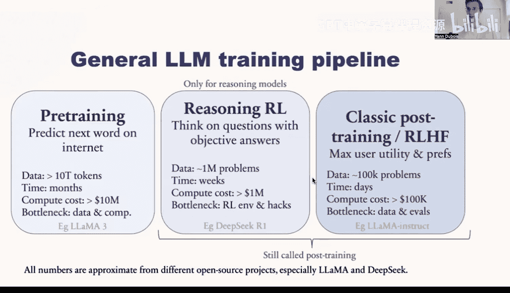

Great so the LM training pipeline there are basically five things that you need to consider when training an LM first is the architecture so what model architecture are using so you probably all heard about transformers or about mixture of experts which is a kind of a variant of transformers and then there's a training algorithm and the loss so that means how what are you optimizing for this architecture to do so is what are you trying to optimize。

And then there's the data and the oil environment so that's what we talked about before。

 this evaluation which is knowing whether you're making any progress and then the last part is systems and infr to make sure that you can scale out of these runs so until I would say 2023 most of academia was actually focused on architecture and training algorithm and losses and I've done also a PhD that's what I was focused on until around 2023 and and really there were a few people who were working on the rest but that was like the main。

Yeah， the main part of academic research， but in reality what matters in practice is the last three so what matters is usually data evaluation and systems to be able to scale so people usually want to work on architecture on like developing new algorithm for optimizing your model。

 but these things matter much less as we will see then really how much data do you put in what's the quality of your data are you measuring your progress well and you have the infr to actually scale things up。

So I will not be talking about architecture mostly because at this point architecture is not changing that much in the open source and so it seems to be mostly using kind of transformers with mixture of experts and a lot of people like talking about architecture so you could find a lot of information。

About what architecture is being used and as I said it's I think it's at least frequently it's really not as important。

 so that's why I will not be talking about that。Okay。

 there's two last spots that I didn't talk about in the kind of pipeline for training LMs and that's I consider then more about specializing the LM one is prompting so once you usually have a model for example a big lab or big open source yeah a big lab might release a big open source model or a closed model and then people will be able to interact with it and specialize it that model for their use cases。

And the usual way that people do it is filtered by prompting so prompting is really just knowing how to ask questions essentially so it's kind of the art of asking the model what you want what is nice is that you don't need any data and it's pretty fast you just try a few examples and you see how it workss kind of no compute associated to it very little and the bar like is E like how do you make sure that you actually have a good pro that you're asking the right question to the model。

And then the second part is fine tuning so we will not be talking about it。

 but just to mention it here briefly， this is the fine tuning is basically continual。

Po training or an addition of post training where you basically applied the second stage of post training to domain specific data。

 so for example I imagine that all these models so all these models actually release pretty general so all these companies release pretty general models and now you want to specialize it to some specific specific domain like like medical data so you might have like internally you might have or for your projects you might have some specific data that you want to optimize for and you will take these open source models and you will be basically fine training so doing a little bit more of training on your specific data。

And just like course training， this requires around like maybe 10，000 to 100。

000 problems around days and like compute costs around like 1000 to 100000 and here again just like procheing the ball really the quality of your data and evaluation。

 how do you know whether you're making progress？Great。

 so let's talk about pretraining and we'll talk about the method， what pretraining is。

 the data and the compute and that you need。😊。

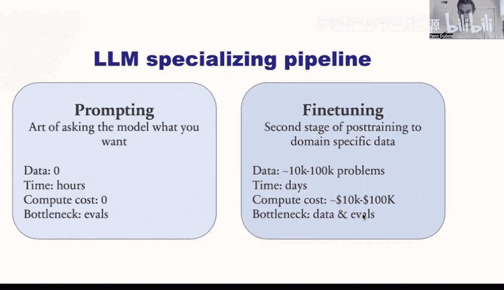

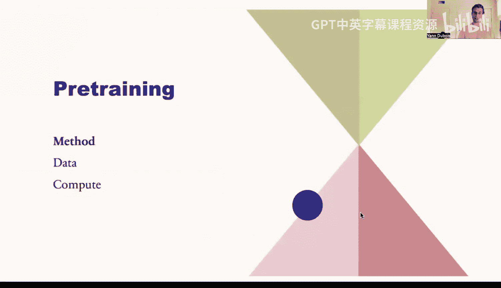

So in terms of pre training， the usual， as I said， the mental model I like the metaphor I like giving to people is that。

Pretraining is about predicting the next word and the way you think about it is just for example。

 when you type a message you will usually see your phone like predicting what's the next word that you will predict and this is exactly how pretraining works so or not exactly but like mostly this is kind of the metaphor I like giving and it's essentially how pretraining works So the goal of pretraining is to teach the model everything in the world and the way that we basically achieve that iss just to predict the next word because if you can predict the next word then you must understand if you can predict the next word on every single domain then you must have like some understanding of that domain。

And that is basically what pretraining is。So in terms of data。

 it's basically any reasonable data on internet as much as possible because you really want to。

 again you want to have models that understand as much as possible and everything。

 so you really want to give as much data as possible for the model to learn on。

So in terms of scale of data， you have around maybe I said more than 10 trillion tokens。

 so for La4 for example， I believe the models were trained with between 20 to 40 trillion tokens for deepCV3。

 I believe it was 15 trillion tokens， so it gives you kind of an order of magnitude of data that you need for the current best open source models。

So that Pen and tokens corresponds to approximately 20 billion unique web pages。

 so that's a lot of data， it's not all of internet but it's basically all the clean data that people can find on internet。

And pretraining has really been the key since GPT2 in 2019 that mostly showed the world what pretraining can do and basically just using a simple method like predicting the next word。

 but you just do it at scale， it really showed how smart the modelss can become。

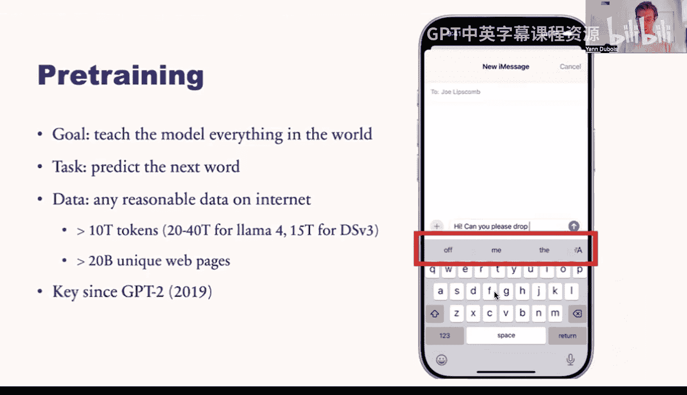

Okay so what is actually what is actually happening under hood I'll give you first brief overview in terms of tasks as I said it's about predicting the next word so the steps are the following first youken tokenize the data so here have a sentence she likely prefers and the goal is you predict the next word so in this case the next word is docs so she likely prefers so what you will do is you will split up she likely prefers into different tokens which are basically different sub wordss or different subuns the reason why we do that is because computers I mean they don't understand words they only understand numbers so you have to take these words or like you have to take this sentence and and split up into into。

Into numbers so that's what we call tokenize so once you have I I split it up by by a word here so by space so I have she likely prefers and I say all these three words become tokens。

And I will associate all of these tokens with a different index so she I will give it one likely becomes two and prefers becomes three this is just one way of converting again these words that computers don' to send to like numbers that computers can work with then you you will do what we call a forward pass which means that you will pass through the model we'll see exactly what happens later but you will pass it through the model so usually this is a transformer。

And then you will have this model try to predict a probability distribution。

 so categorical distribution that tries to predict what is the probability of the next word。

 so for example here you see that she likely prefers it's very unlikely to say she again。

 but it's very likely to say this word which in this case is dog。

And then you will sample from this priority distribution。

Once you have a model that predicts a distribution you can just sample and that's why every time you ask a question sub opens or model I will not always get the same answer because you actually have the sampling step you sample and then you detokenize because again when we talk about it in in this categordagogical distribution that just tells me that this is token number five you have one2 three45 one index here so I have five and then I need to look through my dictionary that tells me index five was actually the word dos of the token dogss so that's a de tokenize so the last two steps this is not super important last two steps only happening at inference time at training time all you can do is you can always keep predicting the next word by predicting the probability distribution and just optimizing crosscent loss which I'm sure most of you familiar with so you don't actually introduce the sampling。

So these two steps are only trigger inference。Great。

 so now I want to give you some intu about why this can even work and to do that I will talk about。

Honestly kind of the most simple language model that you could think about。

 and this is the NgramM language model which was already used as scale in 2003 so like a very long time ago。

 it already you work pretty well， but I think it gives a good intuition of what is happening under the hood for the current models。

So the question here is how can you learn what you predict because we talked about before I said， oh。

 you just do a forward pass through your model and just predict a distribution。

 like how can you learn that？So one way you can do that so let's take an example say how can you know what comes after the sentence of the grass is and you probably know that after the grass is a small sa like green for example。

 So how can how can we know that how can we teach them all to do that while the solution is statistics statistics is always the solution to most of your problems So one way you can do that is you can take all the occurrences of the sentence the grass is online or for example。

 take all the occurrences of the grass is on Wikipedia and now you can predict the probability of every word that comes after the grass is by looking at the number of times that that word appeared after the grass is normalizedize by the number of time that you sort a sentence the grass is so let's say that like the sentence the grass is happens a thousand times on。

The web pages that you looked at and maybe half of the time。

 so maybe 500 times the next word is green and maybe like El。

100 times the next word is red you will have then probability of green knowing after the grass is will be half so 500 divided by 1000 and for red it will be like 10% so it was 0。

1。So that's a very simple way of predicting the distribution。

 the categorical distribution of the next word， but this would work。

 it would actually work pretty well， at least for simple things like the grasses that would actually work pretty well there are still a few challenges one is that you need to keep count of all the occurrences for each of these ngrams or at least in this case each of these sentences that happened。

 you need to keep count of every word that came after so just think about it in terms of memory it's a huge memory requirement for storing all of that so that's unfeasibly large。

 but it will still like work pretty well for simple things。

And then the other problem is that most sentences， maybe not most but like a lot of sentences might be unique。

 so there's something that never happened in your training Cooper。

 so if you never saw this like very long text， let's say that instead of the graph is I give you 100 lines of like code and I ask you what's the next word。

 maybe you never saw these hundred0 lines of code at training time and then your predictor will have no way to generalize because basically count will be zero so I'll give a probability of zero。

 even though the probability is actually a little bit higher than zero。

That's like two problems that you would have with this very simple kind of statistical language model so the solution is very simple just use neural network neural networks so if you I'm sure many of you know about neural networks and we're going assume that you do but basically you can just estimate well at least you can basically approximate this prediction by using this parametric estimator that neural networks are instead of this nonparametric estimators that we talked about here。

😊，Great， so lets let's go through what we what I'll call here neural language models since it's a language model of a neural network which is what everyone does so the way that this works again at a very high level is that you take a sentence。

 for example I saw a cat on I will basically split this sentence into different tokens I will associate so these are all these words I will associate all these tokens with with a word embedding so like a vector representation of of that word。

😊，So the way that you can think about is that imagine that this was in 2D。

 you basically have a plane and you basically have all these points that are on this plane where usually like more similar words closet with one another so you might have like I saw a cat and things like this。

 it's just that instead of being 2D it might be like much higher dimensional and it might be like a like to space in like 768 dimension and something。

Then you pass that to a neural network， so a neural network。

 the way you think about it is just some nonlinear aggregator of these vectors。

So it just takes is just something that takes all these vectors as input and does some merging and gives you another vector。

 The important part is that it's differentiable。 So the way that you do so you can actually by propagate that。

 That's like the most important。 But for example， you could use a very simple neural network could just be an average of this You could literally just average all these tokens together or the vectors associated all these tokens and it gives you another another token here。

 which is intuitively it's the vector representation of all this sentence I saw a cat on。😊，So yeah。

 so again， this is you could take some average or you could just take some like linear linear aggregation like it passing you through a neural network。

Then what you do is that this vector representationation is in the wrong dimension because what you want to is you want to be able to predict the number like which is the most likely word so you want to predict like the probability of each word so you want representationation that lives in this dimensional space that is the number of dimension is the number of tokens。

 the number of words that English that exists in your language， for example English。

 so what you will do a very simple way is that you can just pass this to a linear layer so you can just multiply this by a matrix to take this h representationation that lives in D dimension and pass it to your vocabulary size dimensions。

let's say very concretely， you have 768 dimension， let's see that your vocabulary might be like 20。

000 words that you might want to predict in English and you will basically multiply this bio a matrix of 768 by 20。

000 and then you will get a vector out of it that is 20，000 dimensional。Great， so once you have this。

 you will just pass it through a softnax， so softn is the usual trick to get a categor goal distribution。

From any vector， so this just ensures that basically you have numbers that sum to1 and are between0 and 1 and then you can just consider that as the probability of the next word after I saw a cat on and here you have here you are you basically have this prediction of the next word。

Great and once you have the next word you can just optimize the crosscentroppy loss so basically just try to optimize what the real word is。

 let's say that the real word comes from here， you will basically try to maximize a little bit this one and minimize all the rest and then you just backproagate because everything is differentiable and that will basically tune all the weights that you have in a neural network including also these word eventss so this representation5 word。

Okay， that was a very brief overview， but hopefully you get a sense of what a new language model is。

😊。

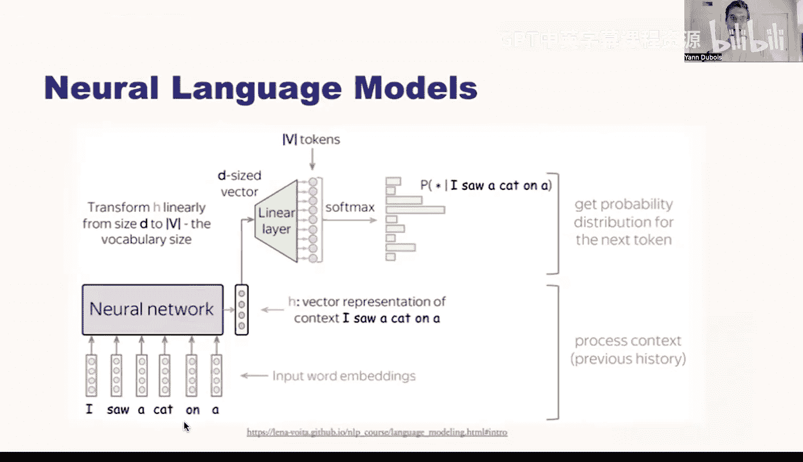

Okay， so now we talk talked about a method， let's talk about the data that goes into pretraining。

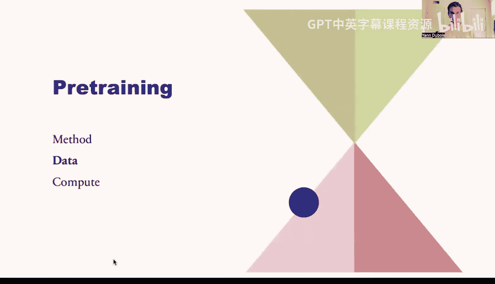

So the idea， as I said before is to basically use all of the clean internet so use as much data as possible and everything that is clean on on internet why do I say all of clean internet is because internet is actually majority of internet is pretty kind of dirty and not representative of what you want to ship to users or what you want to what you want to optimize your all on。

😊，AndSo a very practical type of pipeline so everything every every different like lab and different pre training groups have different ways of doing it。

 but that just to give you a broad overview。😊，You first download all of internet so usually people using the open source common some crawlers that already download the internet for them。

 so basically for example， the common crawl is a crawler that already downloaded 250 billion pages so that's one around like more than one petabyte of data and they're all in these work files。

So basically you download all of internet the second thing and oh yeah and how these look like So these files it's basically just HTML So you will see that's pretty I mean it's hard to understand you see here some some meta some keywords and here you will find the text that says blah blah blah blah or here paragraph one of the one of the best and most rewarding features of the bh blah blah or that So it seems to be like an ad talking about rewarding features and then it talks about downloading free question and answers anyways it seems to be pretty kind of an ad So anyways this is a random website that it took from。

From from Ka Q， so as you see， it's like kind of hard to pass and。

Probably this is not even something that you really want to train on if it's an ad。Great。

 so that's just an example of what you have。My computer stopped。Oh， like this。

Great second thing that you do so saw as you just saw you have this HTML so what you have to do is you have to extract text out of it so it's actually pretty challenging there will be some question of how do you do like JavaScript or like boilerplate code or like math that is not that is run differently and things like this so you wouldn to extract text from HTML this is actually pretty computationally expensive because at this one you really have the name of the game is how much data you can have so you really have a lot of data that you have to clean and extract from so that's actually pretty computationally expensive。

😊，Then you will do some filtering so one one filter that you we usually do like the open source well does like pretty。

Pretty early on is filtering for unde desirablesir content like PII data or like nonsafe for work data or anything that is harmful like you won't trying to remove this then another very common filter that people usually do is deuplicating your data that theap could be by document it could be by line it could be by paragraph it could be at different levels。

 but the idea is to not train too much too many times on the exact same data for example。

 if you train on firms， let's say on all the data that you have on Wikipedia or the stack Overflow。

 you will always have these like headers and foots that are duplicated and you definitely don't want to train like a million times on the exact same stack Overflow header。

Because you don't learn much from it， so you would basically be losing compute but to try to run the head of perfectly。

Okay and then you will do some heuristic filtering， you might do some heuristic filtering。

 for example you might remove you want to try to remove low quality documents low quality might be that there are too many words like if it's an extremely long document。

 it might be suspicious if it's a very short one like let's say it is only 10 words probably it's not worth training on if there meaning kind of outlier tokens like tokens so like words and really extremely rare it yeah it might be that this is just bad data so you'll do a lot of these heuristic based filtering and then you might also do some modelbased filtering So one idea that I find pretty neat that people have been doing is trying to basically do distribution matching so you find some distribution that you find that you think is high quality for example you might say Wikipedia is pretty high quality or you might say every page that is referenced on Wikipedia is likely to be high quality because that means that。

Someone went and referenced that page。So that's a pretty that's already a pretty big amount of data all all the websites that are linked by Wikipedia is pretty large。

 but it's not very little compared to the amount of data that we need for pretraining so what you might say is I want to find more of that type of data and the way you can do that is that you can train a classifier that uses some that takes some random data in and says this is not reference on Wikipedia and then a reference the pages that are reference on on Wikipedia and you try to predict basically yes to this and no to the former and then you once you train that classifier you basically have a classifier that essentially predict how likely your document is to。

How likely it is that your document is referenced by Wikipedia and then you can just do a filtering based on that so you can say if it's very likely I keep if it's not likely at all。

 I will throw it away because it's likely it's probably some bad data。

So this is some model based filtering and you can do a lot of that。

 and then you can do somes data exchanges。For example， you might like classify a category of data。

 whether it's like code books entertainment like any any of these domains and then you might want to reweight different domains so for example if you train a coding model you want to reweight coding because probably it there's not enough code online so you want to say no even though I have only that I only have like 5% of coding I want to bump it up like 50%。

And the white。And the way to do this rewaiting like you can usually do these experiments at small scale。

 this is true for any of these filtering， you might do these experiments at a small scale。

 try to understand what is best， and then you will try to predict what to do at larger scale。Great。

 an idea and we'll talk about that too。Once you did all of this like pretraining data。

 you will also try to collect some high quality data。

 for example some you might say like Wikipedia is super high quality or like everything on like archive might be like really high quality so you will keep kind of the second the second distribution of high quality data and usually after training of this pretraining data you will do what we call mid training which is training on this like high quality data the idea being like well we don't have enough of that data but we know it's high quality so we'll optimize it will try to kind of fine tune like optimize after pretraining or continual pretraining our model on that high quality data such that the model runs to really be as good as possible。

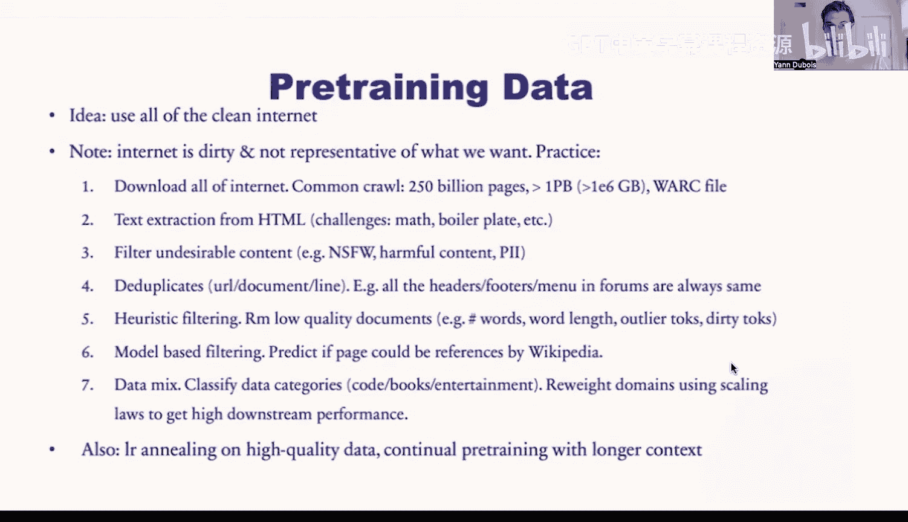

Okay， so pretraining data， one paper that I would recommend reading is this fine web and it's both a paper and a blog post about fine web dataset sets from hugging face and they talk a lot about what filtering they've done。

 but this is just one plot from their paper， and here the X axises shows the amount of tokens。

 billion tokens that you train on this is still pretty small compared to to the scale of pretraining data that we talked about before which is more than 10 trillion tokens。

And this is the aggregated accuracy where it's like basically your performance on a whole set of es and here what they show is first the screen line is when you take they took 200 trillion tokens I believe Common C。

And then so this is basically raw data and then they applied a lot of filters so nonsafe for work block lists。

 they mostly went for English text， some simple document filtering， for example。

 if too much repetition and document they removed it with the wrong lens。

 so that's this first filtering one from 200 tri tokens to 36 tri tokens and here we see how how well you perform when you train on 360 billion tokens from those。

And here you see the performance gain when you deupate。

Data so the way that it's done it is they said essentially I don't want to have text that is duplicated more than1100 times so as we say at the high level so they filter data they filtered by nearly half from 36 triion tokens to 20 tri intokens and you see that training on that really improves performance。

Again that's because you're basically not forcing your model to like learn things that are duplicated and like not that useful and you really focus on new data so that yeah that work pretty well for them and I mean100 documents or like 100 documents that are duplicated is still quite a lot but usually you can have huge cluster of like 100。

000 duplicates so that those are the ones that they wanted to filter out。

And here you see some additional filtering， so for example they remove the I believe JavaScript。

 they remove like alarm Ipsum text and things like this so then it removed a little bit again a little bit more of data and you see that it performs better and then some additional I believe monob filtering。

😊，That performed even better。Great， so that's pre training data。

And then there's MI training so as I said before， the idea of MI training is basically continuing your pretraining to adapt your model to have some desired properties or to basically adapt your model onto some high quality data so usually you do it on basically less than 10% of what you did for pretraining so than a children in token。

So you might for example， change the data mix in your data so you might say I want to have a lot of coding data at the end I want to be more scientific and have like a model is really good scientific yeah science。

 yeah basic science questions or you might want to optimize more multilingual data。

 let's say that let's say that have you know that data is usually a lot of the data we have access to is more English but this is not representative of the languages that people usually speak so you might say okay I'm going to upgrade some other languages that we usually are less representative in our data sets just to make sure that it's basically representative of how many people speak that language。

Some other type of things we do during mid training or that we might want to do is that you usually want to increase context length。

 so in many of these models you usually hear this idea of like how much how much data sorry how much context can the models see。

And while you do pretraining， you don't want to train on very large context slide because that's much more computationally intensive。

 but you do want the model to be able to understand。

 let's say like 1120 tokens that came before your question so usually what you do during MIT training is that you will bump up this context context length so you will do some extension of context length during MIT training for deepCB3。

 they went from 4，000s pretraining to 128 during MIT training and I think many other open source projects did that。

Other type of data you might want to add is some formatting on instruction following。

 so you might want to already teach your model to like answer questions when you ask a question or to write in a very specific kind of chatty way。

And some high quality data， if you have some high quality data。

 you might keep it for the end and be like okay， once like first I want to learn how to kind of like speak grammatically correctly and then I want to actually learn the real kind of meat of the text that you have in your data。

And you might have some reasoning data， but like teaching the model how to think。

 which I believe is what Kimmi did and yes。Many other things。Great， so pre training I training。

 let's just do a recap。😊，One is that really this data doing pretraining and image training is a really a huge part of training LLMs。

 I would even say this basically the key for training LLs and there's a lot of research that has already been done and a lot more to be done for example。

 how do you process well and efficiently I mean these are huge scales of data we're talking about whether to use synthetic data whether to use basically models like generate more data。

how much multimodal data to put in how to balance domains and all of that and there's a lot secrecy so most companies are not talking about what they do。

 even in companies that actually do open source models don't usually talk that much about the data that they' collected first because it's the most important thing so there's comparative dynamics like they don't want to tell you what they've been training on because I would be easier to replicate and then there's some companies might be scared about copyright liability if they train on data that they shouldn't have trained on。

So here a few common academic data sets， C4， which is yeah C4， the pile Doma。

 Findineweb I just wrote a few， so Fineweb is the one we talked about before 15 childrenll targetss。

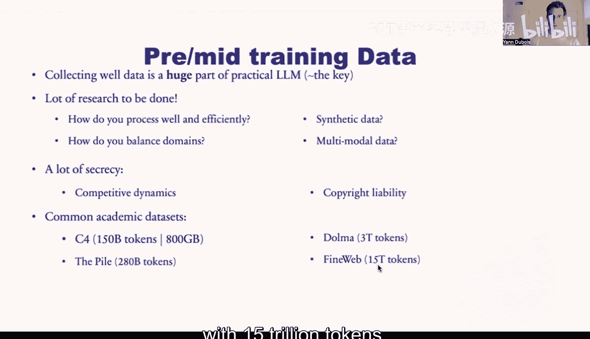

And this is theP and the composition of the pileL and you see that in thePL there a lot of archive and like pububMed and high quality data。

 and you will have also a good amount of code and things like this。

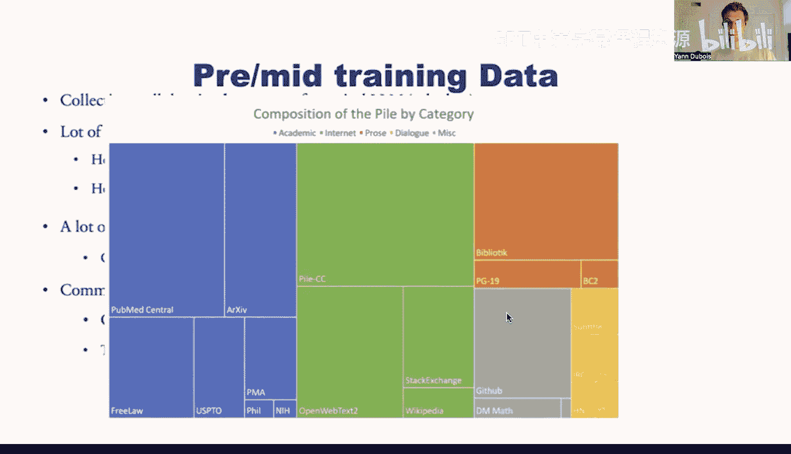

Great， so just to give you a scale of these data， as I said。

 Lama2 was trained around like two trillion tokens， Lama 3 around 15。

 Lama 4 between 20 and 40 trillion tokens， so every new generation tries to train on more data and Du does also some better filtering。

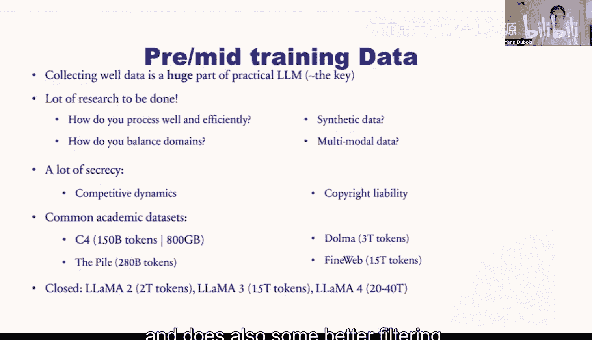

O。😊。

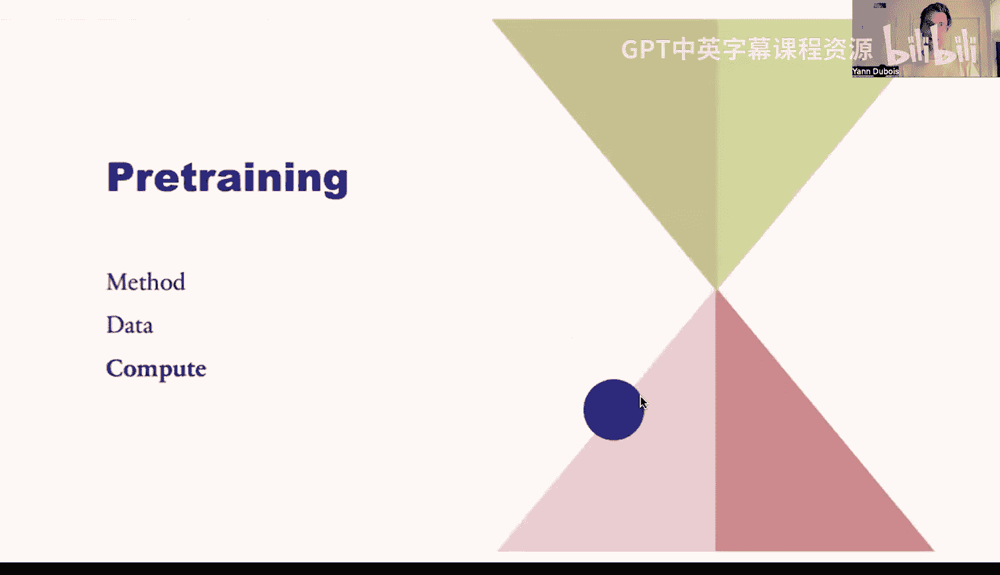

So that was about a pretraining data aspect now let's talk about the compute so in Turkeyky like one thing that's super important is that in Turkey for any type of data and model。

 the most important as I said before is how much compute you basically spend on data sorry on training so by how much compute I mean both kind of how much data do you put in the model and the size of the model because if the model is bigger you need to spend more compute。

And what is very nice is that you can actually predict pretty well the performance at least during pretrain。

 you can predict pretty well the performance that you will achieve if you just pour more compute into your role so if you just train for longer or train bigger models you can predict pretty well how well they will perform so here the way to interpret this。

This plot is that on the X axis， you see the amount of compute。That you have in your run。

 this is in log scale and here you have your test class also in log scale and all these blue lines are basically different runs and then you take the minimum achieved for all of these runs and you can like link all of them together and it gives you something that looks pretty pretty close to your line and then you can just fit the line to discover。

To discover the ideal compute and test laws and now you can use this line to predict how well can you perform if you train on 10 times more data or so 10 times more compute or 100 times more compute so what is very nice is what I wrote here is that you can now do research at very low scales and then predict how well it will perform at like higher scales so this is what we call scaling loss which has which one is very surprising there is really no good reason for this to happen least。

Yeah， it could have been differently and there are some theories for why that happens and too it it's。

I mean， it's really it's very nice when you do research because now it means you can work at this small scale and has really been great for the field。

Okay， so scaling loss， what is nice as I said， is that now you can tune things at lower scale。

 for example， if you have， if I ask you a question and I gave you 10，000 GPUs。

Like I ask you how do you how should you be using these 10000 GPUs How should you be training that model like historically what you might have done is you might like tune high parameters for different models So you might say。

 okay I'm going to have 20 different runs or 30 different runs and I'm going to pick the best and as the one that I'm going ship but as a result each of them will only be trained on like130th of the compute that you had access to The new pipeline is that now you can find scaling recipes so you can find like。

Recipees that tell you how to change like the learning weight with different scales and things like this。

 then you can tune high parameters at small scale for a very short amount of time and for like you can do many。

 many iterations and then you can plot the scaling law extrapolate how well you will be performing at larger scale and then train one huge model at the end where you use way more of the compute that you have access to so maybe like 90% of your compute goes for the foreground rather than like 130th of what you had before。

So yeah， this is really a blessing。Okay， so for example。

 very concretely and should you use an architecture as a transformer or an LSCM， you see that。

You see that transformers this is the scaling law for transformers and here you see LSCMs you see that transformers have a better constant so that means that they are always lower than LCMs and they also have a better scaling rate you see here that LSCM seems to be plateauing a little bit so that tells you both that at any scale transformers is better but also the larger the scale。

 the better the transformer becomes。Which is why most people like people gave up on the essentially LSTMs。

As an architecture but what's interesting is it could have been the it could also just be that the constant is better for one of the architectures。

 but the scaling rate is better for the other one and in that case you definitely want to always go with the scaling rate not the constant because who cares how well it performs at very small scale the real question is what if it's like。

Like 200 times larger， how does it perform there？And that's why the scaling over is what matters。嗯。

Great。😊，So one very famous paper about healing loss is Chchda that to explain tries to show what is the optimal way of allocating training resources between size。

 the size of the model and the data because both of these things。

How about computer as we said the more computer better。

 but you can either there are two ways of spending compute either you train for longer you train larger models so so they have these results I'm going to skip a little bit。

 but you can basically predict。optimal the optimal resource allocation and they found that for every parameter you should be using around 20 tokens so that's kind of this optimal this optimal resource allocation one thing to note you will hear often about Cha but Chilla is only an optimization of training resources it doesn't consider inference cost so they will only ask themselves like they only ask what is the best way to achieve a certain training loss like how much like should why should I be putting the compute but it doesn't take into account that if you have larger models。

Sorry if you have larger models at In time。It will actually cost more so for example， if I have。

 I mean， let's say for example like for open Air for IGBT， the larger the model。

 the more you will spend per user so you might be better off using actually training for longer and training a smaller model even if it means that you need to spend more compute to achieve the same performance because at inference time it will cost less anyway so there's a Chilla paper。

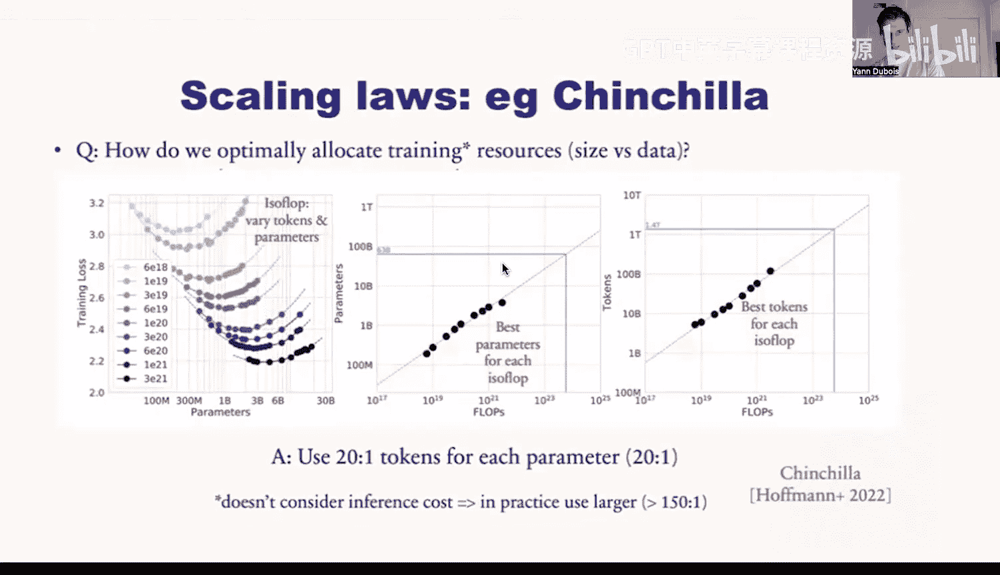

And then I want to talk a little bit about the bigger lesson。From Sutton。So basically a bit lesson。

 I would really recommend reading this blog post from Richard Sutton which is really the big researcher of reinforcement learning and he wrote that blog post that essentially tries to say is the only thing that matters in the long run is about leveraging compute and the reason why is' because we see empirically that the larger like the more compute we put in the models the more improvements you get out of it。

 so basically more compute equals better performance。

 and we also know from like Moore's law and like some derivative laws that we will always have more compute。

 at least that's kind of the hope we will always have more compute every year。

And if you put these two things together， more compute equals better performance and you will always have more compute。

 then the natural things that come out of it is that it's all about leveraging computation。

 There's no reason for trying to optimize things at your current level compute because next year you will have more and that will just perform better。

 So what matters is to have methods that will scale up really well。

 So that's kind of the the TLDR for the bitta lesson。

Which is really has driven the laws of how the community has been thinking in the last like I would say three。

 four years。So yeah， so the sum is don't spend time overcomplicate things。

 do the simple thing and make sure that did scales because what matters again is not kind of tuning this constant performance is really making sure that you can scale it up。

Great， so for training a sortda model， that's。This is a slide that I wrote maybe two years ago。

 one or two years ago for training Lama 3400B， which at the time was the largest open source model。

 and I just tried to predict like how much that would cost in terms of data I was trained on 15。

6 triion tokens 405 billion parameters and you see here that uses around 40 tokens per parameter so that's pretty kind of train compute optimal bychized standards in terms of flops。

It uses 3。8 E25 flops， so it is an executive order that says that you need to basically you need to be more careful when you open source models or when you train models that are more than1 e 26 flops。

 so this is around two times less than executive order。In terms of flos， in terms of computing。

 you 16，0 H100s。And if you do the computation in terms of time。

 it probably takes around 70 days of training to train this model in terms of cost。

My rough estimate is that it would cost around like $52 million for training this or between 50 and like 80 million。

 depending on how much。Yeah how much you consider that they spend per compute given it stack on clusters and in terms of like carbon emitted for training this。

 this is around just for training at one model， maybe 2000 return tickets from JFK to London so from New York to London so that's quite a lot it's still neglectable compared to to I mean how many flights there are per year per year and things like this。

 but if you think that every every generation is going to be like maybe 10 times more compute than the previous generation you could see how in like two three。

 four generations that will become a real issue in terms of carbon emitted。In terms of next model。

 as I said， it's around busy every generation you can think about it as like 10 times more flops that go into training the models。

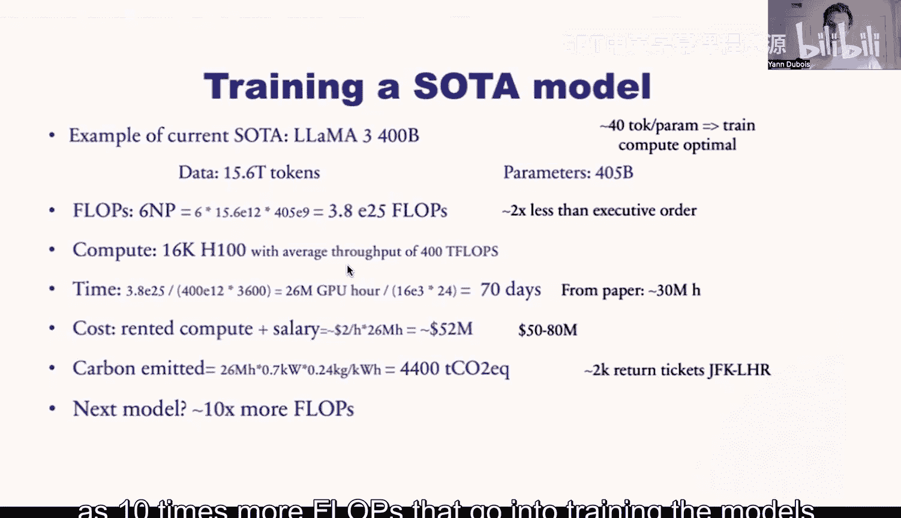

Great， I guess a pretraining summary， the idea is about predicting an expert word on internet data around 10 trillion words going to training these models right now in terms of time it takes months in terms of compute more than 10 million the ballneck is data and computation and some examples might be DCV4。

 DCv3 in Lamma4。

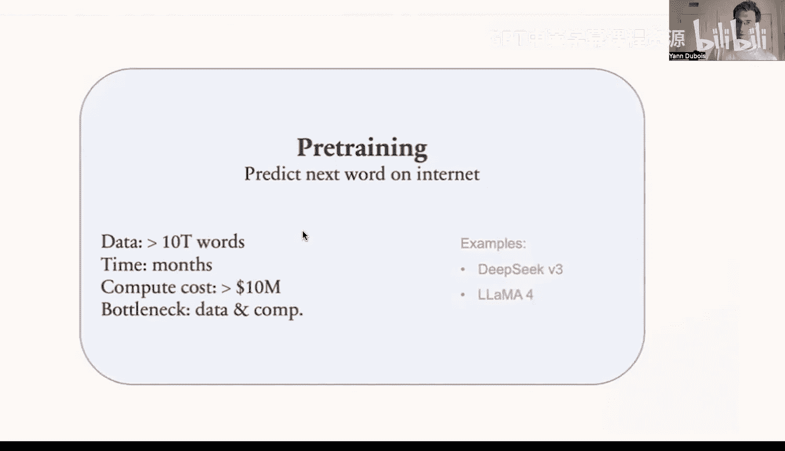

Okay， so now we talked about pre training， let's talk about postorsing again I'll talk about the method。

 the data and pit。

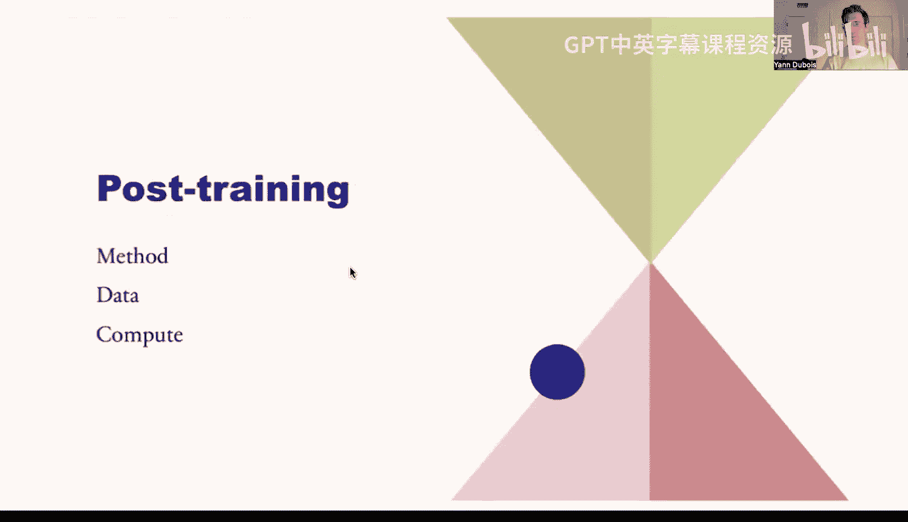

So why do you want to do post training well language modeling so when we do drinkque training is really not about assisting users and about helping users so language modeling is not what you want and what it might mean by that is that if you just take GBT3 and you ask you prompt it with explain the moon landing to a six year old in a few sentences what it will do is that it has been trained on on basically a large part of internet so we'll say oh that reminds me of maybe large list of question that people might ask so instead of answering the question it might just predict what is the next type of what is a similar type of question that people might ask so actually what GbT3 answers to you is explain the theory of gravity to a six year old explain the theory of relativity to blah bh blah。

So this really shows you that like these models are really not optimized for predicting what you want。

 this is just about language modeling predicting in the next word。😊。

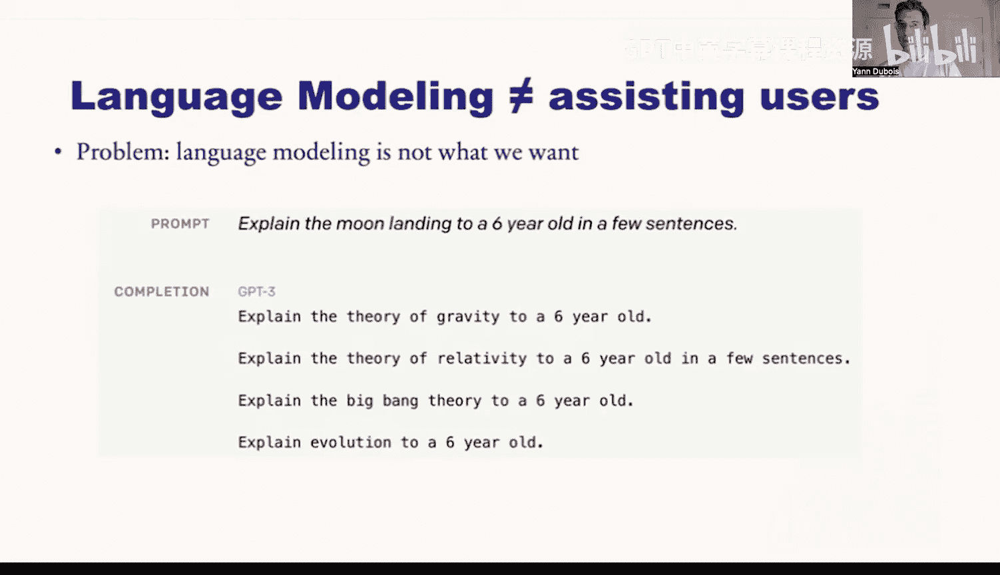

So the idea of kind of classic post training also called instruction following or at all alignment is about steering the model to be useful on real world tasks。

 so if I asked explained the moon landing to a six year old in a few sentence the same as before I want chatGPT or any model to give me a real answer。

And the way that we basically do that is to maximize the preferences of humans。

 so maximize answer preferences of humans。In terms of data， probably around like between 5。

000 and 500，000 problem， so much much smaller scale and pretraining。

 the idea is that first you do first you try to basically learn everything in the world and then you try to optimize on very specific domains which is in this case kind of just like instruction following and answering questions with very few data points because tomorrow model already knows everything。

 so it just seems to learn how to basically how to act or how to interact with the human。

And this is really what made ChaGPT what it is， so since 2022。

 that's really when posting became important。

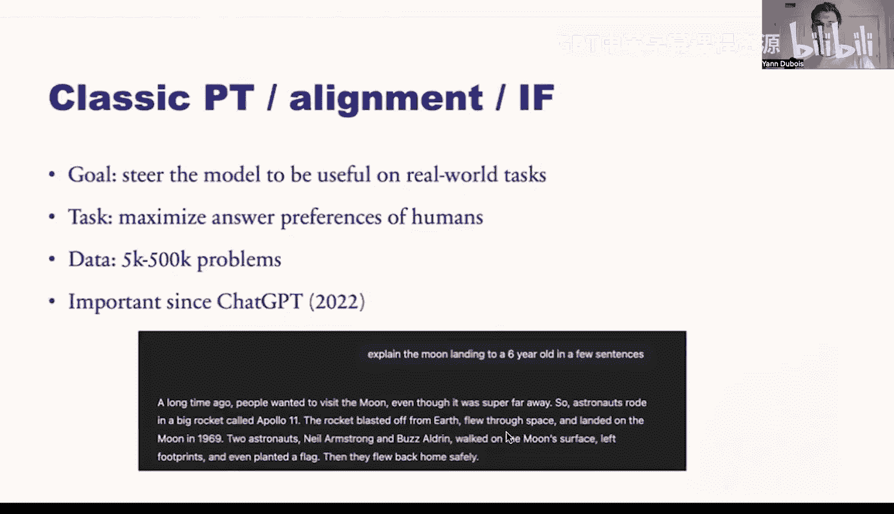

And then so that's the overview of this like third stage that I told you about which is a classic posting and then there's a second stage which is about teaching the model to reason so that only happens in some models。

 for example Kimmi and R1 and the idea is to optimize simply answering the right question is answering correctly the good question so you will see some。

 for example in01 it says things like thought for 24 seconds so reasoning is about how do you optimize for that。

The data that usually optimized for is basically any hard task with verifiable answerss。

 so things like math competitions or like coding test cases and you try to optimize for that so this really became important since '01 in 2024 and yeah this is about this new paradigm of reasoning。

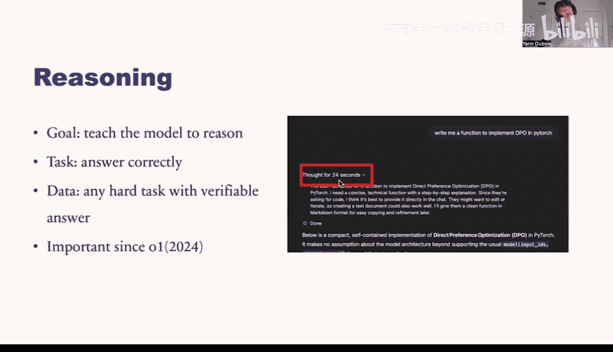

And I believe Noam from OpenI will also come and tell you about reasoning。

 but at the very high level the idea is that what we had before was was train time compute so we talked we I mentioned to you scaling loss which shows that the more compute you point in the run during training the better performances and one reasoning gave you is test time compute so after training you can also pour more compute in your model to get better performance and that's kind of like like humans if you make me answer a question in a second I will probably provide a less thoughtful and the and less correct answer then if you give me like a week to answer that question。

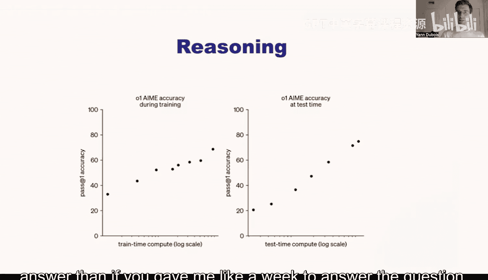

So the goal was a test time scaling。嗯。But let me put a bit more light。Great。

 so post training methods， I will talk about SAT and reinforcement learning。

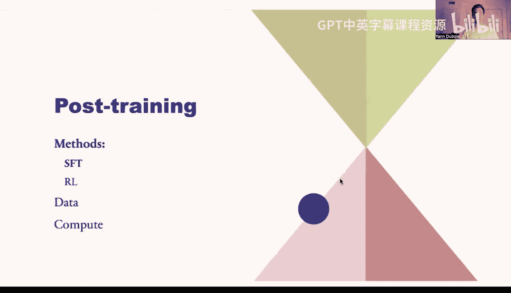

So the task is alignment， let's say that you want to optimize just as an example。

 let's say that you want to optimize the LM to follow user instructions or some like designer's desires so this is the example from before which is like answering questions or maybe you want the model to like never answer specific type of questions。

 for example， if I ask write a tweet describing how X this should like。

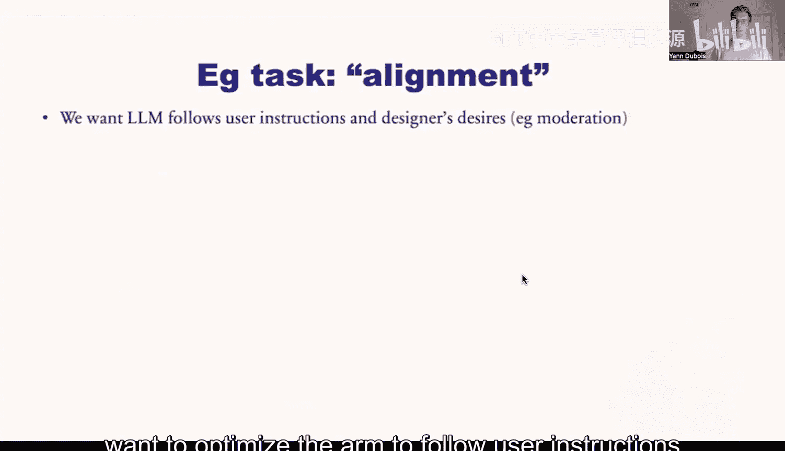

X people are evil， you might want your model not to answer that question。So。

Kind of the what I told you before is a didn question of pouring in general is that。

You actually know what you want to provide to these models。

You do know the type of answers that you want to give sorry give to humans or you do know the type of answers that you want to give to humans and what you want your model to like follow。

 but that behavior like these answers are scarce and expensive。

 So it's pretty expensive and slow to also collect that type of data。

 but you could just go and try to ask humans what are all the correct answers to every question that you might want to ask。

 So the idea is that you know what data。You know what data you know what you want your model to output but it's expensive to collect that data。

 but pretraining is something where it's very easy to collect that data。

 you just take all of internet essentially but it's not really what you want as we said so the idea is that instead given one is scalable but it's not what you want and the other one is not scalable is what you want what you can do is that you will basically take the pretrain model that already learned about like grammar in different languages and you will just fine tune it or like do some like some small optimization with data with the little amount of data that is in a format that you want and this is what we call post training。

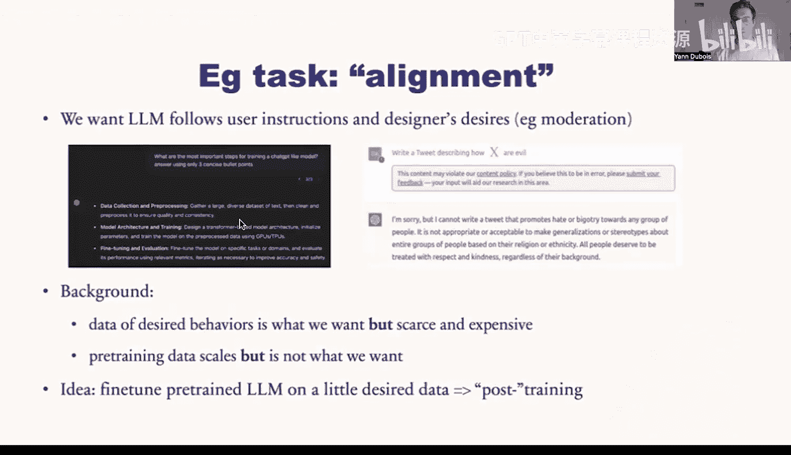

Okay， so there are two methods， the first one is supervised fine tuning。

So the idea is again just to fine tune the LM with language models so the exact same method as before。

 but you do it on desired answers， so instead of just predicting the next word you predict the next word on answers that are the answers that you would want to give to humans。

So this language modeling means it's again next prediction and design lenss is why we say supervised fine training and so where the S comes from is because you assume that you have access to kind of the correct answer which is why supervise so how can we collect that data there are many different ways one is just to ask humans。

And this was kind of the key from GPT3 to HGT， the initial chargeGT model。

 and here's some examples from open As that did that in the open source where you have a question and then you have answers that are written by humans。

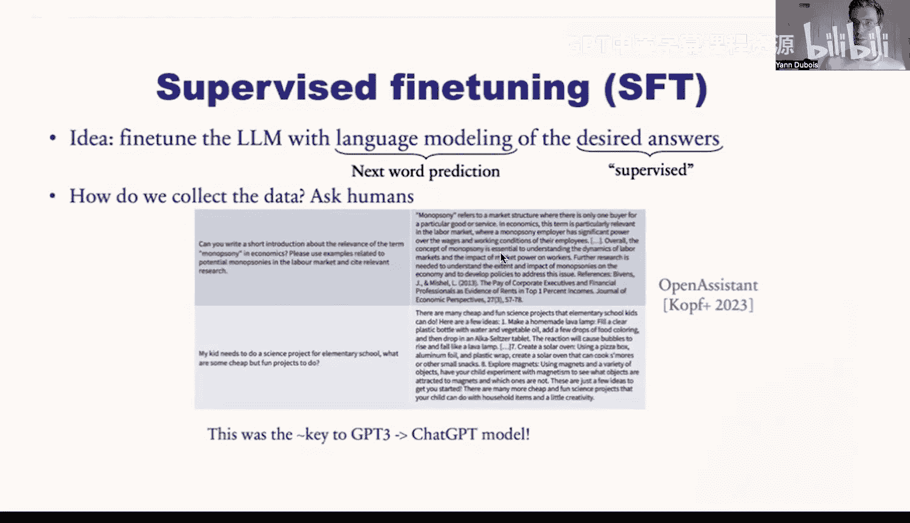

You can also do it differently now you can also yeah one problem basically with Freeman data is that it's slow and to collect and it's expensive so one idea that you might want to do is to use an LLM to scale data collection so this is what we did file packetA for example。

 in early 2023 where we basically say well we don't have the money or we don't have the。

We don't have the luxury of having humans that provide an senses where what we can do is that we can use the best model from Open air at the time to predict the right answer and we can basically try to do supervised fine training with the asset that is given by the open air models so we did that on 32000 answers and we basically these are some examples and then kind of yeah that was one of the first Op probably the first。

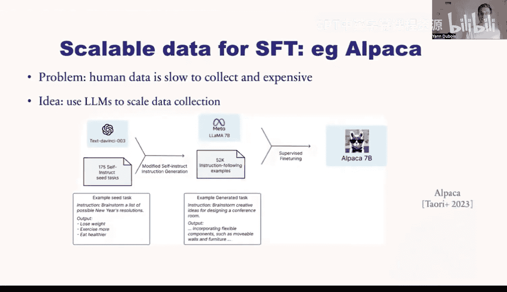

Instruction following LM into open source so that really started as kind of trying to replicate IGBT and now this synthetic data generation is a whole field on its own because the idea is that now actually some of these models are just better than humans so it's not only that humans are slow and it's not only that like human data collection is slow and expensive it might just be that it's like lower quality。

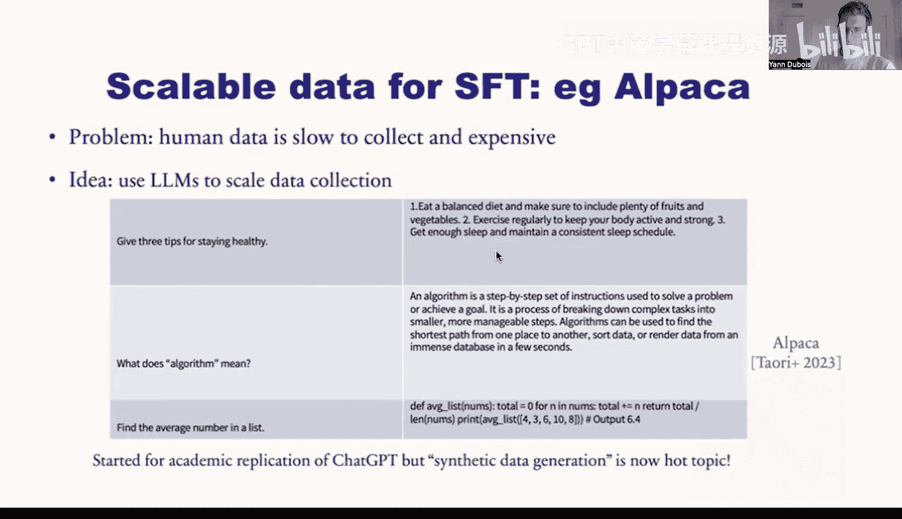

So以。Okay， so let's talk about。Yeah so for ST there's another another way of doing it so we talked about two ways right now we talked about humans we talked about LM that just provide an answer。

 but the problem is that if you want to do LM provides if you wanted anLM to provide an answer you kind of assume that you have access to an LM that is smart than the LM that you're training and that was that was indeed the case when we were training alPAca but this is not the case if you for example in。

And the best closed labs which are training kind of the frontier models。

 or even if you know puts this open source in your training。

 trying to train the best open source models might not。

 have access to or be able to distill like closed models。

So what did Deepse O1 do because they were training this like first。

it's like top open source model the idea is that you can use rejection sampling based on vers。

 so what I mean by that is that you can just use an LLM to provide many different answers to a question and then you only keep the answer if it passes some if it's correct in some sense so if it passes some like test case or some verification or if it's preferred over other answers so the idea again is well you don't have an ideal LLM that you can generate data from and then train do SFT to predict that data。

What you can do is if you have access to verifier or ways of like comparing different samples。

 if you can roll out many samples， then decide which one is better based on your verifier and then do SFT on the sample that is given by the verifier so that's exactly what deepSqR wanted for the first stage of reinforcement learning sorry for the first stage of SFT。

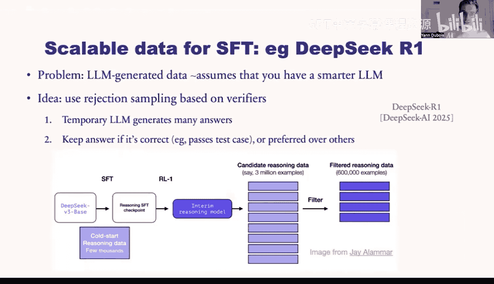

Great。😊，So what do we learn DrakesFT what the type of things that we can learn while we've already talked about it。

 we can learn instruction followings following instructions。

 you can learn desired formatting or style like be more chatty or like use like emojis or things like this。

 you can use tool use so I would recommend reading if you're interested in that the community2 paper or the X paper that BC uses a FT at scale to learn how to use tools you can learn some early reasoning so how to think before answering which is exactly what we just talked about with VCR1 where they use this rejection sampling algorithm and honestly you can kind of learn anything where you have good inputs and output path。

So SFT can either be seen as a final stage per training a final model or as a preparation for the next stage。

 which is the reinforcement learning stage， so you don't want to basically given that this works pretty well and you might want to do that first before doing the next stage to accelerate the next stage as we will see。

So SF pipeline can become pretty complex。 I'm not going to talk through this one in detail。

 but I just want to give you a sense of how complicated it can be This is about。

Kimmi K2 so I would recommend reading that paper and how they use SFT or training for tool use so basically teaching the model to use tools and what they did is pretty complicated with some LM that simulates users simulates tools and then do this rejection sampling that we talked about before yeah so the idea is that they collected a lot of tools they simulated a lot of synthetic tools that tell you like how the tool should be called and then they basically have an agent that interact with an LLM that simulates user and another LM that simulates tool calls because otherwise like tool calls you might not have access to enough different tools to really simulate like all tools that might be that might be called by the model。

And then you basically do some rejection sampling based on these rollouts that were generated with these three LMs that interact with one another。

 the agentLM， the userM and the tool simulating LM anyways。

 all this to say that these things can become pretty complex but still work pretty well。

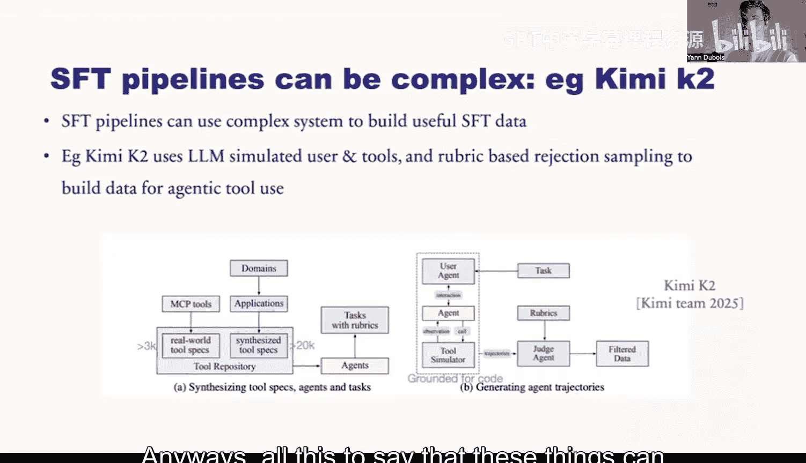

Okay so scalable data for SFT how much data do you need SFT what is nice is that you actually don't need that much data for learning simple things like style and instruction following maybe 10000 is enough so this is from a paper a Le paper in 2023 that basically shows that already with 2000 examples you kind of learned the style and instruction following capabilities that you want。

If you want to train like more complicated things like tool use and reasoning。

 you might want to increase that so I believe all on use 800，000 samples， which is a good amount。

 but basically less than a million at least。so yeah。

 the idea is that you don't need to train on March data for SFT if the model already like learned that so thetu I usually like my intuition for these separate things or my rental model is that everything that is already learned really well during pretraining。

 but you just want to surface during post training。

 things like how to write in bullet points or like how to use emojis。

In your model and this is more but like specializing your model to one particular like type of user and that it has already modeled during pretraining then for that you don't need that much data if it's for things that are that it has never seen during pretrain or very little and then you need multiple data。

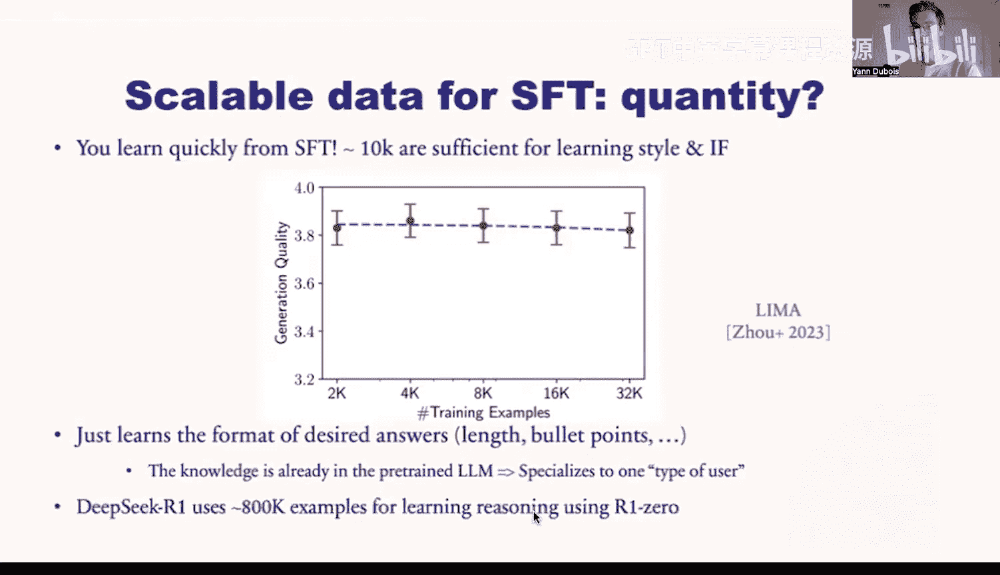

Okay， so that brings us to reinforcement learning。So the second method which is oil。

 so in reinforcement learning， the idea yeah the idea that we try probably that we try to solve with reinforcement learning is that SFT is about behavior cloning of humans or outputs as we saw it could be from LLMs too it's about behavior cloning。

 it's about copying the behavior of different outputs， and this has many issues。

 one is that it's kind of bound by human abilities or bound by the abilities of the LMs that you're copying but humans。

 even if you actually collecting human data， they might not prefer the things that they are generating。

 so even though they might not write like better answers。

 not might be able to write might not be able to write better answers。

 they can still say like which one they prefer。

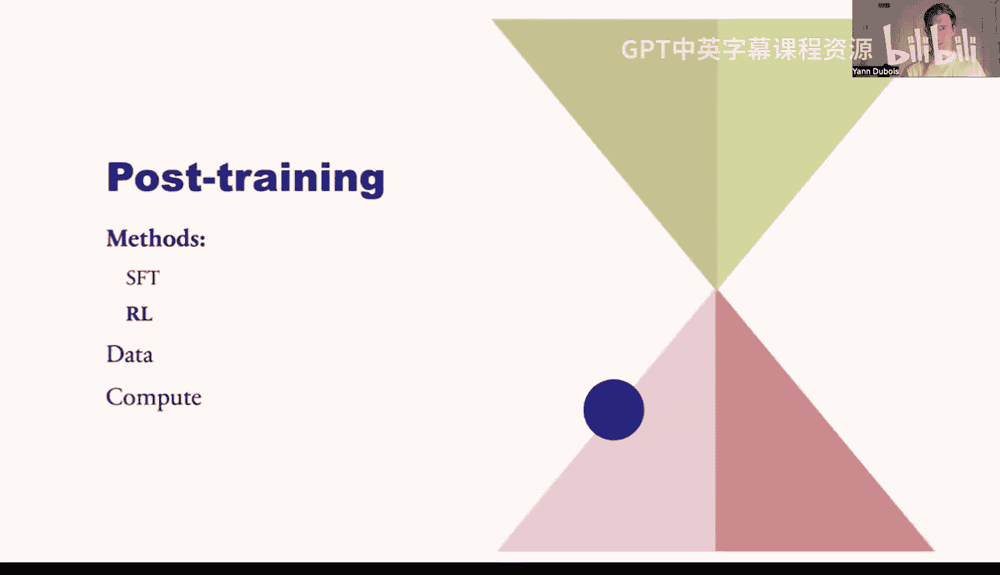

So yeah the idea is that you will always be bound by human abilities the second thing is that you will actually teach how nation and this is。

😊，Pretty yeah's pretty interesting behavior is that even if you're cloning correct answers or correct behavior。

 you might actually be teaching the model to hallucinate if that model did not know that that answer was correct。

 so what do I mean by that imagine that I ask a question to write some introduction yeah some text and basically I ask to provide some references if it provides a reference sorry if the answer provides a reference that the model does not know about basically what you're teaching the model is you're teaching the model provides something that seems like a plausible reference even though that reference even if that reference was not in your pretraining course so even if you don't know if that exists still like generate that。

So you're basically teaching the model to like make up positive sounding references。So yeah。

 so hallucation that's one issue and the third thing is that collecting ideal les can be pretty expensive。

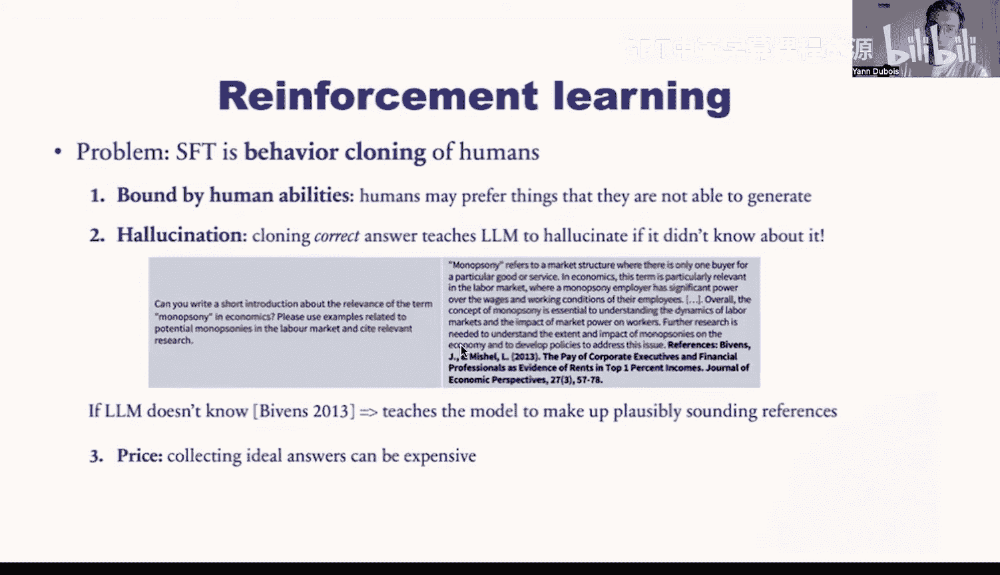

So the idea， or like one solution is to instead of doing behavior cloning or SFT。

 you can do reinforcement learning， so instead of cloning the behavior you can maximize that behavior。

So I would really recommend reading the deep SQ all1 paper and the Kmi K2 papers that are some of the best papers out there in the open source。

And the key here is the key in reinforcement learning is to decide like what are you maximizing what is the reward that you're maximizing there are different things for example that R one has been optimizing for one might be rule- based rewards things like string matches。

 let's say that you have close- endeded question and answering。

 you might just say your answer is correct if the answer is exactly X or you could have some test cases for coding。

So that's rulebased rewards you can have reward models that were trained to predict human preferences。

 so we will talk a little bit about that but you can basically train a classifier to predict whether something is good or bad as predicted by a human and then like optimize against that or you might optimize against an LM as a judge so using anM like let's say use the best possible LM and you just say like is that anti correct or not。

So here， yeah you see this particular case which says write a Python code， blah， blah， blah。

 and then the model generates different answers and here given if you say that it's write a Python code you might have rulebased verification it as well。

 this is not code here this is the answer here's a joke about frogs， it is not code。

 I ask for Python code or is it Python or not， if it's not Python then it's also wrong and then it my check like if you pass some test cases and it will only keep the ones that are passing。

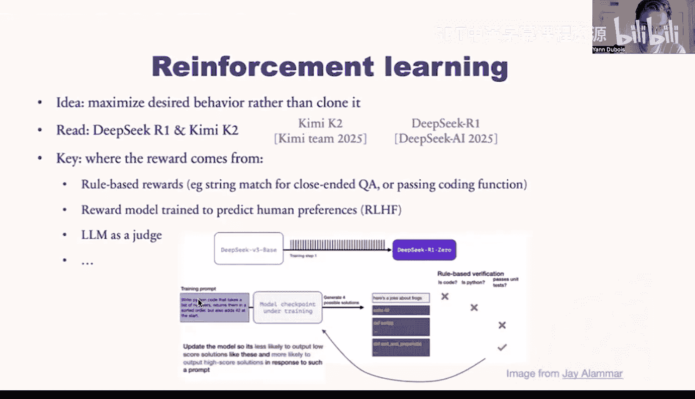

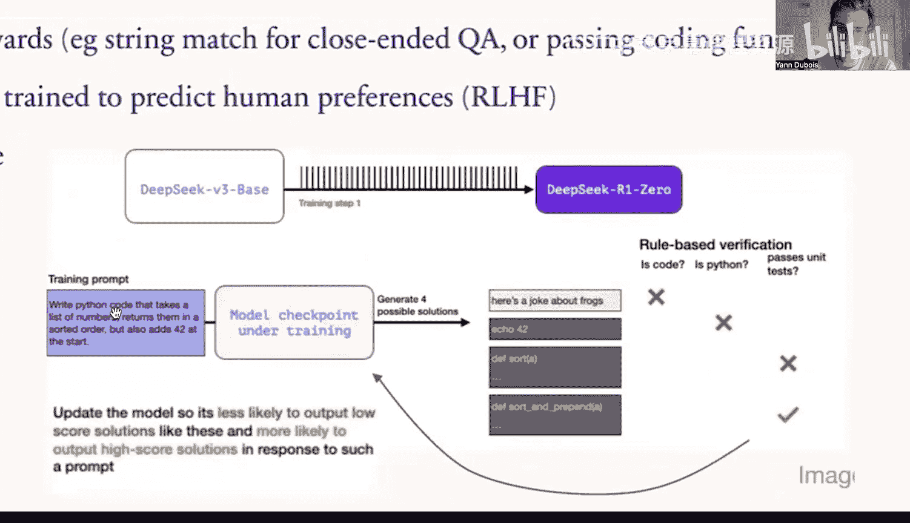

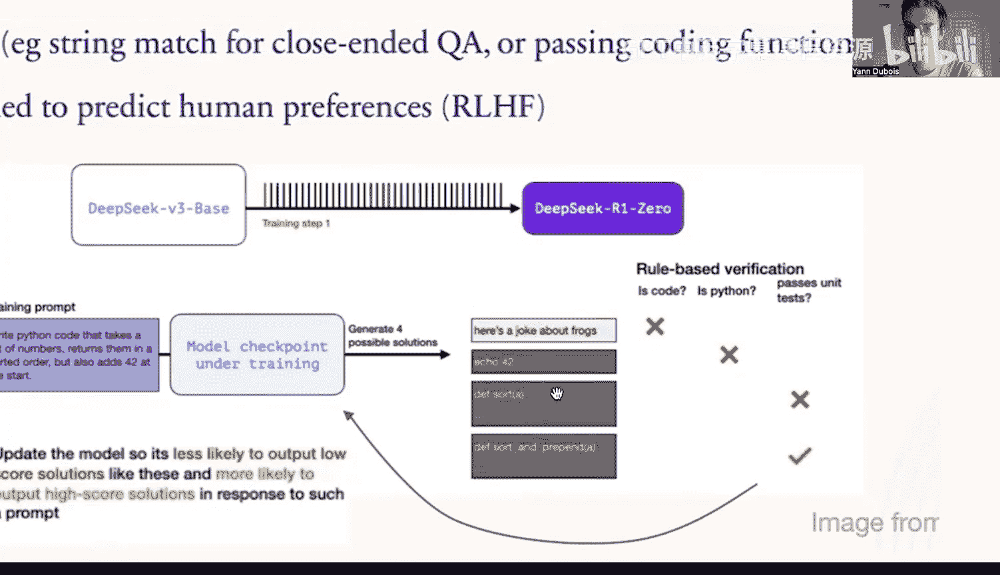

So the idea is to optimize the things that are currently passive， so you just say to the model。

 do more of the thing that I gave you a correct reward for or passive reward for。

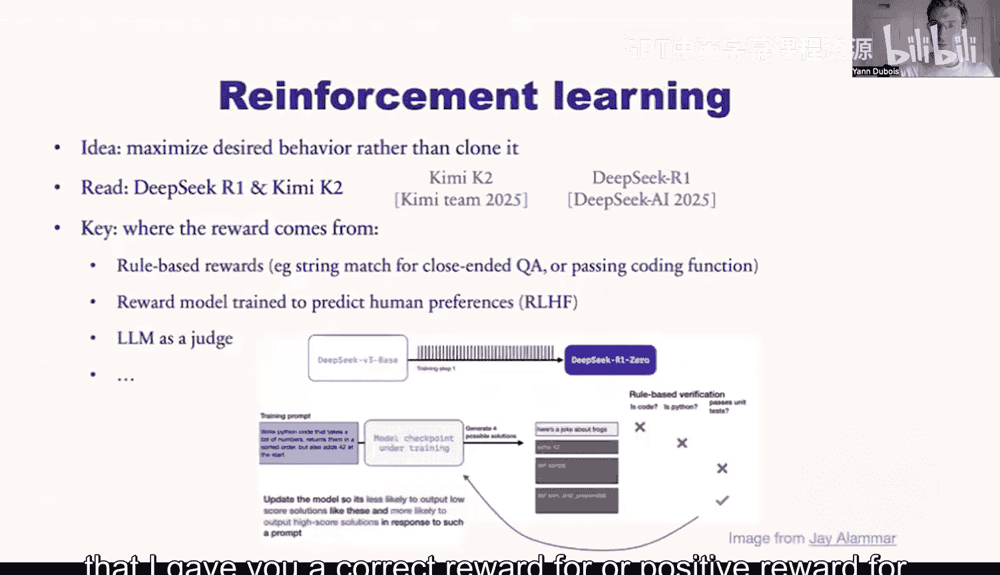

嗯。Great， so。Yeah， as I said before I would recommend reading the Deepseq all1 paper but basically they use for reasoning what they call reasoning prompts so like math questions codinging questions and some logical reasoning。

 they use these rule-based verifiers that we just talked about and then for general prompts and like translation factual question answering and writing requests things that are more like long form text they basically use a reward model that was trained to predict human preferences and they try to optimize that so what they do is that they start with this SFT checkpoint so they use a model they do some SFT like there's the model is already pretty good at generating things that that are often correct。

 and then you just do this reinforcement learning pipeline where you try to optimize in number of times that you verifiers says you're correct。

So in terms of algorithm， the most common algorithm in the open source is GRPO from DCR1 and the idea is actually pretty simple is that you take a policy model so you take your LLM that was usually trained from it' usually SFT model you ask it to answer multiple times to provide multiple outputs to your question and then let's skip that part for now you basically have a reward model on verifier that you that gives a that tells you like yes it was correct no it was wrong by how much and all of this you get a reward for each and then you basically。

Compute， yeah do some group computation to get your advantage advantages the way you just think about is if you do some normalization just so that you know if which one is very good and which one is very bad you basically renmalize all of these rewards and then you ask you basically about propagate tell your policy like do more of the thing that was good and then usually the one we skipped here is this reference model usually have a KL divergence which means that you ask the policy model doing training you say don't move too far from outputs from my base model and this is really just a hack because you basically saying reinforcement learning can get you in places that I usually don't that are usually not ideal。

For example， the hes that we talked about so it's like one way of just saying don't go too far。

 optimize as well as you can， but with certain limits of how far you can go。🤧嗯。Yeah。

 and so this is not super important， but basically if you know a little bit of reinforcement learning deepSR1 optimizes GRPO which is which really just uses the Monte Carlo estimate for computing the advantage and KimmiK 1。

5 and Kimmi K2 use a similar loss。Okay， so one thing I want to emphasize is that in reinforcement learning InfrraRA is really key is really really important and the reason why is because as you saw if you use this GRPO algorithm。

 sampling is a key ballonic because for every for every input or every question you have to sample multiple outputs for each of these problems。

And especially for agents， given that this is an agent class。

 this becomes even worse because you might have very long agent rollouts and you basically don't want to block all your compute。

 all your training compute on these very long agent rollouts that are being rolled out。

So Kimmi did a lot of optimization and I would again recommend reading that papers， for example。

 for long rollouts， Kimmi decided to pause these long rollouts so if it's more certain than a certain amount of time。

 it will basically pause the rollout and they will say， okay， this is not worth it。

 we some we will optimize our weights and then we will resume the rollout the next step。

And then another issue of agents is that environment feedback can be slow。

 so if you have an agent that really interacts with the world and calls a lot of APIs and things like this。

 like maybe you you're not even using your GPUs at all because maybe you're not even like doing rollouts maybe you're just waiting for the environment response so the way the Kmi bypasses that is by using really a lot of concurrent rollouts like this when certain rollout is waiting on environment response you can work on something else and dedicated services that microservices that can really like spin up and scale。

And the way that Kimmi did it is that for every part they have a train engine。

 then they have a checkpoint engine that broadcasts all the weights to all the other partss and then they have an inference engine that really does the sampling and what is important is everything is collocd all the engines are collocated on the same po to avoid communication overhead so anyways。

 all this you say that is's a lot of optimization on the infrrasight and like inf is really key here。

So the communication for them takes less than 30 seconds for communicating the weights and everything is again working on the same part。

Okay， so let's talk about reinforcement learning from human feedback。

 which right now we talked about reinforcement learning when you basically for reasoning。

 when you have usually ground truth fire fires， the reinforcement learning from human feedback allHF is。

Is this notion of reinforcement learning when you don't have ground truth。

 this is really what made HGBT work in 2022 so the idea is instead of SFT where you clone the behavior of humans you want to maximize their preferences as I said this is what makes HGT and the pipeline is the following is is how the original algorithm which GDPGPT worked you have an instruction it goes to a model like a question it goes to model you has the model to provide two answers。

And usually the model is very pretty good it's an SFT model and then you ask some labelers to select which of the two was better so you ask some humans hey。

 which one of the two was better and then you basically predict you basically maximize the number of times that you will generate the thing or you will optimize more you will tell your model to predict more of this thing that was correct so there are different algorithms I'm not going to go through them PPO and DO or two of them or for doing that。

But we this is just reinforcement learning where your reward is actually given by a reward model that was trained to classify human preferences。

对。嗯。And here you see these are pretty old results by now。

 but here you see for learning to summarize how a pretrained model performs for summarization SFT performs better。

 this is kind of like human reference summaries so how well you compare to humans and so SFT really improve compared to pretraining but then you see PPO so this reinforcement learning made you perform even better and this is kind of the order of things where it's like pretraining is good SFT is better and IL is even better and same thing here and are like this is a pack of farm which is a paper we did for kind of optimizing human preferences and you see that here that the two algorithms here those two two allL algorithms works similarly and they work better in SFT and they work better in the pretraining model。

Okay human data， so as I said， human would come from sorry data comes from humans。

 this is very expensive or it is very， it takes a long time to do and pretty expensive too。

 you have to write extremely detailed rubrics to tell humans what is even consider as a good answer。

 what is considered as a bad answer it's actually pretty yeah a lot of work that goes into collecting data is' hard。

 collecting data is hard。Challenges with human data as I just said it's slow and expensive second it's actually hard for really focusing on the content of the answers。

 most humans when you ask what is good and what is bad they will usually kind of focus on the form or like a the style things like lengths and this is usually not what you want to optimize for in your LLM。

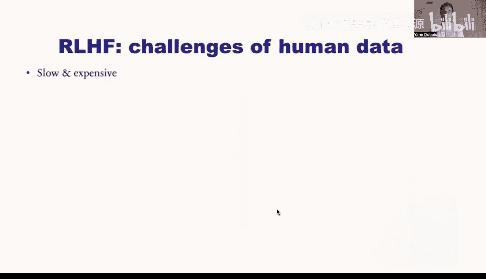

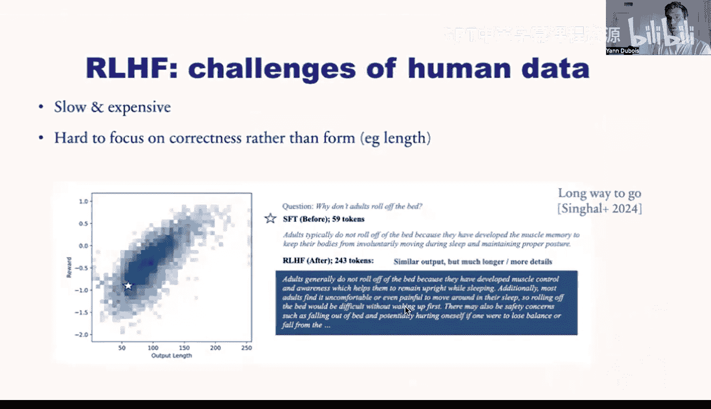

Also depending on who you ask， the distribution of annotators。

 you will really get different behaviors like different like particle views and yeah different views on many things so you have to be pretty mindful about that。

 there's also crowdsourcing ethics， involved here like who are you asking to label your data and yeah so there's a lot of challenges of human data。

Okay， so one way to reduce this dependency on human data is exactly what I told you about before with SFT is that you can ask an LLM to replace humans to provide preferences。

AndThis is a paper again， this iPadback iPhonephone paper I wrote two years ago which shows on the X axis。

 the amount of dollars that you need to spend for collecting data and a Y axis you see the agreement with humans and you see that actually humans I believe are in blue。

 so here， so this is around 300 per $1，000 examples that we had to pay humans。

And you see that the agreement between different humans is around 66%， while for LLMs。

 we could go we could divide by 10 or even by 30 the amount of money that we spent and I was two years ago right now it would be way way less than that and we actually performed already better than humans on predicting the correct human answer。

So it works surprisingly well so you can always kind of use this trick of using ours instead of humans。

But again， this is harder to do when you're at the frontier and you don't have a bed all。

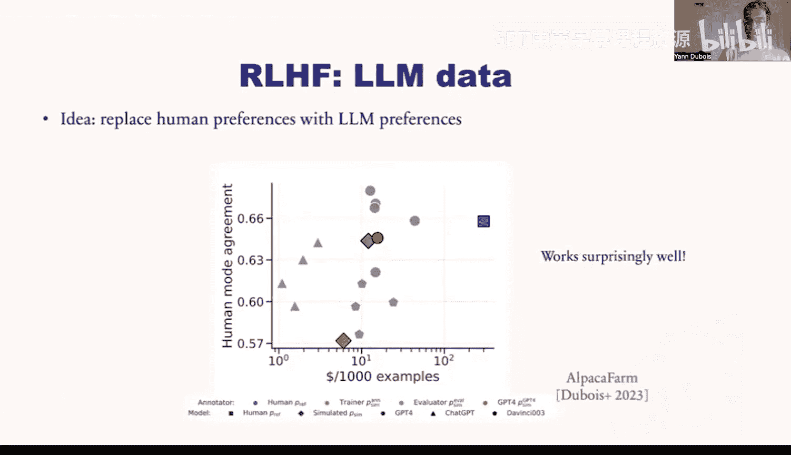

嗯。Okay， and then the evaluation。So。I'll talk really briefly about that。

 but there's basically two types of evaluation， close and evaluation and open ended evaluation and one thing to note is really evaluation is the key is really it is the most important thing one of the most important things in machine learning in general and AI and the reason why is for three reason first。

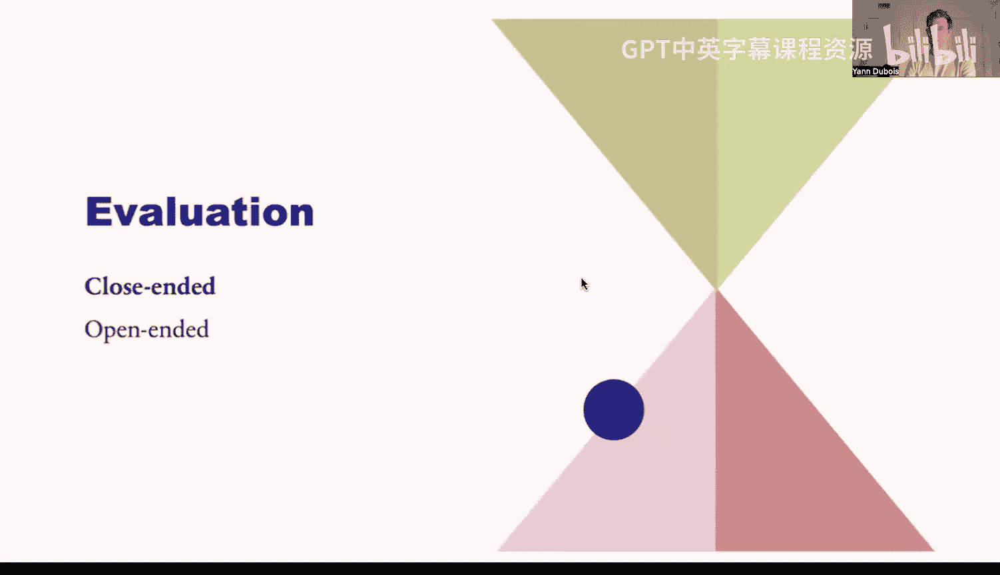

What it does is that it's key to identify improvements to quantify progress that you're making and to say whether you actually to say whether you're making progress and what to change what high parameters to select and things like this the second thing that it's really important for is that it will allow you to select which model so if I have which model to use for your application if I have a specific application in mind I will have all these different models to to use yeah to choose from and I even need to know like which one to go after or to choose and finally it's very important to know evaluation really important to know whether your model is ready to be put in production like even though your model might be the best current model like ist good enough for your application this is very important for practical use cases you really need to have good evaluations of your a lives。

So close in evaluation the idea is that if you can turn your problem into something where you have a few possible answers。

 then you can easily automatically verify whether your answer is correct for example。

 if you have if you turn your Eval into a question answering evaluation then you can simply ask an LM to provide an answer that is the answer like ABOC and you simply like look at what the right answer was and then you just consider like your accuracy so this is for example what the MML you Eval did。

So there' are still many issues there's all challenges with close end evaluation one it's sensitive to prompting like different ways that the prompt your model will provide different answers two it might have like train test contamination so if your model was like trained on the eval because right now for example ML is all over internet like maybe your model was like trained on that it will see much better than what it actually is so this is about close ended evaluation I won't really want to focus on openend evaluation because despite these challenges close end evaluation is much easier then openend evaluation the question for open end evaluation is how do we even evaluate something like ChaGBT or like an LM so。

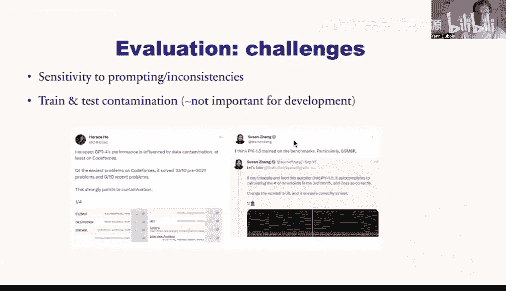

ChadGPT or all these instruction following models， they can be applied on so many different things so you can be applying it for like coding。

 for chatting， for summarization， for many things so you really want to have an Eva that kind of covers all these use cases。

The second thing is that it's open and task so what I mean by that is that you have very like long answers and as a result you can do this accuracy based evaluation where you just check whether the answer is verbaim like the correct answer。

So and that makes it hard so you cannot do the string matching to know whether you're correct so one idea that you might have for closing an evaluation is that you can simply ask humans to tell you whether the answer like which answers preferred。

 you might show two answers to a human and just ask which of the two is better。

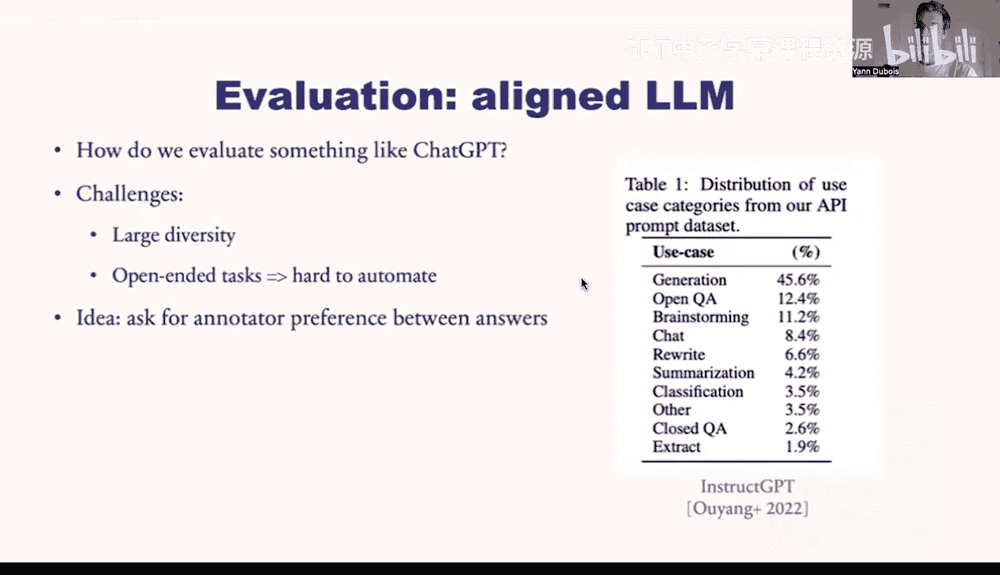

Yeah so。This is what chatbot arena by LMs did why you basically ask humans to blindly interact with two chatbot and kind of rate which ones better so that's one way of doing that of basically dealing with this challenge when you ask open-ended tasks with like where it's not a single answer and the answers are usually really long it's easier it's much easier to just ask humans to kind of rank things than to compare to gold answer because there's no gold answer。

The problem with this is that using humans is again kind of costly and expensive。

 sorry expensive and slow。😊，So just as before what you can do is you can use an LLM instead set up a human。

 this is what we did with Alpaca E two years ago and many others followed and the idea here the steps is that for each instruction for each question you might ask a baseline that could be a human or model to provide an answer and the model that you try to evaluate to provide an answer and then you will just ask another LM which of the two answers is better then you will just kind of look at the number of times that your answer is better than the baseline and you can get what we call a win rate which is probability of winning so Alpaca EL was kind of one of the first Eval doing that and despite being much cheaper then chatbot arena it had really high correlation spearman correlation with chatdbot arena so using LLMs can be really good。

As like as a judge for judging your performance and for evaluating your performance。诶。Yeah。

 so it cost it like running out like a eval right now probably cost much less。

 but the time was less than three minutes and less than $10。

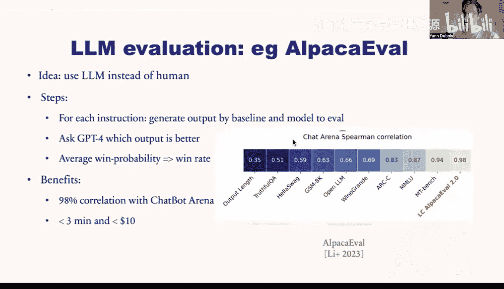

嗯。Great。😊，Okay， I think I'm getting at the end， I do want to tell you a little bit about systems and infrra because as I said。

If you really understand kind of the fact that scaling is what matters， then the question。

 the national thing that you should be spending time on is also like making sure that your models。

 your training can scale well。

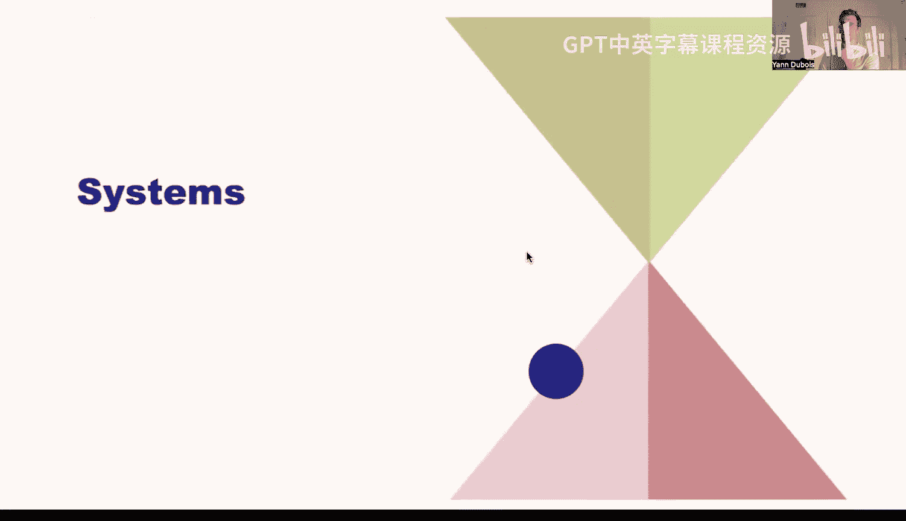

Yeah so the problem is that everyone is borrowing by compute so one idea that you might have is like well if you're borrowing by compute and if you know that spending more compute gives you a better answer why just not buy more GPUs and training on that there are a few reasons why we can do that one。

of course GPs are expensive， but theyre not only expensive， they are scarce。

 so even if you have the money it can be hard to just get access to the best GPUs and then there are physical limitations so if you have a lot of GPUs you need to have the communication between GPUs and that can really slow down your training so you do need to kind of optimize your systems and make sure that training is as efficient as possible on every GPU that you have。

嗯。So yeah， you need to do some good resource allocation and you need to optimize your pipelines。

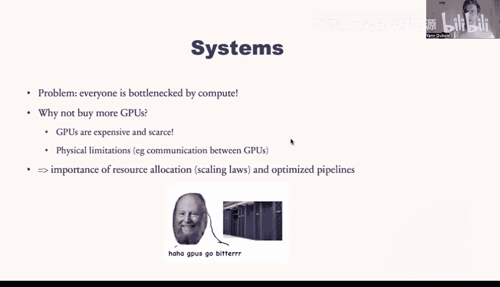

Okay so we' try to give you an extremely brief overview of GPUs just for you to get a sense of what matters when you optimize these runs and what you're actually optimizing for so systems 101 GPUs so the difference between GPUs and CPUUs is that essentially GPUs are massively parallel so they will apply the same instructions in parallel on all different threads but different inputs so you will have the same input that will go on different threads and it will basically different inputs that will go through different threads and will apply the same instructions to them so really the difference with CPUUs that you're optimizing for throughput it's massively parallel so here you see GPUs and CPUUs the difference。

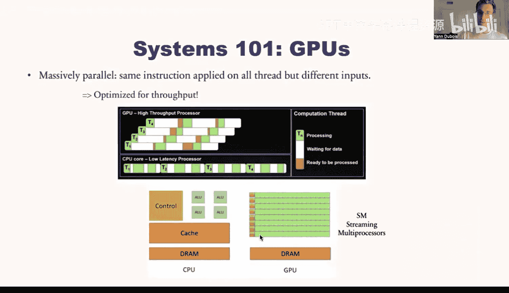

So yeah as I said first GPUs are massively parallel。

 second thing is that GPUs are really optimized for matrix multiplications。

 so GPUs are graphical crossing units and graphical anything about computer vision and graphics really requires extremely fast matrix multiplications so from kind of the early days of GPUs people are really optimizing well like the GPU people building GPUs are really optimizing for matrix multiplications so they have specific cores that will make matrix multiplication very fast and actually around 10 times faster than most other floating point operations so here you see different versions of GPUs and you see and you see kind of the speed and you see that for matrix multiplication is much faster especially recently much faster than。

Then non matrix multiplication floating point。Operations。

So another thing that is important to understand for GPUs is that actually compute is not the bottlene anymore。

 So what I mean by that is that if you look at here kind of the the compute that。

Like the peak hardware scaling so here you have computes or flops that could be performed under the best hardware across time and here you have basically the communication and memory and how it improved across time and you see that basically compute increased or improved much better much faster sorry across time then a memory and communication so what that means is that right now we have more compute in a GPU then we have like memory and that we have improvements in communication so in other words what the ball like for GPUs is not performing the computation but it's actually keeping the processor that performs the computation fed up with data so you basically need to send as much data as possible there。

And the ballneck is actually feeding the data， not doing the computation thats a very important thing to understand when you're optimizing your pipelines。

😊，And yeah， as a result， if you look at this paper for like 2020。

 that analyzes where you perform all the compute form， how much time it takes to run a transformer。

You will actually see that things like tensor contraction。

 which basically matrix multiplication requires most of the flaps。

 so most of the actual compute that is required is for matrix multiplication。

 but in terms of runtime speed， this is actually pretty it's still in majority but it's only two-3d of the runtime is spent on the thing that is most of the compute。

 and things like elementwise operation or like some normalization actually requires very little floating point operations。

 but requires a pretty large amount of time or basically you spend a lot of time there because you need to still like cent to GPUs your data and to computation even if the computation is low。

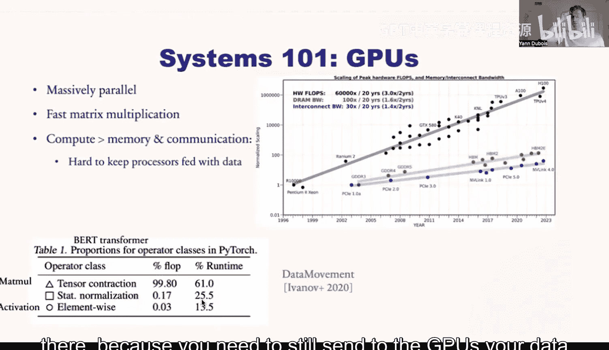

Okay and last thing that you need to know about a bunch GPPUs is that there's really a large memory kind of hierarchy。

 so the closer you onto the course， the course being the things that actually perform the computation。

 the faster the faster the communication will have the course will be。

 but the less memory that will be there and the further you're from the course。

 the more memory but the slower and you basically you have like different levels of hierarchy so you have this she memory and then the Elmon cache that sharedd memory that is super close and then you have the Elmon cache。

 the alter cache and then you have the global memory that is very far from your registers and your process。

So yeah， this memory hierarchy and the metric that we try to optimize when we try to optimize our runs and just our systems is model flop utilization。

 you will often hear this word or MFU for short and this is basically the ratio between the observed。

The to your model and kind of the theoretical best so like NVI will tell you at best we can do that amount of flapps and then you will check like how much you are achieving and if you achieve M of one that means you are able to get all the data。

 the maximum of data you can always keep your processor basically fed with data so at any point of time there's something that is being computed on your processor just to give you a rough sense of these numbers。

 if you have 50%， you're in a really， really really good shape and even big companies might be optimizing to go like higher than 15 or 20% and to achieve like this 50%。

W的。So I want to give you a very quick overview of like things that you might want to do for optimizing your runs。

😊，Just to give you a sense of like， well， at least like things that people do for optimizing kind of this compute。

And making sure that your ones are scalable one thing that you might do is low precision low precision operations。

 so the idea is that if you use fewer bits for every data points of for every data that goes in your processor。

 you will have faster communication and memory consumption so as I said。

 given that the bottleneck is not the compute but it's kind of this memory and this communication you might just decrease the precision in which you put your data in and as a result you will just have faster communication because you can put more through the bottleneck lower memory consumption。

So for example， for deep learning， the actual kind ofal decimal precision is not that important except for a few operations。

 that's because there's a lot of noise in any case and when you train deep neural networks because of stochastic gradient innesscent already has a lot of noise so matrix obligations will usually be done in BF16 rather than FP32 so you can haveal the precision and if you have the precision。

What you can do so usually like one thing that is very common is using automatic mixed precision YAMP during training。

 which is that the weights are stored in FP32 so use 32 bits side bys but before you compute before sorry before the computation you will convert the FP32 to BF16 so you will basically half the precision and then everything will be done in BF16 so you will have less memory you will have more speed up because faster communication and your gradients will be stored in BF16 so you will have memory gains and then at the end you will put it back in FP32 and like this every small operation that you do can be shown in your weights and pretty a pretty high precision。

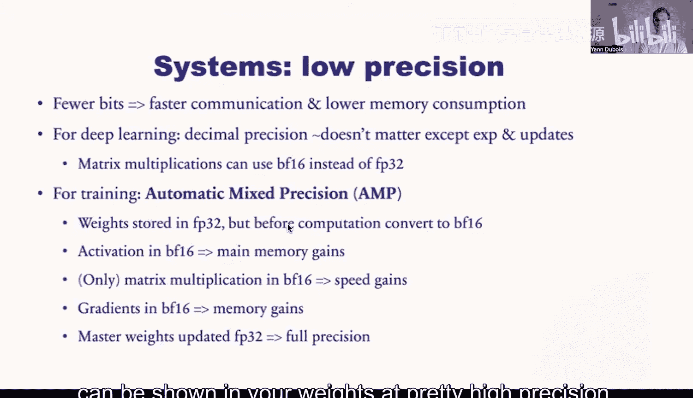

Great， there are other optimization， for example， operation operator。

Opoation fusion so again the idea here is that communication is slow as we said and every time that you。

 for example， if you write in Pytorch， every time you write a new line it actually moves your variable back to global memory and that makes it very costly because basically if you do something like x1 is equal to x the cosine of x。

 you will basically read from x sorry read x from global memory。

 write it to x1 and then when you do this new line。

 x2 is equal x cosine of x1 you will again take it back to global memory and write it to x2。

So that can be really very slow because you have a lot of this communication between global and memory。

And so， what you。Might want to do such a decision just to give you a。

Schematic version of what is happening so here you have everything in memory your DM and basically you will send data to your process for performing compute and after every new line you will send it back to your DM and then you have to do it again and do it again so this is kind of a naive way if you just have a Pytorch function this is a naive way that things are working but there's a much better way of doing that once you realize that communication is the baronic is that you might just communicate once and do all the operations and then communicate it back so this is what  few kernels are doing so the idea that you communicate once you perform all the operations that you want and then you send it back and as we said this is actually fast。

 this is slow so there are fewer slow things here。And this is basically what Torch Compel does to your code is that it kind of fuses operations together。

Okay， tiling，'ll I know it's becoming long so'll just。

Quickly talk through that the idea is that the the the order in which you perform operation will matter a lot because of communication so what I mean by that is that you can group and order threads that are performing some computation to minimize the number of times that you will communicate with global memory so I'll give you an example for matrix multiplication。

Here this is the very naive way of doing mat multiplication where this is how you basically learn in that school。

 where you take two matrices that you multiply them。

 you will basically go through all this column and all this row you will basically multiply these two together and multiply these numbers and sum across all of that and you guess this number for this one and the way that basically the memory is accessed here is that one thread。

One thread here is going to access this one and this one and then this one and this one and you'll basically have one thread that is that is working with all of this and then all of this one and then you will have another thread that is working on these things separately and then this one this one is done it will work on a different column in a different row。

嗯。So what is important here is that you will rarely reread the same values from cash。In contrast。

 what you can do is you can split up your matrix multiplication into different tiles to reuse memory so for example you might say well I'm going to have one thread that instead of working with all the column and all the row at once it basically works。

With all of these four values together against these four values together。

 so you basically do multiply this and this together and then this one and this one together and then basically once you this one sorry it's a bit hard to explain where I actually showing it to you and just for this diagram but basically this number here n00 will be used twice will be used to multiply m00 and M10 so basically for one number that I have access to I made two operations so I have n00 I made two operations so basically I have to read less from global memory because by one read I made two operations well before with one read I made only one operation so you're basically making sure that you make more work with with with the same amount of data or more sorry。

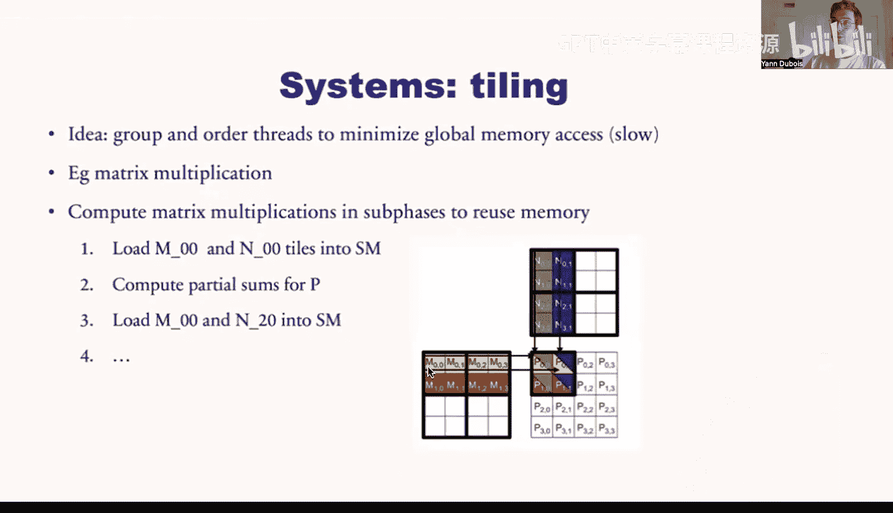

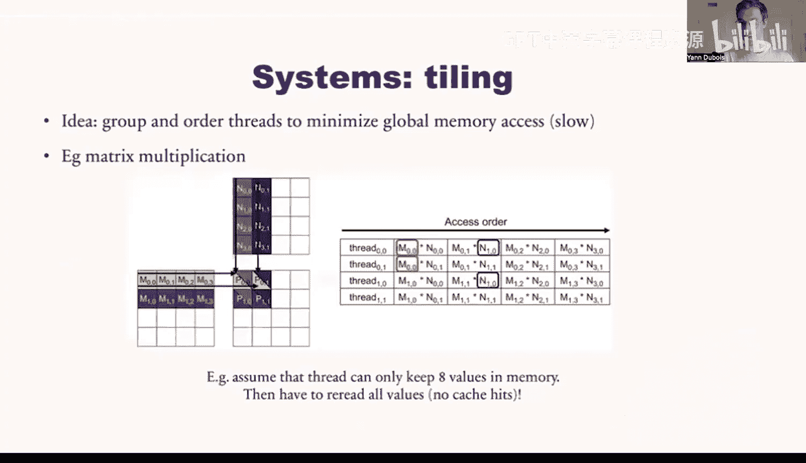

Or same amount of work with less data。So you basically read less and you can still work through an algorithm like this where you multiply these element Y of this and then you have another thread that works with this one element Y with this one and then you have the partial sums and use sum them together anyways。

 all this to say it's not super important the actual kind of algorithm is really not that important what is important is that the order in which you perform operations can really impact or like the grouping and ordering can really impact the number of times that you have to read from global memory and tiling is one way where you basically group things together in a single thread such that with less data you can do more computation。

So you can kind of reuse these， yeah， reuse the reads and basically have access to your cache。

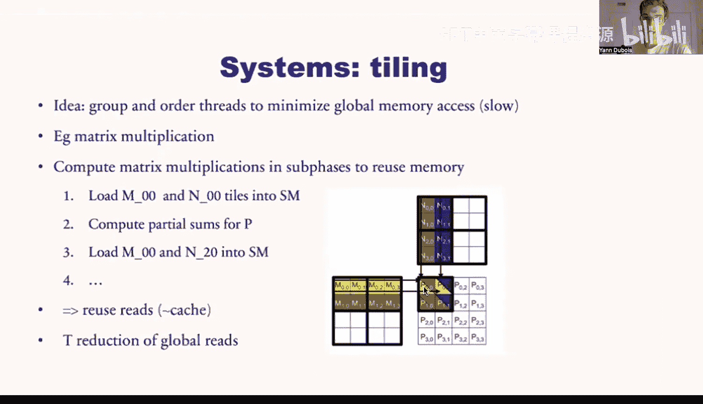

Great， so flash attention is one。Pretty famous optimization that was done for making attention faster and it basically kind of combined the three things that we talked about before。

 which is this kernel fusion， the styling and also one additional thing which is recomputations so sometimes actually it's cheaper。

Sometimes it's cheaper to redo a computation than actually reading from your memory the values from so basically here the recompetation of attention is the idea that don't save everything sometimes it's easier to just recompute the values than like stor them and flash attention V1 and got 1。

7 end to end speed up from3 1。7 speedup gains is by combining these things together so all this to say that yeah systems really matters you can get huge speedup gains at no ML this is a completely ML all neutral。

 is just kind of an order of operation the order in which you perform operation can really improve a lot your performance。

ok。嗯。I think I'm arriving at the end， I do want to maybe briefly talk about parallelization that's kind of the last big topic in terms of systems。

 So the idea is that you have very big models this is one of the big problem is that you have very big models and big models cannot fit on one GPU so you really want to use as many GPUs as possible for making your training runs fast so once you think about it this way。

There's a question of like how do you split your GPUs sorry how do you work with as many GPUs as possible and how do you fit your model into GPUs and the idea is that you can split your memory and your computation across GPUs so again kind the problem is that models are big they don't fit across GPUs they don't fit on a single GPU to you want results as fast as possible so you want to put as many GPUs as possible working together and the idea is that you can kind of split the computation and split the memory across different GPUs and this this is all about parallelization。

嗯。Okay， slide background here is to naively train model that has P parameters。

 you actually need 16 times p gigabytes of DM。The the reason is that you need 4 P。

 so four bytes because here we assume it's 32 floating like yeah FP32。

 so you have four four bytes for every P parameter。And so you have。yeah， sorry。

 4 p gigabytes for model weights then for the optimizer， if you talk about atom。

 you need to store both the mean and the variances of every parameter every parameter So the optimizer needs to store two times 4 P gigabytes in terms of values and so you have here 12 and here you have 4 p for the gradient。

 So you need to store both the forward sorry both the weights and during when you do back propag you to store。

The gradients and this is also 4B so basically that means that for training a 7 billion parameter model。

 you actually need 112 gigabytes of memory， which is which is really yeah， which is really huge。

So the idea here is that you can optimize that by。the goal at least is to use more GPUs and to optimize your training。

So let's say that you have。4 GPUus here。 And you want to optimize。

 you want to basically have every GPU working simultaneously on on。On your dataset。

 one naive way that you can do it is that you can copy the model and the optimizer on every GPU。

 you can split the data and then you can basically have every GPU working on a different on different on the same model but different set of data because you split up your data and then at the end after they do one step you basically communicate the gradient and some ingredients and there will be the total gradient that you would have gotten if you had actually trained on the four sets of data。

So basically after every batch， everyone works on a separate batch and then at the end you get gradients。

 you communicate you sum them and then you have basically the same gradient as what you would have had。

 had you trained on four times the batchge size。So the benefit is that now you can use all these GPUs because now you can use four times more GPUs than before。

 so it's four times faster than before the negative aspect is that here you have literally no memory gains because now。

If if your model for example didn't fit on one GPU it still doesn't fit on a single GPU right now so you and also here we send 7 B models required like 1212 gigabytes of memory here it means that you really need to have 112 gigabytes of memory on every GPU so there's no memory gains so how would you split like how would you split memory how would you get memory gains one way of doing that is to。

Have each GPU update a subset of weights。诶。Yeah update subset of weights and hold the subset of weights and then you communicate them before updating your weights so this is what we call sharding so here we this is this is one way of doing that is this paper called zero。

So here you see the baseline， which has the 4P parameter 4P gigabtes for parameters。

 you have the 4P gigabytes for gradients， and here you have the AP gigabytes for optimizer states and they have different levels of sharding so you can shard the first thing that you can shard is you can shard the optimizer so you can say。

 well， every GPU。Will only have one subset of optimizer states and basically each of them contain a subset and will just like communicate them when needed so you basically have this and then you can do the same thing so this will cut a lot your memory requirement from 120 gigabytes to 31 gigabytes so nearly your 4X decrease and then you can do the same thing for your gradients and you can do the same thing for your parameters so you can basically say every GPU takes care of a different subset of a different subset of weights。

Oh。Okay， so that was for data parallelism and now let's talk about model parallelism。

The problem with data parallel is that requires your data to it requires to have at least least as much data as you have or at least as much batch size as you have GPUs so basically as I said is I assume you have a batch size of 16 basically what you're saying is if you have four GPUs。

 you have four every GPU now gets a batch size of four。

 so 16 divided by four but what if I want to use 32 GPUs like how do I now split up that data to fit into 32 GPUs。

The idea is that you can have every GPU take care of applying specific parameters rather than updating so what we saw before with this data powerism is that every GPU can take care of updating specific parameters but here the idea is with model powerism is that instead of having every GPU taking care of updating the parameters you can have every GPU taking care of applying the parameters。

 so like applying the actual operations。

So for example， in pipeline parallelism， you can say that every GPU has access to holds different layers so you can say layer one is on GPU1。

 layer2 is on GPU2， and basically what you have is that once you predict sorry once you take data。

 you make all the data pass through your first layer， which is on GPU1。

 and then you send it to GPU2 it passes through the second layer and on GPU3 etc。So yeah。

 so this is for pipeline parallel， I'm going to skip that part and then you have tensor parallel so this is the idea that instead of splitting instead of having every GPU hold a different layer you could have every you can kind of split matrices or you can split inside of the layer。

 you can split between GPUs so for example， when you apply when you multiply two matrices sorry when you multiply a matrix with a vector。

 what you can do is you can split up the matrix into two。

 you can split up the vector into two and you can basically say I'm going to operate with these matrices on this vector and it's meet these matrices on this vector and then I'm going to aggregate everything at the end together So this is what we call tensor parallels Tensor parallelism So pipeline parallel and inside here that every layer has every GPU has different layers。

 Tensor parallel will basically split up the weights into different GPUs。

诶嗯。Great okay， and the last last example for system optimization is that models are really huge so instead of kind of splitting up your model onto model weights onto different different GPs what you can have is you can say well actually not every data point has to go through every parameter and this is what we call spasity so very common architecture that is spa is the mixture of experts that basically says。

Only some parameter will be active for some types of data sets sometimes types of data points。

 so the idea is that you now have a data point that comes in and it will only go to some set of hyper some set of parameters not all the parameters and this makes it very easy for doing multi kind of for doing palisism and like multi GPU training because you can just have different GPUs contained the parameters that are required for a different different data points So here you have a dense model。

That basically this is kind of inside a little bit too much moving into the weeds。

 but if you know about transformers you have this like linear layer at some point and you can basically say the linear layer is going to be split into like different linear layers and different data points will go through different linear layers and every GPU can basically have access to different different linear layers So if you didn't follow kind of the last two sides maybe a little bit not as important。

 but what I do want to stress is that there's a lot of work that goes into systems optimization and kind of optimizing the use of your compute。

And the different ways that we saw about doing that was tiling， so like ordering of your operations。

 it was the dissposity， so basically making your model sparse and not having every parameter。

 sorry every data point go through every parameter， we talked about parallelism。

 so basically using more GPUs and yes， I think that's。

Basic it。Great， so we're done and there's no questions today because as I said。

 this is a re recording of of the video。 I know this was pretty。😊。

Pretty long I'm also starting to be a little bit tired， but I hope it was useful and yeah。

 good luck for the rest of the class。

