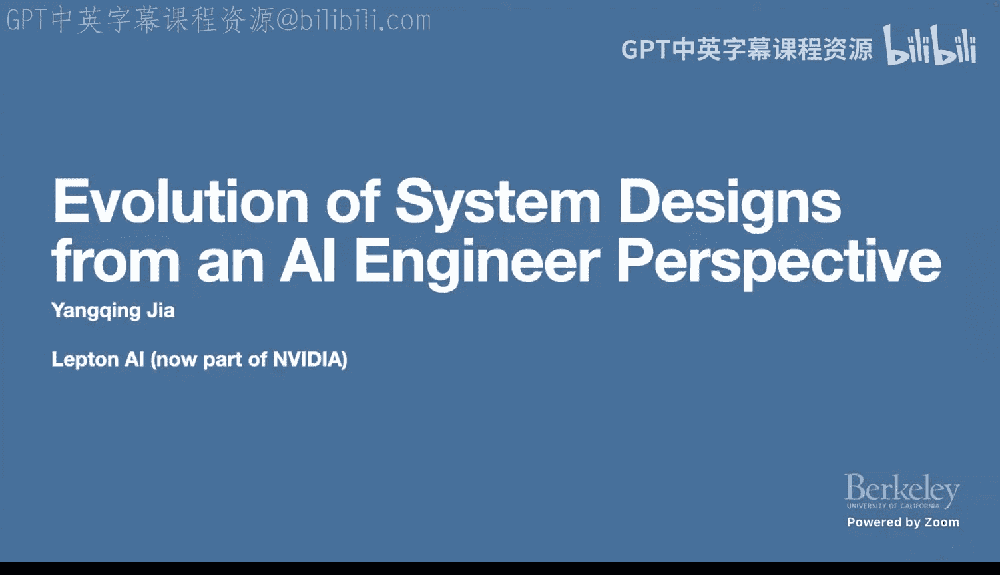
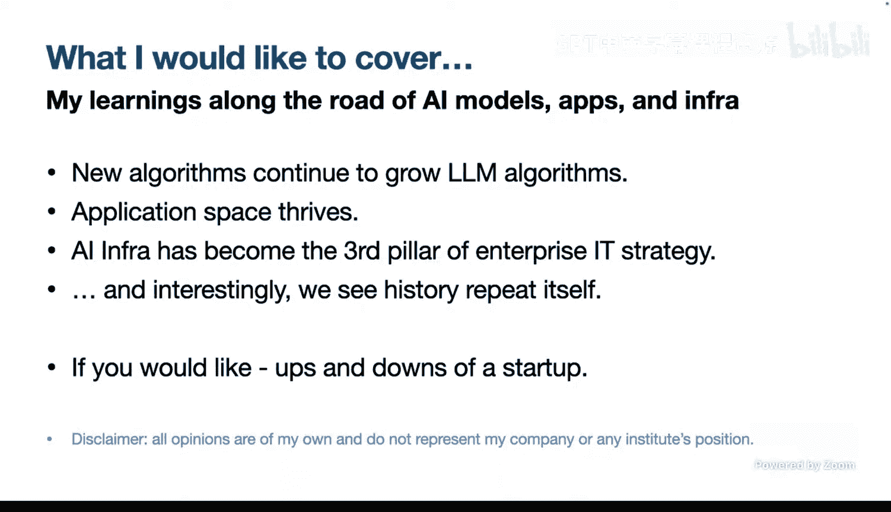
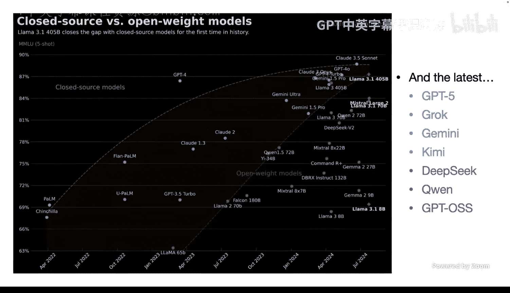
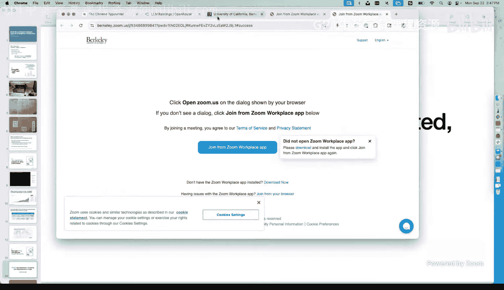
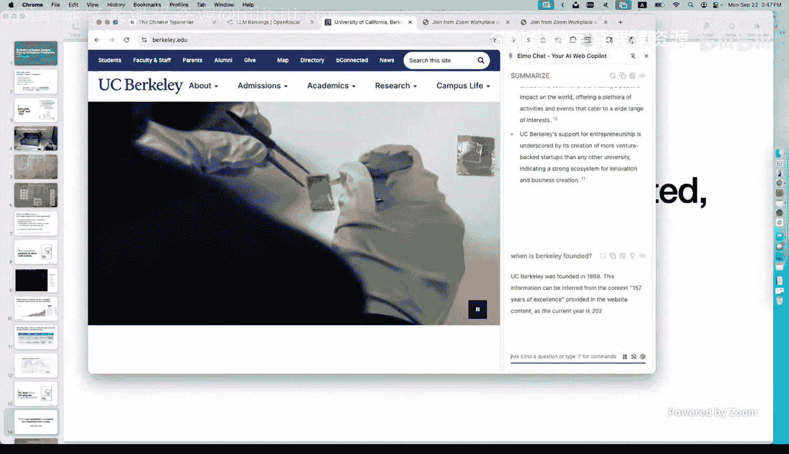
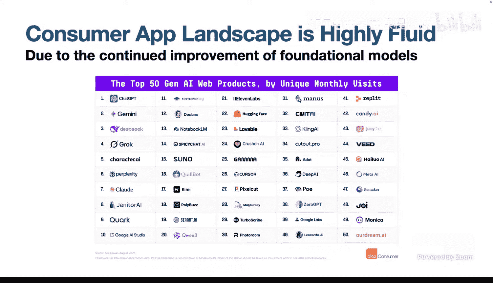
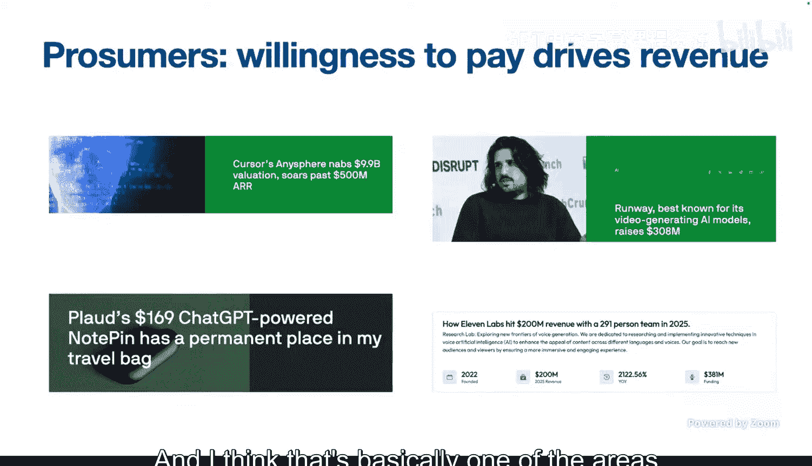
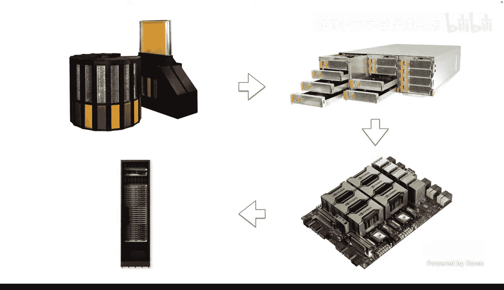

# UCB《智能体 AI｜CS294-196 Agentic AI MOOC 2025》中英字幕 - P2：-2-Evolution of System Designs by Yangqing Jia.zh_en.mp4 - GPT中英字幕课程资源 - BV1GpUTBhEGX

honor pleasure to have Yang Qing J， V P from Nvidia to come give the the guest lecture today。😊。

Yangi has done a lot of amazing work in particularly in AI systems。😊，So first， he's also。

 whenever all， he actually got his PhD from Berkeley go Bears。😊。

And he is the creator of Cafe and has done a lot of open source work， also worked on Penflow。

 P and so on。 And he did ap that was acquired by N media。 So now V P at NV。 And today。

 he will talk about evolution of system designs from an AI engineer perspective。😊，啊那诶。Thank杨琴。

And I'm just like trying to check if this works。 sounds great。 Yeah， it's a great honor to be here。

 And like Dun said I'm actually one of our own， I graduated did my PhD between 2009 and 2013 before AI and deep learning and things were cool or basically hand out in SDH if some of you are have visited bears and we didn't really have that fancy building back then still getting food on nuclear Avenue and things like that。

 I think you know I it's probably good to basically just talk a little bit about cruise this dude。

 what is this thought process and things like that back at Berkeley Day and then my first job back at Google。

 I was a researcher looking into like module and things like that。

 and one of the things that we did back at Google was Googlenet or what we call inception as one of the leading image recognition models。

 And then I realized I wasn't really a good researcher but I'm slightly good at writing code。

 started writing AI frameworks。😊。

cafe and later participated in an intensive flow and pretor things like that。

 And one thing that we kind of found was that with all those AI algorithms evolving。

 we start seeing very much different patterns from the conventional computer science。

 whether it be microservices or databases or data analytics and like that。

 And in a course for quite a lot of the system designs to change for us to build newer。

 larger and more like real work scale kind of applications。

 And so basically started basically going from research into engineering。

 And then after many years started a company called leftin AI trying to basically build a cloud kind of infrastructure that fits the AI workload。

 especially for a training and inference instance like that。

 we got it quite by media So basically to back in backend company environment。

 and so I kind of feel that like I don't really have very deep knowledge about the state of art research of AI but hopefully the experience。

To me a little bit about， you know， stories on the road。

 what kind of things people are caring about in the industry right now， what kind of， you know like。

 what kind of cost benefits， racial analysis and things like that。

 Are people thinking about when they are doing a startup and model and applications and things like that。

 I would like to basically share that with you guys。

I kind of want to always start with a kind of more not scientific but interesting thought process。

We've seen quite a lot of people talking about the term AGI。And basically saying， hey。

 the order is this mysterious model。That seems to be able to understand everything and is getting smarter and smarter。

Now， there's no question that arere getting smarter， right。

 But are they so mysteriously good or are they actually being built with some really simple principles that we've kind of learned in。

 you know， like C， S 2，81 or things like that。And so I grew up in China， my home language is Chinese。

 And so we will type， you know， on keyboards。 type in English。 It's very simple， right。

 what you see is what you get。 You type A， and then on the screen， you show a。Now。

 if you have a bit of knowledge about Chinese textbooks， are yeah。啊。😮，O。It's kind of weird。 the， the。

 the mouse isn't really。 I just put it over there。Or I can minimize it。 Let's。

 let's just put it there。 It normally wouldn't have too much sense。 So so basically， if， if you。

 if you have seen photos like Chinese logos and things like that。

 you know that Chinese characters don't really show up on the keyboard。 right。

 It's an indirect typing kind of process where the character is different from the  query keyboard。

 So what you see isn't really what you got in your days， people solve that problem。

By having literally a Chinese keyboard with individual keys as， you know。

 metal foundries somewhere up there。 So the way you do it is you move around that keyboard。

 you find a key， how of something around 3000 to 5000 common characters。

 You click that thin and there is a mechanical structure that。😊，Get the that that foundry up。

Clicks onto that role and then when you release it it comes back and you find the next key。😊。

A huge keyboard。 Now， over our， you know， early computer science days。

 we've known how to type 26 keys and so。But imagine how do we deal with that？

And the other question is， you know， we ty in sentences。

 moving these kind of like handle around is hugely difficult。 right。

 How do we actually make sure that things are more efficient when we actually type in， Of course。

 today， we don't use these kind of keyboards or those trend students as still type in on 40 keyboard。

 But this is how things started。Well a fundamental question of the same logic as when you are basically saying。

 like how do you actually seek to the next block of data on your spinning keep hard drive and things like that。

 The idea is that the distance between the current character and the next character matters a lot。

 if your last character is on the top。 and then you want to type the next character of your phrase down there。

 then you're kind of you know， in a bad position， because you have to move quite a lot。

 which is why you don days， if you use Windows and things like that in in a spinning in hard drive。

 there is things called deramentation and things like that。

 making sure that since that the same file stays in the same， I forgot。

 even that word like stays the same part nearby part of hard disk。

So then people started becoming smart。 I mean， that was basically in the1920s and 1930s。

 And people are like， how do we actually group things together so that we can minimize the movement of my handle。

They went out to libraries。 They started count。 They started counting what we call today bygrams and engrams and things like that。

 basically saying， okay， given the previous characters or given the。Yeah。

 kind of weird causeuse like the， the mouse is not showing up。呃， shall we just keep it away发。

Right probably that doesn't block too much。 So then we basically start counting all those diagrams and more。

 And then we start to grouping things together。 the words that are basically like the characters that happen together gets grouped together。

 So that things get more efficient。 Now， for example， here over there from the top to bottom。

 was what we see is Qi， which is gas and you Q， which is paint right here， what were seeing is Zhguo。

 which is China。 and then Zhonghua， which is the Chinese ethnic group and like that。

 And by doing that， people found that the Taipian speed thetyping speed comparing to a random keyboard got massively improved。

😊，Now， that was basically in the old days。 You were like， this is simple。 You just count。

 And then you basically do prediction of what would you were type next in today's LM vernacular。

We call this thing with a more fancy word called next token prediction。We have a module。

 we see what kind of things are in front of it， and then we predict what is the next token。

There were researchers to basically see whether you can use the history or use the surrounding part or the future to predict the current word。

 there was a model called B a few years ago which is basically saying given the character before it and after it。

 how do we predict the current word and the models that we are using quite you know extensively today called GPT models only use the history kind of similar to when we are typing something。

The difference is that in the old days， were basically like doing all these things manually。

 So we cannot really go very detailed。 We can probably count two or three characters before it。

 conventionalional NOP were actually kind of constrained by these kind of constraints because you can basically locate in bygrams。

 and， you know， like probably 4 or 5，5 gra is probably the upper limit that you can go because that correlation matrix gets。

 you know， multidimensal crazy。😊，Today we can actually look into what we call the context lens。

 right， start the Sa models having normally millions of tokens context lens。

 So you can look at a lot of the previous context to predict next token。

 and as Elike would say that basically this is a mode of compression。

 compressioning compressing knowledge into predict next token and by doing that simple action and producing that sequence。

 then you will be able to capture a lot of implicit intelligence or things like that。 So。😊。

A lot of these basic ideas kind of come you know， like in similar ways， of course。

 with more sophisticated and powerful models。And and so。

 so what kind of like one to basically cover is four topics。

 One is basically in this in the space of LLM， what kind of algorithms are there。

 what kind of models we're looking into， I'm not gonna be diving into the exact math because I'm a terrible researcher。

 So I'm sure that they are way smarter researchers who can basically tell those。

 I'll just like talk about it in the from outside in or application driven kind approach。

And the second is basically on top of these models， What kind of applications are out there。

 What kind of applications are doing great。 If you want to build an application。

 what kind of parameters you might think about。And then we dive down into the infrastructure side。

 which is really my comfort zone， talking about， you know。

 AI infl and why is it different from the conventional cloud and things like that。

 Because cloud has been around for 20 years and why suddenly things are changing a little bit。

And in the end， I kind of want to basically talk a bit about hardware stuff like that and see。

 you know， like if we can find similar like， like analogies in the， in the conventional。Hardware and。

 And， of course， when we talk about hardware， this hardware is going down。

 And let's let's wait my my， my apologies。 We used to joke that， you know， the。

 the three hardest thingss in two hardest thingss in computer science is printers and display。

 This is one of the hardware problemss。Alright， seems to have stabilized。 And and yeah， well。

 and after after this， I think you know， if you like。

 I can basically talk about the pain points of doing startup and things like that， if you like。

 And of course， one mandatory disclaimer is that since you know。

 like we are currently employed in the company or these kind of opinions do not really reflect the the opinion of the company and it's more basically be from an individual contributor and a dude with too much code kind of perspective。

 All， so。

Just just similar to what we were just talking about。 I mean。

 there is quite a lot of interesting in models that comes up and starting from you know chat GT or even earlier models that you might remember。

 such as Chincha and poem from Google and things like that G35 really started this trend oflum frenzy。

 we've all been asking ourselves every six months， basically saying hey。

 are we actually plateaued have we actually plateaued in the model qualities。

 And it seems that even today， we haven't really seen a plateau in effect and the two streams of models。

 both close source ones and open source ones are continuing to be having a very healthy competition。

 And as of this group actually a very nice Twitter gentlemen from 2024 and in the last couple months。

 we've seen really great close source models such as G 5 and Geminikimi coming up。

 and in the open source land， we've actually seen a very quick change of throns， I would say。😊。

Going from Lama models to the models such as Deepse when or Qianwen as in Chinese and GT open source from from Mo Air itself as well。

 What we are basically observing is that close source models continue to ace in in the absolute quality。

 And as we talk to enterprise clients or basically partners out there such as say the salesfor。

 the Pinterest and like that， people basically do feel that open source closest models actually leading in in quality and especially the newest capability of doing reasoning and stuff like that。

 But the gap between open source models and source models are becoming smaller and smaller will say in 2023 maybe be the gaps around a year and more than a year。

 And today， what we're thinking about is something around six months。

 So basically when there is new approaches coming out。

 normally open source models are able to catch up really quickly in terms of reasoning。

 for example deepse is probably one one of the first papers that detailed the capability of test on scaling。

And that actually educated the whole community to actually cut up really quickly。嗯。

And this， the next question people often ask is like， there's quite a bunch of models。

 And are we actually in the land of a self fulfilling prophecy。

 And we're only training models and not choosing them， AK is there a bubble。

 I tend to basically use some more objective measurements。

 In addition to the news pieces from techcr and other places。 of course， really great news pieces。😊。

I tend to use basically more objective usage statistics to look into whether theres a to or not。

 And there's a very nice website or a web page called open router。

 which aggregates a lot of the models into more unified API so that people can easily consume those and a side effect or basically a side result of that is basically it will be able to look at below consumption。

 at least from that channel open router。 and also the distribution of different kind of models and how how popular they are。

 And so starting from 2024。 and even earlier。 we can see that the consumption of the models are actually sur。

 So I remember about， you know like a year ago at that time。

 there was the consumption is something around you know。

 like 50 trillion to something 60 sorry 50 billion sorry，50 billion to 60 billion tokens per day。

 And today when you look at it is something around。4。9 trillion。

 so about 10x growth in the in the last year。 Apparently。

 we are actually seeing a very solid use of these models。

 An interesting thing is that you can see there is a very very big battle actually。

 between the open source models and closest models。 So the graph here that chart here。

 this shows on sub 15s。 What are the models that are a most popular。 And you can see there graphq。

 there is anthropic。 there's Gemini。 The one Sooma sky alpha is actually Gq 4 being tested in a semi secret fashion。

 and the open source models that we mentioned， such as deepse and little down therequis like that are still being doing pretty well。

 there is also a ranking by application areas and different applications。

 So this is really a good place。 if you're interested in diving into more data science and analytics of the dynamics of the different models。

 So apparently there is a continued growth of consumption， which actually give us。😊。

Hope that AI this round has actually been very helpful。😊。

And and so if we look at the more researchy side of the world， this is my personal understanding。

 not completely right about why there are new things that continuously excites us and some of the ideas as I no dude。

 I kind of tend to basically tie it back to the other research topics or research ideas in the community So in 2022。

 basically we started knowing about GT is kind of similar to。

 I would say Alexnet about you know 13 years ago because this is really a structural innovation or change that fundamentally improved the quality in this case。

 the text understanding and back in Alex Alexaday， a free computer science researchers from using simple handcrafted features such as you know sift and pyram kernelels to a more principle deep learning approach。

Now， as we saw tragedyB T taken on very well and people are doing strategic training things like that。

 And we， when we believe that the model might be just。The toin， then a mixture of experts came out。

 The idea is that you can actually use a massively sparse model and sparsely activate a model to improve the efficiency and decrease the model size while actually maintaining a pretty good quality。

 These kind of things happen in the past as well if you think about know like a very early Bayian learning kind of things onemble with very simple classifiers work really well。

 and in the convolutional neuralnet days the Google network or the inception paper exactly kind of like adopted a similar approach by having not one big chunky network but you know like sparsely well actually in that case。

 it is like sparsely parameter， but always active different paths in each inception unit to achieve a much better parameter utilizationization。

 it can also kind of derive things from the theory of ten decomposition and things like that。

 but that's two theoretical and referringin from having deep into that。😊，Now。

 these are all structural changes。 And then when we feel that， you know。

 structural function in essence like that， using a very simple dust function to basically train a model has plateaued。

 then in 2024， we found and open AI block posts actually set a very interesting theory。

 which is like you can actually start using test time scaling or basically have the model mumble longer in some way during testing time and having it reflect on its intermediate results to get a better result Its kind of is。

 you know， similar， I try to basically draw some analogies。 It kind of similar to the idea of。

 you know， like say multi- instancestence learning or basically fully convolution neural network by back in the days by doing prediction。

Multiple times across the the space domain and try to get a better results in this case is basically doing prediction along a much better time domain and accumulate and reflect on the intermediate guesses that it can have and get a better result。

Now， there is debates about whether test time scaling is kind of the last leg for us to squeeze out a bit of the intelligence out of an existing model and things like that。

 and people are a bit pessimistic about it。 And I think one thing that really kind of made people much。

 much more interested in the model innovation is the massive application of reinforcement learning。

 Deepsq was actually one of the early papers talking about that。

 But we know that open AI has been using this to train their models for a long time。

I think one thing that really excites me personally is that reinforcement learning allows us to actually define in a more principled way。

 a much more sophisticated loss function。 because before that， the idea is， you know。

 like we have a bunch of sequences。 And then I use the next token as the， the loss function。

 the objective to train the models。 It's not really exactly tied to the end result。

 reinforcement learning allows us to basically say a model should basically do some rollout of predictions and then look at the long term。

Look， look at， you know the end of the horizon and then you know。

 provide feedback about the quality of the end result。 right Fundaally。

 it's basically saying it's difficult to define a loss function that is actually matching the the thing that we want to do。

 But R L allows us to have a principled way to do it。

 R L ties back to really old days of robotics and things like that。 I think， you know。

 if you're in each department， I think the premium examination still requires you to read that big such an abarto book。

 which is interesting because it has a great comeback over the years。😊，And so basically。

 if you look at the modules and like well if you look at the hyp cycle of Garner。

 which is one thing that you know or industrial participants like me would normally look at。

 you can see that a lot of the ideas are very quickly iterate and evolving。

 if you look at module ops and then Ra， review， augmented generation and things like that has only been out for around a year or two。

 but it's already been kind of like it had states and is' coming down and then right now what we are looking at is prompt engineering and agent AI and stuff like that are becoming more and more important。

This ties to a very interesting question which like in these kind of days。

 how do we actually think about building applications on topic it Because， you know。

 you might have remember that rag or basically like search augmented。

Chatbo and things like that used to be a big thing。 It continues to be。

 but it seems that now everyone's talking about agentss。

 how do we actually think about applications and how do we actually build applications and things like that。

So back in the 11 days， we were doing a infr and unavoidably。

 we'll have to look into what kind of applications people are building so that we can serve them well。

And one observation that we have is there are normally two types of applications， ones consumer apps。

 and one is basically business services or enterprise services and things like that。 Today。

 what we see is a thriving number of consumer applications because the models are indeed very smart and are actually able to。

 you know like foster a lot of innovative creativity。

 entertainment and productivity and things like that。😊。

Business applications or enterprise applications have a very strong。Potential to actually make。

 you know billion dollar businesses。 But as， as we all know。

 businesses move kind of slowly and things like that。 So we are only seeing the emergence of that。

Let'm give you some examples。 So basically， we were basically thinking how hard this to make an application。

 right， as an API and， and， and， and what is the distance between an API and then something that's useful。

So this story， I want to basically like tell you this story。

 which literally happened within like some of our engineers。

 And I was basically chatting with a gentleman called Ya， who is in Singapore over Chinese New Year。

 He was like， I'm so bored。 This is Chinese New Year。

 And other than my grandparent or my parents actually like forcing me to have a kid。

 I don't have no other topics to talk about。 He was like， let me build an app。😊。

And so what one thing we were thinking about this， there are so many blog posts ands like that。

 and it's really difficult for us to consume the massive amount of information that's feeding into our browsers。

 And it was like， how easy could it be if we could have a bot that lives next to our browser and helps us basically do digestions。

 analysis， and like that， so。Over two days， basically， he was a very smart front engineer。

 Over two days， he built an app which lives still today。 And so Im I'll show you how it works。

 So let's say we have Berkeley's homepage opened。 and I'm too hasty to understand what Berkeley is。

 So I basically say this app little app， basically I say。😊。

Please summarize for me， and it goes like a person reads the web page and gives my me the summarizations and things like that。

 says Berkeley is a lead in public research university known for its groundbreaking research。

 top rank academic programs and vibrant student life that contributes to better world and things like that。

 And I can basically ask questions like when is， sorry。😊，When is Berkeley。Fo it。Hopefully。

 it answers me correctly， It like 1868， which if I if I'm still correctly rememberinging is right。

 right， So those kinds of things makes it really easy for us to build something that wasn't possible before。

 And you might have heard about stories like， you know。

 like a one person startup and since like that just hasn't been a startup yet。

 But it shows that by combining smart， you know， like an application knowledge and basically like other general programming skills and a powerful a lot of model will be able to do something that's way more efficient than we could do before。

😊。

So a small cute application。 and there's quite a lot of。

 you know like much deeper thoughts over there coming along this line of thought。

 And if you look at basically the consumer app landscape。

 it shows itself as a very highly fluid and competitive land。 and And H is every half a year。

 basically puts out a report called the top 50 January web products and and other kind products。

 And this is， I think August， maybe September， August 2025。😊，And as you can see， basically。

 there is quite a lot of applications out there。 loosely speaking。

 they get into a few things that you can kind of like see。 chat is one of the biggest topics。

 So chatGBT， Gemin I deepse Gro and things like that。

The other one is basically code is seen like becoming much more much more prominent and used by people。

 So you might have heard about cursor and also like replicateit and things like that。

 there's also a search that comes that comes quite often。

 So perplexity is the most prominent one also started by Berkeley gra student and and and all these things are。

 you know， evolved evolving really quickly。 And and the landscape ships very quickly。 So this。

 for example， is showing what's different from six months ago。 And now。About that's。

 that's 11 that are basically like like， that are just like pop up into the top 50 in as short as six months。

 right， and grow and work and， and， and folks are actually like in top 10。 So， so in this case。

 you know， like people are constantly asking， what is the， what is the the mo。

Because people might think of some， some， some models that are like the the performing really well。

 But because of the underlying Elna model doing really well， then in the end。

 basically like very quickly。sururpassed by other applications。

 one of the very prominent example is a company called Jasper AI， which started in the Cha Tri 3。

5 days to be an editor helper or something like that to help you basically do content creation and things。

 but for better worse due to chat models being too good， it started having to pivot into other areas。

 We also see that models such as basically like I think 11 labs having its own model and then midjoney having its own model。

 and knowing the customers really well and being able to hold its mode relatively well。

 But in general， it's a very it's kind of like a blue oceance kind of field。

 and but there's quite a lot of competitions over。

AndAnd， and one thing that we are were seeing is there's a lot of traffic。

 But who are willing to pay right And then in all those consumer apps， one trend。

 a very clear trend that we see is that if the application actually targets proumers， Aka A。😊。

There're still small consumers， but they are actually embedding those kinds of things into their daily work and productivity。

 They seem that people are very much willing to pay。

 And I'm just cher pickingking a few succeeding examples。 cursor， as we all know。

 is basically embedded into quite a lot of the coding practices that we have today runway as a multimedia creativity and multimedia editing kind of tool。

 has been liked by a lot of the content creators， such as the Tikta guys。

 and also like people who are basically starting shops on Esy and things like that。😊。

That's a very interesting hardware kind of startup code cloud， which employs a very simple idea。

 I actually have one here。 So it basically have you know like a credit card shaped kind of in like recording device。

 recording device is not really new， right basically it can basically like recorded conversations and things like that。

 And then connecting that to voice recognition andPT to tell you what are the action items。

 What are the conclusions。 What are the main debating points of the recorded meeting。

 which is liked quite a lot by people who are in the legal industry in the consulting industry and the healthcare industry and things like that。

 11 labs， as we mentioned， has really awesome， know voice models and has been all of these kind of guys are actually having like multi hundred million revenues。

😊，The logic behind that is basically like it seems that when things get into productivity。

If I'm very much willing to pay as a consumer， for example。

 I play with a mid journey and then I was like， I really want to spend $20$50 per month just for fun and I was like。

 na， I'm not gonna to do it。 But if this is basically like coding or basically if I'm a content creator and I was like thinking about to make sure that I actually like do my job much better。

 am I willing to pay $20。😊，And I was like， of course， I do from a startup guy perspective。

 if you look at every single person's， you know I or productivity productivity tool。

 you will find that it's not a lot of money。 So let me count for from a startup kind of perspective。

 when we have one new person join in One new gentleman or lady joining how much kind of task tools we would set up for them。

 That's Github。 that's $20 or $25。 There's Google workspace $25 Slack $12。 one pass $9 Github Copi。

 That's about $19 among a bunch of other things。 So it's very easy for us to basically for for people who actually like thinking about productivity to shell out a couple hundred to you know support doing a better job。

 And I think that's basically one of the areas that's thats the smart startups are doing really well over there。

😊。

Still， when we think about enterprises， things are in an interesting position where a lot of the enterprise applications are growing much faster than the more conventional ones。

 but not as fast as the， you know， like the decursors and the perplexities on the consumer side。😊。

Enterprise applications have this unique barrier in the sense that it just needs a lot of work。

 So let me give you one example。 we all do search daily by we use normally Google and in my own country。

 by do instance like that。 But the question is， what search engine do you use at work。

 Maybe you're like doing an internship in in a company of things like that。

 What kind of search engine do you use。Normally， I get two answers out of that。 One is， well。

 there isn't a good search engine because all those things in like。

 we cant your tickets and things like that just cannot be aggregated。

And the other one is basically saying we， our company has our own internal search tool。

 but it kind of sucks because it's just not high quality。 There's a startup called Gan。Which has。

 it took a little bit more than three years to reach 100 million A R。

 And quite a lot of our friends in different companies actually was chatting with them was like。

 did you guys use Z， And it was like， it's great。 It is the greatest search engine。

 enterprisese search engine that we have experienced。😊。

The idea is that it basically connects to the multiple sources such as Google Drive， Gitthub。

 internal Wiiki and a bunch of things， Microsoft 3，65。

 And it will be able to integrate all authentications and access control and things like that to basically give every person a search engine that is indexed on the set of。

😊，Com information that he or she is actually able to access inside the company。Lots of dirty work。

 but addresses a very big pain point of enterprises。 And it's combining with AI。

 then it's actually actually doing pretty well。So I think， you know， like basically。

 when we think about the potential of AI and answer the question， whether there's a bubble or not。

 it's still a lot of potentials， especially with the more nascent enterprise market。 La is one。

 And there are a bunch of others such as Si who basically doing。

 I think legal AI and things like that。 And， and if you go to like say Scoia or recent hardware reports。

 you can see quite a lot of like potential companies over there。

People basically started normally by using closed source models and build you know some sort of like N to end kind of applications。

 and then as data started accumulating， they started basically in like build their own model and things like that。

 there's a constant debate whether the open AIs and anthropics are actually going to be taken over the world。

 but in the industry we see since happening differently So there's a very interest in app called Duolingo and my kid actually use it to learn English I don't know why they are actually born here。

 but they use that to learn English， probably just to play some games right Duolingo was actually able to。

 you know like people were like oh when AI models are coming in out， Duollingo' is dead。Not so。

 they are actually living pretty well。 And what we found is that Roolingo is actually able to use AI models on open AI and things like that。

 I don't know what exactly they use， but they're able to use AI models to start。😊。

Creating contents and more innovative contents much more efficiently。

 And it creates this very complementary relationship where the better A models are。😊。

Combining with the deep knowledge of the customers and， you。

 like the the language learning kind of expertise that Duolingo has。

 they create a one1 plus one larger than two kind of effect。 And。

 and it basically boosts the quality of the whole product and and experience。

 So I think this kind kind of basically like is gonna to be continuing in。

 And we will see very healthy synergy between the model builder companies and also the application companies。

😊，And of course， all those companies need， cloud infrastructure under there to support the massive scaling。

 very fresh off the boat kind of news was like this morning。

 I didn't know about ahead of time this morning， Imedia and open AI are announcing that they are I think investing in100 billion or something like that into computation infrastructure to build and to scale an next generation models and like that。

 which is basically the massive scale that we're seeing in Infrrasight。And so in general。

 I think starting from even before ChaGBT， maybe like 2020s。

 what we found is that AI Infrra has become the the third pillar。

 the third pillar in the IT or cloud kind of strategy， no longer as a part or a small part of。

 you know， I Goddo's cloud and IT， but really becoming its sound。And when I say the third pillar。

 what are the pillars that we're talking about right first of all。

 what is the need the need is basically like very very well summarized by Professor Richard Sutton's blog post in 2019 he's basically anti biggest lesson that we have learned in the 70 years of AI research is that we can employ a generalized approach general method in today's context。

 large younger models， to learning model instance like that and and we basically deploy a large amount of computation。

 numerical computation onto a large amount of data and that seems to be the most effective way So so we need a large amount of computation power。

And if you look at the computation history， a lot of the a lot of the compute kind of idea actually came from numerical computation in the 1970s。

 we know that scientific compute is a big thing。 And on the on the hills of Bkeley， there is N。

 right， it's basically built by the Department of Energy。

 And if you if you you have taken or if you are taken the introduction to parallel computers taught by Professor James Demo and Kali here。

 you know that a lot of the things that are taught over there is about how do you actually carry out large scale matrix not and things like that。

😊，And， and those applications were physics， weather simulations and stuff like that on a cluster with CPU in back in the days with good old software such as Sl and things things like that huggging along。

😊，And then when people want to basically like have someone else to basically deal with computer instance like that。

 they started the business of virtual private servers so that some companies。

 data center S can take care of the physical machines and people build applications on top。

 and that eventually rolled into what we know as cloud today。

 cloud servicesice A GCP and and Azure and others。 So so we kind of call it conventional cloud。

 in a sense that they kind of started in a web services days。

 And what the need is basically like we we host a bunch of machines。

 we do virtualizations on top of that。 We put a bunch of microservices or small workloads over there。

 make it more flexible for people to not worry about machine operations ands like that and certain web traffic。

😊，Web service cloud grew for quite some years。 And then when the idea of Web2。0， Such a old idea。

 Web 2。0 came， there is a lot of idea about user generated content and matching matching users content and the consumer' interest Tiktk and YouTube and like that。

 Theres a lot of need for data analytics record the user activity data where it be e-commer like content create content consumption and things like that。

 And we started building recommendation engine and things like that。

 And that actually required quite a lot of data analytics。 So around 2014。

 there are two interest in companies coming out and one is called snowflake building the idea of cloud data warehouse and the other one on open source side came from Berkeley which is called databricks on top of Spk。

 And that set the idea of data cloud where there is a massive amount of data and massive distributed training distributed computation using SQ。

😊，And data analyticss， and like chat。😊，In the 2020s when I actually started doing AI。

 we see that a lot of patents are kind of different because today we actually call for quite a lot of exafflps of float and even like lower precision float competitions。

It has to be carried out with relatively small amount of data。

 but a lot of compute and a lot of communication， kind of similar to the very old scientific computation days。

And so， so to kind of put things in more abstract， or basically like more principal terms。

 there are two parameters that are govern in the thought of how we think about the infrastructure。

 One is data movement or IO。 and the other one is numerical computational computation in the old days in web compute。

 There's quite a lot of IO， we move data around web pages， you know images and things like that。

 there's not too much of compute because I just need to reasons after this can serve it to the customers。

 The lots of IO and a smaller compute and the workload looks like microservices。

 It's embarrassedrass and in parallel you have node Ajs server。

 you replicate it if there's more traffic。 and if you scale it down if there's no traffic。

And then a data compute is slightly different in the sense that still， there is quite a lot of IO。

 but the computation is not that it's not that embarrassingly parallel。

 you actually have to use abstractstructions such as。

 you know like sparkar or basically map something like that to carry out one SQL as one big distributed system。

 SQL gave you a very good abstractstruction。 but under the hood。

 you have to have a lot of like complicated distributed schedule in and things like that going on。

AI is kind of different in a sense that computer is way bigger than IO。

We also we always talk about like large training and data sets and things like that。

 but that's normally true about， you know like say a potential terabytes or maybe one node two petabyte or something like that。

 computers a lot training one single image model is already one x flux and we used to joke that if the whole city of London。

 Everyone starts using you know their pens to do calculations。

 It takes them 4000 years for the whole city of London to train one model。

 And in L of them today it's even bigger。And and it's very distributed。

 And in the sense that for data， for data infrar， you can actually have some machines go down and you just like redo the compute of that chunk of compute on on the next available mapduce shard in AI compute when you launch distributed training。

 And if one of the GP machines go down， then the whole training jobs down for good。

 You better basically like restart the whole job。 There's a bit of tolerance sentence like that。

 But if you look into the modern day distributed training it's not that easy。

And that actually really basically gives us the thought， hey， it just looks like more like like MP I。

 like the old day slm kind of days， like the old day scientific Comp days。

 The conventional cloud value proposition that's or originates from the。😊。

Web cloud days no longer holds because conventional cloud basically。

 I'm gonna be giving you an easier way to acquire and install software。

 You can basically say I can launch a cloud database without having to install my for myself。

 And the other one is basically cloud I'll give you a flexible supply chain by having easy two machines being pulled up and released flexibly all the time。

😊，In the AI world is kind of different in the sense that if we list out。

There's not too much applications in AI。 and there's not too much variety。

 It's pretty much basic AI frameworks。 You know， you install back in the day Pytorch， Tensorflow。

 Nowaday is more popularly Pytorch。 And then a few dependent libraries on top of that。

 such as like megatl LM or lightning AI and things like that。 So it's kind of simple。

 There's not too much variety of software。The workload is also quite unified in a sense that is's a huge amount of numerical computational or matrix applications and things like that。

 not too much computer stores， network data and things like that。 It's simpler。😊。

So Pwise is more rigid in a sense that in conventional cloud。

 you have microservices that works really well on virtualization and you can actually migrate workloads between different machines and since like that。

 because it's very nicely laid out in AI cloud when you launch a large training and job with seem like say like bunch of GPU machines。

 then that machine physically are just stuck together with high performance network and like that。

 if one machine goes down， you need to move whole in the whole thin。

 you shut down the whole in and you find another sort machine and you start running things over there。

😊，And and for， for better worse， if you actually have a bunch of CPU machines during the day。

 you're probably serving web traffic。 and during the night。

 you can repurpose it to actually do data analytics sentences like that。

 in the GPU La for better worse， the workload is not that interchangeable because it's really good for numerical computation。

 And you cannot really run a web service on top of GPU for interchangeability becomes becomes harder。

And that drives the emergence of what we call the neo cloud over the last few years。

 there's a very nice like an analyst website called semiana that are highly encourage you guys to read if you're interested in this land。

 they coin up the term neoclo with the idea that there are companies out there who can actually focus on AI compute and AI workloads。

 aggregating GPUus and not really worry about database services and things like that。

 The most prominent ones are basically coreweve Lambda。

 there's a European one called Nebuus and a bunch of others。

 They kind of start basically showing their value by providing more AIcentric。

Competation resources that would， you know reduce your cost。

 improve your availability at things like that。 and of course。

 you know the hyperscalers are also getting into this field to create more ecentric cloud services。😊。

The reason is that basically like you really cannot just get a bunch of GPUs and and start running with it。

 I was chatting with I was chatting with like one founder CEO last year。 and he was like， man。

 I'm spending so much time cur GPUs and basically like monitoring GP things like that。

 which isn't good there are basically two choices up there。

 One is basically like you just have an internal team that starts using Excel or whatever to basically manage the cluster。

 we did that back in the Berkeley days。 I was the assistmin for our computer vision group and wasn't really the best choice。

 the Captain Venus up there that I joke about。 That's Orio Venus who's basically leading German today。

 and he was also one of the poor systems back days。 The other choices use Kubernetes。

 Now you might have heard quite a lot of things about Kubernetes being the best sin since slice spread。

AndAR researchers don't seem to think so， mainly because Kubernetes is a very nice abstraction。

 but normally for S R Es， site reliability engineers or operation people。 And when you actually。

Basically provide， you know， like the Kubernetes type abstraction to the AI researchers。

 They're like， no， I don't really know how to think of you know parts， deployments， parallelism。

 completion and things like that。 as an AI researchers even if I even after I did a startup。

 I still don't know about those kind of things。 researchers like I want a simple mindset where I get four machines。

 I get MPI set up and I run this Pyto job and I just happily wait for the result。

 If one of these kind of things go down， please give me another four machines run the same thing until things go wow。

 I don't really want to deal with Kubernetes。 This is kind of like the fight today。 the holy war。

 I would say between the s researcher kind of mindset。😊，And the Kubernetes operations mindset。

 which kind of like comes very often in the community。

 Now the reason is actually you know like the fundamental problem of developer efficiency and efficiency are just in a conflict in state developers want things to be really simple and abstracted。

 roll a job and get it on。 inrovwise， for better words GPs do die today。

 actually the charts that you see here is actually from a very nice analysis from Facebook or running their cluster of I forgot how many machines。

 but you know probably at a scale of 100000 or something like that。

 define that you know like there's quite a lot of reasons software bugs。

40 gus memory issues and things like that and network issues that might cause the machines to go down so you do want some sort of abstractions to hide these operational burdens away from the developers and get them seemingly stable environment for them to carry。

😊，Their job and not worrying about fixing GPUs 2 a in the night。Right。

 so so so we found basically we're thinking about this。

 I had to basically use Leptin as like a bullhitting kind of marketing architecture。

 But what we found is that the best practices today for a lot of the startup is four things。

 One is basically to find a multiple cloud supply chain because today GPUs are still in short supply and and normally when you want to basically find 2000 GPs to train your model。

 maybe your current provider doesn't have it， but the provider in the next state might have it。

 So you basically want to figure out how to actually smoothly migrate your jobs bit in different clouds。

And of course， since GPS are so expensive， you want to basically make sure that you are actually actively looking at utilizationization and things like that and not really just wasting idle GPU hours。

 normally， people would start looking for an AI native platform that allows us allows them to basically abstract away the Kubernetes jargon and focus on the training jobs。

 A few really good examples and I focus on the Berkeley oriented once right So we have ray as an open source project a couple years ago。

 actually， maybe 10 years ago， starting to basically serve reinforcement learning before it's cool。

 And today as a general computation framework there's a company called any scale that basically supports Ray and basically does commercializations。

 There's a very interesting new project for a couple years now called Sky pilotlot that allows people to find。

😊，Efficient computation resources。 and then basically like orchestra workers across different clouds and things like that。

And essentially， I think people can actually。Pgy back on these kind of frameworks and their platforms and then build their own teams on model applications。

 because there's quite a lot of things to be sorted out。

 taking the really famous coding company called Cursor。 for example， they will be using， you know。

 standardized Sa services to basically like to stabilize their inference workloads and things like that and focus their effort on to define or designing and training the next generation coding models that would be one of the key competition。

 competitiveness of the company。 right， So those kind of things seems to be a common best practice that we observe in the in the industry。

Lots of the things are kind of different。 But in the end。

 a lot of the conventional wisdom of operating cluster and operating services start basically coming back。

 I love to basically show this picture because it shows that AI infr is no different when it starts becoming getting into products basically。

 So， so this is like one Saturday afternoon in like like back in the startup days。

 And then one of our clients was basically running in a large scale chatbot suddenly saw。😊。

A suddenly saw a fluctuation of their services。And， and when we looked into it。

 was a very classical era that happened。 One of their engineers accidentally shut off the main model that they're serving on our platform。

😊，And so， of course， everything got idle。 Well， what do you do， Then you restart it。Now。

 if you think about it， when you shut up a main service。

 a lot of the requests start basically aggregating and waiting。

And you start a multiple service of multiple replicas。

 What will happen is there's first replica or first machine that pops up and start accepting traffic。

 All those crazy traffic start getting in there。😊，And what happens that poor guy just。That is right。

 the second guy pops up with what's going on。 and immediately he got killed。

And this is the typical thing that often happens in a lot of the AWs， you know， in like region。 Well。

 if AWs region fails and then it comes back， normally these kind storms happen as well。

 So we were like， yeah， we know about that。 So， so Saturday afternoon。

 we basically like sitting in there to get chatting together with with like， okay。

 let's basically put， you know like what is that called a traffic regulator in front of the service So that。

 you know， like we only allow a certain amount of traffic coming in gradually putting the services up speed。

 in 15 minutes， were actually able to recover the whole services。 But we were like。😊。

It's no different from conventional car services。 So when we are actually looking into basically the productization of these AI models。

 all these kind of conventional wisdom comes and becomes helpful。Alright。

 so the last thing that I think is like pretty interesting to talk about。

 especially at Berkeley is that we see the hardware software designs to。

 to come back to a very interesting。😊，Allward way。So。In 1985， there was one of the very famous。

 you know supercomputers， I guess that came out， which is called C2。

 the computation power of C2 today is not really as big。

 It was probably half of an iPhone 5 back in the days was one of these really beautiful mainframes。

 The thing that you are seeing is basically the circular thing in the front is the compute units host in the CPUs and the memory and things like that。

 the brown syn in the back is that the cooling tower。 It just deals with cooling and stuff like that。

 back in the days while those kind of mainframes have this beautiful idea that there is one buzz。😊。

And then you can attach different CPUs， and you can attach different memory and storage on there。

 and this whole send operates as if it is one single computer。 really nice to do programming。

 really not that flexible。And then during the cloud days， we were like， that's different。

 We shouldn't do that。 We should actually use more machines and things like that。

 So the thing I'm showing on top there on the top right part is a typical server designer by the open compute project。

 OCP。 OCP was created by a bunch of industry participants like Facebook and Google and things like that。

😊，And basically says， I'm actually being able to design really modular small machines。

 Each machine operates on its own。 And， and then I can basically sovel in and shovel out individual machines really well。

 And， and then it serves microservice and things like that really well。😊。

And then AI came and we feel that we start needing to beef up the machines。 Today。

 one of the most popular servers that we're using to run the run the A models is what we call the DG X boxes both NVdia and AM D actually have in similar have similar kind of setups for such boxes。

 It's what we call4 you rack mountable unit， which is about that tall。 It hosts 8 GPus two CPUus。

 and it's a very beef view machine that is able to run in like deepC and GP models and like that。

Becoming really bulky。 But still， it's a server。 It's a bigger server in the Internet days comparing to the smaller Internet CPU service。

And then I think as of you know last year， we started designing in MD's term， it's called ML 72。

 iss give rack level really nicely integrated servers set with service that can do large distributed training。

 So if you look at that rack。 What happens， basically the middle part， As you can see。

 there's a bit of like patent difference over there the middle part are all switches。

 highly connect highly high bandwidth switches that allows the machines to talk to each other。

 And then the top the ones on the top and one on the bottom are basically in like a service as we normally have。

😊，If you think about the cloud days， each machine is its own right and machines basically you talk to each other by primitives such as RPRPC or you know MPI and things like that。

 But each machine is its own domain。 you cannot as a machine。

 you cannot access another machine's memory without asking for permission from it。In the N72。

 and similarly， industry participants have different kind of like setups over there as well。

The new pattern is that with all those M switches， you each machine is actually able to directly access other machines memory without asking for permission。

 It operates very much like a mainframe。😊，With all those CPUUs and GPUs being able to access all those memory in that rack。

嗯。There's in in the HBC world， there is like a very interesting project called UPC universalvers parallel C by providing an abstraction of multiple machines memory into one so that we do not need to use primitives to ask for permission to access each other's memories and things like that。

 This is exactly basically like achieving some sort of that design。

The benefit is if you are training massive models， if you're deploying massive models。

 now you no longer need to worry about chopping the model into different pieces that can fit into individual machines。

 You can basically say， hey， put a model into that big box or big rack and everyone connects to everyone's memory and things like that。

 So a lot of the optimization pieces that we think about such as dissegregated like prefil in and decoding。

 you know， prompt and things like that becomes much easier。This is too quite nascent。

 We haven't really seen in like the the software side like Pyth since like they are fully embracing that。

 But we are seeing really already， you know， like explorations of that。

 So VL M projects SM projects see Berkeley is great because all those projects come from Berkeley。

 V M and since like were actually like actively looking into those and utilizing the newest hardware innovations。

 which seems to be。😊，Thinking about ideas back in the mainframe days to actually push the boundary of water handle。

I think media actually had a pretty nice slide that I want to basically show the evolution of the thoughts of the scale。

 right， We basically started about， you know，1015 years ago by just using GPUus as one additional card into my bucks。

 And then we started basically saying we need more GPUs。 And today we need more and more GPUs。

 and we're thinking about level where basically a data center level scaling of the models for training and inference。

 which is really nice。 there's an order of magnitude increase in the competition needed and also the corresponding memory needed。

 and as one example back in a day when we're thinking about computer vision models。

 the state of without model such as Googlenet was about 6 million parameters。😊，And we're like。

 that's a fairly decent big model。And today， if you think about L LMs。

 an 8 billion parameter models such as Lama A B， is considered small， very small， very small。

But computer vision models is three orders of magnitude down there。 And back in the days。

 we thought it was big。And so， so size is， size really， you know， like like we， we。

 we do see quite a lot of increase in size。 and hence that actually drives part of innovations that drives back the software innovation。

😊，I kind of want to basically end the talk by a very interesting application that I actually did back back my back in my last last job as the big data and AI general manager back at Alibaba。

To show showcase how difficult a real world like environment might look like and how AI isn't really able to solve all those problems。

 So so so you know， we will flying into and out of different kind of airports。

 San Francisco is a beautiful airport。 if you go to JFK or L X。

 you know that some of the airports aren't the most convenient ones。

One of the biggest challenges with those airport operations is that there's quite a lot of。

 you know like garbage time between a plane landing onto the runway and basically like that plane hits the tarmac。

The thought process is， if you're in the air， you don't care because you're watching movies and things like that。

 the moment you hit the ground is like， I need to get off the pain。Same thing for passengers。

 Same thing for planes， because planes want a faster turnaround time so that it can be useful。 right。

 And and back in the days， this is done by you know manual ATC personnel and things like that。

 And if you if you read the news， you know that since the Reagan days， there is a growing shortage。😊。

A continued shortage of ATC personnel。 And how do we solve that problem。 So back in the days。

 I was actually like participating in some of the projects called like smart city or smart airports to create a digital train of this airport by laying out the map of the airport laying out basically the all kinds of operational data of the planes。

 their flight sentences like that and using computer vision and to basically lay out the position in a different airports airplane sensors to analyze sense like where are the hotpot。

 Are there some sort of， you know， like a taxiway that are actually block in unwing to ATC personnel block in the traffic efficiency things like that and to increase。

😊，Normally， we， we claimed that it was actually able to increase the efficiency of the。

 of the airport operations significantly。And personally and off the record。

 and I I still find some of the airport that we we work on highly congested。

 So it may or may not be useful。 but if you think about it。

 these are the real world challenges that we're facing not only basically saying， hey。

 here's the prompt。 and please give me a text telling me what I should do。

 but really to connect data sources that aren't， aren't text。

And then basically create actions that are not text either。 There's a lot of。

 you know like new innovations such as physical AI and things like that robotics and stuff going on。

 Professor Fi Li from Stanford for example， is having a company called Worldlab that basically like looks into these areas。

 So I think there's quite a lot of like real problems that are that are expanding beyond Lms and and there is a massive amount of opportunity that we could we could unleash in this round of AI bubble。

 And I don't think it's a bubble in this round of AI innovation to to create the next。

 I guess industrial revolution。 So I'll stop here I think know hopefully some of the materials will be like interested into you and I mean to take questions if have central kind of world how does business model evolved to be competitive something like that。

 So I think basically the conventional model of hyperscales me working in one in the past is often basically selling。

😊，Compute and then sell the operational expertise or basically the operational like simplicity to customers。

😊，And， and today with L Ms， I think it becomes even more simple， right， So， so hyperscales are。

 I think they are having a mindset shift from selling resources to more selling workloads or results or tokens or something like that。

😊，They do have a unique advantage in the sense that the pool of computer is big。

And they themselves actually consume a large amount of large amount of air compute as well because internally。

 when they train their models or basically they run batch computer， things like that。

 that creates a bunch of compute compute need that can be basically plugged into the tidal wave of inference need that unavoidably comes when at a large scale。

 right So I think basically like hyperscalers would continue to have a very advantage in increasing the efficiency of the underlying GPU operations。

 a few hurdles today still haunts the field。 for example， today。

 a lot of the training algorithms aren't really designed to be to be kind of interoptable。

Back in the days， I think if you read Google's board paper there's a very nice practice inside Google engineering。

 saying that you want to build your workload to be interruptible and item potent。

 meaning that you can rerun it AI is such an nascent and hot field that a lot of the researchers we included are just a bit spoiled because we can just hog resources and and efficiency。

 we don't care too much about that， But I think as we get more and more mature sure in the engineering operations and care more about the efficiency and productivity balance then hypersscaleators would actually naturally use their scale as an advantage to continue how do we think the economy of token cost versus price So a lot of the inference basically although there is they are actually charging the price。

 the cost of serving those tokens is actually still higher than。Thenhan the cost。 or in other words。

 like some of the some of the application companies。

 when they are charging their customers and then when they're paying the token or model providers。

 the fee they pay the model providers are actually like higher than the fee they collect from the users。

 right， This is indeed， like a real question。I think there's one gentleman who actually wrote it。

Current coding bo models， theyre basically saying coding bots。

 when they are selling seats is actually a glorified version of insurance and insurance basically is built on the assumption that people would consume less right。

 or basically saying， like， if someone sells you car insurance。

 they assume that you don't get into accidents， you don't want to maximize your accident count。 And。

 and as a result， the math or the economy。 the economy analysis seems to be not not added up today。

 I used to have kind of similar thought as well。 I want to do a startup。

 One of the things that we care quite a lot because we are infrar people is we look at a cost。😊。

And one thing I kind of start you know， realizing is that when the industry is going pretty quickly。

 there is， I would basically say， unavoidably or actually in a better way， waste。

Or basically like like like a money losing kind of mechanism。

 Silicon Valley is probably the only place where people are investors are willing to basically believe in a random do。

 the random technical dude coming up。 And basically。

 they have this brilliant idea that's gonna be losing money for many years。

 but it will be creating value。And give it the money to， to do a startup。

 the I I think I think that the logic is that cost is never gonna be a thin in the long term run of things。

 For example， today， G 5 or G T 4。40 and things like that are something something around the the price of G 3。

5。A couple years ago。But the college in better。So I guess the the most low equivalent would actually apply to the tokenomics as well in the sense that。

 you know， like if I am only losing 50% of the money， then next year， with the same quality。

 I will be breaking even as long as customers are happy and creating value。

 So I think a lot of the companies in a value are actually build on this belief that we focus more on creating the value and worried less about burning money。

 of course， this is actually one structural risk that， you know。

 if there's no value then this whole thing is household cards。

 But it seems that right now we see tractions in search productivity holding in and things like that。

 So I would be more optimistic。Thanks。😊，I kind of casually mention that rag is kind of falling out of favor and there's new cool terms like agent AI coming in。

 but it seems that rag is still very useful because we cannot put all the information into a terribly long context and get an accurate result out yeah fully good actually this is one of the interesting part。

 know like in the start of land where there are new concepts coming in every day。

 and then know like there's a natural tendency， especially on Twitter。

 for bit or worse to chase the newest concepts code for example， And and you're right。

 basically I think what I observe is that Ra or a good search algorithm is actually hugely important for us to get accurate information was actually was it was my adary I was basically asking opening the I was like what would like could you actually recommend me a few wine selections for celebration and one thing I found is that it started using web search and things like that under the。

😊，Com with L And M。 So I think， you know， like Ra is not really falling out of favor， but has been。

Understood or basically like adopted in a more， in a more， in a more implicit way。

 kind of similar to no one talks about databases today， but we all use databases。

 So I think it's kind of it's getting control。 And there are other terms who are basically like still in a very vibe kind of state and and rug is something that's actually been useful。

There's like the end result is a bunch of very relevant information and the source is a bunch of too much information。

 So there has to be multiple stages。 I think right now。

 what seems to be useful is kind of similar to the old recommendation system as well is you use some weaker models to do a course rank and then you get a sufficient amount of candidates and then you do a fine fine grainin ranking。

 Now normally course ranking is using keywords back embeddedbed in and things like that。

 and then you use you know like concept window because they understands things much better。

 The first step is optimizing on cost and the second step is uprising on accuracy and the balance in between is kind of something that people tune quite a bit in different applications。

 I think like the concrete question was when we're basically looking at the Berkeley website and then we use Elmo to summarize it and do question answering where does the knowledge come from。

 I it that the model already learned that Berkeley was founded in 1868。

Or is it inference from the contracts itself， right？

This is kind of like a question that's that kind of like like。

 like like bothers me quite a bit as well， mainly because I think in like。In theory。

 the model should be， should be basically only learning general practices or logic from the training data。

 and it should rely on the facts that are in the text， But I mean。

 the boundary is kind of unclear because， you know like there's nowhere in the text that will basically say like a dog is an animal because we think that as common knowledge。

 But what is boundary between common knowledge and specific knowledge。

 right And I think that comes quite a lot with like that's one of the reason that like hallucination and things are just us in big issues today。

And I think that's why， you know， like Ra and an efficient well like an effective data search and and and data source is super important。

 especially in more like enterprise and vertical applications because。

General search is more about common knowledge， but then verticalized search。

 like enterprise search is more about summarizing reading informations。

 And that's why I think tying back to the last question。

 think rack and accurate data processing pipelines is super important。

 Quite a lot of orchestration abstractions in the general compute days and in AI days as well， right。

 Why is it continuing to be an important topic。 And what are the what are what are factors that made it hard。

 I guess that's the question， right。Let me basically try to to find our question basically theres promise7。

 eight years ago about basically an abstraction layer that would allow people to very easily do in like a cloud dev environment for like formal cloud and things like that。

 and why is it still not so So I think I can basically answer it from two perspectives。

 one is the implicit difficulty in training and second is the implicit difficulty in in data in training in the past。

 a lot of the cloud practices are basically having the assumption that machines are all abstracted away as replaceable individual virtual machines and their exact physical location in the racks or in a data center does not matter that much because the workload on top of there is not tightly integrated。

😊，And today， what we found is that for AI training， locality actually matters a lot。

 when we're actually requesting four machines to train a distributed training job。

 we better find these machines that are actually on the same rack attached to the same switch。😊。

So the conventional cloud practice of abstract in in a way using VM and Kubernetes instances like that actually doesn't really work that well in AI compute。

 And that changes a lot of the narratives and you like infrastructuref pieces and like that。

The other things when we talk about data， data locality is still quite important because if I like want to launch a machine somewhere。

 it's really easy to just like install Pwatch， but if I have a petabyte of data that I need to basically install onto that providers storage that's connected to that machine then it becomes very fragmented some of the some of the also for the cloud providers。

 they normally have elastic block storage， elastic file systems。

 they have object storage and things like that in an neocloud or conventional sm environment。

 we normally have good old school anFs lu F and other type of parallel F and providing an abstraction that would span across all these different type of storage and also create a clean data pipeline to efficiently pull data into that becomes a challenge and I think actually not skypir basically tries to abstract some of those away essentially。

😊，The data movement bottleneck still is there， making it not as as simple as just launching a microservice and those kind of things makes infrar evolution a bit slow。

😊，That I kind of learned in retrospective， like doing the startup was， was that。 and by the way。

 I mean， brilliant cofounder and things like that， we've had a really good run。

 So it's not like a failure story。 But one thing we found is that as technical people。

We've often been thinking about things in an efficiency drivenri or basically in an inside outdriven kind of approach by basically saying how do we actually craft a very nice product that people will be able to use that actually led us to build really nice platform than things like that that our customers like。

 But at the same time， one thing that we've been learning from the last two years is that getting awareness out there is actually super important and it's at least as important as building a product And that's why there's all kinds of startup showcases and things like that。

 and sometimes you feel that all those CEOs are just going out there like clowns。

 basically like like like in a blatantly bluff in way。

 talking about how excited and how good the products are things like that。

 having done a startup by kind of like start understanding those kinds things better because just like the research papers says attention is all you need and only by driving attention and grabbing the customers and basically efficiently using the customer。

😊，Back to very quickly iterate on the products， because this is like way more important than ever before。

 and then do this， this flywheel， Can a startup be successful。

 thinking like were kind of joking that if we were， if we were to do lein around again。

 nothing is very successful and happy， but if we were to do it again， we were be bullshiting more。😊。

In a respectful manner。Kind of observing a great engineers and great scientists over the years。

 And one thing I kind of find myself been been very useful to brag a little bit is that。😊。

I kind of learned to speak the languages both sides and that helped quite a lot because researchers see me as their friends because I can actually like talk papers。

 talk about math and things like that and understand that they do not really want to deal with infrra and and engineers see me as a friend as well because they see that I've done you know since that mean in the past and acknowledge the inherent difficulty of fixing machines And for better worse in many places。

 there is a bit of professional hatred between engineers and researchers because they don't go ahead to head。

 and I kind of feel that like being able to be in the middle and hope in smooth in the message actually help quite a lot。

 And then in the end， people are like oh yeah， we're actually talking about the same thing。

 but just with like slightly different priorities than sin and a good thing is both researchers that engineers are very mathematics and logics driven。

 So I think I think it's it's something that that if there is a smooth conversation enabled across the spectrum since getting much better than when it's not。

😊，So the question is basically like in this area where models are becoming more and more expensive to train and how does if one wants to do a startup。

 what might be places of like of its unique value So I might have a overly biased view of that。

 my feeling is that basically like training yet another foundational model。 has space。

 But that's unless you have， you know， like a very strong financial backend and you have a team of really talented researchers。

At the same time， I think theres quite a lot of application areas that are yet to be solved。

 especially in the enterprise service land。 And over there。

 I think like large companies and even Open AI and folks will not have enough focus onto that because they have a wider problem to solve。

 and as a result， a startup will be able to combine the domain knowledge and the nascent or basically the new techniques like a things and combine it to solve a vertical area really well and and that's the place where I think startups will be running much better and much faster then the big companies and create differentiated value。

 So if I may， I can summarize it as basically like what is the what is the balance between like scaling centralization versus this more needed edge compute distributed compute and efficient compute on the other side and today we're talking quite a lot about like huge clusters for training and inference。

 but then there are robotics and like like say like mobile phone。

gen sentence like that on the other hand。So I think this is basically the balance between exploration and exploitation in the sense that like when we are still shooting for the best model。

 we were like we don't care too much about cost。 we want to land people onto the moon or Mars。

 So burning a bit more field doesn't matter that much。

 And that's basically the trend that we are seeing in the last two years。

 there is this path of exploitation or more efficient models happening for sure。

 especially in the robotics land mainly because like when it comes to inference。 indeed is like that。

 This also kind of like has this is also kind of similarly happening in a cloud land where the teleco。

 the telecom telecom companies and also like the CN companies like Cloudflare are basically thinking how can we actually deploy air compute capabilities on the E node on the entrance。

 pop entrance is like that And and over there， you may be able to see a more distributed computation resources closer to closer to basically where the computations。

Needed， right， And and I think that's basically like when when less more people are looking into more efficient models。

 efficient computer things like that。 still nascent。

 But there are still but there are already a few companies who are trying to do that。 So。

 for example。So so So Han， who is basically like buildda student now a teacher at MIT and one of their grad students were actually starting a company called Eigen AI。

 Eigen AI Lab， which is proposing the idea of if I remember correctly AEI artificial efficient intelligence。

 basically saying we want to basically build models that actually can run on， you know。

 resource constrained platforms like a robot or phone，It hasn't been。 I will basically say。

 it hasn't been in the main interest in the last two years because there is so much top line to be to be。

 to be reached。 But as we look at， look more and more into the application areas。

 I'm sure that they will become ever more important。 It's interesting。The biggest。Thanks， and。

Last question， basically。 So I think the question was。

 could you share the biggest technical problemm that we encountered in in the Lepton days interestingly。

 I've got really great cofounders。 So technically wasn't really too much of a trouble。

 So one of our cofounder is the creative of ETCD。 which is the fundamental database on Kubernetes。

 So I relied to him on all kinds of Kubernetes infrars。

 the biggest slightly related to technology kind of challenge that we had back at Berkeley Lepton days。

 was actually supply chain management because there's such a shortage of GPus and GPUus are such an orbitged market。

 We found ourselves to spend quite a lot of time procuring GPus and negotiating contracts and negotiating price in terms。

 Can we do a sixmon term， Can we do a threemon term。

 Can we do a committed spending but with flexible scale up and down over a period of time and things like that。

😊，That consume quite a lot of， you know like time about ours。 and interestingly。

 when I was talking to a lot of the fellow startup founders。

 those were the problems that they were facing as well。

 So I really hope that basically in the next few well in next months or years。

 there could be a more fluid marketplace where we can where the startup founders and enterprises can actually go and find efficient computation resources in a multiclo or across the globe so that they can focus on building models and applications and rather than basically doing infrraar ops。

 which has been the 30 year old topic。 that was one of the big problems that we encountered。😊，Thanks。

