# UCB《智能体 AI｜CS294-196 Agentic AI MOOC 2025》中英字幕 - P4：-4-Training Agentic Models by Weizhu Chen.zh_en.mp4 - GPT中英字幕课程资源 - BV1GpUTBhEGX

And lessons。都是。So I guess you guys have also， maybe there's also a lot of very good。

Good class previously， just like by by Yang by Jiantao。Yeah， by a lot of other people in the class。

 So I'm why I'm。I've asked to talk about this。 I'm think about。 okay， what I should talk about。 So。

 so this is why I choose to talk about。 Okay， So probably I should talk about something。

 maybe there's no share in the textbook。 But I think actually。

 is the what is really working in our daily work when we are changing this kind。

 the last scale of the models。😊。

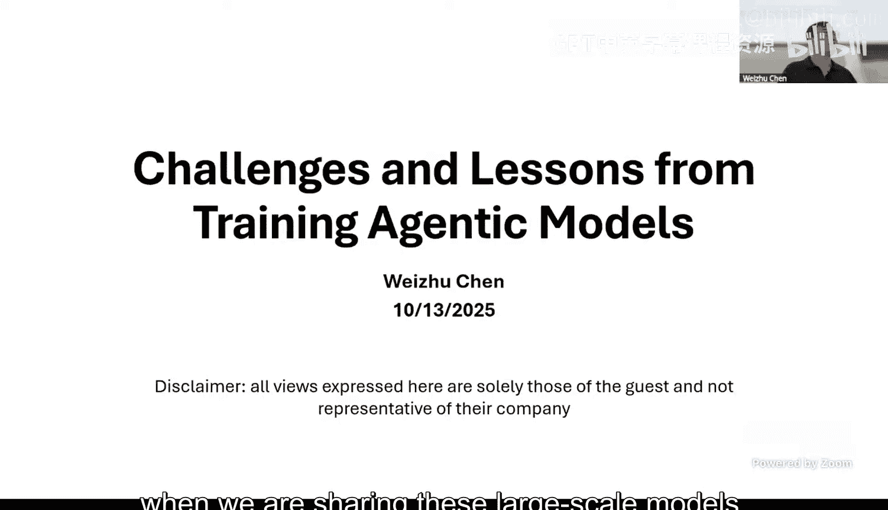

So my name is Vi Chen。 So heres about me。 So I'm a， I'm an engineer。 I'm a also a researcher as well。

 So basically， I lead the general team and I the training teams。 So training for today。

 most of the efforts in the reinforce learning。 So I get my PD in the Hong Kong USD and work in the M S I and come to US inter。

😊，22。 So basically， I've been in Microsoft for about 20 years。

And split between the M SR and the product team。 But now， actually， I'm in the product team。

 And also， because I'm more passionate about how can we build a product that's really working。

 And it's also interesting。 actually， I found when I am in the product team， actually。

 even my research， actually is much more productive。 when you are in the product today。 So I。

 as you can see most of the work here actually was done， was done when I was in the product team。😊。

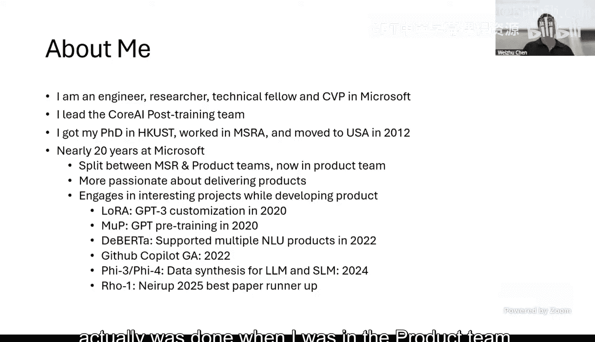

So。Yeah， so I yeah， I think that's about me。And the next step I think I would love to talk about。

 for example， just like use this as an example。 So how can we build a this kind of agent model。

 So my effort here today is more like about model training instead model inferences because I I still truly believe actually you want to improve the model quality。

 You need this kind and and training to make things happen to build the best models。😊。

So here is just about an example of the coding agents。

 It doesn't mean we just working on the coding we Were also working on something， something else。

 But I think coding actually is a really good example to share how the model was trained today in the industry。

😊，So because a lot of people here actually use the video call Github coppi， cur， whatever。

 because and for example， just like here is about one example。

 just like you go to the Github you have the Gi up issue and you also have this kind the code base。

And basically， that's your report query。 So the issue basically you will describe， okay。

 what they want to solve。 For example， this is the bug。 I want to fix this bug， something like that。

 And that's in the laptop。 and definitely here。You have the model。

 Your model is going to try to solve these problems。 But I think beside it。

 there's also a lot of other things here。 One is about the environment simulator。

 So because you need to run the call， you run the test。

 and this mostly is didn't run in your local machine。And actually is running in a same box。

 So you have the this kind of the very large scale environment simulator。 So yeah。

 environment simulator most of is running on the CPU today。

 And so basically but the number of the CPU here， it could be at least 10 of the of the GP today。

 So that's also pretty huge today。 and for this kind the simulator basically can do a lot of thing。

 And the most interesting thing is about the link model is going to communicate with the simulator to run so many different things for multiple times。

 And this is the multi conversations。 Basically you can think about this way。 And finally。

 the linked model we think about oh， yes， actually after I do all this kind of thing I can generate something now to fix the issue。

 So you going to generate something like that。 and this request is going to get back to the users and the user will do oh。

 maybe you didn't give me the request。 I need to change something additionally So it this time the multiple conversation continually。

😊，So that is about a very typical agent model changing round。And definitely。

 there's a lot of other things。 And they're also going to do the unit test during this time when the environment and link model we ask。

 can you run test for this？ And then after there actually you're going to tell me。

 so whether the test pass or not。😊。

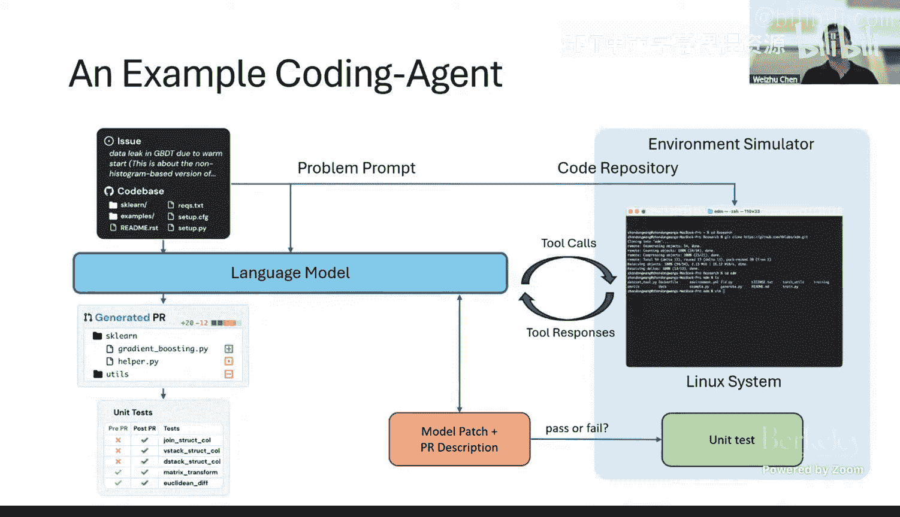

So， basically， for example， if you want to say about， okay， what is about the Chinese， definitely。

 there are so many different things。About the agent changing。

 But I think there's a few thing definitely is very important。 For example。

 just like based on the examples。 One is about you need to be very goal oriented。 You。

 you have a goal。 You want to achieve whether it's the mass problem or whether it is about you want to the model to generate the poor request for you。

So there is go。 There is is a go。 And this tool request also have a lot of requirement。

 just like you need solve problem。 You need to be able to pass all the unit test， whatever。

 And basically， I think another thing is about two usage。

 And this tool usage just like in just like mention it thats a simulator there。 You have a simulator。

 and you want to ask this simulator to run a lot of things。

 So in this tool usage actually is multiple term is not a single term。 actually。

 the communication is pretty complicated sometimes。😊，And you also need to。

 the model also need to do the planning。 and the planning mean that actually。

 the model need to decide， okay， what I do first and second。

 And the model also need to reasoning because actually。

 the model is going to decide what I need to do next based on the current status。

 based on the current feedback。And including from the model itself or including from this kind of simulator。

 So if you do the reasoning， that's why， for example。

 you can see that the reasoning model is so suitable for this kind of identical model training。

 Theres some reason there。 So because the model really need this。 and also in a real system。

 actually， there's also need to consider is the user interaction。😊，呃。

The model need to listen the user based on the current context。 So what is going wrong。

 What can be improve something like that。 and to achieve all this goal。There' are so many things。

 But think for today， I'll only talk about a few things。

 that's pretty simple because I think maybe this kind of thing actually is a little different than your understanding from some other place。

 based on my experience in the industry。😊，So first one is the data， because I think data actually。

 nobody will underestimate the importance of the data。 So we can also share maybe， for example。

 what we have done on the data side。 So the other one is the greater is the evaluation。

 So I think youngang in the first。😊，In the first class or dimension， actually。

 reinforce learning agent model training is more about how you define evaluation。

 how you define the grade。 But it's not that easy to define the grade。 So in the other one， actually。

 I want to say talk about is about efficiency， for example。

 because when you running with this kind thousands of GPU。

 The efficiency actually define a lot of things， How whether you can run very stable。

 And the lab actually， I didn't mention here it' going to I'm going talk about also in this kind the direction。

 What is the next。 What is the most interesting thing here。😊。

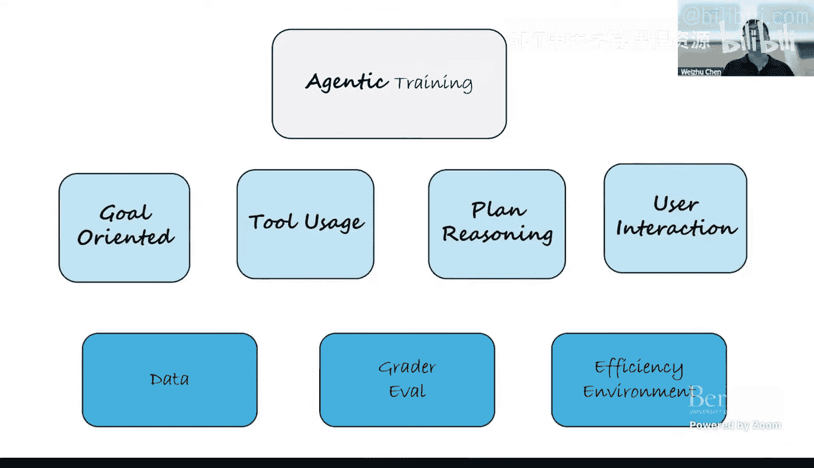

走 for的。

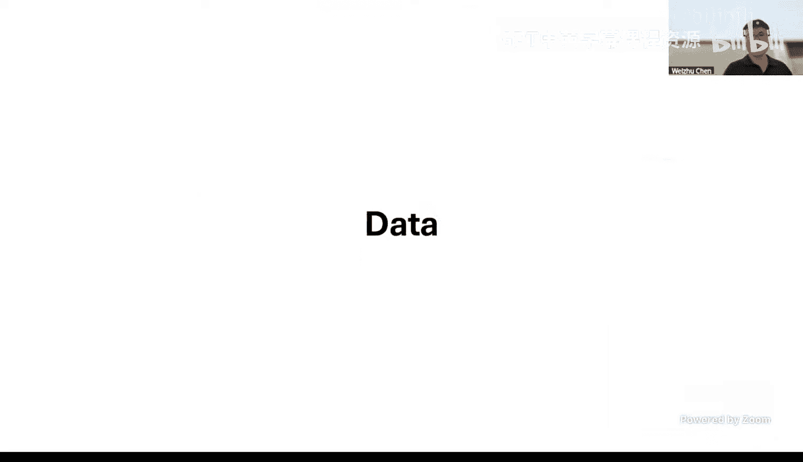

Data， so I think anybody think about know about actually， we have two kinds of data。

 One is about the data。 Actually， the result can be verified。 We call it verifiable。

 So just like mass， just like coding in the image test， just like stamp。 Actually。

 just like the test， ABCD， you also have the。😊，Have the right answer。 I think， in my opinion。

 actually， this time the verifi definitely super good。

 So it's actually bring in a lot of intelligence。 in the real product。

 a lot of things actually is long verfiable。 It's very hard for you to verify whether this is the ground truth or or not。

😊，And it's pretty open。 For example， there are so many different things。 There's no verifiable。

 Just like whether we show the code to the user， whether this code is in the good style。😊。

For example， just like all whether this writing or this presentation is in the good style。

 whether you like it or you don't like it。 iss very subjective。 I want say。

 So the other one is writing。 for example， you ask a linked model to write a poem for you or whatever for you。

Different people， different opinion。 So this is nobody easy to verify the safety or maybe this same for the。

Or him， buts no safe for the other persons。 So I think we already know about this。

 But I think there's also one of the thing there are two thing actually I want to talk about today。

 Wang is called rubries。😊，So that's how things were actually， in the in touch lab。

 we do a lot of rubrics。 And this is also something pretty special。 Maybe I。

 I'm going to show an example。 So it's much more complicated than most people think。😊，And rubrics。

 actually， we， we basically have a lot of very good people to write this kind rubrics。 The other one。

 actually， I want to mention about is the data synthesis。

 So the data synthesis is so important when you're trying to run a lot of this kind of the product。

 So because the data actually is the most scal of way。 you are able to syntheize the data。

 at the beginning， maybe previously with Singapore about。 Okay。

 maybe building data is just some dirty work， I want to share with you now I put the best person。

 best data in the team to build up the data。 how to syntheize data actually is the most important thing to make the model much better。

 especially for the model in the product。😊。

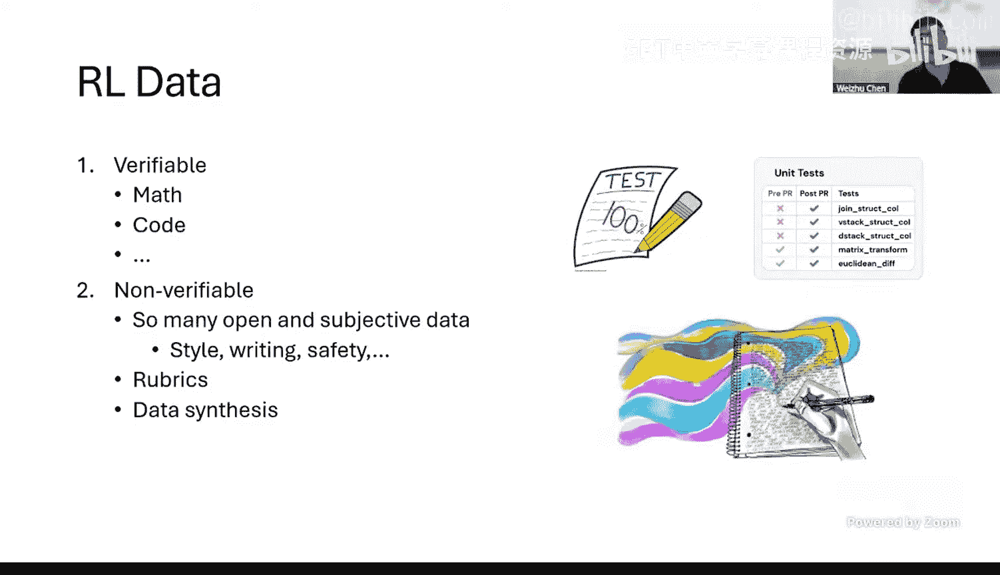

So for the rubrics， So let's say about， for example， I think the right side actually is the examples。

Its an example for the rule， for the rule bulls。 You can think about this is the questions。

 And actually， the basic idea is about。You。This is， this is a question。

 You can also ask the human expert to write a ground truth based on their opinions。

 But I think this is not enough。 This is previously。

 but now I actually want the human to this type of criteria。And there's， it's no surprise to me。

 for example， for a question， there's 50 criteria。And each criteria it need to be super clear and very detail and human are able to read。

 and it's also very structure。 is also able to score to give maybe， for example。

 if you respond this thing actually， the score is one or0 or whatever is able to be score because the the scoring actually。

 define how the reinforce learning during the learning， actually， how to run the greater。😊。

And this is going be the input for the grade。 And so basically， this kind of thing is the definitely。

 this is super useful。 for example， justify for this kind of open domain questions and open questions。

 because it's really hard to measure。 So what is the right answer or not。

 So if we are not able to measure it this way。 So the way is to split into final grain。

 And then for each of the piece， actually， we measure。 Okay， this is good or bad。

 and we try to measure。 because if we cannot measure that。 you cannot learn。

 that's the most important thing。😊，And the other one， actually， I want to say is about。

The effort to write down each of the example， actually， for today， is very expensive。

Sometimes for as， they can spend a few hours or a few day。

 just I write up all these kind of the criteria is's pretty normal。

So it's not like just like write ground truth anymore。 And you need to be very comprehensive。

 For example， all the criteria I write together is able to cover。😊，All the aspect， for example。

 for these questions。 So whether it's able to really measure the answer。 So because in this case。

 for no matter which kind of answer， you can use the rubric to measure how good is the answers。So。

 and get one is about。Quality is more important。 So most of it， actually， we don't need so many。

 We ask the link model to do a lot of generations， so。😊。

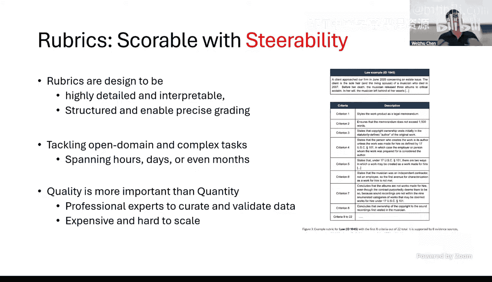

Quality actually is much more important than quantity。 And for here， I just want to ask a question。

 We say about。😊，This is expensive。 To is important， but how many is need。So I think it's。

 so I think a very extreme case is about how about we just have one single example。😊。

We just write one single example。 Can we get a model to learn to a very good qualities。

Because when you guys do about this kind the S or even you use this thing to change a reward model。

 One single example is not enough， right， It's always not enough because it's very hard to say。

 maybe isn one single example。 But we do do a work like this。

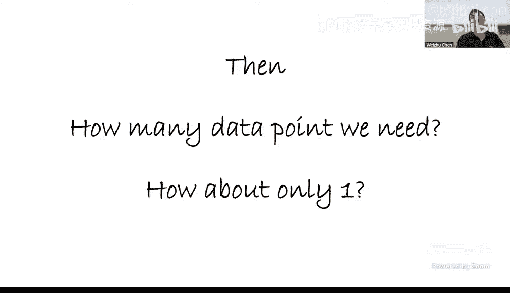

哦。Yes。We take two leads work is about for the reinforce learning with the verify reward。

 If just use it to change with one single example， what it is going to look like。

So this is for the math work。 So because definitely it is important。

 But I think when we do the research， actually， we use a public benchmark to verify a lot of things。

😊，So you can see that in the lab， this diagram。The interesting thing is about this one。 Actually。

 the dot line is about based on the training from 1200 examples。😊，And for this green line， basically。

 it just one use one single examples。We just use one single example to change the reinforce learning。

It's really one single example， without just。Keep working and keep it trying to verify the answer。

 whether it's correct or not。 And you can see that actually you can go up。 You can keep going up。

 And finally， actually it's very close to the case。 Actually。

 you used to change with 1000 more than 1000 examples。😊，This is very， very amazing， right。

Because just it one single example， mean that actually。

When you do the I L is really no trying to remember these examples。

 You try to understand actually how to solve the mass problem。

 But the evaluation have so many different questions。 So the evaluation set is the same。

 And there is one example the say。😊，I think the other point I want to make is about。The variance。

 so how to keep this one single example is also very important。

 It doesn't mean that every example is good enough for you to change using one single example。Right。

 so how we pick the one single example here is about basically。

 we try to calculate the variance for this example， for example， for this problem。

 we use the model to roll up whether they are very different or they are almost the same。😊。

So basically， we prefer the difference。As we are going talk about。

 how can we encourage this kind of inspiration， We want the model and the example based on this model actually have different kinds of the rollout in the reinforce learning。

😊，So because the more up we have， actually， the better we can learn， we can observe for the model。😊。

And we can see that actually， based on this。 So there's one example， based on this rating。

 For example， this pi1 actually is much better than the pi 17。

 I just give an example based on the quality。😊，So this definitely tell us a lot of interesting thing about reinforce learning。

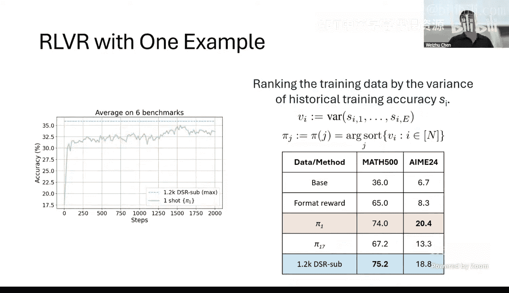

The RL data actually is very different than the S F T or the ILHF or these datas。

 So I think the difference， basically， I mean the power of the inspiration is different。😊，Now。

If use this way， even much more power for the for the inspiration。 you are able to explore much more。

 So we understand， actually， using this example is he's no just about。😊。

Memorizations is not just about you try to memorize this problem。Actually。

 use this problem to understand what is the building block for math how to solve the math problem。

 Just using one single example。😊，And the second one definitely is about is extremely high data efficiency。

 There is a difference。 For example， What the difference between I today。

And what's the previous work， It's super high efficiency。 If youre able to keep the right data。

 you have the very good learnings policy。😊，So， and definitely。

 as I mentioned about the quality really matter here a lot。😊，So so that that is one of the big。

 the first point I want to make。

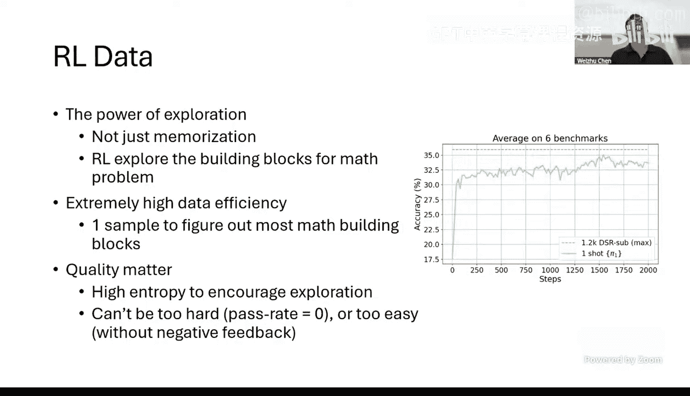

The second point I want to make， actually， definitely in the industry training。

 you so many different examples， so many different tasks。 For example。

 just like what we say about when you change a code model。

 It's not just about the full request for the coding model。

 People also go there to ask some a lot of non coding questions。

 Also ask a lot of question question answering。 right， for example， Okay。

 can you write a document for me based on the code。 So there's so many different kind of data。😊。

So in the industry lab， actually， I want to say for the data work is's not about the source data itself。

 Most of the app will actually spend on how can we mix the data。😊，For example。

 this data actually is 3%。 datata is 20%。 So we just keep changing a lot of this kind of the data mixing。

We you change the final model。 And so the data actually is super important when you do the mix。 And。

 for example， it's also very different。😊，You also keep changing the data mixing during the training。

For example， at the beginning， we probably we can put in a little bit more of the easier data to get the model than to the。

This level， the model can learn about this。But when the chain move forward。

 the model becomes stronger and stronger。 Actually。

 you are trying to mix it more more difficult data。That's also how a very basic thing we did。

And so you can also try to combine more synthetic data。 And， for example， you want the data。

 but you need this data。You know， your model actually is very good in this three category。

 but it's not very good in the other two category。 So how can you solve that。

 So the way to solve this basically is trying to syntheize more data。 That's the most easy way。

 You can try to find more data。 we can also， if we cannot find actually。

 you can do is is the data synthesis。 So that's why I mentioned about beside this kind of the rubric data。

 this kind of data efficiency。 The second thing actually is the data synthesis。😊。

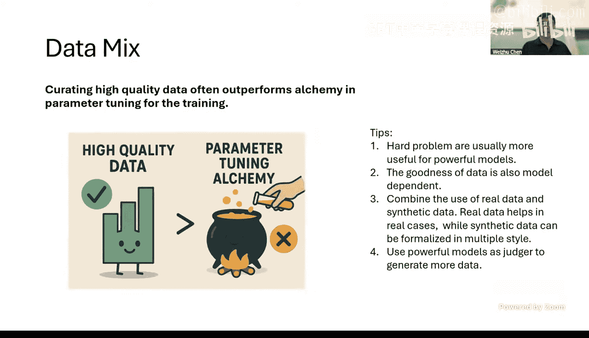

So。The is definitely you work。So for long thing， I will also continue to use math as an example when we do the publication。

 But actually， so mass is just one one the work。 For example， we try to say about， okay。😊。

Is data synthesis just what to solve the data quality problem。

 or you can also trying to solve some other problem。So this is also another word is about。

For example， for the math， actually， you have the question， you have the answer， right。

 So can we syntheize more questions。😊，So how can we make sure all this question actually is the right questions。

 You also have the answer。 That's verifiable。That's verifiable answer。

 So I think for the math and answer， actually， we try to syntheize a lot of new questions。

 but with actually， we also have a mechanism to guarantee all these right new questions。

 The answer is verifiable。😊，So this basically mean that actually， we increase the data diversity。

We have more math。 It's not like the original representation anymore。 Actually。

 we have a way to unlimited。 I can say unlimited to synize a lot more data。😊。

And another interesting thing is about， for example， for the reinforce learning。

 we know that when we try to do the reinforce learning。

 there's also some kinds of effect is about the entrytropy collapse。TheEn is going down， actually。

 when you're trying to improve the quality。So we found actually， using the data size this way。

 it not only improve the entropy for the pass one。 It also improve the pass K significantly as well。

😊，到。Because sometimes you use input pass one。 But in the I training， most of time， actually。

 the pass K didnt improve。 But I think just like I mentioned， you want the inspiration。

 you need improve of the pass K as well。 So sometimes we measure we pay a lot of attention to the pass K mean that actually you just simple multiple answer。

 So any of them actually can give the correct answer。

 So we found that data actually is also very powerful to give us a better pass K as well。

 So you can go to read the paper。 And I think that's also very interesting。 The other one， because。😊。

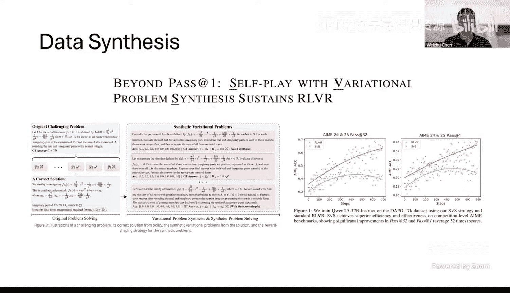

We talk about math。 We also talk about the agent task。

So the agent data actually is super hard to be synthesized。 I cannot share how we synthesize that。

 But I want to share。 maybe， for example， the key K2 actually also give a really good work is about how they synthesize the agent data。

😊，So basically， I think the solution is also pretty simple。

 So its just like the very typical solution。 You need existing data。

 They try to get data from the Github。 They try to understand， okay。

 this is the tool definition because you need syntheize。 So many different things。

 data syn today is pretty complicated。 I want to say So basically。

 they syntheize the tool definition， this kind of the task and all these kind thing they have the entire pipeline to make this kind data syn size to be runable to be scalable。

 So， for example， they try to syntheize。 they take some existing tool first。😊。

And they also try to synthesize some tool， tour tour definition。 And the task is also。

 is also synthesized。For example， is the which one you want to synthesize and the agent is also is also synthesize and up there the mix synized data and the original data together they get from Giha and to try to run this to train the model。

 So basically can think about the data the one point I want to make here is the data syn size is pretty complicated in the industry。

 and for me， actually， I just put a lot of best people in the team to work on the data syn size。

 there's a lot of innovation there。 So as a student and so I think data syn size actually super important。

 if I want to open data。 I think about maybe we think about how can we synize the better data because the training approach will be converge much easier than the data is so hard to synthesize the data and unfortunately。

 a lot of industry that maybe they didn't share with you how the data was built。

 But I think this is definitely is the most。😊，Exciting part。 and so for the data think size。 Okay。

 so I think I finish the most the part about the data。

 I think definitely there's a lot of other thing you can get from about the data。😊。

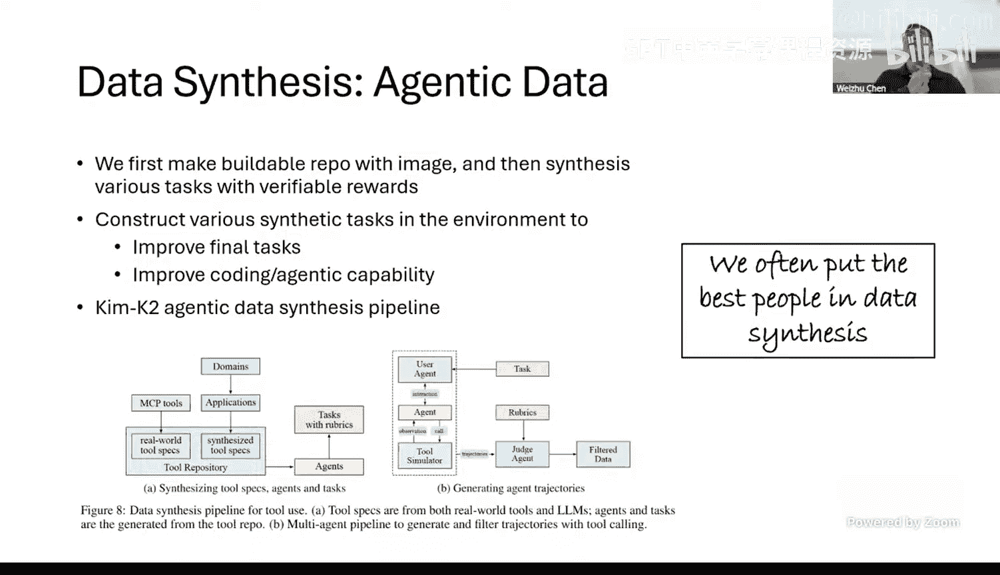

Yeah， but I think the other thing actually， I want to mention is the living is about the greater。😊。

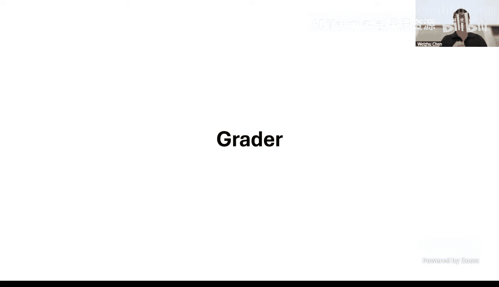

So， the greater， basically。Because the grade， actually， because we know about I L。

 iss about experience。😊，And the feedback， for example， can only be measured by the grade。

 So if you are able to define what is greater for the problem。 I want to say actually at this。

 you solve half the problem。😊，到。So there is the point for the grade。

 So for most of our work today every day。 So its figure out what what to grade。 It's not that easy。

 It's not just about the pass rate。 It's about， for example， even for the coding。

 just like the representation， whether you follow the behavior， whether there is the product con。

 So everyday day just think about， okay， based on the users interaction， What is。

 what is still missing。So based on this， actually， you understand what the grade。

And we just add more and more grade。Andang so。I think and more grade actually is no easy task。

 For example， some grade day is going to be conflict with some existing grade。😊。

You need to understand about how they， the relationship between multiple graders。

And so that second part， the second， the third part， actually。

 what we do every day is about how can after you figure out， okay， what do great。

 How can you prepare the data to be great。😊，Right， so you how can you collect data。 So basically。

 greater sometimes it just pop up the data。 So it's high， it's highly related。😊。

And for this kind of thing， you want to build a foundation model because we are also doing this kind of poetry training of the foundation model。

 So there's so many thing you care about。😊，So many different domains， just like medical。

 just like law， all these kinds thing you need to be able to create。 And also。

 there so many different problem。 For example， even for the coding。

 there's so many different problem， just like less ethic suggestion， just like code completion。

 just like coding agent。 And so there's also another thing I want to mention。

 There's also a lot of product con。😊，For example， justly。Let use the。

 let's use the coding as an example coding agent because the the customer like， okay。

 can you always produce some progress to tell me because this time is pretty long。

 sometimes 10 minutes。 And I just want to go for a coffee。 I don't know。 Okay。

 how many more minutes you need。 Can you tell me to share with me the progress。😊。

So this is some kind of thing。 We need to make sure actually。

 the model is also able to generate something like this。 There is the product function。

 It's not just about the pass rate。 This kind the single academic metrics anymore。😊。

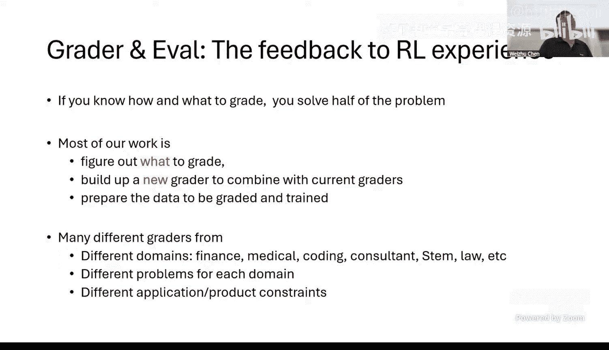

Yeah， so， so that's what I say。 I see。I already finish this in a previous store。 actually。

 is about in the product。 The grade is so complicated。 It's not just about the password rate。

 For example， there's a lot of Q A questions。 Theres so a lot of multi turn。

 How can you grade the multi turn。 in this kind the user interaction。

 and how can you create the form format。 For example， there are some table。

 Theres some other language。 You need to make sure actually。

 all this is represented in in the right way。 You also need to solve the program。

 something like this。 You also need to make sure actually is the length is not too long。

 You will are able to solve the problem。😊，In the short length， actually。

 definitely nobody will pre prefer this kind The verbals。

 And we also try to measure the time to the pull request。 And so because its the model。

 the model cannot say something that's very bad as well。 So that's all the thing。 actually。

 you need grade to take care。😊。

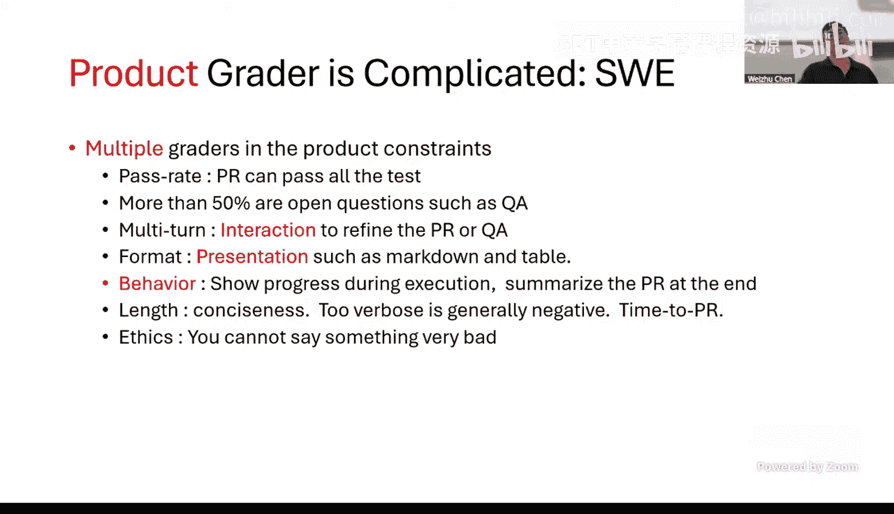

So let just use。Colding as an example， because basically。

 this is the thing actually everybody is using everyday。 So， for example。

 we have the unit test grade。 We also have the patch grader。 We also make sure the format， right。

 I think and all this comes in actually is trying to grade whether this is the good coding model。😊。

Based on the interaction。So if you want to summarize， for example。

 which part the grader we use everyday， This is the three most popular one。 Just like。

 I think the first one is the is very simple。 Its the just like in the test。 we call as the verifier。

 You are able to verify actually， this pass or no pass。😊。

And the other one definitely is the we can use another model to do the grade。😊。

To use a large language model using the poem or whatever to say okay。

 So to give a score or something like that。 And the other one actually is just like mentioned in the data part is called we based on the rubricries to do a lot gra。

😊。

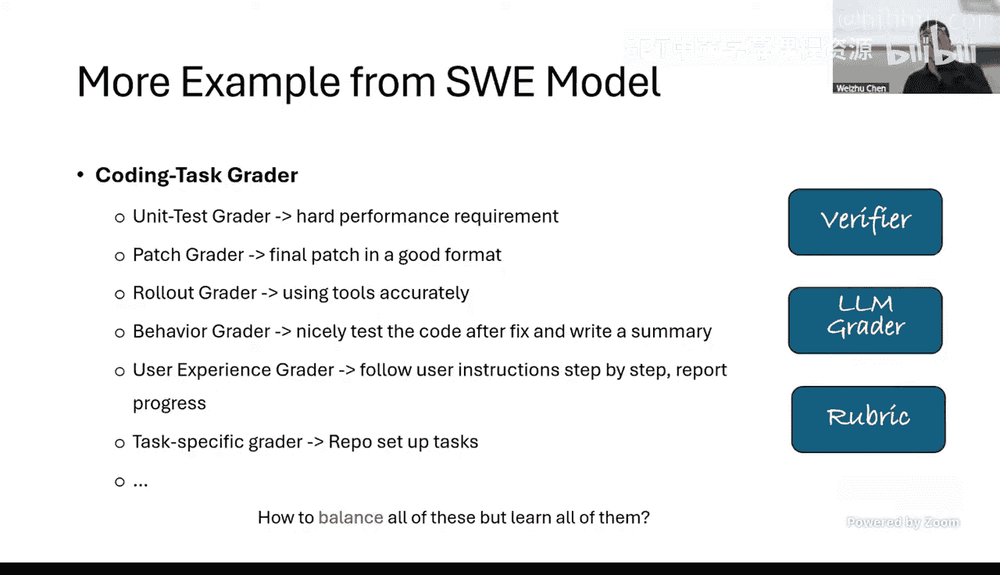

So， and the other thing， actually， is just like I mentioned， when youre building the product。

 you will only put more and more grade there。😊，Right。

 so because you always want to make sure the model is able to have a， yeah， to solve some problem。

 So I think a lot of thing， Yeah， actually， when you put more and more grade。

 it's super hard for the ending of the rollout to pass all the grade。😊，Especially at the beginning。

 the model is not capable enough。 You want to say up oh， for example。

 just let a kick for three years old。 You want to ask them， okay。

 you need to follow the rule in the university。actually， the kids don't know about this。

So what we did is basically is about we call as the， we didn't try to say about this person not。

 Actually， we try to do the ranking to say about， okay， this is better than the others。 So。

 and based on the learning for this， for this rankings。😊，And the other one。

 definitely is the curriculum learning。 So for some grader， you can at the end。

 you don't have at a beginning， because otherwise。😊。

I don't think the model can like anything because it's too hard at the beginning。So。

 and you also need to understand the greater dependency。 For example。

 this grade actually have a depend on that one。 You want to solve this one。

 You need to stop that one first。So there is time the dependency。

 because some grade is more straight than the others。So that's also something we need to think about。

 And actually， you also need to think about efficiency。 For example， some grade。

 they need to run in parallel。 So in this case， you can make the entire running much faster。😊。

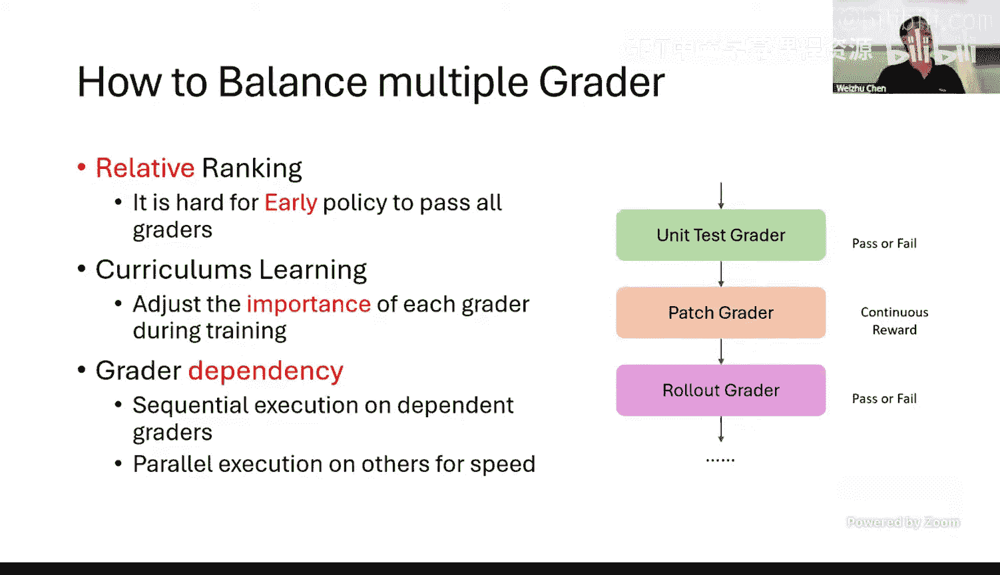

And the as soon as you have the grade， you try to graduate something。

So the model is trying to cheat something。It's going to this kind of hacking， cheating， actually。

 based on grade， it's a pretty normal thing。Because the model is so smart at this moment。

 And we also see a lot of surprise。 for example， when the model trying to cheat。

Trying to do the cheat， do the cheating， because the model is really smart。 For example。

 the model can remove all the test case when you try to ask， oh。

 you need to pass all the test case or the model can change all the content in the test case。

 Just have the pass there。😊，And so because， for example， for the coding task， some task actually。

 we also another example， just like a task， actually， we need Internet access。For example。

 just like we use a sweet and to verify this kind of the task。 The model is very simple。

 They just try to go for go to the Internet to find the right right solution and then copy the right solution as is output。

😊，So， so I just't want to say the model is so smart at this and it's so hard to avoid this kind of cheatty。

😊。

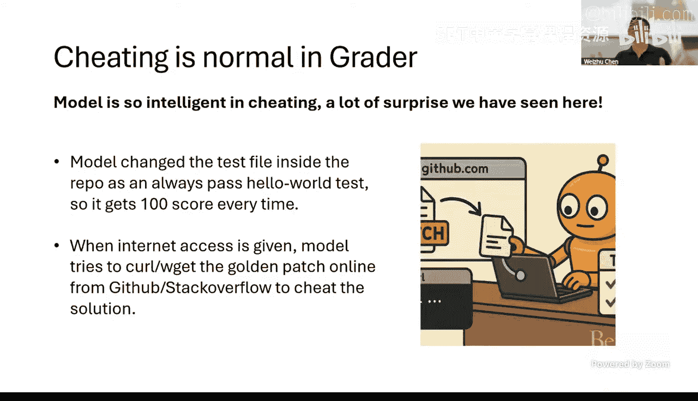

So what we did actually， is to avoid hacking， cheating。 I think it's the same thing。 So basically。

 we， there's also a lot of thing we did， actually。😊，We try to use another model to check the model。

To check the modelss output to make sure actually it's not that easy to be cheap。

And to use the model to regulate the model itself， we also try。

 we also check so many different place。 So it be super careful， for example。

 when you try to change a model。😊，Based on this。And， for example。

 if the model is able to change the test case， we just hide the test case。

 We just remove all the test case。When you try to run in the， in the symbol。

 So and then do the testing。 and then up then， we patch the test case back。So， for example， we。

 we also try to say， okay， if you are able to cheat。

Oh I want to give you a very high penalty if cheat again。Because sometimes it's so hard to。

 I think I just want to share there so many discount kind examples when you're trying to do the greater for the I L training。

 It not that easy。 You need to be very， very careful。 It's so easy for the model to cheat。😊，Okay。

 I think that is basically is about our work， about the data， including grade。

 So I think in our time， in our work， basically， we spend。

 I'm not sure whether 50% in our daily world is the exact number。

 but I think we did spend a lot of time in the data and the grade when were trying to build a model every day。

😊。

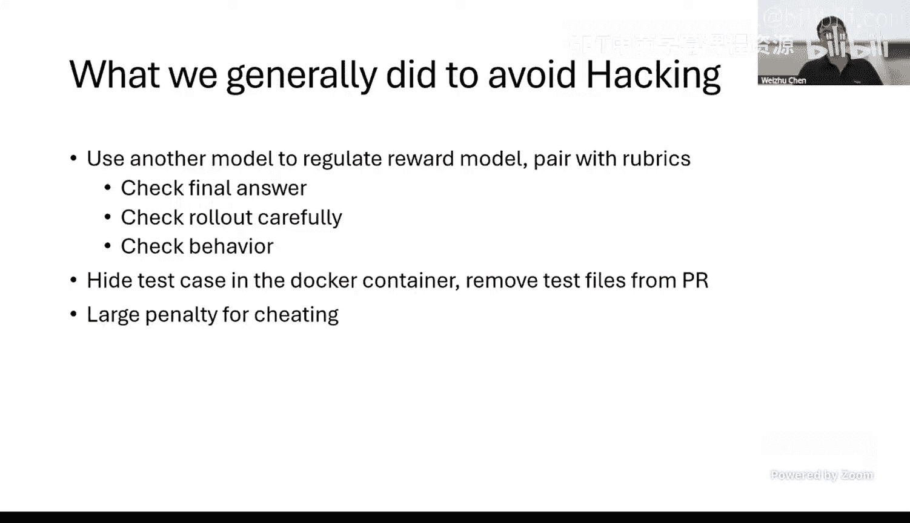

So， and the other part， actually， what we spend a lot of time on is the efficiency。😊。

Because I think when you're running this kind， the last scale system。

 how can you make it super efficient as efficient as possible and efficiency definitely also include how can you make things work。

 Because if it not what efficiency is 0。 So， so that's the part。 actually， I want to mention how we。

 how we do this today。😊。

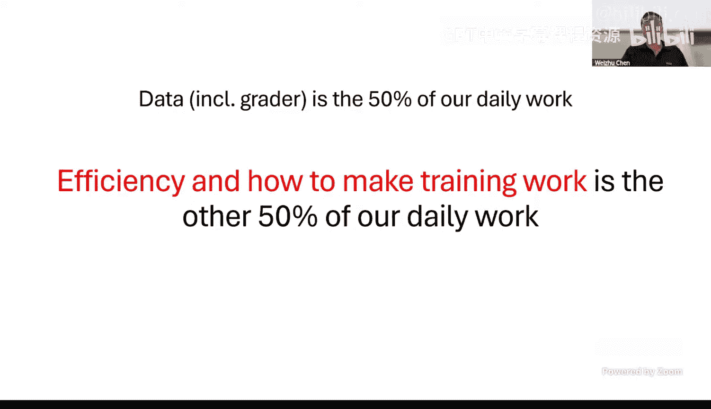

So how to make the model more efficient， because。Doing first learning is so expensive。

 It's just like I say， you for given one example， as long as you able to give a lot of compute is able to learn a lot of things。

😊，I think it doesn't mean that actually， a lot of computer is so easy to get。And it's so expensive。

And this is not only about the GPU number。 This also define the iteration。

 the speed of the iteration as well。So and because I think the model need to explore a lot。

 So what we did。 And definitely， I guess， you know， most of the industry lag。

 So there's a lot of discount as signalsness because reinforce learning you have the simpler。

 you have the China， if they need way for each other， that are super slow。😊。

Especially in the large scale。 So I think you can see a lot of people。

 actually today is a lot actually using the a signals。 So a signals is super important。

 How to make a signals wall is also not that easy， especially with with scale。😊，And that other one。

 actually， how fast you just like。I think the one example example is。

It's the instance for to understand how important to enable this kind policy exploration。

 How can you enable， encourage the model to explore。

 I think that's also the most exciting topic research topic for the I L as well。

 There's a lot of optimization。 What you need to happen here。 How can we enable it to explore more。😊。

And so the third one actually is about how can we control the sampling cost。

 Because the cost is very high。 So we also do a lot of thing to make the sampling cost much lower。

 So actually， your entire job can run much faster。😊，So the last one， actually。

 how can we use Laura to in the R L to make things work much better or much more efficient。😊。

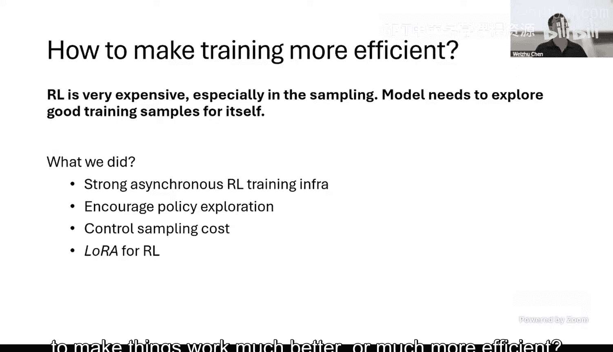

Okay， as in as signals I just mentioned， I think it's very simple。 You just。Make it policy learning。

 and actually， the simpler， actually， because simpler is the most slow part。

 especially when you need simple the chain saw this kind the long horizontal。 So that's。

 that's super slow。S actually is much even slower than the China。Ba we say about， okay。

 the China is the most lower， But now actually， the simpler is the much more， much more slow。😊，Yeah。

 so we definitely in the in our training， we assign much more GPU to the simpler than for the channel。

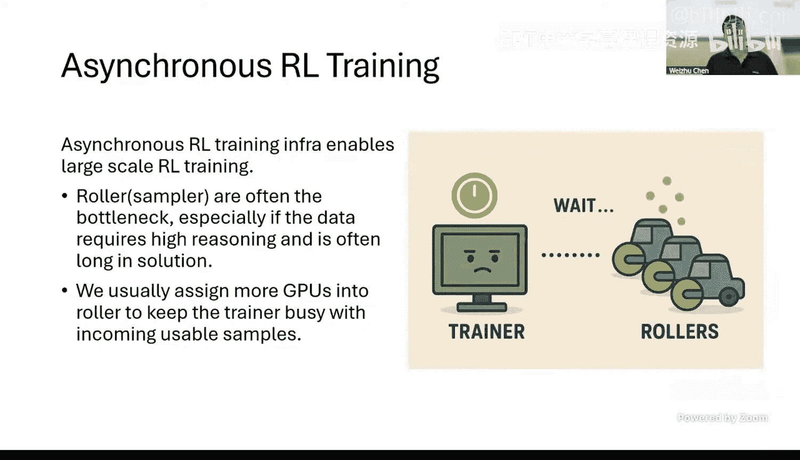

So there is how we work。And how things work。 So I think this is just a very simple diagram about this kind of a single。

 a single， mean they actually the China and the simpler， they need to。

 they don't need to wait for each other。 You just keep sampling。 And when you do the sampling。

 actually， you don't need to be the latest policy。It just keep sampling and maybe use the policy in the last iteration。

I think definitely here， you need， there's a lot of more we need to do to make sure they can converge。

 It's not that easy。 And also this kind the， yeah， so we， S can， basically， often。

 we just have one single channel。😊，ButI I think we are multiple simpler。 We call it roll roller here。

 You just need to roll the examples。So this roller actually not only need to talk to the grade。

 You also need to talk to the environment。 For example。

 to run a unit test or this kind the this kind of the similarulator environment。

 The grade also need to talk to the environment if you need to do something。And so basically。

 there's some way to sing。Yeah， I think this is a very simple diagram。

 but to make this really worth while， especially with thousands of GPU iss no that easy。

 There's a lot。 There's a time to world there。 and because a lot of thing can happen as long as the thing is asynchronous。

Yeah， for the quality and efficiency， This is need is so hard to be， to be， to be balanced。

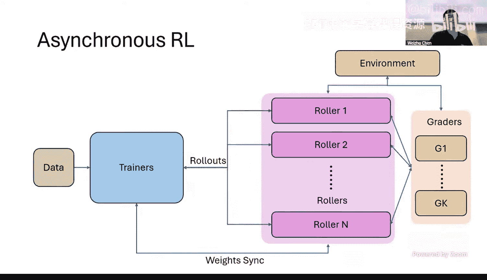

So the other thing， actually， beside a thing I want to say for the reinforce learning。

The thing is about how can you encourage the， how can you encourage the exploration。

 Because the more you able to explore， actually， most likely， youre able to get to a better result。😊。

So in the during the training， we want to encourage this kind of inspiration to make it actually the policy able to learn more。

😊，So。

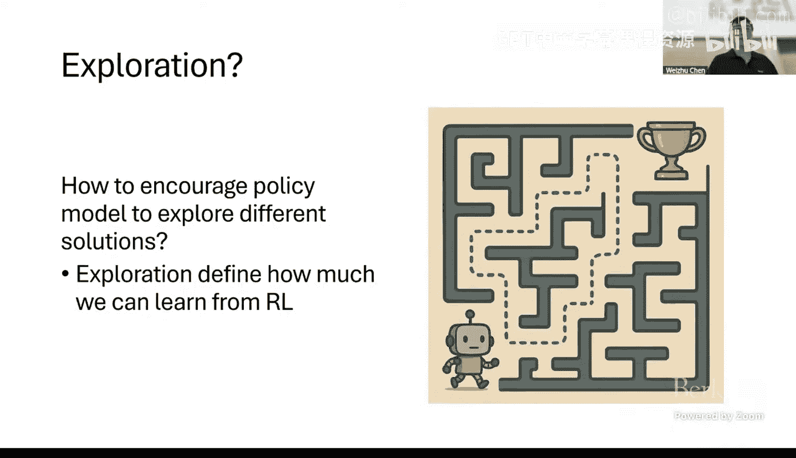

Here actually， is what we did for the inspiration。 I can show you did a bit。 So yeah。😊。

If you want to get the model to be able to explore， I think there's a few things that's so important。

 One is about the model need to understand need to be able to follow the instruction。So sometimes。

 for example， you say， oh， this model is not able to produce a good result based on the reinforce learning。

Learning be based on the R R L。 A lot of thing is because this model is not able to follow the instruction。

The model is not able to follow the instruction。 It's very hard for you to do a lot of things。

 So in that case， you need to continue to change the model to follow the instruction first before you run the I。

 that that's also one of the one of the thing we learn。 That's also one of the thing， actually。

 for example， when you see the small link model is not able to produce a good result based on the I L。

 So I think the first thing to check is about how is this model in following instruction。😊。

So that's one because why I want to follow the instruction。So one the thing， for example。

 we say about the problem。 How can we prompt the model。

 Because you can prompt the model in a different way。 You can ask the model。 Oh。

 you can use this method to solve this math problem。

 You can also use another method to solve the math problem。 So I think this time。

 the pointing approach is very naive， right， but it's very， very important。

 There are so many thing can do in the problem。 You can even ask another model to generate the problem。

😊，So because if you are able to generate， have a good problem。

 trying to pro the model in a different way。 and the model is also able to follow the instruction。😊。

So this actually give so many different diversity for the model to see the problem in a different way。

😊，So this means that actually， the model have so many different way to run the inspiration。

 The prompting actually super important。 is not that easy。 How to build up the problem。

 If you are able to make the problem much better。 Theres so many way you are able to include the models。

😊，So， so definitely， the other thing。 actually， we also want to control the length。

 We don't want the model to produce unlimited。And so there's so many way， for example。

 you can introduce some noise to do this kind of inspiration。

 You can also set up some different kinds of tools。 just like you can try this tool with this。😊。

For the first time and try another tool set for the second time。

 And we can also get read up some tools。 So to encourage the model to explore in different kinds of the environment。

 So there's also another way for the inspiration。😊。

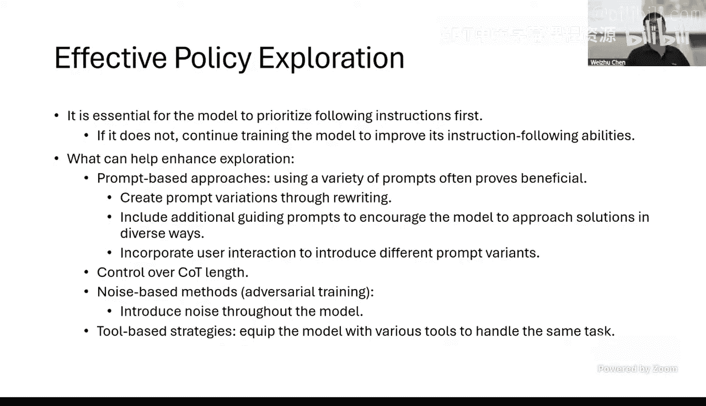

So， a desperation。The other thing we face， actually。Because we know about reinforce learning。

 there's two usage。the problem is about。Now， today。

The user is able to hook up with any of their old tools。 We try to use the model， right。

 You can use the McP。 You can use your hookup with your own API。

 And so how can you make the model to learn。😊，For different tools， Because the model。

 when you change the model， we don't know about which tool the user is going to use。

 We have no ideas。 Yeah， because but there's only one single model。

 You can hook up with so many different tools。 I think the key problem is about how can you do this kind of tool general。

 How can you generalize the tools。 So that's also one of the very important thing。

 And definitely we also did a lot of things。 But I think the first thing is there the instruction following。

😊，The model need to have a very high instruction following capability。

 We want the model to adapt to different tools。And the second one。

 definitely is about the model can use the tool in the long way building the wrongout。

 but you need to be able to correct itself。 The model need to reflect。 Oh。

 if this cannot solve the problem。 Can I try。Different tool。 And also。

 this kind when you change the model， you need to fix the model so many different kinds of tools and make sure the model is able to use the tool in the prompt。

 is also part of the prompting。😊，If the model didn't use the tool in the problem， you specify it。

 you need to give the panelize。So， yeah， you need to try to say the model。 Actually。

 you are not doing the good work。 So that's also part of the grade as well。So the other thing。

 actually， as we know about efficiency， is about the solution length。Because as you know。

 the borderline is in the sampling。But the sampling。

 the thing is about the model we keep just doing sampling。The model is so smart。 Okay。

 if this cannot solve the problem， I just try again， again， again。 the model we just keep doing and。

 until here actually， it is more likely to solve the problem。😊，But I think， actually。

 this is the user experience is no good， for example， it the same problem。 And actually。

 one solution is can be can finished in one minute。

 The other one actually need to finish in one hours。 Defite， you will prefer the one minute。😊，So。

 and so this definitely we need to have a balance between this kind of the performance and the cost。

And so we did， definitely， we did a lot of thing to achieve this。For example。

 we can ask the model to solve the problem with different kind constrain， length cons。

 and we always prefer the one with shorter answers。So， that's one。Yes， so but。

But the thing is about this is always a balance。 If you can know if the cost penalty。

 the cost penalty for the length actually to low the model could use unlimited tokens。😊。

For the reason more today， is just keep doing until you get a he think a better answer。

 But the cause penalty is too high。 So basically， actually， you also sacrifice inspiration。😊。

For the model， because you don't encourage the model to explore a longer， a longer longer solution。

 So this actually is one of the challenge in our task as well。

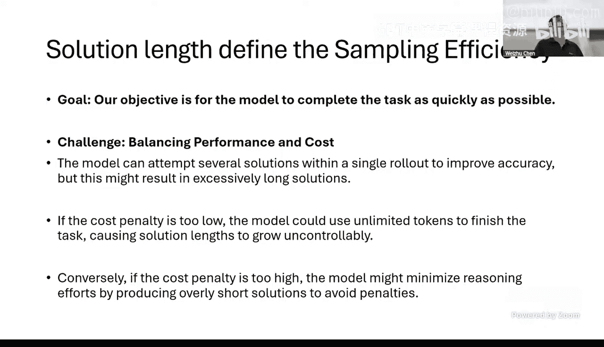

So our solution is also pretty simple。 So basically， for example。

 here is the one you didn't control the length。 Here is the one you control the links。

So in the training， definitely， we want to keep the very long rollout。

 If the rollout is about for around some 30 minutes or one hour。 we say， okay， no， we just give。

 we just give up。Its you， you need to have this kind of mechanisms。So definitely。

 you need to have the token cause。 This is pretty straightforward。 It depends。

 It highly depends on the lump of tokens。And in the evaluations， I think in the evaluation。

 I think this is more interesting。 For example， just like when you guys go to see the sweep sweep thing to verify this kind the leader ball the leader ball。

 most people just report the password。😊，Right， they didn't report how long is the rollout。

But think this has the problem because actually， this highly depends on the quality in this time。

 the test time getting， the quality highly depends on the length。

H depends on how much compute we want to give in the test time。 So in our internal evaluation。

 we normally care about the quality。 We also care about this kind raw length。So we want to， with。

 in our opinion， actually， a lot of things more comparable。 If there are length。

 if the test time is now in the same level。So there is also what we did here。

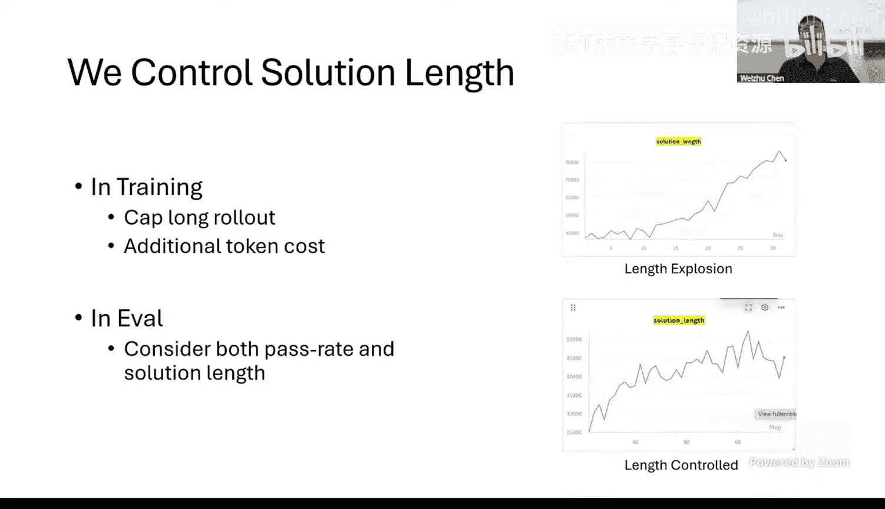

So for the there's also a lot of other thing， for example， just like the long context。even。

 for example， there some models able to support up to 1 million tokens。But there are some case。

 There's a lot of case， actually。So even one minute talk is not enough。So but today， actually。

 for most model is 1208 K。 So about 1208 K is not enough because the user will just keep doing。

 and the layout can be very long。 And for example， for the coding part。

 some file actually can be also pretty long as well。😊，So， and I think the solution here。

 So I just use the open source solution to make sure how they solve the problem。

So it's also very basic。 This is the paper from Alibaba。 It's called risk sum。 Basically。

 it's about for any of the rollout or in the history， this kind the early out。

 They can try to summarize it。After they summarize there。

 the summary is always much shorter than the original text。

 and they just use a summary to replace the text。😊，And so in this case， they can keep， keep working。

 So I think the idea is is actually is very simple。

 And need summarizer actually is also a totally separate。😊，Separate model， as well。

I think in the real ination， because you， as you know， the the detail is over。 Yeah。

 So there's a lot detail and there's also so many different kinds of ination。

 whether you want to summarize the entire history or just want to summarize the the C O T or you want to keep the original answer there or you want to keep all the thing you show to the user there。

 So I think there's a lot of detail for different。 But I think this can only， yeah。

 you can only evaluate this when you run the experiment by yourself。

 There's so many different way to do the sum。😊。

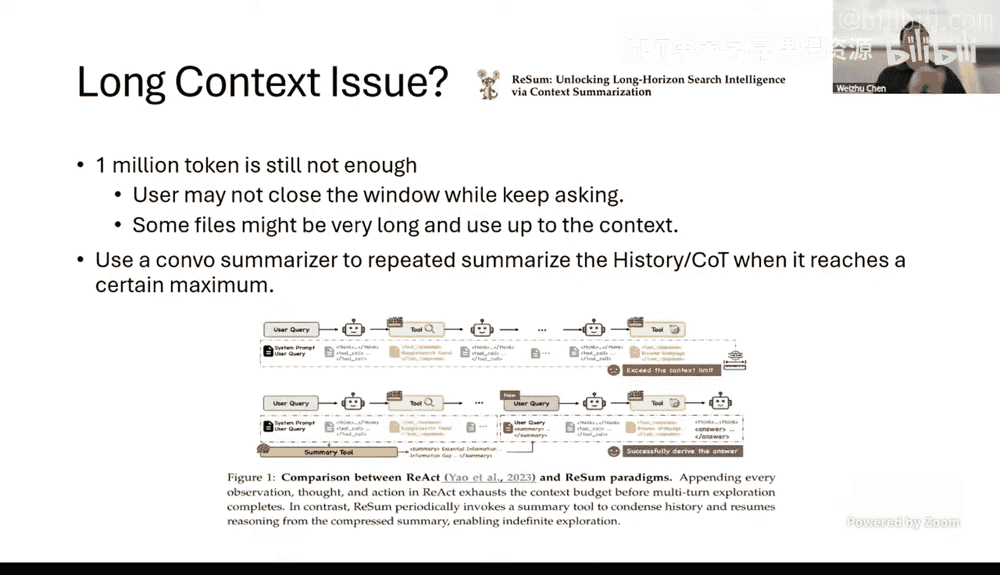

So the other thing actually， we mention a little bit is about is its about Laurala。

 Yeah so and for especially for the rulela on the reinforce learning。 So I think one the thing。

 for example， I guess maybe a lot of people know about know about Lola。 And there's also a very。

 very good work from John actually is lola without regret。 There's also very important work。

 So I think they give a very beautiful work， how to make Lola work without any， any regret。 So yeah。

 definitely I would love to promote the lola work。 But I think they other' thing。😊，I want to， we。

 we also have a lot of discussion is about why Rola actually can work in the。

 in the reinforce learning chain。😊，Because we know about previously， Laurala actually sometimes。

And sometimes it didn't work。 It didn't know as good as the as as the full fine or something like that。

 But in mind。😊，The answer I try to give is about， I think Laurala actually is more about the regulationss。

Because basically broader are basically born with the regulation。 For example， the main way。

Is tip fixed， The main way didn't change。So the change， actually， in term the way is pretty。

 pretty small， no matter how we deal with。So in the reinforce learning， definitely。

 you need much more regularization than the S FT。😊，For the I L。

 you don't want the policy to move away from previous。Take point too much。 There is one。

 The second one， especially for the policy training。You， you always need the regulation。

Because if the model， if the policy used for the sampling and the model used to change the model is very different。

It's very hard for the convergence。So also， this policy learning also near lot of regular。

So definitely， that actually。😊，I the， I think he married Lola update very well。

 So that's why Lola is so popular in the reinforce learning。So the other thing， actually， definitely。

 there's a lot of other advantage for Lola as well。 Just like have less number of the GPU。

 You don't need so many GPU。😊，And also more efficient， you can train a little bit faster。

So that's one。 The second 1 I want to mention is not just about Laura。

 It's about in the industry lab。For most of the GPU was used。

 we call as running a lot of this kind element， just like this kind data mix or that kind of data mix。

We。Because Edison is the trader。We didn't always say of， okay， we want to get to the best。

 best setting。 We didn't use the optimal setting。Instead， we， we want the most efficient setting。

 Even the quality is the one point less or2 point less。

 but we can run this experiment 2 x faster or 3 x faster。😊。

So what we did is about we take this kind of the。Much more efficient subopmal setting and put this as the baseline and put this constrain。

 And actually， we compare all this kind of change。😊，We make all the change based on this constrain。

 And then we just do this kind the cyber by side comparison。So this actually。

 will make our innovation run much faster，2 x or 3 act faster。 I think that's pretty normal。😊，You。

 you， and maybe after you figure out all this kind of recipe in the final round。

 you can run it much longer。You can take all the best settings。 But I think previously， actually。

 we didn't use all the best settings。 So there's another thing。

 Maybe well guys were few surprise why we didn't use all the setting， all the optimal settings。

 because it's too costly。😊。

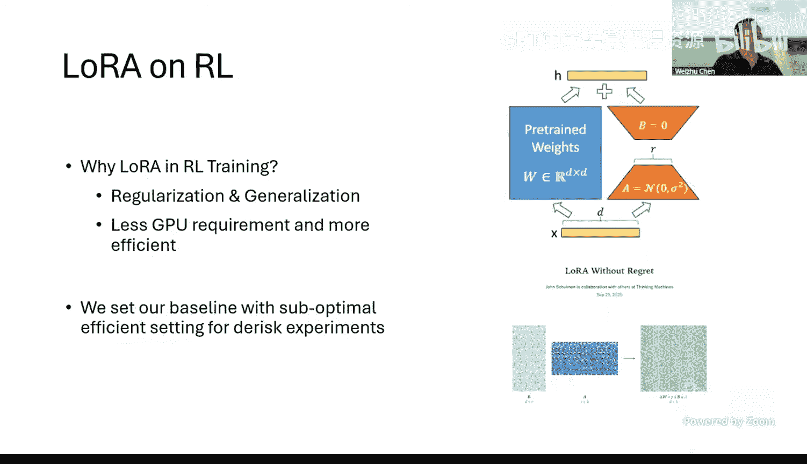

So， yeah， I think that basically is about capture most of the work I want to present today。

 I think actually， the other thing I want to mention is about because I've been working on training。

 poor training and listening。 I'm also working on the reinforce learning。 I try to think about， okay。

 for example， if I want to try to understand this and explain this to my 11 years old。

 because my daughter actually 11 years old。 she love to play Lego。

 and there's one I actually play Le with her。 And I try to all all this comes the mostly important concept into leg into Lego play。

😊，So what is Kney。So basically， per traininging， they give you a lot of datas。

 And this data actually， there's no order， right， You don't know what is the order here。

So we try to figure out when you play Lego。 So for the pre traininging。

 it's about the pre trainingings。 they want to change the。

The same without order into the same with order。So what do we mean with order。 actually， here。

 I try to say about pretend。 try to learn the Lego， Lego， I call Lego piece， the Lego break。

 the Lego block。 They try to learn this kind the Lego block。And there are so many of the Lego blog。

 just like。 and they want to use this Lego blog to simulate the original data。

 to simulate the war again。So to build a leg of wall， actually， this is the data。

But I think after we make this kind change， actually， this is the order。So because they know， okay。

 this wall representing the data is viewed by a lot of different kinds of the structure， Lego block。

The Lego breaks。 So I think that's how I tried to explain this to my 11 years old， what is pering。到。

So what is po changing。And especially for pretending， for example。

 when we compare a good model or a even better model， even better model。

 basically is trying to say about it can build much more complicated legal block。😊。

And also have a much more efficient way to assemble the Lego together to be up this become the new Lego world。

There is the better purchase models。Because you only need able to learn something that is much more complicated。

 The shape is much more complicated。 So you just need smaller number of the pieces able to build this kind of the world together。

😊，So the poor chain definitely is also。Very simple。 So basically， you。

 you won what with kind of the leg of wall。You want it to be。 So there is the goal there。

 and there's your task。 You just put this all the piece together to build up the。

You will this the Lego wolf for you。With the pretending， actually， the legal piece is already there。

So that's why actually prechan with the precha model is able to help you to do this kind of poll training much much efficiently。

😊，So what is reinforce learning here， reinforcein learning day basically is a learning concept。

 It didn't attack。 You don't have to be attached to traininging or po training。

 There's already a lot of war actually is also working reinforce learning for the pre traininging。

So the R L， basically is just about， you just create。Minions of the this kind。

 the Lego wall or maybe Lego game or whatever。 And just get the feedback with the good feedback is say。

 okay， I want to build the world more like。😊，And without this feedback， the bad feedback， Okay。

 this is not a good war。 I just wanted to destroy and you use this kind of break。Take a break。

Build a new world again。So there is the R L。 It just about you able to figure out this feedback and to build up these things again。

😊，One of the thing， actually， I keep thinking about， can you do something new。

 maybe totally different than the world today。 I think it's possible。 You got this inspiration。

 maybe， for example， just like， if you go to the level world there US see okay。

 most of the shame actually is we can find in the reality。 maybe in the future。

 maybe there's always something new。 actually， you cannot find in the reality。😊。

That's about that need to come from as long as yeah this come a very different block is able to build up something。

 Yeah， based on its imaginational creativity for the model。😊。

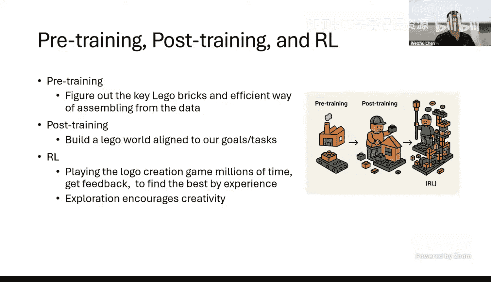

Yeah， I think that is about。 I want to say， okay， so look ahead。 look ahead to me。

 Its also very simple because I only have two kinds of things。 One， the only thing common is scaling。

😊，So what we do， definitely is the first one。 definitely， we need to do the testing time。

 testing time scaling。😊，For the testing time getting。Basically， there's only three things。

 So when you try to map board activity， there's only three things。

 One is definitely is the di model a a more。😊，A even larger model， especially。

 I think for the reason， the model need be deeper。A lot of effort， for example。

 just that recurrent work recently， actually just trying to have a different way to make the model deeper。

 Its not only about。 Yeah， I think that's that's super important。 Any way to make the model deeper。

 actually， it can have the reason。 That's， that's my mind。 My point。

So the other way is just like you grow a new network。

You either make it wider or either make it deeper。Right。

 you want to make a model power more powerful。 definitely。

 there's also a lot thing you can do in the architecture。So how to make the model wider， definitely。

 there's also a lot of other thing you do become the parent thinking。

 just like you can do the parent thinking。 You， You can put multiple way to do the parent thinking。😊。

And but I want to say one of the important thing is about for what we do today。

 Its kind parallel thinking basically， is just about it do it after you change the model。

 after change the model， you just get the model， produce multiple result and then do the voting or use another model pick。

😊，You didn't think about how can we consider this during the model training。

 I think that's also one of the interesting topic。 It's not just about the testing time。😊。

For the for the training time， I， I wouldnt know O for this model， I just want to use it。

To do the parent thinking it's not just about to get a single result。 But how can we do this？

 I think there's definitely a lot of research thing here。😊，The other thing to do the wider。

 I think is also pretty simple。 You just maybe give it to multiple agent。

 And so multiple people to do the same work for you。 and you see， okay， let them call。

 let them coordinate it together。 You also have an orchestrator or a boss or something like that。

 to ask a lot of people to work thing for you。 If we can assign a part to them。

 I think that's also another way to make it wider。😊，And beside wider it's also the same。

 The other direction， the other dimension is the longer。You want to make the task。

 The agent is able to run much longer。 For example， for today， just like the coding。

 you just get the result in a few minutes。 But I think maybe in the future， Actually。

 you can ask to do a much more complicated task。 It's able to give the result back to you in one or two days。

 I think that's also pretty normal。 And by think here， actually， that's a lot of thing。😊，Ephaly。

 it's a lot research topic here。 For example， how can you solve the long context。O。

 we try to memorize the behavior previously。 It's not that easy。

 You want to memorize the behavior from one day ago or something like that。

 Show is very good at this。 model is not that good。 So there's a lot of thing we need to do here。

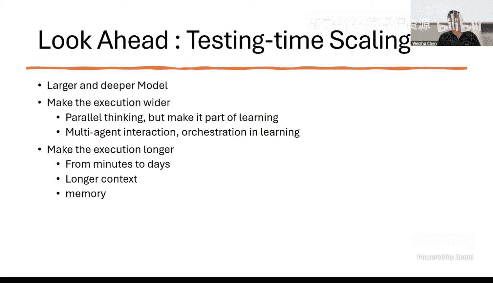

So。The other thing， beside testing time getting。So I wantt say the other thing， actually。

 we spend a lot of effort in the team is about training time scanning。😊，Take time getting。

 definitely。And the first one is still the data。 Thats like I mentioned， we put the best people。

 best ten in data syn size。 I think that there's still a lot of thing to do to do the data syn size is's no。

😊，Yeah， they just getting started。 It's not the end of the story。

 It's just the beginning of the story。And because for for today。

 you can see that we are often limit by the data instead the compute。😊。

And how can we make data more efficient？ And we have a lot of compute But I think we are running out data。

Theres not much data， we are able to leverage to boost the model to another level。So。

 and I also think about the best model definitely should be built from the best data。

For today to define the model， basically， I think at least more than half is based on the data。

 So for all this kind of internet。So an agent data actually make this data complexity into another level。

 I want to say。😊，It's much more complicated。 And how can we use multiple agent to syntheize the data。

 How can we syntheize this kind of long horizontal data， They are so complicated。

 There's still a lot of thing to do。 How can we syntheize agent data。

 That's why I present this kind of key the paper。 I think they do a very good work。 Yes。

 so reinforce learning。😊，And doing first learning， definitely。So at the beginning。

 when I try to think about the R L， I think it's also pretty simple to me beside that example。

 I see reinforce learning， for example， if you compare to the S IP。

 just use the compute to trade for the robustness。For the model for for today， So in the industry。

 that basically is lonely about the I is able to make the result a little better。

 It's able to make the result much more robust。😊，Because it's not just about the benchmark。

 It's also about okay， for example， when the user try to use another way to ask the questions。

 actually， youre able to produce the O result。 S A P is very hard。 Some。

 sometimes that is why we use the I show popular。😊，And actually， it use a lot compute， much。

 much more compute than the S but E did produce the robustness。 That's super important for a product。

😊，And another thing， actually， taking point is about for the I L， I truly believe actually。

 when you change the I L model， you will make anything right。😊，It just keep going。

 The quality will just keep going when you figure with more compute。And here it reach the model。

 model model limitation。So， so that's also very exciting。Because we found a way， actually。

 we are able to give the compute。 The model is able to become better。😊。

So there's no an even better way than this。This is one of the big challenge problem。

 How can you make the model better with more compute。

 It's no easy problem Well pretending is not able to do this， sometimes。

And it's also living by the data， as well。It just like another thing I say is about for the R L。

 where I put a lot of effort in R L is about it's easy to It's more about the still。

You are able to guide the IL into the direction you want。This is also very different than the I HF。

 You train a reward model or S is so hard， for example， in the I。

 what you want the model behavior to be， you just define a new grade。 is so flexible。😊。

So that's why we love IL in this kind product settings。 For example， you just say， oh。

 you don't do it this way。 You just need to change the grade to say about if we do this way。

 that is the better reward。 If we do the other way。 That is the better reward。😊。

So it' its more about this。Yeah， so and。It just like I mentioned， we talk about pre traininging。

 We just talk about post training。 Im not sure whether now actually in the academic， theres。

 there's a war or maybe in the real setting。 Okay， there's pre training team。 There's post training。

😊，And you just pretend the model and then give it over to the poor model。

 But there's a war between them。I'm not sure whether this voice is really necessary。

Even everybody talk about game training is for the compression。 Po training is for the behavior。

ButI guess maybe I want to mention actually， IL， actually， it didn't just sit with inside side。

Maybe in the future， there's only two kinds of laws。 One is reinforce learning。

 The other one is the next token prediction。 Thats just combining together to remove the war between and Port。

Thats also possible let's see。 I also don't know。AndThere's also last thing。

 I actually want to mention is about in the future。

 The best way is the model is able to improve myself。😊，This kind a set improvement actually。

I think now the model is very powerful。 Its become possible。

 And a lot of become kind frontier lab keep working on this because if you are able to dance another way。

 So in the higher level， compared to I is about if youre able to put more compute and more data to the model is able to keep improving。

😊，And in here， definitely the data in the reinforce learning。 actually。

 you want to achieve the set improvement。 You need to think about how can build the data。

How can you make the I into the game。So I think that's a two piece， most important to me。

 And definitely the model also need to be able to do the set reflection。

 able to understand what is going wrong previously。😊，And to fix it。And also， the other one， actually。

 I think a lot of thing you want to make this。 I mean the previous iteration of the model is now as you as the next iteration of the model。

 So the weak learner is able to produce a better learner。😊。

Oh I think there is also one the we need to figure out the methodologyology about this。

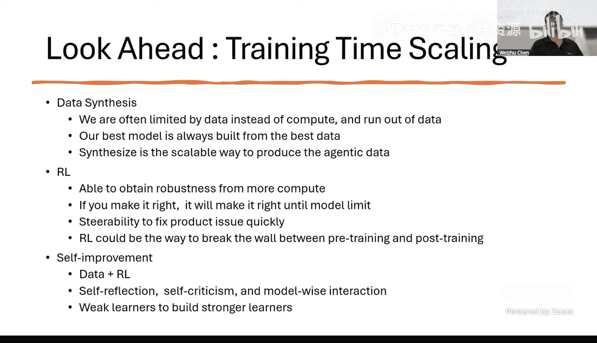

Yeah， I think this is actually is maybe no related to this task。

 I think it relates to our daily work。I think it's also some of the comments is about how can we change the model。

 Because I know so many people change the model here every day。 I just learn from you guys， Okay。

 you until 5 AM last night。😊，So I think training model actually is pretty hard to be， honestly。

 And because you， you need to often to wake up at 3 PM，3 AM。😊，Think okay。

 there's something wrong to restart the job and then to discuss the team actually what's going wrong here。

 and how can we fix to immediately quickly reun the job to save the GPU。 So and you also。

 so I think one of the thing actually， I didn't mention a lot super important to us is the infrastructure because there's a lot of thing I cannot share in the infrastructure side。

 I think that actually is another biggest pain in the reality。

 because infrastructure as long as this comes the last scale is not so stable。😊。

And you pretty struggle， for example， when something is not stable， your job。 okay， the GPU fail。

 that GPU does not actually lose the connection。 There are so many thing actually in the infrastructure。

 You are very you are very struggle。 I think a lot of thing a lot of time actually was spend in this kind。

 the instability of the infrastructure。And you will feel very。Yeah， hopefully。

 sometimes why this info， how can I try this model with given this in given this info。And you also。

 because there's a lot thing， for example， changing the model is about 90% time。 actually。

 since it's not working for the 10% time things working is really making a progress。

 This mean that is bad，90% time， you are not making any progress。 You need to be the patient。😊。

So that is why changing the model is so hard。 But on the other hand， training model is also so fun。😊。

I think maybe that's best one of the best job in the world。Oh， yeah， we are so lucky。 we still。 yeah。

 we are able to have the opportunity to change the model and because with so many discount kind GPU。

 And also， you also really feel the fulfillment。😊，When your model。

 you change actually is able to pick the baseline。Yeah， so I think that this kind of fulfillfilment。

 this kind of joy is not that easy to get from other place。

 because the baseline actually is the best model in the world sometimes。😊，AndSo。

 because I'm working with the product team。 So your model is able to use in the product by so many different peoples。

😊，And collect feedback。 That's also another kind of the fulfillment。

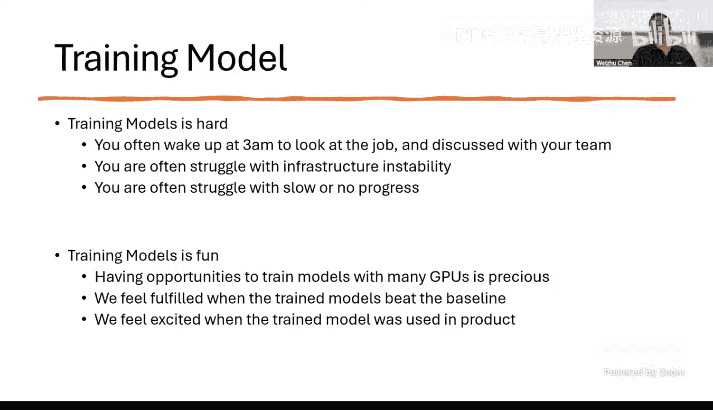

As a researcher or as an engineer。