# UCB《智能体 AI｜CS294-196 Agentic AI MOOC 2025》中英字幕 - P5：-5-Multi-Agent AI by Noam Brown.zh_en.mp4 - GPT中英字幕课程资源 - BV1GpUTBhEGX

1， thanks for being here。And。So let's start the class for today。

 It is It is our online pleasure to have Noome Brown from Open I today to give the guest lecture on multi Asianian AI Nom has done lots of really great work in。

 in particular in multi Asianian AI。 So it's really exciting to have him give the guest lecture today。

 And you know， the multi Asianian stuff that he built in the past has won right。

 very invitation and so hell， he'll tell he'll tell you more but it's really exciting to have nome here today。

 give the guest lecture。 Yeah Thank you。😊，Hey hi everybody。

 so yeah I'm No Brown excited to talk about this today。

 so I'll be talking about M Jane I'll be taking a pretty broad view of it because there's a lot to cover and I guess I'll start by motivating it。

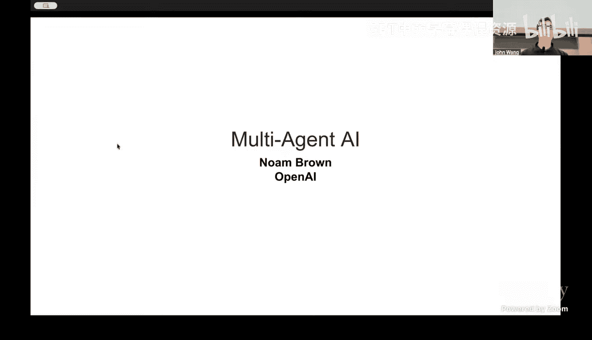

I think we have seen that。Okay so yeah， first I want to talk about selfplay So selfplay has been behind a lot of the breakthroughs that we've seen in AI。

 especially for games， things like Alphago， things like Dota and Starcraft and also poker and we haven't really seen that in LLMs and it's a little surprising right because if you look at the trajectory of LLMs it actually looks a lot like the trajectory of something like Alphago right you start with pretraining on high qualityality human data。

 this was done for Alphago is also done for LLMs then you enable large scale inference compute and then you have recursive selfimp。

😊。

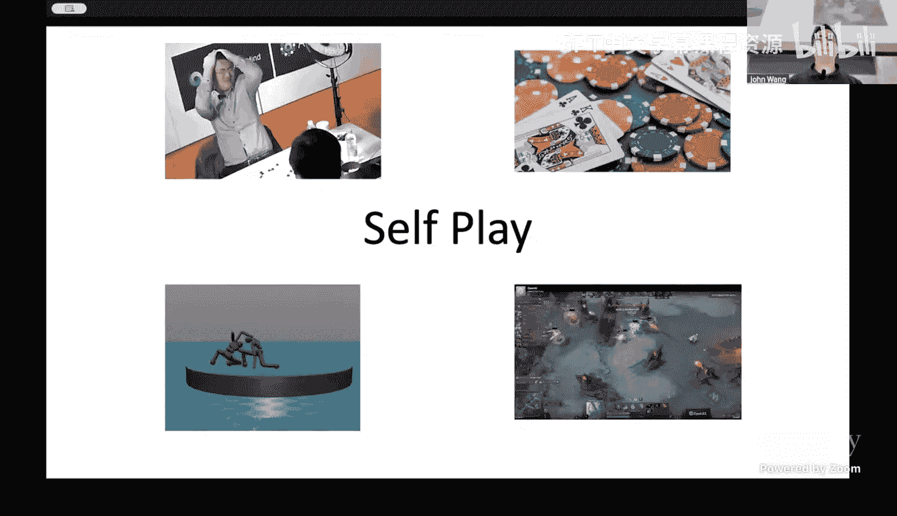

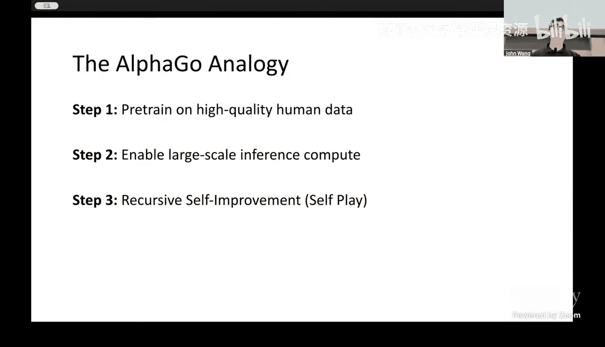

And step one， pre training on high quality human data in Alphago。

 this means training on a bunch of human goga in language models。

 it means training on large chunks of the internet and doing ex to in prediction。

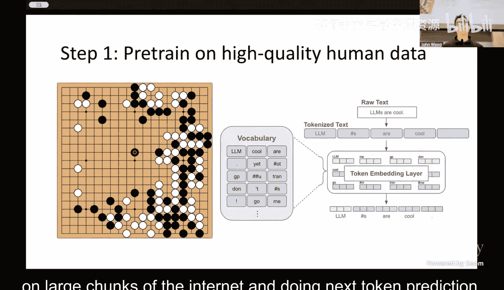

And then step two is enabling large scale inference compute。 So in Algo。

 this was Montegriural research and in all the different games there were different ways of doing this large scale inference compute but in Algo is multigural research and then in LLMs you have chain of thought。

😊。

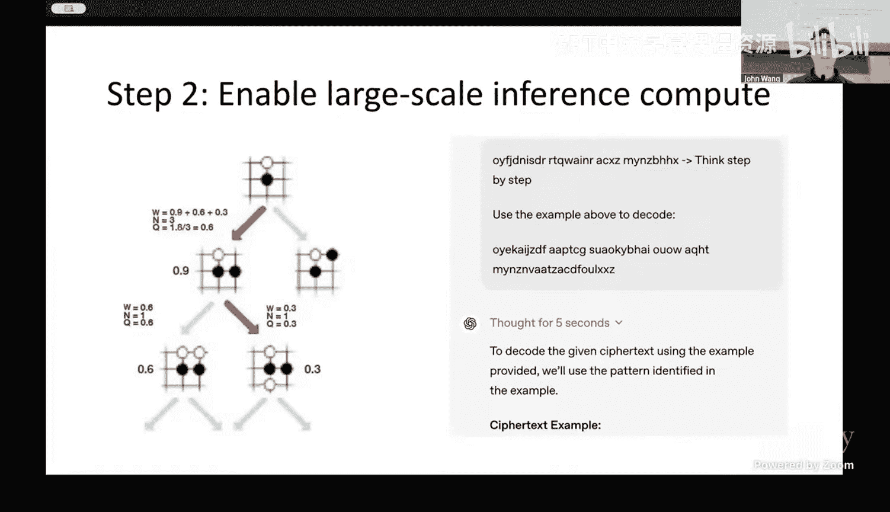

And then step three， you have acursive self improvements， and then in alphago。

 this is selfplay where the AI plays against itself over millions， billions of different games。

 and it gets better and better over the course of those games。And in LLMs，' we don't have that piece。

 So so why is that what's so difficult about doing something like self play。

 recursive self improvement in LLMs compared to all these games where it's been so successful。And。

I'll give you the takeaway， which is that。A lot of people's intuitions about。So play。

Is basically overfit to go and chess and these kinds of two players，0 sum perfect information games。

 And it turns out that when you go outside of these games。

A lot of the like very nice properties go away and self play becomes much more difficult。

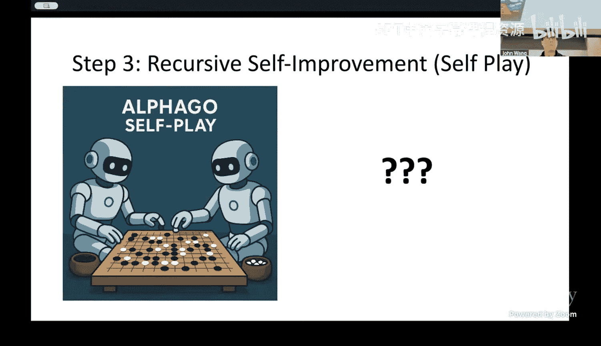

So to give one example of this， I want to start with just like a very basic question。

 which is who do you think is the better poker player Option one is someone who over a very large sample size wins head to head against any other player。

 So if this person were to play a million hands of poker against any other person alive。

 they would win in expectation， they would just like they would end up winning they would end up up money option two is someone who makes more money playing poker than anyone else over like let's say a year。

So who thinks option one？And then who thinks option two？It seems like pretty split。

 but I think most people actually lean towards option2。 Now it's very interesting that in poker。

 this is not necessarily the same person， right you could have someone who is really good at squeaking out wins against other players。

 But if they're playing against a really weak player doesn't really exploit them to the max and you could have somebody who's really。

 really good at finding the weaknesses of weak players and taking advantage of that to the fullest extent possible。

 but when they're up against another top pro doesn't have many weaknesses。

 they end up doing a little bit worse。 So in poker。

 these could be two different people in a game like chess or a game like go。

 we don't really consider the possibility of these could be two different people right Like if you think about who is the best person in an option one and who is the best person in option2 in a game like chess。

😊，You would just say Mags Carlson， would be the same person。Okay。

 so option1 is what we call a minimax equilibrium and option two is what we'll call a population best response。

 Now， typically when we think about AI for games， when we talk about solving a game。

 what does it mean to solve a game。 typicallyy what people are talking about is computing a minimax equilibrium。

 And that's gonna be important because that's an assumption that we are making about what it means to solve a game And it's a strong assumption。

 it's not necessarily what we want。 And in games like chess and go。

 this is fine because it ends up being the same thing。

 but in other games like poker and a lot of other settings and we'll see that as we go beyond two players here are some games。

 this actually becomes a very significant problem。This is not necessarily the same thing。

 and we might actually， it's possible that what we really want is a population best response。

But for now， let's just take it as an assumption that what we really want is a baby max equilibrium and we'll go down the rabbit hole of what this involves。

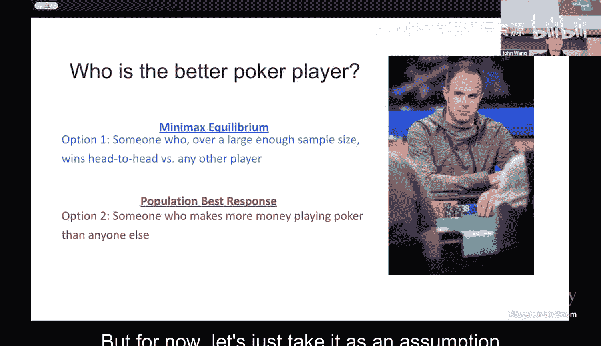

So for starters， what is a mini Max equilibrium？A minimax equilibrium is a set of strategies in which no player can improve by deviating to a different strategy。

And in two players zero sum games in particular， playing a minimax equilibrium guarantees that you will not lose an expectation。

 and we're going to measure something called exploitability。

 which is how much we lose to a best response。 So exploitability is basically how far away are we from a minimax equilibrium。

 If we're in an equilibrium， then exploitability is0。Okay， so。To give you some intuition for this。

 like let's say you're playing rock paper scissors， one strategy that you could take。

 not a very good one， is to just throw rock every single time。And in this case。

 the best response against that strategy is to throw paper every single time。

 and our exploitability is one because。We're losing every single route。Okay。

 so you might have a more sophisticated strategy， you might say like， well。

 let's throw a rock the first two rounds and then on the third round， if our opponent through paper。

 then we're going to throw scissors。Well， in this case。

 the exploitability is still one because the best response would be to throw a paper on the first two rounds and then rock on the third round。

Now you might say this is unfair， we're assuming that the opponent knows our strategy and they know that we're going to throw scissors on the third round and that is correct。

 and this is an assumption that we're making when we talk about equilibrium and again this is a very strong assumption and I think it's fair to question this assumption。

 which is that our strategy is common knowledge， but the outcomes of random processes like the random seed is not common knowledge。

So why are we making this assumption， the reason is。

If you are creating an AI that is going online and being used by billions of users。

Then if there are weaknesses in that system， eventually people will find it and they will exploit it and so the idea behind minims like we're measuring exploitability is to say。

 okay， let's just assume that the opponent has that people have you know full access to our weights。

 they know exactly what the probability distribution is over actions and can we be robust despite that。

Now， again， this is a very strong assumption that we're making and I think it is very fair to question this assumption。

 but for now we're going to go with this and see what happens when we make this assumption and what can we do to make our agents robust despite this assumption。

So in rock paper scissors， the answer is to randomize。

 remember that the strategy is common knowledge， but the outcomes of random processes is not common knowledge so in rock paper scissors if we just randomize equally between throw rock paper and scissors with equal probability each round。

 then our opponent will not know what we're going to throw and the best response you know the best they can do is just tie us and so the exploitability is zero。

Okay and this is the minimax equilibrium for rock paper scissors to randomly choose between rock paper and scissors with equal probability each route。

No。It's reasonable to look at this and say， okay， well， great。

 we're able to compute a minim equilibrium that guarantees we you don't lose an expectation。

 but we're not going to win an expectation by playing equal probability each route so how do we actually win in a game like poker？

😊，And the answer is that in a game like poker。The strategy is much more complicated。

 Like Rock paper systems is a very simple example， where。

You can just play any action as long as you balance them correctly。

 And you know the best you can do is tie。 But in a more complicated game like poker。

 if you are playing the national equilibrium， if you are playing the minimax equilibrium。

 it's actually very difficult for the opponent to know what to do to counter you because there are some actions that should just not be played at all。

 You know， in rock resistors that doesn't happen in rock scissors。

 the opponent could do anything in response and they'll still tie you in poker， that's not true。

 there are some， there are many actions that they can make。

 which actually are just what we call negative expected value that actually just cost them even when you're playing against the mini maxax equilibrium。

So the idea behind mini Max equilibrium and something like poker is that your opponent is going to make mistakes and that's going to cost them value and because it's a two players year some game。

 that means that it's going to increase your value。And in fact。

 this is kind of the strategy that's been adopted by poker professionals now， this guide to poker。

 for example， says， poker is simple as your opponents make mistakes， you profit。

So the conventional wisdom is play the minimax equilibrium and then maybe。

 and your opponent will make mistakes and you'll profit off of that and then also over the course of the long run。

 if you observe weaknesses in your opponent then you could adapt from the minimax equilibrium deviate and then try to take advantage of them。

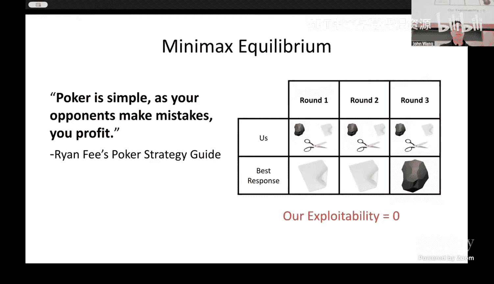

O。So。We want to we were aiming for a mini max equilibrium because that guarantees that we're not going to lose an expectation and in practice。

 it means that we're going to win self play。Is this algorithm that converges to a minim equilibrium so selfplay is when an agent gradually improves by playing against copies of itself and the initial strategy could even be completely random as long as you have a sound selfplay algorithm and I'll talk about what sound means because it's actually non-trivial in a two player zero sum game any sound selfplay algorithm proably converges to a mini max equilibrium。

😊，And so this is actually really incredible because this means you don't need any data。

 you don't need any human data， as long as you have sufficient memory and compute。

 any finite two players you some game can be solved via selfplay。

And I want to say this again because I think this is like really profound and kind of amazing that in any two players Euro some game。

You don't need any human data。 If you just do any any balance two players0 some game。

 You don't need any human data。 If you just have sufficient memory and compute。

 you can just do selfplay and converge to a mini max equilibrium。 And that guarantees。

That you will not lose an expectation to any human or any other player。

We kind of take this for granted， but it's actually kind of lucky that we can get this。

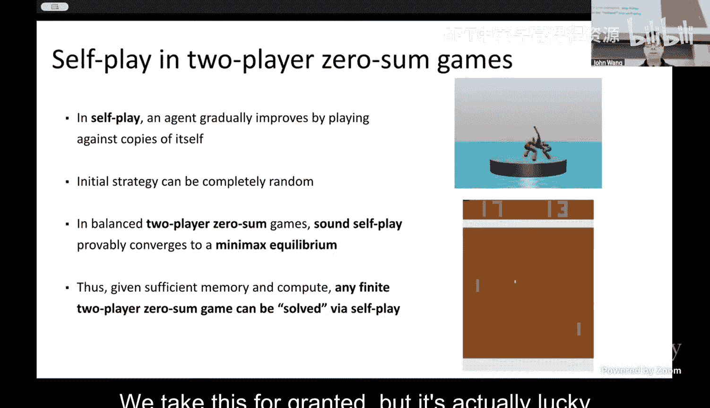

And so this is behind a lot of the victories that we've seen in games like go and chess and poker and realtime strategy games。

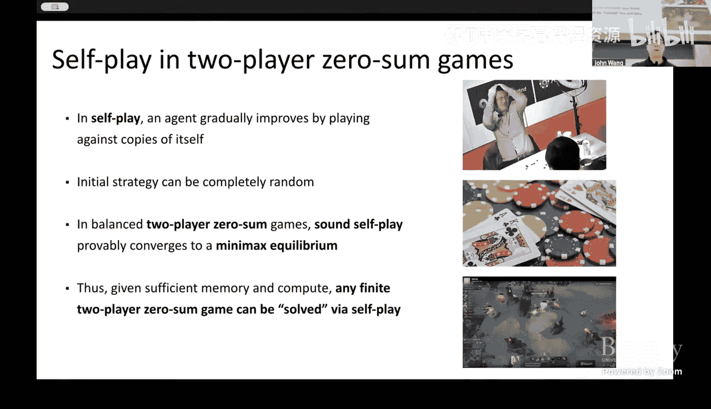

Okay， so what do I mean by sound selfplay and what does selfplay look like in different kinds of games。

 So there's different kinds of two players here are and games and we'll start by talking about perfect information games。

Essentially， what this is is just independent single agent RL。 you just take something like PPO。

 and as long as you do a sufficient exploration， it's actually pretty easy for this to converge in theory to a mini max equilibrium。

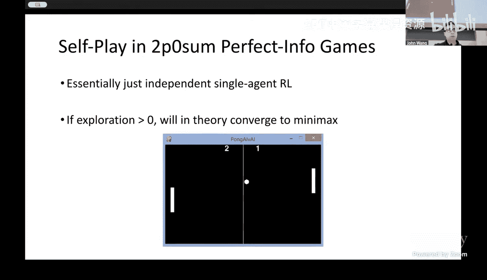

Now that said， that conversionence to mini max equilibrium is a theoretical property in practice you don't usually get all the way to minim equilibrium and in particular you might still be vulnerable to adversarial attacks neural nets are limited in their ability to approximate a mini maxax equilibrium。

 especially in complex games like go。So。This could mean that like yes。

 if you had infinite capacity and infinite compute。

 then you would eventually arrive at a minim equilibrium in practice you don't have that and so you could still be vulnerable to exploits and this is especially a problem because finding exploits is generally easier than defending against exploits and especially in imperent information gains which we'll talk about later。

And so this there was actually a paper that came out in 2023， which kind of showed that in Go。

 in many of the leading Gobots， there were adversarial strategies that could be deployed by humans even that would allow them to defeat very。

 very strong Gobots。

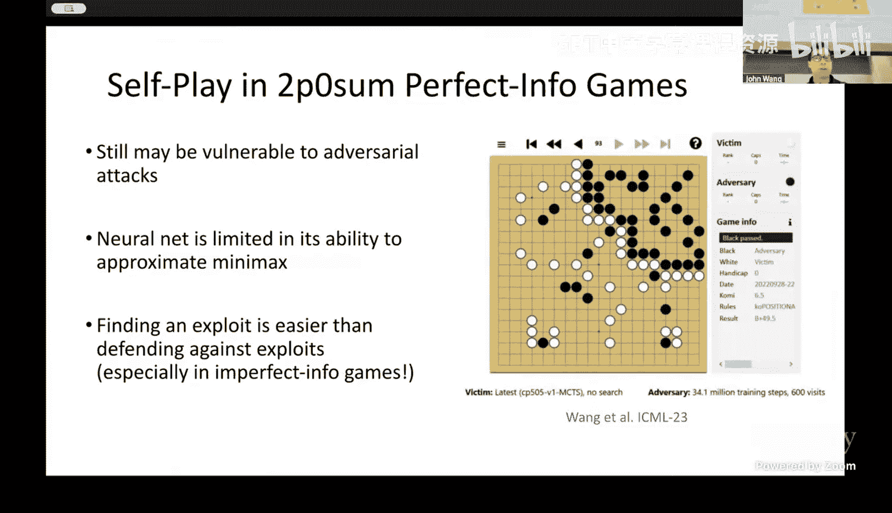

Okay so that is perfect information games and in Per information games it's actually relatively simple when you go to imperfect information games things become a lot more complicated and one thing that I think is surprising to people is that if we take this modified version of rock paper scissors where the payoffs for scissors and paper are altered to be plus2 and minus2 instead of plus 1 minus1 just to break the symmetry of the game。

😊，PPO does not converge to a mini Max equilibrium。This is a lot of people。

 even people that are very experienced in RL don't know this。

 but I think it's pretty important that there's actually nothing in PPO that guarantees convergence to a miniax equilibrium in a game like Bro paper scissors。

And the reason is because rough paper scissors。You have to balance between multiple actions with a certain probability。

And there's nothing forcing that balance， that convergence to a particular probability distribution in the PPO algorithm。

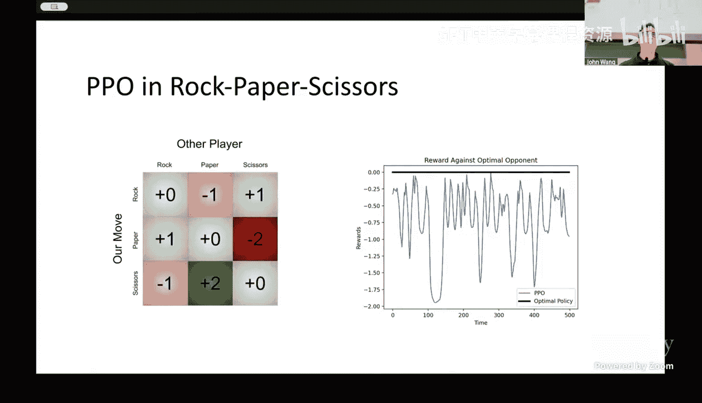

So this points to the fact that imper information games。

There's something special about them that's much more difficult than perfect information games。

And why is that， Okay， so to explain what is particularly difficult about imper information games。

 I want to talk about。We'll illustrate this game called Rocky versus scisors Plus。

A visualization of the game where player one acts first and then player two acts after player one without observing what player one did so that's just so we can observe it as a we can view it as like something like a perfect information game where the players act sequentially so here the players are acting sequentially but player two doesn't observe what player one did and so it's kind of like no different from them acting simultaneously。

And we're going to modify the payoffs a little bit so that the symmetry。

 there's no symmetry and like the equilibrium is to play rock and paper with 40% probability and scissors with 20% probability。

 So the way this works is player one acts first， they choose either rock paper or scissors。

 and then player two acts， they choose rock paper or scissors and then the payoff is shown for player one。

And there's dotted lines between the player two nodes to signify that player two doesn't know which of those nodes they're actually in。

So for example， if player one chooses rock and then player two chooses scissors。

 then player one wins two points and player two loses two points。And like I said。

 the equilibrium for this modified version of the game is to throw a rock mapor with 40% probability。

 scissors with 20% probability。Okay， so let's say we do depth limited look ahead search。

 So just like we would do in a game like chess。So what does this look like， Well。

 you start at player one， we're going to do a depth of one search。

 Player one is going to look at all the different actions they could take and then look and then ask what is the expected value after taking this action。

And in an equilibrium， it's going to look like this。 It's going to show， well， if you throw a rock。

 you'll get a off a zero paper， you get a path off of0。 scissors you get a off a0。

 So it actually doesn't matter。From play1 per second， it doesn't matter what they do。 In all cases。

 they get the equilibrium payoff。There's not enough information for them to arrive at the equilibrium of choosing Bro paper with 40% probability。

 scissors with 20% probability。But the problem is that this isn't realistic because this is assuming that player2 is playing the equilibrium and that is an assumption you can make in a game like Cheer Go。

 but you can't make an imper information game because if player one War two， for example。

 choose rock with 80% probability， then player two would no longer play the equilibrium。

 player two would pick up on this and they would deviate and they would start they would start playing paper。

 and so the value of player one throwing rock would decrease from zero to minus1。

And so this is actually fundamentally why impert information games， mean one of the reasons。

 but I think the main reason why impert information games are so difficult。

Because the value of an action depends on the probability that it is played and that is not true for a game like chess or go a perfect information game in perfect information games。

 the value of an action does not depend on the probability that you play it。

 If you're playing chess and you want to open with this s defense。

 it doesn't matter if you do that 10% of the time or 90% of the time。

 It's not really going to change the expected value。 whereas in a game like poker。

If you want to bluff， well， whether you're bluffing 10% of the time or 90% of the time matters a ton because if you're always bluffing。

 then the opponent is going to pick up on that and they're going to start calling you more often and the value ofluffing is going to go down。

So what this means is that you need an algorithm。That finds the right probability of choosing an action。

 not just what action to play。Now I should caveat that a little bit， I useess as an example。

 the truth is that chess these days is kind of like an impert information game because。Players。

 you know， kind of like prepare different strategies and think about what strategies the opponent has prepared for。

But that's modeling chess is like a repeated game that could be viewed as imperfect information that's not really viewing chess as like a standalone game。

Okay， so how do we get around the fact that。We can't use something like PPO。

 we need an algorithm that doesn't just figure out what actions to play。

 but the probability to play them。

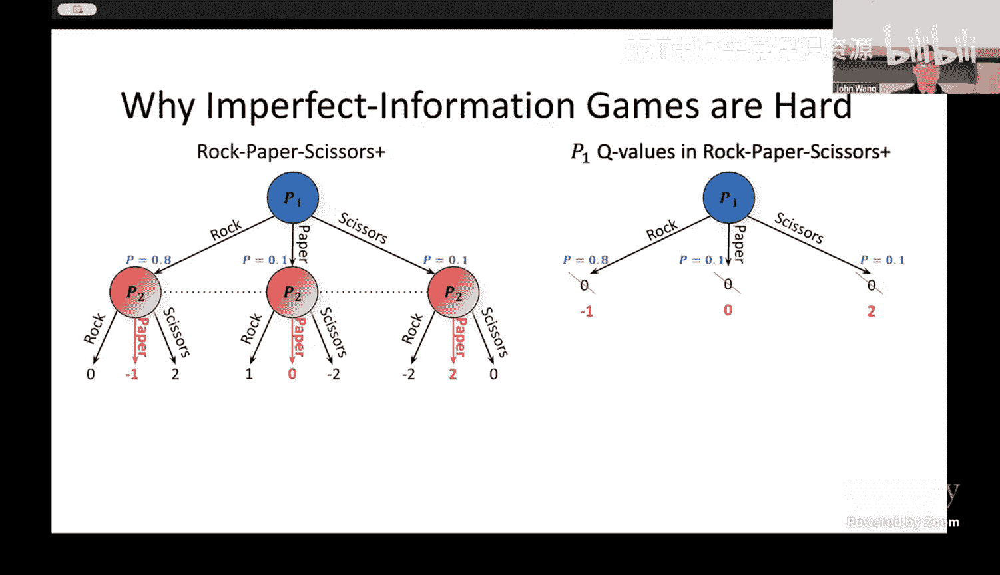

Well， there's a few different approaches that can be taken。

The simplest is this algorithm called Fictitious Play。

And the idea is that we'll initialize the strategies for all players arbitrarily。

 and then on each iteration， each player simply plays the best response to the opponent's average strategy over all previous iterations。

And if all the players play fictitious play， then the average strategy over all iterations converges to a mini max equilibrium。

So to give you an idea of what this looks like for rock paper scissors。

 you initialize the strategies arbitrarily， so let's say we initialize it to all the players throwing rock。

Okay， so player one throws rock， player， two throws rock， their average strategy so far is 100% rock。

And then on iteration2 you compute the best response to the average strategy so far。

 so the average strategy so far is to always throw a rock。

 so the best response to that is to throw paper and now you update the average strategy to be 50% rock。

 50% paper。Okay on iteration3， you again compute the best response to the average strategy so far。

 so the best response to 30% rock 5% paper is to always throw paper and so now the average strategy is updated to be 33% rock。

 one thirdd rock， two3 paper。On iteration4， you do the same thing， the best response to one3 rock。

 two third its paper is to throw scissors。And so then your average strategy is updated to 25% rock。

 530% paper， 25% scissors， and you can kind of see that you're going as you do this more and more。

 the average strategy is going to slowly converge to a mini max equilibrium of 1 third，1， one third。

So this is one algorithm that's been around for a long time。 The truth is that it converges very。

 very slowly to a mini Max equilibrium。

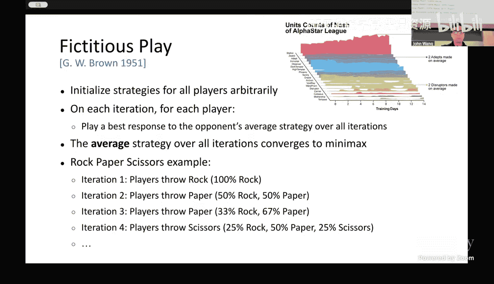

嗯。There are more there are modern algorithms that converge a lot faster and basically what they're doing is is computing a regularized best response。

 So regret matching and hedge are the two most popular versions of these algorithms。

 And the idea is that whereas ficious play would always compute the exact best response。

 regret matching and hedge， pick a regularized best response。 So in this case。

 you're going to have some kind of like value。 and then you look at the expected value of each of the actions and take the like。

就是。You just choose proportional to the amount of mass that's over that line so in this case you look at the expected value of paper and expected value of rock and you see like how much are they over that dotted line scissors is below the dotted line so you just put zero probability on that and then for rock and paper you just choose them with the probability that's proportional to the amount of mass that's over the line。

As should point out， there's a lot of similarities between these kinds of algorithms and gradient descents。

 and there's a lot of deep literature into this that I won't go into。

 but there are strong connections there。

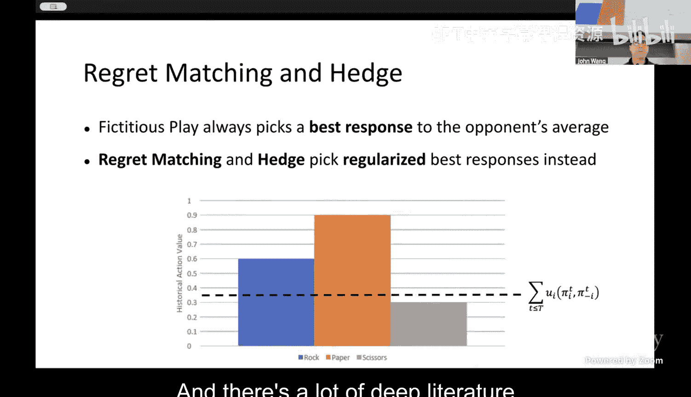

Okay， so this is what it would look like。If you ran regret matching。

 which is like this improved version of ficitious play。 so on the X axis here。

 we have the number of iterations that you've done and the y axis is the average probability for each action in rock paper scissors and you can see over time it slowly converges to playing one third。

 one third， one third Now there's a whole body of literature that I won't go into in this talk that shows you can converge much much faster with better algorithms。

 So one for example， is linear regret matching and this is what it looks like it converges orders of attitude faster compared to just regular regret matching。

So these algorithms， the regret matching algorithms。Their iterative algorithms。

 they slowly converge to the optimal probability of playing each action correctly。

 and these are the algorithms that were ultimately used to defeat top humans in poker。

 which was what my PhD work was on。

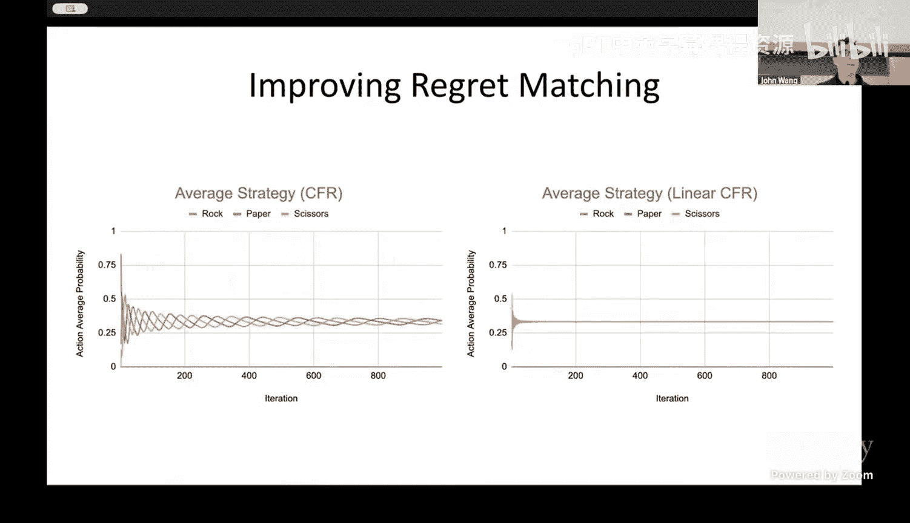

So we were able to use these algorithms to defeat four of the world's best heads of No limit to Texas Holen poker Pros。

嗯。And this was actually done without neural net， this was done the main challenge for a poker was how do you do one。

 how do you do search iner information game， and two。

 how do you converge to an equilibrium in a game with hidden information？

And regret matching was a key part of that。

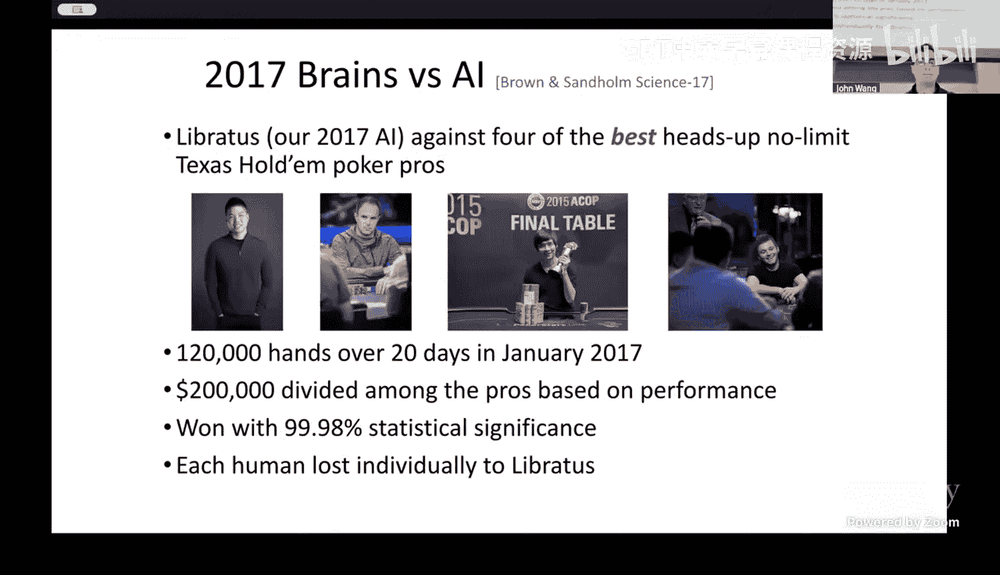

Okay so there are limitations to ficitious play， regret matching and hedge， in particular。

 they tend to have pork performance in single agentnt RL。

 and this has always been a really annoying quirk of these algorithms because。

There's a lot of great algorithms for single agent RO that don't work。

When for imper information games。And there's a lot of algorithms that can converge to an equilibrium。

In imper information games， but don't have very good performance in single agent RL settings。

So it would be really nice that we just had a single algorithm that we could deploy in all cases。

 but that really wasn't the case for a long time。

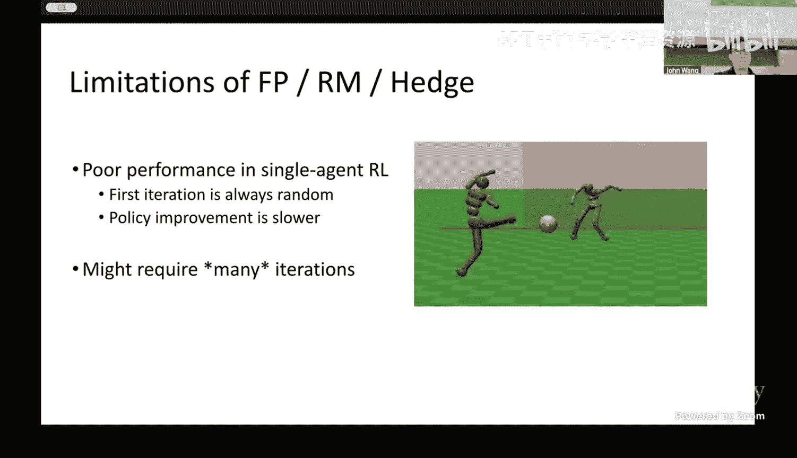

There has been very recent work from a few different folks on developing algorithms that actually do have really good performance both in single agent RL settings and multi-ageent RL settings that converge to an equilibrium quite quickly。

So I think that this probably is the future but。This is still an area of undergoing rapid development。

Okay， so I've talked a lot about two players Eurosome games so far。

 I'm going to shift away from that。 I want to take one quick aside。

 which is and talk about why haven't I mentioned LLMs yet。

 and there's actually a very good reason for this's that because we've been talking about two players zero sum games this whole time and in two players Euro sum games if what you're computing is a minimax equilibrium then communication is never useful and this is actually you can prove this。

 it's never useful to talk to the opponents if youre computing if you're playing a minimax equilibrium and the two players Euro some game。

So I get asked this sometimes like， is it ever useful to talk to the opponent。

 the answer is simply no， And there's a very simple proof。Which I'll give the intuition for。

 which is that。Into two players zero sum game， there could be multiple mini maxax equilibrium。

 but they're all going to have the same unique value for players1 and2。

 so there will be some unique value for player one and then player two's value is simply the opposite of that value。

 That's the definition like the fact that it's the opposite is what makes it zero sum。

And so if there was some cheap talk action for player one， then there's three possibilities。

 either taking that action would increase V1， decrease V1， or it would have no effect。

If it were to increase V1。Then player two was simply ignored because it's going to。Hurt their value。

 so just they're just not going to listen to whatever player one was saying。If it decreases V1。

 then player 2 should simply not say it。The only remaining possibility is that it has no effect。

 and so we can see that in a miniax equilibrium， there is no reason for the players to talk to each other it's either one player or the other is going to realize that it's not worth it。

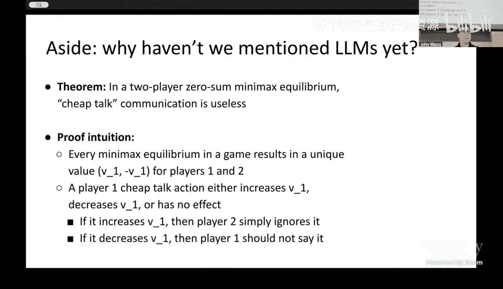

Okay， so that was two players0 are some games。 Now， let's move to the， I think。

 more interesting part， which is， what about non two players0 some games。

 We've seen that there's like a lot of these nice properties for two players0 are some games。

 Min X equilibrium equilibrium， unique values， all this stuff。

 What about non two players0 some games。😊，And we're going to see that a lot of the。

Properties that the nice properties that we saw in Super players Z games actually don't carry over。

 And so that creates a real dilemma for us about like what do we do？

And the central claim that I'm going to make in this section of the talk。

 and I think this is a really important point。Is that if your goal is to learn to cooperate with humans？

Then。Avoing using human data is a dead end。The only way， in my opinion， to learn。

 the only scalable way in my opinion， to learn to cooperate with humans is to use human data。嗯。

And this is， first of all， relatively controversial because there's a lot of research on multi agent RL that's focused on learning to cooperate with humans without using human data and I。

I will make my spicy claim， which is that I think that is a dead end。And this is also in truth。

 kind of unfortunate because I mentioned earlier that in two players zero some games。

 we have this beautiful property that you actually don't need any human data if you just do selfplay with sufficient memory and compute。

 then you'll converge to this mini max equilibrium， which is this unbeatable。

 perfect optimal strategy in the two players Euro some game and what I'm saying here is that actually that's not true when it comes to non two players zero some games。

 there's simply no way around the fact that you need human data if you want to do well when playing with humans。

😊，AndOkay， so why is this， I think I can actually convince you。

 my hope is that I can convince you pretty easily with this demonstration in the ultimatum game。

And by the way， I think this is really like one of the most important slides in this whole presentation。

So the ultimatum game is this popular。Game theory game。 And the way it works is Alice is given $100。

And first， Alice has to offer Bob between  zero and $100。

And then Bob must decide whether to accept or reject that offer。If Bob accepts。

 then Alice and Bob keep their money。And according to the split that Alice offered。

 and if Bob rejects， then Alice and Bob get nothing。So。For example。

 if Alice were to offer Bob $30 and Bob accepts， then Bob gets 30， Alice gets 70， if Bob rejects。

 then Alice and Bob both get zero。So I want you to think for a second。不OK。

I wanted you to think about two things， first of all。

 what is the minimum amount that you would accept as player two in this game？

And then the second thing I'm want to think about is if you were to do selfplay RL from scratch without any human data。

 what do you think it would converge to？Okay， so I'm curious， like how many people would accept。

Let's say less than $40 in this game。40 dollars， Okay， some people。

 surprisingly few how about please raise your hand if you' if youre if you're going to accept。

 so how about less than $30， $3 or less。Okay， that's a pretty good amount。 Okay。

 what about $20 or less。Still some $10 or less。Who would accept $1？Really？O。😊。

I'll tell you that in general， people accept tend to be willing to accept between 20 and 30%。

And then if you offer too low， they will reject simply because that's human nature。

Does anybody want to guess？What the minimax， well， not the mini max equilibrium。

 but a national equilibrium is in this game。有。50，50。Well。

Could Alice do better if Alice's objective is to get as much money for themselves as possible？

Then could they do better than offering 50，50？Okay， so。

What would what would the like optimal strategy be for Alice？But yeah， do you want to say。

Yeah so the optimal strategy well a optimal strategy and there's like actually like a lot of details to this that I won't go into。

 but like the intuitive optimal strategy is that Alice offers the minimum amount possible $1 or one penny or one fraction of a penny and then Bob is faced the decision do they accept this small but positive amount of money or do they go with zero。

And from a purely game theoretic perspective。😡，If Bob is simply trying to maximize their utility。

 which RL agents are ultimately about maximizing reward。Then it makes sense for Bob。

To take that trivial amount of money and allow us to get the vast majority of the spoils。

But of course， if you were to deploy this in the real world， this would be a terrible strategy。

 you know， I don't think there aren't that many people， there are some I guess。

 but there aren't that many people that would accept the dollar in this kind of game。Now。

There's two approaches there's two responses to this that。

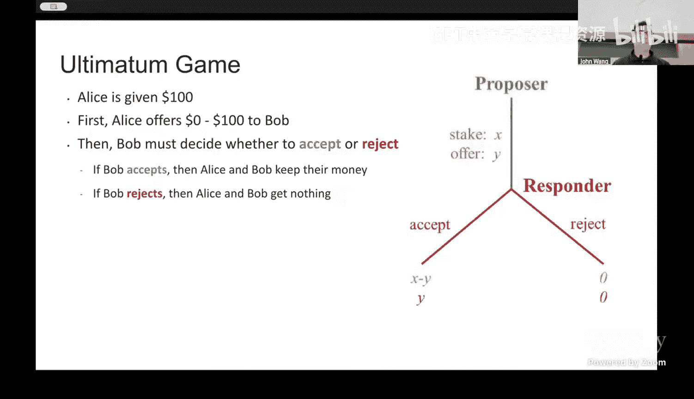

You could take like one is to say。The humans aren't doing what the math is saying it's the humans that are broken。

 The algorithm is fine， you know， and we should just ignore this whole problem。

But I don't think that's the right approach， I think the right approach is to say well okay。

 there's something wrong with our optimization algorithm if it's not going if ultimately what we care about。

 and there's a question of what do we ultimately care about。

 but if what you ultimately care about is doing well in this kind of game with humans。Then。

There's something wrong with just doing pure self play in this kind of game。Now it's tempting to say。

 well， we're not giving it you know the right priors or something like that。

 you know we're not doing it as a repeated game， if it was a repeated game then there would be reputation dynamics that they would learn to offer smaller offer some larger amounts of money so that you know Bob would be more willing to accept or something like that and that's ultimately where this whole literature comes from of like trying to modify this kind of game to get the behavior that you would get by playing with humans。

And ultimately this is a rabbit hole that I've seen a lot of researchers go down and unfortunately。

 yes， maybe you could do something that like kind of works in the ultimatum game。

 but as you go to more more complicated settings， this is ultimately not going to lead to success and one example of why this is the case is that it turns out the ultimatum game is actually very culturally dependent there are some cultures where people will accept 20% very easily and there are some cultures where if you offer anything less than 5050 they will reject。

Now， how are you going to learn about this cultural difference without any human data？

The simplest and most effective way to address this problem is to collect a lot of human data。

 understand how humans play this game， and then figure out the optimal strategy in response to that。

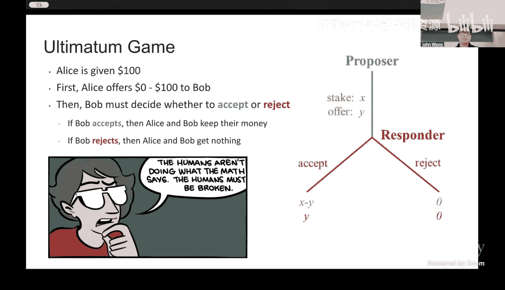

Okay， so I think what really， in my opinion， prove this points is。

The work of I and my colleagues on diplomacy， so diplomacy is a seven player game。

 it's a natural language negotiation game， and the objective is to control a majority of the map of Europe。

So this is a popular strategy game it was introduced in the 1950s and it's still widely played today。

And it's a certain player game。And it was actually JFK and Kissinger's favorite board game。

 apparently。Now， each turn involves private natural language negotiation。

Where you this is I think what's really fascinating about this game is that the actual tactics are not that complicated。

 it's really all the complexity comes from negotiating with the other players。

And so every turn you will spend about 15 minutes negotiating with the other players in private。

And then everybody writes down their moves simultaneously。

 and then all the moves are executed at the same time。And because the moves are done simultaneously。

There's a lot of trust building that is necessary in this game and a lot of yeah。

 a lot of trust and betrayal。Like， you will negotiate with somebody and say， hey， look。

 can you do this with me this turn， and they might say yes。

 And then they might not follow through on that with their actual moves。

 They might backstb you instead。就。There's a lot of complexity in the negotiations。

And it's long been considered a challenge problem for AI。 There's research going back to the 80s。

 but research really started picking up in 2019 with the rise of large language models。

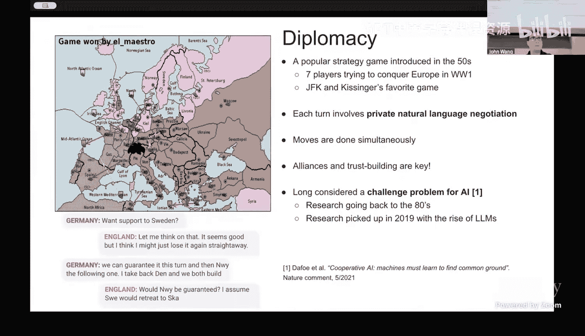

so one thing that's really important in diplomacy is that support is really key。

You can see on the left here if two different powers try to go and try to send units into the same territory。

 they're both going to bounce back。 neither their player is going to go in so what the red player can do is they can support one of their units to go in there and then it's a two versus one and so then the red player will go into the territory and the purple player will go back。

But the key thing in diplomacy is that supports can actually come from other players。

 so the green player could also support the red player into that territory。

 so Red could go to green and say he look， could you please support me into this territory I will help you out next turn or something or I'll help you out somewhere else on this turn and the green player can say sure and they could write down the support order and then red player gets in。

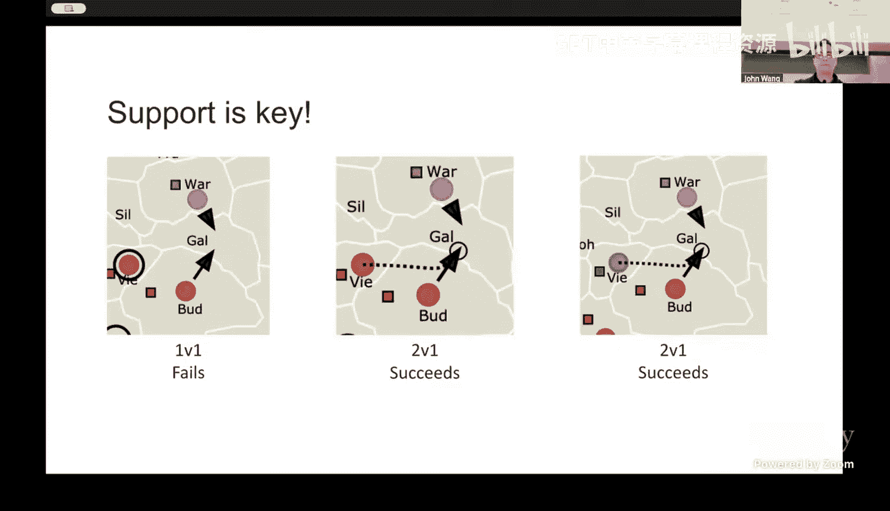

O。So。Like I said， this is a seven player very complicated natural language negotiation game for now let's talk about the non language version of this game where there's just moves being written and all the communication is implicit through the moves this is still a very complicated game but it kind of just like simplifies a lot of the experiments for us so we can really focus in on the non two players here are some aspect of this game rather than the natural language part。

Now。My colleagues and I developed this algorithm called Dora。

 which learned to play no press diplomacy， so that's non languagegu diplomacy purely through selfplay in a way that's very similar to Alpha zero。

So pure self play from scratch in the game of diplomacy， and sure enough。

 the win rate in a two player version of diplomacy was massive， it was clearly superhuman。

And then we put it into games in seven player games。

Sometimes with other Dora agents and sometimes with other agents that were trained on human data。

And what we found is really interesting。So。TheSo if you played。One copy of search bot。

 if you played a game with one copy of search bot and six copies of Dora。

Searchbot is this other diplomacy AI that was trained on a lot of human data。

 Searchbot would do terribly， Searchbot would only win about 1% of the games and because this is a seven player game。

 if you're winning 14% that means that you're tied so if you're winning one seventh of the games that means that you're tying the other players。

Searchbo only won 1%。But if you played one copy of Dora versus six copies of SearchBt。

 then Dora only won 11% of the games。So， that means that。SearchBt was losing searchBbot。

 which was trained on human data， was losing in games with six other Dorabots。

That we're not trained on any human data。But one copy of Dora was also losing to six copies of search bo。

And what this points to is that there are different equilibrium in this game。

 Dora stumbled upon one equilibrium that makes a lot of sense when it's playing with other copies of itself。

But if you stick that same agent into a game with a bunch of other bots that were trained differently。

 trained on a human equilibrium or something close to a human equilibrium， for example。

Then Dora wouldn't know what to do， and it would do terrible。O， so this is。

Kind of points to the fundamental problem with non two players here some games in two players years some games。

 this doesn't really happen。 You can train a bot whatever bey you want as long as it converges to a minimax equilibrium。

 but as long as it converges to an equilibrium， it's going to do great against some other bot that was trained in a totally different way。

 It doesn't matter。In non two players here some games， that property isn't there。

 and so this actually does become a problem。

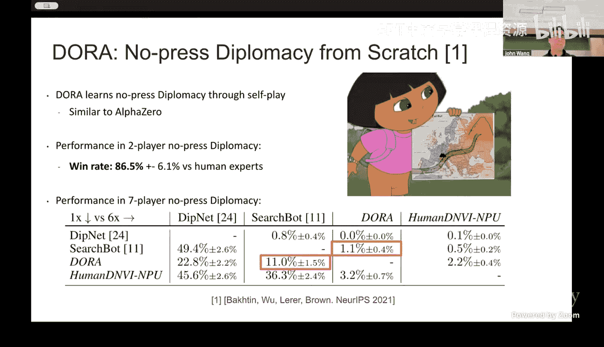

So， this kind of。Gets。To the the remember I mentioned earlier that there is this question of like。

 what do we actually want， Do we want a mini max equilibrium or do we want a population best response？

 And I said that。I mean， people were pretty split on which one was actually better conveniently in a lot of two players there are some games。

 there's not a big difference between these two in chess， for example。

 it's like typically the same agent or the same human。嗯。

When you go to non two players zero and games， minim equilibrium is just not useful anymore。

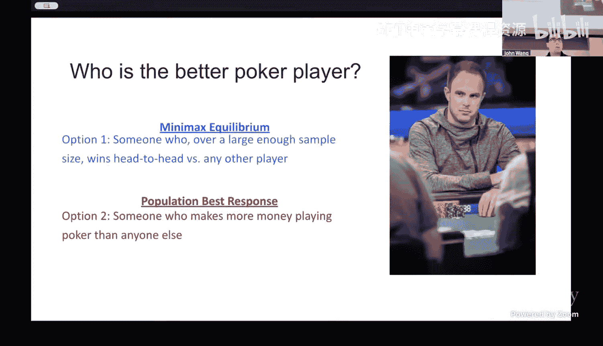

And so we can't really。Use that algorithm， we can't really use that equilibrium。

And the only thing really that's left， that's meaningful。Is the population best response？

And then the question is， well， who is the population？Is the population other copies of yourself？

Is the population humans？But。Depending on what the population is。

 you're going to need data on that population。So this is why you need human data if ultimately what you care about is performance with humans。

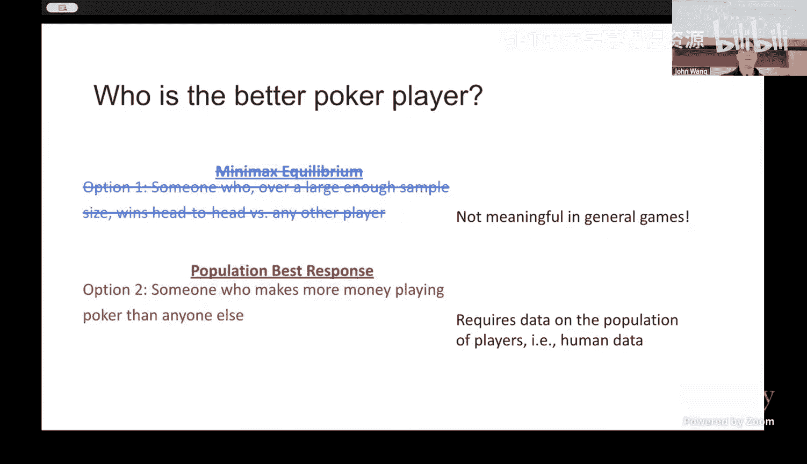

Okay， so the solution that we ended up taking in diplomacy that I recommend as the probably the best solution for general sum games or non- two players here some games。

Is collect a lot of human data and train an imitation model。Of those events。

Scale inference time compute。To better model the human players， not necessarily to do better。

 not necessarily to make the imitation models。Achieve better performance。

 but to better model what the humans would actually do。And then third。

 scale Rl with these human imitation models， essentially as part of the environment。

This is the approach that we ultimately ended up taking in diplomacy。

 and it ultimately ended up working quite well。

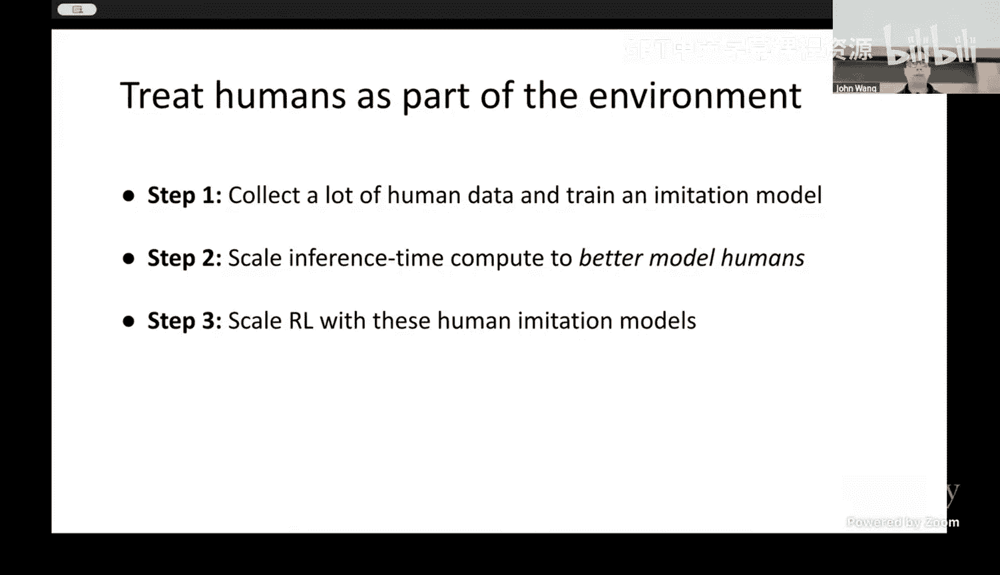

In no press diplomacy， we entered a bot that was trained in this way。In a 200 game。

 real human tournament。With 50 games for each bot so we entered four different bots and our bot。

 which was trained in this way ultimatelysman ended up doing the best。

 it ended up getting first place。We trained two other bots one was。Dora。

 which ended up doing actually quite poorly below the average achievement performance。

And then a couple other bots that ended up doing relatively well。

 but not as well as the approach that I just suggested。

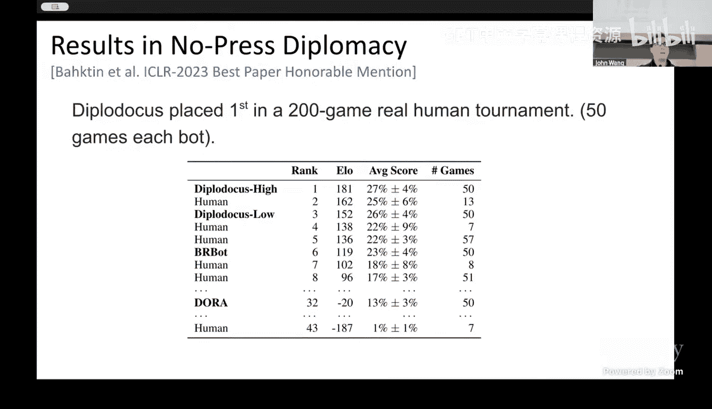

We also use this to train a natural a bot for the full natural language version of the game。

And here we did extremely well， though， not first place， so we entered this agent Cicero。

 which again， negotiates fully natural language with actual humans。

And we entered it anonymously in a natural language diplomacy league。

 and it placed in the top 10% of players and second of 19 players that played five or more games。

 the average score was more than double the average achievement score。Now。

I think the main reason why。We only got second place and didn't get first is that we were。

Bottlenecked by the quality of our LLMs， this was back in late 2022， language models were good。

 but not as good as they are today， and so I think if we really made a focused effort taking a similar approach today。

 I think we'd be able to do extremely well。

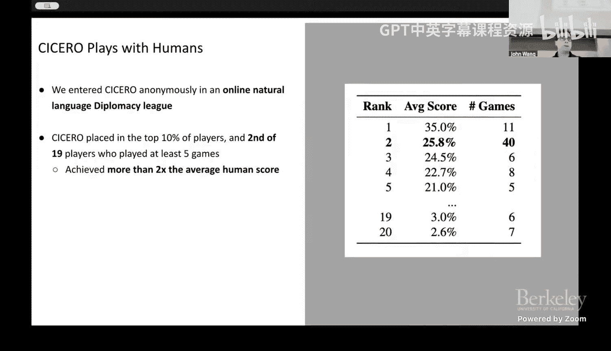

We also use this in Hannabi， I think this is really interesting because there's been a lot of papers on how to achieve cooperation with humans in the game of Hanabbi and we actually had a paper in 2022 that managed to do better than expert humans when cooperating across a wide spectrum of human players and again。

 it used this approach of imitate humans scale inference compute to better model the human behavior and then basically do RL with those human imitation models as part of the environment。

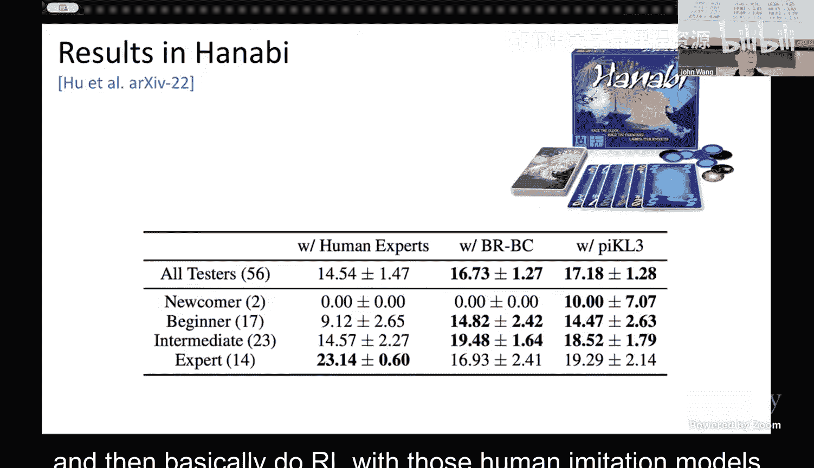

O。I now want to talk a little bit about Age agent LM cooperation。

 so so far I've been talking about competing with humans， cooperating with humans。

 but one aspect where you don't really need human data is if you just want the AIs to cooperate with each other。

O。So why would we want to do this， I guess to motivate agent agent LM cooperation。

 I want to talk about 01。 I'm guessing that you've all discussed this already in your course。

 but basically， 01 is this reasoning model that。It is very effective at scaling test on compute。

So the longer the model thinks， the better the performance。

And not only- and so we've been able to get these models to think for longer and longer。

 but even on top of that even better is that as we developed more sophisticated versions of these models。

The whole。Ploot of like inference versus performance curve has shifted to the left。

 so you're able to get the same performance at a much lower inference today。

And this is getting better and better and this is behind a lot of the recent successes in like crazy benchmark performance and I want to take a moment in case you haven't seen this plot to really just like drive home that this is like progressing very rapidly today。

 this is a plot of Codefor' performance。In January， early 2022， GP 3。

5 came out and it could barely code I mean， it's like still impressive that it could code at all。

 but it was below the fifth percentile for competition coders in code forces。

GP D4 came out in early 2023 again， still maybe close to fifth percentile among competition coders。

 not a very good coder。 G4 O came out。 Now you're looking at 10th percentile。 This is mid 2024。 Okay。

 so that's starting to get on the radar， but still not very good。

 And then you have the reasoning paradigm。 and then things really start to take off。

 So you have01 preview， which came out in September of 2024。

 and it's already above the median competition coder in code forces。01 comes out。

 that's just that's in December。 So about three months later。😊，And it's above the 90th percentile。

03 came out。 that was in April of this year。And it's about the 99th percentile。

And we recently announced that we placed first among all humans in the ICPC。

 one of the leading competition coding competitions in the world。And。

So you can see that this is very steep trajectory where things are progressing very rapidly today。

 It's a very exciting， very interesting time in AI。😊，Okay。

 so I mentioned that we can have these models think for longer。

 longer and just keep getting better performance Now there's obviously a lot of challenges with getting them to think for longer。

 longer01 GB5 thinking can think for I think pro can probably think for like 15 or 20 minutes depending on the problem。

Well， can we push that much longer， can we get it to think for hours， days， weeks， well。

 at a certain point， latency becomes a problem。People don't want to sit around and wait for three weeks to get a response from G5 Pro。

And the problem here is that chain of thought is inherently serial。

So one of the motivations for multi Asianian AI is latency。Latency eventually becomes a bottleneck。

And there are other test time scaling techniques other than just serial chain of thought that are parallel。

So for example， best event and consensus。The idea behind the best of N is that you sample， well。

 let's start with consensus。 So consensus。You just sample from the agent you know a dozen or 10 different times。

 and then you just look at the， you look for the most common response。

 So if you're taking a math exam， you just ask the model a dozen times。

See which answer ends up being the most common and submit that answer。

 and you can actually get a pretty substantial boost in performance just by doing this。In fact。

 here is the plot from the01 announcement where the shaded area is when you do consensus with 64 agents and so you can see that you're getting a pretty substantial boost on this。

Competition math benchmark by doing consensus over 64 samples。But there are issues with consensus。

 So one， for example， is that this only really works if you have。A very， very short answer。

 If you're writing essays， you can't really do consensus over the essays because you're never gonna write the same essay twice。

So something else you could do is， for example， best end。

And the idea of best of end is you sample multiple times。

And then you have some way of judging which answer is best。

 And this works really well if if the answer is very easily verifiable。 So， for example。

 if you're solving a Sudoku puzzle， you could try to solve that Sudoku puzzle 10000 times。

And very easily check whether any of the answers are correct。And if one of the answers is correct。

 you just go with that answer。So best of end。In many ways， actually works better than consensus。

 but it again also has its limitations because you kind of like need a problem that's really easy to verify whether you have the correct solution。

So there's all these different techniques that you can use， and there are trade offs。

 but the general tradeoff is that they are lower latency， but less compute efficient。

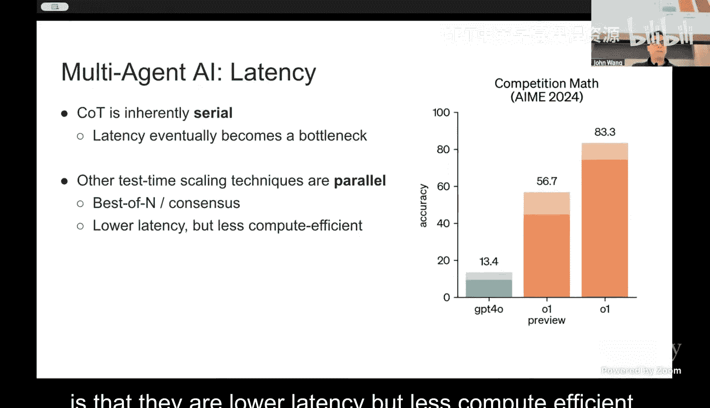

Another motivation is diversity。So。When 03 came out。

 there was like a lot of complaints that it couldn't multiply really large， you。

 20 digit numbers or something。And I always thought this was like really interesting because I don't think there are many humans that could multiply 20 dig numbers reliably。

 And we don't really expect humans to do that， right， We don't expect them because。😊。

They can use a calculator and just plug it in。And similarly。

 language models also can use tools a language model can instead of。

 you know today probably actually I haven't tried， but like my guess is that if you ask G5 thinking and ask it to multiply like 215 digit numbers。

 it'll probably do it， it'll take a very long time。

 but I think it'll probably get it right but it doesn't really make sense for it to do that right in the same way that doesn't really make sense for a human to multiply 2 15 digit numbers by hand。

嗯。Okay， so in the same way that you would want a language model to use a calculator。

Because it is more efficient。 it's like more reliable。 It's more efficient。 It just just makes sense。

 There are a lot of different models out there。And some models are better suited for some problems than others。

 And it might be the case that you're most capable。Largest model could do the task that you want。

But it doesn't really make sense for them to do it。 It's just not。

 it's just not as efficient as a cost effective they might as might just not be as good at it as some other model。

And so in the same way that you would want a model to be able to call a calculator when it's asked to multiply 2。

 15 digit numbers， there are times when it makes sense for an agent to go to another agent and hand off a task to them。

So the the another motivation for multi AI is that diversity is a strength。

You can use the best model for the particular query that's at hand。 And I would argue that routing。

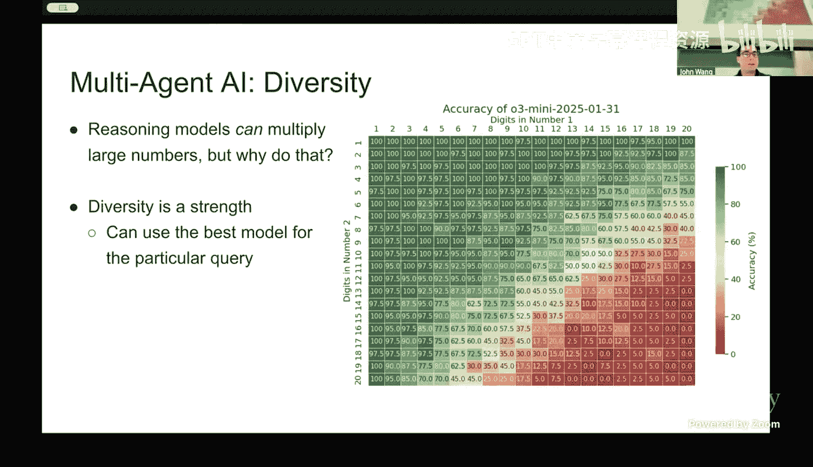

Is already a form of multiageent AI。 The idea behind routing is that you send the query to some model。

 The model looks at that query and decides which which model is actually best to answer that question。

Or to get that response。 And then it will route the question to that model and then return the response back up。

Okay， so the state of multiageent， AI today。嗯。As of today， I would say， it's actually。

Maybe if when it comes to LM cooperation， I would actually say it's。

 it's not as as impressive as it could be。 We're seeing a lot of scaffolds。

And these tend to be like very heavily engineered and very brittle。 And you know。

 they do work in some cases。 I think that there has been some， some clear successes。

 but there's clearly something still missing from these systems。

I think it's actually a very exciting time to be working on multi agents AI， actually， because。😊。

We've seen a lot of success from AI models and a lot of different domains。

 And we haven't really seen a， a clear success when it comes to multi agent AI in in the way that we have seen for a lot of other。

You know， measures of intelligence。But it seems like the models are nearing the point where they can be effective for this sort of thing。

It's also a really exciting time for multiageaging AI because the fact is the field of multiageaging AI has been around for a very。

 very long time。It's people have been working on this problem for like dozens of years。

And there's always been this， like。Question of how do you get the AIs to communicate with each other。

 How do you get them to even coordinate in the first place。And with L M。

 we have a very clear answer to that now。 the answer is。

 you just get them to talk in natural language to each other。 And it just， it just works。 And again。

 like， if you've only been in the field for a couple of years， you kind of take that for granted。

 Of course， you know， you can use LMs to just talk to other agents in natural language and they understand that is。

That is there have been whole lines of research， whole PhDs that have been spent just trying to figure out how to get these agents to develop a language so they can talk to each other and now that's just a solved problem。

 so it's a very exciting time to be working on multiageent AI and I think that there's a lot of potential to do exciting things now。

😊。

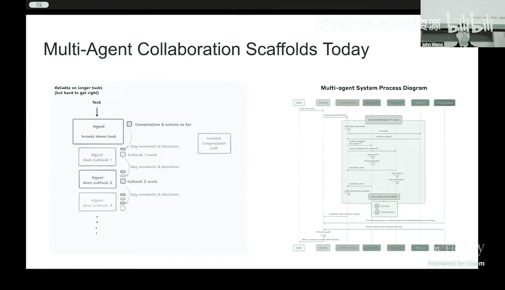

There was this blog post that came out a few months ago from cognition that basically said don't build multi agents and。

I actually think it's a great blog post。 I think there are two blog posts that came out in the past few months about multiage and AI。

 one from cognition， another one from anthropic。 I think they're both really worth reading。

 I think they're both really interesting。 They talk about their experiences。

 building scaffolds from multiage and AI， and they talk about where it works and where it doesn't work and what's still missing。

😊，嗯。And in the cognition blog post， one of the things they say is。Basically。

 they went through this whole rabbit hole of building multiage systems。 It kind of worked。

 but it was also very brittle。 And their main takeaway was that it's not the technology isn't there yet。

 And they say， however， agents today are not quite able to engage in this style of long， Okay， so。

 I'll say the the longer part。If we really want to get parallelism out of our system。

 you might think to let the decision makers talk to each other and work things out。

This is what us humans do when we disagree。If engineer A's code causes merge conflict with Engine B。

 the correct protocol is to talk out the differences and reach a consensus。However。

 agents today are not quite able to engage in this style of long context proactive discourse with much more reliability than you would get with a single agent。

And so basically， he goes on to say。At this moment。

 it doesn't feel like these agents are able to do it。But the technology is progressing very rapidly。

 and it feels like we are on the cusp of being able to do these things。

 And so I think it's a really exciting time for multiging and。

 I think that now is the right time to be working on it。😊。

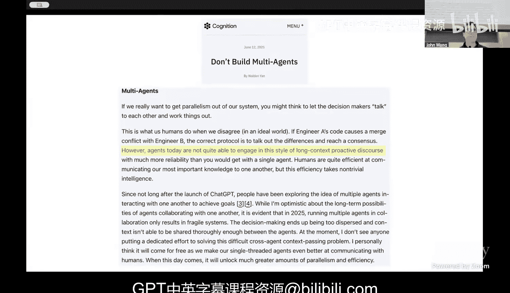