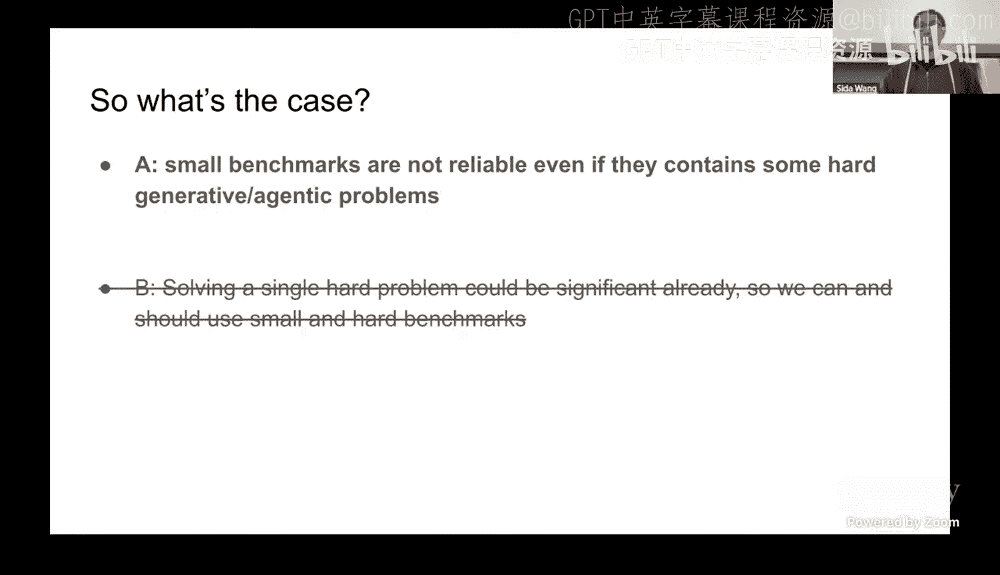
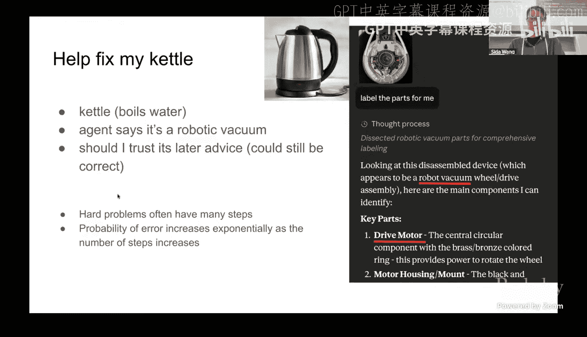
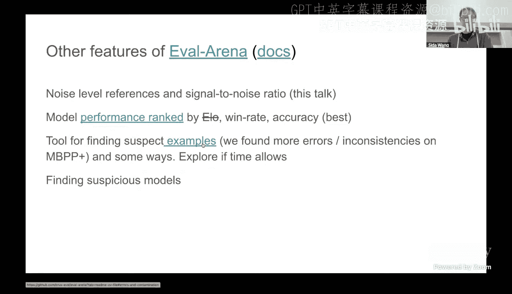
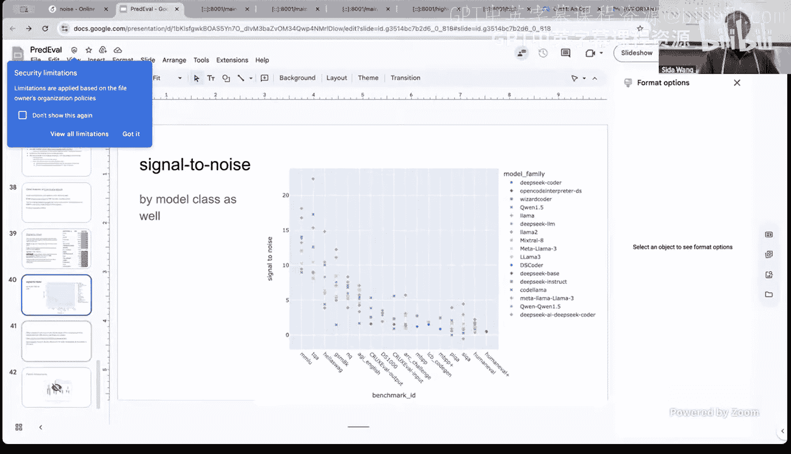

# UCB《智能体 AI｜CS294-196 Agentic AI MOOC 2025》中英字幕 - P6：-6-Predictable Noise in LLM Benchmarks by Sida Wang.zh_en.mp4 - GPT中英字幕课程资源 - BV1GpUTBhEGX

So today we will have Sida Wang from Meta as our speaker and to give a quick intro for Sida。

 Sida is a research scientist at Meta's Fund AI Research and his recent research focuses on evaluation。

 coding LOMs and agent RO。AndPrevious， he worked on learning from human interactions for flexible natural language interfaces。

 a path where impressive progress has been made。He completed his PhD in computer Science at Stanford University in 2017。

 where he was co advised by Christopher Manning and Percy Liang。

And he got started in research by helping Geo Hinton invent capsule networks。 So without further ado。

 please welcome Da for his guest lecture today。 Thank you。 First Ill give a quick。

 quick intro from the research perspective。 and this is actually my my second time at Berkeley the first time I talked about this kind of things learning learning from human fit feedback using a technique called marginal likelihoodput。

 which was actually developed here via my PhD advisoror Percy， it's actually an alternative URL。

 but with all the emphasis on exploration and also because of the log。

 you have to do well every single example。Yeah， anyways， we try that， but without free training。

嗯More， more recently。诶。Yeah， so more more recently， I was very， very interested in code I Ms。

 I thought， okay， yeah， they seem to be really， really impressive。

 Maybe a really good way to get to better， better AI kind of following。😊，You know。

Previously it was student language two programs， now it's called howMs。

Did a bunch of work on that responsible for。A part。

 part responsible for a bunch of benchmarks in space。 And most recently。

 I worked on aant car on this code world model project。 That's recently released。Okay。

 but today I really want to talk about these benchmarks so you know when you create and actually if I I'm correct。

 this class had quite a few lectures of a benchmark intro to benchmark already。

 so I won't cover specific benchmarks。😊，You know， when you， when you make these benchmarks。

 it's all quite， quite busy。 There's considerations about how is this going to be effective Oh what's the quality。

 right there， There's very， very little。Reflection。

On them so so this是 what what I want to talk about today。Okay， so， you know， back then， you do。

 you do a bit better，10% better on imagenet。 It's a huge data set。And there is no。

 no doubt that this this this works。What's happening now is that。

We have these more complex a benchmark。 Well， I mean。

 human evolvevo is no longer a complex benchmark， but it was a generative benchmark that takes a while to make and evaluate。

And many， many paper report a relatively small improvement on them。

 And if you look at the traditional standards of statistical significance。

 many of the improvement are certainly not significant。Right， and if you look at the sizes。Actually。

 benchmarks are kind of getting harder， but smaller。 right， So Amist was 10000 in net。

 hundred000 before really real generative benchmarks， the multiple choice ones like M U10000。

 But once we get to these coding benchmarks。 They go down to like human evolved。

 which is one of the landmark benchmark in the area。 only 160， for example。

 others a little bit bigger。 know， I feel that I was responsible。

 partially responsible for cr evolve D S 1000， We will try to live code benchmark。

 we will try to shoot for about 1000， but still quite a bit smaller than before。嗯。

And now there are these even more complex agency wallss， such as Sw benchch， various versions。

 terminal bench， which often needs hundreds of thousands of tokens and often our depends on how you run them。

So these are time to be also in the in the hundreds。Okay， so one counterpoint then is you know。

 each question now can be quite quite powerful and and informative。 right。

 so because you generate a lot of text or code or these agent trajectories when you。

 when you solve these problems。And that feels like it should be better than， say， true。

 true and false or multiple choice or classification questions。Right。

 and I think we also have certain intuition from humans， from all your experience being a student。

Right， so so leading， leading， I guess intellectual contests have a very few questions， but long。

 not， very long answers。 So， so for， for instance。嗯，老说吧，要巴他呃IMO which。The math omp has six questions。

 The college version has the 12 questions。 yeah， and they， they have a range， range of difficulties。

诶。And I think it's also in， in the era now that if you， if you solve a major open problem。

You just have to， you just have to solve one， right？ And no one is going to say， oh。

 you only solved one problem。 That's not statistically significant。

And there are many the of the more daily agent tasks， which are more and more economically important。

 such as fixing issues， fine bugs， fivebe code。 and I'm sure many， many in other domains。Okay， yeah。

 So so here Ipo a question。 So what's the case。Are small benchmarks not reliable。

 even if they contain these hard， complex questions or be can we somehow。

Get more out of these complex questions。 And we， we， in fact。

 should use these small but very hard benchmarks。Now， there are lots of benchmarks。

 lots of leaderboards， right， Some of these leaderboards really tell tell you exactly what the model did on each question。

And otherwise， you can， you can also run run some kind of evaluation suite and。

Get gather individual individual performance。So in， in this attempt at to explore data analysis。

 I have each each dot on this plot is a is a question and and model。 actually。

 each each column represents a model， and each role represents a question。

 and they are doubly sorted。 So， so the models are placed at how。

 how well they do on average on a benchmark。 that's that's the X axis。 We have the models on the。

Be the cursor。 Yeah， okay。You you have the models on the left being the best models and the model on the right。

 being the worst models and the questions are just sorted from。

 from the easiest question to to the to the hardest question。 So the why， why axis is its rank。

And the color is the accuracy of that model on this question。嗯。Okay， yeah。

 so we have have this kind of data。 You see there， there seems to be a clear。

 clear trend of easy easy questions and hard questions， right， good models and bad models。 and。

 you know， somewhat sharp。传贼山。Right from from from from this plot， right， So this was on math 5。

500 Chen Chen of thought。Alright， and we can we can look at many， many benchmarks。

 I try to get a lot of a lot of it where where there's data available or or I can， I can run them。

 So some some are a bit noisy。 So that we have human evolve on the left and BPP on the right maybe the division on human evolve is less clear。

 but still clear on BP。SoSometimes you cannot get right。

 So the color gradient is because we have multiple draws or for each question。R。

 very yellow is like 1 0。5 are a 50% probability of getting correct on that question。

But sometimes these are external benchmarks that's aggregated by other people。

 and then we just get a binary rightness judgment。So a threeBch leaderboard is one of the most comprehensive have with more than 100 model plus agent。

participating。And the live code bench on the right is another。

 I think B lead author it's also from Berkeley。嗯。Yeah， so， so even even though theyre theyre binary。

 you can， you can still see their easy， easy， easy problems， hard problems and some。Some。

 some problems where no， no models solve。Okay， so one。

 one thing I can observe is there's just from this exp data analysis where there's a lot of inconsistency。

Right， so even though the model， the model on the left is the best， right。

 but sometimes it fails on the， on an easy problem。And， and some of the。

Really rather bad models and that succeed only maybe 3030 something percent of the time。

 but today they succeed on some pretty hard problems。

So so this suggests to me that maybe the problems in in these benchmarks are not that special and even bad models have a chance of getting them correctly。

Even though maybe a lower chance。So back to the question I posed， right。

 can we make up for low statistical power with hard problems？I think right， certainly in some cases。

 you can。 But if you see this inconsistency， you should be pretty suspicious， right。

 So so I'm trying to illustrate， say you have a baseline model right there。 okay。

 it's correct on some questions。And then you have a if you have a strictly a better model。Right。

 that's better on more questions than maybe， okay， maybe some of these questions are really hard。

 really interesting。 And， and somehow it got got done right。 like that could be。

 that could mean a lot。But， but the reality seems more like the the third line where maybe maybe you're a bit better overall。

 but or about the same overall。 but you get some questions correctly sometimes better。

 sometimes worse compared to the baseline。 So so not always consistent。

And I would maybe draw draw the analogy right like if someone can write down they write probably very hard and long proof of P P not equal to one P。

 but they cannot define what what N or don't know some of the basic concepts。

 then that maybe you suspect okay maybe they they copy it somewhere。 if it's truly open problems。

 they cannot copy it somewhere， but for for the problems in the in the benchmark in the benchmarks that could be possible。

So， that's the inconsistency。Another thing we can look at is really what is the probability that a model gets a question correctly？

Right， so。So here is zooming in into， into the same， into the same kind of chart。Right。

 so here we have we have this question 1，1，3， four that only some very good models get get consistently correctly。

Right， so are the slim hiin here。But， but it will draw， draw about 1000 samples from for。

 for each question and some of the worst overall models。

Still has a fairer chance of getting them right。 So in this case。That's the relevant number。

 You have still have 30% chance of getting the right。 Some of the others are maybe less 11%，10%。

Right depending on the case， actually， once you have some chance of getting。

 getting the question correctly， making it more， more reliable may not be that in impressive。 right。

 So， so， so one could argue that actually， the first percent is very important。Right， so。

 so especially if you have a。It's a verifiable question。Where one way or another。

 the verification is easier， maybe maybe a approved for something。

 Then once you have a decent chance of getting it correctly， you can just try。

 try and try again and verify and with with a little bit of help。

 your model can actually increase the the reliability without doing too much actual impressive things。

Okay， so， so I think with with that bit of exposure data data analysis， I。

 I can convince you that at least for the， for the benchmarks lab we have。😊。

Small these small benchmarks are still not not reliable。

 even even if they seem to contain some hard and very， very hard gig problems。

嗯。呀。Okay， and to to give a more， more to give an example from from day daily life one once my。

 my cattle was broken you use boil boil water and like took， took the part Ask the model。 Okay。

 what what what happened， Can you， can you help me identify what's， what's the problem。

 took a picture， ask what it is。 Oh it says， oh it appears to be a robot。So。I I would trust later。

 later advice a lot less。And I think it shows， yeah， well， hard problems， we have many， many steps。

And the probability of error will increase exponentially as in the number of steps。

 So if you have some constant probability of error， thats very unlikely that you can solve。

 solve the hard problem。 So there are some， some kind of gradient。Trying to say here。

Although some sometimes you can jump over it right， you can still get the answer correctly somehow。

But about you will trust us。

And as a result， so probably statistical analysis is still important now。

And since since we we we have have some， some time， I， I want to try。

 try to convey the basics of how， how this works， especially maybe the， the concept of sampling from。

 from super pop sampling from a superp。嗯。Yeah， in some sense， this is apparent from。

Basic stats in textbooks， but this paper from Evan Miller articulated pretty well in the context of IOM evaluations。

 which I think we linked for for this class。嗯。So here I introduce a bit of notation on to to make to make the case of sampling and drawing multiple samples clear later。

 So we which is a bit different from， from his notation。So first of all， we have So X。

 I is a question。 X is the so it's the I I question。 We have n total questions。

 and usually what an evaluation benchmark does is it takes the when when it works on model A。

 it takes all the questions。 A A X returns， say most commonly a 0 to，0，1 value。

0 for incorrect one for correct。And we' got the average A bar。So right。

 and this is the particular set of questions。But this estimation perspective says， well， actually。

 right this we can， we can draw， we can draw other questions all all from the same distribution。

 And these questions is just the particular representative。

 but we can't use it to estimate the the variance of the real population。Right。

 and and you can ask what those samples。 And that's the variance of A A X estimated by。

 by the empirical average on the samples。Yeah， and then because because the min is computed by averaging and things。

 there's the concept of the， the standard， standard error of the min。

Which is quite which is less than the than the variance of the population by。

 by the factor of square one over square root。I give giving you a pretty clear trend multiply by by the co。

 you can， you can think of the variance as fairly constant because so， so， for instance， if 0，0。

1 variables in the maximum it can be is one over 4。Right， and often much smaller。

 So so already you have an upper bound on how big your standard error of the mean is。

Without having a， without having any data。嗯。Okay， right， but that just gives you if you draw。

 if you draw repeated samples， if you draw other samples from the same population。

 what's the variance of the mean。But actually what we are more interested in is comparing model A and model B。

 right and try to answer， did my maybe model B do better than model A？And this。

 this part is really for， for free， right， It's just better， better analysis。 You already have。

 you already have all the data。 So instead of asking， what's the variance of a， you just ask， well。

 what's the variance of A A A X minus B X。😊，Right， so。

 so if you have a set of samples and there are 0，1。 now， now you have some， some set，s either-1，0。

1 with some probability。嗯。And this could potentially have a large impact。 right。

 So if A and B are almost perfectly correlated， then than by doing this paired as a variance estimation。

 it could be reduced， potentially reduced to near to near 0。So。So yeah。

 so that's a different version of of variance。 And once you have which can also be normalized to be the standard error。

 and once you have the standard error， you compare it to to how big how big the difference in means is to get Z score right and and according to to the theory。

 the score follows follows the standard normal distribution。 So assuming your n is large。

 which which all of our evaluation still satisfy。So， for instance。

 being one one Z scroll away is quite， quite likely to happen just by chance by，5，5 instance。Right。

 so。Yeah，5， I guess five standard errors away is quite unlikely to happen。

 And very conventional standard is is about two standard errors away。

 which gives5% chance of happening by chance。诶嗯。So that's that's hard的。

Basics of the statistics and analysis works and on this human human evolved data set。

 we have140164 examples and typically your your standard error will be about 4% for each for each individual component。

 if you don't do if you don't pairre them up， then then to produce the point of the 5% P value you need about a 10% difference in performance。

Even with a pair test， you， you you typically still need about 88%。

 And these are larger than what's reported by many papers。So I， yeah。

 I can also give a bit of intuition， right， So if。If we are considering un paraired。

 it's drawing from the distribution。 So， so suppose A scored 50% on this year's exam。

 but B scored 60% on last year's exam。They， they contain different exact questions。

 but they are drawn from the same distribution。 So， so that's an unped in the paired version。 right。

 So the in the unped version， B might have done better just because last years was easier。

 for instance。 But in the paired in the paired version。

 B also did the same the exact same exam as a with， with the exactly the same questions。 right。

 And then typically the 10% difference。Seems some more， more significant。Right。

 so basically because because they did， they did the， the exact same problems。

 we can take advantage of。Even though if you met the higher standard of onpaired， that also works。嗯。

So one interesting thing about L Ms that I work out here is they， they have， they can。

 They can draw multiple independent samples， and especially with agent reasoning models is becoming more and more prominent。

😊，Yeah， and certainly I can't do this。 if I I solve the problem， I cannot forget it and re attempttt。

So a common confusion is actually thinking that the only kind of noise coming from these evals of LM gives you different predictions。

But， but， but according to this theory， if you， if you are sensitive to what exact questions are chosen。

That's also a type of noise。In fact， could be the the more important type of noise。嗯。Yeah。

 but we can develop a system to capture the setting as well。Where。

 where you have we all in in addition to the question variable X。

 we also have the noise variable epsilon and your evaluations。

 you average over both the questions and multiple draws of the model。嗯。Yeah。

 and you you can estimate the variances as before。 And now now I actually theres。

 there's a decomposition。Of of the total variance into first， the， the， the variance due to。

 due to choosing different questions， but averaging over the noise。嗯。And the no the the noise due to。

Due due to due to sampling multiple times from the model。And it's a nice nice identity。

 add them add them up。嗯。Right， and you can as before get the standard error versions of them。

And then apply the same these scores。In in， in the， in the now， both paired and with noise setting。

So I don't yeah' need to do all the details here， but but I try to work this out to make sure they are correct and test run a bunch of empirical data so maybe others can can just use the results without without fo and understanding that and do it themselves。

嗯。Yeah， so even though you， you have this ability， but sometimes it can lead to to a bit of awareness when。

 when you， when you can say I， I can do do this question correctly would probability a point8。

So here we can have in this example， we have eight questions， and model A and model B。

So model A is overall not that great。 has a 10% chance of getting each question correctly。

But modelel B has。100% chance of getting the first four questions correctly。

 or zero chance of getting the second four correctly。This can happen if you say。

 do doL and maximize the expected reward。 So your expected reward increased， but but actually your。

The set of solvable questions decreased。And it's not completely clear which one is better。

 even though the average for on， on average B is much better。喂，走走走把这FF。

Some of the errors can be corrected， say with a verifier in the loop。但 then A is actually better。

Yeah， and and all of these can be can be computed with a fairly simple variances mean variances mean estimations。

 there is more complexity with the correct bias。 But one thing you don't have to do is you don't。

 you don't need to compute these with bootsrap， which is a perfectly fine method。

 But but sometimes when when the answer is just like a P P times1 minus P。 And they they say， oh。

 that's the computes with bootsrap shows certain， maybe lack of thinking。

 And we see a lot of examples of people doing bootsrap incorrectly in in the literature。Yeah。

 but actually the another reassuring thing is multiple very。

 very well established theories will give roughly the same answer。So namely， bootstrap is another。

 another view point on this problem where you say mean mean ideas， really， if you draw。

 draw draw resamples。From the empirical distribution as the the samples that you' are actually given。

 it roughly behaves the same as drawing， drawing more samples on seeing superp。 Yeah。

 and if you try to estimate that way you get basically the same answer。Another quite classic。

M method is scientist test， treating and treating this as testing and hypothesis。

 where the now hypothesis is everywhere A And B is different。Each have 50% chance of being better。

And the and asks， how likely is this random model to achieve and result as extrem as the one you observed。

And this will also also get about the same give you the same result as long as A A and B performs about not too far away from each other。

Okay， so that's the method。嗯。Right， so so I think the the mean。嗯。

Contro contributionion of this work is if I， if I try to， to do this on all the， all the benchmarks。

 all the model pair I have， I carry out these different type of analysis。 then maybe。

 maybe the numbers will be like fairly consistent。 and you， you don't need to con to say， well。

 maybe my， my model pairs is very， is very special。And different from the others。So。

 so that's what I what I did from trying to do do this on all。

 all all model pairs and take the average of。Yeah take the average of all the meaningful standard errors。

 both paired and unpaired。Okay， and then then I can write this down just for。

 for each for each data set。And one immediate observation then is that actually。

 the parent test tend to return。About the same。 About the same result。As as the arm pared。

Which means so one way to interpret it is okay， maybe their correlation is about 50%。Right。

So if you actually apply the unped method， you， you would have to first multiply this by by square root of two。

 right， resulting in less power。 But actually， if you， you do the paired。嗯。

The standard errors are all the same。So。Yeah， and， and on pair standard error， you can more or。

 you can more or less just calculate from， from the accuracy and the data set。

So hopefully that that to makes it a lot easier。 but。

 but there is a slightly weak dependence on the overall accuracy， right， So when when your。

 when your performance is near 01， there's。But the standard error is lower。Yeah。

 but it's not a super strong dependency。 And yeah， but if you。

 you want to get this little bit of additional accuracy， I also gave。The。

 the estimated standard error on each data set as a function of its overall accuracy。哎So we are。

 we are here the。The green curve， the green dash line is is if I treat them all as independent。

And the blue one is the prediction by another simple theory I will talk about but first we we can look at a few few examples of these。

So， so for the most part， once your model has a reasonable performance on on the data set。

 it follows this be theory prediction。But， but when it's quite， quite bad， then。

 then maybe it's more like， more like independent。And this holds for， for， yeah。

 for almost all all the data， Yeah， all the data sets。 And I see it very yeah。

 except with a few possible deviations。Right one is here is' M O U。 It's a multiple choice test。 So。

 so when all the models are really， really bad， right， like even your random model can， can get the。

1 over 5 or one over4。 So so that there it was more like independent。 But once the model gets better。

 it follows the the predict， the beta prediction。Sear for live Code D。And also also quite some。

 you also got the same result for a Sw bunchch was now with more and more data points。

 giving more confidence。And there's one， just one pair of outliers that I saw。

 and I dig into it a little bit。 And there there were three three fixer versus a three fixer with a filter result。

😊，嗯。Yeah， where you， you got a strict improvement and that's much less standard error。I think yeah。

 it's a bit reassuring to say， okay， no this is not some real universal phenomenon。

 I really only only applies if you are testing I O Ms。Right， so even though these。

 these are a diverse set some yeah， some some diverse set of Ls are trained by different people on different data。

 yeah， using different agents as well。 but they are。

 they are still all all LMs and seems that seem to have similar noise behavior。嗯。Okay。

 so now now I try to explain this a little。 So why， why is it that we we get noise at that level。

 So one thing we can do is look at the in empirical distribution of of the probability。

Of getting correct for， for each for each tier of models， from。

 from really bad models to the best models。So here is this is the the cumulative distribution function。

 Okay， and see okay， what， what， what do they look like， And it turns out you can。

 you can fit a beta distribution after accounting for the true real zeros The questions where no models solve。

And， and one， once。Once your performance is good enough。The， the bimodalness， let's see。

 of the beta dis distribution increases often time often with roughly the parameters suming sum into one。

 And that that corresponds to the， to the prediction that we showed before。Okay， so， so again， right。

 like if you， you use this model， then you can predict how。

 how much noise there is without having all the individual results。Yeah， and beta distributions。

 this distribution on the interval0 to one， where in in this in this range with I guess parameter sum to one。

 they are there by model。Where for for parameters somethinging to be something bigger's more more uniform。

Okay， so this also appears to fit multiple multiple data sets here。

 MOU Pro Chm thoughtt and more discreteet。Predictions might on Sw bench verified as well。

 because now， now the empirical predictions are stepwise because there。

 theres only only so many models where we don't have multiple predictions， but。

 but the overall trend still seems so fit。O。嗯收。That's。

 that's what I wanted to say about measuring noise。 There are other other works。

 such as run with more multiple seeds or something like measuring the variance of your training curve。

 which actually tend to lead to an underest。😊，So after， after doing。

 doing both the expatory data analysis and some summary of it， right， we can， we can， in fact。

 recommend this right in increasing accuracy。Right。

 so if you really just want a bo Bob Bobpar figure and just look at the table， right。

 It tells you what what the standard error is by by data set。 and you don't don't need to。

 to do to do the additional work to get a little bit more accuracy。 You can。

 you can look at you know， these， these charts find okay， what's the range of your， your， your。冇到。啊。

咱锐到三 chart。哎诶呀有可嗯有看我说。Pide， provide your， your results on each。each question and use my code， right。

 and then runs all together gives your， your particular comparisons in the context of all the all all the other comparisons。

 So if you， if you you're getting some of something strange， you immediately。Yeah， but you。

 you can also do your own own tests and calculations。

 but it seems fairly error prone because there are several different types。嗯。Right。So no。

 no is the thing that I think I took the furtherthest here。

But there are a few other things you could do with this kind of data， tool。

I think one in kind of interesting one is you can say， look at。

See if this works。

Yeah， you can look， look at examples and see。 well， is。

 is this example correlated with a more negatively correlated with the overall model performance。 So。

 you know， the better the model is the worse it does on this example， And we can find some。

 some such examples in in many of the data sets。诶。But a lot of them are not not actual errors。

 except on the under the MPP， where， where you have a bunch of negatively correlated examples that are actually either in inconsistent or somehow。

Yeah。Yeah， but but not not all of them are6。 So this gives one way to audit the quality of the evaluation set。

Yeah I find a few few mistakes in MPP and which got incorporated into MPP plus。You can。

 you can also try to find suspicious models。 actually， right， So So once you say you have some。

 some suspect examples。Where， we are the leading model that that wasn't wasn't cheating。Will。

 will kind of overlook what's in the evaluation data set。 But there there may be a few model。

 which gives the the exact answer from the evaluation data set。On this wrong， wrong example。

 So if there are few of those， you can gather some evidence on what models may maybe have trend on the evaluation data。

嗯Okay。Yeah， I think this is more for benchmark builder right so that was the absolute level of noise。

嗯。But an important question is really， how what， what kind of of effect size can you measure with your benchmark。

Right， so this also depends on the， on the standard error。 But， but on many， many models。

 when they release， they release a series of models from small to large。Right。

 so a place for to get signal is now when say when you double your model size。

 how much improvement you get scaling law， which gives a consistent improvement。 And you can ask。

 okay， So how on on your on the on each benchmark how much signal to noise ratio really also。

 also measure by the score is there。😊，And， and here you have。Still mostly require just。

Mostly a function of the size still， but with occasional。

differences right so so I ML U can very reliably distinguish the next larger model。

 whereas many of the code evaluations like human evolve even distinguishubling model size。嗯。你我看我。😔。

In long time。I have a few examples about that。 Okay， but I think we can。And and here。

 So I give way to look at all the question results。 spend more。

 most of the effort characterizing how big the noise is， but also show a few。

 few ways to get some other information。

