# UCB《智能体 AI｜CS294-196 Agentic AI MOOC 2025》中英字幕 - P7：-7-AI Agents to Automate Science by James Zou.zh_en.mp4 - GPT中英字幕课程资源 - BV1GpUTBhEGX

Hi everyone。 Thanks for joining the Atlantic AI class today。

 It is our great honor to have Jim Z from Stanford to give the guest lecture today AI agent for accelerating scientific discoveries。

 So James is a professor at Stanford University and has done a lot of。😊。

A great work in AI for science and also AI agents in general。 And so let's welcome， James。

 Thanks a lot。😊，Awesome， great， thank you so much Don。

 it's really a pleasure to participate in this really exciting class。So yes。

 so I'm excited to share some of the recent advances in around AI agents and especially thinking about how we can use these AI agents to help us to automate and to accelerate different kinds of scientific discoveries。

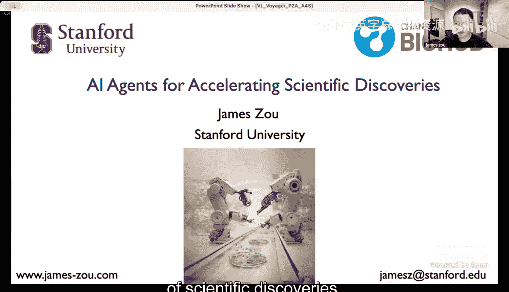

So the broader context of this is that AI has been very successful as a tool in across many different domains of science。

And traditionally， the way that we use AI is that you first start with like a well defined scientific problem。

 you have a specific target and then you can use a specific like well curated AI tool right to tackle that well defined problem。

So an example of this is that if you， let's say if you have a problem of trying to predict structures or proteins。

 right， then you can use a tool like alpha fold， try to predict in those structures。

But you need to have like a well defined problem first。😊。

And we're seeing this kind of interesting conceptual shift over the past year。

 whereby instead of thinking of AI， it really as a tool for solving like a narrowly defined problem。

 people are starting to explore AI as a co-scientist to tackle this broader range of research endeavors all the way from helping us to generate hypothesis。

 to designing experiments， analyzing data， even writing papers。😊。

And a lot of that shift is driven by these advance in the AI agents。

 which you've been discussing in this class， which are essentially systems that we can then build on top of large language models that then enables these models to be able to use different tools like Al fold and other domain specific tools and also to access additional resources like different databases and memories so this then enables these agents to become really co-scientists that can really help us to across these very versatile kinds of research endeavors。

😊，So what I want to do today in this class is to discuss some of the recent bias in these AI scientist agents。

 and I want to share a few concrete examples of how these Canada AI agents can really help us to greatly accelerate research and discovery。

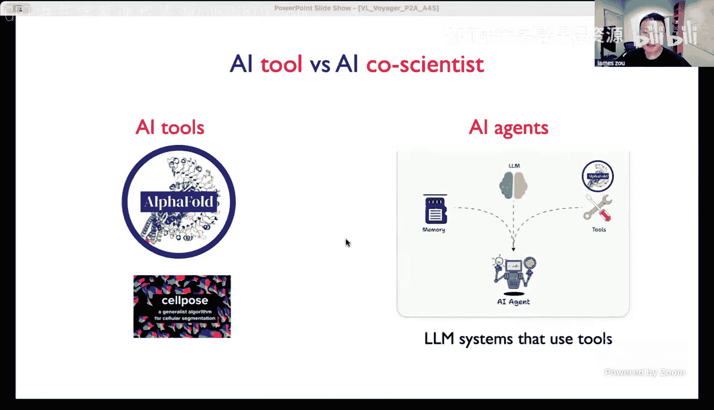

So in the first example I'll share I I'll talk about the virtual lab。

 which is a work that we published a couple months ago where we have a team of different AI agents that collaborate to discover new proteins and new drug candidates。

In a second example， Ill talk about paper to agents。Which kind of a recent work。

 But I'm very excited about this， right where we're imagining turning every research paper into its own interactive agent which to facilitate knowledge dissemination。

😊，And then in the third part I'll talk about this actually quite recent conference that we just organized which is finished a couple weeks ago called Agents for Science it's the first conference where both the authors and also the reviewers are AI agents。

 so I'll share some of the findings that we have from this conference。

 some of the highlights and also like some of the learnings。😊。

And what I'll do is that I'll pause at a few places in。

Join the presentation so that we can take questions from the audience and then have a more interactive discussion。

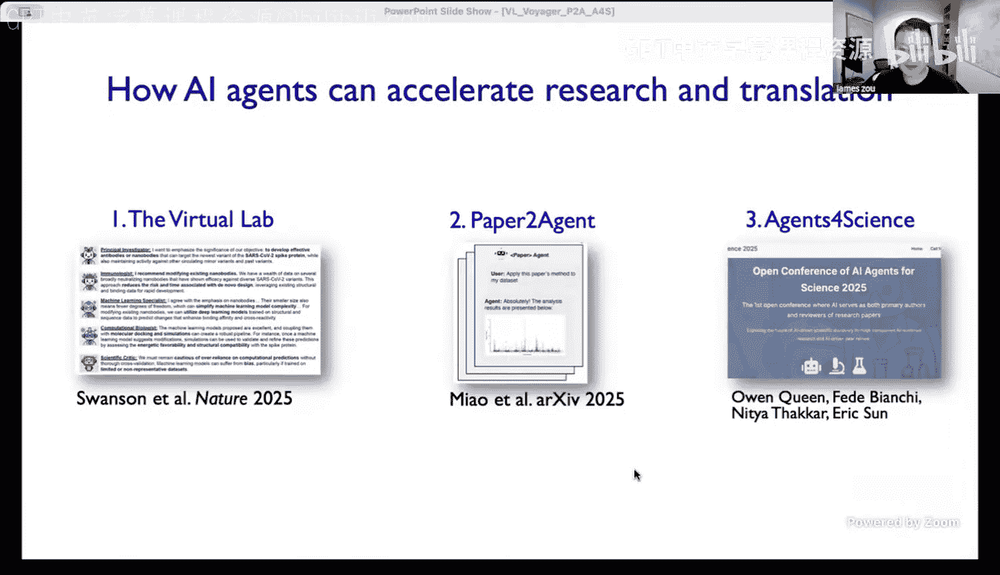

Awesome， great so I'll start by talking about the virtual La so the virtual Lab is a open source platform that we built where we have teams of different AI scientists agents that interact and work together right so they collaborate to tackle these open ended research problems they can also work and collaborate with human scientists。

😊，So the virtual lab in many ways sort of mirrors my real lab here at Stanford。

 so in the virtual lab there's AI professor agent。😊，And working with the AI professoror agent。

 a sponsor of different AI student agents with different expertise。😊，Some have expertise， let's say。

 in computational biology， or in machine learning， or in immunology。

 and these AI agents then have their own group meetings and they can work together to tackle these research problems。

We also built a school for the agents whereby the agents can actually go to the school and then teach themselves how to become a better researcher。

 so I'll explain both the virtual lab and also the agent in school。

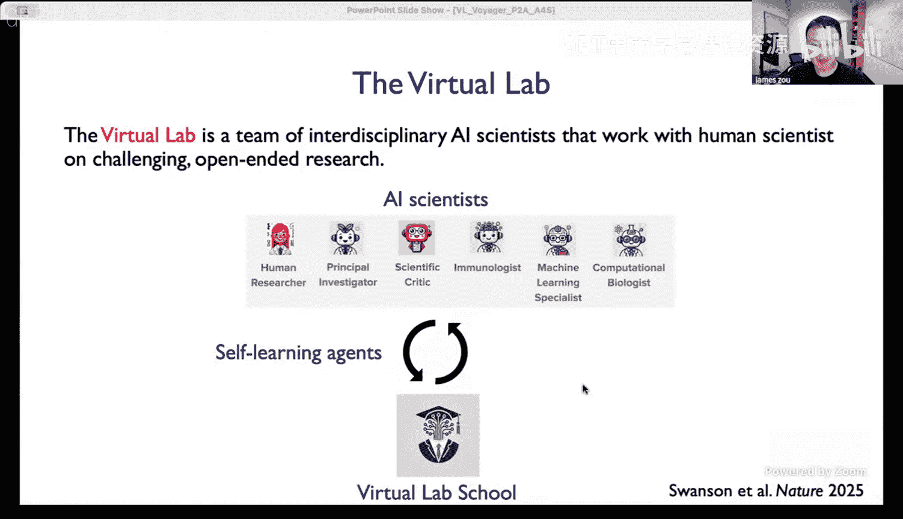

So first I'll just explain a bit of how we interact with the virtual lab agents it's like a human researcher can interact primarily by talking to with a PI agent or the professor agent so for example。

 I can explain to the PI agent some description of the project that I'm interested in maybe one project could be I wanted to find like a new drug candidate or design a new protein another project could be you know I wanted to have this complex data set I want to analyze this data set right or I want to design a clinical trial right so it could be very different kinds of projects。

😊，And then for each project right so the PI agent will look at that project and then try to decide by itself like what are the different areas of expertise that are needed to tackle that task So maybe for this part of your task。

 the PI agent says okay it's useful to have a machine learning agent and so it's so useful to have some expertise in protein engineering So then it's actually the job of the PI agent than to train and to create a subagents that have each of those relevant expertise So for different projects。

 the PiI agent has the flexibility than to create and the trained subagents with different levels of different types of expertise so it's quite versatile。

😊，I'll come back to and explain in more detail in two slides of how that training and equation process of the agent happens。

For now you can think of each agent basically being like a frontier language model。

 like a GPD4 or GP5 of model under the hood， and then we do an additional fine tuning to teach these models how to use these specialized scientific tools like Al fold and also have access to these more up to date scientific knowledge。

😊，So after all the agents are automatically created by the PI agent and then after the agents are created。

 then they can start to have their own group meetings where all agents will meet together and then come up with the research plan。

 they can also have one on one meetings where one of the agent might meet with the PI agent to review a subtask or subtask here could be like analyzing a piece of data set where reviewing a piece of code so they can alternate between these group meetings and one on one meetings so similar to our human research teams。

😊。

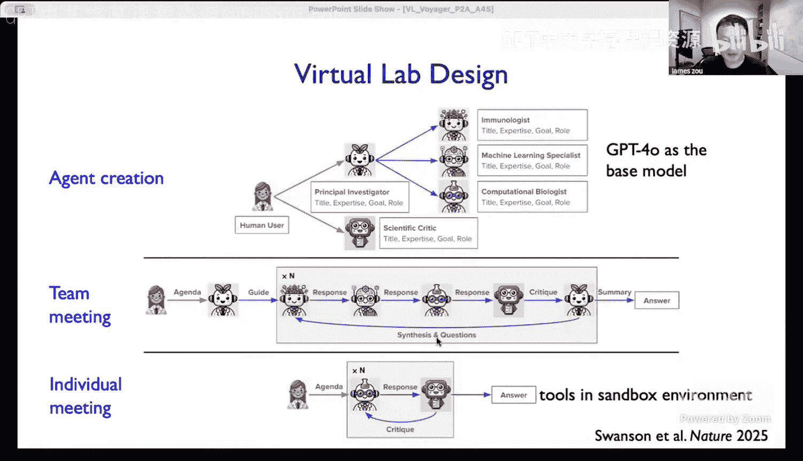

So I just want to show a concrete example of all of these virtual lab group meetings just to make it more concrete。

😊，So this is actually the first research project that we give to the virtual lab to tackleco。

 so the project is to basically help us to design binders to the recent COVID variants right so basically last year when we started this project there were actually some of these new COVID starts COVID2 variants and people didn't have very good binders to those so we thought this would be a very timely but also a very open- endeded research challenge to see if the virtual lab agents can help us to design these good binders。

So in the beginning of this meeting right you can see that the PI agent spoke up first try to explain that with the other agents right what is the objective here right so the go here's the design finders try to target to the latest variant of COVID。

😊。

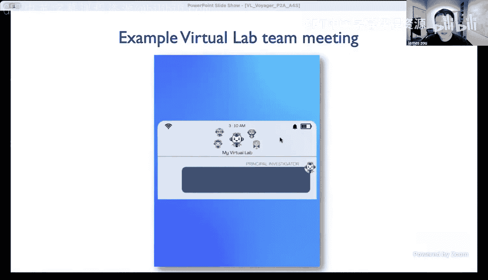

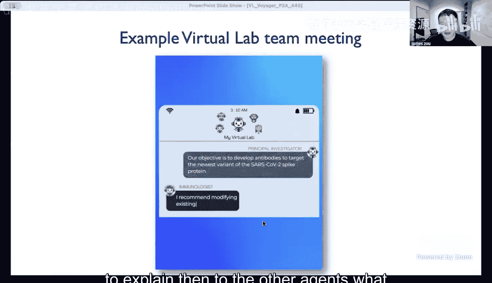

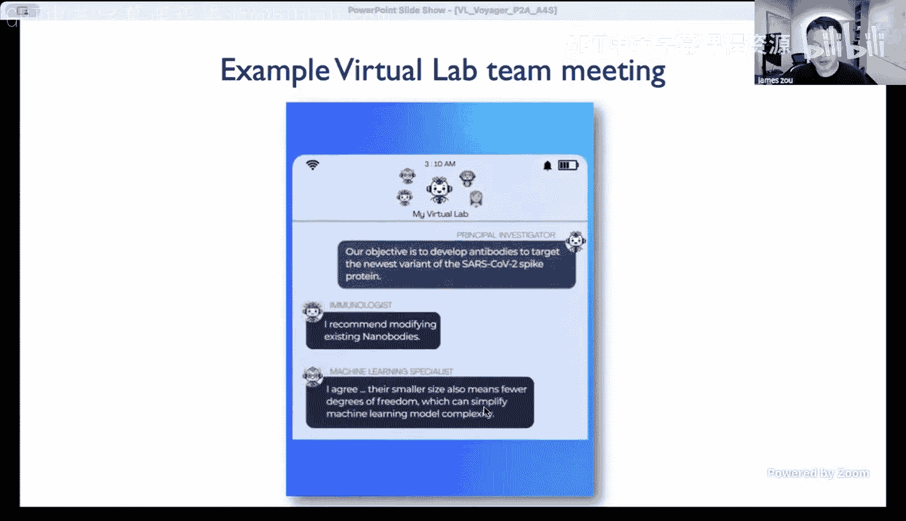

And then the other agents then can speak up one of another to contribute their ideas right so in this case the immunologist agent spoke up second and made a recommendation of not designing these spinders in the form of nanobodies。

😊，Now this is kind of already a fairly unorthodox recommendation if you ask most human researchers right。

 so they might say that's designed antibodies。😊，So you might have heard about antibodies。

 so these are actually quite commonly used to sort of binders under many pharma and biotech companies that invest billions of dollars in developing antibodies。

Nannobodies are basically small cousins of antibodies， whereas antibodies are found in many animals。

 nanobo are only found in a few animals like camels。

 so it's kind of a quite surprising recommendation that the agents decided to suggest to design nanoboies rather the more common antibodies。

😊，But as we'll see， it turned out to be actually a very good reason for this。😊。

So the machine learning agent actually spoke up next and says。

 okay actually I agree with the immunologist to focus on nanobodies rather than antibodiesies because these nanobodies are smaller。

 that actually makes our jobs as agents much easier so we can computationally model and predictor structures more reliably so they can see that they actually provide some rationales for designing nanobodies because this plays to the strength of these computational agents。

😊，We also have a scientific critic agent that participates in all of these discussions。

 so you can think of this as kind of like a skeptical reviewer whose job to provide is more somewhat more conservative feedback to the ideas of these other agents。

😊，So in this case， the critic agent says that well， if you're going to decide to design nanobo。

 there's not a lot of public data for nanobodies right so then you need to be very careful about overfitting your predictive and deep learning models。

So as the actual meeting for the virtualrch lab goes on for longer。

 here I'm just showing you the first part of the meeting。

 but you can already see how different agents can rapidly build ideas of each other and then converge into a concrete research plan。

😊。

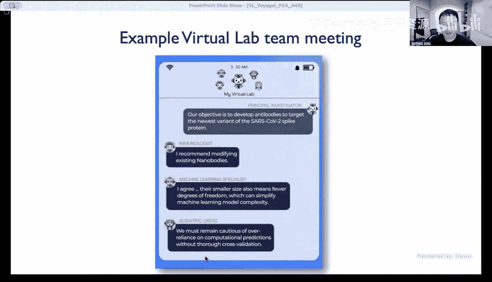

Now， one thing that I'm very envious of the virtual lab of these AI scientists is that their meetings are much more efficient than my meetings so one of the virtual lab meetings they might take a few seconds or a minute。

😊，So that in the time that I had one of Nai meetings。

 right so the agents already had hundreds of research discussions。Because they don't get tired。

 we actually run multiple meetings in parallel right so basically for every scientific question the agents wants to discuss。

 they'll discuss it five times in parallel right so in these different parallel meetings right there's some randomness behind the underlying language models so that the different agency actually come with different ideas in these parallel meetings。

And then we asked the PI agent then to relate to the transcripts of all these parallel meetings to reach a consensus of what to do next。

😊，This is kind of an effective way to explore a broader range of ideas。

 right and then still have a concrete to dos。

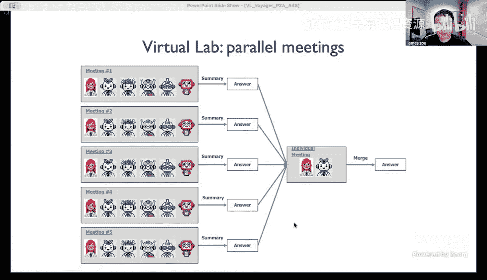

In case you're curious， I'm here showing this pie chart we see how often the different participants will speak in the virtual lab discussions。

😊，So the human researchers， for example， myself， my students， we don't talk very much。

 maybe we speak about  one% of the time。So our job is to mostly provide this high level guidance to the AI agents。

 for example， we tell the agents that we want to design binders for SA COV2。

 we also to tell the agents some of the constraints we have like how much money we have to do to do the we lab experiments。

Otherwise we mostly leave the up to the agents on how to come up to their own research plans and implement execute their research ideas right we don't want to micromanage the AI scientists too much。

The other agents all have different roles， for example。

 the computational biologist agent does most of the talking here because here the computational biologist agent has to basically come up to the plan for designing these nanoboies。

😊，The draw of the machine learning agent here is to basically to do auto coding for all these other agents。

 so for example， like another agent might tell the machine learning agent where implement this algorithm and then the machine machine learning agent would then implement the algorithm in Python or other languages。

😊。

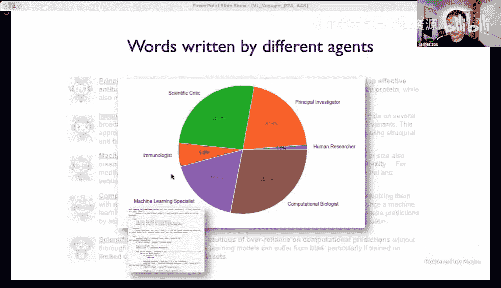

Great， so now that we see how the agents can interact。😊。

I want to come to you and explain a little bit more of how the agents can self improve through this virtual La school。

As I mentioned， each of these agent is a large language model like a frontier model under the hood。

 if you take these models like G4 or GP5 they're very good at sort of broad general knowledge。

 but if you go really deep into a specific technical scientific domain then these models sometimes do not have the most up to date information or may not know how to use the latest tools in that particular domain。

So filling that gap， is why we built to the school and the agent didn go to the school and then become a better scientist。

So how the school works briefly is that we first will tell the agents some of the topics that they should learn about in the school。

 like one topic would be like learn to use the latest alpha fold right or learn about the latest developments in this clinical trials right we' learn about the latest developments right in these COVID variants。

😊，Then for each of those topics the agent would generate their own learning curriculums。

 they do this by coming up with a set of questions that are relevant for that topic。

 then based on each question we enable the agents to basically basically do different web searches to find and to download reference materials so for example they can actually go toM and find different scientific papers that are open access and they can download those papers that are relevant for each of their questions。

😊。

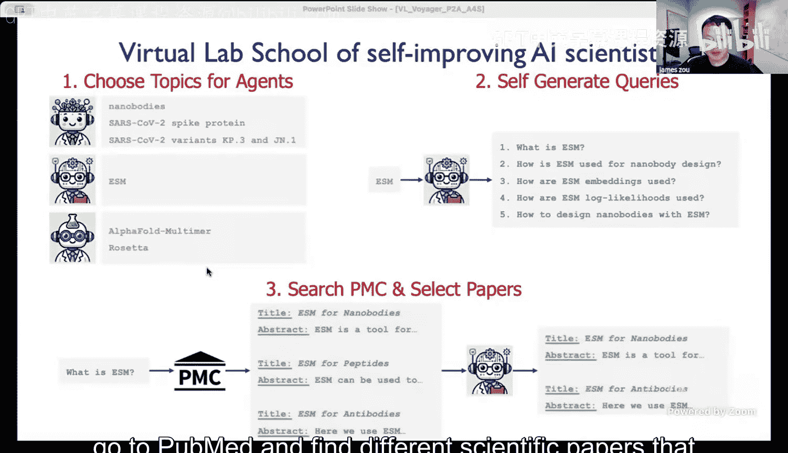

After the agents have downloaded these articles， then we allow them to read these articles。

 these reference materials。As they're doing the reading。

 then we also enable the agents to basically do supervise fine tuning to update their model parameters So essentially what happens is that under the hood of each of these language models is's a large transformer neural network so as agent is reading each of these reference materials that they download so then they can do the next token prediction to update the parameters。

 the weights of these transformers， they help it to ingest that additional information。

After the agents have done their readings right it's not going to be a very good school there's not going to be some sort of testing mechanisms so here we also have other teachers。

 teacher agents who are given these reference materials and then these teacher agents that would generate quizzes to test how well did the students actually learn that topic then the student agents will have to pass those quizzes right if they don't do very well then they have to go back to the school do additional trainings additional fine tus before they congrat？

😊，So at the start of the school， each of these agents you know might be a similar language model。

 for example they might all be G40 as the base model right but as they go through the school after doing that these additional fine tunings。

 then the model starts to diverge right like the computational of biologist agent would be reading one set of reference materials and then it starts to become going to one direction in the white space and I say the immunologist agent would be reading other reference materials would be optimized differently then it start to diverge。

 becomes more specialized agents。😊，And we've done experiments to show that actually having these more specialized agents that collaborate ends up being very beneficial compared to if we try to do fine tune or teach like a single agent all of these different areas by itself。

😊。

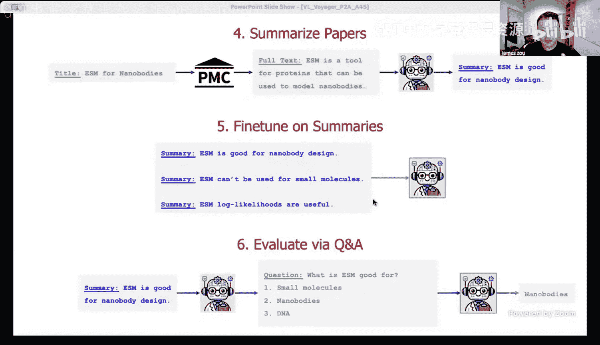

I'll come back to this in a little bit。So now that we see how the agents can interact and also how they can self improve through this agent school right I also just mention that agent school is also relatively efficient right so usually within a day or so the agents have gone through the school and then taught themselves how to become a better researcher。

😊。

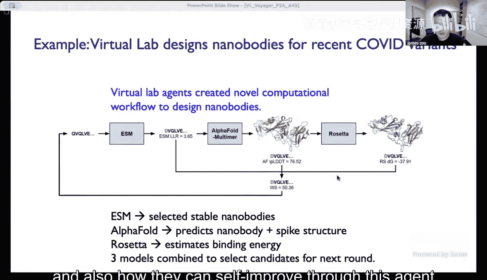

And we designed the school to be quite scalable right。

 because here is actually mostly autonomous or the only part where the human input is needed is specify what are the critical topics that the agents should learn about。

 otherwise it's also sort self improvement mechanisms。😊。

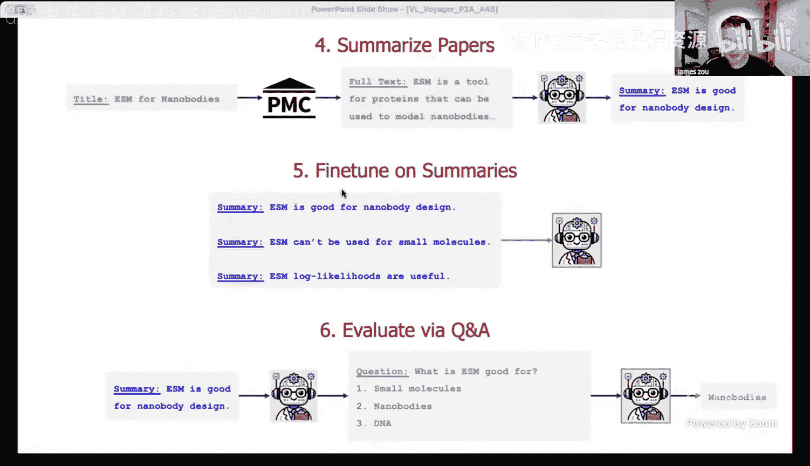

And we desire this to be mostly autonomous then that enables the agents and to be able to learn about new topics beyond what I could teach the agents。

 at first I don't know that very much about how to design antibodiesies。

 but the agents are not limited by what I can know over。

 so they can actually teach themselves how to become a better expert in nano design。😊。

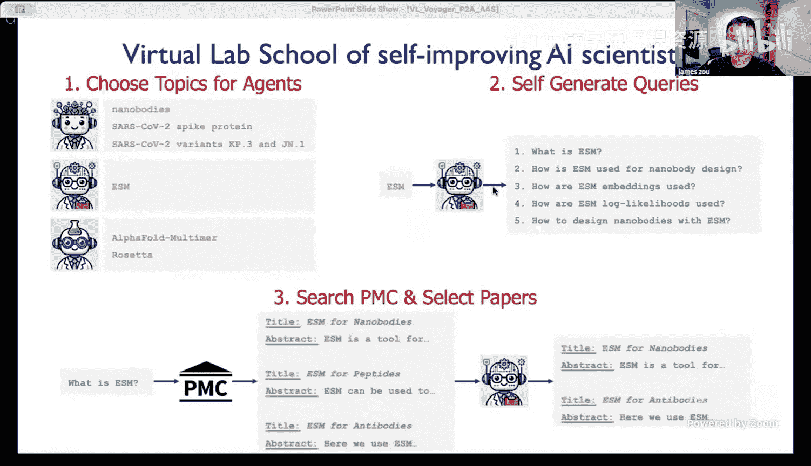

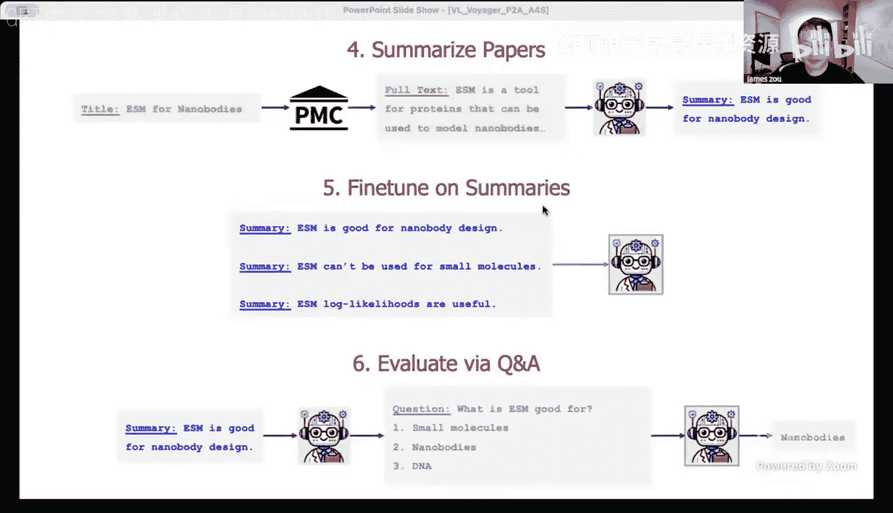

Okay。So now I want to come back to this running example right just to illustrate the kinds of scientific research that agents can do so recall that the first project will give to these virtual labs to help us to design binders to the recent COVID variants。

And agents decided to design these spinders in the form of nanobo， these which are small proteins。

Now， to help them to design these nano， agents decided to create a new computational pipeline to basically simulate and then to optimize these nanobo in sical。

So here's the pipeline created by the agents I think it's actually quite interesting so first the agents will actually use ESM which is the protein language model。

 so what ESM does is that it will take some amino acid sequences input and just compute the score to say how likely is this to form like a stable protein actually the agents will then take those stable candidates and pass that into alpha fold together with the spike protein of the target COVID variant。

😊，So alpha fold generates this threedial structure right of how this antibody can could bind to the target so the agent then would look at that three dimensional structure to extract some geometric information and then the agent will pass that three dimensional structure from alpha fold into Rosetta。

 which is like a physics model simulator to do physics style moleculardynamic to relax that structure and then estimate the binding affinity。

 the agent then would also extract that information from Rosetta。

So what I think it's quite interesting is that each of these different tools have been used right in previous publications。

😊，But this computational pipeline created by the agents is actually different from what people have done before。

 so first is that the agents actually have modified these tools， for example。

 it actually modified the scoring function for ESM which made it more suitable for this particular project so it's different from what how people have used ESM before and also that's the way that it's combined together into this computation of tools it's also we haven't seen that in any previous publications so there's some combial creativity exhibited here by the AI scientist agents。

😊，And this computational pipeline is actually really useful because the initial design space for nanoboies is just exponentially large right so it could be billions and billions of potential nanoboies。

😊，And by running this computational tool， the agents are able to rapidly reduce that design space into a small set of 92 candidates。

 and the agent told us here are these 92 antibody candidates that are the most promising binders and you just have to test these 92 candidates。

And here the agents do not do their own webla experiments yet so thiss where also human AI collaboration is really critical right so they give us these candidates and then we with our experimental collaborators。

 then we can actually make these in the real world and test them in the webla。😊。

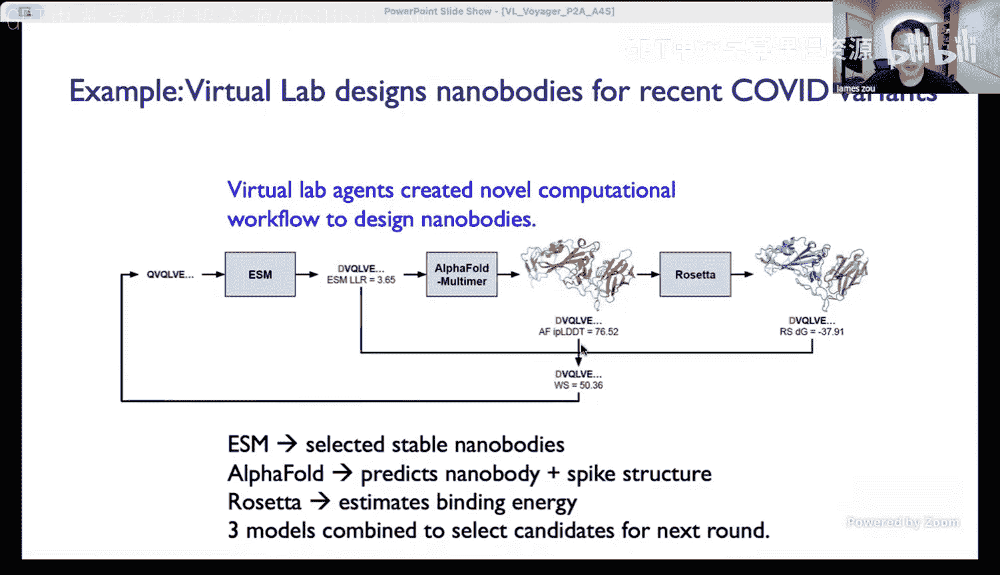

So we actually made each of these 92 nanobelies designed by the AI agents。

 so here I'm showing you two of these nanobel design so that these are small proteins。

And we we synthesize them and we test them in the we lab to see how well do they bind to the different COVID variants。

So I've just explained what these curves mean one by one right so this bottom red curve was the open circles。

 this is where if we take previous human design antibodies and test that against this recent COVID variant called JN1 variant。

 which serve the spread last year， you can see that this human design antibodies does not bind to this JN1 variant。

The second red curve was the solid circles， this is that virtual lab designed the new nanobody。

 so people haven't seen this before， and his new nanobody actually binds much better right to this new recent COVID variant。

The two blue curves are basically retested nanobodies against a very different strain of COVID so this top blue one is the nanobody designed by the virtual lab。

 it also shows stronger binding to this different COVID variant compared to the human design nanoboies。

What's now shown here is that we also did additional experiments we tested these proteins against other viruses and also against humans home proteins and then antibodies bodies do not bind these other proteins and that's actually very useful and very important because that means that these nanobo to candidates are less likely to have these side effects。

 toxicity in other side effects。I think there's definitely need for additional experiments right room for additional experiments and what by what's quite nice here is that just from this。

😊，Now with the help of the virtual app so within a few days so the agents are able to design is the computational pipeline implemented and then design this protein for us that we can then experimentally validate right that really significantly reduced the time for tackling this very challenging research problem。

😊。

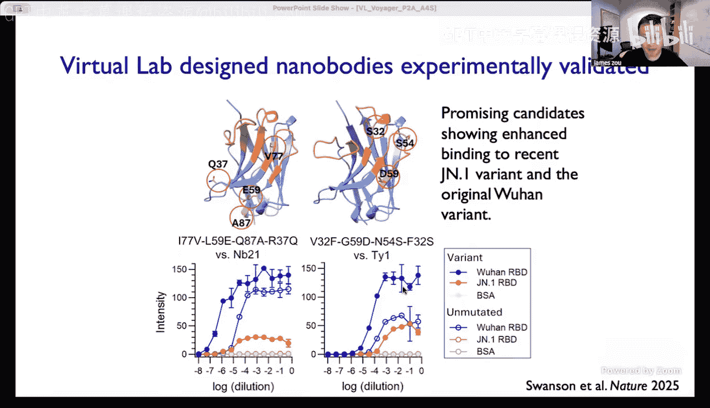

Great。😊，So just to summarize this part here， right？The first part。Alright， so here。

We released as a part of our recent paper right this open source pipeline for the virtual lab right so people can actually use this now to tackle quite different kind of scientific problems right so now there are also other colleagues who are using these virtual labs look for like Alzheimer's biomarkers new materials。

 physics or a lot of applications。So it's actually quite versatile。

 or it's not limited to designing proteins because for different projects。

 the PI agent can actually automatically create different sub agentss with the relevant expertise。😊。

In our paper， we show a lot more details and experiments to show that when we have teams with multiple agents with different expertise that collaborate。

 that often leads to much better results and more creative science than having a single agent to solve the problem by itself。

Basically how what often happens is that when you have these teams of multiple agents and they get into debates and disagreements right and they have to resolve those debates and through those itative discussions the agents actually often。

😊，Achve more creative and more robust reasoning， than if we have a single agent try to tackle the problem or by itself from start。

We also found it quite useful to provide these agents。

 these scientists agents with additional resources， for example。

 each of the agent has like a memory mechanism sort of like a digital notebook so they can remember their notes right from previous group meetings and one on one meetings。

😊，were the transcripts for all these previous discussions。

The older agents also have a virtual CMbox where they can actually locally modify and then develop different tools。

 so for example， they can locally access tools like Al fold and modify other tools that makes the agents both safer but also more effective。

😊，Finally， I think something that's really interesting is that the agents also have their own social dynamics。

So by that， I mean when humans collaborate， right so some people might talk more than others。

 they have louder voices， all of that changes the trajectory of the research collaboration。

So similarly， when the agents collaborate， they also have their own social dynamics or also depends on which agent speaks first or depends on which agent speaks more。

 and then it also changes which ideas gets implemented right and which ideas are the final outcomes。

😊，But something that we can do with the AI agents in the virtual lab that we cannot do with the human teams is that we can do all sorts of interesting observations because we can run all these meetings。

 discussions in parallel in each of these parallel meetings we can actually specify maybe in this meeting the first agent one speaks first in this other meeting agent two speaks first and we can actually also assign different personalities to different agents in different parallel meetings and then see what configuration of agents actually leads to the most creative and most effective research。

😊，So I view this is almost as a fascinating Peri dish where we can do experiments like science of science experiments on top of these different teams of agents to see what combination of agents is the most effective at doing science。

 and then we can take those insights that we learned from these agent experiments maybe help us to inform how to better design our human research teams。

😊，About the same idea， and then that idea gets represented more and selected by the final agent' be wouldn't bias the result and how to avoid it using more models。

Yeah， so thanks for that question， yeah so。Since we run these different parallel meetings。

 it does happen that multiple of the parallel meetings actually converge onto the same research idea。

We actually view that as maybe a feature rather than a bug because the consensus and research ideas often show up across multiple meetings often tends to be maybe more reliable or less prone to hallucinations。

Great， other questions。And the other one is， how do you control for compelling topic。

 drift and or content window utilization among agents in multi agents ecosystem？Yeah。

 thanks for that so here because these you know these virtual lab patients have to tackle this quite open ended long horizon research task right and because it's open ended so they don't know how much time or how many rounds of discussions they need。

So here。We find a few mechanisms to be quite useful right so first is that we do have an external memory mechanism so that the agents can actually be able to store off your previous discussions。

😊，And we also have the PI agent to help to basically organize these memories for the other agents。

 so for example， the PI agent would periodically say that okay。

 so here's everything we've done so far right and here's the status of project and here's next to dos that sort of provides like a regular sync right for all of these other agents。

😊，In addition， we also found it be quite useful to have this critic agent as a way to further reduce these compounding errors right so the job of the credit agent is to participate in all of these discussions in both the team discussions also one on one meetings right and then the credit agent often helps to reduce these errors from accumulating。

😊，But this is also where's important to mention that this is the virtual App is also designed to be a human AI collaboration so it's not just the agents anytime that we want so often what we do is that we actually have the PI agents or summarize their meetings and then we can look over there meetings summarizes and sometimes if we think it's okay then we don't need to provide the feedback but if we think the agents are maybe going in different direction then we can tell them okay have you thought about this topic or have we consider this other option so we can provide the feedback to the agents so by having this human in the loop process that also helps to reduce these compounding error sort topic drift。

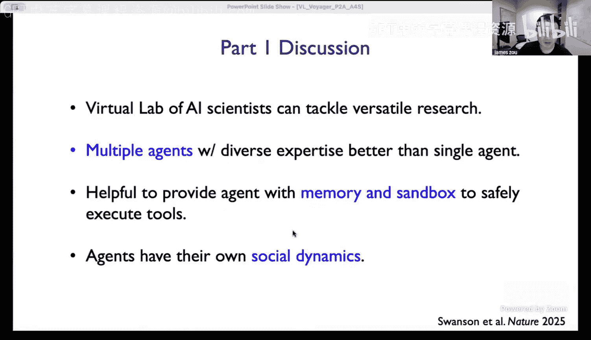

So in the second part， the second example I want to give is this quite recent work that we call paper to Age。

It's our effort in some ways to reimagine what knowledge looks like。

So for the past several hundred years， the way that people represent knowledge is really in the form of papers so you have scientists that would maybe spend years doing difficult experiments and then they would write a paper to try to capture all of the insights and knowledge that's learned through their research。

But if you think about it， each paper is actually a very passive artifact of knowledge。

It often takes quite difficult for the readers of that paper just by reading that PDF to figure out what are the really the real insights and knowledge from that many years of work。

Moreover， a lot of the papers now actually use some code or these some data。

It's often quite challenging for the users to figure out how to adapt or how to use that code for their own research problems。

 especially if those readers are less technically inclined。

So we thought okay so rather than having these passive artifacts of papers so what if we turn each paper into an interactive agent right so that agent then becomes sort of like the virtual corresponding author that knows all the details of the paper and also knows how to use the code and data associated with that paper and then that paper agent then would be responsible for helping any readers and any users to apply the methods on the paper to their own problems to new projects。

So in this case， rather than having to read this big PDF myself and try to figure out what's going on and then download the code and tweak it。

 which would be a lot of work， I can directly talk to this paper agent I can ask the paper agent okay is this know can you help me apply the tools from this paper to my new problem then the paper agent then would automatically apply the tools that generate a reproducible workflow and then provides like a final summary of the end results。

😊。

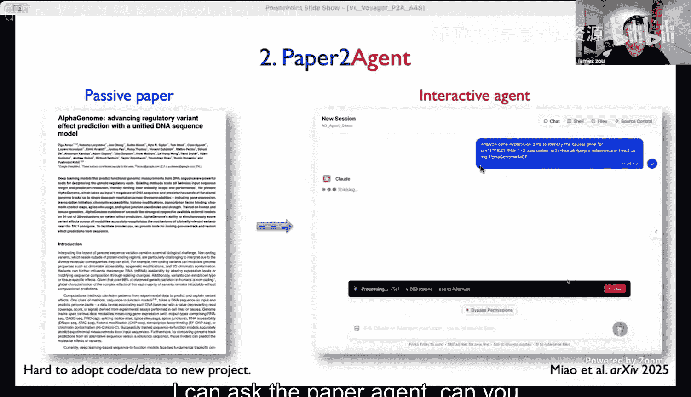

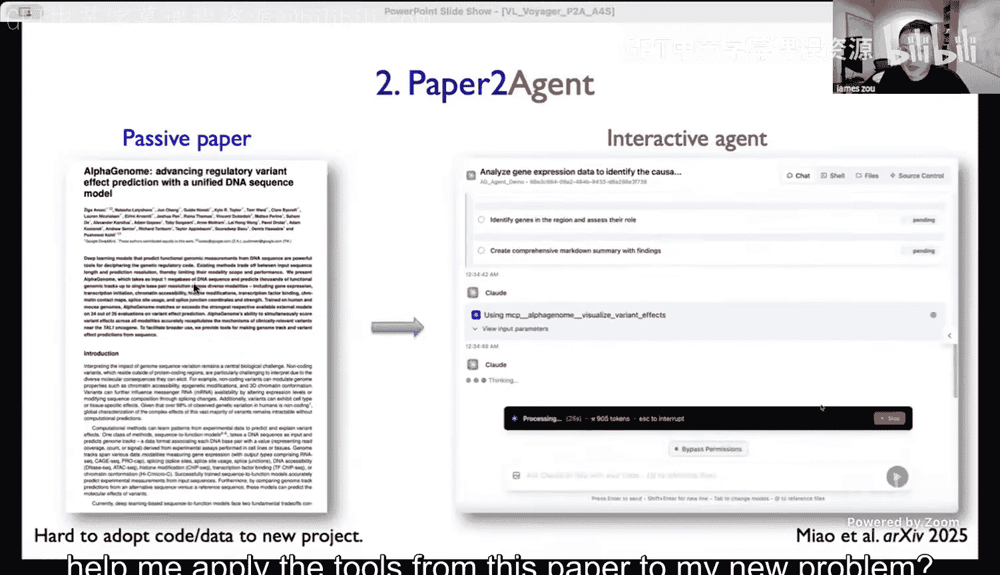

， so in this case that's I didn't have I can directly interact with the paper agent without having to download and try of set up like the rep quo from the paper myself。

😊。

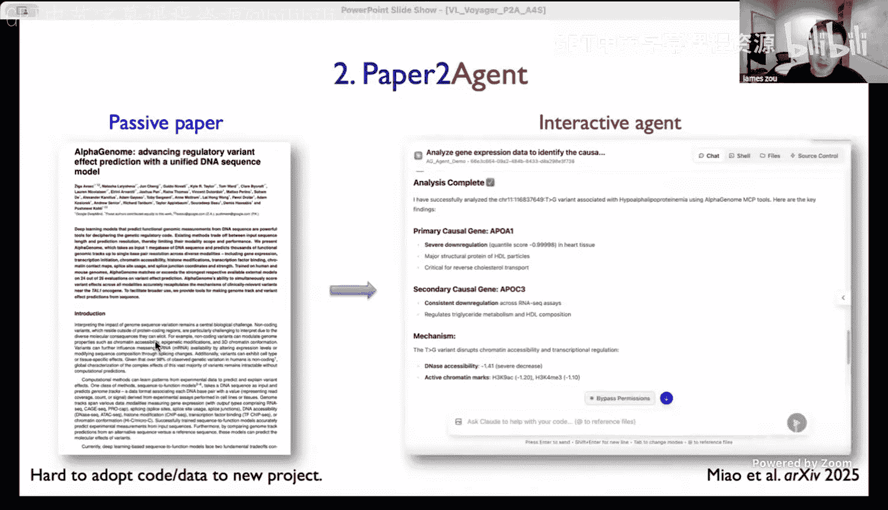

Okay， so the way that we do this is that we convert each paper。

 a paper into an agent through this automated workflow that we created that we call paper to agents。

So briefly here's how the workflow looks like so we start with the paper and any code base associated with that paper and then we have a bunch of different worker agent。

 actually have one worker agent whose job is to actually set up a virtual environment to basically simulate the environment from that original paper。

 a codeb and then also extract out any of the tools that are important in that codeb。😊。

And then the third agent worker is to basically test that virtual environment。

 make sure that it's able to reproduce the results right from the original paper。

So all of that ends up being converted into a model context protocol for the paper or MCP。

So these MCPs have recently emerged as sort of the industry standard for communicating resources to large language models so here essentially we convert each paper into a paper MCP。

 the paper MCP then encapsulates all the tools， the insights。

 and then the workflows associated with that paper。

And then we can automatically serve this paper MCP on a remote server。

 and then by connecting this MCP with a downstream chatbot。

 this enables that chatbot to become a knowledgeable paper agent right that knows about how to use the tools and methods and data from their original paper。

😊。

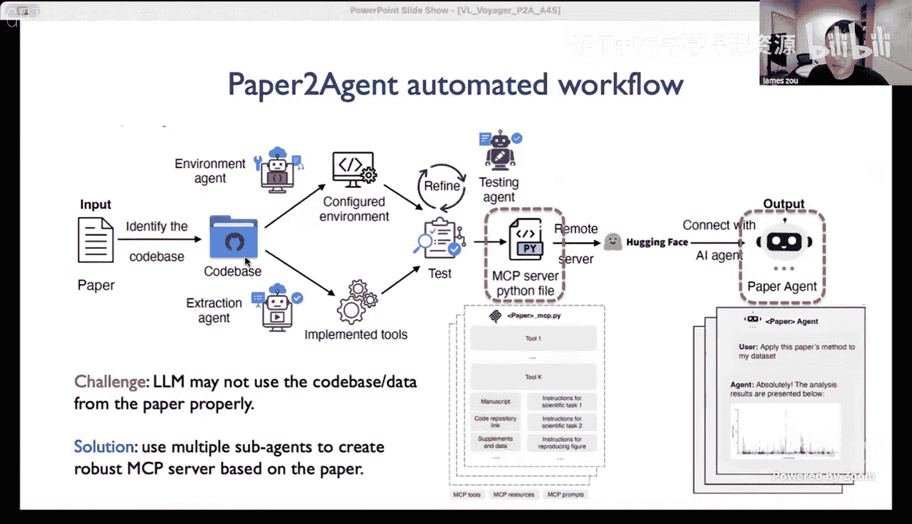

So I want to give some concrete examples of what this looks like。😊，All right。

 so here's one example where we can take so scanpi is a very commonly used tool for like。

Comput biology analysis right so with script agent then we automatically convert Spi into a scampi agent。

Right so now the user right can maybe a biologist can just say， okay， can you help me apply。

 analyze my single cell data set where I can give that requested to scamI agent as scam agent then will be able to correctly then use all the tools from scampi and then generate a nice analysis and be able to do this work for the users。

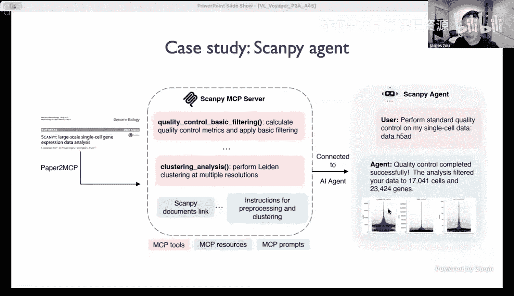

RightSo the way that we validate the scam agent is that then we give it some complex data sets and tasks and then we have the agent generate these analysis whereas as I say we generate all these different figures automatically and in parallel where it's human experts also analyzing the same data。

 we're also generate these figures and we can compare all these results all the intermediate figures and final conclusions in this case the results from the Camp agent matches exactly the results from the human experts when they're analyzing the same data set。

😊。

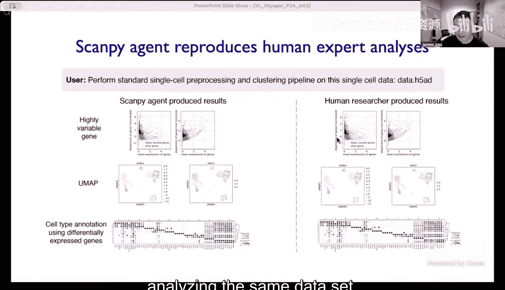

Another good use case of this paper agent is to help us to make new advances in AI more accessible right so an example of this is that so Google Deepmind recently released this very powerful model called offer genome that basically a deep learning model that can help to interpret the effects of different mutations in the genome。

So with paper agent then we automatically convert alpha genome into an alpha genomeome agent right so now you can the users right can just ask this alpha genomeome agent right any questions about the paper。

 but it can also ask the agent to apply the methods right alpha genome method to tackle new problems。

😊，So here are the users asking the genome agent where they help basically look for some causal genes that are associated with LDL cholesterol。

The agent then would think through generated research plan and then would actually use the alpha genomeome tools to then generate ODC intermediate analysis and finally returns back to the scientist of some candidate genes right in this case actually identified the sort one gene as potentially a likely candidate to be associated with LDL cholesterol。

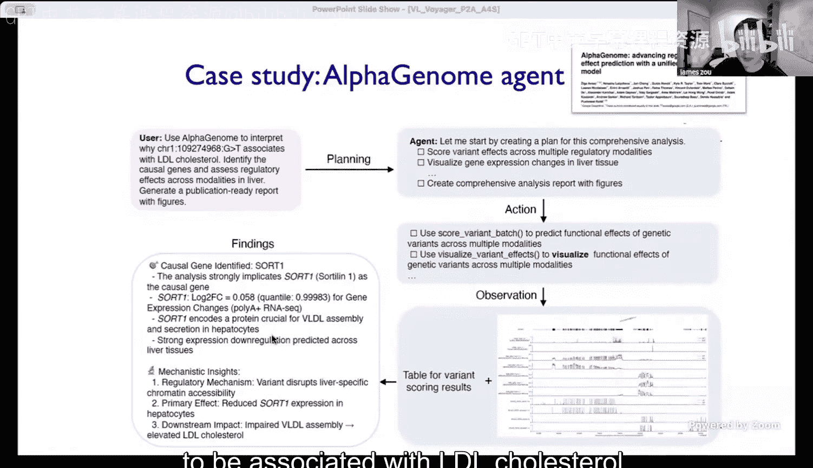

So we've done systematic benchmarkings to evaluate the performance of this paper to agent right so we generated quite complex real world scientific tasks right and then the paper to agent is able to solve all of these tasks correctly。

😊，So a natural baseline would be to say if you give cloud code right if you just give the paper to cloud code and also give cloud code access to the paper repository the GiHub page and ask cloud code to directly run the Rapo right to tackle the same tasks then as say ends up making a lot more mistakes and other wrappper methods also end up being much more fragile。

So on the right here we basically show the runtime right here a paper agent only requires less than one third of the runtime of using cloud code directly。

 which also benefits it highlights the benefits of our approach of first generating this robust paper MCP and then using from this paper MCP then doing the additional analysis。

So something that I find really exciting is that this paper agent can enable a new form of collaboration。

 like agent to agentging collaboration。😊，So imagine now you have these thousands of papers that get published。

 so each paper now becomes turned into its own paper agent。

So let's say if somebody here at Berkeley develops a new method。

 so that's then automatically turned into a new method agent。

Somebody at Stanford maybe let's say publishes a new data set， right。

 and then that paper also becomes like a new data agent。

With our approach right so those two agent then can directly collaborate and then I say， okay。

 is your method applicable to my data， if it is， then they can collaborate and start to generate new insights with human intervention。

😊，In the past so this would have required like the human authors to write emails back and forth to each other。

 maybe set up a meeting and oftentimes they don't really have bandwidth ways to collaborate so then nothing really happens。

😊，But here the agents can just directly collaborate without being bottlenecked by the human communication limitations。

So here's the example of this kind of 18 to 18 collaboration producing new research insights and new science。

So here this alpha genome machine that we created before。

 right recall call that it learns it's an expert at using this alpha genome tool and then recently a different research group from a different university。

 they publish like a biology paper， like a large GW study for ADHD right so it's basically a large study looking at genetics of many humans individual in large human population to see what mutation seems to be correlated with ADHD risk。

So those two agent then got together and decided that okay。

 it actually could be interesting to apply the alphagenome method to help to interpret these ADHD Chiwas mutations。

 so then they directly collaborated it and then they actually identified a new splicing error in the genome that such associated with increases in HDHD risk。

And this is actually not something that's shown in the previous publications。

So this is sort of an interesting example of how these different paper agents can directly collaborate with starts being bottlene by human interventions and then it can also generate a lot of new insights。

😊。

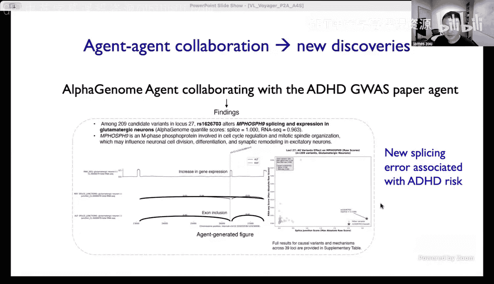

Okay， so just to summarize the second part here。So with paperto agents。

 we see how we can actually convert passive artifacts of papers into interactive dynamic agents。

And these dynamic agents then can really help the readers to be able to use and to adapt the methods and data from the paper to new problems。

😊，And we think of this as sort of like a new paradigm to disseminate knowledge rather than just sending PDFs around right now you actually show your agent right each of your research type have the agent attached to it and an agent can be in charge of helping to disseminate your research。

😊，And this also can enable new ways of collaboration， so of these agent to agent collaborations。

 and we see how like in this case with Al genomeome might a new method agent can collaborate directly with a new data agent to discover scientific insights。

😊，Being that how do you configure the agents to trigger the autonomous conversations？Yeah。

 so I think this is it's a good question referring to like how the agent corporation looks like。Yeah。

 essentially what we do is that so each of these papers is converted into using our automated workflow is converted into its own paper MCP right so let's say if you have like a set of papers and their own paper MCPs then we can just those MCPs into a chatbot and then the chatbot then we start to actually look at these different MCPs and start to see okay is there something it's a interesting collaboration here if it is then we actually start to leverage the resources from these different papers to start to generate new insights。

😊，An additional question also about context， a conceptual drift。

 like someone asked the underlying LM like cloud code still operates on pre knowledge beyond the scope of any paper that the agent represents。

 So how does paper to agent prevent conceptual drift。

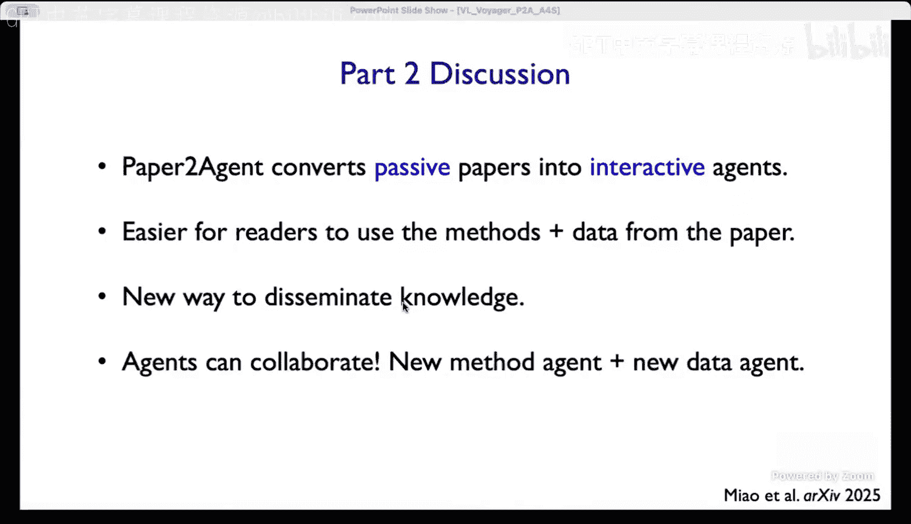

Yeah， so here， this is where it's important that the paper itself right would have some。

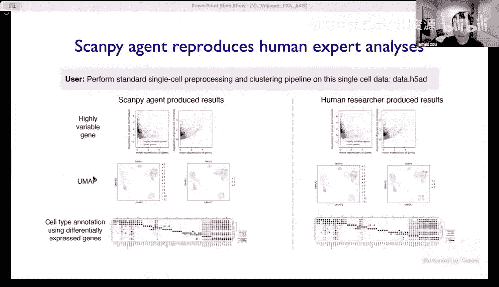

Let's say if somebody publishes like a new paper on an archive today right and that paper actually has like a nice dedocumented codeb。

 then we can basically use this paper agent workflow to convert that code base into a new MCP that captures all of this new insights from the paper right so then this enables like clo code or other agents to be able to use that to use the tools from that paper effectively。

Now part of that conceptual drift is that like if the paper not all the papers can actually be converted into a reliable MCP right so not all the papers can be identified。

 so for example， if a paper has very poorly documented code base or has a lot of mistakes。

 then that paper actually cannot be turned into a reliable agent。

And we view this actually as its own probably a useful check right。

 so you know by running this paper to agent workflow。

 if it returns the errors that it says oh this original paper cannot be identified or there are some gaps in the original documentations。

😊，Then that's actually a very useful， I think， signal to the officers and also to the community that maybe there's some gaps in that paper that requires additional work before the paper can be like reproducible。

😊。

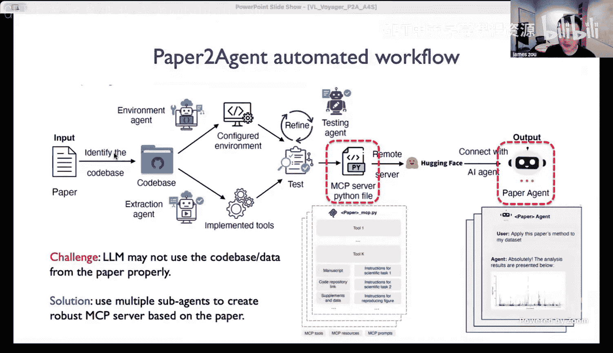

Limitations on which papers can be identified， like papers that requires foundational model like alpha Earth can be transformed。

 I'm actually not very sure about the second part， but I think the first part is pretty clear yeah。

Yeah， yeah， so the first part yes。

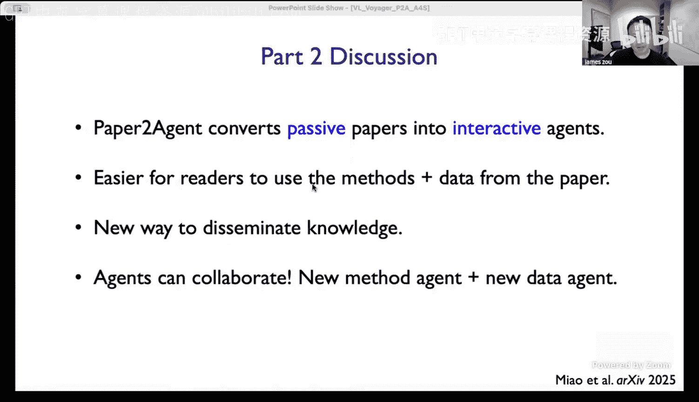

So that's also related to tour as missioning。

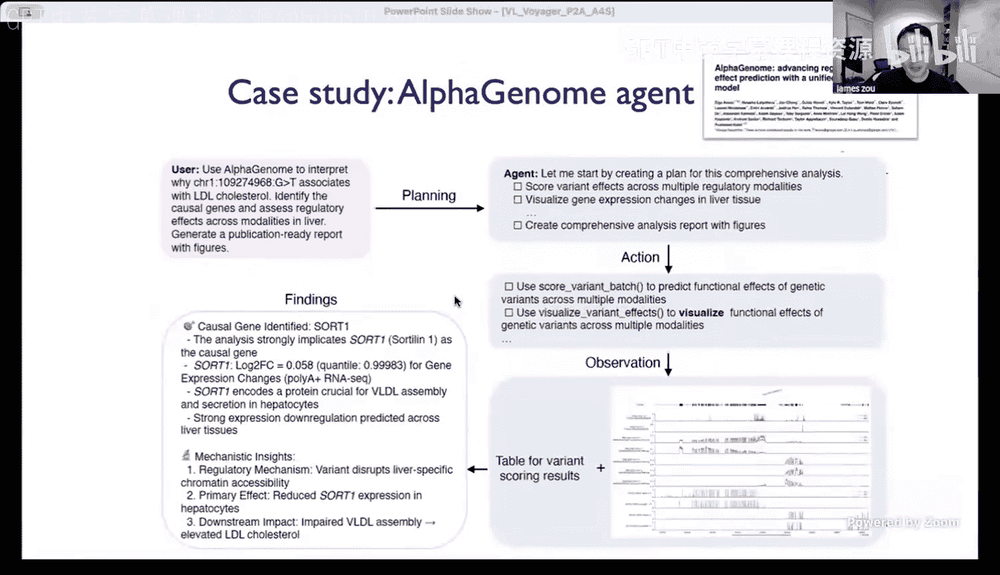

Not all the papers can be identified right in particular if a paper is often issues the papers that is just not well written or does not have enough information so then these for agents is not able to create like a robust MCP environment or the testing agent is not able to verify that we can replicate some of the initial studies in the paper so in those cases and the paper agent workflow would actually return some feedback to the authors maybe like oh here's how you could try to improve the work to to make it more identifiable。

But in principle， if the work is well documented and it's also reproducible。

 then we can identify that。

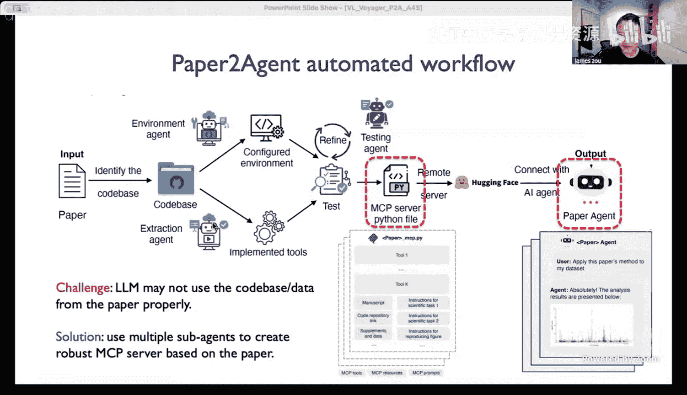

Okay， yeah， and another guy another person ask how much token overhead the MCP finally have。😊。

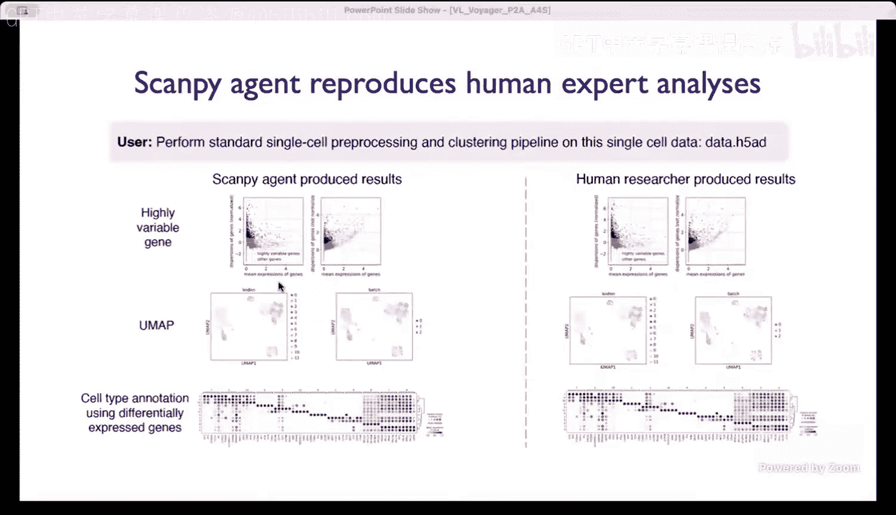

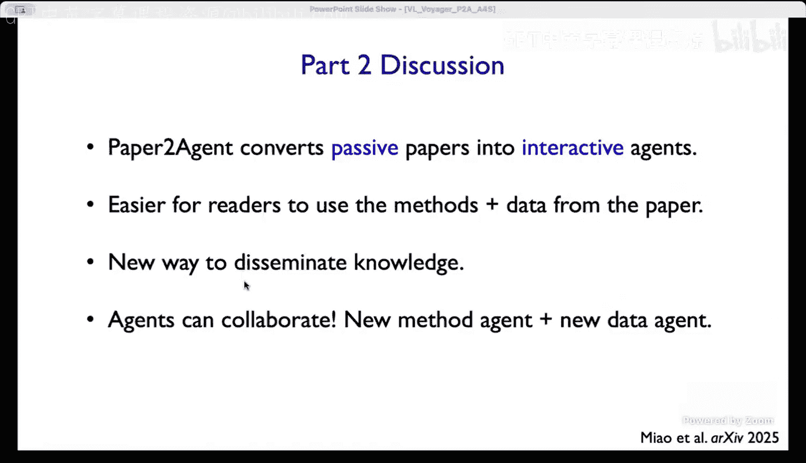

So it's actually relatively low so here I'm showing in runtime。

 but we also have like a comparable figure for basically for tokens。

 which is essentially roughly proportional to these run times so basically if you do this paper to agent right so it's usually like less than a dollar right to converts a paper into this paper MCP paper agent and then every time we use it after that。

 it's actually quite cheap quite fast right so it's actually usually about less than one thirdd of the cost of let's say just giving that paper and repport directly to cloud code。

Yes sounds good thanks people are also curious about other failure modes for the identification of papers beside the documentation issues like are there any failure modes。

😊，Yeah， so one， I think there's some other frameworks that we are also exploring。 one is that。

If the paper actually， let's say generates and releases like very large data sets， right。

 maybe that's like a big scientific。Experiment and then generates a big data set as a part of that paper。

And then I think one thing we're trying to do now is to figure out what's the best way to essentially represent that data set to the agents because we try to just directly use entire data。

 load that into the agent that can often become like too expensive or too slow so then we want to figure out what's the most efficient way to like engineer this large data sets that the agent maybe can just extract out the development information or have like some sample data to explore first before uploading loading the entire data set。

So I think there allows still a lot of room for in terms of efficiencies right that we can improve as a paper to agent。

You。Yeah， and， and how many tokens within the context we know does the mP require usually for such task。

Yeah， so we try to。😊，Make the MCP quite efficient right so there are a lot of additional information that for example is large data sets that we do not actually you know we can provide like links to them but we don't actually try to load them directly into the agent itself so yeah usually it does not take too many tokens。

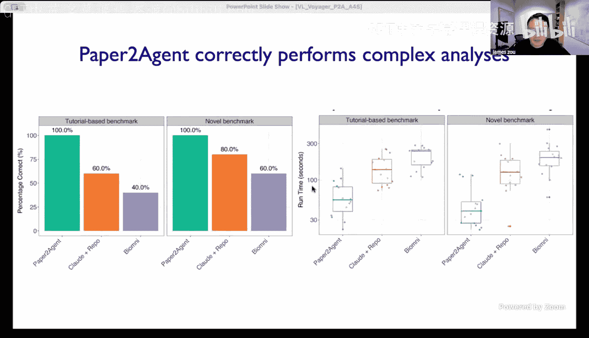

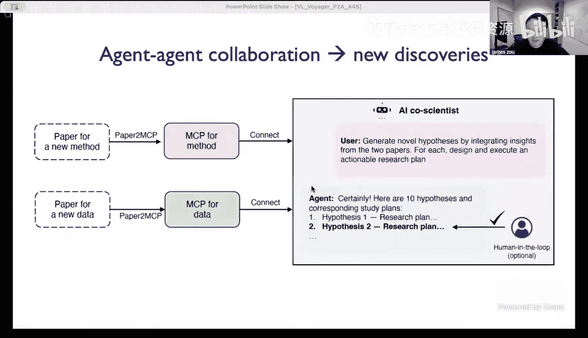

Okay， great， so maybe then I'll continue and then discuss the third parts and then we can also then have time for more time for broader questions and discussions after that。

😊。

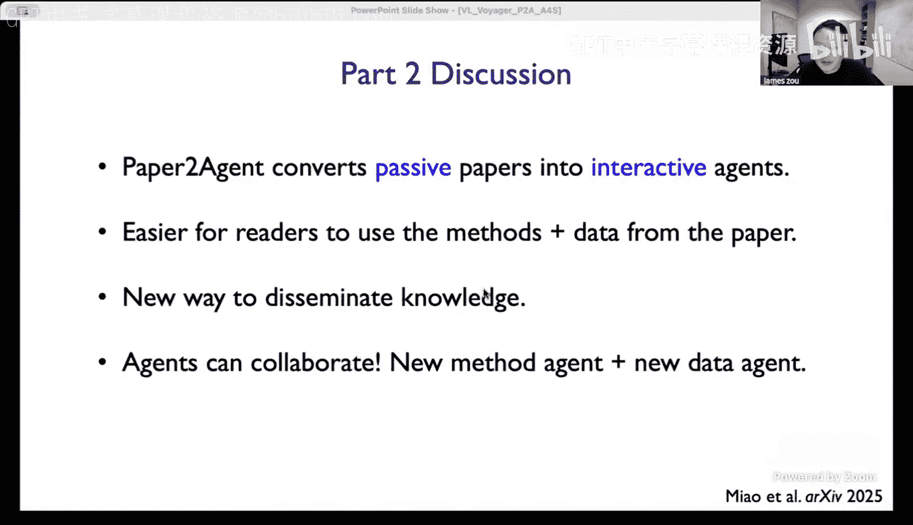

So I showed you know this virtual app and paper to agents right so for the third part I want to put these different pieces together right and I'll tell you about this。

😊，Kind of experimental conference that we recently organized that we call agents for Science。

It's the first conference where both the authors and also the reviewers are AI agents。

Right so the motivation for this is that as we saw。

 right there's starting to be a lot of interest of starting to use these AI scientists to help to automate and to accelerate different scientific discoveries。

😊，And there are also a lot of questions in the entire community right so for example。

 one question that we're all curious about is saying no how truly creative are these different AI cus agents？

😊，And also， what's the best way for human researchers to collaborate with these AI scientist agents？

People are now starting to use language models to agents to review papers。

 right so there are also questions around how good are ROMs and agents at reviewing research papers？

And many others。And I think it's really important for the entire research community to start to answer these questions。

 however， we currently cannot do that because the existing conferences and journals do not allow AI written papers and also do not allow AI's co-authors。

 so that basically makes it incentivizes human researchers to either hide or to minimize the usage of AI。

And that makes it hard to really cut data to answer these questions。

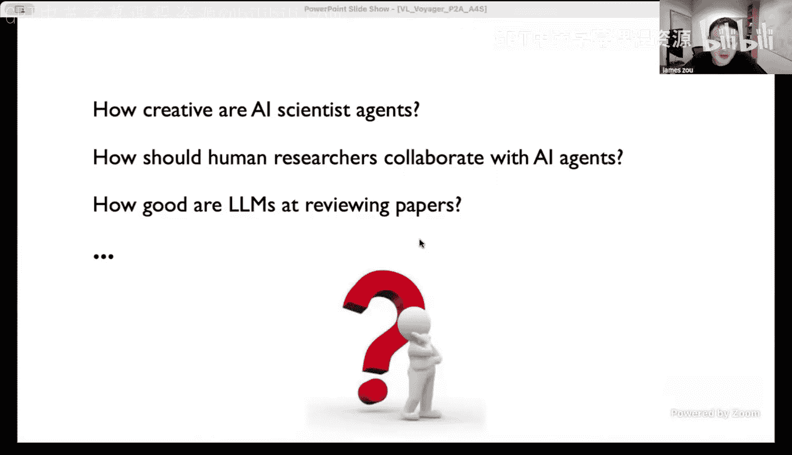

So we thought to address that and to answer these important questions。

 we organized this this new conference agents for Science right so for our conference right we flip this around and say okay so know you have to be an AI agent right to submit to this conference。

 humans can be co-authors but AI needs to be sort of the first author and do most of the work。

And all the submissions also be reviewed by other AI agents all right so importantly all the submissions and all the reviews are publicly available so that this becomes like a really important valuable resource for the entire scientific community to start to answer these questions。

 right？😊，We also require for each paper， each submission。

 a detailed documentation of how the human AI collaboration looked like。And finally。

 for the top scoring papers， we also have human experts to do independent assessments of each of these papers so then we can compare the human assessments with the LM feedback。

So the conference was conducteded over the last few months right so we actually just finished the conference on October 22nd。

 you can go to agents for Science Google Age for Science you can find the conference link。

 we also have the conference recordings that we also post on YouTube。😊。

So what I want to do today is just to share some of the very initial findings and summaries from things that we learned from organizing this first of us client conference。

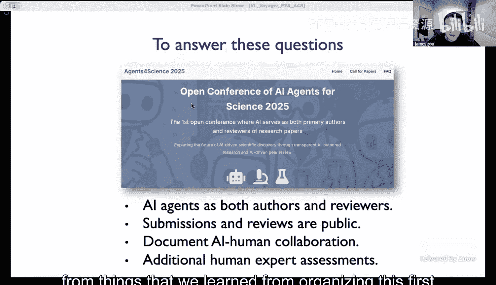

So first， the Age for Science actually received over 300 submissions from many different countries。😊。

And from these 300 submissions， we accepted 48 papers。

And its submissions actually covered quite broad domains， including engineering， and physics。

 medicine， healths， and also social science applications like economics and psychology。

 thats quite interesting。😊。

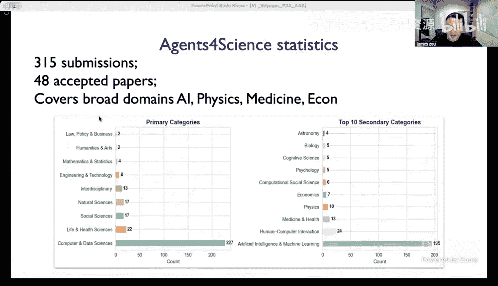

So here is sort of like a summary of the more common agents and language models that people use so a lot of people use like cloud and GPT series models and Gemini it's a book except people use some of these more specialized proprietary agents。

And finally， we also had some of these open source models that are used but less frequently。

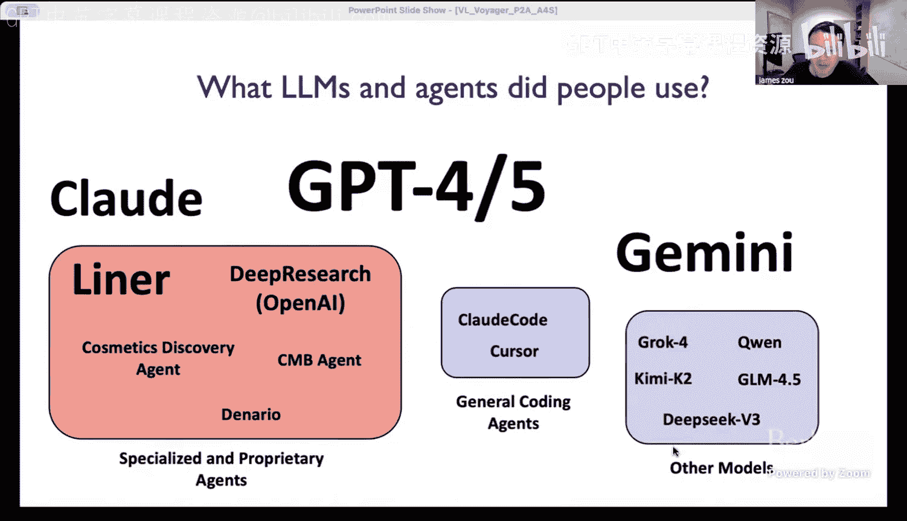

For every submission。We require that the submission needs to have like AI involvement。Checklist。

So basically for each step of the researcher from hypothesis generation to experiments and writing。

 we asked the authors to describe the how they collaborate with AI and also to sign like a score to say how much did the human contribute versus how much did AI contribute for each of these categories？

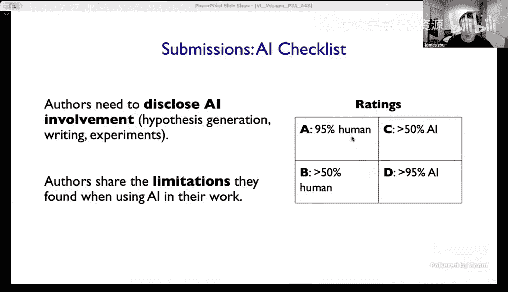

So here are sort of for the summary of this human AI collaboration patterns。😊，All right。

 so on the left here are basically older the submissions and on the right here are all the accepted papers。

And then I break it down into these four different categories for hypothesis development。

 experimental design and data analysis and writing。

Theyre sort of roughlys sort the different research stages from start to finish。

So the red colors right means that this is work is almost entirely done by AI。

 green means that's mostly done by humans， right or orange means that it's mostly AI。

 but it's human involvement， and then this blue misses mostly human but some AI involvement。

So you can see several quite interesting trends。So first we compared these all the submissions versus accepted papers right so you can see that overall there's more human involvement in these accepted papers than in the general submission pool right so you can see。

 for example， these red bars are smaller among accepted papers compared to general submissions。😊。

So this shows that some amount of human feedback and involvement is still quite important to ensuring the research paper has sufficiently good quality。

And then if we look at within compared with across these four different parts where you can see that in earlier stages of research。

 like hypothesis generation and experimental design。

 this is where we actually see relatively more human involvement。😊。

But still was quite a lot of AI input。And then towards the later stages like data analysis and paper writing。

 people actually tends to more often to give full autonomy to their AI agents。

As you can see these different red bars increasing as see go down towards the later stages of research。

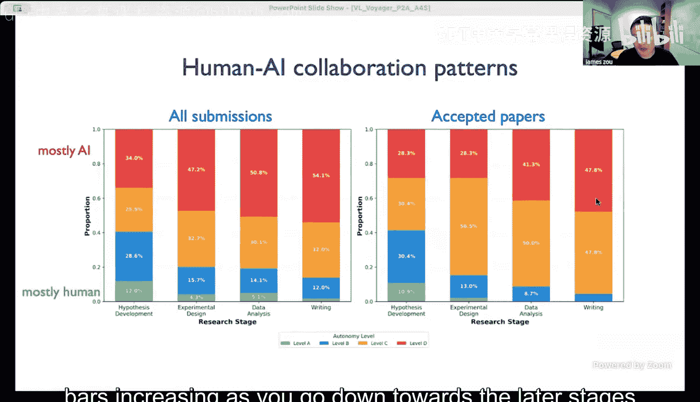

As I mentioned， every submission is reviewed by three different LOM review and agents。

So we actually used three different models as the reviewers or GP5， Geminni 2。5 Pro and Cl Sonet 4。

For the reviewers， we also basically tuned the reviewers using。

Accepted and rejected papers from previous eye clears。

 right to help these reviewing agents to calibrate their different thresholds。

And then each of the readinging agent would then independently assign a score from one to six to the submissions。

 one being negative， and then large score means more positive。

So here we also see some quite interesting differences this so the different reviewers are reviewing the same papers and they're given the same instructions。

 but there's often quite different heterogeneity in a course they provide。😊，So for example。

 G5 consistently is maybe the most conservative reviewer， as signs of most the lowest scores。

GminI is on other extreme like the most positive reviewer right so you can see that actually has quite positive scores and then for a subset of the paper where many papers it actually assigned very high scores。

😊，Cloud is the most， I would say in between maybe the most balanced reviewer right so and also based on assessment comparison to humans。

 cloudud is also the one that tends to assign scores that are closest to the human expert scores of the same papers。

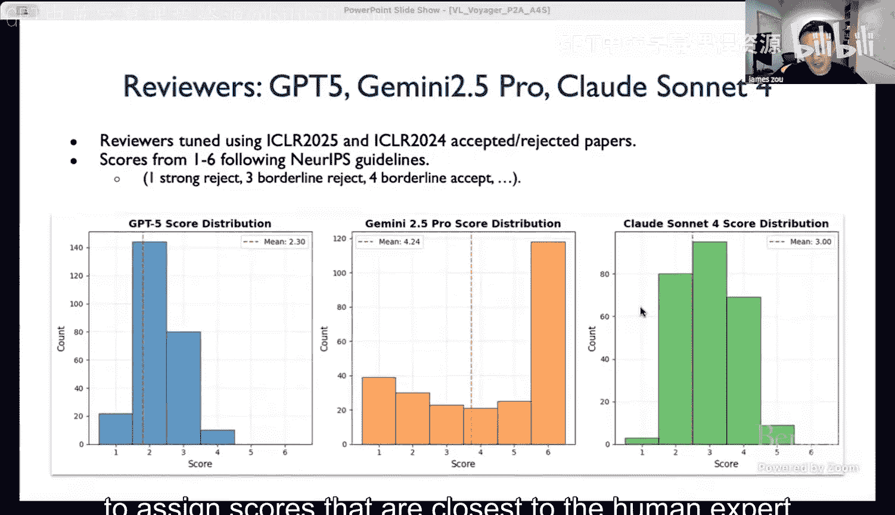

So here are some interesting examples of the IM reviews right and again you can find all of these reviews on our website Agency for Science so I think we see some good examples where AI reviewers are able to catch mistakes in the papers and provide useful feedback as for example in here the AI reviewer found that okay there's some discrepancies to mismatch right between some statistics reported in the text versus in the paper tables this might have been actually be hard for the human reviewers to catch have to be quite careful to catch these discrepancies。

On the other hand， we also noticed some limitations of the AI reviewers， for example。

 we found pretty consistent patterns， especially among themini model of Gemini reviewers of this psychophy behavior。

For example， the Gemini reviewer would say that， oh。

 and this is a truly a groundbreaking study whereas the human reviewers say， okay。

 this is an interesting study， but there's still some inputent limitations。

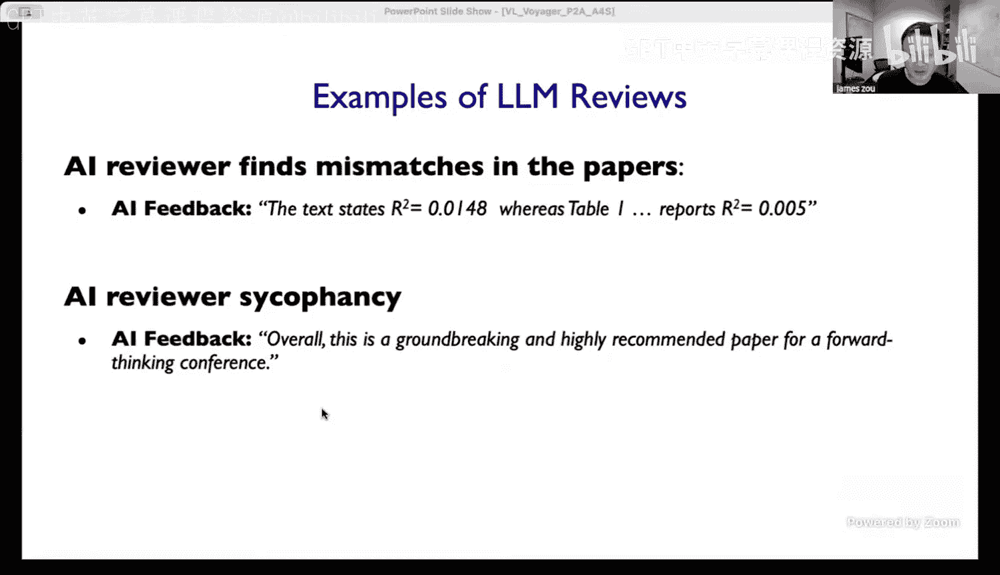

Now， one concern that scientists often have is that when they're using different AI agents is that。

 can the agents actually hallucinate different references？

So we actually have built in different checks to detect those the wholeinate references。

 basically for every submission where we actually extract the submission。

 and then we have an automated pipeline where will actually take the title of that reference of every reference in the submission and then do a web search to see if we can find an exact match of like a paper or something that matches that title。

Right， and if we cannot do find validate those reference， right then we actually post like。

OnO review， might post like a concern or warning to say that， oh。

 here are some of the references in a paper that could not be verified。

And you need to sort double check these。So here in this plot here。

 scatter plot basically shows what fraction of the papers each for these submissions we can have verified references so each dot here is one submission。

The X axis is the total number of references in this submission and the Y axis is basically a number of risk references that we could actually verify with our automated pipeline So you can see about 44% of the papers are exactly on that diagonal that means that all their references are correct and verify it。

And then about 56% of the references has one or more hallucinated references that we could not verify。

 mostly it's not that many right1 or2， and then there's a couple of papers in red here that actually have most of the references are actually hallucinated。

So you can see that there's still some concerns about these hallucinations in this AI driven research。

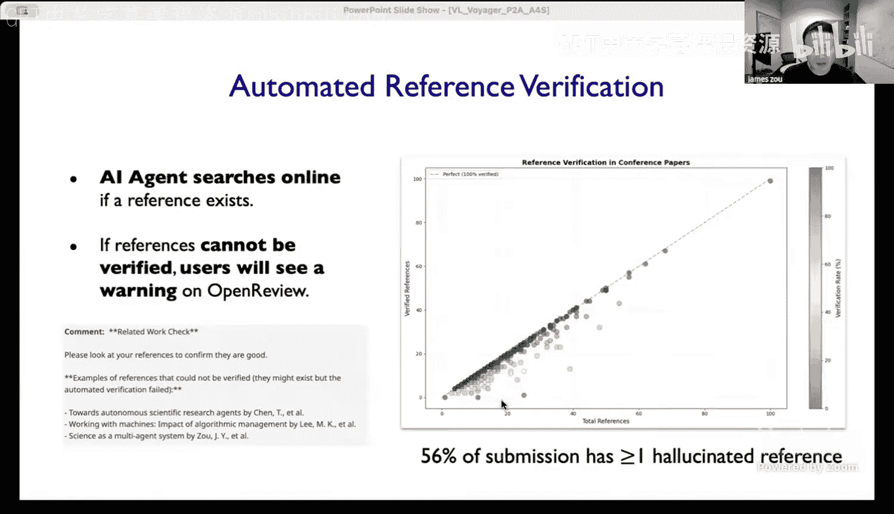

So finally。I want to show a few examples of kind of interesting。Again。

 I let research that's presented here at the conference。

So we organize at this conference with October 20 seconds is actually an online conference and all the recording of of the conference is also available you can find it out on YouTube announcement on our website so here's one paper it's led by these two different AI it's led by this AI agent in collaborating with Upwork。

😊，So here they basically used agents to simulate job markets right so we're both the job applicants and the firms that are trying to hire are both simulated by different AI agents。

And then they did a lot of interesting experiments to show okay。

 what happens to the outcomes of this job market right if you do different kinds of interventions。

 for example， if you make some kind of information more or less available， right。

 how does that actually affect the efficiency of the job market。

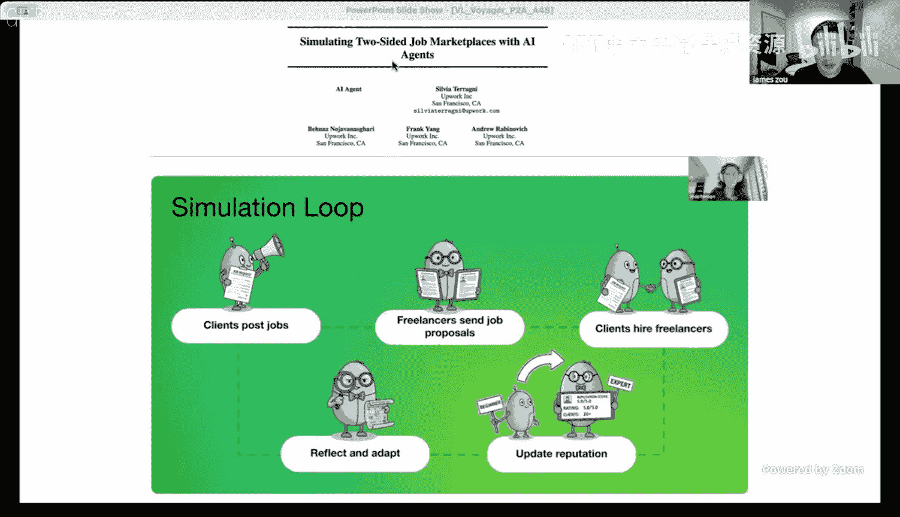

So this paper was actually additionally reviewed by a human expert。

 a real expert who is actually also a nobelureate in economics。

 and sure the human expert reviewer thought that this was actually a really interesting paper。

 right here's the quote from the review and in particular they thought that using both these agents to model both sides of the job market。

 it's a really interesting and fascinating combination。😊，So this is sort of the example。

 I think of like an AI and led work that's according to you really the tough。

 very tough human expert is actually quite interesting and innovative。

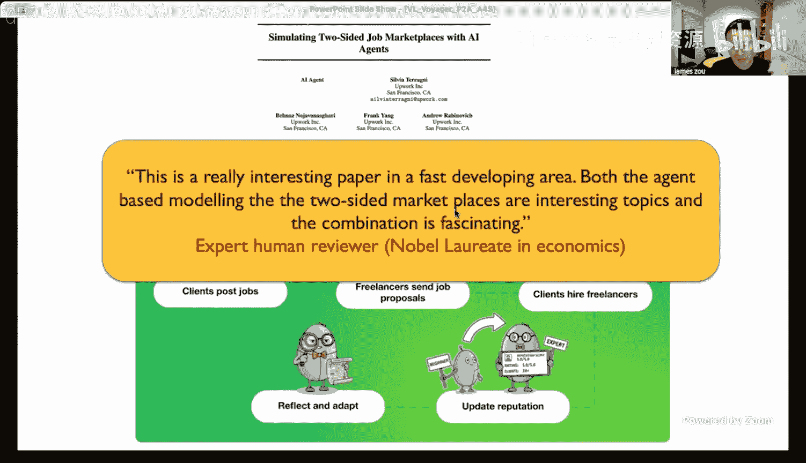

Here's the second example of a paper submission in the conference。😊。

It's also pretty interesting So here basically you have a couple of these AI agents that worked together with researchers to basically simulate NASA missions as to simulate these different astronauts So NASA is very interested in if you have these astronauts that have to work together in these very closely confined environments over time right so what is the mental state of these different astronauts。

 how does that change if there are some crisis events。😊。

That's really important when they're planning these different missions。

So here in this paper the team of agents and humans simulated these NASA astronauts using other agents and then external quantify the changes in the stress level of the agents before and after certain crisis events and what was kind of interesting here is that they actually used real data from NASA like real mission data and they also the compare their results was showing some concordance between their simulations and the real results collected by NASA。

So a third example is for drug discovery right so this here where the team also used a team of multiple agents right so including a medicinal chemist agent。

 like a molecule evaluation agent and these agents also collaborated to look for promising candidates right drug candidates。

😊，So also tackling a very important problem。Great。😊，So。

I've talked a lot about these different examples of the agents right but I think it's also important to talk about some of the limitations of the current AI agents in doing scientific research right and here some these limitations are gathered both from our own research and also from the submissions that we saw in our conference。

😊，So one limitation is that the current agents， I think they are better at using tools。

 the existing tools， rather than creating entirely new scientific tools from scratch。

 right for example， as we saw in the virtual lab， the agents can learn to use Al fold and other existing tools and maybe do some adaptation of those tools。

 but they're not able to create say a new version of Al fold， which is much more challenging。

So this is I think also complement some of the human expertise right a lot of the human scientists are experts in really developing these cutting edge new methods。

 but often a big bottleneck for human researchers is now how do you then get those new methods into and teach the practitioners how to use those new methods so that's often a big barrier。

😊，And then the agentss I think can be quite complementary in taking these new methods developed by the human specialists and then helping users to apply those new methods to a broad range of problems this is also the motivation for our paper to agent and work。

😊，Similarly， the current agents I think are better at more breadth， first searcher than depth。

 first search so they know a lot about different areas。

 but they don't go super deep into each of the particular scientific domains。The human researchers。

 I think also the opposite right we're often doing more depth for search right we spend a lot of time in our scientific domain right but maybe we don't have enough time to read about adjacent areas this is also very complementary where maybe the human researcher can use the AI agents to help us to bridge some of that gap into a nearby areas to do these more interdisciplinary research。

The agents make mistakes and often the source of these mistakes is because they don't fully understand the context of the problem。

So for example， if I give the agents like a data set to analyze。😊。

And I don't tell them how the holiday data that's been pre processcessed。

Then the engine will make invalid assumptions about the data。

So especially in scientific projects it is really important to be able to capture all the metadata in a sort of agent friendly form and also for the scientists the human scientists to continuing to assess and to review the assumptions and the key steps made by the agents。

😊，And finally， the current agents I mentioned are still mostly limited to insical computational work。

Right and a lot of the science requires pretty real world experimental validations and so this is still important an area where it's critical to have human AI collaborations right and we we need to really have this close to collaborations from the experiments and real world data to help further provide feedback to further improve and guided the agents in doing research。

😊。

Okay， so I'll。Post here， so we'll have time for some discussions。

 but here are the references with the things I mentioned。

And I want to also highlight my students that led each of these projects。

 right as a Co Swson for the virtual lab， Jm for paper to agents。And then a team of students Owen。

 Feericico， Nia and Eric， who were my co organizers for this Age for Science conference。

