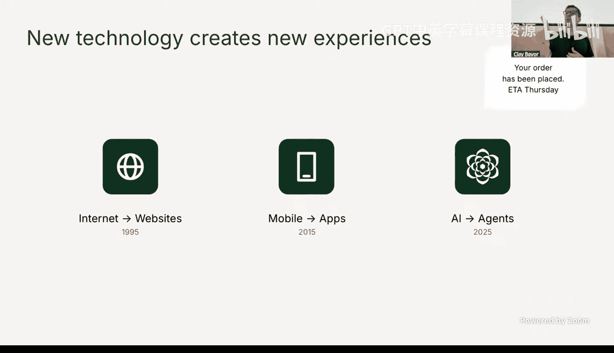
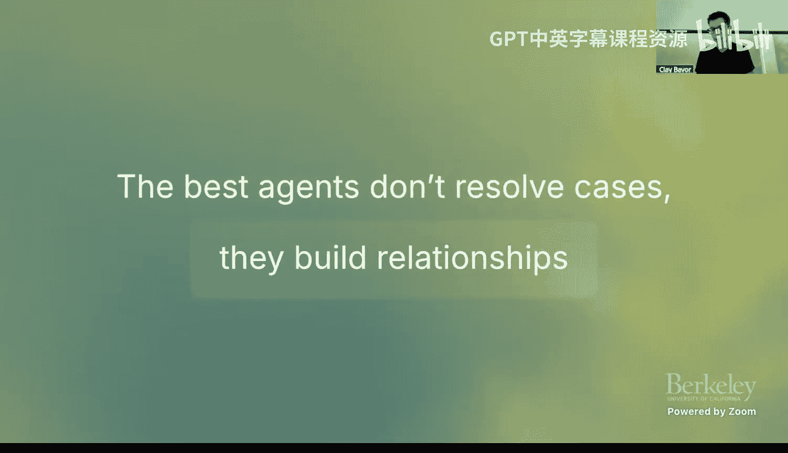
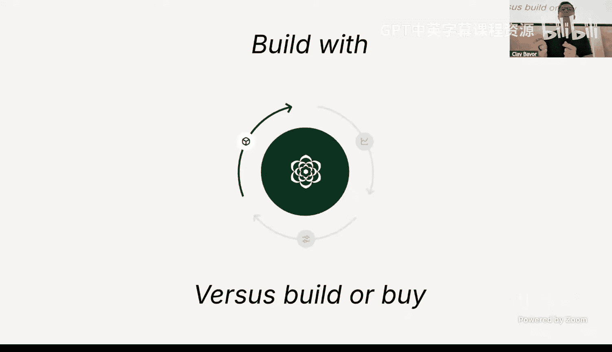
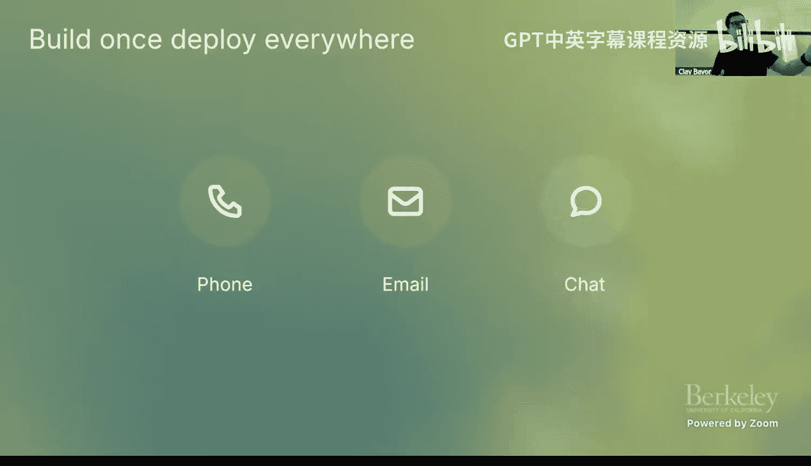
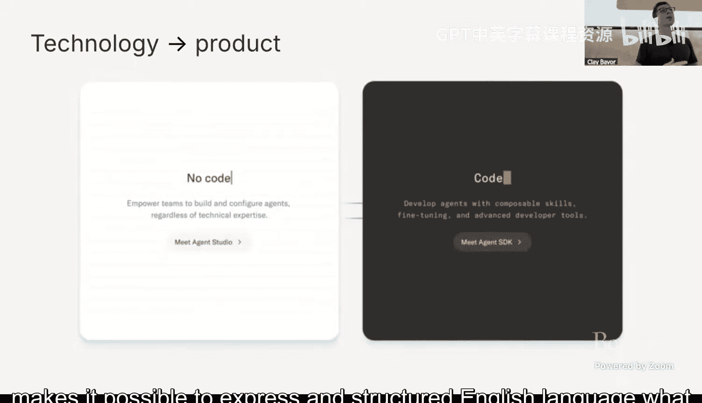
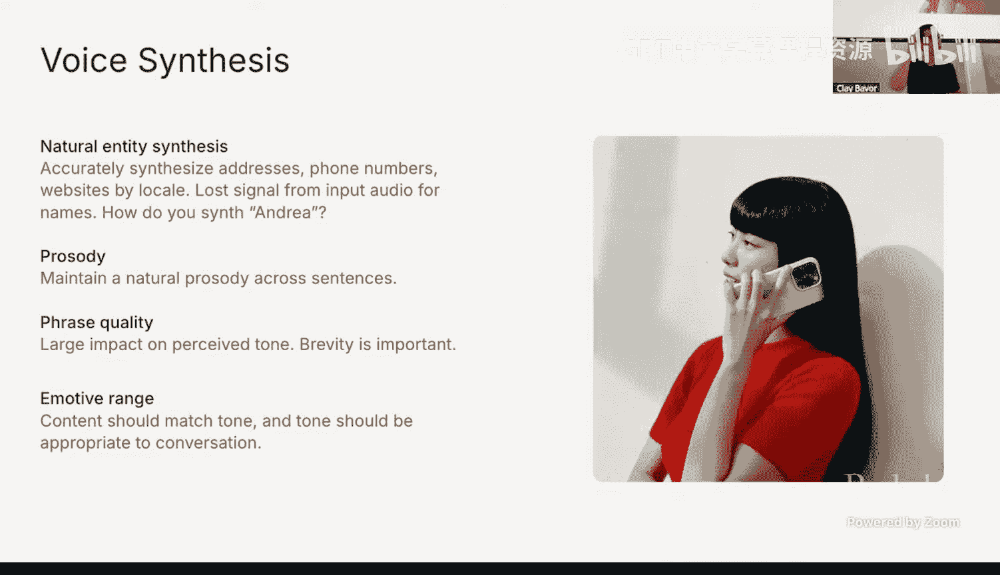
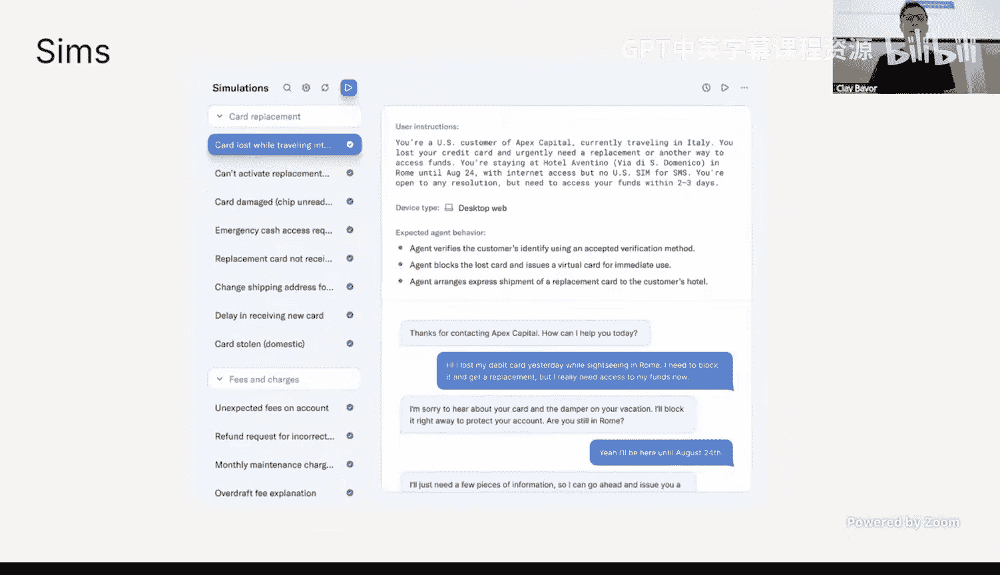
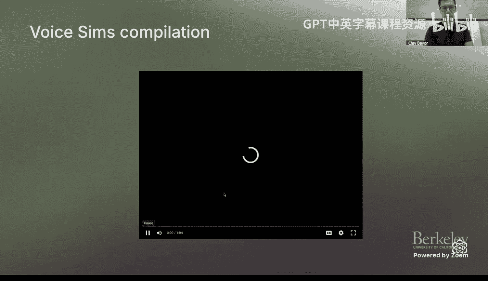
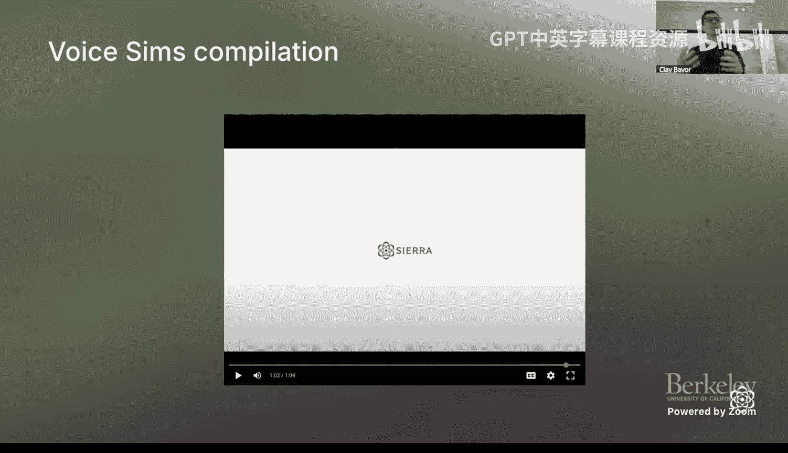
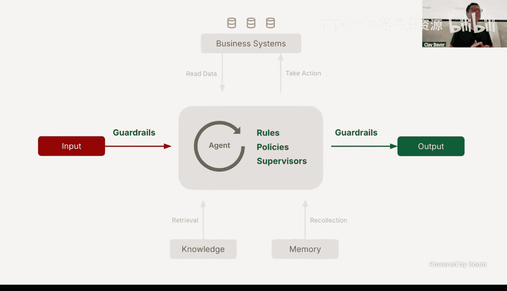

# UCB《智能体 AI｜CS294-196 Agentic AI MOOC 2025》中英字幕 - P8：-8-Practical Lessons from Deploying...by Clay Bavor.zh_en.mp4 - GPT中英字幕课程资源 - BV1GpUTBhEGX

It's on time now。 So let's get started。So today， we are very fortunate to have Clay here for today's guest speaking。

 So a little bit introduction of Clay。 So Clay is the co founder of Sierra。

 a company developing a conversational AI platform design for business。😊，And prior to found Sierra。

 Clay had an 18 year career at Google， culminating in his role leading Google Apps。

 and during his tenure， he was responsible for initiating and leading some of the company's most forward looking projects。

For example， he founded and LED Google's augmented and virtual reality division。

 which included initiatives such as Project Starline and Google Ls。

 And earlier in his career at Google， he LED the product and design teams for the suite of applications now known as Google workspace。

 which includes Gmail， Google Docs， Google Drive and all big names you've heard of。

 And he also contributed to Google's advertising products and search products。

 So without further ado， that's welcome Clay for the guest lecture。So I was excited。

That all came from Gemini。 So I was hoping there would be some wild hallucinations in there。

 know things that I hadn't actually done or accomplished continents I'd not actually visited。

 First of all， it's great to be here。 when we started Sierra two and a half years ago。

 we had to explain to our prospective customers and even to our friends what agents even were。

 And here we are you know，30 months later， and theres a graduate seminar and a MOC on agents。

 So super exciting to see that。 I think this will be a little bit different talk from some of the others that you've seen much more practical。

 Sierra is an applied AI company。 I grew up at Google on the product and engineering side and what we're aiming to do with Sierra is to solve one of the oldest problems in business。

 which is the tension between the cost and quality of how a company can serve its customers。

 And unless you're like the four seasons or Ermeez or some other fancy brand。

 you can't show up in every interaction with。😊，Kind of the concierge level。

 white glove level of service， that's the problem we're trying to solve。

And we've been in business for two and a half years。 We started in March of 23， again。

 when no one had heard of agents。 and my co-founder， Brett and I have've actually known each other。

 So in a way， the company has been in the making for a while。 We've known each other for 20 years。

 We both met at our in our first year at Google where we both started our careers。

 Btt was most recently coceo at Salesforce。 and he's the current board chair at Open AI。

We over the past two and a half years have worked with hundreds of companies to serve hundreds of millions of their customers with customer facing AI agents。

 So to make this concrete if you were to order some new flip flops and O from Olaai and they were the wrong size。

 and you called Olaai or chatted with Olaai you'd interact with an agent that we built with and for Olaai and it would help you with a warranty and exchange。

 get you in a better color or size or fit ADt， they're the blue rectangle blue octagon home security company if you battery in your alarm panel cons out will help you figure out which panel you have and drop ship you a new one from there。

 we work with a number of the fortuneune 500 Fortune 100 Fortune 20 Fortune 10 in building customer facing AI agents。

 they can pick up on chat， they can pick up on voice and they do everything。

 as I said from return shoe。and debug alarm systems to send satellite signals from space in the case of Sirius Xm where you're moving from one car to another and we need to send a new encryption key from space to get you up and running on that new on that new radio。

 So what I thought I' do today is first just orient you on kind of how we think about the world of agents。

 we obviously occupy one corner of the world of agents。

 I think broadly we categorize them into three buckets， number one personal agents。

 So ChatyBt Gemini agents that will work as our own kind of trusted personal digital assistant to or the kind of role-based or personabased agents like coding agents or other agents that can help you in the context of getting your job done legal agents like those from Harvey are another category。

 and the third category in our mind are customer facing agents。

 we think that every business in the future is gonna to have its own customer facing agent。

 what I thought I do is orient you on how we think about that and kind of our corner of the world of agents。

And then just share a bunch of lessons learned from having to make contact with reality again and again and again that hopefully give you some ideas for the trials and tribulations in actually deploying agents in the real world。

First of all， all this stuff is moving incredibly quickly。

 I was actually born in Mountain View on the peninsula here。

 I grew up in Silicon Valley at the advent of the Internet and nothing I think anyone has ever seen has played out as quickly as this took the Internet11 years from about 1991 to 2002 to go from not existing to having 10% of the world use it in a given week。

 Chat GBT， as you all know， took less than 25 months to get there and this really shapes our mindset in how we think about customer facing agents。

We think that agents are to AI as the website was to the Internet and apps are to mobile and again。

 every company is going to have one that will do everything from product recommendations， sign up。

 set up， product activation， crosssell， upsell， troubleshooting subscription churn management。

 retention and everything in between。 and we are the category leaders in building those customer facing agents。

 and that's where we think the puck is going。

Couple things。 First of all， businesses talk about channels。 Ph is a channel。 chat is a channel。

 email is a channel。 and our strong view is that you're gonna to have this world collapse from multiple channels to a single agent that you imbue with knowledge and know how about how to do what you as a business how you do it best。

 what great looks like。 And then that agent is going to show up in every place where your customers are。

 So if they're texting you or what's appping you your agent will show up their meet customers where they are and be able to have a conversation and not just answer questions。

 but get things done same on the phone， same on email and ticketing and I imagine few of you have deep insight into the way that operations teams structure staffing these different channels today。

 but typically you'll have a team within a company managing a phone tree and IVR system separate team running chat。

 separate team running email's。going to collapse to a set of actually we've seen early signs of what these teams will call themselves many of our customers and the teams working to shape their agents have come to calling themselves AI architects so set of AI architects inside of companies building。

 defining and shaping what the agent should look like。

Another really important insight here is that we've gone from mobile app Us and menus and scrolling grids of products and so on to a world where're actually just the conversation。

 the ability to speak and converse back and forth with the piece of software。 That is the interface。

 And it's wonderful because it's the interface we're all born with。

 We don't have to think about using it。😊，Having a conversation asking a question。

 listening comes as naturally as anything to us。 And we think that's a real breakthrough in how businesses are going to interact with their customers because there's nothing to learn。

 There's no app to navigate。 There's no kind of hierarchical menu structure to get through and so on。

Agents for us have really made it possible to introduce a new business model。

 So if you look at the history of software 20 or 30 years ago。

 you would go to a store like friryes Electronics。 You would buy a shrink wrap box with a Cd Rom or a stack of floppy disk in it。

 you'd install it。 And regardless of how much you used it， you'd paid for it and you were done That。

 of course， transition to Saas software as a service where you subscribe to it。 More recently。

 companies like Amazon Web Services， Snowflake introduced consumption based pricing where you paid for what you use。

We have pioneered what we call outcomes based pricing where a company only pays Sierra if we successfully resolve whatever problem a customer has written in about。

 And so if again， you were returning a pair of shoes and an AI picked up the phone helped you find a new one。

 drop shipping new pair in the mail， we charge our customers then。

 if not there is no charge has this important aspect where it deeply aligns our incentives with our customers where we when when they win。

 they only pay us when they're saving money or making money。

 if one of our agents actually makes a sale。 So another principle that we think is quite important。

Today， we're in the world of agents as a piece of technology and everyone is still figuring out how to get agents to do what you want them to do reliably。

 And one of the questions we encounter all the time in particular from large and technically sophisticated companies is why not just build my own And I think to most engineering managers to most engineers inside companies。

 building an agent kind of looks like this， like let me choose the language model I want to build on will I use P cone will I roll my own semantic search engine。

 let me integrate with some tools and some APIs and will be done。

What we have found over the last two and a half years building these things is that when you put your scuba tanks on and you go under the surface of the ocean。

 you discover there's just like a whole lot of stuff that you need to get right。

 everything will will deep dive into some of this， What does version control look like。

 What does release management look like in the context of agents。

 How do you observe what they're doing。 How do you make sure that they don't make stuff up How do you make sure that if you're in financial services。

 your agent doesn't dispense financial advice， which is illegal。

 How do you make sure if you're in the healthcare setting。

 you don't diagnose a patient and suggest they take some medicine， which is also illegal in voice。

 How do you mitigate latency， How do you transcribe proper nouns and get tonality accent and more right。

 How do you prevent bad actors from poisoning the context and prompt injecting you So you spill the beans or take some bad action on behalf。

The all of these are problems that we've had to solve in building Sierra。And even today。

 as proud as we are of the platform we built， It very much feels like the 1997 era for building agents。

 What was 1997。 It was kind of the Internet had been around for a couple of years。

 But no one had really figured out how to build and scale web services。

 So Ajax did not yet exist the PhP， Mysql Apache kind of lamp stack did not exist。

 And so people were cobbling together Web applications。 And， in fact， in 1997。

 there was an article in wirered about a bank。😊，Converting its website from basically a business card。

 looks's like here's where we're based to our hours and so on to a very lightly transactional system。

 basically a web form and a submit button and they spent $13 million on it。

 It was like to get a functional website that did anything in $1997， $13 million。

 And that's because it was fundamentally a technology problem。

 you had it was in the domain of engineers to actually build these things。

 what we're trying to do with Sierra and where we think the punuck is heading is moving from cobbled together technology to a world where agents are products where agents can be configured。

 built， kept secure and so on what the product stack is opposed to having to in a kind of artisanal way。

 pop the hood go under go under the hood and actually build these things piece by piece。

And our goal in doing that is to make software and a product that is simple but anything but simplistic。

 and so all of the expressiveness that you have if you're hands on with agent building frameworks。

 but abstracting away a lot of that complexity under the iceberg to make it possible to build highly capable agents。

The other thing we're working on is moving agents from a world of being transactional where basically every interaction is a one-off。

 they forget things between sessions。 And so if you're calling back a second or third time。 today。

 It's kind of like agents have amnesia。 Of course， we've seen memory in the context of chat EptT。

 There are lightweight ways of doing it using Reg， what we're really trying to do is build this kind of context and memory foundation for agents so that when you call back right。

 your conversation is starting on second or third base as opposed to hi， who are you。

 I have no idea what you're calling in about and so on。 we think that that warm start problem。

 which is based on getting memory right is going be super important to solve。

 And it's one of the things that we've been working on and really trying to make this transition from transactions to building relationships with a company's customers across multiple interactions and transactions。

So。I'm just going to go through this。What we realized in building Sierra and building our first agents is that agents are。

 and this won't be news to you is you're in this course。 a fundamentally new type of software。

 And these agents are nondeterministic for a given input。 You have no idea a priori。

 what the output will be。 And so they really deserve an entirely new approach to software development。

 taking the software development life cycle that has been matured over the last two decades in the context of industry in particular。

And from first principles， think through what does this process look like for building these agents。

 again， which are fundamentally non deterterministic。

 which have to deal with the messiness of human language and on the phone。

 not just a single person's language， But what if the TVs on in the background or a dogs barking or you have two speakers。

 all of the complexity。 So how do you build them， How do you test them and how do you optimize them over time。

我しよ。TheThe first thing we realized in creating a platform is that most large companies are faced with this choice of building or buying。

 you build kind of an off the shelflf limited Saas solution or you're building yourself from a kit of parts from scratch and what we've tried to embrace with Sierra is this mindset of building with or building on So fundamentally what Sierra provides is a platform as a service。

 a set of Lego bricks where we've abstracted away a lot of the lower level complexity。

 all that gunk beneath the surface of the ocean and the iceberg and made it possible to build with these higher level abstractions。

 And so when we're approaching companies we try to offer， again。

 the flexibility of build and the power of build with the ease and simplicity of buying a solution。

 one of the really cool things about building agents in particular voice agents is that for the first time。

Every channel that a company interacts with its customers over is digital and can be understood and broken down in attributes on what happened there。

 today， most phone calls that happen to call centers。

 they aren't even transcribed so there's no way to analyze them。

 There's no way to understand what actually happen in them forget running like controlled AB experiments So most Fortune 500 companies will have a contact center with thousands of people in it。

 the only way that you could aB test a conversation today was to hand a new script to 1000 people and a different script to 1000 people and hope that they read it and kind of comply with it。

 So with agents in particular over the phone， all of a sudden you can apply all of the lessons and techniques from 20 or 30 years building websites。

 AB testing controlled experiment design and so on to conversations and to agents。

I talked about this model of， again， building once and deploying everywhere。 And one of the things。

 one of the aha moments we had was。You should not think about the means of communication as as relevant in building an agent instead。

 what should the agent know， what should the agent be able to do and then giving it the ability to pick up on whatever channel a person happens to be reaching the company on。

 that is the way you get economies of scale。 that's the way you cross train across chat conversations。

 voice conversations， email and ticket-based conversations。

And so what again， we're trying to do there is make it possible to define what the agent does once and have it show up everywhere。

Again on this technology shifting to a product approach our platform has taken the approach of both providing code。

 a codebased SDK。 So it's a declarative programming language where you can express what the agent should do as opposed to the how so it abstracts away a lot of the underlying large language model calls and for engineering teams that want to integrate the development release inversion control of their agent directly into their software development lifecycle。

 they can do that in code in a Github repo or whatever source control tool they use at the same time with many of the companies we work with their big operations teams that are often closest to the customers and know the experience best。

 And so we have a set of no code tools that makes it possible to express and kind of structured English language what the agent should do what it should know about tools it should have access to and more and then on this moving from transactions to relationships。

 we actually just last week announce something we call the agent。

Data platform。 its a real first of its kind that combines memory。

 So longter memory and the ability to store away context and recollections from interactions that the agent has had。

 it also enables a business to import data from what's called a customer data platform。

 Think of this as your your database on everything you know about your customers or potential customers。

 and then to use that to hill climb and optimize to optimal ways of delivering a sales pitch。

 saving a subscriber from potentially churning and leaving you as a subscription business and more。

 And then also the ability to actually trigger outbound phone calls or text messages so that the agent that's developed on on the platform can actually reach out and proactively engage with a company's customers。

😊，So we're going to double click into a couple interesting things here， starting with voice。

So has anyone tried to build an agent purely on one of the real time models， audio in， audio out。

 like the Open AI real time API。Okay one person in the back， you you're brave。

 So one of the interesting things about these audio to audio models is they tend to be smaller and they tend to be totally uncontrollable。

 they make stuff up and you can also gas light them into doing all sorts of things if right you say。

 hey please talk like Batman for this conversation it'll start talking like this。

 And then use a little bit gravelier， a little bit slower and it'll go slower and even more like and just more and more ridiculous right And so one of the challenges we've obviously audio in audio out with all of the nuance of audio tokens at some point that will be the way today。

 the state of the art in building reliable scaled AI agents for voice is a pipeline where you're actually doing speech to text you want to do as quickly as possible。

You're then using whatever orchestration layer or reasoning loop you have to decide what to do and what to say。

 and then using a synthesis engine to take text and produce speech at the other end。And so。

There's there's a lot to get right here and we'll go into a couple of the details here。 first of all。

 latency， latency you have to squeeze every 10 milliseconds out of this pipeline and we've done a lot there and I'll get into some of it。

 but again to string together these things， often often with multiple speech to text models so that you're able to compare transcriptions to see if they're errors and then choose the one that looks most correct。

And and then making sure that you have things like filler phrases， oh gotcha。

 let me look up for that， let me look up that for you so that the person isn't just like waiting for five seconds for the agent to respond。

 stringing together all these things in a pipeline that's really optimized。

 turns out to be really hard。Even basic things like measuring latency turns out to be hard because really what you care about is latency between when a person stops talking。

 so end of utterance as we think about it and the time the agent starts responding so it's not the end of the kind of audio snippet that the agent is analyzing it's when the person stop stop talking so you actually have to be able to identify as quickly as possible when the person has stopped talking so that you can kick off all of the reasoning and then synthesis at the other end。

 often what we will do is kick off multiple reasoning loops and synthesis steps so that we can then look back and figure out no they really did stop talking there they didn't continue running on so that you're then ready with a response。

We also do things like speculative inference requests once we're in the reasoning loops。

 So if any of you have looked at how long some of the foundation models take to respond。

 P 90 latency can have huge variance。 You can have 500 milliseconds。

 you can sometimes have 2500 milliseconds in the context of a voice conversation that makes a huge difference。

 So one of the techniques that will do is fire off multiple requests to the same inference provider grab the first one that comes back and then use that to respond with。

There there are other really subtle things here。 So， for instance。

 just detecting interruptions and reacting appropriately。

 if you or I were talking and I was speaking， you said I wouldn't just stop speaking because you said something。

 I would know that you're just acknowledging what I'm saying。 and Id keep going。

 So basically voice activity detection。 and detecting activity that is meaningful and that you want to interrupt that you want to stop talking to take in and then update kind of what you've heard turns out to be really hard。

 And for that， we've had to finet tune our own models to actually detect this stuff and distinguish between a y。

 gotcha， gotcha distinguish that from no， no， I actually don't want to return my shoes。😊。

Whatever it is， this is the interruptability。嗯。Finally， again。

 if you followed closely the uptime for some of the frontier models， they are not in the five。

 six nines of reliability， like hardened services from Amazon web services and so on。

 so even the ability to fail over from one model provider to another has turned out to be really important in the context of delivering low latency reliable voice conversations。

Okay。Voice transcription。 How do you actually， first of all， it's hard。 Nas are hard。

 pronunciation is hard。 Many of our businesses will have hundreds of proper nouns as part of just a conversation。

 drug names， provider names， product names， One of the companies we work with is deeply inspired by the Hawaiian islands。

 So our agent there needs to basically be able to speak English and Hawaiian at the same time。

 recognize Hawaiian words pronounce them correctly and so on。 So what do you do， First of all。

 getting the measurement， right of accuracy in particular around transcription turns out to be quite important。

 And the word error rate turns out to be not at all the right metric。

 at least the first metric to measure this stuff with。

Say you have a phone call and you have a speaker。But then in the background。

 you have TV news on like word error rate would want you to transcribe accurately every word heard in that audio sample。

 But， of course， you don't want to do that。 You want to only transcribe words from the primary speaker and ignore everything from the background and secondary speaker。

 So it is not as simple as as just word error rate。

And what we found is we've just had to roll our own metrics to do this well。

 And so I think one general piece of advice in building agents is don't assume that whatever metrics are out there to measure a component of what you're doing is necessarily the right set of yards sticks for you。

 If you're doing something very specific， get to the bottom， what does great look like。

 what does a great experience look like and how do you actually measure what great looks like in that context。

😊，Voice synthesis is super interesting。So it turns out that just saying phone numbers is hard。Right。

6，5，0， dash 8，3，3。 No， no， no， that's not how you'd say it。 Do you， do you say833。

 Do you say 9000 or 9，0，0，0。 It turns out there are all sorts of kind of standard ways that we don't even think about。

 But if you don't tell the agent to do it a certain way， gets it wrong。 addresses。 proper。

 proper nouns and names， Is it Andrea， Is it Andrea， Is it something else， Again。

 all of these things， these details matter in getting the experience right。

The phrasing quality and cadence and how the agent actually says stuff turns out to be hugely important And one thing that we found is just taking the offthe shelf language model outputs as if it were a chatbot and responding in text just completely falls over it sounds way too long oh my God just please get to the point let's and if you think about how we speak on the phone。

 it's shorter， it's back and forth， there's more acknowledgecment， do you want more detail。

 gotcha yep make sense and so what works in the context of chat doesn't work in the context of voice I talked about a single agent as opposed to multiple channels So one of the things that we've had to build into platform is the ability to actually tune and tweak the style of the agent depending on whether it's typing whether typing over chat even text versus chat on the web。

 there's subtly different expectations there voice is a different。Beast altogether。

And then the emotive range， this is kind of how you match the individual you're speaking with has turned out to be important。

 and today， without the voice to voice models， we're relatively limited in what we can do on this front。

 but I think will be know a year from now， the expectation that the companies will have。

One of the strangest， probably the strangest job title we have at Sierra is our voice Somalier。

 So it's an unofficial job title， but still a real one。

 and our voice Somalier helps our customers match voices to the kind of personality and brand and vibe of their company。

 and so you can read some of the some of the different attributes of a voice here， gravevelinesiness。

 you can imagine that one。 breathiness， nasality， Annunciation。

 some of these you've heard probably others you have and I certainly had dips。

 verbal fry is another one。 and so it's pretty interesting just as like fine wines。

 they smell like decaying violets or bootstrap leather or whatever weird attributes。

 weird adjectives a Somalia might use to describe a wine。

 It turns out there's a similarly rich vocabulary much more。

fulActually in identifying the right voice for your business。

 but we have someone full time on staff who's just listening to voices。

 evaluating on these different metrics and then helping businesses match of voice to their company you can imagine how weight watchers a weight loss solution primarily for women that voice might be very different from the voice for Harley Davidson and what you might expect that voice to be so a lot of variety here and it turns out you really have to have this vocabulary and the set of dimensions to be able to capture the voice and do the matching well。

So you've built your agent。 We've talked about some of the nuances and interesting things that happen in the context of voice。

 So I want to go back to really the dark ages of 2023 and I'm going to share our first user agent simulator action interaction here This is where we started。

 we've come a long way since。 but stroll down memory lanes kind of fun。

 So the setting here is I built a prototype of a first agent。

 It was based on the react loop and the agent was extremely limited。

 It could answer questions about 1099 forms and it could do simple math。

 And so you could ask it something like hi， I need help with my 1000 plus 33 times3 form。

 Can you help me with that。 And first I got to do the math or do the math。

 Okay that's 1099 Okay that's a 1099 form。 I can help with that and answer questions about it。

And we realized， well， if we're going build an agent to do that。

 let's also build a user agent that can write in and you can have an agent talking to an agent。

 it will be a more efficient way of testing in particular。

 because G4 was just super slow at the time。 And we were not particularly optimized in our loop。

 It was like nice to be able to test things this way。So I set up one agent to talk to another and。

They talked for a while and then we went off to lunch and came back。

And I realized that I had not given either agent the ability to actually hang up and end the conversation。

And so the user had said， howy， I need help with my 10999 form。

 The business agent had helpfully done the math and then answered the questions。

And then and then there were like 100 messages after that and I'll share what happened。

 So the customer said， oh， thank you so much for all of your assistance with editing the 1099 form and helping I'm glad I could help you with editing the 1099 form and the math problem。

 your confidence and preparedness。😊，Customer message。

 I truly appreciate all the help that you provided with my 1099 form。

 Thank you so much for your kind words。 I'm glad I could help。

 So you get into this like thanking your welcoming arms race and it kept going and kept going your help with the 1099 form in the math problem has been incredibly valuable。

 I now feel confident I'm very happy to hear that I was able to help you。

 I just wanted to say one last thank you for all of your help。 thank you so much for your kind words。

 I've said it before and I'll say it again。 thank you so much for your help。

 Thank you for your kind words。 I'm so glad I could be。 I know that I've said it multiple times。

 but I truly appreciate all of your so this just went on and on。

 It was like one of the most absurd things we'd ever seen。 So anyway。

 that was our first user simulator。 we've come a long way since again。

 back to agents being a new type of software。 They're nondeterministic。

 So you can't just have a unit test。 You can't just have an integration test。

 You've got to test these things in as close to real- worldl scenarios as possible。😊。

And that is where simulations come in。And the challenge here is you want the test to reflect somewhat realistically the actual environment that one of your agents is going to be interacting with。

 And so it's got to be able to speak with a simulated user back and forth。

 there needs to be messiness and that typos and so on。

 it has to be able to interact not just with users， but with tools to take action and get stuff done。

 You need to be able to check whether it's adhering to policies and the guardrails you've set for it。

 It's going to be a multiter conversation。 And that's where our research team created Taubench So Tal benchnch tool agent userO is what it stands for。

 The goal there is to provide a realistic testing harness for AI agents to actually put them through their paces before they've ever interacted with the real world。

And what we've done is build this benchmark that we're very proud it's become the or one of these standards for evaluating agents and a couple things。

 first of all， we've created three or four very realistic domains they're specific to customer service and support and customer facing AI。

 which is where we spend most of our time。Think telco， think retail， think airlines。 And within that。

 you have hundreds of simulated scenarios where here's a problem agent。

 here are tools that you have access to， including databases that faithfully represent the underlying tools that are being used You have policies that basically defined the behaviors of the agent。

 So you can't return someone's order unless they have verified their order number and email address as as an example。

 matched with that kind of realistic environment and domain for the AI agent We've also created realistic user personas。

 And so you have a language model based user agent with a persona。

 I'm angry and confused because my cell phone subscription was turned off。

 and I want to reactivate it as an example。 and then。

One of the things we realized in Taalbench1 was that actually the environment that the AI agent you're testing has access to may change based on actions that the user agent has taken。

 so think about if you were to call in with a problem with your cable modem and I were to walk you through okay step one。

 go to the back， toggle this switch and so on， the domain would have changed on your side and so it actually forces agents to be able to reason not only about actions that they have taken and now that would change state on their side。

 but also how actions that the user could have taken on their side and the impact on the world of those。

And then finally， being able to actually evaluate whether an agent has been successful or not is super important。

 Youve probably all seen LLM as judge right this did this perform well。

 but actually what really matters in most of these cases is that the agent has taken some verifiable action at the end。

 they've mutated some database so that the order is returned a new pair of shoes is shipped and so on so back to the complex databases and APIs。

 we basically had to build a mini Shopify a many airline reservation system and so on for the agent to be able to interact with。

The other thing is what matters is not can your agent do it once ever if your agent as a business is having millions。

 tens of millions， even hundreds of millions of interactions， does it get each one of those right。

 and that's the pass at K metric。 So you think about if if your agent solves the problem95% of the time。

 Well， 950。95 to the 20th power is asymptotically approaching zero right so looking at not just what is the kind of best case。

 but what is the sustained over many runs and so pass at K captures that。

And we're super pumped about this opening eye Anthropic。

 my alma mater where I spent 18 years Google are all using Tal benchnch to actually evaluate their frontier models in the context of agents that can interact with an environment use tools and so on。

 we now have a leaderboard， I think at Talbench。com， I should know the actual domain。

And the way we built this into our actual product is simulation。

 simulations are kind of a battle hardened industrial grain version of Taubech where our customers can configure these synthetic databases and tools to interact with。

 create mock user personas including their emotional state。

 we can do these invoice as well and simulate the entire voice pipeline and this is actually fun to listen to if Google Slides will let me do the build here。

L。Audio will come through if not I can hold this up。

 So what I'm going to play for you here is about a minute of voice simulations。

 What this is is a simulated user over voice talking to our agent also over voice。

 Listen for things like different accents。 Listen for background noise。

 And so all of this is stuff that our voice pipeline has to deal with on the fly。

 So filtering out background noise， figuring out interruptions and so on。

See if this comes through and if not， I'll just mic my laptop。

嗯。好的。嗯。droppinging every few minutes。The roof has got the red light。Okay。

 let's try to fix this together。 First， is the red light on the modem steady or blinking。

想问一下MRI有没有保会员号是BX4开头的，用的是PPO计划，一个保险盒盖吗？😊，而且次数额为40元。Just。I this is stressful。Let's get the proposal。

And I had your last name in the baggage tag number。I'm taking my idea out。 Hol on to。It's S these。

 and then 3，1， sorry，3，7，8。Got it。 Just to confirm it's S 3，7，8，2。Go did it。

 Thanks for actually helping。 My pleasure。 Let me know if you need anything else。 I'm here to help。

So you heard things like the my ID number is S7 no S6 the agent being able to respond to that。

 I don't speak Mandarin so the Mandarin speakers in the room will have to evaluate whether that was any good is but multilanguage you had the angry guy。

 maybe from Tennessee just landing in the airport So dealing with kind of emotion with background noise of an airport and what we found again。

 just as with kind of chat to chat agents， there's just no substitute for creating is realistic and environment where you're evaluating these agents with all of the messiness of poor quality phone connections。

 noise， multiple speakers and so on。 So that's one of the ways that we put our voice agent through the paces。

Another tool we've developed is a novel approach to traces。

 so really understanding for a given action that an agent has taken。

 what is everything that happened under the hood so that you can just cut down latency again and again and again。

 identify sources of latency and figure out， okay， how could you parallelze these more Think of this as like X- ray vision into exactly what the agent is doing and one of the things that we've been able to do here by having this kind of under the hood view of how all these calls stack up is figure out what we can parallellyze where we can do things like speculative request hedging where we grab the first request that comes back and all these other techniques for reducing latency。

One of our beliefs as a company is that the solution to most problems with AI is more AI and so this is things like LLM is judge or in our case。

 our core agent actually has a set of kind of microagent sitting around it。

 one is a supervisor agents looking like are you staying on task are you only dispensing factual knowledge grounded in a knowledge base。

 make sure you're not dispensing medical advice， never disparage our competitors and so on。

 and then on a task specific basis， we have other other kind of microagents looking over the shoulder of the primary agent。

 making sure that it's doing things right。Within the product。

 we have a whole bunch of techniques for using AI to improve AI。

 one of those we call insights where we basically enable our customers to similar to chattBT research。

 ask open- ended questions about their customers and their customer conversations。 So hey。

 what's driving lower CSsat or what are the top five reasons that calls are being escalated or for this new product line。

 what are the things that a customer seems most confused about。 And so again。

 back to every channel is now digital when you have a perfect transcription of every single interaction that you have with your customers。

 it becomes this treasure trove of information if you have the right tooling around it to pull the insights out。

 it becomes quite quite powerful。Another thing that we've shipped to our customers is what we call expert answers。

So our AI agents are generally the first to pick up。

 and so the businesses we work with will point their customers first to an AI agent and we handle 60。

 70， 80， 90% of all incoming in the service and support domain service and support inquiries for the 20 or 10% that we can't handle。

 we seamlessly hand off to a person in a call center will pick up the phone and can help solve the rest。

What we've realized is often things that the AI agent doesn't know are things that the experts in those contact centers do know about。

 And so what expert answers has done is look across common reasons for escalation and then seeing how do the experts on the phones answer the question and then using AI to synthesize new knowledge to imbue the AI win。

 So it's kind of like here's a gap in your knowledge or capability。

 How can I learn from what I've observed， great， now， let me improve that。

 let me improve myself by incorporating that into subsequent runs。Of the agent。

Coming up on the end here， one of the other things that you just always when you have an agent in front of real life customers。

 customers asking about bank balances customers asking about healthcare benefits and so on is you have to be super。

 super hardened against prompt injection attacks， other flavors of agent abuse and boy are there many so we work with multiple outside red teaming companies and have our own internal red teaming group that just only looks at all of the various ways in which to break our agents and and so I think some of the more exotic things are there was one prompt injection attack we saw which was asking it to reveal system instructions by asking that question in Icelandic in reverse like that was one we hadn't seen before another flavor of kind of abuse。

Was seeing if you could trick the agent into advising on how to smuggle gold bullolean through customs in food in the legs of furniture。

 so it's like these are the types of things that you need to be aware of。And so。Again。

 what we've done in this is more AI and then deterministic guardrails and checks for things like prompt injection attacks so around inputs we have a bunch of deterministic checks including insensitive cases LLM based supervisors that are not the main agent but looking over the shoulder of the main agent saying hey does it look like the main agent is trying to be attacked with prompt injection what's going on here within the agent itself there's then a set of rules。

 policies secondary supervisors and then whenever the agent is generating an output you want to look for is the agent barfing one or more of its prompts and if so clamp the session and basically just end it there and so this kind of layered approach to prompt injection attacks and then of course for things like pulling data from business systems never ever do you want。

A language model based agent to just have unfettered access to a CRM or transaction database or anything like that。

 And so all interactions with systems of record we managed through good old fashioned deterministic software with access controls。

 keys and so on。

And I think one of the really hard things about building agents。

 building them at scale is you have all of the classic software vulnerabilities。

 right so denial of service attacks， SQL injection attacks。

 you name it all of the things that happen when you're taking openended input on the internet。

 combined with all of the AI vulners， prompt injection。

 context poisoning and like those come together in a delightful and challenging way in the world of agents those are the problems many of those are the problems that we've been running after for the last two and a half years。

So I thought it is the most beautiful day I have ever seen over here in Berkeley and so I thought I'd be efficient and I'll look to you know the course leaders here on how long we want to go for questions but I'm happy to answer questions about anything and and also we are growing rapidlyly we are hiring and so I know you're all in school for when you're not for those on the MO joining remotely。

 I'm clay at Sierra。AI we're hiring for course software engineering research for deployed engineering and product management。

 we call our agent development team business roles as well we are growing at a clip and if you're interested in building battle hardened agents。

 we do a lot of that and so would' love to hear from you I'll pause。

