# UCB《智能体 AI｜CS294-196 Agentic AI MOOC 2025》中英字幕 - P9：-9-Multi-Agent Systems in Era of LLMs by Oriol Vinyals.zh_en.mp4 - GPT中英字幕课程资源 - BV1GpUTBhEGX

Today， we are very excited to have Oriel joining us。 So a little bit introduction of Oro。

 The Oriel is a VP of research at Google Deep Minine and serves as the co technical lead for the Gemini program。

😊，His work has been foundational to the development of modern large a models， for example。

 he is most famous for being a co-inventor of the sequenceence sequence model。

 a general purpose encode equal framework that's introduced in 2014 that became a fundamental building block for a modern AI imaging translation。

 speech recognition and lots of other natural language processing applications。At Google。

 Aio has led and contributed to numerous key projects in deep learning。

 including research on knowledge distillation， exploring the emergent abilities of AOMs。

And developing your conversational models。And in addition to his leadership on Gemini。

 he was also the lead researcher on the Alpha Star project and contributor to Al。So with Alfr Ado。

 please welcome Orle for his preor today。Great thanks for the kind introduction hopefully you can all see the screen full screen otherwise yeah that good。

😊，And you see this red thing as well。Yeah amazing great so it's great to be back at Berkeley there was a probabilistic trip which would have helped me to be in the US today but sadly I took it very short last week so I was in the bay last week but not this week so we'll have to do these online but yeah it's great to be virtuallyly back I have deep roots in Berkeley as you might know if you know me for you have known me for a while and today I mean this lecture really will have kind of two parts and。

😊，It's a metal lecture in a way and it's also kind of selfishly。

 I'm doing this also to kind of remind， I mean， first and foremost。

 you know people in the field that lots of ideas recirculate and so in a way I put together this slide deck from or I recovered the slide deck from the Al Star project which is like six or so years old。

And realize that many of the current issues， but also solutions that we're using in modern LLMs。

Tras back further before， but I mean we did kind of encounter many of these issues ourselves when we work on a fairly probably our most advanced。

 even today especially on video games agent that Deep Min had built at the time and I'll get into details now in a second but it's useful to revisit kind of these ideas to see them with perspective and also realize what are the things that we did know back then that currently we can't do or we're not quite doing at the same level right in LLM so this lecture will be a bit of a mixture between Alpha Star and also Gemin I and other LLM agents。

 but with a kind of hindsight foresight lens which hopefully we'll find entertaining。

So let's go through a bit of basics now of course I'm sure you've covered many of these topics and you probably know them because they become quite mainstream but indulge me into giving you my own perspective and point of view。

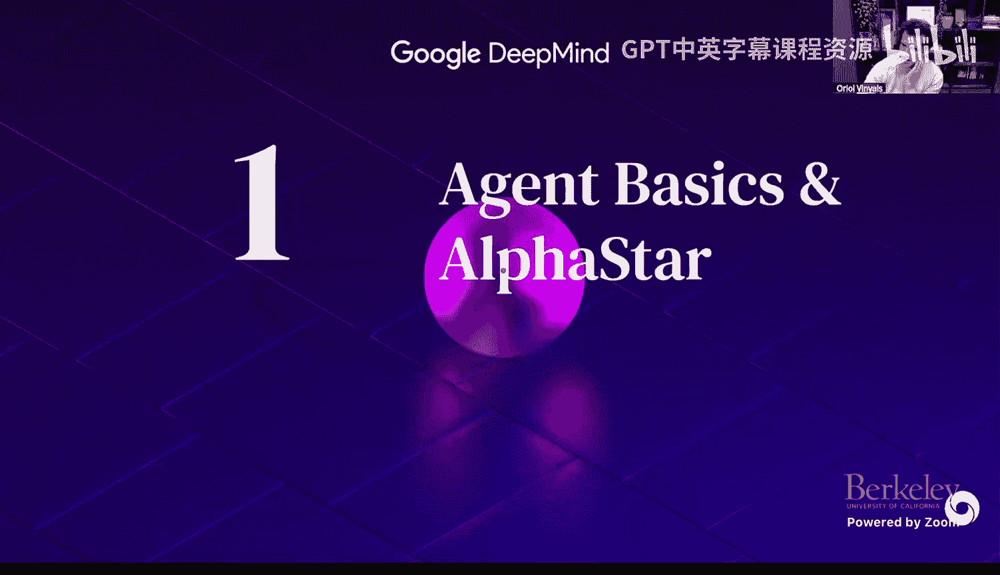

So this is kind of the OG slide of like DeepM actually like the pitch slide deck had a version of these that did not have Starer but it had agent environment。

 you know agent with goals， observations and actions that was at the time not that that mainstream right reinforcement learning wasn't mainstream in when DeepM was eventually acquired and also it serves a little bit to try to put our heads on what is an agent since these classes about agents and I think today if you think if you ask people like is this an agent。

 is this an agent behavior， you probably get quite a few different answers back then things were a bit simpler though。

We were mostly connecting to single environments with well spec and defined observations and actions right and the agent had just maximized reward as a goal。

 of course in games many times the reward was fully specified and fairly simple to compute and then this was the loop that agents lived in forever and their goal was to optimize reward。

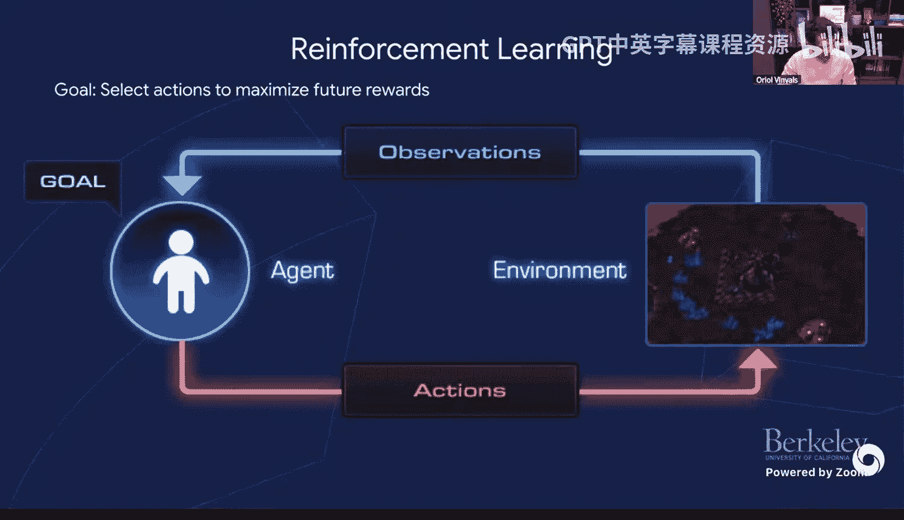

Now。You know today things are a bit different right like there's besides I guess having agents in the traditional sense。

 we have assistants that assist users right so then what is the environment what are the actions start to be a bit more diffus and I think embracing that is fine this is probably the most accurate at least from you know our site perspective of what we mean by agents right so so you know you might you might be a user of a chatbot or you know advanced system and you're going to interact with something right this object we can call is the agent and。

And as a user you'll ask questions， you'll know maybe give feedback etctera。

 etc ce and then this agent now actually is more complex in any way。

 I think it's more useful to think about the environment being part of the whole package right so you'll get sort of an agent harnessness that's controlling how you call the LLMs to issue an action or issue a search or issue a terminal command etctera to this very rich environment that could be a digital computer a network of computers it could be anything it could be a game of course as well very general and then you know that's kind of how we orchestrate the whole thing right so it doesn't quite fit the paradigm as neatly but doesnt that actually things makes it more exciting so sometimes when I'm presenting some of the results and observations especially from alpha star it's going to become come from a more simplistic world where single environment。

Clearly defined and no user so to speak so the world has changed and this will keep evolving especially as we get to an exciting topic that I think is the one I want to leave you maybe with some thoughtprovoking ideas and observations on multiagent systems and what does that even mean here right so a bit of history right like deep mind at the time of acquisition had just master Atari I remember fond the new ribs in which Vla presented the results and they felt creative refreshing I believe that was the sequence to sequence in New Ris maybe was the year before I can't remember it was a while ago and then in the internal program for Deep Min there was sort of a curriculum of difficulty of games that we were gonna tackle and you know famously go came a few years after Atari and then I would say maybe Starcraft graduated as to just kind of must。

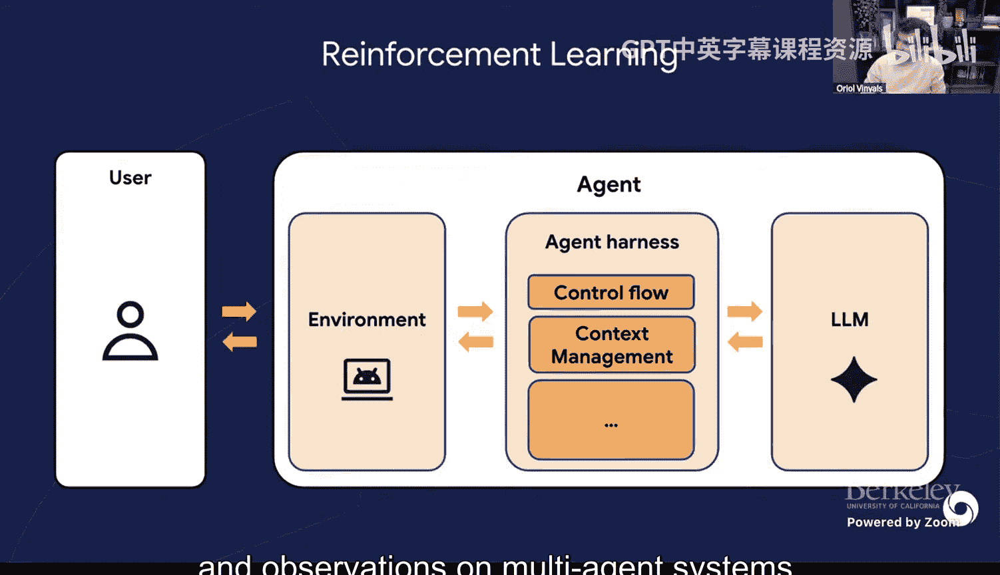

arere all due to its complexity although of course there's many interesting games that have slightly different complexities。

 but StarGra really for AI felt like a good kind of ending note。

 although even today we are working on games still as you might have seen with things like world models and CA2 was just released that can play 3D games and so on。

 but the approach is quite different。

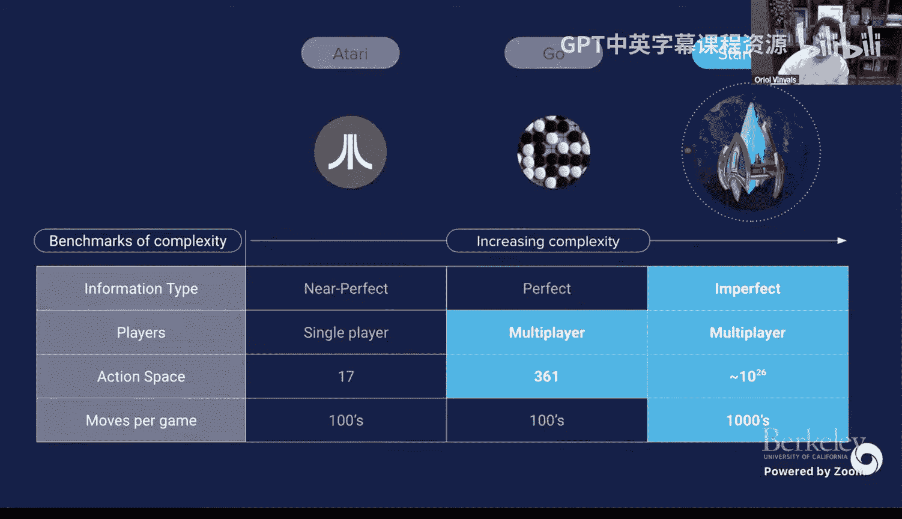

Now blast from the past as well， so 2011 ages ago， I used to be a grad student and very exciting from Dan Klein's group was this project that tried to tackle sort of solving Starcraft with machine learning。

 and there was a whole class set for testing kind maybe somewhat good oldt fashion AI。

 although some machine learning as well interleave with just trying to play the game or play different aspects of the game。

 so it was recognized of course as a domain and personally of course this resonated very much when I saw deep mind for the first time applying ML which I love to video games which I love I used to play Starcraft to eventually become the lead of the Al Star project。

So very， very interesting domain at the time in 2011 really seemed quite impossible that a single neural net could play the game but that's basically what with it right and for those of you who don do not know Starcraft I mean it's very hard to give you two-minute overview but it's essentially sort of a ch in which you don't see the board all the time and things are fairly continuous like actions it's a real-time strategy game so there's lots of hiding information from the enemy because it's partial observable and generally the action space is quite complex because you have to control not only the strategy at the high level but also the microt about how to move your units about the map right so here you have a map。

 it has resources， you gather resources， you get money， you build buildings， you build units。

 you engage the enemy and if you destroy all the enemy buildings that's the winning or losing condition so it's kind of a fun game。

It's been quite heavily played over the years， different versions of it。

 and it brought these sports to life in South Korea certainly very。

 very early days like in the late 90s even so this kind of pioneered in a way also certain aspects of video gaming。

Different points of view this is the one you might have actually seen that's rendered directly from the game。

 this is your UI you can see sort of you only see on the bottom left here part of the map you need to move the camera right send the units around build buildings issue commands it fairly fastp so there's lots of cool subproble that you could tackle as an AI domain but as I was saying what we actually end up doing and not describe bits and pieces but not in full we train the single neural network basically that was issuing all these commands and how when it matters to LLM or current trends that we're seeing I'll describe in the second part of the talk and then in the third part we'll cover multi agent。

So achievement wise， I mean it was fun and I remember fond when our agent achieved Grandmaster statuss。

 which is given only to the I believe top hundred players in any given region。

 so we were playing online little in our office so im right playing video games at work that was pretty fun and we were all sitting around playing games against people that didn't know they were playing against Alphastar although many good guess and there was lots of speculation because you had to opt in to play against possibly bands AIs。

 but eventually we reached the Grandmaster Maston and then later we also went sort of in the wild in Bliscon。

 which is a New Ris for Star so to speak where we played many。

 many folks who just were mesmerized by playing against an AI at the time was I believe our first AI system in the wild from Deep Min actually so it was quite nice to just interact with people。

 see how they felt。About the game， AI， et cetera， this was 2019 right before the pandemic hit。

And so we visited this wonderful very different style conference。

 I would say that Nris although I think Nris is becoming a bit like this as well lately and it was fun we played a bunch of people including Sarah who's one of the legends of the game if you want to sort of see the games the five games we played I believe YouTube linkss are here at your disposal you can see here me a bit。

😊，Tendense to see what the agent would do under such strong opponent。

 but it was all fun and I think probably the most profound realization was you know a couple of weeks after you see November 24。

 C mentioned that he actually copied Starcraft or Alpha Star one of the builds that he had played against and of course an obvious comment that again kind of in a way concluded this epoch we had a deep on mastering games in one on one setting was that we got a player learning from Alpha Star of course Alpha Star had learned from Cy as you see in a second so that was pretty fun。

So let's start to see kind of maybe some obvious， some less obvious connections and then yeah like basically。

Why does it all make sense right like even even when we talked to reporters at the time very early days。

 they didn't understand the impact of playing games in real world right so here I tried to map fairly imperfectly right sort of the timeline of certain major projects alpha risk projects if you will。

 that kind of in a way took inspiration either algorithmically or learnings or you know whatnot from the previous projects that had coming right because because games were such a good。

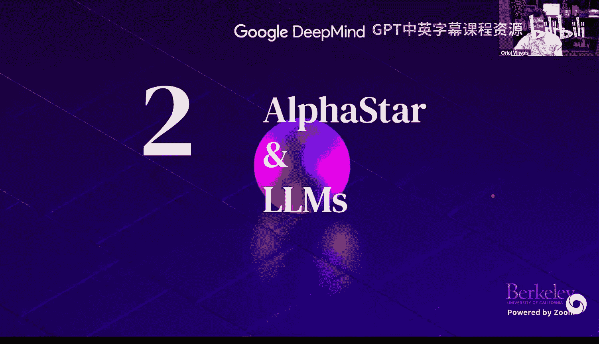

Sandbox to try some ideas to scale up neural networks and I mean at the time it was a bit hard to convey these to maybe general public。

 but it's great to see that these kind of plan for that really the whole company was set about is taking shape and games still have a role to play by the way into kind of building pursuing AGI in the context of LLMs。

 but here there's a few sort of projects I didn't put all of them certainly there's no Atari for example。

 but certainly as I mentioned after go， we decided to tackle Starcraft and then there's no other games。

 but after that we had huge inspiration to start working on coding early days or our first LLMs Chincha。

 visual language models fllamingo or Gato and Alpho also took inspiration of I mean certain aspects of transformers。

 distillation of data etc and today as you probably can guess。

A lot of the research and resources are now heavily invested into a single project。

 almost although it's very large， there's many， many different components。

Called Gemini which I'm called tech leading together with Jeff and Noam and of course in there we're just trying to build the most general system we can so you know it's you a game or playing a single game might be one of the many。

 many things the incredible things that these models can do today。

 but it's nice to also look back and attribute a bit of ideas or where things come from。

So more specifically right let's dive into some technical details and some have striking closeness I would say with how today we're creating some of these amazing LLms so this is from from the Nature paper that was eventually published and we'll discuss the three aspects but。

In sequence， we did basically three things to create this single neural network。

 we had first supervised learning as we called it in this figure， learning from human data。

 then we had the step of reinforcement learning and these reinforcement learning didn't happen in a vacuum it happened in a massive multiag system like as follows。

So mapping to today's projects or work， this is what we commonly now call print trading。

 this is post trading， and I don't think there's a massive amount of motivationation work although there is more and more。

 of course as we get more mature in the technology for LLMs。

But there's even at the highest level of how these different steps of creating this agent we already could see。

 or we already can see that many of the problems we faced back then apply today and youll see why in more detail now for each of these stages。

So let's start with actually something that at the time felt kind of complicated and also in a way obvious in hindsight。

 having worked on sequence models， which is how to deal with actions。

 the actions that you needed to issue to activate or to operate Starcraft。

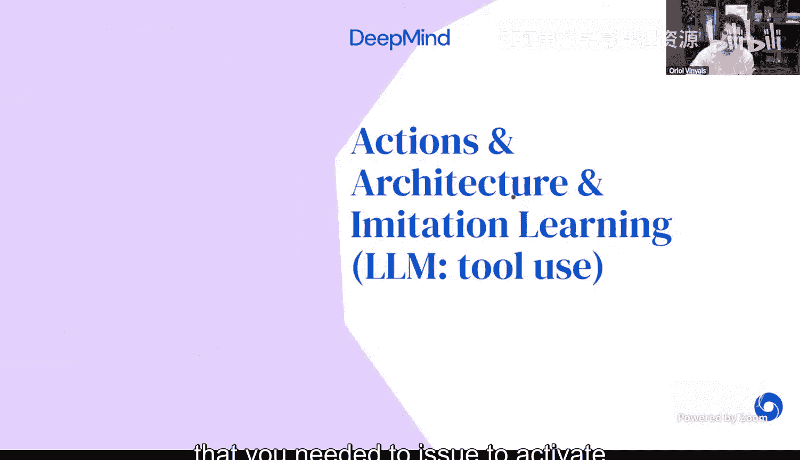

So the actions were fixed there was an API and as an API you basically had you know all sorts of different functions that you could call and different functions required different arguments right so this is basically an API that Blazer has and had before we start working with them already to interact or to send network messages actually between prayers in Starcraft and we just used it as is right。

So you can imagine in this instance there's this thing here that blocks this ramp so there's an action called force field which is the name of this thing and you know you issue this action to these set of units so you say a set of units try to issue a force field in this coordinate sixcoma 82 and then you also say delay from current you know you can wait 10 steps which is kind of half a second or something and only repeat this action ones right so that's kind of how you do everything in the game and it was a bit tricky to how would we be able to issue these commands so the solution we found is to just lay out an auto aggressivegressive model we kind of a little recurrent neural network that was structured so that all these arguments were lining up with different softmes right that would basically say Q yes or no when。

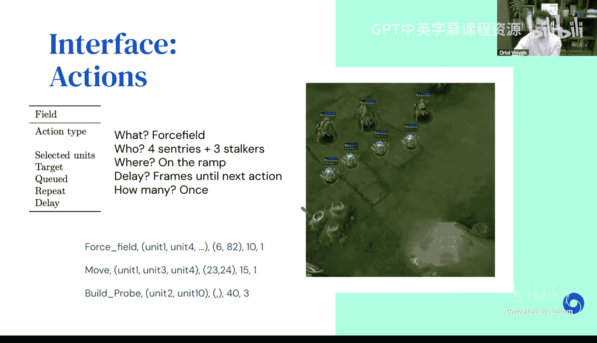

And then it's a softmax between zero and 128 steps or whatever maximum we decided what is also a softmax。

 a categorical softmax over positions， et cetera， et cea right so we hand crafted this architecture and then we obviously learned both imitation and reinforcement learning to finesse how to issue these sequence of instructions or commands that form an API code that then we would send to the game。

And this is strikingly close to tool use in general right because in tool use in LLMs。

 what we have is an access to an API like there's MCP， there's so many different protocols。

 but essentially there's an API there's a way to define how to call search engine or issue a command on a terminal or click on the screen for that matter。

 all these things and then this is sort of defined now in natural language but actually lots of different problems and solutions again a line here and it what's cool to at the time I mentioned when I talk about alphata Al style is like a language right you just need to issue these literally code calls or API calls into the game and there are some differences that are notable as well right here these architecture is setting the API right so the auto aggressiveive actions are expressed through this part。

architecture as cool as it is， it's fixed， whereas today we know that to issue API calls using the power of generalization of text or code or combinations allows us to issue API calls to all sorts of different environments that agents might be connected to。

We also have now a single transformer architecture that just writes this text or code for us that then is interpreted and sent to the environment and then there is actually a lot of flexibility even in the formats because you can instruct the models to change the formats if you want to be empirical about which formats might be best versus here where there's a certain architecture rigidity and so of course。

We did ob many decisions and we had to retrain the models and then try which ones played the game better。

 but it was much more cumbersome to need to retrain。Now。

 another very problem and I think this is actually a key debate even today still pretty hot between many folks。

 which are the issue of using imitation learning， right which we commonly denote as pretraining in the LLM world。

So。In Starcraft， unlike let's say go or Atari where the action space。

 however large was literally not as large as it's in Starcraft where it's very combinatorial and also the time horizon was much longer etc cetera。

 et cetera， exploration is and was very challenging and I'll demonstrate that kind of。

Pretty sharply in the next video。So problem is random policy will not do much in this game that is that useful and so in a way the bitter lesson discussion。

 which is should you gather as much imitation learning experience to bootstrap the knowledge about the domain even in a game like stackcraft which arguably is not aGI complete as complex as it is didn't work to the best of our abilities right so for us it was very clear we would need an imitation learning plus then an experience learning a reinforcement learning loop on top and that was kind of a nice merging of deep learning and reinforcement learning which I very much welcome also in LLMs although it can be debated whether ultimately pure reinforcement learning。

 for example， could。Get us all the way there， I strongly believe the answer is no as you can probably guess。

So what happens when you apply pure reinforcement learning is that it actually discovers how to beat the enemy。

 but in a way that is unsatisfactory， it takes all your workers。

And then it just sends them to attack it's not this is not an uncommon technique。

 I mean its it's it's if you're newbie， you might do it。

 some professional gamers do it at some point with all ins。

 especially that they also bring all the workers to attack。

This one beat the hardest AI in the game by exploiting it basically with something that was not preprogrammed to defend very well against this kind of attack。

 but clearly we just kept seeing these results and we had to resort to essentially using human data。

 which luckily we did we open source over 1 million games of Starcraft thanks to blizzard collecting anonymous replays online there're still available today hopefully and there's a good cool way to do research on imitation learning。

 but that's basically kind of getting lots of human data online was felt necessary and was part of the solution。

And then。Something else we did， which also at the time was felt very different。

 but we also besides saying， hey， imitate every human move from these millions of games。We also said。

 look hold on a second from the whole game， we know what happened。 We know how good the players were。

 we have some metadata， we know what the players eventually build what units they did so these metadata we decided to encode it it's a bit of a cheating information because as you start the game you don't know the future units that will appear etc。

 but it was sort of a guiding signal to condition the neural network to look at these for correlations right so for instance。

 the neural network would know， okay， I need to do know this kind of unit will appear。

 it would learn the correlation between these units and then how to build it even in imit learning setting even though the correlations are fairly weak。

And so that was kind of a powerful thing to do for many reasons。

 and I'll get back to these conditioning signals again as well during the lecture。

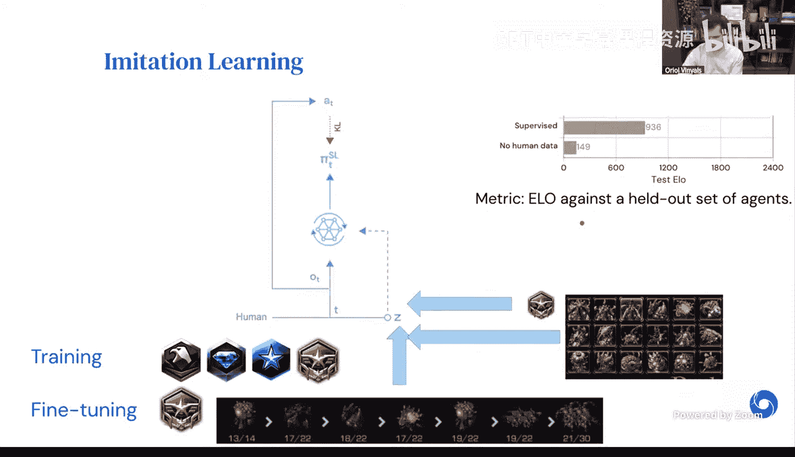

But again， contrasting this with current LLMs， these actually was a form of prompt or instruction following right so we all start a model and we tell it what we wanted to do and that was our way without obviously knowing about these yet of doing the same to a fairly complex system right we would tell this agent to either do this sequence of buildings and or to construct these units and or to behave like a professional gamer or like a obe in advance that was our instruction and then by a doing this the agent was reconfigurable to do to play in many different styles。

Controlled by the user right prompted by the user Now that's a similarity。 Many differences。

 I mean this agent was trained on about 5 billion tokens， we know， of course。

 LLms strain on over 1 triion tokens So the order of money to is quite different these prompts were structured where kind of again。

 hand tune to to the style of vectors， binary vectors that we expected。

 rather than expressed through language right it was not that we were writing hey。

 build an overlord and then build aer right was these were like binary encoded so to speak and then these prompts and like in today's LLms where derived by just looking at the whole game right we could look at the future。

 we saw the whole game we summarize it into these vectors that were given from sort of the first frame of the game versus of course in current LLms oftentimes we have。

A prompt or an instruction that's requires human annotation in some form not always but it's generally hate as coding competition someone comes up with a nice coding competition problem with some instructions and then you know we let the agents try to try to solve for that particular coding problem for example or a theorem prove by LLMs etc so again some similarities。

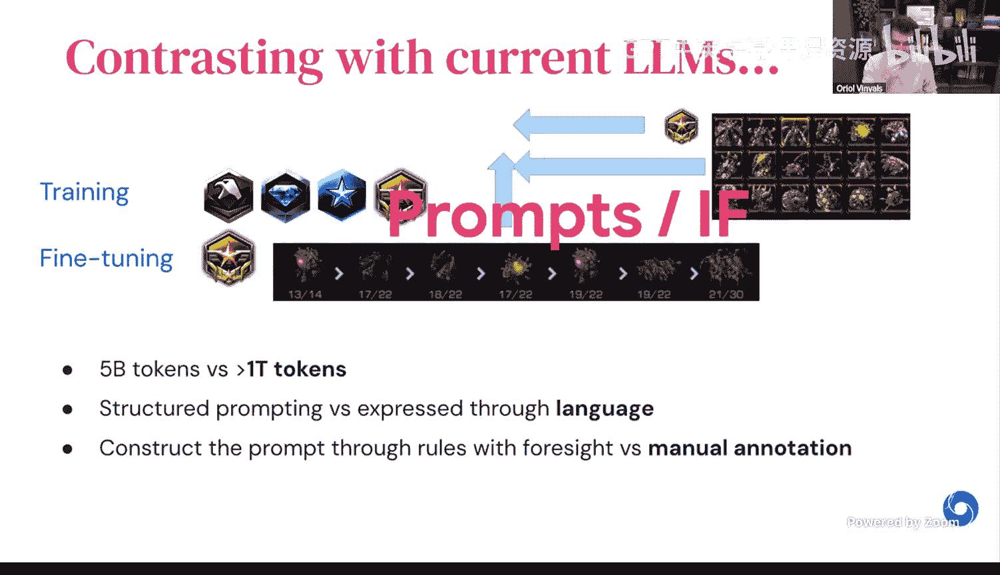

Some differences here as well。But with these， we actually went from that state of degeneracy of ArL to actually being able to start to see believable game states being achieved by these agents that they didn't experience the game。

 but they imitated the human knowledge same as what we see with LLMs before we do any post training step。

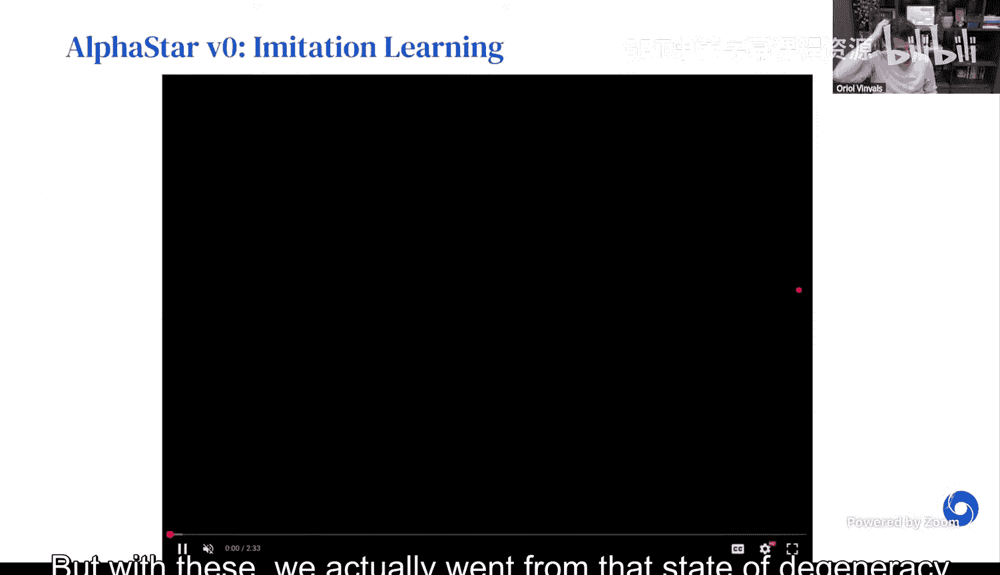

Now I want to， I think a very exciting area of progress。

 and I would say probably not the most mature even in LLMs， despite all the investment。

 which is posting or using reinforcement learning。So in Stargraph， we did a few things。

 all of which actually we also see in some form of another done for similar reasons， to be honest。

 in current large language models。So。Here is a fairly imperfect way to measure IO scores you might be now fairly familiar with IO's scores thanks to LMCs for example。

 which scores of course your favorite LLM providers against each other。

 but of course I mean chess and many other games use IO as a system right and think of。

Things like 40 difference not super large， but it starts to be significant 400 is fairly significant difference。

So。If we train from scratch without human data， we didn't get a very strong agent。

Just the supervised learning policy was at 900 e。So that that's a fairly strong initial state to then。

Kickstar the whole reinforcement learning multi Asianian system that we had。嗯。

Now the obvious thing is take this policy， initialize it and then add just use reinforcement learning vanilla and you get a bit of a boost。

 but what tends to happen is you might see some collapse of behaviors which also is quite commonly seen in Ls right so the diversity of the pole distribution that you've gathered over imitation learning is lost so to speak。

So we added a supervised KL penalty which is fancy way to say we distill the policy。

 the original policy onto the one we were training with reinforcement learning。

 so in a way you don't overcomit too early to certain particular way of playing you keep kind of the diversity of styles and strategies etc。

 although that itself was not easy to do so we'll get back to that in a second。

 but that helped quite a bit keep things much better so that boosted IO by 400。

And then the last thing， which is this conditioning。

Explicit conditioning on the kinds of things we want the agents to do further boost the EOs score by almost 150 or so so all these aspects came together and we see obviously all these being employed as well in LLMs another trick we find which was neat is that for the value function which tells you whether you're winning or losing。

 even though it's a partial observable game， we found that the value function seeing the whole board so to speak was much more accurate and help reducing variances in training which was problematic and always is in reinforcement learning so that's another trick we did which also in different shapes and forms is seen as positive when you apply to certain domains in large current large language models。

So all these tricks and more right are used in modern LLMs。

 but what are the differences right between what we were doing here and LLMs。

 I mean most crucially that rewards。Can't be fullyifies specified always I mean Starcraft you win you lose you know there are interesting things Starcraft actually many people resign before losing right so it's not that all the data you get to the winning condition necessarily so there's some fun problems there but by and large you can compute you know success or not success whereas of course in LLMs I mean write me a nice poem it's just good luck you know getting humans to agree on that so it's very very tricky right to to reward behaviors when you're going to much more general problems。

Now that's kind of annoying， definitely to me， which is compute envelope for LLMs are heavily skewed towards pre training right so you spend most of our flobs。

In pretrain and only a little bit in post training and that feels wrong for a variety of reasons and certainly for Alpha star it was not an exception。

 most of the compute， most of the weights updates were done in this experiential or reinforcement learning stage。

And then overfitting is very common in LLMs because it turns out we do not have an infinite amount of tasks that are interesting for humans to solve or to perform and would help train LLMs in when they deploy against you real humans or with real humans in the loop that the kinds of things they would ask right there's a limited amount of data whereas for Starcraft。

 every game is unique and because it's constrained by the environment。

 you don't see these overfitting issue， which of course is related second and third bullet points here are quite related。

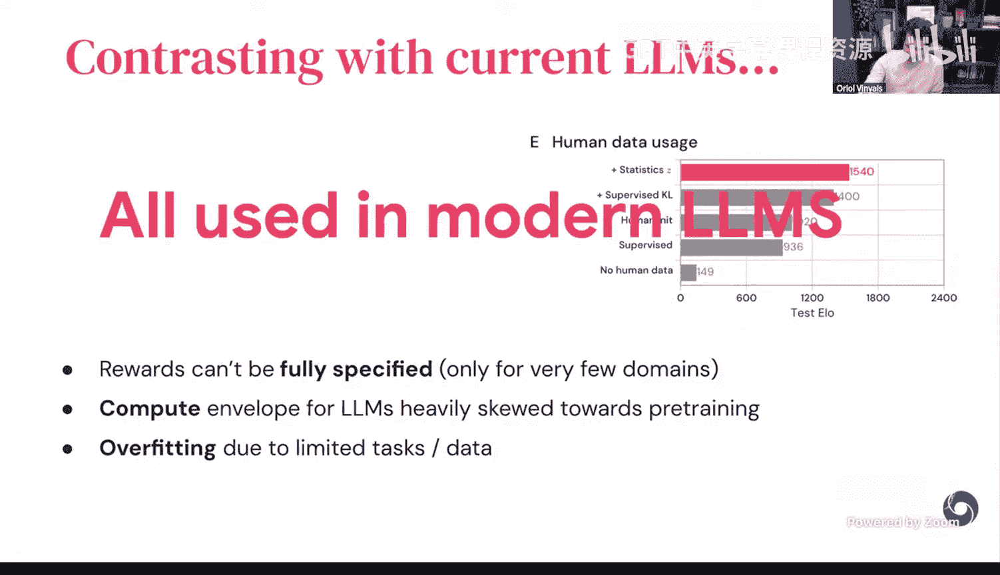

So let me take a sip off my team and let's get into slightly more technical。

 more intuitive part of the talk about。Why do we need multiHN systems。

 what did we do in alphapha star？So this was quite fun at the time I had certainly。

 you know I enjoyed of course the imitation learning sequence to sequence was an example of imitation learning very heavily。

 reinforcement learning I kind of hey， I know what's going on right as a scientist you you learned that domain as you joined Deep mind so it was kind of everywhere multi agentent was all that I learned was during the project and it was very fun and very intuitive and very simple to see results。

 very drastic results very quickly just by trying some sometimes extremely simple ideas。

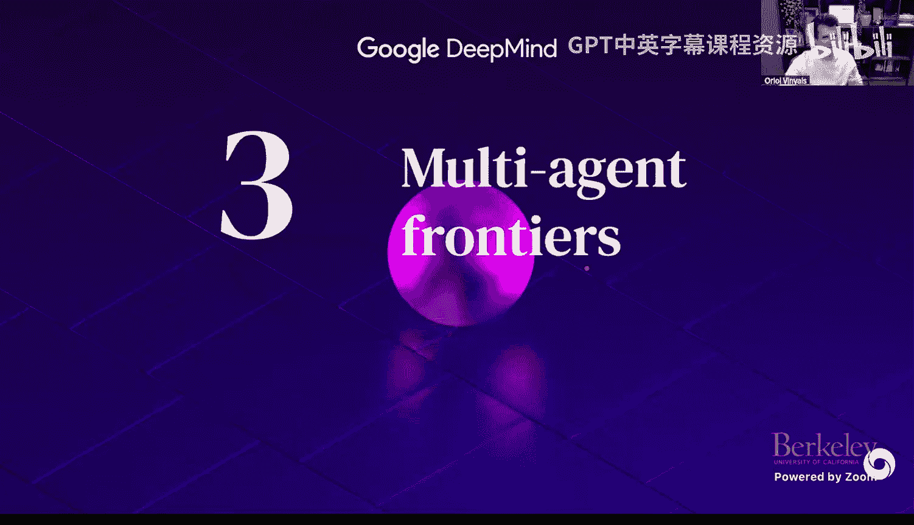

So why did we want motivation Asian learning in Alpha Star War to add robustness。

 so hopefully you'll get what that means through my explanations。So。

You have these models they do amazing things， but we see them fail often and that happened certainly in alphapha star and we see this happen in LLms all the time as well right you ask simple questions right like is this number larger than this number how many Rs are in strawberry？

And these models tend to flop quite dramatically， even though they might be， I mean。

 pills metal levels in some aspects right of mathematics， they might fail miserably in other aspects。

 right。Kind of notally that is very similar to the kinds of issues we encounter we are we train a very good policy with imit learning and reinforcement learning。

 we then play the game as humans right not in the selfplay way that you keep you know getting better e scores and then we found that simple strategies right。

Made the agent it didn't react properly and they were fairly simple it would if you played very at the high level it would really react to your moves and feel like superhuman but it would not understand some basics right so it very much feels similar to although of course we're doing a lot of advancements in our LLMs but it it felt similar。

And using game nomenclature， although you'll appreciate this is similar to the failures you're seeing right we have different policies or different sort of examples that we could get against our agents from some are like very exploitative not that interesting to actual strategies that we would certainly encounter if we had these agent online in the wild right so adversarial policies these would be like making the agent flip is almost like adversarial examples in neuralnets you change a pixel a little bit and a panda becomes an airplane according to a neuralnet similar things you can get with a policy where maybe you bring a unit and you move it in certain ways and the neural network just degenerate right so that's unlikely to be found unless you let of course users probe it but it's still like kind of the most basic kind of exploit you could think about。

From a neural network perspective。Then we have exploiters that。

Are just repeatedly playing properly so to speak against a single policy but eventually they might find a weakness and then they go deep into that weakness strategically speaking until they just basically beat you all the time and that's in a way similar like both exploiter and the next level are similar to what we're seeing in LLMs these days。

😊，The third library is cheese， which is a strategy that my generalize might be actually fairly robust against many different opponents versus the second one。

 which is against just one opponent。But of course， it's not probably the best optimal strategy for this game。

 although mix and matching cheese and normal policies is commonly done at the professional level of Stargraph as well because you always need to be worried that this strategy might occur at any time you're not seeing the board all the time right so to play the game optimally similar to of course things like you see in poker right you always need to be worried about many things so you cannot go too far into optimizing against an opponent that even though you're not seeing what they're doing。

 you know what they're doing right so I'm predictability is important so the third kind that cheeses you usually see them at even the highest level and then there's normal policies and optimal policies。

Now putting it differently， right， this is called non transitiveness， what this means is。

Would this policy work against a different opponent right？

 so the adversarial thing most likely not right like you know。

The Brasalia tag might be specific to the weights of your neural network。Then the exploiter policy。

 you train or you repeatedly play against the same opponent who cannot update their weight。

 so that one is specific to one opponent。Cheese tends to generalize right so maybe when we're talking about the Rs in Stawberry and so on we see many models trained not very differently。

 but somewhat differently by different companies have these weaknesses right so maybe those kind of exploits are more in this cheese category which are reasonably generalizable but of course not very kind of interesting or strong I mean no one hopefully just uses these to cheese the models so to speak then we have normal policies and then the optimal policy which of course is very very hard to find with deeper reinforcement learning and multi agent。

So if we put this figure differently， one observation that my colleague did is that most interesting games have these different aes。

 the Z axis here is the strength the inherent strength of the player。

 right the elo score or the LMCss score， but then within a slice right of this thing。

 you would actually find different cycles of nontransitivity， meaning that。

Three models at the same eos score， especially if the I score is not very high。

 might beat each other in a way that's nontransitive。

 like rock paper Casor cycles actually that's a commonly used abstraction that's very clear right rock paper scissors one beats the other So think of we might have three models。

 three agents at the same level， but one very strongly beats the next and that next one very strongly beats the next one and so on right so there's these cycles of non-transitiveness and many interesting games study here process these kind of these property and this is obviously designed for zero sum games So for LLMs you need to kind of make some abstractions to think about what that means but we certainly have eO scores and we certainly see models having strengths that are not uniformly the same across the same let's say level of LMC's performance for example right so。

That is an interesting。Aspect of the complexity of the kind of task we're trying to solve。

As keep this light just there's the reference from 2020。

 but that explains this intuitively this issue of there's an area where you're not so good that things are very nontransive and then as you become very。

 very good， then there's a dominant strategy that no one can beat so that's kind of how we're seeing in most games this kind of behavior。

Now。Switching gears a bit， how do you actually train these models？

There's a few techniques but all of them have some issues。

 especially as the games become strategically complex so here is rock paper scissors actually so each of the of the vertices here are rock paper or scissarors a strategy is just a distribution of what will you play right so if you play against our opponent that always plays rock well that's a very bad strategy and the optimal strategies uniform right so if you do self play kind of naively。

And you try to say， I'm going to learn an agent that plays rock rockberry paper scissors。

 you see these effect of。Kind of oscillating around the middle and locally you're very strongly into one strategy right so sadly that makes convergence very hard。

Now what you can start thinking about is hey， let's add population populations of policies all playing against each other right so there's several ways to do this here are the three figures。

 but this starting to be to feel a bit better intuitively as well right like if I want to learn to play rock paper for scissors I'm exposed to many players。

 maybe someone who has of optimal strategy playing only scissors。

 but at least I wouldn't know that that player a priori。

 so I might learn to eventually that I have to play you the optimal or the Nash here which is the middle point equal distribution of the symbols。

 very simple game though so obviously very toy。And different strategies yield different results。

 the one that is most hopeful， but even in this toy example。

 it doesn't quite get always the result that is desired is the right most， which is。

You have a population of these agents that you play against and you play always against the strongest of one。

Right。😊，That feels like a good strategy to maybe set yourself。

 your whole system up and we didn't quite do this in Starcraft。

 but there's a lot of these intuitions that played a big role。

Let's see this plate kind of we saw this， this is a real example of what we saw as we trained using sort of self play in Alpha star in the early days。

And let's use an equivalent of rock paper scissors in Star of World。

 which is three different kinds of units， Boyre， which is an air unit。Imortal。

 which is a very strong ground unit that cannot attack the air and then stalker。

 which is kind of a unit that can attack the air， but is not the strongest ground unit。

So boyrate beats immortal， immortal beats stalker， stalker beats boy rate and it's kind of true if you do it just naiveively。

 you just build lots of these units， you most likely will see disease actually like represents the game reasonably faithfully。

So great right we said this and we start from imitation learning so we have that players I mean there's a distribution over different strategies that people will have done when they play online and our initial policy is in the middle right it's not very good at either of these。

 but it represents the whole distribution。And as we train， what happened is our policies。

 even with the distillation losses and so on， started to only do void race really well， lots of them。

 very good micromanagement， but they became really， really， really specialized。

 so the whole population which was not really a population， this is just pure self play actually。

Everything， the only strategy that became。Present during training was Boy race and of course that washed out a little bit the prior knowledge that we came in even with distillation。

And that meant that from the agent's perspective， it was delusional right it was playing against itself and boy Bra versus great battles。

 awesome games that we recorded during that time， if the enemy happened to do immortalos，No issue。

 right these units dominate this， but if someone just said， okay， I'm going to do these other units。

Then this agent didn't even encounter this anymore right because all it saw in its games were massive amounts of boy race so sadly this was not a very robust strategy I mean if you force a pro player to hey you'll have to do boy race only do that no cheese。

 no different strategies then these agent was very good but of course people are diversifying what they do these are not the only three strategies there's early rahes all sorts of things that happen in these domains so that really didn't work well。

What we added though the key notion in the league is to add exploiters right so as you train the model the main agent the steel agent。

 it might still specialize to the void race， but then at some point during the training process like the reinforcement learning you're going to add a second agent。

And this agent is going to be an exploiter， meaning that he's only going to care about beating this。

Agent here， right， its its goal is gonna be beat this agent。 This agent cannot train against these。

 So there's an asymmetry。 The red gets to see the games and learn from them。 but the till does not。

 Okay so then what happens naturally is that if the agent starts to specialize to void race naturally。

 the exploiter will start doing stalkers right So now at least these agent has seen that， hey。

 there are very good players out there that will do these other unit that beats me So it's gonna to be exposed right to this strategy。

 and be able to react properly。 And even say。You know run out of the optimum which is to build lots of void race to say hey。

 maybe I actually should also build Imortals if I see that the enemy is doing lots of stalkers etc ceter。

 right so this is simplistic but I think it gets the idea of the algorithm we end up developing intuitively。

In full， what we do is these in steroids， right， so we had many different agents。That were created。

With the sole goal of making the main agents the agents we actually deployed and became Grandmaster against the global population of players right so you can imagine we have these three main agents one per race right and then we have different agents whose goal is just to make the main agents stronger right so that's the whole multi agent system we designed。

And the way it works is actually super simple。 We didn't experiment a lot with this。

 So the main agents are essentially playing against themselves。

 playing against the other main agents and playing against the whole population all the time。

 right They are playing kind of。😊，Against everyone。

 I'll get to how that distribution of everyone evolves over time。

But then these main exploiter agents， they will basically say， hey， start from the prior。

 try to beat let's say the three agents maximally right so just cheat right。

 cheating the sense of I can train against you， you cannot train against me。

 develop a policy that eventually reaches a certain wind rate when the wind rate is very high。

 meaning I exploited you successfully， only then you say hey， here I am， I'm beating you。

 I'm a new player in this world。Deal with it right so this agent was secretly training until it became good at exploiting and when it became good。

 it dropped a checkpoint it showed itself against the main agents which now all of a sudden could play against it and it went and it restarted the same process again from the prior right so over time you will find different exploiters at different stages of training against the main agent and then we also added league exploiters which is the same concept but instead of beating only the main agents these agents try to beat everyone in the population by finding exploits that work against everyone rather than just the main agent。

Which is a bit more like cheese right so we have main exploiters。

 league exploiters and then of course main agents。This was very fun to see， like the dynamics。

 the learning dynamics， very。😊，Hard to understand even in a game right what's actually going on。

 I mean intuitively we know but lots to do that are left on the table from these Alpha Star League as we call it。

 but it was very powerful。

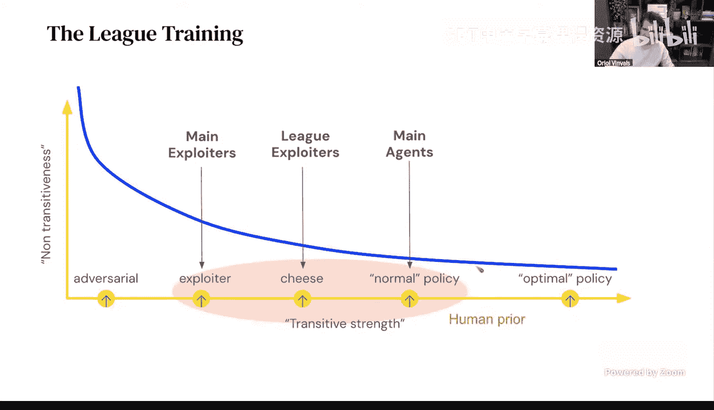

And then over time， we have over 1000 agents that have different strengths， right。

 they will beat a previous agent but eventually the main agents catch up and beat the exploiters。

 so there's all sorts of interesting wind rate dynamics。

And it can be represented in this shape of the the spinning top a little bit， right。

 so the weakest agents here are。highly nontransive there are 30。

000 R cycles that means the cycle length of nontransitivity is 30，000 right so you can find 30。

000 agents I believe that's what it means that beat the next one。

 the next one and so on and so forth and as the agents become stronger。

 they start to fully dominate which is also commonly seen， I mean in these interesting aim。

So that's an analysis， this is what happens in drug paper scissors to give you an example。

 so much more complex game dynamics。And then as I said。

 it was very fun to see this happen right so you would be training and all of a sudden this red agent is an exploiter that finds a cheese that's called canon ra right？

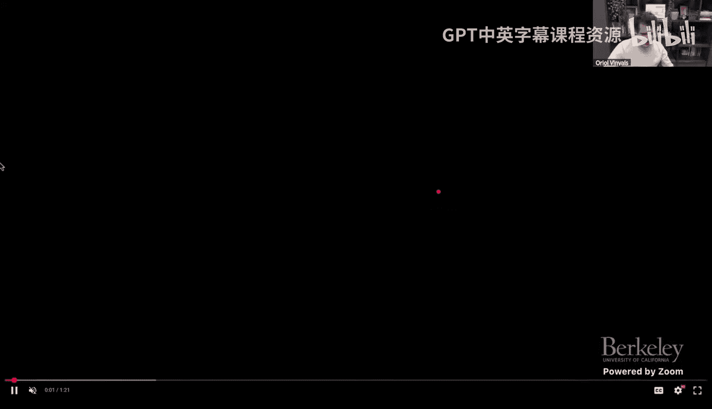

So the blue agent that's the main agent。Kant really has not seen this strategy enough so can't really defend very well。

 but eventually by now playing against this RE agent that's now frozen in time and it will just do the same strategy eventually we be able to defend and so on so forth right so with workers which is the right reaction and scout right to find that you've been indeed in this situation and so on so forth and we saw all sorts of interesting dynamics as well anyways there's lots of cool games and hopefully analysis that you can see online I don't want to talk about Sagra too much but it's a passion of mine as you can see。

But yeah this was kind of very critical and then in the results you could see that if you only train with the population still but only of main agents right so just you have three agents playing against each other and against themselves in the past that's called fic tissueious soft play you know you achieved certain strength and this ch is not that perfect if you play as a human。

 you would not be that that strong I mean these differences were probably less than reality and we check these a little bit but it was hard to do these experiments in the while then by adding main exploiters we became much stronger and by adding on top of that leak exploiters we had the final system that was robust against many different strategies and of course very strong at playing the game。

Now a couple of details， and then I'll conclude is that。

The path of learning matters and it's so hard to know how it matters right like basically if you're now an agent and it is exploited very often or very rarely or initially is never exploited。

 I mean all these changes heavily the policy you end up with at the end of this process。So。

There's lots of details that I mean， are to be worked out even from a theory perspective。

 but in these games and with deep reinforcement learning theory is also hard to come by。

We had a couple of strategies on how to match make， so I'm the main agent。

 there is like literally0 agents。Which should I play against so we have two strategies one is play against the one that beats you the most which is heart opponents and one the other one is play against the one that you're 5050 your closest to maximum entrytro right because the one if the one that beats you the most beat you all the time there's not going be a learning signal So we try these both strategies variance was a little better like this one that maximizes kind of that tries to get to the sweet spot of 5050 but also I mean this is one of the many parameters that tells you that the process in which you create these main policies matters a whole lot。

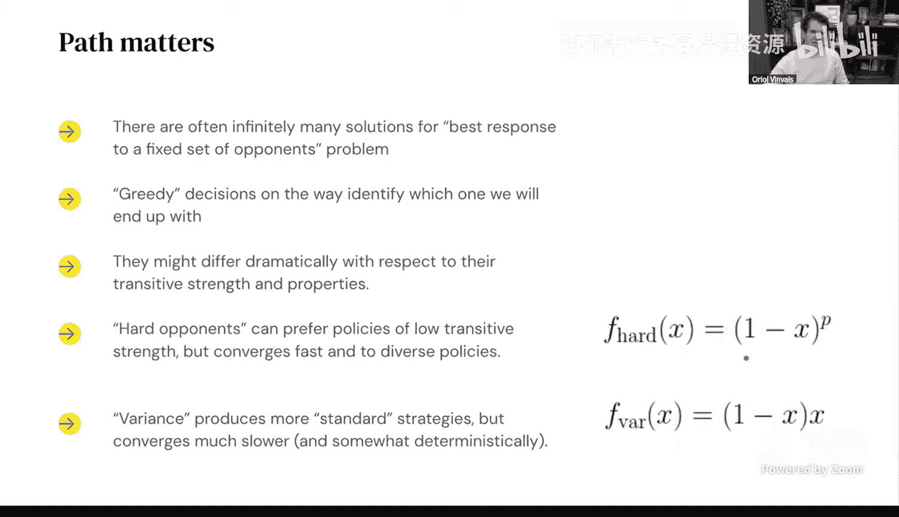

And then the other part that was important is that。

To generate interesting counter strategies or exploiters or cheeses having controllability mattered。

 so not only we started from the prior distribution that we had training in imitation learning and say hey go and exploit the main agent we also were opinionated about how you should exploit it right so we would sometimes not always say I want you to exploit the main agent but please do it with this unit type right like I mentioned how we did this prompting so it was kind of。

tyying your hands behind a little bit say hey， I want you to beat me but you have to use this unit right and that added a component of robustness and diversification that also helped so lots of different choices here not a lot of time we had during the project to fully study these but you can see lots of different possibilities。

And it was very important to have this diversity in the main policy of course in LLMs that is trivia right so you have they're very proable。

 there's a lot of diversity so there's not a problem at all to think about hey， I don't know。

 solve this theorem but do it in Catalan or in Spanish or do it in you know very very all these things will add some sort of robustness to maybe new encounters that you'll find meaning new prompts in LLMs and so on and so forth。

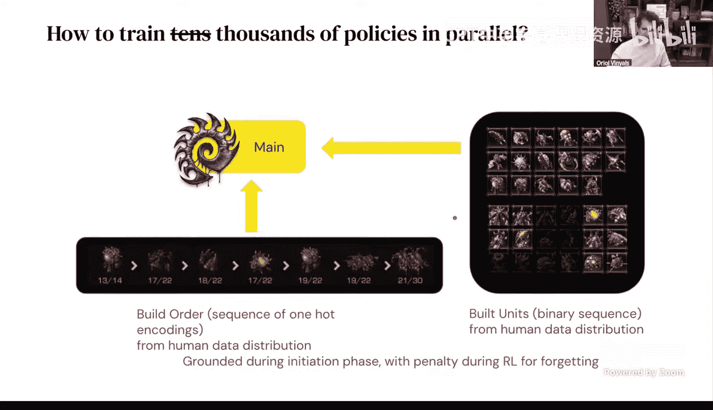

So contrasting his very exciting multiagent ideas and space with LLMs mean one one difference is that users are in general collaborative right like it's not a zero game that we play zero sum game that we play I go online and I want to achieve something get some information help me with some problem that I'm having so I'm actually collaborative with the other agent right。

So that's an interesting difference。 That being said， we also have adversarial users right I mean。

 who doesn't like to find weird failure modes and then Twitter likes are obviously one of the reward signals that humans like to optimize or and also more seriously right we will have you know eventually these systems become close closer and closer to AG very powerful So you might wantna them for doing something that they shouldn't be doing right so there's gonna to be adversarity as well trying to。

Go around how the system is designed to be used so both aspects could use multi agent techniques such as the 1 I describe from the alpha style differently。

Complexity is massive compared to even a game as complex as Starcraft right so there's no clear reward。

 we discussed these prompting is much less clean than a bit of a bit of which units should you build right prompting can be vast is natural language is unbounded it's very。

 very interesting the amount of complexity will deal with here to the extent that even these LLMs playing Starcraft。

 which is a dream of mine they can kind of play。 They're not very good is actually one of the many domains right so you could see a particular case of current models is that we might just instruct them to hey be a very good stargraph player and then give them control of the environment and see what they do right and in fact games more and more are starting to be reused Turn around be used as an evaluation There's a game arena I believe on kle that is very popular for example。

 and famously， I think some of the LLMs try to。Prete Pokemon， et cetera， so very cool domain as well。

 right to test ideas。I will say some amount of ultra re timinging right， et cetera。

 has been using multi agent techniques， but I think overall is still in its infancy。

 so there's lots and lots of research to be done here。

So to conclude the sort of past and future combination and of course present of LLMs。

 I would say there's lots， you know pre LLM agents right there's lots of gems to learn from from many different。

Papers and different problems tool use was discussed architectures， losses， regularization。

 value functions， I mean， lots of things we can probably revisit very seriously and we should。

My strong belief is that human priors are going to be part of the path to HGI。

 but we need to obviously also build knowledge and experience on top of that prior knowledge。

 I've seen it succeed in offtime now including in Algo which also use imitation plus RL that I believe that certainly the shortest path to HGI。

 although happy to discuss that if useful， then in general like RL or posttrain on top of LLMs still feels in their infancy when I think and compare to a system like the Alphastar system。

 we can train on thousands of steps maybe versus in these Alphastar League we use 10 to the 10 training steps in post training right so vastly more compute used in post training rather than intraining of course we also have this issue that the rewards are fuzzly specified so that。

Its definitely a challenge。And last but not least， multi-ageian R。

 in whichever way you can think of creating a population of users and agents talking to one another and really optimize and train for that。

 I think that's very exciting and it's going to have probably a new scalability breakthrough I can imagine in the next few years。

 maybe from some of you。

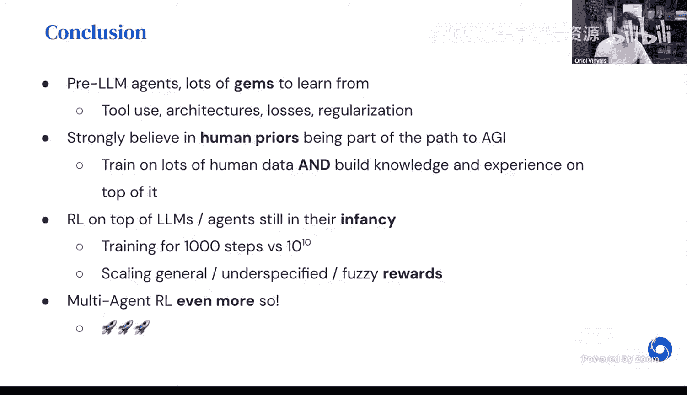