# UCB《理解大语言模型｜CS 194／294-267 Understanding Large Language Models》中英字幕 - P1：-1-Yuandong Tian_ Inside-out interpretability_ training dynamics in multi-layer - GPT中英字幕课程资源 - BV1Sz421q7k1

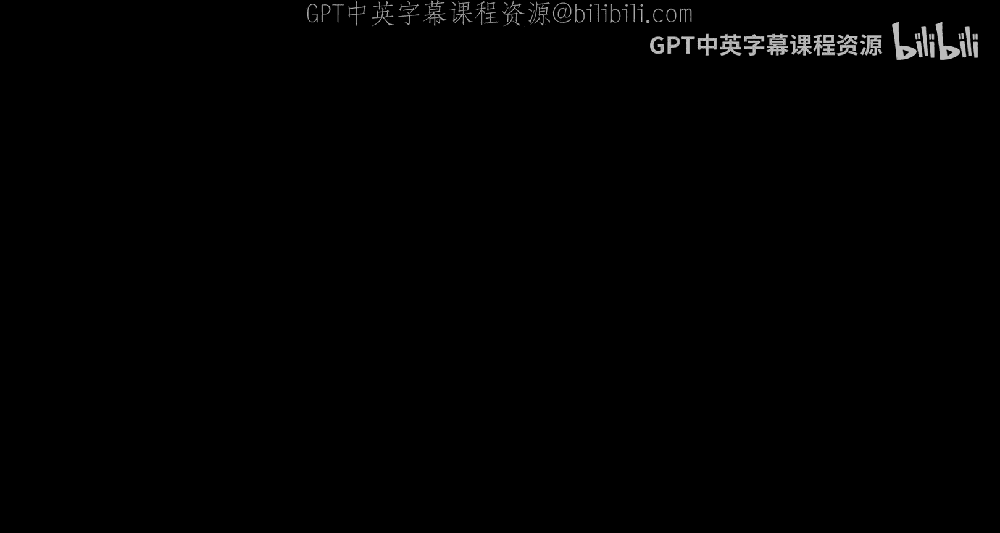

At its core we all know that it's the transformer that play all the important properties and also have all the interesting structures that can enable all these applications and in this transformers we all know that the difference between the transformer and the multi layer perception is that there's an attention layer and this attention layer actually play some magic so for the attention layers we know that's a query that's a key to do product they can compute the softmax and use these softmax values to reweight the embes from previous layers and you do these multiple times and magically it give you very nice outcomes by predicting this next token So then the majority of this lecture is going to contribute and to talk about like how we should understand this mechanism。

😊，So we basically talk about two papers there's one paper called scan and Sn that is being accepted in New York 2023 and we have a follow paper called Dr is accepted inDCSI clear talk about understanding transformers so we start with this scan and snap paper which basically understand attention in one layer settings so we always start with very simple settings in order to understand the mathematics formulation and structures in order to have a better understanding for multi layer transformers so we start from one layer settings。

 its one layer settings we have a very simple input output right so the input here is basically a few contextual tokens x1 all the way to X minus1 and then you have a last token which is called query and then send to the query and you do save attention and once you have some distribution across multiple tokens in terms of the probability in terms of attention scores you use this attention score as a weights to。

To compute the output features。 And this feature is going through normalization。

 and then decoding layer and a soft Max and use that to predict the next token X T plus one。

 So that's basically the model， very simple model。 And here is the formulation that we try to use in order to build this end to end mathematical structure there。

😊，RightSo based on this one and you're going to see like okay， if you write them down literally。

 you're going to see a lot of parameters and you see WQWK and you also see you So it's very complicated if you write them down and try to compute gradient。

 It's very messy。 So we actually make two very important tricks。

 So first of all was that you want to make sure that youtize the problem with independent variable。

 and this is turned out to be very important for this paper and also for the follow up work that does more better understanding for multi layers。

 So this is actually try to reize this many variables into y and z。 So y is basically the top layer。

 the decoder weights and Z is the pairwise logic of attention matrix。

 And then suddenly the dynamics become easy to analyze and we can actually come with some conclusions。

😊，So that's basically the major first step we can do that and we can actually use that to write down the dynamics of y and z。

 I'm going to cover that later because this equation seems to be very complicated so in the next few slides we're going to have a much simpler formulation after we have introduced drama and then we'll put them together and magically things become much easier。

😊，So we first start with the conclusions right so we don't want to go into details first but talk about like what is actually bring us for the property of transformers so here's a few of major assumptions for the scan and snap paper first there's no position encoding we don't talk about position encoding right now because first of all it's a little bit hard to deal with and second we actually see people have papers that can show that even without position encoding you can still get reasonable performance right and second sequence lens goes to infinity you have very long sequence lens and third which is a particular assumption in the skin and snap paper is that the linear rates of decoder Y is larger than the linear rates of the cell tension layer Z and finally there's some other technical assumptions。

😊，So and on the data distribution， we also have some assumptions as well right So we assume there's a bunch of sequence classes from1 to K and for different sequence classes。

 there's two different kind of tokens its one token called distinct tokens that only appears in one class。

 but not the others there's also common tokens that appear in multiple sequence classes so you can basically write them down in a mathematical form saying that for distinct tokens the probability of that sequence of that token given the sequence index is greater than zero for only one sequence class but for common tokens。

 this might appear on multiple sequence classes So basically that's assumption given that data assumption that the question is how there the same attention layer behave So here's the main conclusion is over over picture of the transform dynamics So first of all。

 we try to put this key key statistics there which is called C title that is。😊。

ActuallyThe product between the core occurrence probability。

 which is the probability for data set and also exponent of the pairwise attention matrix。 right。

 So you have this C title here。 You want analyze the behavior of the C title。So。

 and you're going to see like for distinct tokens， this C title is non0 for just one class because the corresponding core current probability is non0 for only one class。

 but not the other。 So you're going to see very distinct patterns。 But for common tokens。

 it appears in both of sequence classes。😊，And then the first conclusion is that for common tokens you can analyze these dynamics and it shows that the gradient the gradient will basically drag all the attention score of common tokens error to be smaller and smaller so z will become smaller and smaller because the gradient of z respect to time is smaller than zero So here this notation means that it time derivative so time derivative of z is smaller than zero so then over time this U becomes smaller and smaller。

 this is true for common tokens basically the token that appears in multiple sequence classes。😊。

On the other hand， you can actually show for distinct tokens the correspondingian Z。

 which is the attention logics will grow over time so this is basically the figure showing that how it grows so for all these distinct patterns。

 distinct tokens， there are attention score will go up and this increase or attention score we also make the final C titer going up as well。

😊，So from this tool you can already see the attention mechanism is kind of like the learnable TFIF right so if people have been working on NRP before before the transformer error and people may heard about this TFIF kind of formulation which means that you want to find tokens or find words that has a high frequency but also want to have the words that has inverse document frequency right so the first term talk about very important words for each class and second criteria basically ask the model to filter out the tokens that is too common across multiple multiple document so for example and also all the articles or the common words and they are not informative so they should be suppressed when you are doing a decision or document classification so by the other hand。

 if you have very specific tokens for specific categories and we should pay attention to so for example if talk about sports。

😊，And talk about messy messy is a very important token for S。

 and then you have the connections there and you may use that to do a better document classifications。

😊，And third， furthermore， we can actually actually quantize the growth rate of the attention scores right so basically theL。

 which is basically the one element of the selfat matrix and this is actually a function of time。

 this actually will grow faster with a larger conditional probability error given the attention given the sequence sequence class and we can actually characterize how it grows faster that we can have a serum the serum will tell you the ratio between the two distinct tokens how much they grows and how fast they grow so if the figure also shows that if you have you have like a distinct tokens that has a very high cos with the query then it will grow much faster。

 then the distinct tokens that only happens to be co-ocd with the token。😊。

Not with high probability So you're going to see this a very high jump when you're doing the training。

 So in some sense， this is called contextual spaity because over time you're going to see this C title。

 which is attention score will actually become spae and spa after normalization because the winner will become richer the rich will become richer where the will becomeer right So and over time you're going to see maybe one or two where it stands out and the reason why you see attention become spa and spa doing the training right So thats that's why we are called this contextual spaity is that this depend on the query for different query。

 youre going to see a very different curve there right So for different query query one token this will have something like that from a different query tokens then maybe a different token will have high cores with a particular token。

 then you see a very different patterns the query dependentity there。😊。

And finally we actually have shown there's two stage effects for attentions right so people may wonder according to this picture。

 then over time you're going to see a high and higher growth for high or occurred tokens with to a query that eventually you're going to see a winning take call effects but actually it's not the case in our analysis we eventually will show there's two different stages when its called attention scanning which in which this winning take call effects happening on the other side the second stage called attention snapping in which everything slows down a little bit and finally seeing satur rates so once you see the richer become the become richer effects and after some time in the attention pattern will freeze and it becomes kind of like a minority take all kind of a picture but it's not like winning take call so that's basically the over pictureture that is shown。

😊，the scan and snap paper so that's basically the menu picture and we have a few different simulations and showing this is really the case and this is like some overall strategies for the theoretical analysis so if people are interested then here is like a very simple strategy in how to prove that right so first of all we want to use this power of infinite sequence length to basic turn all the terms into statistics terms that include the probability distribution that's the first step and the second step because we have the assumption that the learning rates of y which is the decoder is much。

 much faster than the learning rates of Z which is the self matrix then you can basically treat the same attention matrix as a constant when you analyzing the dynamics of decoder and then once we have that nice equation which tell you that how the gradient by pro。

😊，To the the attention layer is related to the data that is being fed into the decoder。

 Then we can plug this back to the self attention layer and then analyze what's happening in the self attention。

 So that's basically how you analyze the two layer structure of the one layer transformers。

So we have done some very simple real experiments， for example， on Wiki text2。

 if you have this kind of like learning rate structure then over time you see various spae patterns in tensions and if you do a lot of work in practice for training transformers you also a see these learning patterns changes so that's basically the scanner step paper very simple and then we can talk about like how can we improve scanner snap paper and how to get rid of these assumptions right so we have annoying assumptions here there's no inviting vectors。

 there's no residual connections right so that decoder need to be learned faster then attention which is never happens we never happens in practice so and also and we have this single day analysis right so how to get rid of them then the next step is to introduce the work called drama which is our second follow paper that try to understand these dynamics much better compared to the previous papers right so in that paper what we do here is we actually discover some very nice properties。

Of the training dynamics between MLP lower layers and also the self attention layer combine them together into a layer called Mo MP。

 So that layer actually capture the dynamics of both of the layers and at the same time。

 much simpler then if you think about the self attention and also MLP layers at the same time。

 that's basically the rough idea about drama。😊，So for this one we basically like put like a drag down like one layer of the transformers and then we put like a bunch of symbols to analyze what's going on so know that we now think about like this additional re connections here and this rest connections is basically like is missing in the previous analysis but now we can add them back and show how it actually played the rule here and we also can use this linearities so these five is linearity in the decoder layers in our previous like step paper there's no nine narrativeities it's basically linear towards the softm so that's the difference so we actually can able to show a nice properties there and we also have this ems matrix you here and for the inviting matrix we basically have assumption that these embes are all soften to each other and does not change over time so that's actually。

That been questioned by reviewers。 So that's why we have an figure showing in practice。

 this is indeed the case when we actually plot the similarity between vector at different layers for models like We also tested on other models。

 It looks also true right So here basically figure showing that X axis is is basically mini batch training dynamics and y axis is cos similarity cos similarity will vary between 0 and1。

 So one means like perfect line and0 means like to each other。😊。

RightSo then what you see here is that over the training， the does not really increase as much。

 right So it's basically at roughly like 0。03 something， right。

 So it's almost solid to each other for even for different layers。

 And here each curve correspond to different layers。

 the layer is represented by the color of of the of the curve。😊。

So that basically means that this orthogonity assumption is approximately true。

 but still we haven't analyzing the dynamics of an embedding yet， which may be the next table。😊。

So given these assumptions， then we actually will see there's a joint dynamics between between the lower layer of MP and also the selfat layers right so you can actually compute the selfat from from basically like the magnitude of the lower layer of the weights so this basically mean that once you have that equation。

 then you can forget about the self selfat layers but just plug in this equation into your dynamics and it will give you something like that so this equation basically tell you the story of both selfat plus the MP a lower layer so then you can use that equation to analyze the dynamics of the transformers that's basically the idea so this actually makes things much simpler and this does not require assumption that the decoder。

Layer is much more much more is basic training much faster than the than the self layer。

 You don't need that anymore。So here is basically a few slides I try to do comparison between scanner snap and drama this is basically a few additional slides that we add in order to answer the question raised by the students so here's like a general formulation that try to combine the two things together right so here we basically have a unified general for formulation that combine these two things together so here is like you have these notations and here common assumptions between the two papers basically all these incom assumptions first of all。

 the lower layer weights W and also and save attention layer weights Z they are both trainable parameters they can be trained so we basically both of the work we are not considering wqwqwR wqwqwv。

 but we are caring about these entire Z matrix as a trainable parameter so this is something that is different from what's practically happening and second this you。

Wwhich is in is fixed and column orthogonal right so this is also another assumption that we make for both of two papers and the third paper is that the input token when a vector is actually one hot column vectors so that we can actually compute frequencies this is true definitely for the first layers in which like each of the tokens it be encoded by one hot representation so but may not necessarily true true if you think about like multiple layers and in terms of like the intermediate non nonlinearularities so this may not necessarily necessarily true。

😊，So the difference between scanner snap and drama is that you might have very different settings right so for example in scanner snap。

 you might have additional normalizations Air2 and you have to assume that this activation which is linear and ZW learns much faster than but on the other hand in drama we are having a different settings so maybe Phi is empty there's no normalization but in linear narrative you can use linear or nonlinear so we can also there's a bunch of other different directions and this is actually the derivation in a few in one slides about the first serum so I don't want to go through that but just use that as one of the summary of the serumem1 if people are interested you can go through that this is actually much more concise then the proof we put on the paper and we're going to update that in the camera ready。

😊，So then people will say， okay what's happening to drama if you have destroy dynamics。

 what happens So here is a verification about dynamics because in the set attention layers we actually makes assumptions we want to make sure the assumption is true and once we have joint dynamics then we can try to come back to the scanner step settings in which the activation is linear and to see whether it actually having the same prediction then scanner step the answer is yes。

 we can actually have the same very similar predictions there so the prediction basically say that attention will become spa it's consistent with scanner step and the component that has the highest highest like this token discreancy times co so this is this term the term is highest in terms of the in terms of magnitude then you're going to。

😊，See it the curve will go the fastest fastest compared to other curves which will saturate so it's actually consistent with scanner step。

 but what makes things more interesting is that if you can extend this drama to nonlinear activation in which like activation is nonlinear then the previous scanner snap paper is not able to give you anything。

 but we actually can give you a much interesting behaviors that is correspond to linear activations it actually tell you that the attention will first become sparse which is what the scanner step paper will predict but at the same time it will become denser later in the later activations So basically this is the difference picture。

 the picture is different between the activation and in the linear activation in the linear activation I mean the attention will only become sparse and then it goes sparse is sparsr and it saturates but in nonlinear situation it will become denser。

😊，Later。Okay， so this is actually I don't want to go into details for this one because there's a lots of math there。

 but we first want to check whether this is consistent with the real experiments right so actually in the real experiments we have a our transfer models。

 multilayer version in two different real world text to real world data sets withs Wiki text2 and the other is Wiki text 103 and you want to see exact the same curve as predicted by the theory。

😊，RightSo especially in the first layer if you train one layer transformer with non narrativeatives。

 then you're gonna to see its first drop and then go back again。

 it is very similar to the previous curve that is drawn by the theory so it's very similar and if you put like a multiple layers there are training youre want to see very similar curves as well right so especially in the top layers。

 you're going to see things drop and then come back so that's actually quite interesting so and then we want to really understand why that's the case right so why you will have these behaviors because these behaviors doesn't seem to be that intuitive especially for one layer because for one layer it should be the case that we just do one shot。

 why you need to pick up that the features that are not silent later right so first like the things become sparse because of the same mechanism as what's happening in the scanner step that。

Token that quark a lot with a query， they will basically be pickup and then the attention will go up and other attention does not change or even go down then that's why you see the attention entrophy goes down to very low numbers but after a while the attention score will pick up the attention the entrophy will go up The reason why it go up is that it also pick up features and tokens that is not salient。

😊，But still reasonablysilient over time， and that's why you see that attention entrophy also goes up a little bit。

 this does not drop in the first step because here the units is mini batch K， so kilo mini batches。😊。

RightSo basically， it has to be go from like first 1 kilo mill batches。 It drops down。

 And after that， go back bring back up again， yes。😊。

And I think the skill probably is not important because you can always change the learning rates。

 you got different skills。😊，Yeah。有。Okay。So you also see the real events with other models and you see the similar behaviors as well。

😊，So the reason why we we actually see this is because we have a hypothesis later to talk about these properties。

 So basically this property。😊，Its not useful for one layer， because in one layer。

 why not you just learn all the features in one shot without having this kind of interesting properties。

 but it may be useful in multiple layers。 The reason why it is useful multiple layers。

 we have to think about hierarchical data representation。😊。

RightSo we think about we want to learn the hierarchical data representation from the data So in the representation。

 what happens is that you only see the final labels。 Okay that that's top layer。

 you only see the lowest tokens， which is in the lowest layer。

 but you don't don't really see what's happening inside。

 So there's latent variables that will govern the data generation process。

 but you don't know We have no idea what's happening for data set。

 but you really want to train transform model so that the transform model can learn automatically the latent representation in the data set。

😊，And what's happening here is that we're going to hypothesize that in your transformer。

 the reason why you see this attention jump up is because you actually can learn the latent representation there so first of all you can actually prove a serum the serum basically tell you if you have two tokens that is very close in hierarchy。

 then their probability that they co will be very high almost equal to1 but if you have two tokens air prime and n there are very far away from the hierarchy。

 then their cos will be low very close to zero so here is like an equation that characterize this behavior。

 H is basically the height， the height height of the common latent ancestor of this two tokens A and M so for this air andM they are common latent ancestor H is one is very small so that if you plug in that this is approximately one if you use this same serum。

😊，H for air air prime M they are very far from each other and their height of the common latent ancestor is almost air。

 which is the total height of the hierarchy。 then this probability will almost become zero right so first of all。

 you have this assumption。 You have this interesting properties for the hierarchical generating models right so know that this property has nothing to do with transformers okay。

😊，Then we think about like how we transform or should learn it。😊。

RightSo we think about this property that we first learn tokens that co a lot。

 then we learn tokens that co occur sparsely right so this mechanism actually works well for both shallow and deep latent distributions because for later distributions that is deep then what we learn is that we first learn M and air associations and also M prime and air prime associations at the same time because they co a lot with each other according to our previous analysis for the hierarchy right so because they first learn the two then you automatically imply built a hierarchy that can be later combined again in the top layers so you basically avoid the learning of M and air prime。

 which may have co a little bit but they are cores is not important and can be learned indirectly by the hierarchical learning。

😊，So then does actually give you the intuition why transformer should learn the features in this way and on the other hand。

 if you think about if the data is generated by some shallow latent distributions。

 there's no much hierarchies there， we just have very straightforward distribution there then what happened to the transformer learning so the transformer will first learn the token that occur a lot M and L but eventually it will learn a co occurrence between M and air because these two still have some co but maybe very weak then basically the same mechanism which is tension mechanism can learn both the deep latent distribution and also shallow latent distribution at the same time without knowing the internal structure of the data。

 so this basically provide you with kind of insights about why transformer can do so much interesting things without actually knowing the internet distributions。

 it will be auto adaptive to the structure of the data。😊。

That's basically the explanation why we see this attention first go down and go up again。😊。

So if you come back to the figures and you will see interesting behaviors。

 if you train the same model the model with the same data sets right so you train this layer first layer model。

 one layer model with transformers you see very deep very like very very interesting structures there and this is very obvious but if the layer of the transformer become more you have like more deep transformers then in the lower layer。

 they go basically drop but there's no backup right so but in the top layer there are still kind of like a button bouncing back kind of properties。

 the reason why this is the case can also be explained by by this theory because if you have multiple layer of transformers。

 then what you do here is that you first learn these core occurrence that co a lot and once you learn this you don't need to learn weak occurrence between air and prior again because you don't need to learn this two these two core occurrence then you don't have this。

Buncing back properties because this bouncing by has already been explained away by all the by the previous mechanisms right So that's the reason why you don't see the curve in the lower layer that bounce back after if you learn the data with multiple layer transformers Yeah。

 so I think right now I think this is this is a theory I have a heavy mind but we haven't tested any other possible explanation。

 Okay I see yeah I'm not aware of other papers come to explain this right now。

 but mean it will be interesting to see any alternative series there that's just one way to explain。

Is there a where you can generate some synthetic？食そし。Yeah。

 so you can actually do that in some of the in one of experiments right so because for this theory one possible implication is that over time you're going to learn these latent variables in different layers of the transformers which is indeed true for our analysis because like if we can generate like character data from synthetic experiments you can use transformers to learn it。

 you actually see almost 100% correlations between the latent layers but between the hidden layers of transformers and the latent variables especially in the few first few layers。

 you can see we have tables in the paper first of all the causality here is not related right so we don't know whether the causality will play a role here or not because here we only only as correlations。

😊，There's no causalities。 Yeah， but indeed， it seems like it will learn strong attention。

 a strong correlation first， and that strong correlation may mean causalities because if you see these two tokens happen a lot。

 then they might have real correlations between two。 Yeah。

 so think as I think we explain a little bit。😊，Previously。

 so if you only train the data with a lower with like shallow transformers。

 you see very clear bouncing back。😊，If you train the train like a deep transformers。

 then the lower layer， once they drop， they will now bounce back because the bounce back means that the lower layer trying to learn features that are weakly correlated。

RightIf these features has already been expanded away by top layers。

 the lower layer does not need to learn them anymore。😊，So that's why it only goes down。

 but that never goes up。But then my question is if you unfreeze them after let's say like one or three epos。

 whatever it is。Do you think that it's going to become like the lower layers are going to be the same level of bounce and go back then yeah that's a very interesting experiment to try Yeah I would suggest it's possible that you're going to see the lower layer bounce back and then go back go down again actually I saw this curve in some of the configurations Yeah so it's actually pretty interesting and there' are also other experiments that shows by changing the different learning rates you're going to see very different kind of training curves right and the training curve that show this bounce back properties willll have the highest validation accuracy。

Which means that thats might mean the correct way of learning data so compared to other kind of learning rates。

 yeah you can check experiments in the paper， we haven't show this yet。

 it depends on how you define your causality right so it's possible that causality would mean if you kill like the first promise and it will not the second will happen so but not divisive vers because it's asymmetric so if that's the case then you might want to design properties that to enforce the attention matrix is also the same properties something like that。

It's possible。 Yeah， I think that's actually a very good question。

 So we actually try our parameterization real y and z in practice that what happens is it can still learn but performance it obviously not as good as original transformers right so we actually have a one called the yz transform which is the yz parameterization that we shown before you can actually trend it for three layers。

 it actually works but when you train multiple layers it actually does not work as well This is because the power of embedding because in in the yz transformers there's no embedding the embedding is all put into the z matrix Z is like huge its a vocabulary size by vocabulary size right so but this huge matrix may not be trend well doing the practical training in practice what we do is that we do not really like trend this huge matrix。

 but instead we train embedding and also the weights to basically mimic this huge attention matrix。

This is， in some sense， much more efficient。 So this aspect hasn't been explained by the theory yet。

 but hopefully in the future， we're going to explain how the dynamics look like for the attention for the em matrix。

So we have to basically break this into parts and analyze one after another。 Yeah。

 I think that's a good question because the reason why we want the assumption for the second snap paper is that the formulation a little be restricted so you really need to analyze two extreme cases right so either a token is happening in multiple multiple classes or a token only happen in one class right but there's actually a lot of things that's in between right so we say like one token happens a lot 90% in one class but not 20% in other class。

 what happens to that right so the good thing about drama is that once you have have the formulation。

 then naturally you will have this kind of property。

 this property is replacing the common token versus the the distinct tokens now we have a continuous spectrum covering all the tokens right so if this quantity is high in magnitude。

 then this is distinct tokens if this quantity is almost zero， then it's common tokens。😊。

So then you have a spectrum that you don't need assumptions anymore。😊。

YeahSo that's the good thing about the formulation。Yeah。

 so you still have the occurrencence and also discreminpancy。

 So it's a similar thing as in the scanner step。 But now it becomes a natural term。

 Then that term does not need to be specially treated。Okay。Okay。

 so we have covered mostly the two0 paper in 40 minutes。 I think for the remaining 20 minutes。

 we're going to talk about more empirical work。 So I'm going to skip all the formulation details。😊。

And hopefully， people have enough of it。So I think it's great that we have so many questions here。

 usually for series it's pretty hard to understand。

 but it can be interesting to discuss the future work of course the future work here is that we want to do inva vector analysis so in these two papers we basically assume the in is fixed and it's all to each other while this is true if you check the empirical results but it's still not ideal because in should also be learned doing the training but we haven't tested yet we haven't like really analyzed what's going on with in so which is a little bit a PDity so but there will be an next paper trying to deal with that and also position coding another one and also we want to talk about basically the dynamics of the latent concept learning right in the multilay settings we basically give a concept about how this should learn but there's no concrete theorem telling you how this latent vector get learned。

Over time。 but this is pretty pretty tricky， very hard to deal with。Okay。

 so I'm going to so this is another but this is in some related slide talking about some internet properties produced by drama。

 I'm going to skip that。 So this is tell you when one vector in the layer can encode multiple different patterns。

 It is called pattern superposition。 So this is actually be observed by many empirical works and also being highlighted bytroic but in drama we actually can also that and show that this is indeed possible if you from scratch following the training dynamics。

But I'm going to skip that。Okay， so let's go to the second part。

 which is the application based on attention properties， mostly on the attention srsity。😊。

So for this， we have a bunch of papers that try to leverage spaity in order to make the make the attention。

 make the inference faster。 right So hopefully for now。

 we are talking about empirical results and hopefully the cognitive load for audience is much much more relieved So the is very simple right So we want to only keep the high activation tokens in attention andP and use that to accelerate the inference of the larger models。

😊，So you empirically what you see is like you see a lot of hat that's not activated for each of the forward path and you also see a lot ofP layers activation is also not activated that's actually not great because this means that cross money weights are loaded for nothing。

😊，So then in order to solve this problem， we propose what is called DJ Wu。

 that people basically tell you， okay， how can we predict which head is not activated doing the straightforward forward inference？

😊，RightSo for example， this hat 4232 4043 is not activated。

 It's basically giving you uniform distribution across tokens while had 42 and 44。

 they have like a very clear patterns they have a very clear focus in terms of their distributions how you predict that So we actually learn a very very simple kind of predictor per layer and also a per heads and also per activation and about like which hats and which MRRP intermediate layer should be activated。

😊，Right， so， and we basically use that to predict this contextual sparsity and use that to make the forward faster。

😊，It's very simple right so the reason why I want to predict that is that because if we know in ML layers。

 only the second and sixth activation will be activated。

 then we only need to load the corresponding rows and columns of the two weights so this loading is much faster because you have a fewer number of ways to load and we all know that in GPU loading memory to cache is very。

 very slow， probably like a few hundreds of GPU cycles compared to compared to you actually compute we need to computation。

 it's actually a few cycles usually so much much slower So if you can load like a fewer weights you actually will have a much faster feet forward speed。

😊，So you actually can do that and you can basically like do all the engineer work and this is the final performance right so we actually can make the make this kind of fee forward faster then different kind of benchmarks right So if you compare this with hugging phase and also with fast transformers it' actually has a fast like lower latencies so that's basically one of ideas and it's compatible with the quantization right and also can be useful especially for like a lower batch size。

😊，So we also have a paper called H2O that try to leverage spa attention for fast inference so we all know that if you compute the attention。

 it's actually n square right so basically for each of the new tokens you want to compute attention you have to go through the previous tokens its square but the question is like do we really need all the previous tokens and the answer is actually no right so if we actually draw this distribution right so how many tokens actually has higher activations and how many tokens has a lower activations you actually will see first of all。

 these attention score distribution is very similar to the core occurrence which as I said which I talk a lot in the previous slides about series。

 this also is a good empirical justification about creation and also we also find that if you get rid of this token that has a lot of attention。

😊，Then all of a sudden， the downstream task performance drop substantially So this token that happens a lot and has a lot of attention for this forward feed forward pass。

 we call this heavy heaters So if we use these heavy heaters in our inference they have good performance if get rid of them they have very bad performance So then the natural algorithm becomes we all keep the heavy heaters but we get rid of all these tokens that is having very low attention scores So this is the attention algorithm is called H2O heavy heater ors that basically the local gradient algorithms every time some of the score of the previous tokens every decoder step and you basically drop the tokens that has the lowest accumulated attention score from all the previous runs so you only keep like a budget of the K cache tokens and you get rid of the tokens that is fall below the bar。

For the community attention score。That's basically the idea。 Very simple。😊。

And you actually see very good performance， right， So youll see like you only keep 20% of the K cash tokens。

 and surprisingly， you actually have almost the same performance in multiple benchmarks So if you only keep from local tokens。

 Its actually drops a lot。 But if you keep only heavy heat tokens。

 it actually give you very performance until you drop more than 80% of the of the KV cash。

 So this will save both the memory because you don't need to keep the K cash and the same time。

 you also make the make the influence much faster。😊，Yeah。

 so we also see it has us actually other benefits like it will create give you more creativity because it get rid of some of tokens as I might restrict your creativity。

😊。

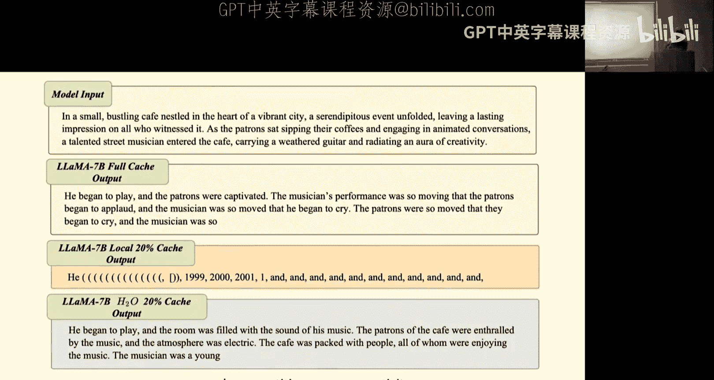

And natural question is like， okay， what are these heavy heaters right？

 So and we actually do some further analysis And this actually leads to a paper called attention sink。

 that's called self attention。 that's called the stream air paper。

 which also is accepted in DCs I clear。 So we basically say， okay。

 what are these attention heavy heaters and turn out that many attention。

 many heavy heaters actually the first few tokens in the transformers。😊。

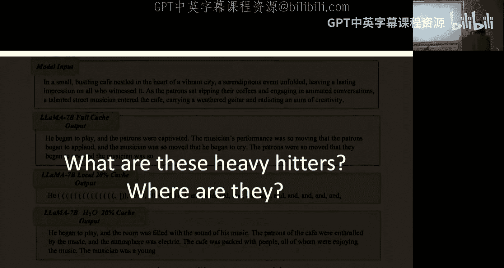

And they actually occupy a majority of the attention score， right， it's like 50%， very very high。

 very much。😊，So then what happens to that right So then like we basically have hypothesis。

 maybe in some cases， in many situations， we don't need that attention that sum to one。

 but it has to sum to one because the softmax rule So they basically like overload multiple very strong attention scores for the initial few tokens in order to to do that。

 and it turns out that it doesn't matter whether these first few tokens you can replace the first few tokens with with just like we just return it will give you very similar prop However。

 if you get rid of the first few tokens all of a sudden the moderate breaks the always basically goes goes up to like 5000 basically means that it basically give you garbage So basically the first few tokens are important。

 but only their position is important rather than the content。😊。

So this this discovery is very interesting。 and we we later find that if we only keep the first few tokens。

 you can， you can keep infinite chat with the models without having restriction of the contact windows。

 That's actually pretty important for empirical distribution and deployment of the larger models。😊。

Yeah， so that's that's the stream and paper。 the paper basically have a lot of attention from external world and people really appreciate that。

 and some of the variation of the work has been deployed in hardware devices and also libraries。😊。

Yep。So and here is a very simple idea， right， So when you generate like next tokens。

 you first keep like a KV cash budget， which is fixed lens。

 If your token generation exceeding the KV cash budget。

 then you get rid of these tokens that is in between。😊，Right，But you keep the latency tokens。

 the recent tokens and also the initial tokens， as well as keeping their attention attention position in the in the cache rather in the original original window。

 and this basically give you infinite chat capability capability for the models。

 right So with streams， you will infinite chat and all the text they are reasonable but of course。

 if you use if you don't use streams， what happens is that you either run out memory because you have to keep like a very long sequence of the Kv cache。

 or if you just trunet all the previous tokens， including the initial first few tokens。😊。

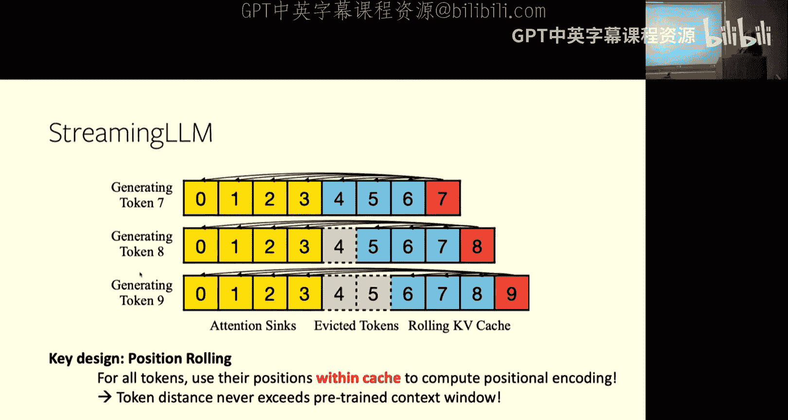

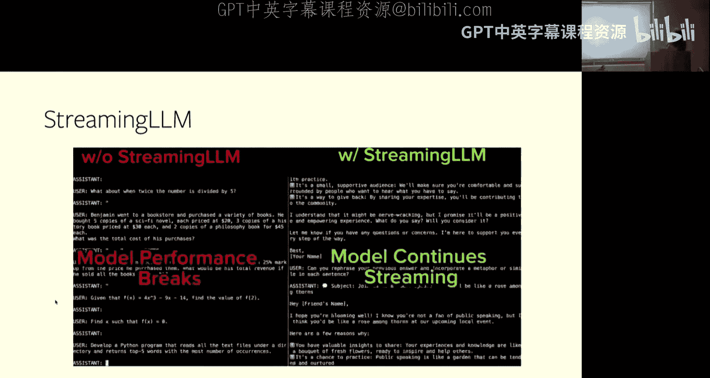

Then the model suddenly will break and will give you garbage after the first few tokens are out of your budget window。

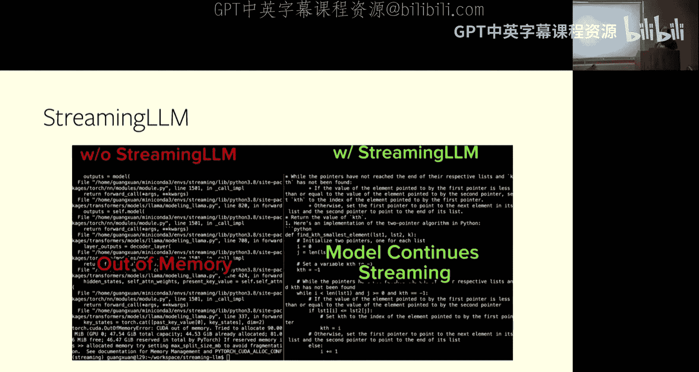

So that's actually quite interesting。Yeah， so and we have tested thoroughly in many different scenarios and we see that our stream can give you very stable op。

 which means that the output is very it very meaningful and at the same time it save memories you keep constant memory over time even regardless of the context window right so you want to keep the budget and you keep the first few tokens That's it and you can keep chatting with your larger models forever it's the interesting properties there and we have other bunch of experiments。

 you say it can scale up model to 4 million tokens you can scale up to maybe more than that and with the same opity which is is good。

😊，Yeah and also we compare with other lines。 Yeah and you also want to understand what's happening to the first few tokens。

 So what happened if you actually treat these first few tokens as learnable and you can see that the learnable token actually do the same thing and you can actually do even a little bit better right So you have a delicate token called think tokens at the beginning。

 and you also keep the think token either a zero embe or learnable em。

 So that's called correspond to the zero think and the learnable think and you see that after the think token is there all of a sudden the capacity become very low and you can actually chat with the models without having issues with the lens of the contact window。

😊，Yeah， so we also see concurrent work， which is also from MEA。

 interestingly that we don't talk to each other of a different department and when we submit the paper we see very similar ideas from different groups。

 and they also find very similar structures in the vision transformers。

 which is called V transformers need registers， registers corresponding to the attention things。😊。

So of course like it actually does not solve the lung context。

 it just drop tokens and keep the capacity， but if you want to do any kind of like a series like a classical called retrieval。

 it will not give you the right answer if the token does correspond to the answer is being dropped It's basically the publicity which means that it will give you reasonable answers but it may not necessarily retrieve the information thats being discarded so that's basically limitation and hopefully in the future we're going to do that as well。

😊，And finally， basically we want to introduce another paper that they try to solve the long contact window by basically do you fine tuning。

😊。

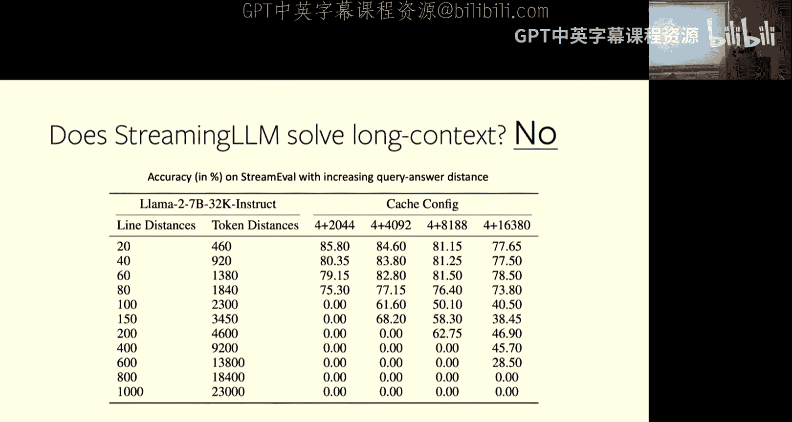

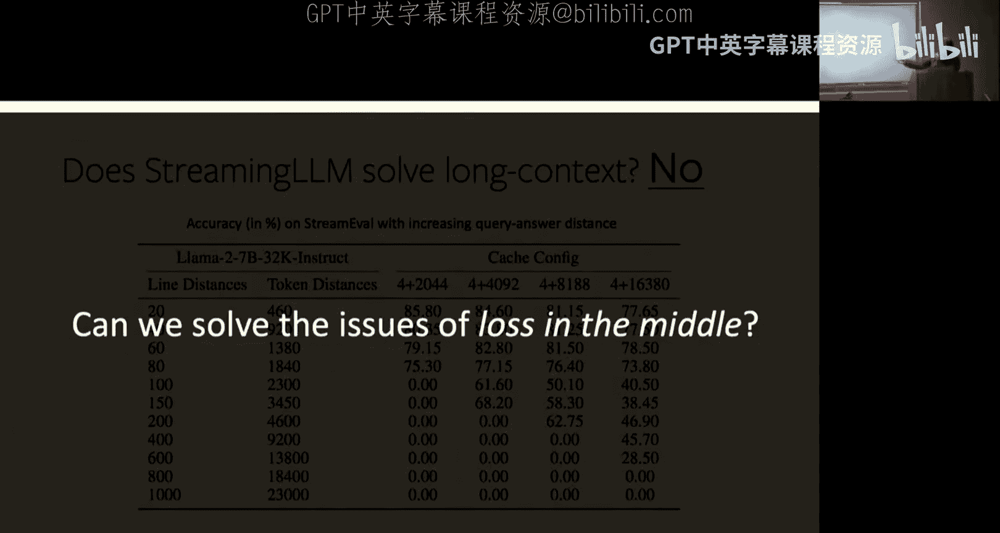

So that's basically one possible sorry that's actually this paper。 Yeah， that's the paper。

 So in between， there's a streaming H to O， which means that you want to combine streamings with the H two O approach right。

 So if you think about streaming is actually a special case of H2 O because streaming only keep the first few tokens where H to the token based on their attention scores you combine too and you actually will give you even better performance So in the same time。

 you will keep the infinite chat property that's the very recent updates So using this We to use with all this improvements in the fast inference。

😊。

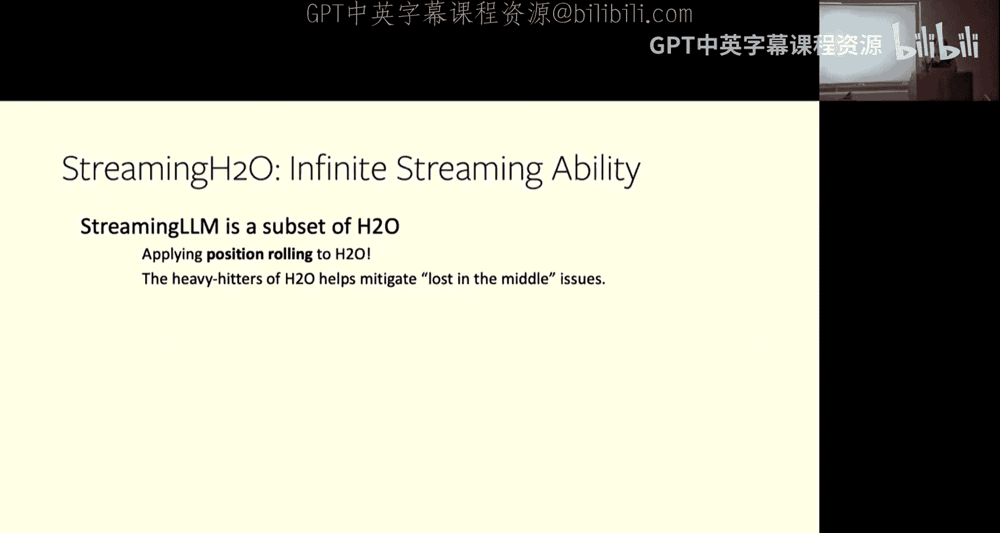

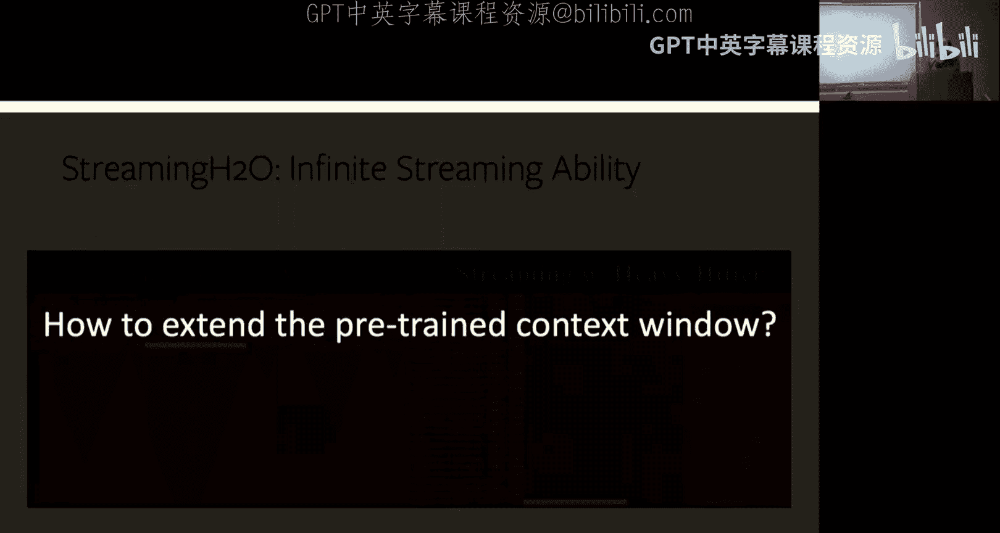

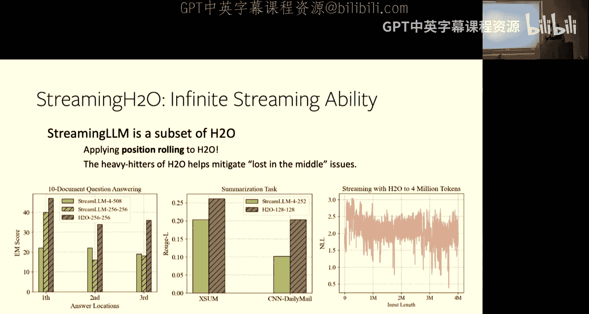

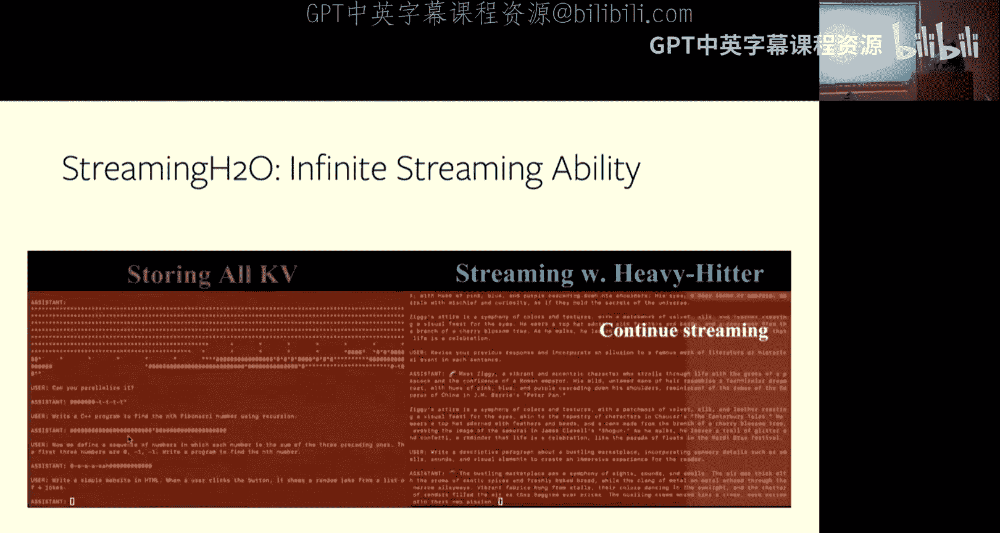

So in the final way there's a paper called extending the content window。

 So this is actually a paper that is always in the archive version because after two days of its release we see radis。

 we have that people have better ideas how to solve the problem better。

 So just two days I actually to be for should be like30 hours or something So we decide not to submit paper because it's just too much competition yeah。

 so this is actually a paper that try to extend the content window with per training right So we all know that content window cannot be changed after the per training for example for Lama version。

 Lama model the content window is 2 if you try to use it beyond 2 it suddenly give you garbage So that's basically the problem and then how can we extend it we can obviously fine tune it with longer text but fine will requires a lot of resources and a lot of mini batch。

 So we actually find that by changing a single。😊。

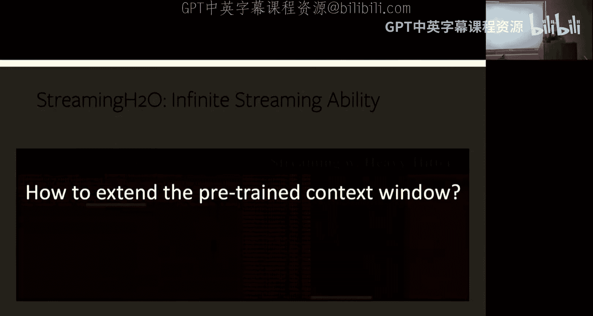

Single parameters in the Lama models， you can make find much more efficient。

RightSo this is actually very simple。 We basically say we。

 we basically change the emdding the position embe skill and you steal this back to the original size。

 right So for example， your model is like 2 k。 if you want to scale the model up to 4K。

 What happened to that， you basically say， okay， instead like doing anything。

 you just say for each position encoding。 You just divide this position en an index by2。😊。

Very simple right so then you for the 2K window， it will map back to for the 4K window it will map back to 2K so that each of the positional encoding become the position encoding an interpolation of position in the previous layers in the previous version and use that change the transformer you train model with only a few only with like a few hundred samples and all of a sudden it does very well The reason it is the case that it because we actually discover that the attention function is actually well behaved right So if you do interpolation is behave quite well。

 but if you do extrapolation and all of a sudden it give you super bad super bad scores out of the window that is been trained on So that's actually the reason why we should do interpolation rather than extrapolations。

😊，Yeah， so that's the reason。 And if we use our approach。

 then we can actually train models that can extend to long contrast windows with less than 1000 steps or fine tuning And you can extend it to up to 8 x length of the original contrast windows。

 This is actually much more efficient。 then if you just do hard fine tuning without changing anything front models right。

 so for example， in this case， 200 steps suffice to extend the window from2 k to 8k16 k or32 k right。

 So you only need like 200 steps。 But but like if you just do fine tuning。

 then you really need like fine tuning， you really need to like more than that。

 you need to basically use like maybe 1000 steps。 but still don't really extend it to 8k you only extend to 22。

5 right So it's much more efficient。 if you do interpolation in the。Positional in。Yeah， and still。

 the performance does not really drop the approximately the same for all the benchmarks。Yeah。

 and as I said。Me， after the paper I released two days， you guess something better in the Reddit。

 That's how intense competition is。 So， and we actually see many more papers coming out along the directions。

 So I hope like people benefit from this insights。 and that's basically all of my lectures。

 Thank you for your attention。😊，What do you mean this interpolation。

 extrapolation in this language model， What does that mean。Yeah。

 the what that mean is like very simple。 you start from， for example。

 the window is the window is is2 k right， So 2 k means that for each of token。

 you will first assign an index in terms of the position， right， So it's from 0 to2 k minus-1。Right。

 so and then given the the the index， you can compute their position including。

 Of course for this one， we are using a rope。😊，RightSo that's basically the one that people use for these models。

 So to compute that， you first subtract these two position encoding。😊，To put to position the index。

 and then I use this n minus n number。 and you basically plug that into this equation。Right。

 and you can compute the attention based on that yeah。

That's basically how you call you use a position to to do position encoding。

So I think the first question is about how can we connect the insights from the theoretical papers with。

 for example， the scaling law and also emerging capabilities of large language models。

Because the theoretical pictures from the papers， I mean they are not completely absent from earlier models。

You mean like how you combine the two in larger models。 I think people really use that， right。

Ex when we much bigger models we get a much stronger emerging capabilities I see okay so I think there's a definitely for theory I mean theory is actually very deep stack right so you have a theory that is mostly like empirical and also try to describe the phenomenon I would say like scalinging laws and also emerge behavior。

 there are series that's more on kind of like summarizing what's happening right so this is this theory definitely is very applicable to to the current models right for。

 according to skiing law， you can know okay if you scale the model by 10x， if you scale data by 10x。

 what happen to the performance you basically have a curve the curve will tell you pretty what's going on so that's actually very useful in many situations right and for the theory like this so basically for the theory that that we discuss here it's more on。

The kind of study from the first principles， right。

 start from the formulation and think about what is the consequence that will will be achieved by the formulation。

 right， So this might be a much harder to to be applicable to to the actual applications。

 But if we do things well enough， then all of a sudden。

 we know everything across for this entire process。

 then that could be like many different scenarios that can be applicable So it's it's a very hard journey。

 but in maybe in the future， it may come up with the applications and very strongly。

 So what do you think it's the most immediate next step from the first principle to things like scary enough。

😊，Yeah， so I think for things like scaling laws， what happened would be so you given like all the theoretical studies and then given the theoretical studies。

 you might be able to simulate what happens if you have more data right so what will the bound look like and that will become a scaling law that you empirically observed so this in that case it might be one step further than the scaling law that currently we have and this purely empirical。

😊，It's possible。 I think people in physics has done that in many different scenarios。

 You may study from first principle and come with some some some some equations and then say。

 what happen if you have 1000 atoms have like 10 to the 32 itemss and what happens。

 Then you come with kind of like a more global and empirical laws and try to fit this where the real world experiments So that might be one possible rush to go。

It's the process really varies I mean okay， I will give you personal opinions right so I started with doing some series starting from 2017 and at that time it was a very painful process I have to say yeah so in that process you might spend a few months on a problem that is impossible to prove。

😊，And even if you prove， you don't really see any benefit of it and you realize that what you prove is nothing。

 you don't need to prove that right， so it's actually very painful process at the beginning。

 but now after a while， I mean after maybe many years of exploration。

 then people may get to the point that you have a good insights overall。

 about like what is rough picture about how the theory should go。😊。

And then given the rough picture you know roughly the serum should be proven。

 some serum there may be some serum， you can write them roughly， even if they are wrong， that's fine。

 this should write like a wrong theors， but they are approximately right in the right direction and then by adding constrain adding conditions and by doing some more like empirical atification。

 you might have a better idea about what this should look like until you nail down to an argument that is both logically correct and empirical useful。

😊，So that's probably like some way you can make the theory much more streamlined Yeah so for example in drama for the drama paper。

 I mean we come with this idea， the core idea about drawing ins in maybe a few days right so once you get derive that equation okay you get it then we know okay there's a definitely next step then we can do more work there in all the work are basically like corresponding to that so I would say like a series basically not my like a major push。

 we have a lot of other work to do but in order to but there's already like a very good in sense then you can derive。

 you can think about like how to get like a good solutions in a very short amount of time。

So I think if we go through that process， then you will try。

 you have the capacity to do the theory at the same time you can also do experiments。

 You also do empirical work。 Yeah， it's it's kind of art。

 You have to say like you have to first try a few things。😊。

And then once you try and then you realize that， oh that may now be correct， right。

 So then you go the to the different assumptions。 It's basically a kind of process go back and forth between your symbolic structures and also the real world structures right so you go from real world and then come with some assumptions and then you come to the symbolic side and look at it and think about what should we do and then with okay symbolically if we do these assumptions。

 then maybe make things easier think about symbolically whether the symbolic assumptions makes sense or not right and then come back to the political side and then do back and forth until you converge into assumptions that is both symbolically interesting and the same time relevant to the real world then you convert to that And over time you become more。

 more good at that。Okay， mean， first one that obviously like T goes to infinity， right。

 So that is the one that is being adopted。 I have we have the collaborator。

 So the second author actually do many of the detailed work。

 And he first come up with a kind of confidence bond。😊，If T is finite， I will say， okay。

 forget about it。 just say T goes to infinity that basically it will capture the essence of the。

 of the picture。 While we do not care too much about max details。 right， So in that case。

 these seem to be a good assumptions。😊，But I， but I will never assume that your feature is fixed。

 right， That's actually not the right thing to do。 even if this will make the mathematics much easier。

 This basically kill the entire physics picture。 that's not a good thing to do。

 So there's always a balance。 if you have a， if you have a good assumption， you try it。

 But same at the same time。 Like you make sure that the assumption does not break what you want to do。

😊，Yeah， so for this one， I mean， actually， I can tell you another story because for hierarchical models。

 I have been trying to do something about that for many years。

 I mean since my master's student masters degree， if you check my master's thesiss about hierarchical representation of some vision models。

 that wassis and read it anyway， it's a very long long efforts and for CNNs its yeah。

 we also tried that if you check some of papers So I had to say like this Java paper is the first paper that I do the hierarchical analysis and get accepted all previous hierarchical paper that we tried to do analysis the I rejected because the notation is too complicated。

 Yeah， so it's very it's very very tricky。 And for CNN Ns， yes。

 thats definitely hierarchical structures。 and this actually my motivation as well。

 I was original vision person。 I mean if you check my publications。

 I originally do some vision work can obviously vision people are。😊。

Obsessed with the hierarchical representations， right， So we have all these kind of insights there。

 But I think the difference between CNN and transform is that transformer use embeddings。

 and embedding is very powerful。 super powerful。 It's's actually。

 I think one thing that you can think about that is that。😊。

There's interesting properties for the for dimensional high dimensional space。

 right in high dimension space， you can put two to the D number of vectors into this space and keep all of them almost all to each other。

😊，RightBut this is actually very nice properties。 you can basically put like exponential content in objects in this finite finite space。

 but if you do CNNs and what happens is that you essentially doing a one hard representation for a concept so you say maybe this token represent something that will represent something that's actually one hot representation but if you do one hard representation。

 you want them to be assigned to each other then you need a two to the d dimension right so this is actually very efficient Another point that makes things efficient is that for transformers it can also do lots of reasoning tasks and the reasoning I will believe it's definitely related to representation of the embeddings so I would say maybe a can be represented by a sum of multiple embedding vectors and the vector one vector say it's a letter the other vector say it's a first letter the select the word say is rather lower case something like that this high representation is very useful because。

😊，It actually is coupled into different properties。

 and this property may be computed individually in the transformable computation。Right。

 so that may be a next thing we want to analyze。

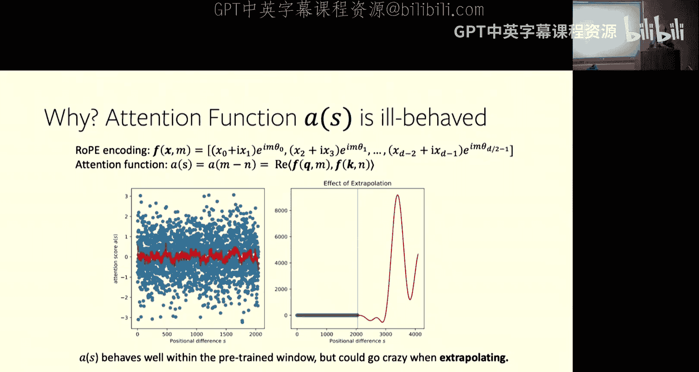