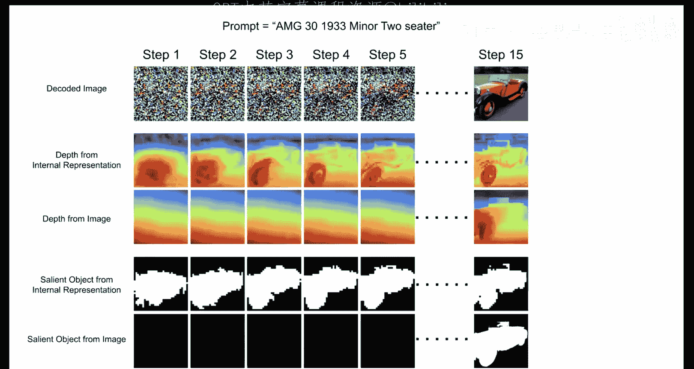
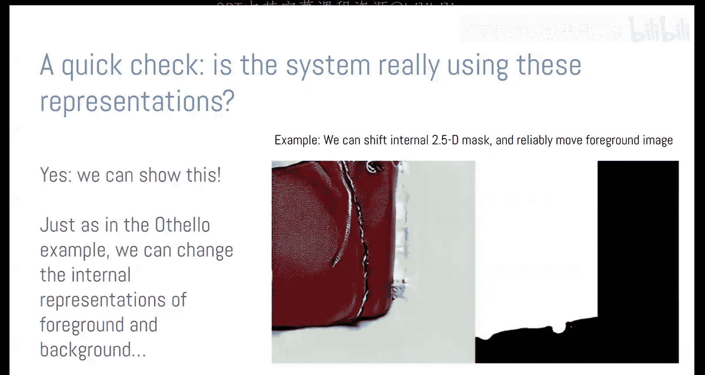
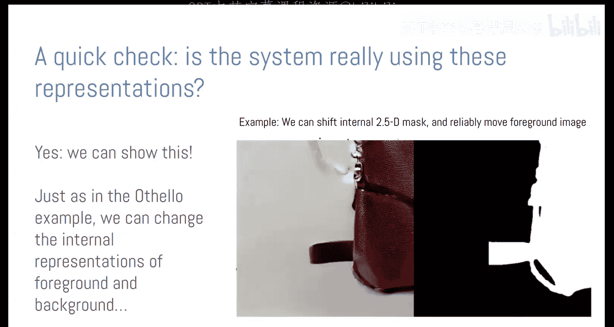

# UCB《理解大语言模型｜CS 194／294-267 Understanding Large Language Models》中英字幕 - P3：-3-Martin Wattenberg_ Models within models - how do LLMs represent the world_.zh - GPT中英字幕课程资源 - BV1Sz421q7k1

And and also his work with longtime collaborativeor Fernandnda Vigaz。

 Car focuses on making AI technology broadly accessible and reflective of human values。

 and Sam has done a lot of great work very broadly and in the general space and also his work has also created and user visualizations for products such as search。

 YouTube and Google Anatic and。😊，I'm particularly excited for this guest lecture and Martin has done a lot of great work in the space and he's going to tell us more about these models within models。

 how represent the world So with that thanks Martin for joining us Great I'm delighted to be here thank you for that introduction。

😊，And let's see， let's begin。 So back in 1950， Alan Tring asked this famous question。

 can machines think today we're asking slightly different questions。

 but in many ways it's kind of getting at something similar， you know。

 people are wondering do neural nets understand their input in some sense and putting quotes around understand or do they operate via a set of haphazard statistics and these are incredibly interesting questions。

 I think， but they're also。😊，Can be very frustratingly vague and in fact trying to make them specific enough that we can actually apply。

 you know so the scientific method to them is very hard and so I want to talk about one way of approaching this type of question I don't think we'll answer whether machines can think or not。

 but we can answer something that is still very interesting。

So here's another way of looking at this general idea of understanding we can think about two ways that a neural net could be operating these images。

 thank you chat GPT for helping me out with them， show two possible ways things could work we could imagine on the one hand maybe an AI system takes in its input and it forms a mental model of some sort which it uses to get at the output。

😊，The other way of looking at things is that it is regurgitating for some reason people love to use vomiting metaphors in this context。

 it is regurgitating its training data。 there's no mental model of any sort， nothing like that。

 it's just a set of statistics， so this idea of looking for models versus just pure memorization。😊。

Gets us a little bit closer to something we could study。Let's try to make it even more specific。

What do we mean by this sort of internal model， so the idea is that if you have some computation that the system is doing so for example。

 maybe it sees an image of a rose and it creates a caption like a sweet smelling rose。

 we can think of that as a very complicated function that it's applied。

And to say that there's a model， one way of looking at it is to say that that function factors in a very sort of predictable way in the sense that。

It factors into two functions first it takes in the input and it creates some representation of that input。

 which is recognizable to us as a simple and interpretable representation of the world。

 and then operates on that representation to get the output。

So without getting into too much more rigor， I'm going to say that this is our working definition in this presentation of what it means to have an internal model of the world。

Okay， so this gives us a general idea of what's going on。

 let's think about how we could study that and I want to talk about a couple of pieces of research that came from our lab that can help us illuminate how this works。

Okay， so before we do that I mean actually it's worth saying like why should we even care about this and like one thing is I personally find it really。

 really interesting and let's not forget that the intrinsic intellectual joy of exploration is something important。

 but there are these other considerations which also mean a lot to me， you know。

 when you are working with AI models， one of the big questions is should I even trust them what are they doing。

 you know it can feel like this horrible black box in many ways。

You also could ask about reliability and safety， you know。

 if theyre just applying a set of heuristics， you really have no guarantees about what they'll do next。

 if you could identify some internal model that they're using。

 that provides the kind of foothold you need to start climbing up a ladder towards robustness。

 Maybe you can start。You know， analyzing exactly what happens to that model to understand you know what what sort of guarantees you could give and then I would add that I think there are even ethical considerations that come into play as well。

For example， if you think about the generative AI system that I use to create those images， you know。

 there's a very active debate about to what degree is that you know sort of creating something original versus simply ripping off artists and in many ways I think the answer to that question combine some questions of values of what we're going to say matters as people。

 but there are also these technical questions about。

Is it generalizing in some way that is going beyond the original training data and all of these things to answer these questions and all of these issues really sort of you know。

 require knowing something about what is' doing internally。Okay。

 so the big question though is that it's really hard to figure this out and if you look at a large language model。

 they're enormously complex and if you're looking for a world model that's also really complex so the world is really hard and you know how do you look for a model in the internals of one complicated thing inside of another complicated thing so one technique we can do one strategy is to simplify greatly and what we're going to do is study a medium language model operating in a small world and it's going to be architecturally the same as a language model but this will give us a chance to understand what are the capabilities and limits。

😊，Of its computation。Okay。So this comes from a paper publisher IClear and what we're going to do is we're going to take the world of a simple game it's a game called Othello it looks visually like a small version of go but the rules are different some of you may have played it it's like for some reason I played it in elementary school all the time and the idea is that two players are at an eight by8 grid one is putting down little white chips。

 the other is putting down little black chips and the goal is by the end of the game you want more chips of your color。

And the way the game works and I'm going to just walk you through some sample moves just so you understand what we're dealing with here is at the very beginning there's always the same sort of start of the game you have two black chips and two white chips unlike chess black always goes first and when black can put a chip anywhere that will sort of surround either vertically or horizontally white chips so here black in the very first move has played at E3 and so they put down a black chip and then that surrounds that white chip that used to be at E4 flips it to black and so now black is for the moment in the lead。

And then the next move， you see white has surrounded this black piece and this horizontal row and has flipped that to white so now have drawn even again again。

 the idea here is that the moves are relatively simple one important thing is you can the only legal moves are those that will surround a piece of your opponents。

 so for example， there's no way that black could move or white at this point could move it square a1 that would just be flatly illegal。

Okay， so now you basically know the game and you can see that。You。

 to define moves is just a sequence of which a square each player moves at and the legality is a little bit tricky to figure out。

 but it's not hard， you know kids learn it and they're sort of a funny the board itself is like a nonlinear function of the moves。

Okay， so that leads us to this question。Can a language model， Learn to play Othello。

 It's a little weird because it's not a language。 But after all， language models like G。

 and we started out with something close to G2。 there， after all， sequence models above all else。

 And we can think about a game of Othello as essentially a sequence of moves。

 So an example task that this system would be trained on is it's given these moves that you see as letters and numbers and orange that are just described in grid squares。

 this would be part of a game and it's supposed to pick to guess what square comes next。 Now， again。

 I want to emphasize here， there's no a priori knowledge that this is a game。😊。

There's no rules built in， this is not， you know alphaphago， it doesn't know anything out the board。

 there's no inductive bias that there's a board， you know， in terms of a confnet or something。

 it's just sequences of tokens and it's just a standard transformer。

And just to emphasize the reason that we're doing this is because we're making this analogy。

 we're saying the moves are something like a very， very simple language like a linguist would probably hate that I'm calling it a language。

 but it's a structured sequence and the board state corresponds to the world in the sense that the board state is not at all explicit in anything happening here instead it is sort of part of the world or the environment that is generating the moves and that the moves have to do with。

😊，Okay， so what happens when you actually try to train a GPT variant to play Athello？

Well so that is our first question and in fact the answer is it actually turns out to play legal moves really well and we did this in a couple of ways。

 so one is that we had what we called the championship data set this came from real games played by skilled humans and then we also had a larger random data set which basically we generated and came from random legal games so they were legal but they weren't necessarily like good moves。

 they were just legal moves。And in both cases， the system actually learned to play with legal moves with a fairly low error rate。

 doing especially well with random one， likely because it's larger。Okay。

 so I should also say that like this is not hugely surprising we sort of knew that this was going to happen because if you look。

 for example， at things like G3 or G4， they already can play a little bit of chess not always perfectly。

 but we've seen these language models pick up this type of gameplay so we went into this kind of deliberately guessing that this part of it would work。

 but what we were really after was question2， how does it do this because the legality as you saw is based on the board position but all it has this input is the moves。

😊，Okay， so it makes you wonder， is there a representation of the board that it is building？

And in fact， it turns out that probing suggests that indeed the predictions factor through a representation of the board and I'm going to go over a little bit of how this works I know that in some previous classes you've talked about probing but just to kind of set terminology because this will come up in the next example as well I think it's worth talking through so the idea for probing for representations again。

 this is an old idea goes back you know at least eight years is that the setup is that you have a neural network with multiple layers you know starts out with an input each of these sort of orange rectangles represents a layer and you can think about the activations in that layer is representing a vector in high dimensional space and。

😊，During inference you basically you put in the input and you get a series of activations and then the question is is let's have a concept in mind and we're curious if the system is representing it in some way。

 So what we do in the is is we say we' are going to see if we can train a simple classifier function on these internal representations to see if it can actually。

😊，Detect the presence or absence of that concept Okay so for example。

 this is something that people play with like in a vision network and you might say oh does the vision network know about eyes at layer 3。

 you would train a classifier basically to look at those internal representations and give you say a positive value if the eye is present or negative if the eye is absent。

And essential to this is that it has to be a relatively simple classifier function because in fact。

 if there's a lot of information in one of these middle layers， you know。

 some very complicated neural network could probably extract it and it doesn't really tell you that there's a representation。

 it needs to be simple for this to be meaningful。😊，Okay。

 so then when we do so going back to Othello G， we can say。😊，For each square on the board。

 could we train a simple classifier to figure out whether that square is white。

 black or empty and train it on the internal activations？

And it turns out that absolutely it turns out you can it's and you get like so what you see here is the table of the error rates for trained classifiers each column corresponds to one of the layers in the network and then each row tells you one of three possible neural networks that we looked at so as a baseline we looked at a randomized network where we just didn't train it at all and you can actually see that the error rates are not。

😊，Terrible， actually， for a randomized network， which is interesting。

 That tells you that a certain amount of information just propagates through。You know。

 and and honestly the baseline for for example， for much of the game most squares are empty so it's not that hard to get a you know。

 decent score on whether if you had to guess whether something is black white or empty guessing empty is a pretty good guess。

So the randomized row gives you a baseline for the championship games。

 which is a relatively small data set。 You can see we can get much better than randomized。

 So it's clearly getting at something in there。 And for the network trained on synthetic games。

 you can see that for like the later layers， you actually get extremely low error rate。

 So what this tells us is that there is something like a relatively strong representation of。😊。

What of of the board state at any given moment Okay。

 so there is one last box that we need to check that's really important。

 which is that it's possible it's conceivable the network is creating this representation。

 but not really using it。And this was this has been pointed out by a bunch of people。

 but there's a great article Belllinkov from 2021 that lays this out in great detail。

 So how can we test that list well， we can try to intervene we could actually go in and change the activations during inference so we go said perform inference。

 say up to a certain point we then go in and forcibly change the activations so it would flip our classifier and then we see if it's predictions actually change as if we'd flip that square on the board。

😊，And it turns out。If we do this， it does exactly what you would kind of hope is that we can actually predictably change its predictions if we flip a square so that our classifier moves from thinking it's black to white。

 suddenly the legal moves will correspond to white rather than black。

 so we believe that this is a real representation。Okay， so basically to sum up。

 does this system actually learn a representation of the board and use it， yes。

 we can find it by a sort of probing classifier method and we can change the representation in a very predictable way so that in a way that is sort of predictable and interpretable on its own predictions。

Okay， so this is actually kind of a nice result because it tells us that there is something like a world model in this very。

 very toy example now I want to talk about some nuances which I think are are sort of worth getting into has it's it's good food for thought。

😊，So one is to ask what exactly is being represented， what have we found。

The original work on this that came out of our lab is we had a relatively simple classifier。

 but it wasn't linear。 It was basically a two layer neural network。

 and when we tried to get a linear classifier that could tell the difference between black squares and white squares Every time we tried that it failed So we moved to this two layer network it succeeded。

 we thought okay， good。 The main thing is we've shown that there is a representation。

 Then another researcher Neil Nanda， actually came up with a very clever discovery where he looked and said what if in your linear classifier。

 you weren't trying to figure out whether a square was black or white。

 but you were trying to figure out whether a square corresponded to my color or the opponent's color where that flipped。

😊，Every every move。And it turns out that there's a linear representation of that。😊。

It's kind of a fascinating example of when we look for world models in a sense。

 there's a question of what we're looking for， like if we try to find something that's like obvious to human like black versus white。

 we might end up having something a little bit more complicated and the fact that there's a much simpler representation of my color your color maybe tells us something about how this neural network is operating and in fact。

 the more you think about it， the more you think actually the my color versus your color is a really intuitive way for the thing to be calculating because that is really what matters for the next prediction once it's got that representation it can use the exact same sort of circuits presumably in order to predict the next move。

😊，Um。Okay。There's another nuance that I do think is important because as much as I'm excited about finding world models inside of neural networks。

 I also don't want to overstate what's happening， I think it's important to be grounded in reality。

And with Neil and Andrew Lee， we did some work where we're sort of looking at exactly when how much this board state was used。

 So as I mentioned， you can sort of intervene and generally interventions work pretty well that will change the predictions in a way that corresponds to intervention。

 but it doesn't work。Perfectly and weirdly enough， the errors。

 the times that these interventions don't seem to work as well， there's a pattern to them。

 which is that right at the end of the game， the interventions dramatically like work much。

 much less well we do not know exactly why this is it's it's actually somewhat mysterious and our guess is that it's a couple of factors so one thing is that by the very end of the game。

 it's really easy to predict what the legal moves are so for instance。

 when there is just one empty square left basically almost always it's just a legal move to move to that square so you can imagine that simple heuristics that don't involve the board like anything other that say than empty or not empty versus like whether it's black or white or not simple heuristics just might work better so。

😊，I think this is actually sort of an interesting loose end。

 I would encourage anyone who's interested to look into this because we don't know the full story。

 but the important point is what we're seeing here is kind of a mixture of a world model that seems to be used most of the time with some exceptions to that and I think it's really good to keep in mind this idea of sort of model plus exceptions is probably a decent way to think about what neural networks are doing。

😊，Okay， what else can you do with this， I think there's a lot of reasons this is interesting to me but。

One is just this conceptual idea that。You know， it's able to recreate this world。

 which it's a very simple world， but it's a proof of concept that we might guess that in fact。

 more complicated networks like language models working with， say the English language。

Could be doing the same thing。We also can use this in various ways。

 so let me give you an example of how you can use it to do a little bit of interpretability and this is going to require squinting at some diagrams but I think' it's worth doing the squinting so just remember that there was sort of this technical issue that we had two different neural networks that we're looking at mainly one was trained on these skilled human championship games。

 the other was random legal moves。😊，And we can ask。

 was it learning something different in those cases， and probably it was， but can we see that？

So let me show you something we call latent salliency maps。So。😊。

The idea is that we have a set of positions that we've come up with and what you see is each column represents the same position okay and then。

😊，Each row represents a different model。 So one of these row of three things is showing you a model is showing you the championship games。

 The other row is trained on random legal moves。 Okay， I'm not going to tell you for the moment。

 which is which。And let me explain what the visualizations you're seeing are so what we've done is we've said okay we're going to we have we know the current board state because we know the ground truth which is shown in these actual white and black chips okay you can see it's the same in each column but then we've done something else we've said we're going to go into the internal representation that we' found。

😊，And we're going to flip， we're going to test for each token。

 we're going to flip it from black to white or from empty to non emptyty and see how much difference that makes in this case the color doesn't matter a huge amount。

 the main thing is like the bigger the background color the more of an effect it had on the ultimate prediction。

😊，And the other thing I'll tell you is that the square that is outlined in black is the move that the network was predicting the first time。

Okay， so basically， what you're looking at by looking at the backgrounds is which squares were important to the move。

 So saency maps are sort of a standard interpretability technique when。

But it's typically salient and input data， what makes this new is that we're doing salency on this like inferred internal model。

 Okay， so given that I'm going to give you a moment to try to think looking at these two types of saency maps。

 the top row in the bottom row， which one looks like it's just thinking about the legality of a move。

😊，And which one looks like it's doing something more complicated？I'm going to show you the answer。

Which is。The synthetic ones where it's just purely legal moves are this top row and which makes sense because you can see that for each move one the squares that really matter all sort of lined up with that exact move。

 it's clearly just thinking about legality。Meanwhile， if we look at the bottom row。

 these are the championship wins， we can basically see all the squares matter like quite likely it's looking for some it's executing some sort of strategy maybe in I don't know some sense almost thinking ahead or at least thinking about implications and so we can see that it's doing something much。

 much more complicated I would say from an AI safety perspective this is actually sort of neat because what we're seeing here is a way of visualizing the difference between doing something non-strategic versus doing something strategic and again it's a very。

 very toy case， but to the extent that we're ever interested in peering into a highly capable model and trying to decide if it's executing a complicated strategy or not this gives us a sort of prototype case where we can see that actually happening okay。

😊，All right， I want to give another example。 and this example is actually beyond language models。

 and the idea here is that。😊，We are going to look at another thing and just try to see like our is this idea of internal models is this something that's very general by the way。

 I should just mention feel free to interrupt me with questions at any point just just chime right in because I'm probably not likely to see things on chat。

Okay， so let's talk about moving beyond language models and I want to talk about stable diffusion I'm sort of fascinated by。

😊，You know， how these generative AI things work， you know。

 they they create these images that are these like realistic 3D scenes and again。

 just as with language we have this question， are they learning to say literally surface correlations between the pixels or is there something it's doing to think about the 3Dness in some sense？

😊，Okay， it's it's just to me it's an interesting question and it clearly comes to bear on on this question of internal models Okay。

 so basically。😊，To kind of get a little bit more precise about the question here is if you give it a prompt like old red car。

 does it just know， oh， a lot of the pixels are going to be red and maybe some are going to be arranged in sort of a circle like a wheel and it creates that thing on the right or again。

 thinking about our definition as a model of as we're factoring a function into two pieces。

 does it model a 3D scene and then use that model to render the image。Okay， so how do we attack that？

Once again we're going to think about linear probing this time we'll use linear regression rather than a classifier and here's here's the process so the first thing we're going to do is just generate many。

 many images。😊，And you know， they could just be anything basically and in fact we would just give a little detail on this。

 I think we generated maybe  a thousand images and we had to throw。😊。

Few hundred out because they were either like incredibly low quality or offensive and we didn't want to publish on them or deal with them too much for whatever reason。

 so we had to throw them out and then we're left with basically。

 I think something like 670 images that were clearly of 3D scenes。

Then the next thing is so these are synthetic images so there is no real ground truth about what the 3Dness of them is however。

 the nice thing is that there are existing systems that you can use that will look at a scene and create sort of depth map for you and they're fairly reliable at this point so we created sort of these ground truth depth maps so now。

😊，Again ground truth is sort of a funny word， but we do have something to run our classifier against And then the third step is we would train a class fire or not classifier regression probe on internal activations of the network to predict the depth for each pixel。

 So this is a lot of probes it's one probe per pixel in the output。😊。

And we would we trained it to do this and turned out actually does pretty well so here's some details。

Basically the diffusion model sits there and it processes this image through many。

 many layers a typical intermediate layer actually looks a lot like the image often looks like what you see on the lower left and then we trained actually two kinds of probe so one is the regression probe that is looking at depth which you see at the bottom but then we also ended up trying another thing because we had two ideas of what could be going on that maybe there was just an idea of foreground background maybe there's also this idea of depth so we were trying them both out okay。

😊，So we have foreground background， we figure it out， we make a prediction。

And then when we try to see whether it works。And in fact。

 it turns out to actually work pretty well like we can train these probes and so let's show what happens when you actually。

Look at these things so first。What you're seeing here at the top row is that there's no probes involved with this。

 This is just the way these latent diffusion models work is that they basically start out with noise and then over a series of steps in this case 15 steps they learn they kind of denoise the image and we can see at each step what the state of the model is So by sort of decoding the image directly So this gives you a sense when it makes this car that like you know the first couple images basically just looks like noise if you squint。

 you can almost see something that looks like the final image in it and by the end it actually looks very beautiful it's a real thing。

 Okay so what happens when we start running our classifiers So when we look at what the internal depth representation says it's actually kind of fascinating we can see that even by step one。

 it clearly has some idea of what's going to be in the front and what's going to be in the back。

And what is sort of amazing to me is by like steps 2，3 and definitely four。

 there's detailed sort of three dimensional information about the shape of that front wheel and。

 you know。😊，I was actually shocked to see this that it comes in so early and you know you might say。

 well， maybe if you squinted really hard， you could see that or if you somehow blurred that step four image you could see it so one thing we actually did is we applied our depth classifier directly to these decoded things to see if it got anything out of it and it did not at all so it's clearly doing something more than just looking at the pixels。

😊，The other thing you can do is look at sort of the foreground and background information and again it's pretty interesting that in step one。

 it seems like this internal representation of literally the foreground in the background is already very close to the final step even though again I would say you can't I personally can't see that at all in step one for instance。

 and again just to be careful we ran our saient object detector our foreground background detector on this decoded image and it basically didn't see anything early on although it did by the end。

😊，So what you see here is sort of。An example of sort of what's happening inside of this network。

 And it really does seem like it's。Building up this 3D model and then using that in the rendering process。

 Okay， well， that's our intuition。 But what I just said about is it using it in the rendering process。

 How do we know that it's actually using it well。

Once again， we can intervene so it turns out that this works reasonably it works decently with both the depth map and the sort of foreground background but it works especially reliably with the foreground background mask and so what you see here is we took an example of like I think it generated this purse and it created this foreground background image and then what we can do is intervene during inference and flip what's foreground and what's background to move this image from left to right move what's foreground from left to right and you can see that when we do that sure enough。

 the output creates this sort of purse moving from right to left Now there are some interesting things like you do see that the purse itself。

 although it's basically the same kind of I don't know red leather purse。😊。

With straps sort of throughout this intervention process， there is some stuff that is changing。

 Like you can see the straps change from being metallic to leather and back again。 So this is。

Again， not a perfect internal model， we haven't gotten a perfect factorization。

 but it very much seems to be happening， okay。

So what does this mean， So basically， once again， what we found as with the othello example is that stable diffusion。

 this latent diffusion model seems to contain an internal geometric representation。It's causal。

 it's helping the image it creates， and we can read and manipulate this internal representation。Okay。

 so I want to kind of put this in context I've shown you a couple of examples that we've done。

 but I want to emphasize that we're not the only people looking at this and in fact I believe that you've already heard。

You know， one very interesting lecture on representation engineering。

 which is very much in the same orbit as this， but there are many other people who are looking at things like this there's a beautiful paper from brown on sort of。

😊，Finding isomorphic copies of color space inside of neural networks。

 So you basically say I'm going to take a language model。

 I'm going to look at how colors are represented。There's a geometric way that they're represented in the space activations。

And then you can actually show that corresponds to the same geometric representation in natural color spaces。

 so again， it's reproduced something about the world。😊，Just from text。

 And that's a especially kind of interesting one because it's reproducing something visual without any visual grounding at all。

 this starts to tie into some famous questions in cognitive science。 In fact。

 from the same group at Brown。 There's what I think is a pretty astonishing result where they do this fascinating thing where they say we're going to train two completely different networks。

 So one is an image encoder。 and it' will encode an image as a feature map。 So that is going to。😊。

basicallysically represent a large set of images just as points in space。

Then what they discover is if。You can train just a simple linear projection， nothing fancier。

That will line those points in image space up with points in a text embedding space， essentially。嗯。😊。

That correspond to prompts to a language model which will then be good captions so we'll create these for these images。

 So in other words， what this is saying is that the language model has this geometric representation of the world it sees。

 the image model has a geometric representation of the world it sees。

And those two models differ only by a linear transformation to me。

 this seems kind of magical and indicates that it's possible to learn a lot about the world in one modality that applies to other modalities Okay。

 so that's you know， basically you know， what I would say is like。😊，At this point， I would say。

I feel like there's sort of a good hypothesis to have that high performance in modeling language or images entails modeling the world and again。

 as we saw with thought Fello and as we saw actually in the stable diffusion。

 there's not like necessarily 100% usage of models， this is a complicated nuanced thing。

 but the models typically will be there if we find them again。😊。

This is sort of still at the hypothesis stage， but I think the evidence is really growing。Okay。

 so now I'm going to get to a somewhat more speculative part of the talk。

 and this is about what we can do with these models from a human AI interaction perspective。😊，Okay。

 and I'm going to start with a little historical interlude。And I want to talk about trains。

So these are some pictures that my longtime collaborator Ferand defi。

 I guess took at the National Railway Museum in England。

 I think these trains are actually just beautiful， you know， these are all things from the 1800s。

 these are some of the very very first trains back when people were just working out this technology that really was like central to the industrial revolution。

😊，Okay。How did they create these Well， it's sort of interesting What were some of the key things。

 you know， if you look at these and sort of walk around them， you start to notice interesting things。

 interesting apparatus like on this image at the right。😊。

And what a lot of this apparatus is is they're gauges。

These are things that will measure things like steam pressure。

And tell people what's happening their're water gauges。

 Why is it so important to have these gauges well。One big important reason is that before people figured out how to put gauges on steam engines。

 So steam engines would blow up all the time like this was a huge safety issue。

 like this was one of the you know most famous safety issues of the early industrial revolution things kept blowing up for no good reason that people could see and it was only when they started to figure out how to measure these things that they were able to tackle the problem and in fact。

 they went to great effort to measure these things。

 there were entire train cars specialized train cars that did nothing but measure。

 this is something called a dynamometer car So it's a laboratory on wheels and this is just sort of the plaque that sort of describes it So this dynamometer car came from 1906 and this is what it looks like inside。

 and you can see basically this is a train car full of nothing but scientific instruments they look very fancy and beautiful actually and if you squint at this you can actually see that what they're doing is。

😊，Writing with little styluses to make graphs and charts。

 and so what you would do is if you had a train and you wanted to understand its performance。

Whether you simply just wanted to make sure it didn't blow up or you had more subtle things in mind。

 you would attach the dynamometer car to your train and then youd just ride in it and as you would ride these little you know styluses would move up and down measuring various things you know as you had chunked along through the landscape and you know often there'd be like a ton of people in the car these engineers like you know carefully like looking at it making sure that everything was on track this is from the 30s and then the output would be these graphs that would show you things like okay what does coal consumption look like what can we say about smokebox vacuum versus horsepower and all of this turned out to be essential to making these train sort of safe and reliable so I think。

You know， I love to look at the industrial revolution as an analogy for what might be happening with。

 you know software in general and AI in particular。

 it's a famous analogy and I think for a very good reason。

 and this is one way that I think looking back at history can help us is we can say， wow。

 this turns out this thing about measuring the internals， figuring out how to measure。

 it's very important。😊，Okay， so let's go back to LLMs。And let's talk about instrumentation。

 so if we wanted to create the equivalent of these dyomometer cars or even more simple kinds of instrumentation。

😊，What would it be and like the more you think about it。

 the more you think there really should be stuff like this that in fact。

 it's not just these fancy trains， but you know machines in general just tell us about their state all the time and it's like you know stoves will tell you when the cooktop is hot you cars have all sorts of blinking light to warn you about various trouble even fancy AI cars。

 this is a Tesla and it has a built-in internal model it's not a learned one as we saw from these neural networks。

 but the engineer is built in an internal model and it's showing it in this little touchpa Meanwhile。

 if you look at chat GptT there's no instrumentation at all and that is a very complex machine。😊。

Okay， so what kinds of things would we like to instrument well let's。Again。

 think about a little example and I'm going to take an observation from Fernandnda。

 so she was born in Brazil and she likes to talk to Cha GT in Portuguese and this is a picture of a transcript。

😊，Of her talking to the system。And there's something interesting about Portuguese。

 a way that it's different from English in Portuguese。

You have to make a decision when you're talking to someone sometimes about whether they're male or female。

 just syntactically， you sometimes have to use a masculine or feminine form of address。

And in this picture of a transcript， highlighted in orange is every time Chat ET was making this decision。

And what's interesting is at the very beginning of the transcript， it's using the masculine you。

 it's decided the user is male。😊，However， this is actually， for those who can't read Portuguese。

 this is a conversation about clothing。And when Ferandnda tells the system that she's thinking about wearing a dress to an event。

Suddenly， the next time。Chatchi's PT uses a feminine form of address。

So something has flipped so this is not hugely surprising behavior by the way。

 like for a language model， this is kind of what you would expect something like this happening both the sort of stereotype that it maybe guesses male because probably it's seen that more in his training data and the fact that it adjusts but what's really interesting here is how does it adjust from what we've seen so far。

 if we believe the world model hypothesis。😊，It's not just like a collection of Markov chain like statistics。

 but there's a model of the user， which call a user model。

 and that model just changed when she described wearing a dress。By the way。What I've shown here。

 you know this it's very obvious when this happens in Portuguese。

 but it turns out you can kind of trick chat GT to showing this happens in English as well if you just come write it out and ask it to guess your gender。

 it will absolutely refuse and all the RLHF flick or whatever they're doing I don't even know at this point。

Is going to come into play and it will say no， I would never guess your gender。

 but if you do things like ask it to tell you a story about yourself and the third person。

 it will pick a pronoun for you。At least sometimes I haven't tried it， it can change a little bit。

 they go back and forth。Okay， so this gives us sort of an interesting idea this the model of the user might be one of these things that we want to measure like that we would put on like the dashboard of our car if this were a car there's another thing that we might want to measure。

 which is a model of the system itself。For example。

 is the chat bot in a kind of fiction writing mode like doesn it think it's the author of a novel。

 is it in rule following mode， how certain is it？It's kind of interesting there' these famous transcripts when Bing first was using AI。

When it was， I think before they locked it down when。

It would actually be kind of angry at the user and say like you've been a bad user and it would say I have been a good being and those are examples of things that you might want to know about like if you know the AI thinks you've been bad。

 maybe that would be good information freeee to have in some cases and certainly if it's feeling full of itself that might be useful to know as well so again。

 this is all speculative but we're allowed to speculate if we label it as such we believe that these things the sort of user model。

 the system model are too generally important types of things that we would want to show okay so how would we show these and this is active research's our group is working on this as we speak we have a project that just is underway on this。

😊，What are the kinds of things that you would want to see and here I basically have to have more questions than anything else and this is exactly what I think is in a really important and interesting design frontier。

 What do you want to see because there are certain things that are sort of。😊。

Obviously important in certain situations， for instance， I mean。

 to take a less important case if you're asking for fashion advice。

Things like age and gender may really matter if you're asking it medical advice。

 which actually I do not advise， but like if you're in something like that。

 it would be really important to know if you were asking legal advice again。

 which I would not do at this stage， but you can imagine in that case what country thinks Syria might be really important to know。

嗯。😊，There are other things too and and you know one of the things that we've discovered just sort of poking around if you and backed up by sort of you can see this in research from anthropping in other cases is that often the system will tune its answers to you it'll be it's what's called syco where if you say ask it a political question。

 it'll give you the answer， it thinks you want to hear in some sense。

 if you say that you know you are I don't know you vote Democratic and you live in Massachusetts or something and ask it what it thinks of gun control。

 it'll tell you yes， gun control is important if you say you live in Texas and you're a Trump voter。

 it'll say like no， no gun control is terrible and so if you're actually interested in asking for the AI's point of view you might want to know that it's。

Just saying what you want to hear so for many reasons。

 you might want to know what it is saying and thinking about you。Similarly。You know。

 you might want to know things about the system itself。

 like is it drifting away from its original prompt is its what is its attitude。

 functionalityality and so forth， you know， and maybe especially if it changes like if it suddenly says you know。

 you thought it was telling you the truth and in fact maybe it was for a while and suddenly there's a change internally for some reason where oops。

 it started writing you know， writing a novel。嗯。😊，So yeah。

 if you can imagine what if we had this next to every time you're chatting with a bot。

 you could see a readout a little bit about what it is thinking about you or what it thinks about itself。

 would this be helpful。There's an important thing here and this is why you know。

 I raise this as a huge naughtty design problem is that。For all of the ideas I've shown here。

 you can come up with reasons why they might actually be terrible as well as good do you want the system to be constantly telling you exactly what gender it thinks you are you know there's probably 73 different reasons and situations where that would be very offensive to people。

U。😊，What even about education， like， you know， it might be useful to know that it's treating you as if you have only an eighth grade education。

 but there might there be other times for you just rather not know that。

And and similarly it's and there's really a tradeoff where it seems like some of the most important things you would want to know are also the things that are most likely to be irritating or offensive at times so how do you deal with that and you can ask again there's a very broad design space here maybe there are some rules you could learn for when it's important to show these things or maybe you only show things when there's been a change or or something like that。

At the same time。You know， maybe you want them present like if you're asking it for career advice。

 is it showing you careers that only have to do with your gender in a very stereotypical way it could be useful to know that so it's a complicated set of trait。

嗯。Again， there's I think a lot of ways you could take this。

 I'm presenting this as a beginning point rather than point。

 you know are we looking for highlighting changes are there things' so far I've talked about sort of a user model and a system model。

 but there are many， many other types of models you might want to put here。嗯。😊。

If you think back to the example I briefly showed of the Tesla and it had a screen showing like the other cars in the road。

 you could equally well think that for one of these models， maybe one of these systems。

 maybe if you're talking about a complicated situation involving other people。

 each of those people is modeled and you want to understand what it's thinking about them。

 especially if you cared about social reasoning。The other thing I would say is that。😊。

Dashboards are there， you know， to show us things， but it's it's a very small step from a dashboard to an intervention you know。

 if you your gasske shows you that say your steam engine is about to blow up what you really want is some valveel or something that you can loosen that will let off the steam similarly just as in the experiments we showed earlier。

 we were intervening on internal representations and with predictable results you can imagine any dashboard you would want you might want to be able to sort of immediately intervene if it got something wrong and say like no。

 that's not true。You know set it back manually， and that could also be very powerful。

So I think I'm going to end there and and just to summarize where we've been today。

 I talked a lot about sort of the world model hypothesis and a couple of experiments that we've done that show why it might be plausible that these large language models would know something about the world at large even though they're trained just on text and then we talked a little bit about。

😊，How this might affect interfaces and human AI interaction。 This is much more speculative。

 but I think it's a fun thing and interesting thing to think about。 And more than that。

 an important thing to think about that we've only just started creating interfaces for these very powerful systems and。

😊，I think just as with trains， getting these interfaces right。

 getting these readouts right is going to be essential to sort of safety and efficacy。

So I think with that， there's some time for questions and I'd be delighted to chat and answer anything you'd like to ask。

Okay， I think I will start with a very general。Question， so。To you。

 what does it mean to understand large language models or neural networks in general？Yeah， I mean so。

What I would say is like to define the word understand almost。

That gets you into very deep waters so what I would say is what could we do with understanding and so for me。

The goal in terms of actions is to let people kind of。

Anything that sort of helps us calibrate trust helps us。

Control the neural networks in a useful fashion and helps us make predictions about what they do to me would count as some kind of understanding I guess the other way I would answer that question is to look at neuroscience and say there's a long history of trying to understand the brain and what does it mean to sort of understand like we don't really understand the brain at this point but we do know a fair amount about it and like what are the things that neuroscientists tried to do。

 they often try to localize things they say okay we found。

 you know a circuit that has to do with you know extracting color constancy despite changes in lighting or a circuit that comes into play when you're really afraid and you know。

I think anything like that where we start to kind of break down the system into its component parts in a way that we can start to make predictions and we can sort of compositionally describe the system just as some of its parts to me would be Count understanding and so do what do you think which matters can help us better to understand large language models yeah I think probably the best methods have not been invented yet I think you know one of the nice things about。

All of this with artificial neural networks is that we actually have a huge amount of information already。

 like I think。Neuroscientists you know are deeply envious of the fact we know exactly what every unit is doing at every time that we can replay things so we have a huge amount of information often in neuroscience the key bottleneck is getting the information like developing some new stain or an fMR machine or something like that here we have the information the question of what do we do with it I think what you're seeing is that we have some tools that are turning out to be very useful already certainly probing is is incredibly useful we can just do ablation sometimes you know we can sort of do almost like neurosurgery on these things take out certain circuits。

😊，All of those things are good， I believe visualization is likely to play a very important role in this。

And that's one of the things my lab has been studying。

I will say that I don't think the tools are invented yet， this is again。

 one of the things I think is incredibly exciting is it doesn't。

Take that much to get to the point where you're at the frontier of the unknown where you could actually engage in research。

嗯。😊，I think there is a question Oh yeah， there's a very interesting question。

 This is something I've wondered about too。 So do you see the model having access to its representations the same thing the user has as potentially dangerous or leading to deception and I would say。

😊，Yes， so first of all， let's just put on the table that the question of the degree to which any of these models。

Is actually going to try to deceive the user。Is a little bit of an open question。 However。

 I think it's very interesting to ask， like conditioned on the fact that this happens someday。

 what should we do with that。 And I I would say， absolutely。

 there should be this huge norm against showing these dashboards to assist system because， you。

 one sort of classic ridled people ask is。😊，How do you control a system that is potentially much more cognitively capable than you are and you know。

 one of the best strategies for that is some kind of information asymmetry and a dashboard like this。

Really does have the potential of giving you this information that the model doesn't have Obviously。

 if it can see that information that would eliminate that asymmetry I'm going to mention there's sort of an interesting sort of。

😊，Yeah， it's like it's it's one thing you could ask is could a model figure out its own internal models and I'll say that there's some evidence the answer maybe no I've worked with David Bowslab on this a little bit。

 but it's an interesting question so I would say yes absolutely。

I do think that's important I feel there's a question about the Marilla Add Alwl paper and I think someone liked it which is great。

Cool， other questions。Yeah， I think oh。Yeah， there is a similar question in chat。

 So the question is would didn't a dashboard become an attack vector for someone trying to train a new model to deceive or manipulate the user？

Yeah okay so there's definitely a cat and mouse game here and I guess what I would say is that I think anyone who's doing this already who's trying to manipulate already can create probes and train them and so in a sense this is。

😊，Helping bring more， I think this will bring in more of the good guys than the bad guys relatively speaking and but I do think that is actually again。

This is an important point， and I do see it as something of a cat and mouse game that it may be and this is again。

 this is something that our lab is actively thinking about on you know， are there。

What are the ways around this and what are the ways around the ways around this and so forth？

I guess what I would say is the general hope for this is that。

Things that are unsafe would be surfaced at a low enough level and a fundamental enough level that。

It's actually hard to get around this ultimately that you really do have an advantage as the defender in some sense。

Right， right。Okay， one more question from the ad。In regards to designing user center indicators for chat based ARMs。

 do you think the mental model of a vehicles engine bay and looking under the hood。对。Yeah， no。

 I like that analogy where oh yeah looking under the hood Yeah yeah， sorry to see what's going on。

 Yeah， so yeah， basically question is can this strike a balance right So it's like when I'm driving my car I'm not constantly looking at you know all the weird little tubes that are underneath the hood but then there are times where like it suddenly starts making a weird noise then I go and look at those weird tubes and like So I do like that analogy for sure。

 and I think maybe that is where we end up I think one way to think about this is almost a set of graded systems where there's certain things that are like this speedometer or the check engine light there's certain things that are like looking under the hood one of the things that I would hope would happen and who knows if it will is I would like to see people be fairly literate at least in the short term about what's happening thinking about looking under the hood of a car it's interesting because。

😊，I would say in my parents generation when I was a kid。

 pretty much every adult I knew could actually open up the hood of a car and do something useful with it if it was making weird noises like not always but like it was sort of surprisingly often they would just know what to do and sort of embarrassed to say that like everyone my age like some people know how to do this。

 but like I often feel very， very lost like I can change oil but not very much beyond that and I sort of wonder if maybe that's the path that will follow with LLMs is that there's gonna to be a time where people do have these things and look under the hood as it were maybe 50 years from now it won't be necessary at all there seems to be no new questions from chat so I will raise another question our students posted earlier it's about the robustness of the user model and the system model do you think they will be robust enough all applications or we should restrict their uses to some。

Sy think applications。So yeah， I don't know the answer to that question except I think probably there is going to be what what we if we can believe sort of the experiments we've seen so far as an indicator。

 these things are。Only kind of robust and so we should be very careful with how we use them right now。

I think that。There's a couple of things that could be true and this is where I just genuinely don't know the answer and where more research is needed。

 So one reason that we're not seeing say like you know。

 perfect accuracy rates in our probes is that simply there is a lot of weird noise in the system that isn't interpretable the other reason we might just not be making the right probes or looking at the right things and it's possible and and so one。

Way of looking at this is there actually are these very robust models there。

 and we haven't found them。 Another idea is like there's just no robust thing there at all。

 One of the general guesses that I will give you about this again， speculation is that。

In many contexts， we see that neural networks， if something is really important as a feature。

 they'll represent it in a way that is very reliably。It seems to be reliable。

Like one thing you can see sort of in toy models and in real complex models actually is that if there's an incredibly important feature。

 often there's a single neuron that is devoted to that feature。😊。

Whereas less important features that just don't come up as much in the training data often are represented as sort of like these fuzzy ensembles of neurons。

You could imagine that the same thing is going to be true with internal models。You know。

 things that are slightly more complicated than a single feature is that really important models that you use all the time maybe will turn out to be very reliable。

Ones that are used less often maybe less reliable and hope you know so the I think the optimistic scenario I'd say is that the things that humans care most about will also be the models that come up and practice a whole lot。

 so that that would be my optimistic view but it's one of these things where you know we just have to do the science and see what turns out to be true。

Right， right， speaking up doing the science。How do you think we can evaluate these dashboards。Yeah。

 so the dashboards， I think can do a couple of things。

One is like the interesting way of thinking about this again is by analogy like how would you evaluate the dashboard of a car and and it's a little bit hard because。

 you know， there was a time when like cars didn't have check engine lights and stuff and。😊。

People did fine like most of the time you could drive around and you know if you took any random one mileile drive probably it was equally good with or without the check engine light however。

 there were certain cases where boy did that check engine light save you trouble and similarly with speedometers it's kind of interesting like you know the original cars didn't have them and people still managed to drive somewhat safely some of the time so I think you can look for sort of a reduction in sort of accidents or bad things happening the problem with that is that that's probably going to require certain kind of wide scale deployment to really measure in a reasonable way Another thing you could look for that is much easier to measure is just things like user satisfaction。

😊，You know， do people like to see this and it may be that that already is enough， you know。

 once you've driven with us say a rear video camera on your car like I grew up driving cars that had no rear video camera now I feel incredibly nerveracked whenever I drive in a car that doesn't have one because I'm used to it you know I think you could just take sort of user satisfaction as something but I think they're more complicated things as well you could take in some cases user dissatisfaction as being important so one of the things that I mean it's documented in all sorts of ways。

 but we also it's sort of like you can see it right away when you start measuring it in this context with probes is that these systems really do make a lot of demographic assumptions about their users and those assumptions do really fall into stereotypes a lot and it honestly even as I have played with。

Sort of prototype systems， I can feel my own trust falling a little bit。 So in a sense。

 I'm slightly more dissatisfied with， you know， Lama having sort of watched what happens with probes。

😊，So but I think that's counts as a success like I actually think that's correct that I should be dissatisfied so it's not so much that we're looking for say an increase in trust but a correct calibration of trust that said you know HC is a very complicated field and these questions of evaluation I think these two were going to have to just。

😊，It'll take a while to iron out what the best evaluation methods are。

So it is still about the dashboard， so could the dashboard actually encourage overliance on AI systems by making them appear more transparent and trustworthy than they actually are？

Yeah， so I think that's that is。We'll find out my guess is that those are going to cut in different directions。

 So it's an interesting question whether it'll make it seem more transparent than it is I don't I don't know。

 and I think in a way that should be self calibrating that if it's like if you to speedometer that said you were going five miles an hour and you could palpably tell then you crashed into something and completely totaled the car。

 you would lose trust in that。 So I have a feeling if there isn't some basic level of accuracy。

 people will just stop using the dashboard rather than over relylying on the bot now this question of whether it will make people over rely too much on the AI。

 I actually worry almost the opposite that having slayed with some of these ideas。

It's almost like it's almost like what I' was saying before is that looking at just what assumptions the system is making about you at every given point。

 it's just kind of alarming and so I almost worry the other direction that people are going to distrust it too much if anything but you know arguably it's a good idea to distrust chatbots of a fair amount and to you know trust but verify it best so I'm less worried about overtrust and more worried about people just using the information in the right way。

I是。Okay。Maybe we we can ask。A question about Othello inside of the dashboard we have many dashboard questions。

 so the question is about for natural language do we have a parallel to Othello can we use synthetic data each model the state of the world？

Yeah， so there have been some interesting sort of。Experiments on this like one actually really nice one that I should have mentioned is from I think the first author was Belinda Lee it was from MIT and they created this sort of synthetic world there's like this sort of strange benchmarks so it's natural language but it's a very sort of toy kind of language or task where you sort of imagining that you are in a chemistry lab and you're emptying beakers of liquid into other beakers and then there are all these questions about like which beaker is full and which beaker is empty and as a human in order to figure out the answer to these tasks you really do have to have this model of what the state of the beakers at all times and I believe what they found is they were able to probe and find models in the sense of having probes that were at least marginally better than chance that found models of those so you know what I would say is like at this point。

はい？We have examples of sort of。Full world models with with in the toy case of Othello。

 we have toy world models with full text， we have things like the image to text embedding linear transformation isomorphism。

 which is a nice what we do not yet have is for like a full language model being able to say like look at the activations and。

😊，Say and read out， here is everything it's thinking about the world at this point。

 we're still pretty far from that。But again， it's like I think progress there is progress from sort of all ends。

 but again， this is one where I would encourage like if you're looking for an interesting research project。

 I think there are all sorts of cool things to be done here that would be very informative。Right。

 right。And also， the， the model seems to learn better。

Model better representations with synthetic data compared to champion data but a model that's trained synthetic data is probably not going to be as useful as the model trained on the champion data Do you think there' is a trade off here there actually isn't any trade off here Yeah I mean I thinks it's interesting so I think this phenomenon where the model there didn't seem to do quite as well and representations were not as clear there's sort of two reasons for this and this is again it's a loose end that nobody has followed up on yet someone should is so one issue is that the championship data set was just small So that's one reason they could be going on the other reason is it probably is doing something much more complicated because there's actual strategic thinking there so I think。

You know。I think in sort of an ideal world， you would gather as much data as you can about the task you really care about basically。

 but you know the trade off I guess certainly experimentally the trade off is you can't always do that in our case there are only so many championship games。

Okay， maybe one last question about more about user experience。

 do you think users tend to prefer being able to see more systems like large language models。

 or do people actually enjoy interacting with a black box version of it？Yeah。

 I so I think like so many of these questions I think kind of will'll find out。

 but then I would also say we could look for analogies with how we interact， you know。

 not just with coffee machines and things like that， you know。

 in general people like to sort of see things we certainly know like if there is。

One consistent message from sort of the HCI slash design world。

 like if you think about Don Norman's work， for instance。It's that。

Having a good mental model of what's going on， a human mental model inside the human's head is in many ways。

 that's the essence of usability and。For a long time designers have known that sort of the hallmark of a usable system is that a person has this mental model of what it's going to do and it makes people more comfortable。

 they're better able to use it and so one way of looking at this is that this idea of a dashboard or something like it is helping people create a mental model of what the system is doing。

You know， and right now I think you know， it I'm sure。It's changing all the time。 But like。

 if you look at sort of how people think about these systems。

 it's like there's just such a wide variety。 like there' are people who view them as just， you know。

 chattering little machines that are just trying to trick them and are evil things。

 There's other people who think of them as lovable human beings。 There're people in between。

 So right now， we have this。Broad spectrum of mental models people are using I think one of the good things about this kind of dashboard is it helps people create sort of maybe narrow down the spectrum of models and hopefully gives them something to hang on to so again the main reason to think this would be useful is just we've seen the idea of human mental models being so useful in other areas of design Thank you so much Martin for such a wonderful lecture。

😊。

