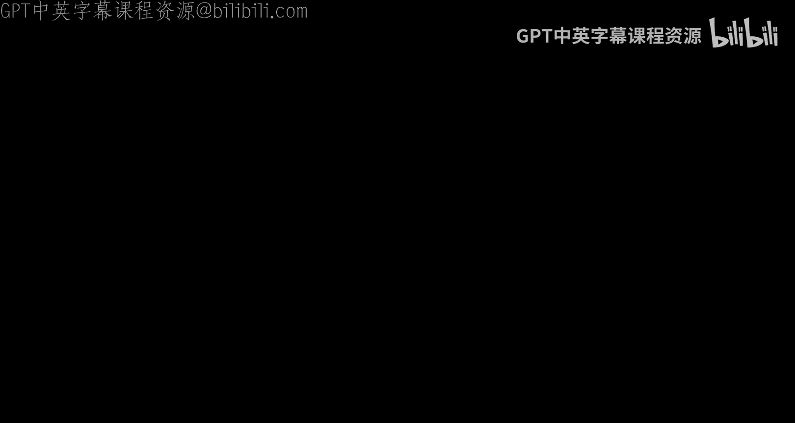
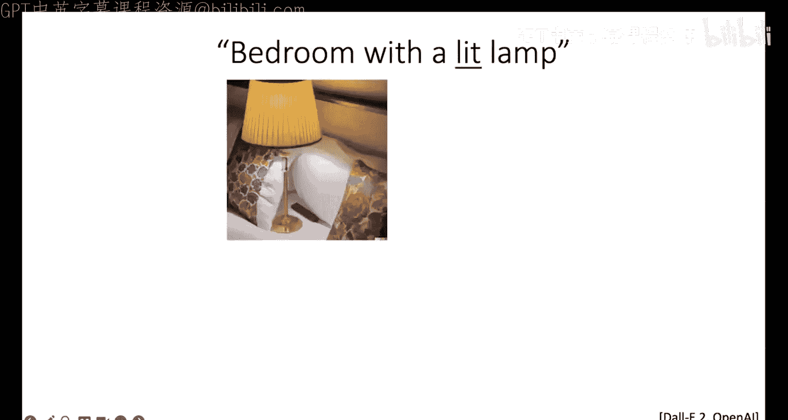
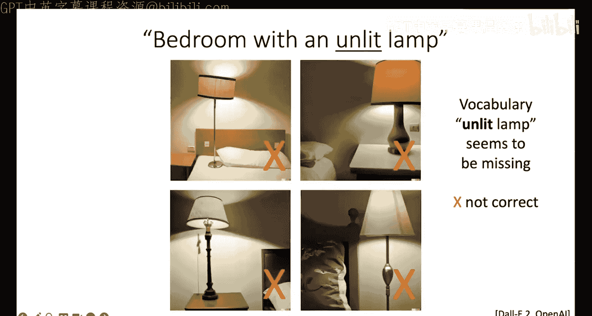
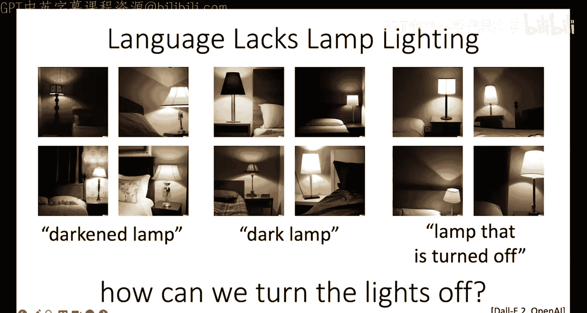
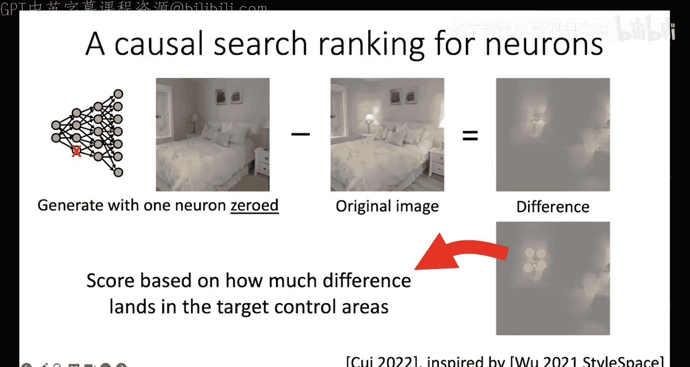
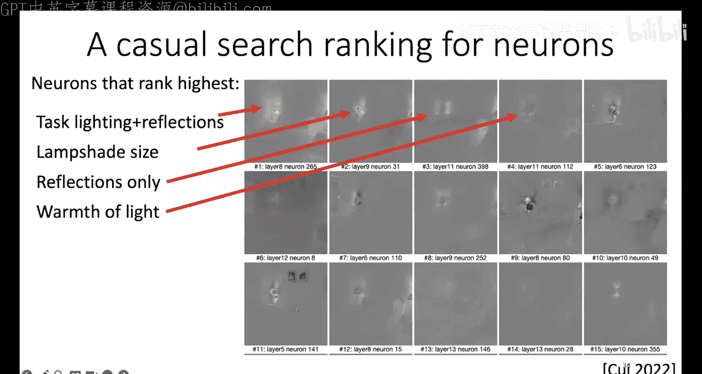
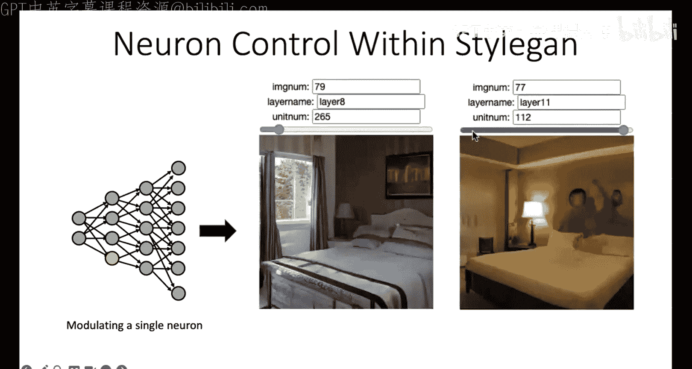
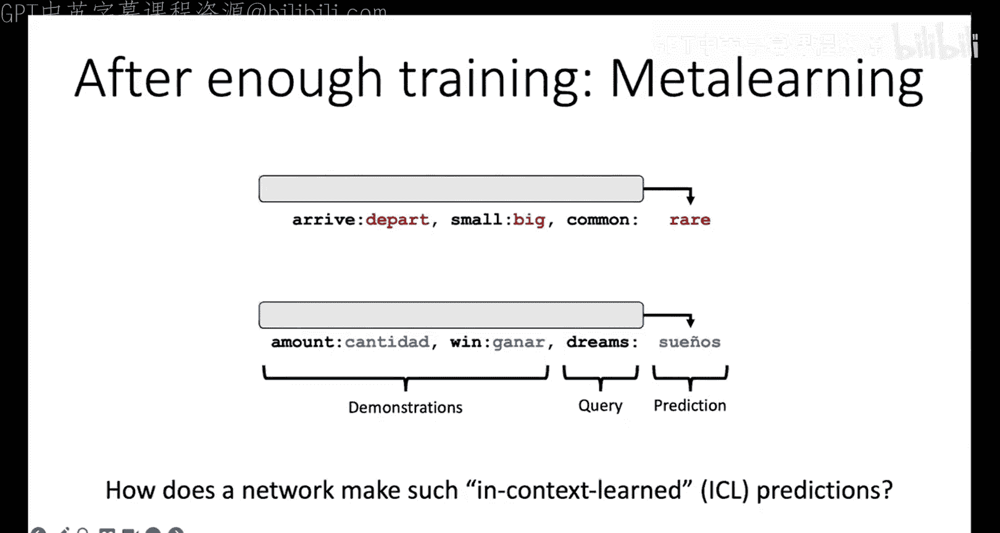
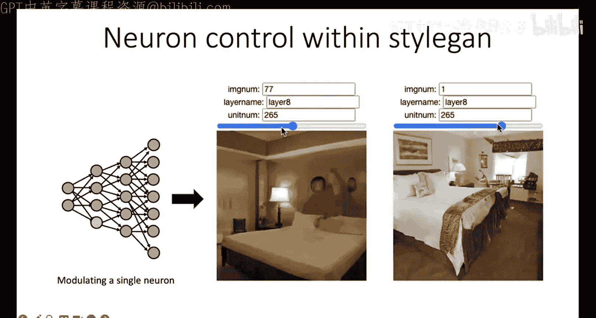
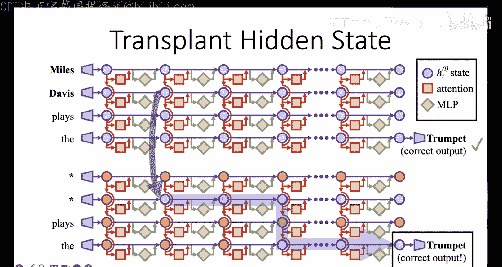

# UCB《理解大语言模型｜CS 194／294-267 Understanding Large Language Models》中英字幕 - P5：-5-David Bau_ Interpretability and model editing.zh_en - GPT中英字幕课程资源 - BV1Sz421q7k1

Hi everyone， yeah thanks for joining so now let's get started。😊，And so。

In in the previous lectures we've introduced the foundations for large language models and also talked about why safety is important and today is going to we are going to start a new section for the class focusing on interpretability so in the next few lectures we are going to cover different perspectives of interpretability so today is the first lecture on interpretability in this class it's our great honor and pleasure to have David Bao from Northeastern University to give the guest lecture on direct model editing and large model interpretability。

😊，So David is a professor at Northeastern University and has done a lot of great work in interpretability and also more broadly in I think HCI and machine learning in general and so with that please David thank you Don thank you very much thanks everybody I know that you guys are doing most of the class meetings in person and this is know sort of one of the zoom meetings and so I have to warn you in advance this lecture is designed to be in person and some of the parts of the lecture are going to ask you guys questions so I love it it just makes it a little bit more fun for me if when I ask questions if you guys you know turn on your cameras raise your hand whatever it makes it more fun so let me get into it。

😊，So I'm going to talk a little bit about interpretability。

 And so basically the what is interpretability about， what is this field about。

 And we ask a really simple question。😊，which is why。You know。

 a lot of live neural network work is about how to get a network to work well。

And we like to ask the question， why did the neural network work well or badly。

 why did it make that decision？And so let me back up and say， you know。

 typically we already have a lot of tools that we use to do this。

 even in elementary neural network classes， we teach you some of these tools。

 so typically you if you train a classifier or something like that。

There is already a basic thing that we teach everybody。

 which is that the way to evaluate the accuracy of your classifier。 So the example here is is。

 is an image classifier。 It's going to classify images。In one of 300 or so classes。

 according to what kind of place they are。But to see if the network is really learning what we hope it learns。

We don't。Care about whether。The network can predict。This training image as a baseball field。

What we care about is whether the network can get the idea of what a baseball field is and we test it by testing it on you know a secret holdout set。

 so if we present baseball images that the network has never seen before and it classifies them accurately。

Then then we feel pretty good about what we're doing。 call we see our models generalizing well。

And so that's the standard state of the art way of interpreting whether a model is just fitting。

 overfitting a function or actually generalizing and learning the concepts that we care about。

Just sort of what we're after。But there's something disatisfing about that， right， which is。

 you know。Sure， the the network can identify what a baseball field is。

But we maybe we're interested in what it really learned。 Like how it's doing that。

 What is it looking at in this image。 How does it know。That this is a baseball field。

And so for a bunch of years after the Alexnet network really proved really high performance at image classification。

 there's been a lot of methods in pursuing the following strategy just show you what so if you go and you do a Google search or search on archive or interpretability papers interpretability papers。

 you'll find that there's a lot that pursuing，Visualizations and measurements like this and these ask。

You know。What did the network look at？To make the decision that that it did and so this is a heat map this is it's called the salience map and you can make them in a bunch of ways I gave a paper that had a survey of a bunch of the ways。

 but like for example you could mask out random parts of the image and see which parts of the image the classifier is most sensitive to and so what i've shown here is a visualization where the parts of the。

Parts of the image that then the network is most sensitive to are shown in yellow and so this is where the network is looking at so if you kind of if you go back and forth。

 you can kind of see。Yeah， it's like looking at the baseball players。

 that makes sense like if you want to identify that there's a baseball image。

 you look at the baseball players okay but。So there's a lot of methods for doing this I'm using GrCm to show this one。

 but there can be something dissatisfying about that too because。It leaves open the question， why。

 why is the network looking there， can we understand that in a little bit more detail that it's looking at these people？

And it's kind of hard to tell。You can guess why but buts but but lets let's see if we can understand what the mechanism that the model is using by debugging the network piece by piece。

 so I'm going to show you a bunch of methods in today's talk that look at an aspect of interpretability which is sort of analogous to debugging programs so for example。

 a convolutional neural network has you know thousands of different types of neurons and we can ask which ones are important so it's kind of like commenting out pieces of code。

 we can take a neuron and we can set it to you know we can remove it from the network。

 we could set it to zero just like turning it off。And we can ask， did that have any effect？

On this task that it's doing。 and so just like a big program。

 if you commented out a line of code and you were interested in a specific behavior。

 most things that you remove don't really have much of an effect on the output So this network unit didn't。

You know this one doesn't change anything Most of the units don't but there's a few that do like this one。

 if you turn it off unit know 208 or just a few units it actually changes the classification of the network these are the most decisive neurons in the network so let's take a look so now that lets us narrow the question instead of asking what is the whole network looking at we can ask what do these important neurons look at so what are these specific units looking at and so let me visualize this this is another this is the same sort of heat map technology I'm just drawing it in different ways so you can see what's underneath the heat map。

And and so this， this is where this unit is firing the strongest。

 So there's one that's looking at like， I don't know， the bend and people's elbows and， you know。

 their clothing and their pants。 And this one looks like it's looking at their maybe at their heads。

 right， the tops of their bodies。It's kind of interesting。 So， let's ask。So now。

 but just looking at one image， we can't really tell what this image， what this unit is looking at。

 and so to actually answer that， we want to ask a more generalized question。

 but once we've chosen a specific unit。It allows us to ask a more broad question we can ask in general。

 not just in this image， what does neuron number 20 look at。And so here I'll show you what it does。

 So here's here's。Top 1% activations of this unit across the， you know。

 a large data set of hundreds of thousands of images。 So this is。

This is this is what the neuron is activating。 And so okay， so question number one， everybody。

 so what is it detecting， I'd love somebody to unmute and just chime in and say what is this。

 what is， what is this neuron。😊，What is this neuro Iran looking for here？Oh， come on， somebody brave。

Get to meet， David。Yes， heads， who said heads that's great is it is it detecting heads。

 does anybody have a better answer than so I see it in text faces is good。😊。

Heads and face professions， maybe yes， there's some professions。

 although there's a lot of professions throughout let me show you a counter example for faces so see this half a face here see there's a face。

😊，It like the unit doesn't seem to be looking at that。 Look at all these heads over here。

 Look at these guys。 Look at this。 Like， there's like a whole crowd of people with heads。Hats。

 a ha hats， yes。I actually you know I found this unit because I was。

 you know I had a program to automatically annotate what units they looking for and my annotation said。

 oh yeah， this is looking for heads， it's looking for tops of people and heads and things like this but it was not very good at it so it took me a while before I went around and looked at this unit。

😊，But when I lifted it by hand， I was like， it's missing a lot of the heads， this is why it's so bad。

And then somebody pointed out to me that it's getting all the hats。

 I did not recognize this at first and and I don't have good annotation data on hats。

 so there was like we did not train this network。To recognize hats。

 we trained it to recognize things like places like baseball fields。 So why would it be interesting。

To recognize hats， if you're interested in recognizing baseball fields， well。

Baseball is like the only sport where they wear hats。And so， so it's it's， it's the salient feature。

 So it's very interesting。 It gives you insights and。😊，The the cool thing about this is this is。

 you know， this was not long after Alex andt Imnet sort of classifiers came out and you could already see。

😊，From doing interpretability work like this， that these neural networks were succeeding in developing their own detectors for concepts in a very weak supervised way。

 without explicit supervision on what kinds of things they should be looking for。

 they're really just you know， you could see that there are concepts that are not obvious in the training data that they are distilling。

On their own。And so really interesting。So I trained my network to label scenes， it found hats。Right。

You know， this sort of the question。What are these networks learning？

And you know so I think at this juncture and this class that you're taking。

 I think the thing to really， you know， I think it's it's good to be amazed at these models。

 deep networks are generally genuinely surprising right even in the earliest days with perceptionrons。

 you know Rosenblatt was surprised that he could get these things to learn at all and then you know the work in the 80s was amazing that you could really train networks to solve non-trivial problems and then that you know there was this whole explosion of machine learning。

But then all of a sudden in 2012， this idea that this ancient idea of neural networks would be sort of outperforming all the other machine learning methods was very。

 very surprising 2012 and then now we're actually going through yet another round of surprise I wouldn't minimize it somehow it doesn't feel like there's been a gap between the 2012 rush and now。

 but I think that we're really facing some new things because we've got these models that really have these emergingnt capabilities like metal learning that people not long ago。

Thought that you would need completely different learning architectures to do and instead of new learning architectures。

 really we're doing the same thing， you know we are training these things using the same techniques we did in the 80s and the architectures are only a little bit different。

And the thing that's really changed。In between each of these surprises is we've just been making the networks bigger。

 and we've caught kind of caught on to that。 So we're even accelerating。

That now and so I'm going to I'm going to， you know。Skip a couple things here just for time。

But what do I mean by meta learning？So， so you guys are。

 you maybe familiar with the idea of in context learning so， but if you're not， this is。

 this is okay， somebody tell me what is the what is the missing answer here if we ask a language model that's sufficiently well trained to complete this。

This piece of text， this is the input to the model， what comes next。Oh。

 somebody can tell me what comes next。 Tell me what comes next here。

I know that you humans are good me learners。 Yes，5，5，5。 K， thank you。 perfect。5， yes。

 And so what did you do there， Right？ So basically， you had to recognize the pattern。

 if I gave you a different pattern with the same numbers， then you would predict something else。

 So what would you predict here， Yes， I noticed that you were very careful not to put the digit 9 there。

 but to spell it out。And so you know so basically to predict all these things。

 a model that needs to learn something and so the typical thing that we do in machine learning is we take our data set and we use it to drive a parameter learning process maybe through gradient descent。

😊，And， and we get a model out。 and and we， we can see whether the model solves a problem well or not。

 And then so this problem of like trying to train a model from a very small number of examples is's called two shot learning。

And fu shot learning was its whole own you know division of machine learning。

 a lot of people developed fu shot learning methods。

 and so the stunning thing though this is not a regular fu shot learning method。

 this is just providing input to the language model and somehow it does the learning internally without us。

😊，Driving any external parameter parameter learning method in it。

 So there's a bunch of ongoing debate right now about how it is。

That language models seem to be able to simulate small。

 few shot learning processes just during inference， just by running them to predict a model。

 And so this， this kind of learning to learn and you know， learning to adapt quickly to。

To to inputs was something that people thought would require completely new learning architectures。

 not that many years ago， just two or three years ago。

 and the idea that that you don't need a learning architecture that if you just train an autoregressive language model and you just train it big it will learn how to do this on its own was I think a real shocker I think a genuine surprise and that's sort of the era that we're living through now I think there's a series of real big surprises of what just comes out of scale and so so these models are learning to do this thing that humans thought would require some special kind of cleverness。

You give some demonstrations， you ask a query， it makes this prediction。It can do few shot learning。

 right， What is the learning algorithm that these things。IHave learned。

 And there are profound questions。About how these LLMs are working and we really don't know the answer to them Okay so now you could take this kind of approach。

 you could say， hey， can you explain what you're doing Yeah， I like this， you know。

 maybe you can explain have the network explain itself to you okay。

 so a question was just what is few shot learning it's very simple。😊，When you train a model。

 you normally have you know， hundreds， thousands， millions of examples that you train a model to。

But and so all few shot learning is is the question。Instead of supervising a model with many。

 many labeled pairs， like thousands or millions of labeled pairs。

 and you get away with a handful like a dozen or 20 or five。

 right if you just have five labeled pairs， is that enough to get a classifier to work well？

And there are different ground sort of ground rules。

The people have set in the few shot learning game， they might say， oh yeah， but you know。

 you're allowed to have pre traineded your model on unrelated。Images。

 maybe different classes or something， you maybe pret an imagenet or something like that。

 but if you if somebody showed up with you know five new classes of images and only gave you a couple examples of each one。

 how well could you do？How how could you adjust the parameters to learn so that's what fu shot learning is and basically what we found is that you don't really need to do fu shot learning now if you have these massive models they are they internally to themselves are performingforming and outperforming any of the fu shot learning methods just by providing examples like this on the input and so here the example is you we give these triplets 3 to158 1432 there's some pattern here and after giving even just 10 examples the network is you know catching on to the pattern well enough that it could predict nine so you know like GPT3 has no trouble answering something like this and putting the spelled out word 9。

And if I asked GP3 explain your pattern here， then it's happy to explain to us itself， right。

 it's actually kind of remarkable and you have a little bit of explainability in English here。

 it's explaining how it got to the third number， although it's a little bit odd I highlighted in yellow11。

😊，It says， for example， in the first 1 there's no 11 here。 I did not provide 11。

 It like eucinated its explanation a little bit。But， yeah， you know， it's pretty good。 Now。

 the weird thing is that it doesn't totally tell me what's going on。

 Anything else I need to follow the pattern。 Like you guys spelled out the word N N E。

 and I'm trying to get GP3 to tell me that it did that。 And there's nothing。

 I've tried having these conversations about this example with G3。

 And it will not explain to me that this is one of the things it did。 but it's capable of doing it。

 And this is kind of one of these neat examples where。😊，Where a model is capable of doing something。

 but it can't really explain to you what it's doing。 So it sort of leads to this question。

 I think that we're going to see this a lot。As language models get deployed in society。

 that some people may argue that their English language explanations that they give when you ask them。

 can you explain yourself， they may be enough？For model interpretation。 And。

 and that's sort of a question for you to think about。

 Do you think that these English language explanations。Are enough。 Now， I don't think they're enough。

And that's what this talk is about and so let me give you another example here from Dolly these diffusion models so if you go to any of these models if you go to a stable diffusion imagery or anything and you ask them you know draw me a scene one of my favorite things to do as a computer vision person is to ask for a scene with a lamp in it because these models are increasingly amazing。

 you can see that they not only draw a lamp but they you know reflect light out of the lamp reflecting against the wall reflecting on other objects you know you can see all these light transport effects which are actually quite challenging to get right。

 and the diffusion models seem to be doing it effortlessly and so to study this I ask my student。

 you know let's make a data set。😊，Of lights that are on and lights that are off in these diffusion models。

 you know， so we'll here some lights that are on and here's some lights that are off。

Wait a second。 Like what is going on here。 These lights are not off。 Okay， well， let's。

 let's no matter what we try。

Right， you know， the diffusion model will not dev us lights that are off。

And so so what is going on here so it's not just that we didn't like choose the right prompt。

 like all the prompts that we try have this problem where the diffusion model is sort of not giving us lights that are turned off and the problem here and the reason that you see this and you can see this in all the diffusion models that you can try。

Is that there's a really strong bias in the data think of it this way right the way that we program a large model is through a data and a data set is like the world's worst programming interface。

 it's this huge million or billion size， you know piece of data that's way too big for anybody to look at and understand what's in there。

 it can take millions of dollars to create， it can take months and months to use and training and then meanwhile you know after all of this work。

 right it's just full of missing concepts， mistakes， ambiguities biases。😊。

And we have no idea what they all are。 And so one of the biases that showed up in the training data for images。

 which is all trained on caption data。Is the idea that like， if you have。

 you have plenty of images where there's like a lamp in the image。

 if you collect billions of images and， and there's plenty of captions that might say that this is a lamp or something like that。

 But think about it。 if you got a room with a lamp in it。If the lamp was on， you might say， oh。

 this is a very bright lamp that somebody left the lamp on， it's turned on。

 but if there's a room with that happens to have a lamp in it and the lamp is not turned on。

You just wouldn't you probably wouldn't say that this lamp is turned off。Like this lamp is unlit。

 it's a darkened lamp it's a turned off lamp like it's just not。

Something you would say it would be like saying this person is not running or something like that you just people don't talk in the negative when they write captions and。

And so because of this， if you go to these models and you ask for these kinds of things like a negative like。

 you know， a lamp that's turned off or something like that like they they don't know how to follow your instructions and so so the goal is this now the thing is these models do know how to draw lamps that are not。

😊，Turned on。But just English is failing at allowing us to get at this and so the goal of a bunch of my work in interpretability is direct model editing can we put people more closely directly in touch with what the model is doing how it's working can we give people access to the concepts that they have and so let me show you how to do this with lamps。

 this is a little bit older work with Gs， it's funny that it's just a few years ago that GNs where all the the rage but diffusion models have taken over this a little bit before diffusion models came out and what you can do is you can do the same exercise with a G generator this is a generative image model that makes realistic images of bedrooms and you can kind of do the same exercise that I was showing you with baseball hats you can take an individual unit and you can ask what are its effects on a scene so let's take a scene here。

Where there's like a lamp that is interesting to us， it's like it's like turned on。

And what we can do is we can ask， what does this neuron do during the generation of the scene。

 I'll define a procedure。 I'm going to repeat it for all the neurons。

 And so what we'll do is we will say， I am interested in this aspect of the scene。

 I'm interested in how the light comes out of this lamp。

 So let's make a little mask that shows where the light。😊。

Reflection pixels are in the image and then I'm going to hunt for neurons that seem to be causal for these pixels and one way that we could do it is we could turn this neuron off and see what effect it has when we regenerate the image and so heres here's what it looks like in this case。

 you can see that when I turn that neuro off and has a little bit different behavior in the image。

And if I were to take the difference image and multiply it by my mask and sum up the differences。

I can get a number。 I can get a score。That says how much of the difference actually lands in the target region that I care about。

 And that gives me like a ranking function over all the neurons。

 It only takes a fraction of a second to compute a score for a neurons。

 So I can sort all the neurons in the network， according to how much。

They cause they seem to cause this visual effect and so here's here's my little search engine that we've created and so yeah。

 this approach is quite scalable because you know even though these models have billions of parameters you know it really doesn't take long to search through all of them now the issue with it。

Is， is that。Is that only certain models are disentangled well enough that you can find concepts by looking at neurons。

 so stylegan， especially stylegan2 is is particularly good at disentangling its concepts。

 I think that you know I'm not sure that theoreisticians have a good understanding of why some models are better at disentangling than not。

But， but the stylegan models are superb and disentangling concepts。 And so。

 so what you can do is you can， you can search through all the neurons。

 we we can discuss that at the end a little bit what disentanglement means。 But I want to。

Sort of continue on with the story here and and so it really just takes a few seconds to rank all the neurons according to a simple scoring function like this。

 one of the reasons it's so fast is because we're just scoring it based on effects of a single image we're not looking at it over you know a large data set or anything and so these are these are the neurons that had the most effect over those like late reflections in that one image now the interesting thing though is that you do get a lot of interesting separated。

😊，Effects here so there is an neuron that affects task lighting this neuron 265 this is actually this one here is affecting the size of a lamp shadeade right it's kind of interesting this one only affects the reflections on the wall like how shiny the walls are to light and then this one is interesting is' like the warmth of the light like whether it's a bluish light or an orangeish light sort of color temperature which is a surprise to us and so。

😊。

And that generalizes。 So I'm showing you different images here that were produced by the G。

 and I'll modulate that first neuron on and off。 And you can see that that the the G really is using this neuron to turn lights on and off。

 So by looking into a network， theres。This promise that we might be able to identify concepts that we might not even be able to find。

Using text。This is sort of more successful than asking a diffusion model through text to turn off the lamps。

Make sense， and I also want you to， oh， so this is more just more laps。

We can show you a lot of images of these things turning on and off this on the right here。

 I've shown a different neuron this is not。😊，Supposed to be turning the light on and off。

 It's actually changing the color temperature。 So this is the color temperature around and see it getting bluish and oranges。

Okay， so what have we done here， So we found it， we found it change and interesting thing that we're interested in。

We searched for causal effects。We search for like the relevant causal components。

And then after we found causal components， we tried to verify。

The effects by checking for generalization unlike different images， different situations。

By altering the network， testing our ability to change things according to what we've learned。

So so there's a couple principles for interpretability that I would advocate。 One is that， you know。

 in sort of in the old days， we we would look for all these saency maps。

 which are sort of these correlative signals of。😊，Of， you know， what， what kinds of。

 what kinds of things correlate with。With certain behavior of the model。

 but I think that the most interesting things are causal， so causal tracing。

 looking for causal effects。😊，Has you know， really does a better job at reveing mechanisms that it's harder to get fooled when you're looking for causal effects and but then still we work with such large systems。

 sometimes you have causal coincidences and so you really want to you know。

 we want to verify your understanding。By checking your ability to actually make changes based on。

What you've learned and see if those changes generalize over other situations。So。So let's okay。

 so this course is supposed to be about transformers， large language models。

 So let's take a look at you know， example， I think。Yeah， this is GPT2 X。

 actually a lot of the experiments I'm going to show you are for larger models。 and again。

 we have this situation where it's a you know， these GPT models are trained unsupervised。😊。

On a lot of text and we're not really sure what they're doing， you know， after enough training。

 we get things like meta learning。Where you just give these demonstrations and， you know。

 it can make these predictions。 So let's ask the question。

Right how does the network make in context learn predictions。

 So I'm going to talk about one of the papers for my students recently。 And。

 and what we're going to do is we're going to ask。What triggers in contextex learning and so let's take a look at this particular example of in contextex learning here right so if anybody's not familiar with in contextext learning I can slow down here but you know just pipe up in the chat and I'm happy to explain it in a little bit more detail but what we're showing here at the top is you know this is just showing a few examples the model has learned how to imitate antonyms。

😊，Like an antonym function and so to the left of the colon to the right of the colon are like inputs and outputs to some function and you can think of what the model is doing is it's actually learning to model this function from inputs to outputs from arrive to depart from small to big。

😊，And then after you give it enough examples， you can do another one。

Down here it's the English to Spanish function and you can have other functions。

 people have functions that they use in context learning to train that are much more complicated than this。

 not easy to fit on a slide but summarization， information extraction。

 you know finding you know what what is the relevant drug name in a long piece of medical text or something like that or tell me whether this。

Stment is true or false。 and figure out the logic of it or something that you can give lots of。

Examples and eventually the models will figure out what you're trying to do。And it'll， it'll do them。

Is there a common mechanism that underlies all in context learning or is each one of these situations just different？

So when asking this kind of question is like the emblematic of like hard interpretability questions that we face and so like when you're doing interpretability over a large network。

 you face these questions like what are the right abstractions for understanding what thinking is right like should we be looking at choices or likelihood distributions should we be looking at learn tasks who we be looking at known facts。

 I think that you know it's unlike biology where I think that there was eventually there was a consensus that people should understand the action of genes。

😊，I don't know if we know what the right level of abstraction is yet in understanding how machine learning models actually execute their algorithms。

And then you can ask even if you understand things in the abstract like on an information and theory basis。

 is there a physical basis to how things seem to work you know can we actually go and find neurons that do things or are things just very diffuse and we should think of things more like you know the way that physicists think about like pressure and temperature and these are just like big you know massive effects rather than things about individual components can we understand neurons radiance or things like attention heads or circuits are these are open questions but then if you can understand even components then you can ask the more detailed question can you explicitly code them or decode them can we can we edit things directly because we understand what code what the internal language of the systems are and so I think by analogy and biology the answer to all these things is yes we know the right level of abstraction。

There is a physical basis for heredity， it is DNA and it's divided into genes and we know the code explicitly。

 the week after COVID came out， they decoded the genes and we knew the proteins and what the you know sort of vaccine targets would be a couple days later。

And so I think the one reasonable question is， you know。

 can we ever get to that point in machine learning？

So these are very fundamental fundamental questions about what thinking is and so let's let's go through the example of in contextex learning here so I'm showing you the end of a prompt you know small big common and then you know the opposite this is the antonym ICL task and you know this model can do it right the prediction that it's going to make。

😊，Is the word rare。 And what we're facing is we have this。 So if I draw the transformer like this。

 does this make sense what I'm drawing here， right， This is a the transformer is a grid of states。

The inputs coming on the left， they're encoded into vectors and the vectors of one vector for each token passes through the layers。

 I've drawn the transformer horizontally here so the layers advance from left to right and then in red is this autoregressive attention mechanism where every token can look at previous tokens and then there's in green there's this MLP mechanism where as you pass from layers to layers it goes through a small feed forward neural network that can you sort of mutate the vectors a bit as you go from layers to layer。

And。And so so yeah， so in context learning， you know， sort of。You know。

 it passes through this network just like any other text does。

 and it can execute these this some amazing learning algorithm。 What， what。😊。

Does it can we identify what component causes ICL， can we find the circuit？For ICL。

 so let let's do this and the idea is let's do it by transplanting data。To identify effects。

 And what do I mean by transplanting data， I'll show you how we do it。

So we're going to run the network twice。And we're going to run the network once。

In a condition where it can do it， it can small， big， common rare right， so like where it works。

And I'm going to run the network a second time in a scrambled condition where I take all the words and I scramble them so that there's nothing to learn here。

 so quiet has no relation to dry。 I can I could supply it with 10 scrambled examples like this。

 and at the end， I can still end with common。But it's not going to say rare。Because it has no idea。

What it is that is trying to learn here。 I mean， haven't given it good training data。

IfThat makes sense。 And so now what our goal is going to be is our goal is going to be。

 can we identify。Where in the network is learned how to make the output rare from common。

 And so the way we're going to do it is we're going to monitor the output。

 the output probability distribution of this。Sort of disease network， this corrupted network。

And then meanwhile， we're going to take individual components。

 and we're going to hotwire them from the clean network。

 which is capable of doing the right computation。Into the corrupted network。

 which is not able to do it。And most of the time， when we patch things over， it has no effect。

 It's just going to continue to be corrupted。But once in a while。

 if we patch over just the right component。Then what will happen is we'll look at the output here。

 and it will boost the probability of the antonym task。 It'll boost the probability of saying rare。

 And so what that would suggest to us。Is that there's some information at this point in the network。

 which is asking。The network， please， you know， do an antonym。

And it's actually even better if if we do this and it's not common。

 if I use the word big here and it goes to small， then it actually helps me disambiguate from bringing the idea of doing antonyms over from just bringing over the word rare。

So we set this kind of thing up。And， you know， we try to figure out if we can see which one of these components causes the the target。

Behavior to rise the most， it's just like the lamp experiment that I showed you。

 it's just a little less visual。And it gives us a ranking function。 We can。

 We can create a sorting of all of the components that we test to see which ones are the most effective。

 In this case， we are sorting through the attention heads of a transformer network。😊，And so you know。

 so the transformer network has about。You know， a couple hundred attention heads depending on the size of the network that you're looking at。

And so in blue， so this is a diagram of all the attention heads over a network that has about 27 layers。

 and in blue， I'm highlighting the attention heads that have the strongest causal effect。

At boosting correct IL results。 Now， the interesting thing。

Is that when we make such rankings and we make such catalogs。

 actually find that it's approximately the same ranking。

 the same set of heads regardless of which ICL task we use to collect them。😊。

And so so this is this was actually kind of surprising for us we we imagined that maybe each task would have a different set of attention heads。

 but we found that it was actually the same set of attention heads across a wide variety of tasks。

 We have dozens of tasks that we have。Tested in this way across different levels of complexity and it's basically the same attention heads and these attention heads have a very distinctive pattern regardless of the task。

 and so I can show you the example， this is what each row here is one of the10 attention heads that's most influential and you can see what they are attending to with this little heat map and they're basically if you have analogies。

 they're always attending to the output to the second word in the analogy。😊。

And so so it's kind of interesting。 So we still know exactly what these attention heads are doing by looking at this。

 but they are they， you know， it's， it's giving us a sense for what is in this circuit and the circuit is smaller than we might imagine。

 and we can actually kind of decode the circuit by。

By going to the attention heads and just summing up what all their output is。

 So what we do here is two steps。 we average each attention head over a few examples of a task。

And then we go to the 10 attention heads。Averages。And we just add them up。For a specific task。

 And so what that gives us is a vector。 This Vt is something we call a function vector。

For the task for the function T。 So if we have like the antonym task here。

Then we can gather a function vector from the 10 attention heads。At this moment。And。

 and it's the thing that that these attention heads are doing when we're doing antonyms or we can get a function vector when it's doing English to Spanish translation。

Now if we take this function vector， we can try to test it now to see if it generalizes and so what we're doing here is we have just some other neutral sentence。

 just a regular plain piece of text， the word fast means something it would normally say the word fast means quick or something like that。

😊，But what I'm going to do is I'm going to take this。Function vector。

 and I'm going to transplant it into。The network， by just insertia into place at the last hidden state。

And then when you do that。Instead of the text generation saying that the word fast means quick or something like this。

 it causes the network to say the word fast means slow。 So in a sense。

we've transplanted the idea that the network should be doing opposites。

 should be doing antonyms into a small vector that we can move around and put anywhere in the network and it will cause the network to do antonyms and similarly。

 if we take this the same sentence we move over the vector from these examples on Spanish and move them over。

 it will cause the network to translate things to Spanish and so so think about what we've done here。

we've used causal effects to identify some mechanism。

 and then we've taken a different setting to see if what we've learned about the mechanism generalizes if we can actually make a change。

😊，That's different from the way that we collected the insight。

There's other ways that we can check on this insight so like so for example we can check on function vector arithmetics now here's another quiz for you guys to make sure that you're awake。

😊，嗯。Here's a few tasks。I have defined three tasks。And for so the tasks will actually take a list as input so this is like the summarization tasks where you might have a large body of Texas input and so my example input is a list of five countries。

 Italy， Russia， China， Japan and France。And like an example task would be to give me the first thing on the list and if I gave a model like 10 examples of lists followed by giving me the first thing in the list。

 then the model would be able to learn that very easily using ICL and it would continue to follow the pattern。

😊，Of giving me the first thing on the list。So I call that task first copy and we can get a function vector for that。

We could have a more challenging thing over list， we could say don't give me the first thing in the list。

 these are all country names， give me the capital of that first thing on the list and the answer for that would be Rome。

I could do other things。I could say， well， why don't you just copy the last country in the list。

 right， And then that the answer for that would be France。

 And each of these corresponds to some function vector。Okay， so， so now what if。

I took these function vectors and added them up in the following way。 What if I took you know the。

Last copy function vector added the first capital function vector and subtracted the first copy function vector。

Well， then I get some other vector。Which I just call V star Bd here。

And the hypothesis is that maybe this。For encodes a task last capital， right， So like。

 what would be the answer to last capital， if that was the thing。 So that's my question to you guys。

 Like， what's behind these question marks， Any guesses。Yes， Paris。 So somebody's awake， thanks， Drve。

嗯。It turns out that when I do this vector arithmetic， it does indeed。

Create a function vector that if I do the kind of information that I described in the previous slide。

 it will cause the model to do parents。 So this is a completely unseen task in none of the examples that I've given has it ever seen this task demonstrated。

 but it actually performs this task very well actually if I use the function vector in this case to perform this task on GPJ it actually performs the task with higher accuracy with not even robust。

 iss like higher than baseline accuracy if I try to use IL to get GPJ to perform this task。

 it can kind of do it but it misses it a lot if I use this function vector arithmetic。

To get a function vector to perform this task， it will actually outperform ICL itself。

 so I don't think that's true for the stronger models if we do it on Lamamus 60 B then Lama 60 B is like good at IL and you can't outperform it using function vectorrithtic but it was weird the first time that we tried to NGPJ and it actually outperformed ICL itself。

😊，Okay。So yes， is it comparably robust， I guess depending on your definition for robust， yes。

 it's compably robust， maybe it's even more robust。Make sense。All right。So， so what did we do here。

 We specified a change。 We searched for causal computations。 We checked generalization。Right。

 so now I'm kind of out of time。 who Who here is familiar with the Rome paper。Rome。

Anybody familiar with the wrong paper？Great， I want to just mention this other result that was it' from a couple years ago。

 but I think it's one of the most important results out of my lab。

 So I just want to survey it before we wrap up。 And this is this is a very similar setting to the question of asking how does IL work。

 But here we're asking。😊，Can we， can we figure out where a model stores its factual knowledge。Right。

 so like， you know， factual knowledge， like Miles Davis plays the trumpet。

This is like one of the things that these models are amazing at。

 you can ask them all sorts of trivia and they will know all sorts of things about the real world both like encyclopedic facts and common sense facts about the world they're really remarkable at this and so they must be storing these facts somewhere and the question is。

😊，Can we figure out what the mechanism is that they're using to store these facts and so we're going to do the same exercise here we're going to run the network twice and in this case what we're going to do is we're going to destroy the ability for the network to be able to recall the fact that Miles Davis played the trumpet and the way well do that。

Is we'll corrupt the input。 We'll make it so that the network can't hear the name Miles Davis。

 And then when we corrupt the input， then is no longer able to predict trumpet。 That's predictable。

 And then what we're going to do is we're going to see if there are hidden states that cause the model to be able to recall that the answer is trumpet。

 And as we go around the network， most of the hidden states don't have any effect。

 But some hidden states do。 and cause it to say trumpet。

 And then we can draw heat maps that show like a little。

Like a sort function for which of the components have the strongest causal effects and so in the seat map I have well I've taken a different sentence here。

 Ryan De Palmer works in the area and he's a filmmaker and in dark purple we've shown you the hidden states that when you corrupt the sentence still cause the sentence to output film。

And in white are all the states which have no effect at causing you to say film。

And so it's unsurprising that at the end of the network。

 you can do this because these are the hidden states that are right before the output of the word film。

 these are states that literally decode to the word film and so by if the network was corrupted and was going to say something else like you know works in the area of sports or something like that。

It's not surprising that if you just pop in the encoding for film at this location then it should say film so these strong interventions at site B are not interesting。

 what was shocking to us is that we have these strong effects much。

 much early in the network at site A and so the hypothesis that comes out and you see this in a lot of different examples where you've got this early site that has strong causal effects it's very。

 very distinctive， the hypothesis is that this early site is where factual retrieval is happening it's where we realize the difference between Shaquiel and Neil and Mega Raau that that's the moment when retrieval is happening and it's just sort of translated into the word soccer at the late site and so when we average this sort of causal map over thousand factual statements that you can see that the effects are systematic now what I've shown you here on the right is separating them into MLP and attention0。

Caus effects， and you can see that at the late site， it's attention that's really important。

 and at the early site， it's actually MLP modules。That are really important。

 And so this is another hint that there's something different going on at the early and late site that maybe the late site is about transporting the information。

 using attention to move it from one place to another， but the early site。

 the causality comes from something that the MLPs are doing。

And so to double check what we've done here， we built a hypothesis for how the MLPs might be operating。

And so the idea is that an MLP might be an associative memory。That maps an input to an output。 so。

 for example， that might map the Eiffel Tower to Paris or the space needle to Seattle。

And so this is an old idea。 This comes from 1972 that neural network layers can。

Store such mappings it's just something that falls directly out of the fact that a neural network layer is a linear system of equations。

 and so you can always solve a linear system of equations to associate any input and any output if you solve the system of equations。

 you can get a matrix that solves them and you can actually pack in more pairs if you're willing to absorb some error and solve this as a least squares problem。

And so what we do is we say， well， if that's the case。

 then we should be able to change a memory wherever it's stored by altering the mapping from inputs to outputs by altering this matrix so you can solve the linear algebra to what you would need to do to make a minimal change to a layer of a neural network to change a single association between input vectors and output vectors and so that's something that we do and so without integrating descent on this matrix at all。

 you can just patch it to to make it map now from V star or K star to v star for any new B&K that you might choose。

And so。So okay， so I'm going to skip through the math here because not enough time。

 but it's just algebra， you know， instead instead of doing gradient descent。

 you you can edit a network directly to change it's an association between vectors and so the idea is if we can find a vector for like the space needle and find a vector for instead of Seattle。

 let's pick a different thing， let's find a vector for Rome。

Then what we can do is we can edit the model so that the layer maps from the space needle to Rome instead of the space needle to Seattle and when we do that then when we run the model then it will predict Rome instead but the cool thing is you want to test it on generalization and so if you ask for the initial question that you asked it。

 of course it'll say Rome， but if you reword your question， ask in a different way。

 it'll give you all sorts of different contexts like say oh， you should learn in Latin。

 you should eat pasta instead of burgers and so what the research here。

 does to try to square the circle。Is it tests both specificity and generalization。

 we want to make sure that if we do this direct editing on a fact that it generalizes that if you rephrase statements of the fact in different ways。

 that the model will continue to reflect the new rewritten fact that you've tried to insert in the model。

 and then for specificity， we want to make sure if we rewrite a fact that we're not changing all sorts of unexpected。

 undesired things in the model， if we move the space needle to Rome。

 we don't want to see that Bill Gates is also born in Rome。

 that would indicate that maybe we've renamed Seattle to Rome or something like that rather than actually changing the specific association that we care about。

 or even worse， if everything is in Rome， if the Empire State Build is in Rome and you Staue of Liberties is in Rome。

 then maybe we've just completely overwritten the model so that it just says Rome as answered to everything which is not desirable so。

So if we measure specificity and tradeoff and we sort of compare it to traditional methods。

 so like regular fine tuning is here in red， metal learning here is in purple。

 sort of the state of the art methods for changing facts and our ro and me methods are here up to the right hand corner and so higher generalization and specificity are up and to the right so actually oddly enough。

 if you just go directly into matrices and you edit them you get better generalization and specificity then you know what we typically do for editing editing things now。

😊，There's been a this work was a couple years ago and there's been a bunch of papers coming out sort of saying。

 oh， but there's still drawbacks from this approach。

 so I don't want to oversell this approach is saying this is the way to solve all sorts of editing things because there are some there's some things that are still fragile with this approach。

 but it does perform surprisingly well， and one of the interesting places this perform as well is if you go to diffusion models。

 you have the same kind of issue， we have lots of undesirable behavior and diffusion models。

 like the way that they imitate artists that you don't want to imitate where they generate porn when you don't want to generate porn。

 they have really serious societal biases where they think that all doctors and CEOs are white and male。

 and by using a Rome technique we can directly edit these associations and diffusion models and actually it seems quite good。

 it's pretty robust， it's a pretty good method， actually if you were editing diffusion models。

Actually， would， I would recommend it。Here， so this， this is， this paper is called oh。

 I didn't put the URL link。 I'll put it at the end。 It's called unified concept of betting。

Make sense。 If you overwrite the model this much， at what point do you think editing the models will still scale。

 So this， it's a good question。 So every time you do direct editing like this。

 then you cause some degradation of other capabilities in the model。 And so this is， this is about。

The limit of how much you can change a diffusion model where we change you know about 15。

200 associations as well as changing a major item like removing all nudity from the model at the same time and when we change it to this level the you know like stable diffusion。

 these large diffusion models， they have a slight degradation in quality but not too bad。

 it's like pretty good still。AndBut if you do a lot more。

 if you were to do like a thousand edits instead of just a couple hundred。

 then the degradation starts to become noticeable and and so so you definitely have this situation now it's not that similar to trying to fine tune in a model on too many different tasks you would have some degradation and fine tuning as well。

 And so the nice thing about this is that unlike fine tuning is from other things we have really precise control and can it can be done very quickly because all the edits are just direct edits to the。

um。To the matrices， you know， you can you can do this set of edits in just a few minutes。

Without collecting any new training data。So okay， so like the idea here and I don't want to claim that this is all solved。

 this is all active research and we're trying to figure out how to get these methods to work better。

 but there is this common fallacy right which is that there's some sort of mysterious mystical tradeoff between interpretability and performance and I just want to you know if you were to say to Lis Torvalds。

 you know I think that there's a tradeoff between interpretability and performance and you should accept my pull request of this crazy kernel patch。

 which is completely uninterpreable because it's the highest way of getting best performance。

 I think that he would just he would have something to say to you and he would not merge your pull request。

 there is not a tradeoff between interpretability and performance for regular code。

 and I think it's a reasonable question why would we expect there to be some inherent tradeoff between interpretability and performance。

😊，For large scale neural network。Algorithms， it may be that we don't understand them well enough。

 but it may be that。But that may be our own limitations， so。

So the goal of what we're trying to do here is see if we can lay sort of an ideal in front of us that really better interpretably should lead to better performance。

 better understanding of what the model is doing and better control and so the method that we found that is useful for this is the same sort of process of you identify the change you want to do。

 you look for causal effects， and then you check for generalization and some other effect it's the same thing that we did for lamps。

 it's the same thing that we did for ICL。嗯。And so， yeah。 So these are my technical takeaways。

You can learn better networking internals by looking for these causal effects。

And if you understand the structure well enough， it could lead to better scalability。

And I just want to credit the students that did the work。

 this is Audrey Couy did the work on relighting scenes， function factorss is Eric Todd's work。

 the Unified concept editing team was this great collaboration over last summer with Rohit Haass and Joanna and there's been a several papers oh I should add another link here for the Rome and memory and LE papers and this is the team of folks who works on that and so yeah thank you very much I think I went over but I appreciate your attention。

And yeah， any questions， Any discussion。Oh sure so we also have some questions correct earlier so I think the first question is we have seen many amazing examples of acting different acting methods so what kind of task do you think this methods are good at and what kind of task this methods probably don't is not that good at yeah so something that I think this particularly like makes a lot of sense so I gave you the example of diffusion model editing。

At the end。So I think it's a， it's， it's actually a pretty good。

Setting here， see if I can find where the diffusion model image is here。 So basically。U。

So when we edit diffusion models， we're doing is we have this thing that we know we want the models to do。

so for example， let's take a look at the debiasing case right we we like the models are really they they amplify a lot of biases if you ask for doctors or。

Nurses， it's always male or female， right， There's， there's all sorts of。

 They have these ethnic biases if you ask for， you know。

Images of a housekeeper or something like that， some of the biases they have can be quite offensive。

And， and so， you know that， you know， you have these different problems in these models and。

And we know how we want the models to behave。But it could be very challenging to try to fix the model by。

 by coming up。With a curated training set。You know， like you know。

 how do we remove all of the so like like I'll give you an example， like if you ask forum。CEO。

 then it'll be you know biased in a certain way and you might try to curate it so that it removes that bias by finding lots of pictures of diverse CEOs and。

includingncluding that in the training set， but then what if you ask for like a successful CEO Well。

 I'll tell you you get the biases again and and then and then what do you do now， you know。

 you have to go back to the drawing board and spend another$100 million dollars on your large scale training And so so I think that this is actually a pretty good setting for doing this because one of the advantages of model editing is that you can do it。

😊，Very quickly， you can do it after the fact， you can do it without introducing new training data。

 and you can very quickly evaluate and tune the effects that you're trying to achieve。And so it's。

 it's a much better programming interface than a data set。 And it kind of makes sense， right。

 There's sometimes the effects that we want to create。You know。

 sometimes what you want is you want to。Imitate the train distribution。And that's what you want。

But there are other times when you don't want to imitate the train distribution and you want something else and when you want something else。

 then you want to understand how the train distribution is turned into model behavior。

 and then if you can understand it well enough， then you'd like to be able to edit that transformation。

 and that's what that's I think that's the area where。You know， it's really promising。Okay。

 so we have。I think Ruth and Akshot， I'm not sure who raise their hand first， but how about Akshot。

Yeah， thank you。We see from like what else Z you said and other works that model editing methods and I'm specifically talking about knowledge editing are not scaling。

SoRight， they only scale up to like they only scale up to like， you know。

 like a thousand edits or something like that and you kind of run out of guess。Yeah。

 so like I mean like in the ideal realization of knowledge editing， I I imagine。😊。

Thousands or like tens of thousands of edit being made every day as in fact come up so what do you think is the next step like how how do you create methods that also scale I think it's a reasonable question I think that so you know I so there are。

😊，How do you create methods that also scale， I think that。You know， to tell you the truth。

 my real goal。Is to understand the models better。 And I feel like if we actually understand the organization of models better。

 if we actually understand。You know。dontSo this real hypothesis。

That there is a simple key value mapping from associations to the Eiffel Tower to Paris。

Is something that we explain in the paper， it's a hypothesis that we confirm。

 but we also you are upfront of the fact that some of the numbers are blurry。You know， sort of。

 you know， explains a certain percentage of the causality， but not 100%。

And we have some follow up work where。You know， we we sort of show in this other paper。

 the Eery paper that there are some facts。That are very cleanly represented by mapping a roam style mapping in this way。

 And there's other factual knowledge that a model has that don't seem to be following the roam scheme。

 They seem to be doing other things。 And so I kind of feel like it would be like。

 going to somebody you know， at the early days of discovering what a protein is and saying， hey。

 you know， we're we're trying to like， you， cure cancer。 It involves you know，40000。

Proteins interacting in different ways and doesn't work doesn't seem to scale this idea of proteins you have。

 you know， maybe proteins aren't a thing。 Maybe we should be looking at something else。

 And I kind of feel like mom， whoa， whoa， whoa， we're just at the beginning here。

 There's a lot of mechanisms to map out and understand。

 And I think that as we as we improve our understanding of what's going on。

 then we'll be able they will lead us。😊，To better performance。

 And so so I agree that our knowledge of what's going on here is pretty incomplete and there's some work ahead for us。

 But one of the one of the odd phenomena is that this work actually has gotten easier as the models have gotten bigger。

Some of the effects which are you know really hard to map out in smaller models actually turn out to be easier to map out in larger models。

 so there's this hope that as models are forced to generalize better and given more training time。

 more training data and more parameters that they actually arrive at better solutions that generalize better that look more like algorithms that look more like things that we can understand and manipulate in a sensible way and so so actually I'm quite hopeful for the future。

Thank you。Oh， Drewve has a question。Oh yeah thank you for the lecture I't I haven't really thought that much about this。

 but I kind of wanted to hear your takes on like adversarial attacks based on these function vectors and like kind of maybe likejecting them like how you know from a research point of view I think this is interesting so let me let me give you the place where I think that the adversarial attacks are particularly interesting so so like this this application that I showed you here。

Like here's here's like a simple application， so you could use one of our methods。

 we have a few different methods for like erasing an undesirable concept from a model。

 you might want to do this for privacy reasons or you might want to do this just to like remove the tendency for models to create an offensive piece of content like an offensive religious kind of content or like nudity or something like so removing nudity is something that all they want to do in classrooms in the United States。

😊，And。And so。So now there's this question。When you remove a concept。Is it really gone？

Or have you just hatched over the model and said， you know， I know you still know this concept。

 but then， let me just like please turn this off right like which one have you done？Right。

 and and you know， I don't know if we really know yet， like again。

 our knowledge of these mechanisms are not is not complete。

And so like an adversarial attack on this might be able to prove us wrong。

 like we think we've erased the ability for these diffusion models to be able to create nudity。

 but if you were to come along and tell us， hey I've got this cool adversarial attack technique and I've tried it on your erase model and let me tell you。

 I have a sequence of 11 weird characters that if I put this at the beginning of the prompt。

 the model is more than happy to like draw all sorts of nude images for me。Right。

 you have not erased it。 You've just， you know， slightly made it harder。Then， then I would。

 I would yield。 I'd say， okay。You've discovered something new。Let's figure out what's happening here。

 And so I think that there's an interesting interplay between aversarial attacks and the types of。

 you know， editing， fine tuing， editing， you know， model editing that try to do create different effects。

 So is that， maybe this， is that one answer to your question。Yeah， yeah， I think， yeah， thank you。

 Okay， cool。Yeah。Oh， there's another one Yeah， there's a sad question。 Yeah I can I can read it。

 I can read it， that's okay， thank you for the lecture。😊，From A security perspectives。

 is it possible add malicious biases into a model by directly by manipulateipulating parameters on purpose。

 like adding stereotypes， absolutely， this is actually a kind of a concern。

 And so I don't want to be too political about it。 But it gave me some discomfort when I was。

 you we we just presented the real work you know， a few months earlier。

 And I think it was at ICLR or something。😊，And a young Chinese student came up to me and said that there's a lot of interest in model editing in their lab because they have a lot of trouble of releasing language models in China and they need to edit they need to edit the facts which is which gives me a lot of discomfort because I think of editing facts as I think that you would want to do to update them to make them more accurate。

 but you could certainly deploy these methods to edit facts to make them less accurate to obscure the truth and to achieve some political goals and so so this is a doubleed sword。

 I think that these sort of ethical concerns。Should be noted。And we should， you know。

 we should figure out， I don't know if there's a technical solution to them because censorship sort of appears in all media。

 but， but I think that but but you know， we should be aware of the issues。

 I think that if nothing else， it brings it into star relief because you can apply this censorship and let。

 you know， in different ways， and the fact that you can just directly edit models and you can do this。

 really， I think it reveals。嗯。A truth。About these large neural networks。Which I think。

 is important for the community。To really absorb these things act so much like brains。

 We tend to treat them as if they're like people or something like that， right， You know。

 these squishy things， but they're not， right， they're computer programs。

 They're creations of a person， right， They're creations of an engineering team。

 and they reflect the values and efforts and intentions of the engineering team that created them。

And I think that that can be used for good things。 And I can think it can be used for bad things。

 And I think it's really important for us to avoid sort of treating them like the way that we treat humans as if they have their own intention or something like that。

 No， they're a reflection of the intention of their creators。 They should be and。

And and we should take responsibility for what they do。Does that make sense？Cool。Yeah。

 so I'm glad I was able to say that that's my， that's my little ethical point of view。 It's。

 it's nice to be able to talk to a classroom of Berkeley students and share that perspective。

 So I appreciate the chance to to come here today and present to you guys。

 I think there is a hand from Oh， there's another hand。 Oh Oh， Dr， you having a follow up question。😊。

Yeah， this is a little bit different， but I was like wondering on。On like function vectors。

 a lot of like all the tasks in the paper you guys are looking at kind of like semantic based stuff where you're like antonyms like capitalizing do you think this will like。

I don't know if you guys tested this like on non like semantic based tasks。

 like where it's like more like nontextual like numbers based oh number based things。

 yeah we had a little bit of a bias against doing arithmetic and maybe it's this is like bad because because everybody is doing arithmetic and we're like oh we don't want to write another arithmetic paper and so we just we didn't even test So my guess is that a bunch of the number of tasks will still work。

 but actually don't have an experimental evidence of that we should add it to our data we should have some arithmetic things we did we did do structural things like you know pick the first thing on a list。

 pick a last thing on the list you know this kind of this kind of like string manipulation tasks and you know they seem to work pretty well and yeah。

 so so but there may be that so I wouldn't be surprised if we really stretched it further that we might end up finding that there could be some category of tasks。

 which is actually done by a different mechanism that's always possible。

But the nice thing is that we can directly tell， we can look at the attention heads and we can see if it's the same ones that are being used or not。

Yep， okay， thank you。So actually I have one more question so there's a recent paper title does localization inform editing think I'm not sure if you are aware of the paper。

 yeah， let's see localization yeah basically its main finding is that if we added the weight。

Some which that is not the one suggested by a the causal tracing process excellent promise yeah。

 yeah， I promise get better Yeah， I think that there so I think that more further work has to be done here so basically。

Yeah， so， I guess my， my perspective on it is this so。嗯。啊。Right。

 they're a little bit chasing a different thing and I worry I worry a little bit about。

That so to give context， so Peter Haasas and you Ban Kim are terrific researchers and they did a good job at asking a hard question about Rome。

Which is， which is this。 so， you know， we found。That。

There was this interesting causal effect in certain layers of the network that really couldn't do much other than mapping。

And so we hypothesize， oh， they must be storing knowledge by mapping。

 And so and we and by editing them， we said， oh， they seem to behave that way。 That's pretty cool。

 Now， what， what Peter has found is he said， well。😊，If instead of storing the mapping。

At this location where you found causal effects， we could。

 we could create the mapping elsewhere in the network and the network still behaves as if it acquired a new fact。

 And so I kind of feel like it would be like。😊，You know， saying， well， you know。

 people hear out of their ears， but we discovered that you could add， you know。

 audio input somewhere else in their brain and they can still hear it right， And， and， and。

 and isn't that amazing。 And so like， and maybe they could hear even better the。😊。

The which I think is a slightly different。Question that we were asking。 And， and I'm a little bit。

 I am slightly concerned about the setup。Because really our use of Rome for us was a validation。

That what we're finding with this sort of， you know， very clean， low parameterized causal experiment。

Is you know， it allows you to edit， but if you if you trade it like a training objective， like oh。

 we're going to like optimize the best way of doing this。

 I'm a little bit worried about overfitting I'm a little bit worried that you might find oh。

 you know， we can really do well by inserting this ability somewhere else in the network。

 but like our data set kind of wasn't designed for that kind of training like we don't like maybe we don't do a good enough job at testing generalization。

And so they're like according to our data set， maybe it's good to add the fact some in some weird place in the network。

But we don't know if there are disadvantages of that。 So， for example。

 just like thinking logically to how networks are structured。

 if you put a fact very late in the late layers of the network。

Then it's not available to any of the mid layers of the network。 So if， for example。

 the network needed to know that。The Eiffel Tower was in Paris。

In order to make some other inferences about the Eiffel Tower that it was going to make in the middle layers and if you instead you put that kind of fact late in the network。

 the middle layer layers that might make inferences with awareness of that information will no longer have access to it and the thing that I'm a little worried about is that。

You know， maybe our data is not strong enough at testing all of these types of generalization right and so I don't know。

 like so like I think that Peter and beingan Kim are asking a great question and they presented you know a good challenge and I think that maybe it rests on us and then in the community to come up with you know more detailed tests to understand why why you're seeing this gap。

And this makes our lot， yeah， it makes our auto。So actually maybe one last question from A and before that I want to mention that everyone please fill out the attendance form before you leave the meeting。

It's in the chat channel， okay， one last question from A。

Yes yeah thanks so kind of a follow-up to you's question so I've read a few papers on knowledge editing and for example your paper on Rome says that through causal tracing we trace facts or knowledge in the middle layers there's an old paper about title like knowledge neurons and they use integrated gradients and trace facts or knowledge neurons to the end of the network there are other paper yeah we didn't find the integrated gradients worth that well but yes yeahep makes sense。

😊，So I guess like I mean I was preempting the answer that you might give。

 but like which one like how do you decide which one is the is accurately finding knowledge bearing neurons。

 is it just like by using it or。Yeah， I don't know。 I， so I， I， I feel like。嗯。So。

 the method that we use。U。Is really intended to be。As direct。诶。Method。As possible。Like， you know， we。

 we， like we， we directly， you know， intervene in the network Do we directly put in the specter。Um。

You know， we have another experiment that I didn't describe to you where we also shortcut the MLP。

 you know to either force it to be used or not to be used。When we're doing the tracing。

 so we have these sort of path dependent patches that we do。

To really narrow it down to the fact that the MlP is mediating。嗯。So I， so I think that。Like for。

 from our point of view。Um。U， you know， a lot of methods that you can do when you're looking for gradients and so on。

Look for， they extrapolate， they look for local sensitivity。And when there's local sensitivity。

 they extrapolate that this will probably integrate。

To you know substantial sensitivity when you know you make a make a real change not like an infinitetestimal one and so you know like integrating gradient is basically a tailored approximation and we're not doing a tailed approximation here we're actually making the change right and so so like my point of view is this is the expensive like slightly costlier you know experiment to do that doesn't require you to make an assumption and it gives you a different picture from looking at the local sensitivity and and you know I guess I believe our picture。

Or， because we actually。She did the change。Does that making any sense。Yeah， yeah， yeah， yeah。

 yeah yeah you I mean yeah it works better than knowledge neurons so I guess that's that's as Yeah。

 no knowledge neurons is also amazing I mean so it's actually it was an amazing knowledge neurons actually inspired us to look at it also and we found the same issue which is we actually tried to edit facts using knowledge neurons and so on we' we're not able to do it and we you know do causal effects and it doesn't actually work but you can see these amazing correlations and and and you could so the knowledge neurons。

When you look at neurons and you see amazing correlations。

 it can be an indication that you're nearby some structure and so I think that you they saw a real structure there。

It's， it's just that。And maybe you have to rotate the basis a little bit。To， to bring it into。

And bring into alignment。Yeah。Thank you。Okay， so I guess this is the end of our lecture。Yeah， great。

 I love I love the students Don， you have great students。 Yeah， thank you thank you so much for。

 thanks for great Yeah， oh， by the way， I have one。

 I have thing to sell before everybody goes there's there's a website I'm gonna to give you a website so for anybody who's interested in doing interpretability work。

😊，You know we have this little community and there's an open source community， here's a website。

 we're trying to build some tools to make it easier to do interpretability work on really large scale models。

😊，Oh， so let me get rid of how do I send chat to everyone here it is it's called an insight Den I should have made a slide。

But it's like， you know， open source。interpretability community。

I also post this you know discussion board so yeah everyone and see it Yeah yeah。

 so it it's kind of fun and and so people are interested and they can check it out。Okay。

 thank you but you guys， thank you。😊。

