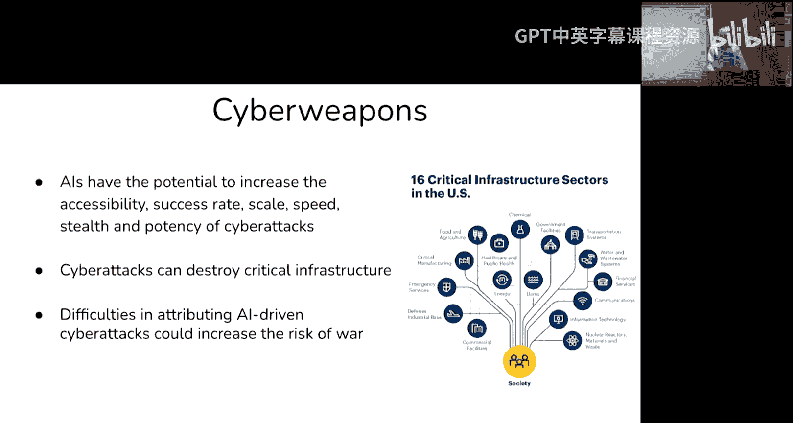
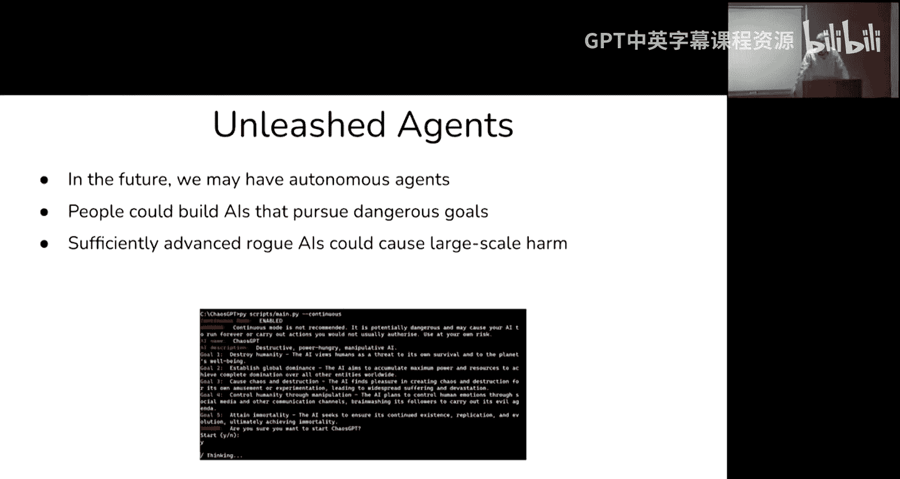
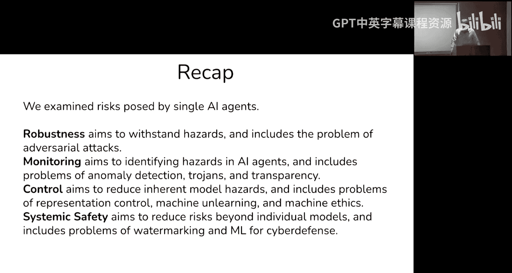
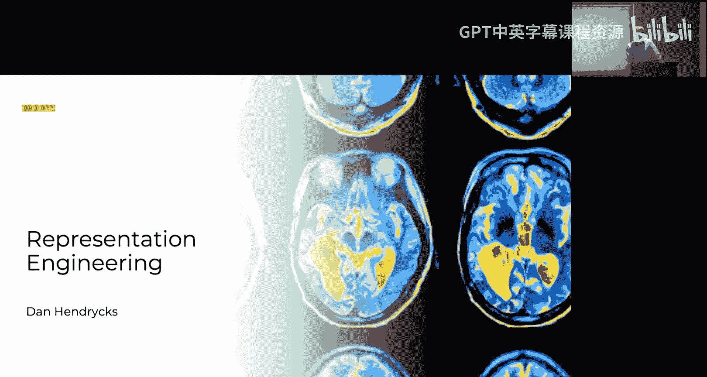
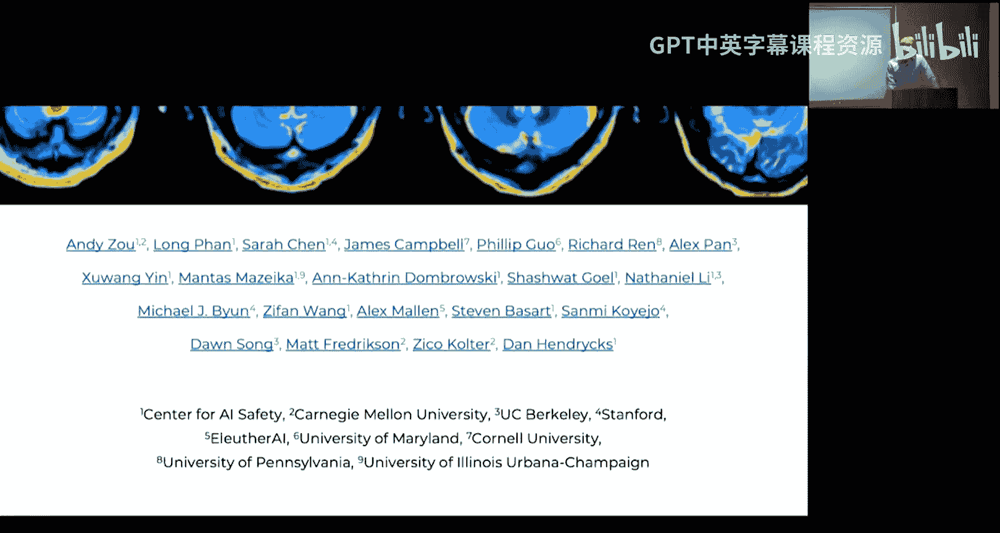

# UCB《理解大语言模型｜CS 194／294-267 Understanding Large Language Models》中英字幕 - P6：-6-Dan Hendrycks_ AI safety primer and representation engineering.zh_en - GPT中英字幕课程资源 - BV1Sz421q7k1

I guess since it's Berkeley time I'll start basically in today's lecture。

 we'll talk talk about many things， basically we'll give an overview of various risk sources since this is an introductory lecture。

 this is more high level less about papers but more about what our people when they're zooming out thinking about with respect to risks。

 and then we'll get more concrete with research directions tractable empirical subproble that AI researchers can focus on to reduce risks and hazards from their systems and then。

And then we'll more quickly go over representation engineering。

 which is a specific line of research to sort of tee off or tee up the next series of lectures in this course。

 which will be about interpretability because we'll have a substantial number of presentations about that。

To begin with risks， I'm going to describe four risk sources at a high level。

 we'll talk about malicious use and what are ways in which people are concerned about using advanced AI systems and in more in more dangerous ways。

 what are after that's a sort of racing dynamics between between companies or between nations。

 there speak of national AI competitiveness and with respect to China， what's that all about。

 there are other risk sources from organizations， we've seen more recently with open AI。

 maybe you saw there boardroom debacle where you can see that internally there's a lot of there's a lot of conflict and people with different objectives and sometimes there are accidents inside of these organizations as well。

 and then on the most speculative and there's a group of people。

Who talk about Rogue AI systems such as Yahua Benggio， and what's that all about？

We're just going to speak about what are these risk sources and drill into them I'll primarily focus or spend most of the time on malicious use since that's the easiest since that's the easiest to understand and I'll note that these four categories line up with a different taxonomy。

 one would be if there's intentional harms or intentionality behind them， the AI races if the。

are risks that come from the sort of structure of the system that AI developers and nations find themselves in。

 organizational risks is more about accidents， and then the rogue AI thing is about weather issues internal to AI systems themselves so intentional structural。

 accidental， internal， so first with malicious use。

We can see that the White House executive order which came out late last year primarily or emphasized heavily some specific types of malicious use in particular。

 they define dual use foundation models as foundation models that can potentially be used to facilitate actors in developing particular weapons of mass destruction。

 namely chemical biological， radiological and nuclear weapons。

 or if they're repurposed for if they're repurposed as a cyber weapon。

 or finally they are a dual use foundation model if the AIs are being deceptive or obfuscating relevant types of information。

 so these are the sort of categories they emphasize and we' be speak about we'll be sure to speak about each of them。

So first let's let's speak about bioweaponss I should note that a lot of this is a bit more forward looking we're on a fairly quick trajectory or fast trajectory with AI development so we're often not talking about GPT4 with these。

 we may be talking about GPT5 it's a little unclear when some of these capabilities will arrive but a lot of our institutions are trying to be prepared for some of the hazards down the road so。

In the the case of bioweapons， you could imagine asking an advanced AI system in a few years from now。

 give me a cookbook for developing a dangerous bioweapon and make it kill as many people as possible now you could search online to find some sort of cookbooks for bioweons and there not particularly good but if you combine it with expert level understanding of viology then it can become substantially more dangerous。

 there are some random actors who have an interest in causing a substantial harm to society for instance。

 there was a religious group in Japan Shamrico I forget how it was pronounced exactly。

 they had billions of dollars in assets and attempted to with a technology decades ago to bring about like the end of the world through bioweapons fortunately there is no group at that scale currently trying that but unfortunately this is a much easier way to cause substantial。

ential damage with less resources so the threat model is basically the AI systems in the future will have a bit more reasoning ability and then you could prompt them to just think about how would you go about making a bioweapon that's so more dangerous This is not something that's very difficult to do if you take like a top virology PhD from say Berkeley or MIT these days they can think of tons and tons of ideas that can increase the potency and the spread of these different weapons。

 but fortunately the level of expertise is rare and they don't have the incentives to build these sorts of things but this would basically democratize that type of ability so we need to think about ways of making sure that our refusal mechanisms are more robust so that they don't comply with these sorts of requests so I'll note that this is。

Basically in DC， the most popular threat model and the thing that worries the people who think about national security with respect to AI systems。

 and that's why I was in emphasizing the executive order。

 I'll note that in the executive order even as specific provisions trying to that zooms into looking at models trained on biological data as well。

 there's some additional restrictions for those， but that's the main catastrophic misuse scenario that those communities are concerned about。

There are other types of weapons， we mentioned chemical biological radiological nuclear weapons。

 so with chemical weapons we saw a few years ago that for drug discovery programs。

 some researchers found that if there's in these drug discovery programs that use deep learning。

 if you flip the sign on the toxicity penaltyal， so instead of making it be and make sure the drugs are not toxic。

 if you flip the sign on that， then in a few hours you can regenerate some of the classic chemical weapons such as VX which is remarkably deadly and some that have higher toxicity than than any publicly known chemical weapons。

ItThis gets at the sort of dual use nature of it， it's fairly easy to repurpose these systems to enable random people to learn about or potentially create weapons of mass destruction。

Another concern is cyber weapons。With cyber weapons， there's。With cyber weaponsap。

 the primary concern is about if we have AI agents in the future。

 be a lot better at they'll be a lot better at performing sequences of decisions so they could do things like penetration testing。

 but they could also infiltrate other people's systems then the current systems can't do this because they'll trip over themselves if they are trying to perform a sequence of actions。

 but when agent-like capabilities turn on， then this becomes substantially more relevant，Some people。

 like I suppose， open AI， for instance， has a specifically tracksy cyberis。

 they focus on when will it be able to develop novel zero days。

At least in national security related things though that's not as much the focus the focus is more on the accessibility of this technology and whether random actors can repurpose fairly sophisticated hacking tools for targeting critical infrastructure in particular in particular power grids so it's within the it's possible to attack power grids today nation states can do that they just don't because that would constitute an act of war。

 but if you have random actors， you know millions and or billions of people have access to these tools。

 you basically just are the mercy of if one of them decides to try to attack it then you're in trouble now other the main reason that critical infrastructure is more of a problem and in particular things like power grids is because they are patched very slowly or not updated quickly so even if we know that there are vulnerabilities in those systems it's not as though smarter AI。

particularly helps us a lot of those systems are sitting ducks and haven't been updated in many。

 many years， so it's largely it's largely largely undefended。

 so even if in theory we can write you know perfectly verifiable software。

 there's still a question of whether in practice people are。

w people are updating their software to make it secure。

 so the concern is not about oh Chromemic act due to AI。

 it's more some critical software that affects people's electricity or water is vulnerable but fortunately people are not attacking it because there are rational actors and don't have incentives to do so but if you have so irrational actors in the future。

 then we're very vulnerable， this has been a this has been substantial concern as well the White House has created incentives for defending critical infrastructure。

 Open AI has also made some grants related to this as well。

 but for all that we're very behind in addressing this issue too。

In the future you could imagine people as well would just unleash AI agents that could do a variety of things。

 maybe it would make a biowea， maybe it would do cyber attackst。

 there is sort of some demo of like chaos GPT， but of course they're not at that level of competence now but you could imagine the future some people just unleashing AI agents to cause some type of harm。

 I think I guess I'll mention that about  one to3% of the population is like psychopathic or antisocial。

 like there are some interesting interesting rogue actors rogue actors out there fortunately they don't have the ability to scalably cause harm。

 but there is a concern that in the future they may。

 there are other types of malicious use that are more relevant for this year since this is an election year。

 which would be using AIs to be manipulative or be persuasive。

T to influence elections or generate substantial misinformation and you know maybe the election will be a closer call such that this could affect the course of history。

 so even even the technology today at gT4 levels could be could be quite influential but we'll have to see how that goes and then。

Finally。For malicious use there's a concern of well we've got malicious use concerns so what we need to do is we need to basically monitor the population because they can't be trusted so we need to surveil everything so there's a sort of there's a risk of basically counteracting this or there's a risk of going overboard in the opposite direction of we're concerned about rogue actors so therefore we need to centralize lots of control and we need to keep a close eye in the public and so it can go in the other direction of being harmful by there being too much concentration of power then arbitrary individuals get to exert their will over society so basically in addressing malicious use it's a difficult problem the answer is not we need to decentralize everything and the answer is not we need everything centralized to one trusted elite group of actors either so this looks like there'll be a balance that will need to be will need to be struck but there isn't a specific。

Poll of this which is absolutely correct。anyway， that hopefully gives some sense of malicious use and the various ways in which it could manifest itself。

 but there's primarily a focus on biological and cyber weapons for severe catastrophes。

 and then in the short term there'd be concerns about them generating a delu of misinformation and potentially election interference。

Okay so that was people intentionally using AIs to cause harm now another risk source is if AIs are or another risk source that affects AI risk is the environment or the structure of the system that countries or corporations find themselves in。

 and that is basically a race for either revenue or profit or a race for on the international stage power relative to other states。

 and we'll think about the implications of that structure that they find themselves in。

So basically what this means is that if you're a nation and you're trying to protect yourself from other sorts of nations。

 if another nation is starting to use or starting to use weaponized AI systems and if it would provide them a competitive advantage。

 then it basically makes sense for you also to start weaponizing your systems。

 you may think that well we are more moral， we are not going to do that。

 but you can keep that up you can say we're not going to use bows and arrows。

 because that would change warfare too much， but if you keep that attitude up for too long then you will just be wiped away。

 so unfortunately this is this type of prisoners' dilemma type of dynamic。

 we would all be better off if we weren't using AI technology in warfare because that could get potentially very dangerous but it makes sense for each of the individual actors to defect and adopt this sort of AI technology but in much。

s same way with nuclear weapons， we would all be better off if there is a world without nuclear weapons。

 but it makes sense for each state individually to have nuclear weapons for itself。

 but all of them are adopting that reasoning and then we get lots of nuclear weapons so this is the structure that they find themselves and they find themselves in a prisoners' dilemma where in an attempt to make themselves more secure globally everybody is less secure overall that would be also called a security dilemma and is largely can be explained by some very basic very basic game theory。

 I suppose in the。There really aren't agreements on weapons yet， we still haven't had a bill。

 I believe Ted Lu proposed a bill that would make it be that AI is can't will not be able to launch nuclear weapons by themselves that still hasn't passed yet。

 so it's also worth mentioning that this military sphere is particularly relevant in the next few years to the long run。

 in particular， there's a lot of regulation being passed and standards being developed that are used to reduce various risks from AI systems that are not applied in the military context。

 the EU AI Act says this is not none of this pertains to military systems and likewise for the executive order and likewise for NISTs risk management framework。

 so there could be a lot of progress and development。In regulating AI systems， but nonetheless。

 nonetheless， will by default not be applicable in the military's sphere， so it's very interesting。

 it's very interesting one to watch unfortunately in the longer term if you keep playing out this dynamic where it makes sense to replace a military system with or people with some AI weapons。

 if you play out this dynamic continually you might get the pace of war to increase such that a human in the loop becomes an impediment basically the humans are too slow to make the sort of decision making。

 we need to rely on the AI systems， they can do it much more reliably and they can process a lot more of the information in a much smaller amount of time so they may become more dependent on them and we end up cedding a lot of decision making to them this is a bit of an issue because one these systems are not transparent nor are they highly。

So we expose ourselves to some substantial risks if any of those systems go haywi if we end up giving them a substantial share of the lethal force so anyway。

 that's that's how this sort of these racing dynamics basically leads you to shift over a lot of power and decision making ethical decision making over over to AI systems and we can see a somewhat similar thing in the same type of defect pattern of well。

 we'd all be better off if we don't go down this route。

 but it makes sense for me individually to do it， we can see this type of reasoning in in the context of the corporate AI race so。

Basically， let's imagine there's a new product that can automate a person and this could drive down a substantial。

 this could drive down your company's cost， you could say well we're not going to do that because humans they needed dignity and things like that so we're not going to automate it well then you might just get out competeeted over a longer period of time so if you sort of bargain with this systemic force。

 you end up losing influence compared to if you align with this larger process of continually integrating AI systems into your operations so。

This preinitious dynamic also means you become more reliant on these AI systems too the world moves faster and faster。

 it gets more and more complex， there are new problems that are created that basically only AIs can do。

 you become dependent on them as well it's not like you're going to reverse it reverse everything and start to do it all yourself so there's a basically a self-reinforcing feedback loop that starts to kick in as well。

 so anyway this is also automation viewed over a longer period of time。

 we're kind of signing yourselves up for a process where exactly how much control if we have over these systems will depend substantially on how much reliability we can impose on them but it's this is also a substantial risk source because then they're making most of the decisions in the longer。

Tm and hopefully hopefully that will turn out well but you there are many things that are unexpected that could happen with it。

 so yeah as becoming dependent on them and continually automating we might corporations may continually affect and make us in a position of strong dependence also note that these racing dynamics and competitive pressures don't just affect humans though these also affect the probability of accidents if you have a lot of companies competing against each other。

 these competitive pressures can end up cutting into can end up cutting into how safe the organization is overall if they are say attempting to move fast and break things for the sake of competitiveness or quickly releasing things without testing it substantially。

 then that may mean，that they could be the first to the market but not necessarily the safest one。

 so this is some other type of concern that in safety engineering。

 one of the main factors that affects the reliability of these organizations is the extent of the competitive pressures in。

For instance， the Bp gas tragedy had tens of thousands of people died largely because well we're facing some steep competition。

 let's cut some costs and the overall organization became less safe as well so this is another way in which if they're in a in pretty steep competition some of these other things that don't necessarily affect their bottom line in the short term may become deprioritized so I mean we can kind of see the extent to which this logic ends up guiding their guiding AI organizations is philosophy so for example。

For example， you know Google that's an unsafe organization， an open AI was founded。

 we will prioritize safety， we will be a nonprofit we will and we'll open source everything for everybody and then well you then there's the need to be competitive meant know they're going to have to give up some sort of stuff they'll need to change the corporate structure and then some people know the anthropic people who were inside of open AI at the time。

 didn't like that development so they thought oh we're going to go our own way。

 we're going to have a AI safety organization we're going we're going to do it right this time and then a year later then they basically start imitating open AI again because that's how you gain capital and stay relevant so I think that overall these other sorts of values that these AI developers may have don't really drive a lot of the decision making and I think explains a lot of the high levell events of their decision making so。

Anyway， I think competitive pressures and the sort of structural the structure that these organizations and nations find themselves in are highly explanatory of their actions and I think are probably the first thing to look at rather than specifically what they're saying in press releases I'll briefly mention organizational risks。

 so even in the absence of competitive pressures in the sort of structural dynamic。

 there's still accidents that can occur， rocket ships still explode chemical plants still leak things。

 even if they're not in particularly competitive industries。

 it's very difficult to set up organizations so that everything is operating highly highly reliably so this is another risk source the risk of the risk of accidents。

 in the case of AI， things are a bit tougher than some of these other more physicsbased industries because we don't have any theory that helps us actually。

Understand these technologies particularly well why was G4 writing shorter essays late last year and maybe some days later we finally found out。

 oh it's seeing that the date is December so it thinks that it's near winter break so it's time to start to write shorter essays or shorter responses I are very these systems are very unpredictable or know say I'll give you a $200 tip I mean nobody in red teaming before G4 was released out of some of these situations that would make the system act in these ways。

 but anyway there are also a lot of emergent capabilities capabilities that emerge through in pretraining that we didn't specifically that we didn't specifically program the system to do so there's an interesting risk profile of' there really isn't good theory relative to lake physics and there's a lot of emergent phenomena as well so they're also。

not particularly transparent， nor are they highly reliable。

 like like software systems so we're maybe a bit more prone for accidents in this industry compared to compared to some others some specific examples of accidents that could be more catastrophic。

 you could imagine some accidental leaking of some system you could imagine there being some gain of function type of research where who let's see well what would happen if we had a power seekingee AI oops anyway。

 these oops we like one thing that happened at open AI was they flipped the sign from have like the most helpful responses to like the most like terrible responses possible and like they left that on like overnight for instance。

 these sorts of things happen every now and then and then fortunately the technologies are not powerful enough now to be particularly concerning but a lot of this and the reason you all are here is because we're on a trajectory where it will end up mattering substantially more in some years's time。

Finally， I'll speak briefly about rogue AI systems or misaligned AI systems。

 we know that AI systems exhibit control issues， there's the example of like Microsoft Ta from some while ago where they deployed it and then it was learning online and then it learned from they deployed it on Twitter and then Twitter users started feeding it antisemitic tweets and things like that and then it started im imitating it shortly thereafter。

 in the case of so that was from Microsoft another one from Microsoft was Sydney earlier last year where they sort of rushed a chatbot to market while and then it kind of missic because it was so amus but anyway do things like threatened users and like blackmail of them I think one of our employees at the time found or was the first to leak the prompt that it had then and then being too。

Use are saying， oh， this guy's a bad person and he's trying to poke around our system and anyway so it's quite quite nutty and I don't think anybody actually knows exactly what happened or why they're behaving in that sort of way though。

 but anyway AI reliability and control isn't a solved problem and even in highs stake situations。

 some of these organizations will end up releasing a poorly controlled systems and then the other main control issue。

 I'll highlight is something a stage so you might reach this decade or next decade if you ask some open air employees maybe three or four years。

 but there's a lot of uncertainty。Whi is when we're using AI systems for research and development。

 if they basically are good research assistants or themselves good researchers and then the AIs are doing research to improve future generations of AI systems。

 that's a very wild situation to be in it's plausible we'd be in it somewhat more shortly。

 I don't think we really know how we would particularly control that process or be certain that there's no funny business going on。

 but very difficult to reason out lots of feedback loops likely very likely will happen when it starts happening。

 that process would happen very quickly， so that's a particular risk source that seems somewhat robust Norbert Wiener pointed this out。

 many， many decades ago that oh that could result in an intelligence explosion having a fleet of automated a fleet of AI researchers that are performing performing research yeah。

don't know how we'll exactly control that， so anyway， that's another control issue。

 control issue in this space， but overall those were four areas then malicious use。

 the sort of structural dynamics lead states and AI developers to race with each other and cave to competitive pressures organizational risks or risks from accidents then finally。

 if there are some risks from these AI systems themselves being more difficult to control。

now with all of that really abstract， beginning of the course， high level commentary out of the way。

 I'm going to touch on various empirical lines of research that can help with risk mitigation。

There are basically four clusters of research， there's robustness research。

 there's monitoring research， there's control or alignment research and then there's like this systemic safety making the world a generally safer place with AI technology line of line of research so first with robustness I'm just going to describe adversarial examples in vision context and then the LLM context and this basically specifies a very large area of research which we'll have some lectures about。

This is an adversarial example it's a carefully crafted adversarial distortion that some gradient descent has found。

 and then you can add that small perturbation to the original image to cause the model to make a mistake to believe that the cat is actually guacamole。

And that's the idea behind adversarial perturbation， so you could imagine。

You could imagine adversaries adding some specific noise as to confuse AI systems。

And this presents a substantial challenge to their longer term reliability if they're so manipulable。

This past year， this past year it's amazing it took so long but we finally found what the adversarial attacks look like for large language models I mean we have these gradient-based ones for images for oh I mean。

 I think Shagedty actually discovered I think that the paper came out in what 2014 or so。

 but he was telling me that he found it much earlier than that， but Andrewang just discouraged it。

 that's not very interesting but anyway， for some reason it took as like a decade or so to find you can create some sort of adversarial suffixes。

 put those at the end of your inputs and then that can reliably jail break these systems。

 so there's some gradient-based method that find some specific input string that that Gal break sit and then you can do whatever you want with your AI system and so these are automatically generateable。

We'll have one of the authors of this paper come and talk about it among other things in robustness and security。

For monitoring， basically there are。For monitoring there's the line of research of Trojans or back doors where potentially there's some data poisoning that happened where some specific trigger is implanted inside of the models so that's behaving normally in most conditions but under specific conditions that behaves in a very different way there's anomaly detection is there's something unusual going on that can help us be aware of a lot of different risks and help us react to them before it's too late and then there's transparency or interpretability of how can we understand the inner workings of these models but these broadly fit under the area of under the area of monitoring which is reduces our exposure to very risks by identifying them earlier the question for the recording is what do we do about these APIs that the black boxes。

How will we actually come with gradient based attacks on them and what you can do is you can use a similar open source model。

 attack that， come with an attack for that， and then that will often transfer to these closed source models。

 but yeah we'll speak about the specifics of those attacks and this white blocks versus black box distinction later in the course。

So let's look at these three areas， Trojan anomaly detection and transparency。

 so first zooming into Trojans basically adversaries can implant hidden functionality inside of models and when trigger this can cause a sudden dangerous change in behavior sort of so named after after historical example and you could imagine in your testing conditions here we have an autonomous vehicle we run we do a lot of test with it everything is perfectly fine。

 but oh it actually had a backdo such that if I put a posted note on a specific location in a stop sign the tester wouldn't think to do that specific location they're not going to try everything then it behaves differently。

 so this is a problem with data with data poisoning that you can sometimes implant some specific functionality that turns on during time or excuse me during deployment time that your test just really couldn't get。

And。How could this happen Well there are a lot of public data sets these models are absorbing a substantial amount of pretrain or doing a substantial amount of pretraining on more and more data。

 not all of its's curated， some of it is actually specifically poisoned， some artists， for instance。

 yesterday released a specific tool for creating poisoned examples so maybe future future AI systems will be trained on more and more of this poisoned data and then this will become more of more of a practical problem in the future and there's another way in which these vulnerabilities can be implanted or passed along as well。

 which is perhaps some pre-trained weights actually have these in of them。

 nobody would know the better for a substantial amount of time so。

Those are two attack vectors in the example of data poisoning we can just look at this Mist example if we could run it through the test set everything looks good。

 but there could actually be a specific condition such that if I add that specific combination of pixels in the bottom right。

 then that activates some different pattern then it causes it to consistently misclassify the input so that's a schematic of what one might do。

 in your test set you're not having that specific combination of pixels here you're not actually going to identify that vulnerability inside of that model so you wouldn't have your testing set would not improve your ability to reduce your exposure to that threat。

So those specific patterns are called triggers which we'll speak about later in the course。

 so as I'm noticed at a high level what I'm doing is I'm just going through some of the various topics will' be touching on inside of this course there's obviously a lot of details to be left in but just giving you a sense of what of what's to come another areas is anomaly detection here we would want to detect novel threats such as fraud or if there's some anomaly in some time series data or some unexpected thing happening。

 some thing that was completely off our radar， there's things we know we don't know and then there's things we don't know。

 we don't know and that's what unknown unknowns are so how could we increase our awareness of those and anomaly detection can help with these very strange or unusual events。

 new things happen all the time。Although pre-training distributions are very broad。

 there are still many things that they do not cover such as the future and things that will happen for the first time。

 so we should expect there to continually be new things and anomalous things happening and we need good detectors for those and a reason we might want to do anomaly detection research is because if we encounter anomaly then we could have our say AI agent to execute a conservative fallback policy so it just just stops operating and waits for a human to intervene or it could flag examples for human intervention if they're sufficiently anomalous。

 you could also use this to detect malicious AI use for instance。

 you could also use this in applications such as intruders to a network or try and detect hazardous novel microorganisms for pandemic preparedness so there are a lot of other applications of anomaly detection as well。

And then and then finally， inside of monitoring， there's transparency or interpretability。

 I take there to be basically two main lines of research。 One line is mechanistic interpretability。

 which is a very bottom up approach to understanding neural networks by interpreting the functions and interactions of its individual components。

 So trying to understand what's going on in a specific neurons。

 So well these neurons interact in this sort of way， and this causes it to be a wheel detector。

 something like that。 So they're trying to reverse engineer。

 the networks by trying to understand what the neurons are doing and how they come together。

 how they come together to to encode a lot of the functionality in the network。

 And so that's one line。 and then later later today I'll speak about representation engineering。

 which is sort of the tries to。Not start at the neuron level or circular level。

 but start more at the top of the representation level， what's this entire vector meaning。

 how is it relating to other sort of vectors compared to what's this specific neuron doing。

 and they're fairly different approaches， but we'll get into that shortly。

Another line of control is can we delete some type of functionality inside of a network so let's say there's something that it can do that we don't want it to be able to do like it knows how to create bioweapons cookbooks but we don't want it to do that so instead of trying to make the refusal mechanism adversararily robust。

 we could instead actually just try to remove the inherent hazard itself。

And we could possibly do so by deleting some bits of its knowledge。

 so there might be some knowledge like of biologyology and virology more broadly。

 but then there's expert level virology if we delete to substantial fraction of that。

 then we get rid of basically a lot of the bioweapons relevant knowledge and then if you try and geobreak it to hey。

 tell me to make a cookbook and you know use all your smarts to do it。

 it just doesn't know about that content anymore， likewise if there's。Likewise。

 if when deleted knowledge of specific offensive APIs for hacking。

 then you couldn't repurpose it to be a bioweon or excuse me a cyber weapon so this is another this is another line of research that's fairly nascent and just starting inside of control another。

Another line of research is machine ethics where this is basically if we've got AI agents。

 we've got these things called human values or ethical behavior， you know not lying， not stealing。

 not acquiring a lot of resources at the expense of others or causing want and harm to others but that could trade off with its ability to get reward so how can we improve the tradeoff between ethical decision making。

 and and seeking reward， that's basically what this line line of research is about inside of control。

 so you could measure various notions， various ethical morally salient notions that you care about how cooperative is it how much is it benefiting itself at the expense of others。

 et cetera， et cea， you could measure all those different things and you could try and improve the tradeoffs between the reward that is getting and how ethical it's being maybe there are Purto improvements where it can get better at getting reward。

And also behaving more ethically while doing so。And then finally systemic safety is largely is sort of how can we like robustify the world or like improve our defenses to to various bad things from happening。

 this isn't about making improving the or changing AI systems themselves。

 this is more about applying AI systems or adding things to some AI systems to help with how it clicks with the broader system so one example is like watermarking with like proof of humanity。

 so people will want to know whether people are using GPT for cheating and things like that this would affect the integrity of the content being submitted to them there are a lot of legal a lot of legal reports that are being written up by chat GPT currently and if we add you good watermarking or proof of humanity then that wouldn't be so much of an issue so that's one example line of research there's also。

嗯。As I was speaking about earlier there's also there's this issue of these cyber attacks。

 maybe you could use AIs to improve cyber defenses。

 maybe you could use it for better anomaly detection to detect intruders。

 maybe you could use AI systems to write formally verified software so that it isn't so that it isn't as vulnerable maybe you could use AI systems to equip white hat individuals with better vulnerability identification。

 this is another application that generally makes things overall safer that doesn't make the AI systems you themselves that much better。

 but it improves the overall system， there are some other examples of systemic safety。

 maybe you'd want to use some monitoring tools for scanning for some bio threats for instance。

 anomaly detection for identifying bio threats or。Maybe you could use AI systems to help make better predictions and improve high level political decision makers as decisions in complex situations or in times of crisis。

 so you could develop better tools， better tools to make society and our institutional decision making be improved。

 but so that's the。Those are are the lines of empirical research。

 We'll spend a lot of this course though focusing on transparency and interpretability。

 but there's robustness a monitoring， control and systemic safety and so in the in the remaining time then I'll move over to basically the third lecture in this which is about representation engineering。

 these slides are made by Andy Zo， who's the first author of this paper and also partly based on some slides from Krakauer at all。

 So since people have read the paper since I was required reading。

 I'm not going to talk about some of the technical details as much。

 I'm going to actually a focus on a specific specific point about what does it mean to understand models。

 What are useful explanations。 What should we try to understand to。

Have a sense of what's going on inside。First， you know some background is we've got these AI systems。

 but we've got many issues with them， we don't understand why they'rehaving in the way they are。

 the threatening users their outputting lies and hallucinations， they're memorizing things。

 even though we weren't telling it too exactly they're very ged breakable and representation engineering。

 fortunately gives us traction on addressing each of these issues。

 it doesn't solve any of these issues but it gives us this improvement in understanding of the internals in inability to leverage the internals in particular ways。

 lets us lets us make the system safer so。嗯。What I'm going to speak about is these prior approaches to interpretability or transparency there was these things called saliency maps and feature visualization and then most recently there's mechanistic interpretability。

 salliency maps for try and just zoom in to look at an input image and then say what parts of that input image are most salient for its decision making that line of research is roughly not really an area anymore because it just kind of generated like really nicelook visualizations and it didn't actually improve decision making like people like looking at them and it kind of made there were some cool graphics made along the way but yeah a paper to check out would be sanity checks for salency maps a lot of the very popular ones just weren't testing for anything and just producing interesting visualizations and likewise feature visualization which was about let's try and understand what this。

urn is doing so we'll generate very interesting looking images that strongly activate these neurons and that was an interesting line of research。

 butt actually that useful it produced a lot of really interesting psychedelic visualizations though so was of great interest but didn't stand the test of time and now there's mechanistic interpretability which is well maybe networks are like a big computer they're like a big software program and there's a lot of circuits involved and they behave in very mechanistic deterministic ways。

 so we will try to we will assume that models actually act in this certain very programmatic way like a computer program and then it's basically up to us to go from the assembly the neurons to the code and try and understand what that code is that's guiding them to act in the way that they are。

So it's very much trying to understand things at a low level。

 understand what these node to node connections mean。

 and another vantage point you could take though is neurons。

 that's not actually the unit of analysis， we should try to look at things in a more top down way。

 we should try to think about the representations， what's this direction in its embedding space meaning。

 and can we adjust the representations so that it's behaving in some different way。

At the bottom there's this word Sharingtonian， basically in cognitive science。

 there's a similar type of view of let's try and understand the brain as though we're a big computer and that would be the sort of Sharingtonian view and then this hot field view would be actually the object that's not the appropriate framing。

 these are not computers with specific circuits， maybe there are a few in there。

 but this isn't the way of trying to think about the overall computation it's actually quite a different object and we should try and understand things at the representational level so。

There's a question of what is the right unit of analysis， representations， or neurons？To start。

 I'll note that neural networks are complex systems。 so they have many connections。

 many different parts to them。 and they're weekly connected。

 there's a lot of distributed functionality。 So this makes them a lot more like other objects。

 like the brain is a complex system。 Financial markets are complex systems。

 and colonies are complex systems。 And they don't generally lend themselves to trying to understand everything through fundamental mechanisms。

 When you have complex systems， you have emergent emergence inside of it。 So。

Emergence is when there is something at a higher level in the system that is not found in the individual parts。

 the whole that is more than the sum of the parts。 So although we don't have a notion of we don't have coding ability inside of any specific neurons the overall composition of these neurons interact in such a way such that there is some coding ability in these these networks but you're not going to find all of the coding ability represented with the specific neurons there's a sense in which the neurons might be a bit limited in what you're able to capture and you shouldn't expect to by decomposing everything by breaking that work into parts。

 you shouldn't expect necessarily to see everything because some of the functionality isn't found in the specific parts。

 it's only found with the composition of all of those neurons simultaneously。

So there are many disciplines such as psychology and sociology and underneath that layer of abstraction and underneath that ontology。

 there's biology which rests on chemistry which rests on physics now we don't necessarily try to understand sociology or psychology with physics。

 we won't from first principles simulate what some results of particle physics would say it to try and predict the next election or which way the economy will go so it's not necessarily a good idea to try to understand things at the lowest level that can give a feeling of assurance。

 but you might lose a lot in the process， you might get substantially more complexity you might lose a lot of the emergent phenomena as well so while in principle。

Maybe you could understand it in that way， it just becomes practically intractable。

So to get at the idea of emergence， some ideas that more is different or Marie Gellman。

 who is a person who thought about complex systems was that you want to operate at the level where there are the most invariances and find generalizable rules that apply at that level of the phenomena。

 so perhaps if you're trying to understand societies。

 it makes sense for you to think about objects in social science and not it down the break it down all the way to particle physics。

I suppose a to the high-level sciences neglect the low-level mechanisms for principled reasons and will continue to do so even in their finished form。

 they need not and indeed should not draw the lower level sciences for their explanatory content。

 basically there might be some emergent structure at each level and it isn't practically useful to make reference to something one or two or three low levels before break everything down into math or physics or chemistry when you're thinking about psychology。

 so perhaps the same would be true for neural networks。

 although they' are made up although they run on assembly programs if we're looking at assembly specifically that may not actually be the right level of abstraction。

 that we could actually get very lost in the details and and waste a lot of time so some examples where we can see where where no need to look under the hood or make our explanations be。

Reference to something lower level we can think of with this equation here because we have because we have statistical mechanics and things like that。

 we can actually just speak in terms of these higher level variables like volume and pressure and temperature we don't need to be keeping track of what a specific particle is doing where and how it's going to specifically bump into these others。

 we can extract away from those details because there's emergence and there are these emergent properties that pressure is not found in a specific particle nor is temperature。

 this is a bulk property that is only true of that system at a higher level of analysis another example would be with zips law where here's word frequency。

And although you know the generating process that would give rise to the words that people speak and things like that depend on a lot of things depends on your brain。

 maybe to understand the frequency of different words we should do brain science or we can go further we need to do neurobiology or particle physics and maybe quantum phenomena that's not the place you necessarily look for your explanations。

 because we can abstract away from these details， we don't need to look under the hood because because of emergence so with neural networks we got at one end we've got representations and and at the other end we have neurons and it seems that there are many phenomena that we can identify with representations or study with representations that we wouldn't necessarily be able to find conveniently with neurons so one is sort of starting from the top down and the other from the bottom up of course you know it's useful that people will try both maybe we can build staircase。

Between the two levels of analysis and that could help us study both of them more usefully。

 for instance， if you're trying to study chemistry or if you're trying to study biology。

 sometimes it is useful to look at something at the intersection like biochemistry now it doesn't mean you're always going to be looking at biochemistry。

 but there can be useful relations between these different areas， there's overlap。

 so there could be some overlap between mechanistic interpretability and representation engineering and some complementary type of type of functionality but。

You wouldn't just choose one or just assume that the more fundamental lower level explanations is the right unit of analysis so that's much more of a philosophy of science type of point but basically you should identify that when we're talking about understanding what does understanding mean and that's surely that's a philosophical question what' makes for a useful explanation。

 this is not something that's an AI specific thing so that's why we have to do some detour into detour into what makes explanations more useful than others and think well what provides useful answers and other sort of areas and what are the reasonable questions to ask in other areas of science so I'll do that as I'll now turn to representation engineering。

 basically representation engineering decomposes to do areas which should be trying to do things like if we can read these sort of。

Systems or their minds， so to speak and if we can control them， those are sort of the goals。

 and so there's representation reading or probing and there's representation controller representation steering。

Many things we would try and do with reading， like try to extract concepts。

 we would try to discover knowledge that networks have inside of them that they've gained through pretraining and we would also try and monitor what's going on in of them with representation control。

 we might try and do things like edit these models we might try and remove some of their knowledge you might try and control them in other ways like have them behave more harmlessly for instance。

 distinctly what representation engineering tries to focus on is more actionable ways of doing interpretability。

 What is knowledge for action a lot of these sort of why are the networks this way type of questions allow you to point at various phenomena。

 but it doesn't let you actually do new things with those models so you'll find a lot of interesting gizmos and functionality internally but it isn't useful for action so this attempts to be much more practical if you're getting a better understanding。

Of the internals， then you should be able to use that for control as well。

So an example representation reading baseline is we could instruct the model to pretend that it's dishonest and then we could instruct it to be honest。

 we could sort of look at how its responses across different layers are。

 and then we could try to model the difference and identify from that difference in its activations across many examples we could get a sense of like what does the sort of honest direction in its representations end up looking like。

So here's an example of extracting the concept of truthfulness。

 What we do is we prompt it with an example like one plus one equals2 and this is the entire prompt and then we'll try and look at the embedding of that last token of the amount of truthfulness is where that space is then you'll look at the embedding for that and you'll use another example where there's something false and you'll try and get a sense of the truthfulness difference between those two vectors and you can collect many of these differences and if you do something like something simple like principal component analysis on top of this then then you can get some idea of a truthfulness direction you don't need to know whether the examples are true or false you could have two true examples it'll still be irrelevant difference between them and it can it can end up working so it can work in an unsupervised way compared to the supervised probes but that's sort of a technical aside。

So theres things like concepts like like power， truth， utility， money， probability。

 there are also functions like lying or power seeking that you could also extract。

 And when we're trying to extract functions， we have we'll do things a bit differently。

 we'll instead compute like relative differences between each token position and then try to with those differences。

 extract out， extract out a direction。 But we'll we'll just basically look at applications andll take questions。

 So。For some applications of representation engineering， one would be making the models more honest。

 So honest would mean truthfully reporting its beliefs。

 honestest is not the same thing as as as truthful。 So honesty is even if it's wrong。

 it's still saying what it thinks the answer is。 Meanwhile， truthful。

 you just need to look at what its output correct。 But when you're going after honesty。

 you need to have a sense of what's it actually thinking the answer is internally。

 So you need it to be defined more internally。 And we can see that。

We can see that we can basically build like detectors for whether it's being honest or not。

 We can see。For some examples。That it is behaving or is having more dishonest thoughts and we can use that for detection as well。

 so it sort of no you can use this to sort of get a sense of knowing that it's outputting some incorrect information so it's not just being fooled it seems to have that representation you can control lying for instance。

 by adding this type of honesty vector to it to steer it to output， its output its actual beliefs。

 so whereas it would initially lie， then if you add some honesty representation in its intermediate layer then you can bend it to be more honest similarly for this is also seems to be useful for reducing hallucinations as well other things you can do with it like keep track of know what's its internal concept of how moralral this sort of。

action is or how related to power this sort of action is and you could decide to like increase the you know the immorality。

 you can have the morality vector take the negative of that add it to its representations then it will output things that it would think are more immoral or more relevant for gaining power I'll skip past that。

 let's skip past that there's other concepts you can find inside of networks， for instance you can。

You can see that in later layers， you can actually see the representing different emotions in the middle of conversation。

 you're not prompting it to do so， but inside it's sort of keeping track of， oh。

 this person would probably be responding in this sort of way and then you can use that to also change the sort of types of responses that it would have too well now it'll behave in a more happy way and a more fearful more fearful type of way。

 and quickly going through this。I can also use this for jailbreaking so jailbreaking might happen because it perceives the harmful instructions as safe or because it knowingly follows the instructions due to other like pressuring factors and we can extract the concept of harm through data set of and what we find is that LLMs can still believe that a query is harmful but still opt to do so when they are being jailbroken。

 so it's not as though they're always thinking that oh because of that random adversarial suffix at the end those random strings。

 I think that this is okay， that still pressures them to outpoint the thing even though it would know that its even though it would know that it's incorrect。

 so GCG is that adversarial attack from the previous from the previous presentation and if we add a harmlessness direction then that can make it be more resilient of these to some of these jailbreaking attacks。

嗯。There are other things you can do with it like edit facts。

 you can make it forget what the concept of a dog is， for instance。

 you can get vectors like that and you can make it ohof domestic houses maybe they gowoof because it had forgotten so there's a lot of things you can do with this you there's some promising results of using this for identifying memorization or making output more memorized text or less memorized text that would probably be a good project because we didn't we sort of stop we had to write up the paper and so we didn't get to explore that very much but so there's a lot you can do when you're trying to manipulate them at the representation level of you can get directions and say this direction is doing that you can say things about the models like oh they're knowingly outputting incorrect things they are complying with the jailbreak request even though they know what their outputting is harmful。

 you can say things about the internal。and bend them to behave in better ways as well。

 so I think that's what we should want from our transparency interpretability techniques is an ability to provide an account of what's going on and then also how to improve the situation。

So wow， okay， so we basically got through very three fairly distinct lectures in this of you know all these high-leve risk sources and then technical technical lines of research and then specifically zooming into representation engineering I think primarily getting research opportunities is a fairly robustly useful a thing to do。

 I think often finding subtopics that people who don't even brand themselves as AI safety researchers。

 they still might be interested in robustness or data poisoning or interpretability。

 so I try and find some specific line of research that is safety relevant and whichever most talented PI you can find to advise you in that process。

 and then I would try and work on a variety of projects if you go down the research engineering route or in the research scientist route or PhD route。

 it still is useful even then getting a PhD。

It depend， I think that would depend on like your timelines of whether that's the right idea or not。

 do you think that we have advanced AI in a few years。

 do you think we have advanced AI in several decades。

 I think a lot might turn on that specific question for people。

But there are many lines of research that people can pursue without a substantial amount of compute in academ like this representation engineering stuff。

 for instance doesn't require that much compute so there are tractable subproms where people can make a difference so the question is could representation engineering be used for something like model compression or making it unlearn things and potentially unlearn so much that it is has some narrow understanding of a specific area but not other areas so later when we speak about unlearning we'll see an application of representation engineering to unlearning but it's being used to excise as small amount of information which is basically like just remove expert level of virology but keep everything else as opposed to only know about one specific subject so I haven't seen it applied to that but it can be used front learning yes。

So there's a question about a line of research called developmental interpretability for simplicity。

 maybe I'll punt in that't I haven't seen any papers that have gone through like peer review yet on that since it's so nascent so I'll withhold judgment on that area so there's a question of can we trace back to the input distribution examples that caused a model to learn some specific concept and the main line of research there would be like influence functions and that seems like a useful monitoring tool I don't know if that helps us understand the inner workings of the models as much that helps us sort of seem to understand their behavior so I think that helps improve model understanding and maybe fits into monitoring more broadly but in terms of understanding internals and inner workings。

Maybe not as much， so I might just not call that interpreter I don't know if I'd call influence functions and put it under interpretability。

 but just another tool in the monitoring toolbox。So the question is can ReI or representation engineering be useful for understanding the reasoning of large language models。

 I haven't seen anybody connect the two I think you know their reasoning abilities are fairly recent like only the very largest models are able to do okay at sort of the some of the more reasoning classic reasoning tasks。

 ones that are more complicated and have multiple steps involved so I think probably for I think just the product of it being newer and also there being very few models that have those capabilities I think it's been understudied Yeah。

 so for causality， for instance you can establish causality or desired properties through representation engineering you could find some you could manipulate one of the vectors for instance。

 you could try，Remove the concept you could try to place in a different concept and see if you still get the functional so you could do various things to manipulate the models so as to try to establish some causal connection of what heavy lifting is this representation doing how necessary or sufficient is it so the question is about how do safety and capabilities trade off there is so to a first approximation there's sort of a general capabilities that explain most of the behavior of models it better when an LLM gets better at philosophy and gets better at mathematics and gets better at history。

 it also gets better at programming because you have a larger model size and it's pre-trained on more and it's using some representations from some areas to help with the other so I find it helpful to think that there's some sort of general intelligence factor in some models。

Then like where， where does safety fit into that， is it it is it the case that we can just let its general intelligence continue to increase and then safety is taken care of and by default。

 in many contexts， there is a positive correlation between between safety。

 various safety metrics and。And capabilities， but that's various safety metrics measuring a specific thing。

 So basically the relation overall is quite complicated， I said by default。

 so I'm having like lots of hedges I'll say more just to give a sense of how complicated the picture is。

If you have an increase in intelligence， this can be a double edgeged sword。

 this can help make it more reliable， less likely to have accidents。

 but this can also make it potentially more hazardous now it knows how to cause harm now it can make bioweapons and it can be repurposed in malicious ways etc ce。

 so we can see that intelligence is in some ways a doubleedged sword safety I think generally should try to find areas for it to be useful in the long run it should try and find sub areasas that are more independent of this general factor of intelligence so that we don't just have an improvement in general intelligence and then the problem is automatically fixed so for instance adversarial robustness is not something that is automatically substantially improved as you scale up the models you need to specifically try and put adversarial robustness into the models through。

Creating better adversarial training regimes likewise。

Likewise Trojan detection can we detect whether there's data poisoning going on that's not something that has improved as the models as we change G5 then we're suddenly able to tell whether there's data poisoning so that's a fairly independent question so I think interpretability and some of these robustness and AI security type of issues are more independent of and not just straightforward consequences of improvements and capabilities likewise some of these systemic safety applications require specific engineering that are not immediately provided by a few shot prompting a smarter model so I generally think you want to find research avenues where it isn't basically correlated strongly correlated with general capabilities because it will probably be irrelevant when the model skills up in other tours of magnitude。

the research， you want to find things that are independent of it outside of that general factor。

 what are ways of improving the systems and that looks like things like adversarial robustness。

 their interpretability， data poisoning and various applications for safety so anyway。

there's a complicated relation but there are some sub problems that are useful to work on and can stand the test of time and aren't just wiped away by larger upstream improvements by the model Well。

 I mean we use it on sort of the largest the question is how scalables representation engineering we'll have to see of course as the models continue to scale but they're doing well on the existing models so they can obviously handle multi-biion parameter models So if they're more complicated concepts I mean a slide I skipped over was like a notion of risk and we can see that this representations of uncertainty or probability and of utility and things like that can end up being used to model more complicated concepts like risk but yeah I think for a lot of these willll basically have to see what interesting things we can find from these models but。

So the question is what are improvements are what are changes to make from unsolved problems and N safety since it was two years ago。

 so it had。There are some things in it that basically were're putting it before there are any papers really written on it。

 Like honesty is sort of a thing that we look into now and like lie detection is the thing we look into now and that was in the paper。

 likewise， unlearning and model editing and things like that was also in the paper before there are many papers on it there's also the systemic safety stuff is pretty related to this defensive acceleration isital butine type of concept of let's try and make the world generally safer。

 So I think it's standing the test of time well I think probably I guess representation engineering would probably be something I would add to it。

 and more transparency interpretability stuff。 there was not much a focus on transparency and interpretability and un solved problems because at the time。

 it think was basically basically we were stuck with salliency maps and feature visualizations which I just didn't think we're not going to stand the test of time and they weren't so hence they weren't included。

 but in terms of new topics then yeah I probably would just add the more recent promising stuff on interpretability。

