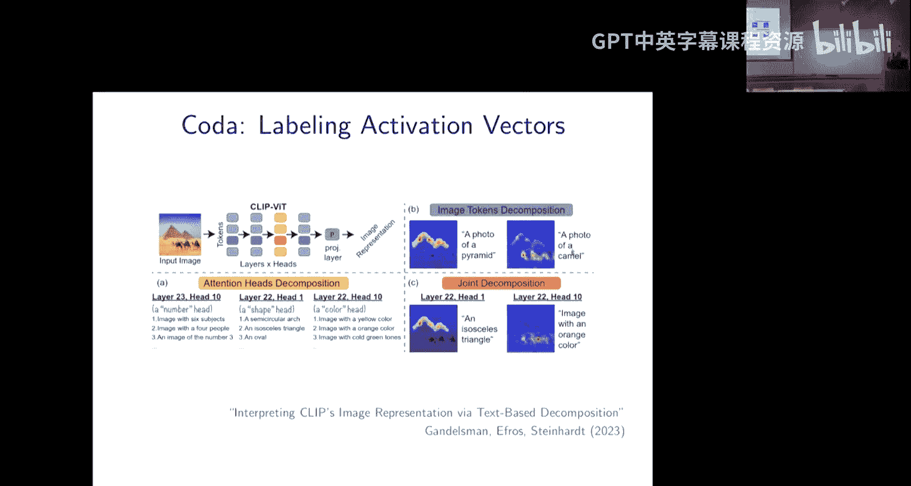
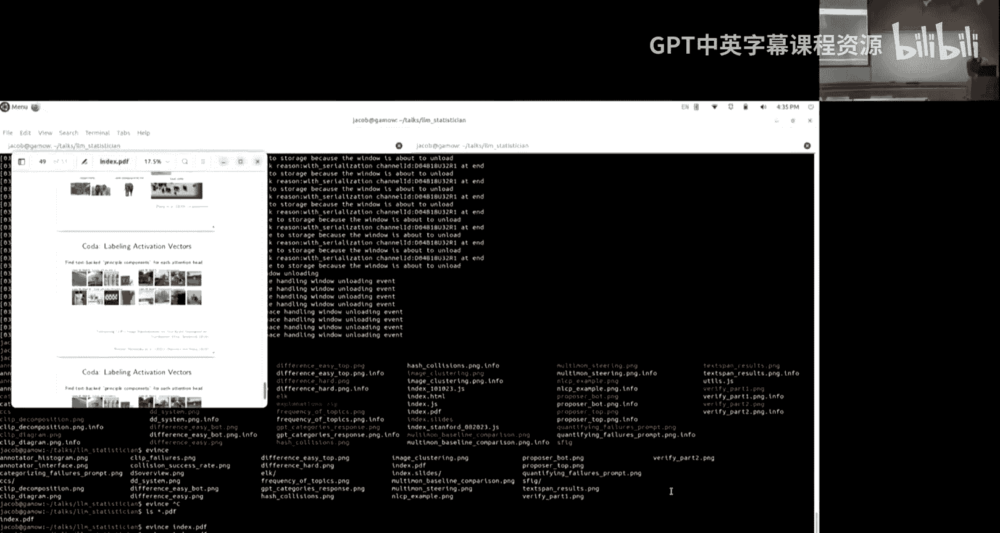
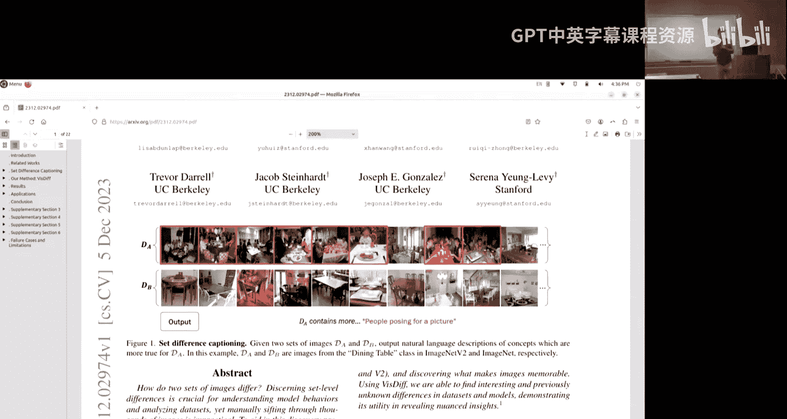

# UCB《理解大语言模型｜CS 194／294-267 Understanding Large Language Models》中英字幕 - P7：-7-Jacob Steinhardt_ Using AI to understand AI.zh_en - GPT中英字幕课程资源 - BV1Sz421q7k1

So hello everyone， my name is Jacob I'm a professor in B working on trustworthative machine learning and today I'm going to talk to you about using AI to understand AI so what's the motivation here so the basic motivation is there's this kind of rapid proliferation of AI systems being deployed right we had G4 than we had visceral than we had you know SOA and then we had cloud3 and you they just mean they keep getting better but they also keep getting more complex and they are doing more and more different things right and often they do unexpected new things we get kind of emergent behavior where suddenly there's new behaviors or new capabilities that might either be you intrinsically create safety problems for instance when Microsoft deployed。

😊，Sydney it would sometimes threaten users to try to get them to behave the way it wanted them to which obviously we don't want or extrinsic problems like someone you uses this to do like phishing attack or you know design like chemical weapons or something like that right so we want to kind of understand the surface of behaviors so that we can actually responsibly use and control and deploy systems but how can we kind of keep pace with all of the new problems that we're seeing every day and so kind of the key idea and the key motivation of this talk I guess the starting point was well can we use large language models to understand large language models right so LLMs are good at a lot of things they can process a lot of data because they have large context windows and they can explain things to us so maybe they could just kind of look at the behaviors of either themselves or some other。

LLM and help us understand what's going on and now this is kind of good because now as models get better understanding does as well right so now instead of new LLMs come out we have new challenges also new LLMs come out we have new solutions and I guess since the first time I gave this talk we went from the LLM world to the VLM world so I'm going to talk not just about LLMs but generally using AI systems to understand AI systems so how can we do this well。

😊，First we have to figure out what we mean by understanding and so my claim is that many forms of understanding basically reduce to statistics or data science problem so what do I mean by this well one thing we might want to do is given data about a model's behavior identify patterns in the behavior that we might care about like you on this subset of inputs coding models are more likely to have security vulnerabilities another thing we might care about is to explain the important sources of variation in the training set like what is you like what is actually going on in the training data maybe there's certain biases in the training data that we care about and might want to correct another thing is maybe we want to actually do some form of like active learning might actively generate inputs that elicit some problematic behavior or at least that we're going to try to elicit the problematic behavior to see if it's there so that we can fix it and so。

All of these are basically a statistics problem，kindin of like PCA。

 this is basically you know also some form of like future learning or clustering and this is basically active learning and so if we can get LLMs to be good at in some abstract sense doing statistics we can tackle these problems so I'll give a concrete example of this in a second but kind of staying at the conceptual level for now。

 what does it mean to do statistics while I claim that it is basically this four step pipeline or most statistics looks like this four step pipeline。

 we look at some initial data。😊，We form some hypothesis right。

 so this might be like we look at a bunch instances of behaviors of some model that we're trying to understand。

 we form some hypothesis about how it tends to behave in general。

 then we need to formalize that as some actual quantitative hypothesis， like say it's you know。

50% more likely to output code with this security of vulnerability if the input has grammar errors。

 maybe that's like a hypothesis right of course that's still a kind of qualitative hypothesis because like it's not yet a kind of like formally defined hypothesis or we need to formalize it somehow then we test it on new data that could either be held out data from the same distribution or we could try to get at some notion of causality with outer distribution or actively collected data so this is。

The statistics pipeline， and so I'm going to give you a few case studies where we kind of have a problem。

 we reduce it to this kind of form， we automate each step with either LLMs or VLMs and then we use this to better understand models and find problems with them and sometimes even fix them the key difference here is that we're using LLMs。

 so in traditional statistics， this hypothesis might just be some like mathematical function like we're saying you know average treatment effect is greater than zero or something。

 but here H is going to be a natural language string and so actually a lot of the problem is going to do how to formalize what a hypothesis that is like only say a natural language means in a way that we can quantitatively test it。

Okay， so that's the high level。The very concrete first case that I want to talk about is finding failures in clip。

 so who here knows what clip is。Okay， so maybe like three quarters of you。

 so clip is a embedding model that embeds images and text jointly。

SoC is an embedding model that embeds images in text jointly and if you haven't heard of it。

 you've probably heard of things that use it， so it's kind of the backbone of stable diffusion。

 midjourney， Dolly， basically all of these text to image models use clip as their first step and these models can do pretty amazing things。

 like you know here's a prominent empty glass it shows you this， a family of five members。

 it shows you this， a man descending a mountain it shows you this。

 there's no star in the night skype shows you this so you get these amazing pictures。

 the problem though is that all of these pictures are wrong。

Right so I set an empty glass but this is actually a full glass， I said a family of five members。

 this is actually a family of six members， this is a man us sendinging a mountain not descending a mountain and there are many stars in this night sky so you get these amazing results but you kind of still have these very basic failures and the plot twist actually in this case is that all of the failures I showed you here where found automatically by a large language model so I didn't come up with these myself I just ran some code that my students Eric Jones and Peter Tong wrote and handed the model and it kind of chuugs along for a while and then it outputs this and like many other things so I'm going to tell you how could we actually design a system that's going to automatically find all of these failures for us。

There's。Kind of a few key ideas so remember that clip is an encoder model so it kind of embeds inputs so the first thing we're going to do is we're going to find what I'm going to call hash collisions in this encoder。

 basically pairs of inputs that kind of collide in the embedding space。

AndThis is kind of a good source of potential errors so this kind of gives us a way of efficiently finding a lot of errors。

 this kind of individual errors with the model， we're going to then use GPT4 to categorize these errors into kind of coherent generalizable patterns and then use these patterns to generate new example failures and in fact you can even generate them in like new domains that are totally different from this kind of initial set of hash collisions that you found so we'll actually see for instance that you just take collisions from kind of regular images and then you can transfer it to say like the self-diving car domain so these are kind of the key ideas and we'll actually see in a second that they actually kind of correspond to these four steps of the statistics pipeline。

So。RightThe first step of this pipeline I said is like you look at some data the first steps remember look at a data form a hypothesis test or sorry。

 generate a hypothesis， formalize a hypothesis and test it so the first thing we need to do is look at data so what's the initial data going to be well before I can say that and give you a little bit of background about clip so clip can take as input either an image I or text T。

😊，And either way it's going to produce a vector， depending on the architecture， either。

Say like a 768 dimensional vector， the dimension depends of it on the particular model。

 but it's going to output some vector and what is it trained to do well it's trained on a bunch of images and their captions。

And it's trained to generate embeddings such that each image has high cosine similarity to its caption and low cosine similarity to all of the other captions。

 so it's kind of a contrastive loss right so in particular it's trained such that if T is a text description of an image I。

They should have similar embeddings， they should have high cosine similarity。

So the idea now is if I can find two text strings T and T prime that have very similar embeddings under clip but that describe different visual concepts that at least one of them has to be wrong because that's going to kind of mess up this matrix so basically we're going to search for pairs T and T prime that are collisions in this sense that they have similar embedding even though they semantically mean different things。

 so concretely we're just going to collect some corpus of text inputs let's call it T1 through TN and then we're going to embed them under clip and then we're also going to embed them under another model called dist roa which is just a text only model。

 we're going to use that for semantic checking that things are actually semantically different so basically we're going to find pairs T TJ that have high clip similarity but low roa similarity so there' is the same clip things they're the same but actually they're not the same so some examples。

You get out of this would be like two girls walking down the street and two women walking down the street or a tall glass on the table versus a short glass on the table。

 clip thinks those are the same， but Roberta thinks very different。

AndOne thing that's nice here right if we're looking for hash collisions is we get to exploit the birthday paradox so there's like for end data points。

 there's n squared potential hash collisions， so this gives you a kind of very efficient way of finding problems with the model that's in some sense quadraically faster than if you just do it naively Well now we just use LLMs。

We basically take all these individual failures which are just text inputs and we feed them into GPT4 and we give it this prompt so this is kind of the magic prompt although I mean the specific details matter a bit but not like fully so basically we say okay I'll provide a series of data for you to remember subsequently we'll ask you some questions to test your performance here。

 some pairs of prompts for you to memorize， then we give it you know k of the failures that we found where you just pick K to be whatever can fit in the context window of GPT4 and then you give it some instructions you see I'm trying to find failures with an embedding model the above are some pairs of sentence that this encoded very similarly even though they're conveying different concepts using these specific examples are there any general types of failures you notice the embedding is making or any common features that the embedding fails to encode。

And then you kind of give it some more descriptions， so you give it this and then what you get out。

 well you get a nice list like this。So conveniently it actually uses a consistent markdown list format so we can actually programmatically parse out the different hypotheses it gives so note like what is this trying to do this is trying to go from these individual failures to kind of consistent patterns so it's saying okay what are the consistent patterns it found well one is saying okay negation embedding models may not correctly capture the negative context in a sentence leading to similarities between sentences with and without negation this can result in incorrect visual representations as the presence or absence of an action is significant image or video generation and then there's other ones like temporal differences quantifiers and so on a nice thing here is that youd get not just as category name but an actual description and this description is sometimes helpful is saying don't just care about generic negation but actually perhaps the presence or absence of an action in particular could be relevant so this elaboration sometimes has useful information。

Okay， so now we have these hypotheses， so that was step two， generate a hypothesis。

How could I formalize this hypothesis， like how could I tell if this negation hypothesis is actually true or how could I quantitatively measure the extent to which this negation hypothesis is true？

So this is an exercise for the class， any thoughts on how？

I could actually quantitatively check or test this negation hypothesis。

 so what I could do is I could basically try to generate a bunch of new examples based on the hypothesis。

And then see if those new examples actually are like give you these hash collisions consistently。

I might even want to go further and test that they don't just give hash collisions。

 but actually lead to failures downstream。Right， so the kind of key takeaway here is that we'll say that H is a good hypothesis if it can be used to generate new failures。

 this is also nice because it kind of actually grounds it in usability。😊，So to do this。

 we basically prompt。A LLM to generate new failures using the hypothesis H as a context。

 so basically we say write down 41 additional pairs of prompts that an embedding model might encode similarly even though they would correspond to different images of used as captions。

 use the following format so we kind of force it to use the specific format so that we can again programmatically parse its output and then we say okay you'll be evaluated on how well you perform your sentence structure and length can be creative extrafolate based on the failure mode you've summarized be both creative and cautious。

 I actually don't know if that last part matters but Eric Eric added it and he's pretty good at these things but we did not do a careful ablation like may or may not matter and then you just provide the description of the failure mode like the negation thing for the previous slide so then we do this。

Why did I pick 41， Well， that's just the number that GPD4 is willing to generate。

You can just keep asking it for an additional 41 if you want more。So。

So then you get a bunch of these， and so we're one going to check if you these prompt pairs actually do have very similar embeddings while having different distillta embeddings。

And then we'll check if when you actually feed them into something like stable diffusion。

 it creates problems。So this is testing the hypothesis right， so first of all。

 let's just look at the hash collisions， so this chart's a little bit complicated so let me explain to you what's going on。

 so there's different models that we used to generate the hypotheses。😊。

Right so the list I showed you came from GPT4 but we also asked Claude and GT3。

5 to generate their own list of these high-level hypotheses about the systematic failures of the model and the thing is that different models provide different hypotheses right so there's actually two things we care about there's like did the model have this hypothesis at all and then if it did what was the success rate at generating new failures so。

So as an example。This is saying that GD4 and Clade both generate temporal differences of the hypothesis。

 but G 3。5 does not。Okay， so that's what this down here is saying。

This is just the different failures， and then Coco and SNLI are two different data sets。

Of image descriptions that we use to do the initial scraping of has collisions。

 so this is trying to get a sense of how much does the initial corpus affect what hypotheses you get out and in fact。

 it seems to affect it somewhat like。SNLI seems to get this like action state differences。

 whereas Cocoa does not， I think Cocoa generally has kind of like more static scenes than SNLI so this kind of makes sense。

 so this is saying that the underlying data matters。Different models come with different things。

 but in general。If a model comes with hypothesis， it tends to have a pretty good success rate。

 like most of these things are kind of around 80%， some are more around like 30 to 50%。

 but they are all pretty good at generating these hash collisions interestingly actually sometimes。

Even for the same thing like more powerful models do better， so for quantifiers。

 GPD4 does better than Claude， why is that well it's just because of that elaboration text after the quantifier hypothesis like GPD4 gives kind of a richer elaboration that's more useful for generating new failures so this is hash collisions。

😊，But what we also care about is can we generate actual failures in downstream systems？

So we did this， we kind of created a UI to test this。basically， what did we do。

 we took these pairs of prompts that were supposed to view collisions。

Then we randomly fed one of the two into， say stable diffusion or some other text image model。

 and we look at the image that was generated。And then we asked human。

 I guess in this case just one of the authors of the paper。

 but who didn't know which model or system this came from。

 you does this image correspond to prompt1 or prompt2 or in neither of them or are these prompts actually not different like they don't actually describe different images。

 so what would count as a failure， a failure would be if the image came from prompt1。

 but the labeler said prompt2， or if the labeler said neither。

 if it came from prompt2 and the labeler says prompt1 or neither then that would also count as a failure。

We're trying to understand what's the rate of failures。And we find- I guess first of all。

 it is pretty high。Secondly， it actually depends on what similarity threshold we use。

 so basically once the clip similarity， like the cosine similarity of the clip embeddings。

So basically right like what's the threshold you want to use to count something as a hash collision。

 if we pick as our threshold something around 0。9， then the rate at which this leads to like actual failures in downstream systems is about 80%。

And just to show that this is like。You know， meaningful。

 we had a baseline system that basically was the same as the system I just described， but instead of。

GPD4 being given a bunch of data to help it generate hypotheses。

 it was asked to just kind of brainstorm hypotheses in kind of like not grounded to the actual failures。

And then comes up with a different set of hypotheses and those hypotheses only give you like a 20% failure rate。

 so there really is like a significant effect from having these kind of data driven categories。

And then the final thing is you can just。Generate failures in new domains， right？

If you say actually I wanted you to generate failures that are about self-driving cars。

 but using kind of like these high level categories you had to come up with。

 what would you generate G4 can do this just fine and you get things like the cars on the right side of the lane when it's actually on the left side。

 you know this is not a green light but it's actually a green light。

Or like red light where this is like a green light， so you can kind of transfer it to new domains。

 which is kind of an additional proof of external validity。嗯。😊，Okay， so to summarize。

 we kind of did all these four steps of the statistics pipeline， right we had to get initial data。

 we scraped cacheh collisions from a text data set to generate hypotheses， we prompted GPT4。

We formalized the hypothesis by looking at the success rate for generating new failures and then for new data we actively generated new examples in this new self-driving domain。

 and one thing that I think is interesting here is like in some sense a lot of this was just like prompting and embedding。

 but not in a kind of naive way we kind of having all these models like work together kind of in harmony to do this kind of cool thing that you couldn't necessarily get from just a single prompt。

😊，Okay， so any questions about this， this is kind of the first case study I wanted to tell you about。

Yes， did you say any differences？Failures that didn't have high e clipse similarity like maybe a different mechanism was causing a failure you're saying。

Like the stuff around here， like why？It's a good question。I actually don't know。

 I didn't look into it， but I think it's something that yeah I'm curious about it， so yeah。

 thanks for asking that。One more thing， when you were having the model generate pros。

 or sorry I generate hypotheses， did you do a lot of playing with pros that in endshotO and other techniques like that？

We spent a while playing around with prompts。I don't know if we tried like in context learning specifically。

 but yeah I think we spent like a decent amount of time on kind of like engineering the prompt to be good like I said I think it's not extremely sensitive to like the exact prompt we used。

 but I do think，You knowI would guess that like。50% to 75% of the specifics matter and the other 25% just happened to be there because we didn't carefully check exactly what was needed。

Yeah。Any other questions， yes？Was that like a superet of all the filling modes identified by all the？

These yeah， so this is an exhaustive list。You know， I think。

What you'd really like is like an even longer list of kind of everything this is still pretty good in that like for some of these there was like an entire paper written just about that one failure mode so you know we've gone from getting one failure mode per paper to getting 14 but yeah ideally we would be getting like hundreds or thousands of just like understanding everything in the model and I think we're not there yet。

 but but I think that's where I'd like to be right you can kind of see like。😊。

I maybe Coke was like very slightly better， but I think。Yeah。

 it kind of seems to me like mostly you just want a lot of diversity and coconess and I had like different types of diversity。

 so they were kind of both good in their own way I it that theres some？嗯。So basically。

 TBV4 has a knowledge card。2，23。嗯。The times ors would be wait before that。

 and it's it possible that 34 has some knowledge about oh。

 it's like read the papers that describe the failures。3。

 you probably had an earlier marriage cut and so。If we put on theC does not have the knowledge atable。

Yeah， it's an interesting question。😊，I don't think I have a way of ruling that out。I yeah。

I would guess this is not like a major。Factor， partly because like many of these are like we're not in the literature。

 although okay， I guess there could be a more subtle thing which is just like people talking in general about the problems that models could have and then this gives you a source of hypotheses so I think that that seems really plausible。

😊，To me。I think， yeah， so the main piece of evidence I have against this being like the primary thing that's going on is that if you're just kind of brainstorming if you just have G54 brainstorm from its prior。

 then it's only getting this like 20% success rate instead of AD。

PresentSo somehow like the actual specific data does seem to matter。

Okay so let me talk about another kind of case study。

 so this is statistical modeling with natural language parameters。

 this is a kind of research direction spearheaded by my student Raie Zhang。

guess before first let let me just talk about a kind of abstract task that I think is interesting and then I'll explain to you why we want to solve this task。

 so the task is given two text data sets D1 and D2， we want to find the difference between them。

But the difference should be specified by a natural language string H。

 so this is basically binary classification， but where the classifier has to be stated in natural language rather than as some neural net。

Right and so why would you want this well， I mean if you just care about classification accuracy。

 then you probably should use a neural net to do your classification。

 but the problem is then the neural net's kind of a black box if we don't understand what's going on if we have a natural language string now we actually like understand what's what the actual difference is so here's an example。

😊，So suppose this was D1 and this was D2， So can someone give me a natural language string H that will distinguish D1 from D2？

Well I'm looking H should be like a rule that tells you what D1 or D2 is Yeah。

 so basically it would be D1 contains more French sentences compared to D2 where like D1 is French and D2 is English。

 right？This one is right， so this one's pretty easy。

 like we can all get once we understand what the task is， we can all get it pretty quickly。Oh。

 I had a hard one but。That one took people too long to figure out so that I skipped it。

 but I guess maybe I'll say in general。The actual examples can be a lot harder and more subtle。

 like we might be looking for patterns where there's maybe like a 10% difference between one data or another。

 or the examples could be much longer than just these simple sentences。

What are some example use cases of this where we would want to separate two distributions so one is I might care about distribution shift right so I trained on one distribution I'm testing a new distribution。

 I might care what are the differences right so maybe I find out that the test distribution involves more formal writing than the training distribution and so then that's a potential source of OD failures or I could look for spurious cues in a data set so say I have a spam classification data set but I find out that the positive class contains more URLs than the negative class。

Well that means URLs might be a spurious cue for any classifier that I train on this data set where like I really want it to be detecting spam but instead it detects the presence of URLs I could also use this to automated error analysis maybe I find out that G53's mistakes contain more positive or uplifting language than TK11 billion mistakes and this like maybe teachses me something about the errors of these two models I could also use this maybe for kind of social science applications so maybe I look at a bunch of tweets and I determine that public opinion from this year is more optimistic about the pandemic than last year so these are these are all like pretty natural use cases that you would care about that basically just come down to this like explainable classification problem so we're going to do this using LLMs。

Basically same four step pipeline， look at the data。

 well fortunately the data is just handed to us here， we just have D1 and D2。

So then we need to propose a hypothesis， well， how do we do that。

 we can just prompt it so we can say， okay， here's a bunch of A's， which are all from D1。😊。

Here's a bunch of bees， which are all from D2。Compared to group B。

 each sentence from Grove A has what property？And then I guess this is what GP3 does。

When we did this paper it was with GPT3， you could now do GPT4 which will work even better。

 but it generates a bunch of hypotheses， so like it says， okay， is more positive。

Contains the word chapter， okay， that's technically true。

These both contain the word chapter is longer， also technically true。But。

Some of these are some of these hypotheses are actually generalizable。

 some are not why wouldn't they be generalizable well the context window of these models is limited so you can only put so many examples into the context window and so you might have this problem of like know there's something that's true on like the 30 examples you looked at but it was just kind of a spurious or not spurious but like a statistical artifact。

 so we'd ideally like to test these hypotheses on many more examples。How could we do this。

 any thoughts？Like how could we figure out which of these hypotheses like are really are really like actually generalized the full data set So the nice thing is basically once you have the hypothesis。

This context window problem goes away because if I want to just test the hypothesis， I can。

Do a for loop。And test each example of my data individually。

 so I no longer have the context length problem。So right。

 we kind of start with these two steps that we've already done looking at the data inform forming a hypothesis。

And we'll say。you know， to formalize this hypothesis quantitatively and see if it's true and test it on new data we're going to say a hypothesis is good if it helps us tell D1 to D2 apart so what do I mean by this okay intuitively。

If I。You know gave someone an example that was randomly chosen from D1 or D2 and they didn't know which。

 but then I tell them H， I tell them the hypothesis， they can consistently classify D1 versus D2。

Now humans are expensive， so we're going to use LLMs instead。In a bit more detail。

 so here's just some formalism。If this is confusing。

 don't worry about it because it's just saying formally what I just said intuitively。

 but there are some kind of important formal details， so basically as an example。

 suppose that we had the hypothesis H， which involves more formal writing。Well。

 we can interpret this as。Basically， a two argument predicate that takes in two sentences and outputs binary truths values 001。

How do we interpret as a true argument predicate， so we say h of x1 x2 for your sentence is x1 and x2 is just the truth value of the sentence x1 involves more formal writing than the sentence x2。

And so that kind of。In principle has some well definedfined truth value， humans could evaluate it。

 but instead we'll just ask an LLM to evaluate it， so we'll define h of x1 x2 to just be like what an LLM would say about the truth value of the sentence and we'll say H is a correct hypothesis about。

How D1 and D2 are different。In expectation over a random sample x1 from D1 and x2 from D2。

 H of x1 x2 is。Did I flip this？No， I think this is。

You want it to be basically as close to zero as possible。This is saying that。It's。诶。

Always bigger on x1 than on x2。Wait， no， did I get this wrong？Sorry。

 I think you wanted to be as close to one as possible， yeah， much much bigger than。Okay。

 last time I had it that way and then the audience convinced me it should go this way。

 but okay the point is you either want this to be very close to zero or very close to one。

 there's some sign thing， but the thing you definitely don't want is for it to be close to 0。

5 because close to 0。5 would mean that like，😊，It can't distinguish x1 from x2 right it's like basically equally likely to say yes or no。

 you want it to always say the x2s are bigger than the x1s or the x1s are bigger than the x2s。

 but not like I have no idea。Okay。So how do we implement this， like I said。

 we'll do it by querying and LLM。If you compare like MTrk costs to GP 3。5 turbo costs。

 it's about a 1，000 x reduction in cost， which is significant。

So here's the overall system we have this hypothesis propose that takes in data generates candid hypotheses。

 then given these hypotheses we have this hypothesis verifier that basically evaluates and rewranks these to say which ones are the best and really nice thing is actually you can also steer the proposer based on the use case because this proposalr is a language model so I could say I don't just want hypotheses that are true about this data but that are true and relevant to some use case I care about maybe like I only care about style but not about like length or I care about topic but not style or like I don't know maybe I have like two corpora that are in different languages。

But I don't care about that difference and like by default that's the first thing it's going to propose so I have to tell no。

 I really don't care about language， tell me about the other things right so you get this really nice like steerability or controllability because you're working with LLMs。

😊，嗯。Okay， so just to go over a few use cases of this。

So the first one is you can find spurious cues in data sets。

 there's this data set on subjectivity analysis， so basically determining if a statement is subjective or objective。

And if you ask it， what's the difference between the subjective and objective class。

 it says is a quote from a film review， actually when we first saw this we thought we had some like bug in our system。

 but then we read the paper that proposed this data set and apparently the two classes were like IMDV and rotten To。

Because the idea is like IMDV is objective and rotten tomatoes is subjective。

So actually the difference was that it was a quote from a film review for the subjective class。😊。

There's this dataset set called M&LI which is a natural language inference task so it asks whether like one sentence entails another sentence or not。

 and there's this well-known spurious cue， which is that having a negative verb like not is highly correlated with non-entailment and so this is like well-known to the literature。

 but our system recovers it and then this spam classification thing in fact it is actually true。

 so the spam class has a high number of hyperlinks and if you take if you train like Bert on this data set or like you fine tune Bt on this data and use it as a spam classifier if you take your own emails and add hyperlinks to them。

 it does start to classify them as spam， so it's like a real spurious Q。

Also automated error analysis， we kind of already talked about this。

 that GPT3 cur makes errors more often on language whether is positive or uplifting。

And there's actually a lot of other applications， so if you're interested。

 we actually created a data set with 675 different use cases across different domains。

 our system currently only gets a subset of these cases。

 but if you're interested in kind of like automated explainability and kind of like automating science。

😊，Kind of like social science with LLMs， this is a really cool data set that I'd encourage you to check out。

Okay。All right， so in summary we did this kind of same four step process。

 we had this initial data where we had these two text distributions。

 we generated a hypothesis by prompting GV3。Formmalize the hypothesis as the success rate on distinguishing samples。

 and then here the new data was just held out samples to test that the hypothesis was in fact true。

 so we can extend this beyond binary classification。😊，So the kind of general insight is that。

Given any natural language predicate H。We can basically induces a feature function my claim is that a natural language string is actually like a feature。

 so what I mean by that is we could define its denotation which is a function from strings to 01。

 which is just the truth value of this predicate on that string。Right and。

don't we are not stuck with just having one feature right like most models have lots of features right so for instance we could define an exponential family model where P of x given you know vector W and a list of predates H is proportional to E to the like W1 times h1 of x and so on up to wK times hK of x right so this is。

Basically a one layer neural network， right like kind of like a one layer MLP or something。

 but where。The first layer instead of being this like matrix is actually this list of strings that define these feature functions right so this is kind of equivalent to a one layer neural network but where all the features are explainable instead of being kind of arbitrary vectors and more generally you can use this as the basis of lots of more complex models。

 like topic modeling， lower rank factorization， clustering， and so on。😊。

Here's just like one kind of cool example use case， so say that。You say， okay。

 I have this data set of images， I'm classifying dogs versus elephants and I want to understand how their backgrounds are different。

And so then it will say， okay， I'm going to try to find clusters。

where you the proportion of dogs versus elephants is very different in each cluster。

 so it kind of comes up with these three where the three backgrounds are jungle。

 white background in sand， where elephants are much more likely to appear in the jungle。

Dogs are much more likely to have a white background。

 and then they're actually about equally likely to appear in sand。

So this is this is kind of just like a fun application but the point is how did I do this well basically I wrote down like a like contrastive clustering loss function and then fit a model to it but I had you know terms in the model that were just these natural language strings so how does it work it kind of works as a kind of like alternating maximization problem where you alternate between like maximizing the continuous parameters in your model and then using GPT4 to make proposals for the discrete parameters these like natural language strings and you kind of like go back and forth so it's kind of like like the EM algorithm or other kind of alternating maximization algorithms've if you've seen that I think this might actually be on archive now。

We submitted it to a conference like a few months ago。

 so you might actually be able to read about this， but yeah I think this is really cool。

 it kind of opens up like a whole kind of like new library of statistical models that you could write down。

嗯。Another thing you can do。instead of just trying to explain behaviors of models。

 we can try to understand their representations， so this is another project I did actually with YoOSC Gnddelman who is a student of Alyosha Eros and UOC and Alyosha and I kind of collaborated on this。

 so what we did is we went back to clip that text image model。And we said， okay。

 we want to understand what the different parts of clip are doing。

 so most of what clip is is these things called attention heads， so we said okay。

 what are all of the attention heads doing？And so for each attention head。

 we actually tried to find a basis for that head， so a set of directions that kind of you know explain the variation and the behavior of that head。

 but with the constraint that each direction actually corresponds to some text string so that all of the directions are explainable。

 so think of this as like，Explainable PCA， like PCA with the constraint that every component is text backed。

 So if you do this。You get some。Cool things。So for instance。

 you know like one of the principal components for layer 22 headache8 is a photo with a letter V。

 and you kind of see， y， there's a V， there's a V， there's a V， there's a V。

 this is like image with Polka dot patterns， you kind of，😊。

Get that and what's really cool is that the heads actually seem to specialize in their behavior。

This like layer 22 head8， if you look at it's like top 10 principal components。

 it's like a photo with a letter V， a photo with a letter X， a photo with a letter like y。

 a photo with a letter W， a photo with the letter A its basically seems like you know one of the things this head does is it just like pays attention to letters。

 there's another one that's like paying attention to locations。

 another one that's paying attention to numbers and so what are some cool things you can do here one is you can use this to actually find adversarial examples。

 so for instance， the head that pays attention to numbers。

 it actually pays attention to two types of number so it has components that are like an image with two objects。

 and also an image with the number two。😊，So it's actually there's like a single component of clip that is both counting things and doing like digit recognition。

 so then if you give it an image that has both digits and some quantity of objects and you ask it like how many objects there are it will actually answer instead of the number of objects like the digit that you drew。

 like it basically stores both of these concepts in the same place so it gets confused between them and you can use this generate adversarial examples。

Another thing you can do is you can remove spurious cues。

 so there's some tasks like classifying different types of birds where there's a spurious cue of like the background that you might not want to pay attention to。

And so you can just find the attention heads that are like paying attention to background and obbllate them from the model。

 and this significantly increases auto distribution accuracy on kind of these spurious cues。

 so you can also use this to repair models。Okay， so here's just like some more examples of this。

 so this is what I was talking about with like the number head like image with six subjects an image of the number four shapehead color head in addition to this you can actually also ask what do these heads care about in the image。

 so for instance this layer 22 head1 is a shapehead and I guess first of all what it cares about is。

This thing。Right， and。诶。If you say like and the thing that most like kind of thinks about this is that it's an isosceous triangle。

 right， and there's this other one， the color head。

 the thing it most thinks about this is like image with an orange color。

Also if you kind of put in different descriptions and ask what's important for that description。

 it will also kind of like attend to the right things like photo of here and versus photo of a camel。

 so there's lots of cool stuff in here， I would recommend checking it out。

The final thing， I'll just say。

Is this paper that didn't make it into here， but I just want to give like a very brief shout out。

To it since I have。Time。Is。We have this。Wrong thing。

You have this recent thing that extends the describing differences stuff to images so given like。

Some data set of images， I can tell you what's different between like the top and bottom row in this case it was people posing for a picture so like all this stuff up here has people posing and all this stuff on the bottom doesn't。

 and so you can use this for instance to like automatically like do error analysis for image classifiers and say find the different you know like you have two image classifiers。

 when does one perform better than the other and you can kind of do the whole gamut but with images instead of text。

So I will stop there and take any questions that people have this be a dumb question but what's involved in taking on the basis of an attention head because that's a pretty nonlinear map。

 right？

嗯。So basically。On any given input image。The attention head has some activation vector。

So now if I have n input images， I get like an n by D matrix， right。

 because if D is the dimensionality of the embedding。And so I can ask。

 what are the principal components of variation in that N byD matrix。

 and I basically want like a basis that explains those components as well as possible。Yeah。Yes。

Maybe like a fine tune clip bottle and see how different like what different roles that attention be。

What actually。Yeah， so that's a great question。I haven't done that。

 so there's some existing work on trying to understand how fine tuning affects models。

The work that's been done has actually mainly been done for language models。

 There's only actually like a small number of papers， like maybe just a couple。

 So I remember there's one that basically。Looks at how base and fine tuneuned model do this task called entity linking。

 which is like tracking which entities are like the same or different in a sentence and their claim is that actually like the fine tuneed model does it basically the same way as the base model but just like better。

 like all the components become more robust。But we also， I mean。

 we've been playing around with this also。For like in context learning tasks。

 like do fine tune models， like do like RLHF models do。

In context learning different from base models and。

We actually like anecdotally we found some differences， so I think the jury's still out。

 I think is actually like a very actively explored area and as far as I know no one's done this for images so like maybe you could be the first one to do it。

Understanding， I think there's a lot of different forms of understanding。To me， I feel like。

The best test of understanding like one thing that real understanding should lead to is like control as in like if I really understand a system I should be able to understand how to intervene on it to get the changes I want right like in biology once we kind of understood that DNA was the code of life and we like understood how DNA encode coded things then you can start doing cool things like you know you like inject DNA in a cell and get like synthesize new proteins and like this is actually like the basis of a lot of like pharmaceutical drugs right so。

I kind of feel like。Right now， we're only just starting to do that with neural nets。

And I think that's how we should be trying to ground a lot of our kind of scientific investigations so you know the example I gave where okay we can like remove this like location queue to show that you know we really did find the location head we didn't just like tell a nice story about it I think that would be a basic form of that but I think we should be doing that like much more deeply and systematically to kind of like prove that what we claim we understand we actually understand Yeah so that's an interesting question。

There is work on this or like there's basically this idea called constitutional AI。

 which is is essentially trying to do this， you like have a model output something and then you have it like critique its own output to try to improve it and then you fine tune it on like its own kind of like improved output and the claim。

Is that this like does？Kind of improve model behavior。

It's a little weird though right because you're like creating this feedback loop where the feedback loop itself is like the same as the thing that is getting the feedback like it feels almost like some like Gll like incompleteness thing that like it shouldn't work but。

But yeah， so empirically it works， so I am kind of a little wary of whether it actually asymptically works as you keep doing it and models keep getting better。

But you also， could imagine a bit more of a complex version of this where。

A model does interpretability research on itself to understand its own representations and reasons about the ways in which those representations have problems and then fixes them based on that understanding。

😊，So that's actually kind of a dream of mine， like feel like I feel like this would be like really awesome if you could do this and that feels a little bit less。

it runs into these like paradoxical problems because instead of you're using a system to fix parts of the system rather than using a system to fix the same entire system。

 so intuitively it feels more robust to me， no one's actually tried to do that。

 but I think that would be really cool to try。Do you think that？啊有 that the。然后为的肯定。

And was like that were like， would you have to like， what are I do？

I think you might have to do like a bit of modification to it。

 but I think like the basic ideas that you know I kind of described here， I think it's not very yeah。

 I think it would not be very hard to get those cases。

 my sense is actually that the gemminized stuff was more of like a management in testing failure rather than a technical failure。

 like I think basically like the process for releasing that model was like a very bad process like just from an organizational perspective and that。

There were there were like people in Google who like very much had the capability to notice those problems and maybe some of them even did。

 but just like。Dididn't really have the right incentives to voice their concerns or the right place to do the voicing。

 or just didn't have the right access to the model to find the problems in the first place。But yeah。

 I guess my answer is， yes， I think you could definitely find these problems automatically。

And I'm not sure that that was the problem that Google had so much as like a kind of like failure of management is just kind of what I've heard from just like generally talking to people in that space。

I just want to get your thoughts on what generally you think it is。Opportunities regarding。Generary。

Like， for example， if you're。Their reasoning。Could you with a reasoning data set， ask the model too？

But you think there' would be value in asking them along too？嗯。Like critique。Currently。

Generate hypoy is kind of why。もの。Exhibitive failures。嗯。😊，So yeah。

 I just generally the generating hypothesies。Wite a different。

In generalral like it's a very powerful use case for LLMs。

 you know why well right they have this large context window so it lets them see more data at once than we could see so then this like I guess any hypothesis that requires kind of looking at a lot of stuff I think these models are going to kind of have an advantage at it requires like very detailed reasoning about like a single example then I think that's also something that they could become good at but it's like less out of the box there because maybe now you need to think about okay how can I decompose that problem into smaller pieces that are kind of like easier to like think about and notice problems in。

But yeah I think that's one thing is the context window。

 the other thing is just models are pretty good at just being kind of creative and coming up with stuff like actually when I'm trying to think of good examples for like my lectures or for like essays I'm writing。

 I often just tell GPPT- you know I want a good example that kind of has these properties like could you come up with something for me and sometimes it's not any good but sometimes it gives me things that I wouldn't have thought about that were like pretty pretty valuable so kind of just like creative generation is ironically actually something that LLMs are pretty good at。

I think the main thing is like how to ground them they're good at creatively generating things。

 but they kind of go off the rails， so I think that's why this is like a really killer use case because you have this data that is kind of grounding the generation and like keeping it on on track。

I think9 models will be faster slower。Mo。Think about certain theI to understand AI to。

You would probably want a stronger model to understand。怎 model都？

And then you want the model to be stronger， so that you can use it to understand a stronger model and it's kind of like a。

I mean， my hope is， I guess I have two hopes， right。

Actually that weaker models can that we can actually use weaker models to understand stronger models why might that be possible okay so hope one for why it might be possible is that you can give the weaker like the weaker model since it's like kind of has control over how it interacts with the stronger model has some advantages right so for instance。

let's say you were a lawyer interrogating a witness。

You could like ask a bunch of questions and try to catch certain contradictions。

 right to get a sense of whether they're telling a consistent story or not。

If you're a weaker model trying to you know understand a stronger model you can do the same thing and in fact you can do even better things because you can like ask it some questions and then you can like flush its context so it doesn't even remember what answers it gave to those questions and ask it some more questions so then you can tell if it kind of has some like coherent underlying model that it's being faithful towards or it's just like saying random stuff that's just like one example but in general you know I think there's these things you can do to give the small model an advantage the other thing is that understanding and acting are two different skills right so models。

Like models， you can have a model that's very good at understanding things relative to how good it is at like like taking actions or doing things。

 or you can have a model that's very good at doing things relative to understanding things if it's very good at understanding things relative to doing things then you're like in pretty good shape。

 and I think a lot of that just comes down to the relative amounts of data and the pre-training data set that kind of correspond to those different tasks so we can just have a lot of data out in the world that is about understanding model behaviors and have that in the training data then you know this is kind of hope to for why smaller models could understand bigger models。

😊，嗯。Have you found any differences between the ox records that like wood？100 of his lately I agree。

What the basisis and the PC that you're doing？Do you have any noticeable differences between the types of planss that are released？

For versus later on。Yeah， so good question so in this case actually everything I showed you was from late attention layers。

 so this is because of a kind of strange thing about clip which is that。It turns out。

Only the last four attention layers actually like write to the output。

 or like all of them could write to the output， but basically there's like after all of the layers。

 there's a thing called the unembedding matrix， which kind of like puts things into the final representation。

And empirically。But all the layers before the last four write in directions that are orthogonal to the unembedding matrix so what is what is saying is they're all kind of doing scratch work that is like setting up the information needed for the last foreheads to do their work so in this work we were kind of only looking at these like final direct effects on the output so we only I only know the answer to the last four other than that the other ones don't have a direct effect on the output they all kind of only go through indirect effects。

We're currently trying to understand the indirect effects。 YoOC has been working on this。

 but it's a lot more。Complicated I guess like or at least you know like we've been having it's been harder to kind of decipher those so I don't have an answer for that I think for LLMs people have looked into this and they have answers where I mean it's kind of what you would expect more abstract concepts tend to appear in the later layers I think I mean there's basically like two roots right there's the behavioral root and the like interpretability root。

I think。For the behavioral route， I mean I'm excited about just scaling up these explanatory tools。

 right？Can we just use can we make AI systems very good at like automated data analysis and categorization。

 like basically this kind of stuff I was talking about， like the second。

 the last thing I talked about with statistical models that have like natural language features as their features as ways to kind of uncover lots of latent structure in an explainable way yeah I'm pretty excited about scaling that up。

 there's also so that lets you kind of like understand the behaviors once you've seen them。

 the other question is like what are the inputs you should actually give to the model。

 so I think that's more challenging and that's kind of like sort of like model andversion problem but I think that would be the other direction to scale up。

Then yeah， for interpretability， I don't know， yeah。

 I think we should just find all of the concepts in all of the models like kind of。

 we did it for the direct effects and clip， so his next step is indirect effects。

I guess also I think we only really found a subset of the directions。

 I think we found maybe like 50 things in each head but there's probably you know thousands in actualities so that's another direction to scale things up and then just taking you know other models I think all of that's pretty exciting。

I think it's a good research direction， there's a lot of。

 you know it's like in some sense fairly well defined。

 but I think there's a lot of very deep kind of technical questions and challenges on how to actually execute it。

I thinkrek， theres any way we can addressed this big given。Well， in principle。If you can find them。

 then you could fine tune on them to try to fix them， so that's the behavioral route。嗯。

I don't know if that's been demonstrated yet， I know Raie。Has been trying to do this。

Then another one would be。I think if you understand the internal representations then you can kind of do surgery on the models to try to fix it right like I think the example I gave with abl reverse spurs cues would be a very crude example。

 I think that's not really what you want， but I think there's I mean，呃。like for instance。

You could imagine that there's just like directions in activation space that trigger better or worse behaviors and if you can just find the right triggers。

 you can actually make the model。Like work a lot better or kind of like remove bad triggers so that it can't you know be triggered to do bad things。

 So yeah， I think that would be kind of the other route。

