# UCB《高级大语言模型智能体｜CS 194 294-280 (Advanced LLM Agents) 2025》中英字幕 - P10：Lecture 10, Sean Welleck.zh_en - GPT中英字幕课程资源 - BV1mkZiYAEYM

I amm excited to talk about bridging informal and formal mathematical reasoning with AI。And。

So probably throughout this course。You've seen many different ways where these AI agents can start to have a lot of impact in different areas。

And so one interesting question is。To what extent can they impact more expert domains。

 so say finance， science， medicine， and the domain that I'll talk about today， which is mathematics。

Now with mathematics。There's a variety of things that you could imagine doing with an agent or a language model。

You could try to have an open ended dialogue with the model。

 you could try to have it come up with counter examples for you， help you write proofs。

 and it's your imagination is basically the limit。And what I want to argue today is that for math in particular。

 how you represent the math is actually extremely important to think about。

So one way to represent math is what is called informal mathematics。

Here math is represented as raw data， so it could be text。 It could be an image。

 It could be even audio if you're like talking with someone about math。

And doing this is extremely flexible and in some sense。

 most of the math that you've encountered or that you've used is probably in some kind of informal format。

 so even something like a latex solution or an archive paper we would consider to be informal。Now。

 when we think about using AI to generate or operate in informal math。

There is a really important problem， which is that we don't have any guarantees that the math is corrected or not。

So like here is an example of a language model precincing a solution。

 and the answer at the end is actually correct， but it makes these kind of subtle mistakes in the intermediate steps。

And so for really simple math， this might not actually be an issue and the language model might still be useful。

But if we really want to trust it in， say， education or in research level math。

 then it could get very tedious。And very difficult to know whether the outputs are correct or not。

So this motivates the other end of the spectrum， which is called formal mathematics Here math is written as source code in a programming language。

And basically， the way it works is you can write a specification or alemma or theorem like one plus one equals  two。

Then you can write a proof。And the really cool thing is that if all of the code compiles。

 then you have a formal guarantee that the proof is correct。

And so this is a lot different than the informal math because now we can have certainty if， say。

 a language model generates a proof， that it is actually a reliable and correct proof of the theorem。

And there's been a variety of these theem improvinging languages developed。

 I'll mostly focus on a language called leanan， which recently is having a really exciting growth and really exciting intersection with the mathematical community。

 which I'll talk about in a bit。And for one of the topics that I'll talk about。

 I'll also mention this language called Isabel because it has some features that make it kind of amenable to writing different types of proofs with AI systems。

So if you haven't seen one of these before， I wanted to actually show you what one of these formal proof assistances looked like。

And so to do this， we'll try to prove this really simple theorem， which is like transitivity。

 so if r is a subset of s and S is a subset of T， then r is a subset of T。

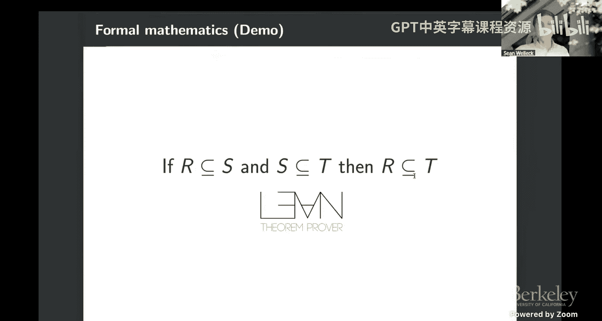

So I'll actually show you this as a demo and so here what I've done is I've opened up VS code。

And so as I mentioned， this is literally。Like programming， like writing code。

And here you can see the theorem statement。So if r is a subset of S and S is a subset of T。

 then r is a subset of T。And these are often called interactive proof assistance。

Because what happens is as I go to write a proof。It actually tells me， over here。

What is the current state of the proof。So the idea isn't to learn every bit of the formal system。

 but I'm kind of just showing you the important parts that'll be relevant for the talk。

So here we can see these different variables and we can see what we have remaining to prove over here。

Now the thing is， is that it takes some expertise to actually write a proof in lean。So for example。

 if I know some lean， then one thing I can do is this command here。

And you can notice that it actually changed the state of the proof。

 so now I have these two kind of variables up here。And the goal has also changed。Then again。

 if you have some expertise， then you can actually know that this idea of transitivity。

Has already been programmed inter T lean。So here I wrote this transitivity rule here orlemma。

And now you can see up here that it says that there's no goals left。

 so I've kind of completed the proof。So we'll actually touch on a lot of things that I've talked about here throughout the talk。

We'll talk about the fact that it requires some expertise to actually write a proof in one of these proof assistance。

And if you look at this proof， it might look a bit different than one that you would see like written down in a textbook or something like that。

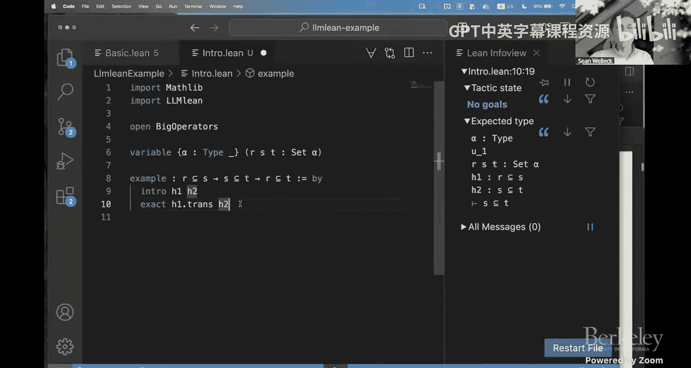

So we'll revisit these ideas throughout the talk。

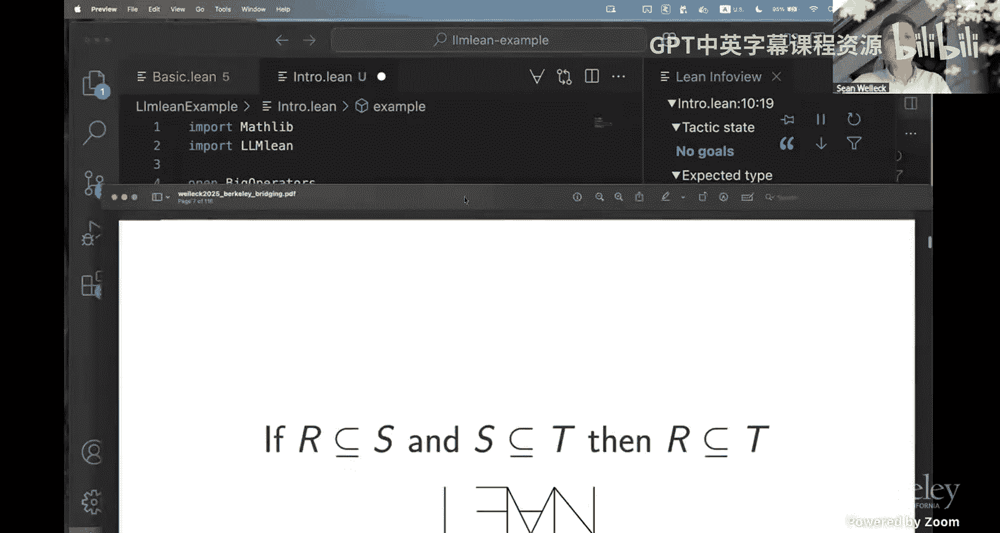

So now going back to the talk。mWe could ask like， okay， I showed you this very simple example。

 but is this is this kind of toy or is this actually useful for more complex mathematics？

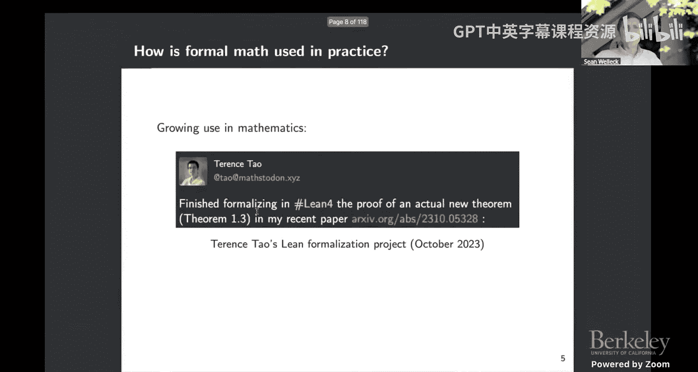

So a really exciting thing is that increasingly there's a larger and larger intersection with the mathematical community。

So here's an example of the mathematician， Terence Tao。

 and he formalized in Lean the proof of a theorem from one of his actual papers。

And a really exciting thing that's kind of playing into this is this project， which is called MathLB。

So if you noticed in the demo I gave this idea of transitivity was already kind of programmed in。

And that's the idea of Malib， so lots of people are contributing and kind of building up foundations that other people can use to make it easier to write more and more complex math。

And if you look at what mathematicians write or talk to them and listen to what they say。

 then these formal proof assistance are exciting for a few different reasons。

So one is that they can potentially enable a new form of collaboration。

So what you can do is you can break down a kind of big problem or big proof into multiple pieces。

And then anyone can go on and essentially submit code to try to solve one of the pieces to say。

 prove one of the kind of helper theorems or helper limos。

And then the cool thing is that we know for a fact that we can trust the code so Lean will automatically check it。

And so this is a lot different than the typical way of collaborating on， say。

 a math paper where you kind of have to trust the author or read through their results。

It also gives you instant feedback as we saw， so this could be useful in a variety of ways。

 including when trying to learn math。And of course， it has these guarantees on correctness。

So hopefully I've convinced you that formal math is getting more and more interesting for learning or for the actual mathematical community。

But why is it actually important for AI。Well， one thing is that as we all know。

 we are not able to automatically check or trust the outputs of AI models。

And so what the formal system gives us is some way of just preventing incorrect math。

 or it turns out you can actually use this for code as well。Increasingly。

 we see more and more models trained with reinforcement learning。

 and I'll actually talk about one of those in the talk。

And what you can think of the formal system as being is it gives you this kind of perfect reward signal of whether something is correct or not correct。

And this turns out to be very useful for then improving machine learning models further。

It also gets at one of the hot topics in the field right now， which is reasoning。

And it gives you this nice playground where you can try even very easy reasoning problems to essentially arbitrarily hard ones within the domain of math。

And so if we look at the history of language models in formal math。

One of the pioneering works happened in 2020 from these two authors from Open AI。

And they developed a system called GTF。And so it actually used the language model to kind of predict the next steps of these proofs。

And even back then， they got some pretty interesting results。

So what they did is they had the system generate a proof。

And then they submitted it as a pull request。And here are some of the comments from the kind of maintainers of the formal proof library。

Even this model back then could produce kind of shorter proofs。

And some of them were even philosophically more concise than the human written ones。

And then since then， we've seen。Rapid progress in using methods based on language models for formal theorem improving。

So here is showing the performance on a really common benchmark。

 these are based on math competition problems。And I actually made this plot a few months ago。

 but it's already out of date， actually just this morning there was a model released that gets like 80% on this benchmark。

And just to give you some flavor of what these look like， again。

 you don't have to read through the details of this or through most of the examples I showed in this talk。

But here's an actual output from a model called deepse proveer。

And it managed to produce this proof of an IMO problem。

And so hopefully it gives you some sense that the outputs of these are starting to get pretty non trivial。

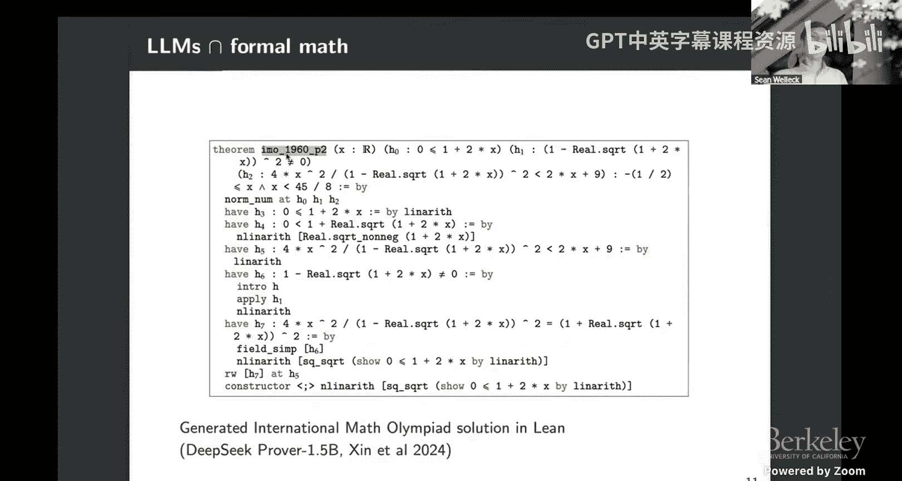

And Terrence Ta， if we go back to members of the mathematical community。

Wrote that during his formalization project， he was actually using GitHub Copilot and sometimes he was able to like infer the directions he was going on going in and things like that。

So with all this with formal math being so exciting for both mathematics and for AI。The question is。

 why don't people in AI always use formal math， what is the kind of blocker to making this happen？

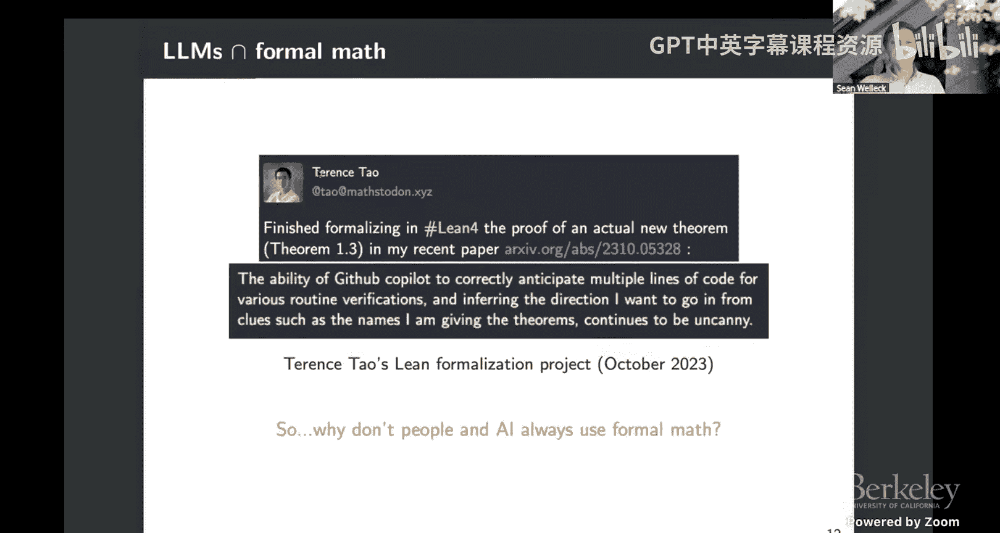

So I want to argue that the key challenge is that there's this gap between how people are familiar with doing math。

And the actual formal system。In particular， there's just so many ideas and intuitions。

 and even the way that we write proofs that are just difficult or very tedious to express in the formal system。

In a formal system like leanan， each step of reasoning needs to be explicitly spelled out in detail。

And as we saw even in that very simple example that I gave。

 you often have to have a deep knowledge of the system like what things exist in the system and how to write the code and so on。

And so the theme of this talk will be steps towards bridging the gap between informal reasoning and formal reasoning。

Can we use AI and language models to get the best of both worlds？

Maintain the flexibility of informal reasoning while having all of these benefits that I mentioned with operating in the formal system。

And so I'll talk about three different directions that we and others in the community are pursuing。

First， I'll talk about incorporating informal thoughts into the formal Theem Proing procedure。

I'll talk about training models to think informally with reinforcement learning。And in particular。

 our recent work， which is called Lean Star。Then I'll move to informal proofrs or informal proofs。

And I'll talk about how you can break down the problem of writing one of these proofs。

As first writing a sketch and then kind of filling in the lower level gaps of the sketch。

So I'll talk about our work called draft sketchtch proof。And then our recent work。

 which is actually not even released yet。Of trying to enable tools that let you fill in the gaps of these sketches in the leanan Theor prover。

And then finally， at the end of the talk， I will talk about more of a future direction that we are taking initial steps towards。

Which is how do we actually make these systems useful to mathematicians doing research level mathematics？

So in particular， I'll talk about one way in which the models could assist in these larger projects。

I'll talk about some tools that actually already exist， and you can try after the talk if you want。

And a new benchmark that tries to further progress of building these assistants for these complex research level type projects。

So with that， let me go to the first part where I will talk about integrating informal thoughts into formal The improving。

So here this will largely be based on our paper called Lean Star。

 which we'll be presenting soon at ICClLR。And here again。

 we're in the setting of the improving in lean。So here we have the theorem that I showed you before at the top。

And then as I showed you in the demo， you could think of this as a kind of interactive step by step process。

So in particular， Lene will give you this state of the proof。

And then one thing that you could do is you could send that state to a language model。

And it could try to generate the next step of the proof。Then you can provide the next step to leanan。

And it can either tell you whether the proof is done， whether there is an error， or as we saw。

 it can give you the next state of the proof。You can then continue this until you either give up or you reach a complete proof。

And so in that sense， you can see one of these proofs as being a sequence of states and next steps or they're called tactics。

So in a bit more detail， what we want to do is。Train a model on some data set of inputs and outputs。

So an example is you could have the model take in the proof state and output the next step。

And what you typically do is you extract a lot of these state and next step examples。

From some corpus of theorems and proofs。So for example。

 you could use the entire MathL project that I mentioned earlier。

 or you could even have a model generate its own theorems and generate its own proofs。

And then ultimately， you kind of turn it into a data set。Once you've trained a model。

 you then want to use it to generate full proofs。So the traditional way of doing this is through this kind of tree search procedure。

Here's an example research called Best first Search。And basically。

 the idea is you ask the model to generate multiple candidates for the next step。

Then you somehow come up with a score for each one of these candidates。

You choose the step with the highest score， so for instance， first we chose this intro H step。

Then you can expand those further。Choose the next high scoring sequence， as you can see here。

 it kind of backtracked。And then it took this green path， which led to a correct proof。

So this is just one possible strategy you could use for generating a fool proof if your model can only predict the next step。

So what we are interested in is can we go beyond just training the model？

On formal proofs and to generate formal proofs。And instead train the model to think before each step of the formal proof。

So in particular， we want to train the model to generate what's on the right。

Where before taking a step， it outputs some reasoning。

And it's kind of free to decide whatever it wants to do with the reasoning。

 it could break down the problem， it could plan out the next step。

 it could even solve some computation that isn't really present in the formal proof。

So why would you want to do this？Well， again， it could give the model some room to plan out what it is about to do。

When you think about it， it could help diversify the search space since now the model is searching for proofs。

 not just in the formal space。But in the formal space augmented with these thoughts。

And I won't go into the details here， but there's been a lot of cool work in the language model community showing that adding in these kind of chain of thought in other domains。

Can actually give a model which is more expressive in terms of the kinds of problems that can solve solve。

So we have a few good reasons to try this out。Now， the key issue here is that nowhere on the internet is there formal proofs written in Lean that have these nice thoughts written out for them。

And so what we have to do is actually design an algorithm so that a model kind of learns on its own to produce these thoughts that are useful for the proofs。

So the algorithm is called leanan Star and it adopts this name from this other work called self taught reasoner。

And the process basically has two different phases。

So the high level idea is we want to learn to generate these thoughts via reinforcement learning。

So first， we have to initialize the model so that it can produce some type of thoughts。

And then we want to train it further so that it gets better at using the thoughts to prove theorems。

So in the first step， we use this kind of clever trick。

Which is we can look at a state and the actual next step， the proof。

And then have a language model just retrospectively come up with some thought that describes the transition from the state to the next step。

So what we found is that if you don't give this stuff， then。

The language model might just output a kind of meaningless or incorrect thought。

But they were kind of good enough at coming up with some thought which described this transition。

So then we can annotate a large set of proofs。So here， for instance， we take all of Mathlo。

And we can get like hundreds of thousands of examples of state thought and next step。

Then we can use that to train a model and it doesn't necessarily have to use all 100，000 by the way。

 for this initial step。You want to just train some initial model that knows to produce these thoughts。

Prior to taking steps。Then we want to take that model and put it into this loop。

So we have the model generate full proofs。Then we ask Lean to tell us whether they are correct or not。

And then we use some type of reinforcement learning algorithm to improve the model further。

So what we need is some method to generate proofs， and we need to actually choose some algorithm to implement this with。

So what we discovered is that this。Commonly used way of using the tree searcher best for search was actually difficult to get to work when we added in these thoughts。

I think one reason is that it gets difficult to actually assign a really good score to the thought。

And so as a result， the tree kind of didn't work as well。So what we did is design a new method。

 which is this kind of simple idea of generating multiple proofs in parallel。

So for a given trajectory， you kind of generate a step。If you get an error from lean。

 you just retry on that same path。And then you keep going up to a maximum number of steps。

Or if you reach a you stop if you reach a complete proof。Then for the algorithm。

 we actually just use the simplest possible algorithm。And so we， as well as other groups。

 are now exploring more better reinforcement learning algorithms like online algorithms。

But here we did something very simple， which is you just collect the successful trajectories。

You add those to your data set。And then you train a new model on this data set of states thoughts and tactics。

So this algorithm goes by various names。It's called exp iteration， it's also called restD。

 it's also called rejection fine tuning， but the idea is very simple。

So then typically the way that these models are evaluated is on these math competition problems。

So although we train the model on MathLbe。Here's a common test data set which is used。

 which is called mini F2F。And here's an example problem from the International Meth Olympiad。

So here I've shown the informal version just to show you what the problem is like。

But then the model here only gets the formal version and has to produce a proof。

So here's some results with an early model that we tried in the project。So in red。

 you can see the model that we started with。And then in black。

 you could see the model after we performed this initialization step。Then in gray。

 we can see the model after we perform the exp iteration。

And you can see that the lean star process basically took it from being worse than this baseline model。

 which was based on this G4 agent。To being better than it。Then at the end of the project。

 we applied Leanstar to the best available base model at the time。Fourth thing improving。And again。

 we saw these improvements going from gray to black。And at the time that we did this。

 this was the kind of state of the art or this mini F2F data set。

One really interesting thing is that we found that。

Models with the thoughts benefit more from scaling up the search budget or the kind of inference budget。

So here we're seeing as we sample more and more steps。

 either with our sampling method or as a baseline with the best research。How the performance looks。

And you can see that the gains we get from the green line， which is lean Star with the thoughts。

Are more pronounced than the model that doesn't have the thoughts。

And so this might be indicating the idea that I mentioned before that adding in these thoughts helps to kind of diversify the search space。

Here's some examples and again you don't have to read through the details， but if you're curious。

 you can take a look at the paper after。One interesting thing here is that if you look at the formal code。

 there's actually some steps of reasoning that the model is doing in the informal thought shown in gray that aren't really present in the formal code。

And here's a longer example， partly because it looks impressive。

 but also to just show you that when you add in these informal thoughts with the formal ones。

 the output starts to get yeah， fairly nontrivial。So after Ele Star。

 the really exciting thing is that this idea of augmenting models or reasoning models with thoughts。

And training them with reinforcement learning。Has been adopted in the Theem improvement community。

So in particular， very rapidly， this idea of incorporating thoughts。

Became a part of the state of the art systems。So here's the example that I mentioned before called Deepse provever。

 where they incorporate in the informal thoughts。And then as I mentioned just this morning。

 there was this state of the art proveer released。By this startup。

And you can see that they have this idea of kind of alternating between informal reasoning and snippets of code。

And then more broadly， these reasoning models that generate long chains of thought。

And our trained with reinforcement learning have really begun to revolutionize the LLM reasoning。So。

I'm not going to go into the details here， but you have probably heard of these models like Open AI01 and Deepseq R1。

 and so it seems like at least currently having this kind of informal thinking is a really key part of the reasoning procedure。

So to recap， Lean Star kind of builds on this observation that training only on the formal code may be insufficient to learn the actual thought process that's needed to produce the code。

And it gives a kind of simple algorithm for learning to generate the thoughts。

Now I'll move from informal thoughts to informal approvers and informal proofs。And in particular。

 we talk about methods that prove theorems by kind of producing this high level sketch and then filling in the gaps of the sketch。

So here the motivation is to combine the benefits of kind of higher level reasoning and lower level reasoning。

And one motivation for this is to think about like。

 how do we actually write one of these formal proofs in the formal proof assistant。

 sorry informal proofs in the formal proof assistant。So again。

 you don't have to worry too much about the details of this。

But here we're trying to prove the statement on the left。

And what is notable here is that we can somewhat break this informal proof up into these three different parts。

Then it turns out that we can write this in the formal system using something that is structured kind of analogously to the informal proof。

So this is a system called Isabel， and it has this style where you can write these kind of intermediate claims or conjectures。

And if you look at it， they somewhat line up with the different steps。

 like here you have 10 times 2 80 divided by 40， which shows up here。

And then this is a way of basically writing， okay， let's complete the proof。Now。

 the interesting thing here is that you still need to produce a proof one of each one of these kind of higher level steps。

 so that is shown in green。And so you can see here that to actually come up with that proof。

 it doesn't really look like natural language at all。

 here it's actually calling this S&T solver and feeding it some facts。So interestingly。

 we have this kind of decomposition between high level and these kind of lower level things。

So let me actually say a bit more about how you produce these lower level proofs in a system like Isabel。

So it turns out that there are these very powerful and very useful automation tools called hammers or this one is called sledgehammer。

And the basic idea is that as you're writing a proof as a human。

 you could write one of these conjectures and then you could call the sledgehammer。

What it does under the covers is it calls out to external automated provers。

Ones that are based on first order logic or higher order logic or S&T solvers。

And these turn out to be extremely effective when you're using the system。For kind of， yeah。

 filling in these little gaps of the proof。What these are not good at is let's say you want to solve an IMO problem。

Then the sledgehammer methods just won't succeed。The technical reason is that based on how they're set up。

 there is just such a large search space of possible proofs。And in particular。

 if you think about this proof as being structured as like these have statements。

They don't really have the functionality to produce statements like that。So in practice。

 these are used kind of interactively as your' writing proof as a human。

So here the idea is we want to combine some kind of high level prover with a lower level prover like the sledgehammer。

And this leads to our method， which is called draft sketchtch Pro。

 which we presented in EyeCLA in 2023 and developed and released in late 2022。

So here the idea is to come up with this kind of three step procedure。First。

 we're going to draft an informal proof。Then we're going to translate it into this formal sketch。

And then we're going to use a low level prover to fill in the gaps of the sketch。

So to show you this in more detail， let's walk through each one of these。So first。

 we start off with an informal theorem and a formal theorem statement。

It's actually really important to provide the system with the formal theorem statement。

Because when we start to translate things， we want to make sure that the model's not cheating and intellectual' actuallyly。

Proving the thing that we wanted to prove。Then in the first step， we have。The system。

 so it could be a human or it could be an LLM， generate some informal proof。Then in the next step。

 we have an LLM translate the informal proof into what's called a formal sketch。

It's essentially what I showed you before， except now we leave these gaps to be filled。

 which are the lower level proofs。Then in the final stage。

 we tried to close the gap with a lower level prover。

Here we are actually using the sledgehammer tool that I told you about。

And if you're able to close all of the gaps。Then you're guaranteed to have a complete proof。

The interesting thing is that this actually looks a lot different than what I was shown you before。

 where we have this kind of step by step proof search。 and maybe it's like a tree search。

Now what we can do is we can diversify the search space by just generating many possible informal proofs or drafts。

And or generate many potential translations of those into formal sketches。

And then we can just try to fill in the gaps and if the gaps are filled in any of the sketches。

 then we have a formal proof that we could consider as the output of the system。

So here's showing what happens as we scale up the number of calls to the pipeline。

So here we're either generating many informal proof drafts。

Or in the case of using a human written informal proof。

 we're generating many possible translations into the formal sketch。

You could see on the left hand side that if we just call the system once， then it actually， I mean。

 it proves some things， but it's not very good。And we really see the benefits as we scale up the amount of pre or sampling。

And up here we're proving a large number of problems， this is on the same mini FTF data set。

Now this was in the days of Codex and Minerva， if you remember those models。And interestingly， here。

 if you look on the very right hand side。If we actually sampled enough from the model。

 then we were able to right at the end， surpass the performance of using a human written proof。

And so this was kind of exciting and probably now that language models are much better。

 we would be able to make that transition even earlier。

So here's an example of proving an international Meth Olympia problem。

So here the language model produces the informal proof shown in green。

Then the language model produces the formal sketch shown in blue。

You can see that here we actually back then even had these informal kind of thoughts in as comments。

Or here it's showing the informal version of the step。

And then we have the sshammer system fill in the gaps shown in purple。

And you can see that sometimes it's pretty non trivialvi， like here again。

 it's calling this S&T solver and feeding in a bunch of different facts or premises。

So since then I've put together a tutorial for Theorem improving。

 so it goes over the kind of step by step methods that I mentioned in the first part and also has a notebook that shows you how to implement this draft sketch proof method。

And in particular， it just calls out to a language model API so you can try it out with one of the any state of the art model that you want to if you're curious to learn more。

So to recap， I talked about this method called Drketch Pro。

 which generates these high level sketches and then tries to fill in the gaps。

And what this relied on is in this language， Isabel。

 having this lower level prover called sledgehammer。

So next I'm going to talk about our very recent work。

On trying to build one of these sledgehammer provers for lean so that we could more easily write these kind of sketch based proofs in lean。

So this is based on a paper that is still not public。

 which is called premisem selection for a lean hammermer。

 where we build a system called leanan hammermer。So what is a hammer？So a hammer integrates。

 as I mentioned， these external proves。And there's a bit of terminology here that。

Is a bit tricky if you haven't seen this distinction before。Specifically。

 what it does is it integrates an automated theorem improver into an interactive theor improver。

So an interactive theor improver is like the one I showed you like leanan。

And essentially it's a programming language that is able to check the proofs。However。

 the language on its own doesn't give you a way of automatically producing the proofs。

 You usually have to write them as a human。An automated theor improver is something that tries to automatically find proofs。

And traditionally， these are based on different kinds of logics。

So they might be based on higher order logic provers or things like S&T solvers。

And so as I mentioned before， these automated theorem improvers really struggle with more complex proofs due to this large search base in their kind of formalism。

So what we can do to try to help with this problem is to solve this really important problem。

 which is called premise selection。So basically， what you do is you provide the automated theor improver with many different facts。

So you can provide it with definitions， different theorems， different lemmos。

And then it goes off and tries to prove the theorem that you want。

And if we look at the number of premises in say， Lean's maththlib， then it's extremely large。

 so it's you know hundreds of thousands of premises。

And so if you just give all of those to the automated theorem prover。

 it will really struggle because。It has this really large search base。

So the basic idea of premise selection is to somehow cut down the number of premises that we give。

And only provide ones that are likely to be useful for proving the theorem。

So then we can look at what is the typical hammer pipeline。So here it is at a kind of high level。

Let's say we're in lean， then we start off with the thing we want to prove on the left。

Then we would pass it to some kind of premise selection system。Now。

 once we've selected premises like definitions and theorems。

We have to translate it from lean into the language of the automated theorem Pror。

Let's say that the automated theorem prover finds a complete proof。Well。

 then we have to actually translate it back into a lean proof。

And so the way that that's done is through this step， which is called proof reconstruction。

So it basically takes the output。And tries to produce a proof in lean。Then as our output。

 we would see this nice proof on the left on the right， sorry。So。Amazingly。

 there's been a lot of really cool work in the community。On these different parts。

Usually they're developed somewhat independently of each other。

But we have this translation layer called leanan Auto。

That can translate that can help translate from Lean's dependent type theory。

Into the higher order logic。An example automated Theor Pror is called zipper position。

And then for this proof reconstruction， this was developed by Josh Cln and collaborators who's part of this leanan hammer project。

 and there's a system called Duper。So what we're interested in here is two different things。First。

 we want to try to solve this premise selection problem。And then second。

 we have to come up with some way of actually combining these together。 When I show it on the slide。

 it looks kind of simple to put them together， but it's actually not clear what the best way to do this is。

And。Even more， we want to kind of go beyond the standard pipeline， which I'll talk about in a bit。

So first， let me talk about the premise selection。What we do is to frame this as retrieval with a neural language model。

So in particular， we have a kind of standard retrieval setup。Here we embed our input。

 so this will be the goal that we want to prove。And we have a language model that produces this embedding shown on the right。

Then we embed all of our potential premises， so this will include theorems， definitions， lemmas。

And they could be for MathLb。They could also be local premises in your project or in the hypotheses that you're going to prove。

And with that， we get this list of embeddings shown on the right。Then to select the premises。

 we take the dot product， use cosine similarity。To select the set of highest ranked premises。

So here we train with this contrastive loss that is often used to train retrieval models。

So it boils down to collecting these inputs， the states。

As well as some positive premises and negative premises。

And it turns out that there's actually a lot of nuance in how to do this properly。

 especially when the output is going to be this sorry when the interface is with this lean auto system in the hammer pipeline。

So I won't go into all the details here and when we release the paper， it will have all the details。

But even things like how and whether you simplify terms。

How exactly you choose these positive premisess and negative premises turn out to have a large impact on behavior on the behavior of the retriever。

 and so we'll show in the results in a second that based on some previous retrievers that were trained our system that we trained does a lot better when we put it into this camera pipeline。

So then the question is， how do we combine all of these different pieces？

And so what we did is not just have this kind of linear picture that I showed on the previous slide。

But we actually incorporate these components into a tree search。

So there's a really cool research method and it's this kind of symbolic research called ASO。And yeah。

 it does this research search over different tactics or steps of the proof。

And so what we do is kind of wire it up so that it can use the selected premises to call different tactics in lean。

And it can at any time query this automated Theor prover using the selected premises。

And so this step will involve the translation that I mentioned， as well as the proof reconstruction。

So now with all of these different parts that I've described， you could say。

 how is this actually useful as a user？Well， it turns out that we can wrap this all into one kind of simple command。

So at any step of a proof。You can just call this hammer tactic。

And then it'll run this research that I mentioned， you know， call the external prover and all that。

And then if it succeeds， it will display the proof to you on the right。

And what's cool about this is you could potentially enable this kind of sketch based proving that I was talking about before。

So here I want to show an actual demo of the system where we took a human written proof sketch from this textbook。

 Mathematics and leanan。And we want to try to fill in the gaps with the hammer system。

So this theorem is the irrationality of the square root of two。And yeah。

 sometimes in the formal system， you'll write it in a slightly different way。

 but yeah the details are not too important for the demo。

 but you can kind of read through after if you want。

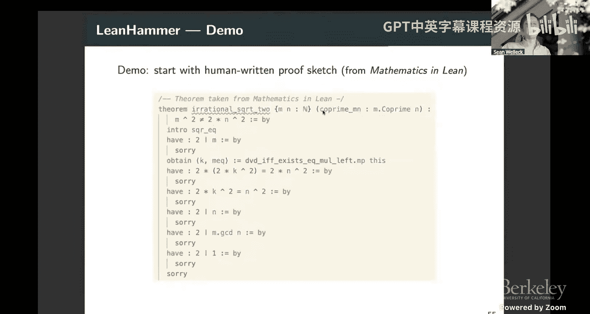

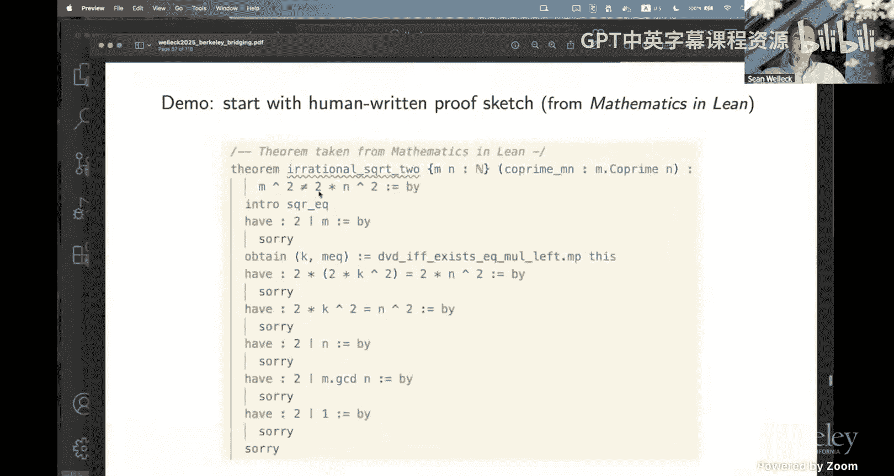

So here we'll go back into VS code。

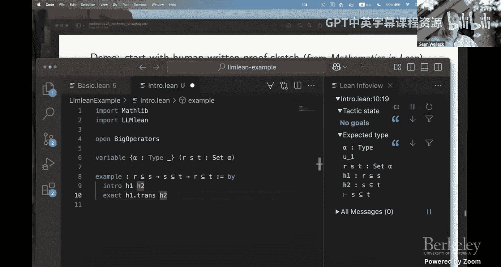

And here is， first of all， the simple theorem that I showed you before。

And so what we can do is we can call this hammer。And the first time you run it should take a few seconds。

And so what it's done is it's selected the premises and called the research and all that。

And now you can see that it came back with this proof， this theorem orlemma。

So this one just says that if t divides m squared， then2 will divide M。

So it turns out that this one will actually be useful in this irrationality proof below。

So now we can go step by step and try to fill in the gaps with the hammer。So here it got this one。

And we can just keep going。And interestingly， up here。

 it actually used the lemma that we just proved so you can see to divide。Of two divide square。

And so here it succeeded again。And I'll just keep going for fun。

So the idea here is that by doing this， you don't necessarily have to worry about these different details。

So here's a kind of interesting one where it's actually calling the automated Theorem improver。

So you can see all of the different facts that are being passed to it。And here we could see the call。

The actual call to Duper， so Duper was this like proof reconstruction method that I've mentioned before。

So if you want， you could treat this as the proof or you can just leave this one in there。

For this step， you actually turns out you have to do this one step of clearing out this hypothesis。

But then you can call it the hammer。And just for fun。

 I'll finish off this proof just to show you that it's。That it's possible。Okay。

 and then here's the last step and we can call the hammer。Okay。

 so now we have a complete proof of the theorem and we started off with these kind of high level steps and we're able to。

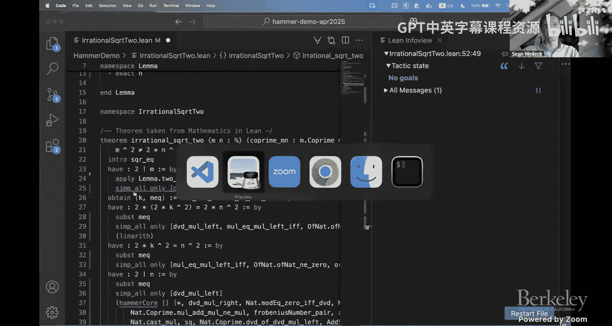

Kind of fill in the gaps。So again， here's the kind of summary。

And then what we could do is evaluate this with different premise selectors swapped in。

So here's some results on theorems that we held out from MathLB。As was a kind of test side。

And we just run the hammer at the first step of the proof。So on the left here。

 you can see what happens if you don't have the premise selection。

Then here is using a retriever that was from prior work。

What we did is we retrained it on the exact same snapshot of MathL。So it had kind of up to date data。

And it's partially showing that like the specific decisions that we make in training our retriever were really important for performance。

Interestingly， there's a symbolic premise selection system。

I believe it's based on the one that was in the Isabel sledgehammer。

So Kim Morrison from the Lean community reimplemented it in leanan。

 and you can see that it actually does pretty decently when it's in our hammer pipeline。

Here is the lean hammer retriever as the fourth bar with the kind of diagonal lines。

And then interestingly， it ends up being complementary to the symbolic mepot retriever。

 so you can see with these kind of crossha lines， you get a performance boost if you just take the union of premises。

And then in absolute terms， it's starting to get pretty good。

 so all the way on the right is the performance that we get if we just use the ground truth premises that occur in the human proof。

And you can see that the performance is starting to approach the performance that we get if we use those。

So to recap， I talked about two different approaches for combining informal and formal grs or even informal proofs。

I talked about draft sketch proof， which involves drafting an informal proof。

 generating a formal sketch， and then filling in the low level details。

And I talked about leanan hammermer， which is trying to bring this kind of paradigm to lean or make it easier。

So in particular， we try to build this hammer and it involves this neural premise selection and a tree search and calling out to that automated theor improver。

And one interesting takeaway from this is I didn't go into detail of the model that we trained。

But the largest model that we trained was just a 100 million parameter retriever。 so very small。

And as you may saw in the demo， you can get some pretty nontrivi behavior or performance from integrating it in。

So it's kind of exciting because， yeah， in these cases。

 even these fairly small by today's standards neural networks can be fairly powerful。

So in the last part of the talk， I want to talk about trying to use AI or techniques that I've talked about to actually assist in research level mathematics。

So not just prove the IMO problems， but try to help out in these more complex projects that mathematicians or if you're a kind of like lean hobbyist or interested in formalizing something difficult。

So what does it actually look like to formalize research level math？Well。

 here we can look at this blog post that was written by Terence Howe。

And he kind of breaks down the steps that were involved in formalizing a proof from this paper。

 which is shown on the left。So again， the goal was to take one of the main theorems from the paper and then try to write it and lean and come up with a formal proof。

And the first step is to write what is called a blueprint。

So here you kind of go step by step and think about how would this proof decompose into different definitions。

 into different lemmas。And ultimately， we can come up with the kind of final theorem and proof that we care about。

And as you can see here on the top， it's showing a kind of dependency graph of all of these theorems and all of these definitions。

So it gets fairly complex and at the very bottom you have the final theorem and final proof。

And so interestingly here， everything is still written in informal language。

 so you can see here the theorem and the proof just written in lateek。

And then you try to think about， okay， how do we actually。Realize this in lean。

And so what it comes down to is a large set of these formal definitions and formal lemmas and formal theorems。

And then ultimately， you're able to kind of state your final theorem and write the proof of it。

So at the end， you have this proof in this theorem that are really dependent on this kind of graph of things that I showed you。

So a question is like。At what point of this procedure could AI help？So maybe at least for now。

 we don't have it do this whole pipeline end to end。

But we could think about like what is the simplest thing that we could have it do and that we could have a kind of trust。

So one thing you could do is you could look at this blueprint and look at just one of these kind of theorems or lemos that is。

Kind of necessary for the proof， but is just one part of it。

So here's an example where we have thislemma， which occurs somewhere in here。

And if we give this to a language model and it produces a proof。Then again。

 we can kind of trust the output because lean has checked it。

 and in some sense it's helped the development because then the human proof writer doesn't have to kind of go through this step。

So in order to do this， we really have to overcome at least two different gaps。That that occur。

The first I'll call the accessibility gap。And this is just the kind of simple observation that a lot of times these methods are developed。

But then they're actually hard to integrate into actual tools。So for example。

 the system might be very capable， but it might not be open source。

Or the results might be very impressive， but then they're actually very expensive or costly to run。

And so when you think about this kind of practical setting。

 it adds constraints onto the methods that you have to develop。But luckily。

 we actually do have some tools already available that could potentially be useful for these kind of simple gaps。

So we developed one of them called LOM Lean。And you could go download it and use it right now if you want。

And so the basic idea is to just create this interface between lean and some language model。

So what it does is it gives you these different commands or tactics。

Like this one queries a language model to try to produce the next step of the proof。

And then we can actually check the outputs of the model so we could discard the incorrect ones and just display ones that。

Kind of finish the proof， those are shown in green。

Or blue ones are ones that kind of don't give an error， but don't necessarily finish the proof。

And in particular， you can even nowadays have a model running on your laptop。

 so there's these different libraries that have been developed like O Laama or LLM Studio。

 and you could basically host the language model on your laptop and then use LLM leanan to communicate with it。

Similarly， you can have it communicate with some API。So it could be open AI， it could be Clade。

 Gemini together。AI。And so now you can actually try to use these models to give you suggestions that are checked and lean。

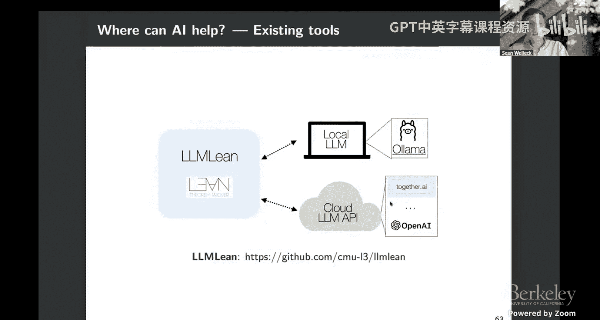

So as the last demo， I wanted to just show you those。

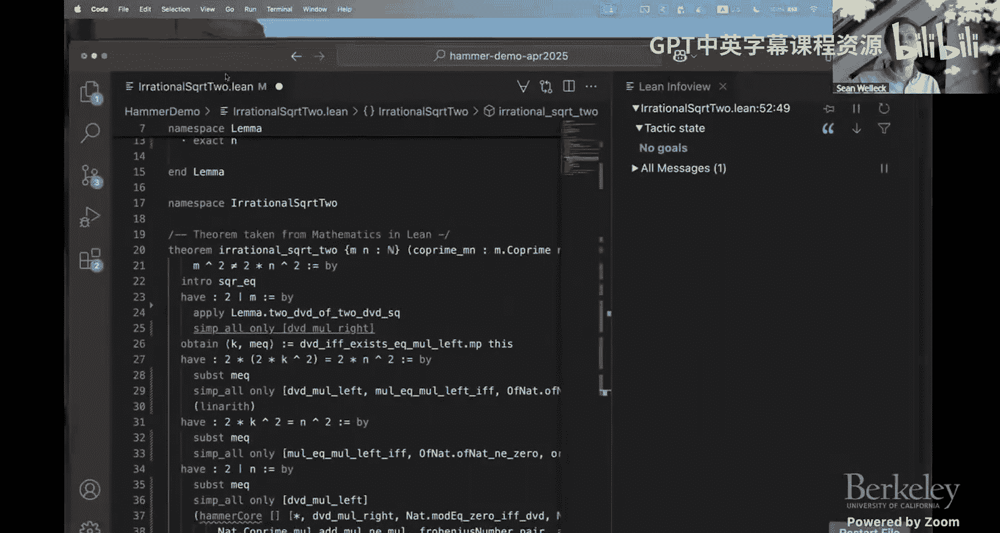

And so let's。Look for the other window。

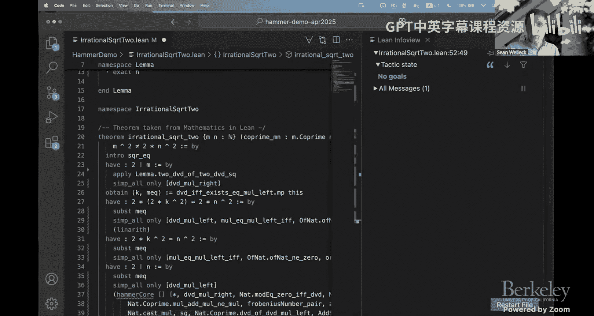

Okay， so let's go back to this really simple theorem that I showed at the beginning of the talk。

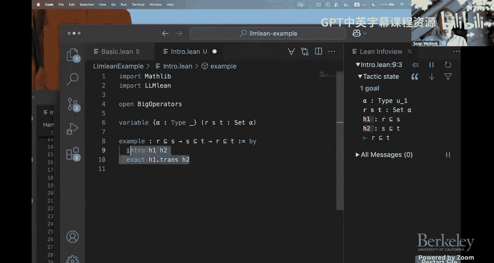

And you probably you might have noticed that I imported this LM lean here。

And so now we could call this LLM step command that I showed。

And actually comes up with this intro command that I showed you at the beginning of the talk。

Then we could call it again。And in this case， yeah， it was able to finish the proof。嗯。

So another thing you can do is you can。You could say， like， try to。Just do this exact command。

 so try to prove it in one step。It actually came up with us。A bit more clever kind of one step proof。

There's another command that just tries to prove it。In end to end。

 like fully prove it instead of just predicting the next step。嗯。So here the model comes up with。

 yeah， multiple potential proofs。And you can see they're a bit different style， maybe a bit longer。

So you can also do other like fun things like。Shorten this proof。And put it as a。他们嗯那。call it lq do。

So let's see what it does and yeah， so now it gives us some options that are shorter。

 actually this is pretty short。You could just prove it in kind of one call。So yeah。

 this is a tool that you could use today you just need to you know have a language model API and then yeah you can import it into a lean project。

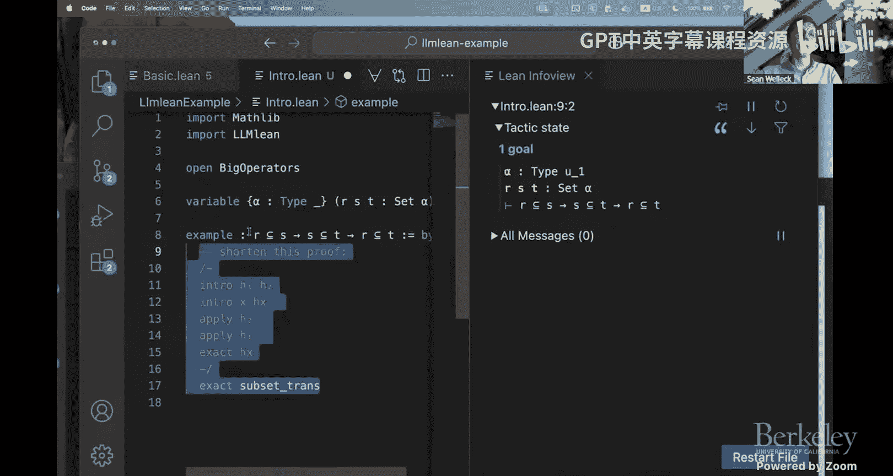

嗯。

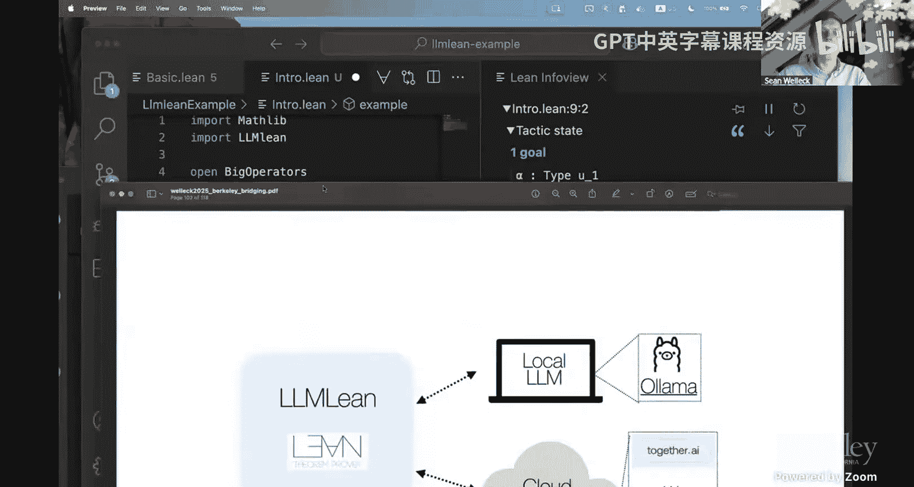

So interestingly。Let's see here。😔，The methods are still bottlenecked。

 obviously by how good the model is at proving theorems。

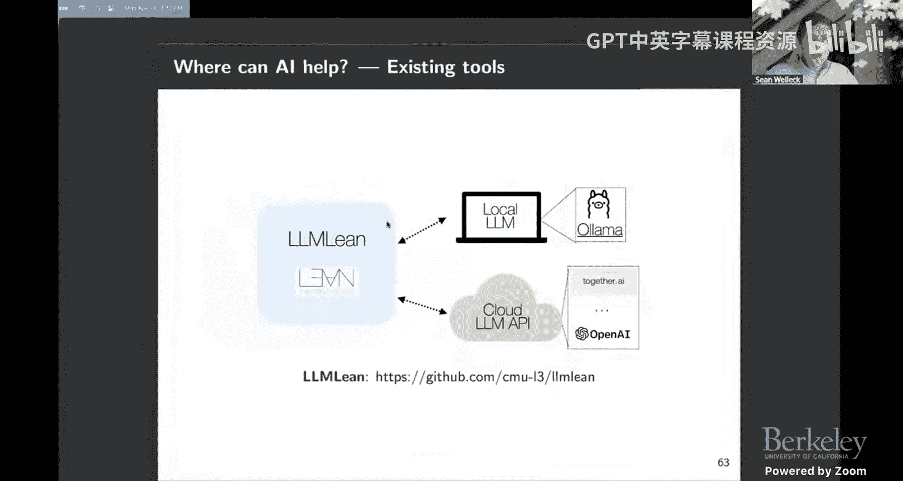

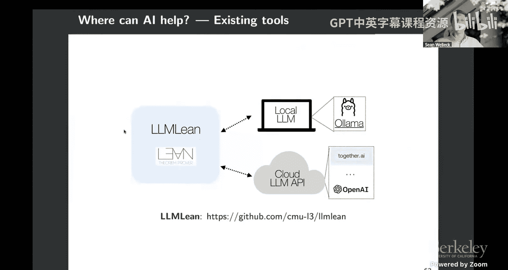

Um but like even now， I kind of went through Ternce Tas project。

 this PFR project and just picked a file。And yeah， this one was actually able to fill in some of these。

 yeah， small lemmas， this was actually the example that I showed you before on the previous slide。

So another thing is I mentioned that the models right now。Are the kind of bottleneck， right。

 we have the interface set up。 And so now it just comes down to whether the model can complete theorems that occur in these kind of kinds of projects。

So this leads to a second kind of gap， which is the gap in the way that we benchmark these steer improving models。

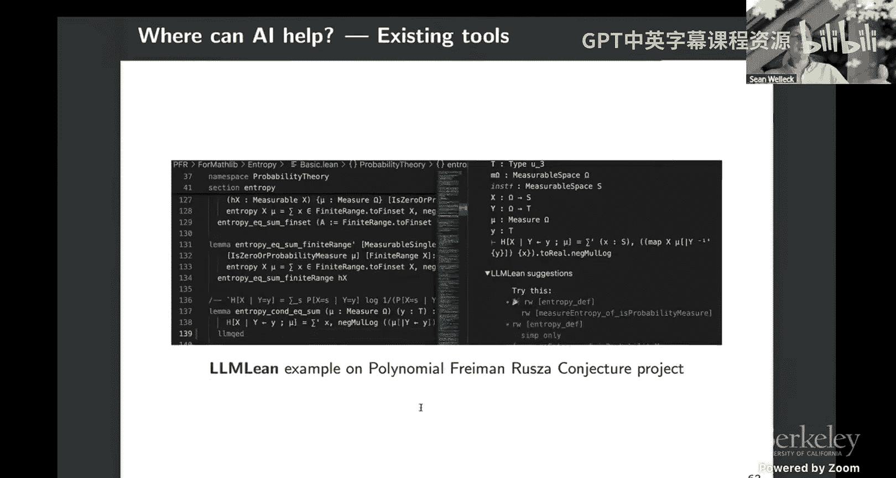

So largely these models are benchmarked on their ability to prove these math competition problems like ones from the IMO。

And what these problems have is they're fairly self contained。

So you can usually state the problem in just like one line of code。

And then they're kind of designed to somewhat use standard results。

So there's a kind of standard set and you know， a lot of them have been implemented in Mathlib and then constructing the proof is very difficult。

 it requires a lot of creativity， but it's kind of relying on these standard results。

If we compare that to this project that I've been telling you about。

These have these complex dependencies from throughout the project。So in particular。

 this theorem to even state it or to prove it。It might actually rely on these brand new definitions and brand new lemmas that have been created for the project。

And so unless we like continually train the model on all of the current projects。

It really has to learn to prove theorems in this kind of context dependent setting that I'm showing on the right。

So this leads to our new benchmark called Min CTX or Mini context。

And we'll also be presenting this at ICear as an oral presentation。

So here what we do is we made this observation that I just told you about。

That when we look at these real these kind of research level or actual formalizations that people do in lean。

They are really in this context， dependent setting。Where you want to prove a theorem。

 and it depends on， like a whole repository of code， new definitions or new auxiliary limos。

So the idea of the benchmark is to test models on actual real lean projects。So in particular。

 we choose some date cutoff。And then we look at a project like Mathlibb。

 and we can take all of the theorems that were developed after that date。Similarly。

 we can look at when a project was created and take theorems and kind of contexts from those different projects。

So this PFR project by Terrencetown and collaborators that I've been telling you about is like one of the projects that was in the first version of this benchmark。

Then the idea is we also make tools so that you can automatically extract benchmark problems from these projects。

So what you can do is update the benchmark to kind of stay ahead of the training cutoffs for these language models。

So we've actually already released a mini CTX version two。

 and it has kind of more recent lean projects that have been developed like in the past couple of months。

So here we have two different types of contexts。And these are basically like what dependencies are needed to prove e theorem。

And what we do is we build tooling to automatically extract things like dependencies。

And so and we can look at like， does a theorem depend on things just in the current file or does it depend on things across multiple files？

And then we can also get things like， you know， what are the set of available premises when you're going to prove this theorem？

So kind of very realistic setting。So in particular， let's look at two different settings。

One setting is where all of the dependencies just appear in the current file。

And then the other is when the dependencies can span multiple files。

So the first thing we want to do is actually demonstrate that this context actually matters。So again。

 I've told you about this really common way of training theorem improvers。

 which is by just giving them the proof state and then having them produce a next step or having them kind of produce thoughts if you want。

So here what we did is develop this simple baseline method which additionally gives the model all of the code in the file so far。

So this can include like new definitions， newlemmas。

 even like new notation or natural language comments。

And we want to see how this compared to just taking in the proof state。So interestingly。

 if you look at a competition problem data set like mini F2F。It actually really doesn't matter。

 You can do pretty similarly whether you take in additional context。

 It would just be like the import statements for many F to F。Or if you just take the proof state。

So this might be one reason why a lot of these state of the art the improving methods don't really deal with or support any kind of external context。

However， when we evaluate them on our benchmark mini CTX。

 which has the theorem some real world projects。We can see this dramatic gap in the performance。

And the reason it pretty obvious if you just look at a lean file。

 it's because in these real projects， youre defining these kind of new definitions and new dilemmas like I discussed。

Interestingly， you can also do this premise selection and kind of give the language model the premises。

And you can see variations on based on whether the theorem requires just in file information or auto file information。

So all the way on the left， we have theorems with very low dependencies。

The first set of bar graphs shows high dependencies on in file premises。

And so here you could see that you do pretty well by just。

Giving the language model of the code in the current file。And then in the third set of bar graphs。

 you see what happens when we have these cross file dependencies。

And you can see that adding in this premise selection leads to some improvement。

So here we are using an older premise selector system。

 so we're excited about like integrating our lean hammer into this for addressing the cross file dependencies。

And in general， there's a kind of wide space of methods that could be developed for the setting。

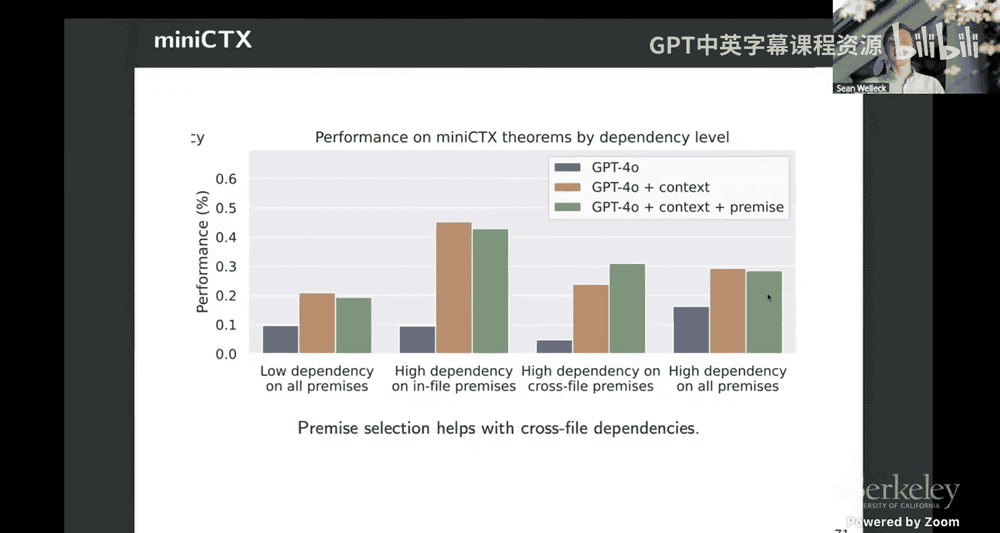

So I should also mention that we provide the model with this file tuning。

 so it's trained to take in the file context。Through Oama， so you can download it。

 run it on your laptop， and use it inside of lean。And then all of the methods that are in LLM lean that are calling the proprietary language models or the API based ones。

They'll actually prompt the model with all of the code in the current file。

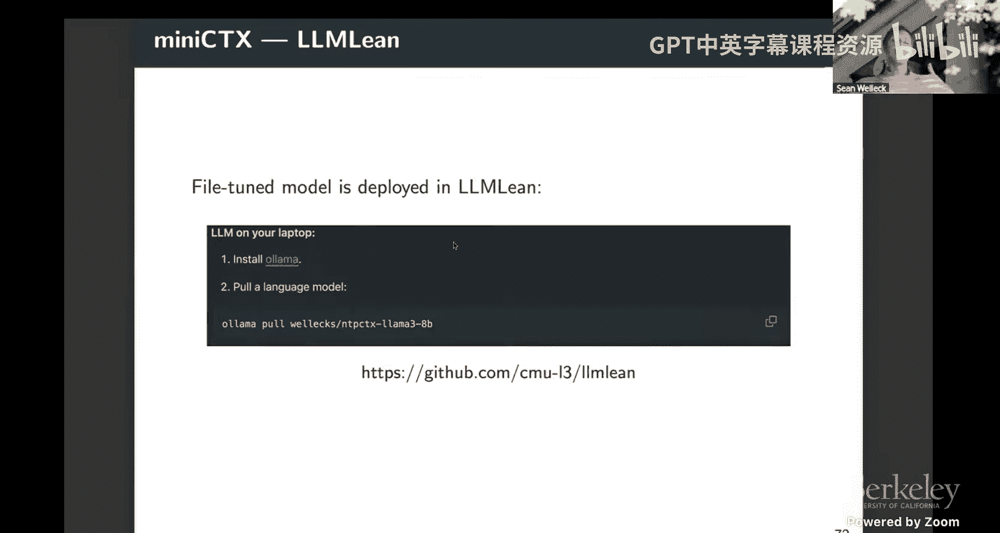

And then as I mentioned， everything from the project is open source， so the data， the models。

 our data extraction tool and even the evaluation code， which is like a wrapper of the lean repple。

And so you can check out those resources online。So as I mentioned in the third part。

 if we look at these kind of real lean projects or what do it take to formalize research level math？

It opens up some unique challenges。These aren't the only challenges of course。

 but two that are really present in the kind of research community right now。

One is that we still have a gap between the AI advances and tools that people can use。

And then second， the benchmarks don't always reflect all of the capabilities that are required to do this real world formalization。

And so this is very much an open research direction， and as I mentioned。

 this benchmark is kind of the first step。So in summary in this talk。

 I talked about three different ways to try to bridge informal informal mathematical reasoning。

I talked about incorporating informal thoughts by training models to think informally。

I talked about incorporating informal proofs or informal proofs。

Through methods that sketch proofs and try to fill in the gaps。And then towards the end。

 I talked about trying to take say， a research paper and look at what is involved in producing a formal version of it。

And looking at what are some initial ways where AI can help in the process。And so with that。

 that is all I have for today's talk。And I'd like to thank all of the amazing collaborators on these various works they're listed here。

And again， my name is Sean and I have my email address here， so please feel free to reach out。

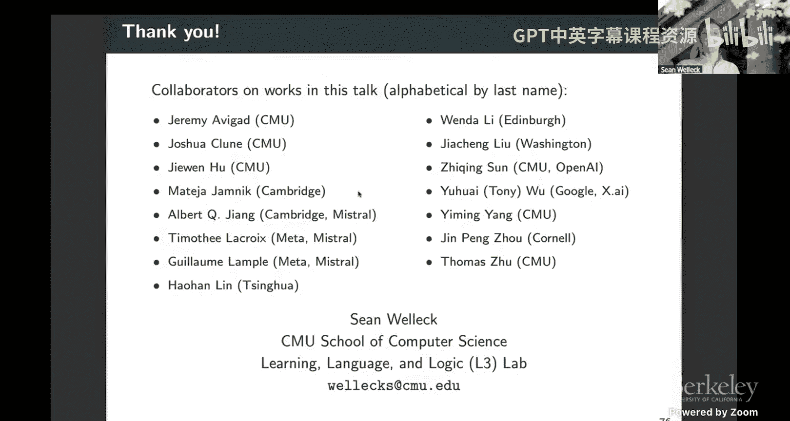