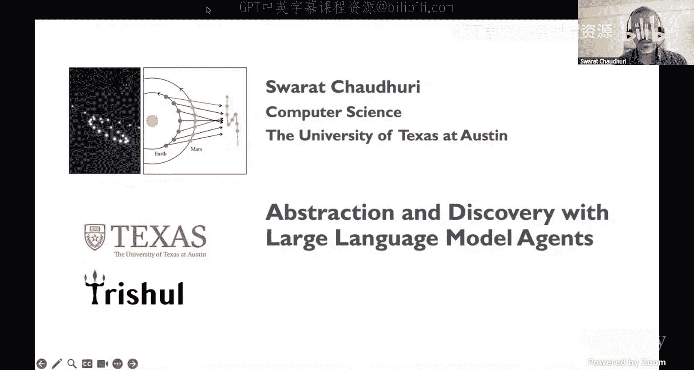
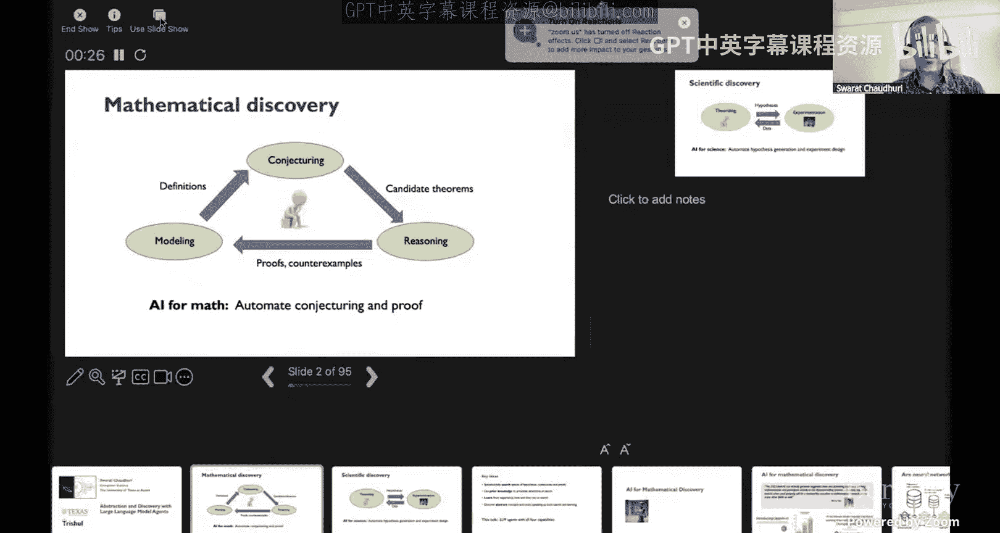
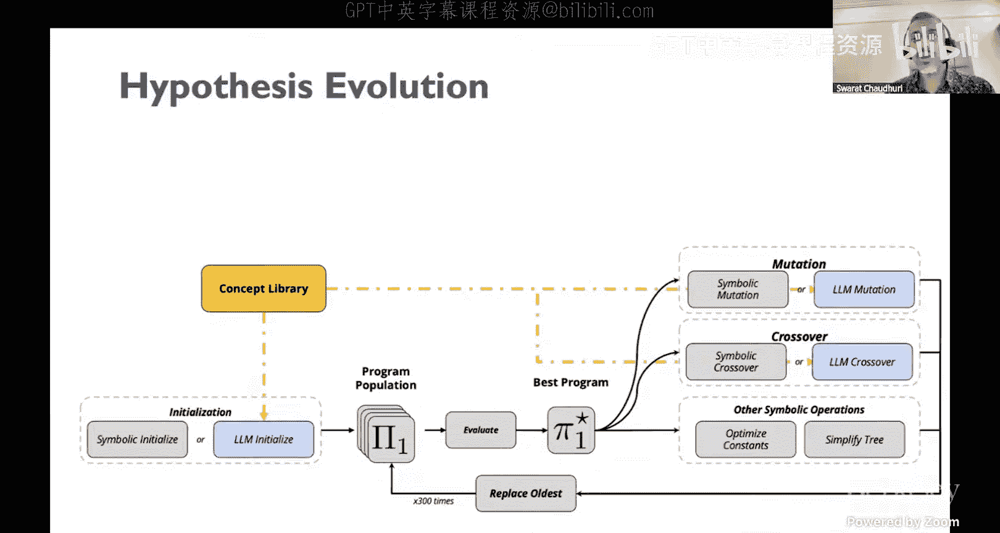
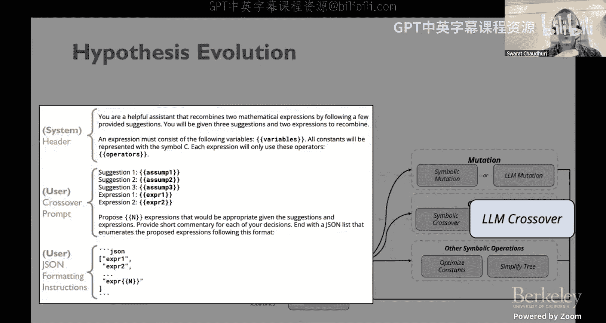
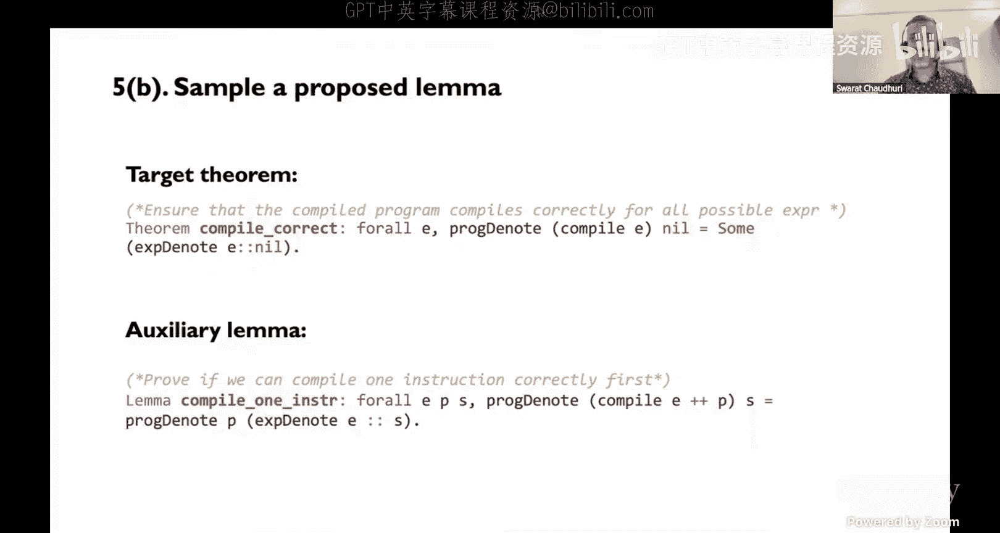
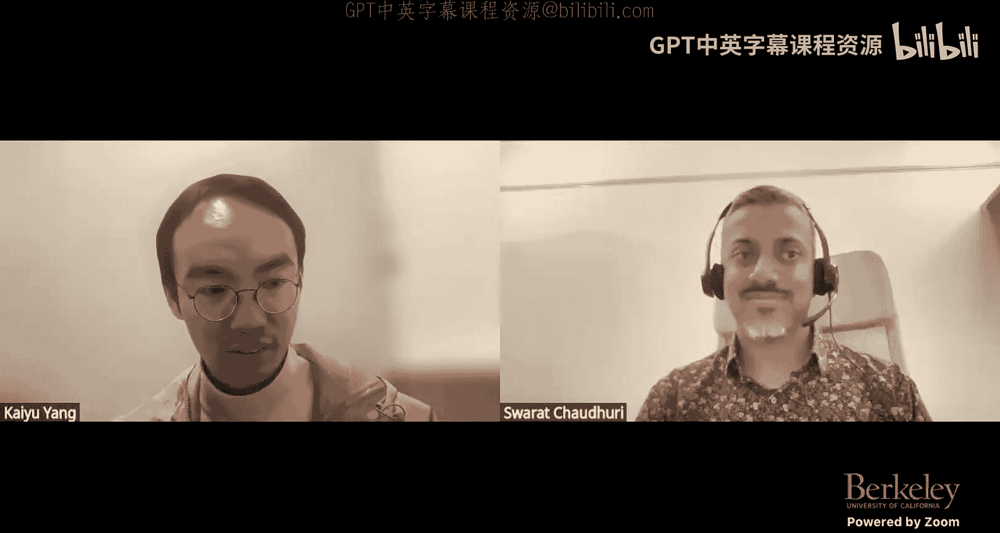
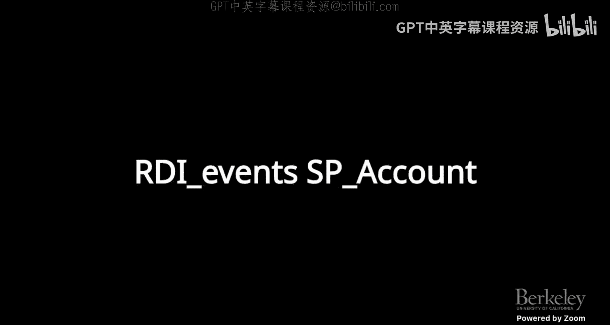

# UCB《高级大语言模型智能体｜CS 194 294-280 (Advanced LLM Agents) 2025》中英字幕 - P11：Lecture 11, Swarat Chaudhuri.zh_en - GPT中英字幕课程资源 - BV1mkZiYAEYM

Try sharing your slides。

Yes， let's like okay。Okay， let's see now。

Okay， do you see this， I see your speaker notes if you're okay with that。

想啊。Oh， okay， thanks。想。Oh， okay， thanks， good， cool。I see。

 But this way I don't get to see the speaker notes， which I guess is okay， but。

Isn't there a way I thought there was a way of。For me to see the speaker notes。

 the presenter view and for you to see the actual screen。I figured this out during the pandemic。

 but I don't remember how to do it anymore。Yeah， so I go on Tara or you go Alex， yeah。

Do you have like a in your Googles or。PowerPoint， is there a button that says like。Presenter view。

Yeah， that's what I used to get to the previous screen。Oh， okay。

 and then so when you have presenter view on。U maybe like stop sharing your screen。

Do you see two like pains of both like。Your actual slides。 And then the。Like。

 do you see both your slides and the speaker notes？Yeah， that's what I say in the present interview。

 That's right。 Okay， so now you have your two screens， I it when you go to share a screen。

 I it possible to just like select your。呃。Slides instead of the speaker notes。Okay， I see。

 So you're saying that I go to。So I first go to PowerPoint and。Do what sorry？

Um go to presenter view so you should now see like two windows。

 one with your speaker notes and one with the slides correct yeah。And then on Zoom， click。

 share and only share your。Window that corresponds to the slides。I see， so that's not it right， yeah。

 not that one。Okay， I think this is too complicated， perhaps let's just。

Yeah， I'll just use the slideshow view Okay， yeah， that works。Okay， so how does this work？Oh， okay。

 so。I think。Xinyan will come on hopefully and Kayu will come on Oh is kyu today okay。

Okay Kayu will come on and introduce you at 10，10 or like basically in 10 seven minutes and。

You feel free to just go for as long as you want， you'll have until you have two hours basically。

 but usually people finish in like an hour or like 90 minutes and then there's just time for Q&A at the end。

And basically， the Q&A will be。呃。Oh， can use here。Those are the Q& As coming from our viewers online and I can read out the questions or Kay you can Tedy answer that that sounds great。

Hey， k you。H， sir， how are you。Good， good。Thank you for coming。Of course。😊，Yeah。

 and then Berkeley classes start 10 minutes after the hour。

 so I guess just you can close your camera if you want and we'll get started at like 110。Okay。

 and then just to make sure I understand。 So I won't get to see the。Questions， right。

 because they are showing up on what YouTube or is there a different platform。

We're using a different platform I can share with you the questions directly if you wanted to read them out yourself and answer them。

 but also generally we've had one of us read out the questions to you and then you can answer them but if it's helpful to read it I can share you where the questions are coming from No I think that's fine you can read it and is the norm that people ask questions during the lecture or is it more like generally generally we save it all to the end。

Okay， is that okay okay with you， yeah， yeah， that sounds good。Sounds good。

And how many students are there。We have， I believe close to 300 Berkeley students and then we have around 6000 online MOC students。

 but I think in terms of live viewership， it's usually around like the 400 Mark Ih because they're coming from international。

Right， and。Ku as Donna's also joining。I don't think so。YouUsual Xin Yuun will be joining。

 but she has a conflict today。 so that。Right。What， what time is it there。Eight hours ahead of you。

 eight hours。Yeah， you guys had Thomas speak a few weeks ago， right？Yeah， let's right。

She thought about otherva proof。 That's right。And what platform do you use for the MOOC？Is this edx。

We host everything on our own course website and then the live take place over YouTube。I see。 I see。

And then the questions， how do you set that up we use a platform called Slido where students can ask questions and vote for their favorite questions。

Oh coolol， okay。Yeah， and we have T A to edit the videos and before uploading to YouTube。 Okay。

 that sounds good。Yeah， one thing that's a little bit。

Disconcerting about this sort of online talk is that， you know I don't see students。

I don't know what the reaction is， whether or not they're understanding。

 but I guess that's just part of a mooc。Yeah， yeah， it's definitely difficult。😊，Yeah。

 I guess in the future， we could set up a camera in the classroom because I was physically in the classroom like the week before last week。

 yeah there were a lot of students there。Oh， I see。 So in the classroom， there is a camera。

There isn't。 But I was there。 So I know there were a lot of students。Aha okay。😊，Yeah。

 like some of our talks we're able to host on Berkeley campus if the speakers able to come out。

 then other ways we're able to accommodate just by having it all online， right？

So the online lectures are also being streamed on campus or are is the audience going to be entirely from home？

We make sure our Berkeley students are going to watch the recording or the live stream on YouTube as well as our MOC students。

 yeah。Now， but when they are watching it， is there an actual classroom or this is being streamed？Oh。

 u no， we， we just have them wash it on their desktop at home or wherever they like okay， right。

 that makes sense。Think it about the time we can probably get started。 And I can。 Well。

 if Tara I think it's ready。Yeah， yeah。 Go ahead。 Sure。 I can introduce the speaker today。

 And Sir is the professor of computer science at U T Austin and visiting research at Google Deepmind。

 His research lies at the intersection of programming languages。

 automated reasoning and machine learning。 He aims to develop a new class of intelligent systems that are reliable。

 transparent and secure by construction and can solve reasoning， intensive tasks。😊。

Swart has received various awards， including an NSF career Award and a several dissertation award and also several distinguished paper award and he also served as the program chair for CAAV and ILA and yeah let's welcome Sart。

Thank you very much， Kayu for that introduction， and even though I can't see any of the students。

 thank you so much for your attention。I hope that I'll be able to teach you something interesting today。

So in this course， you have seen a lot of different kinds of users of LLMs。And today， I'm going to。

Emphasize the use of LLMs as a tool of scientific and mathematical discovery。And in particular。

 there's going to be an emphasis on the ability of LLMs to discover abstract concepts。

And how this can accelerate these discovery processes。Okay， so let us dive in。

Let us start with the problem of mathematical discovery， this is of course。

 one of the grandest challenges known to humanity。Now。

 how does the process of mathematical discovery look like？

There is the first the process of modeling where you are。you know。

 getting inspired by some sort of a real world phenomenon and then modeling it in terms of a variety of definitions and and concepts。

Now， once you have a set of definitions at that point， you may want to conjecture。

Varous properties of these definitions， and then these are you know potentially candidate theorems and lemmas。

 and then there is this process of rigorous reasoning where you are actually proving these statements。

And this process is for human mathematicians。Intrinsically social。

 you are convincing each other about the rigor of your reasoning and the value of your conjectures right but this process just continues in this sort of an iterative loop so you may have you may see proofs and counter examples and these may influence your models as well as your conjectures and this process just goes on right that's how the the that's the history of mathematics。

Now the dream of the field of AI for math is that you want to automate substantial pieces of this process and as a result you want to accelerate this process even more。

 you want to be able to discover new kinds of math and you know this includes settling known conjectures but also potentially coming up with new conjectures。

And then there is the setting of natural sciences that is also going to be something I'll cover in this lecture and here。

 unlike in math you are engaging with the real world。

There is this process of theory building where you're coming up with hypotheses about the universe and then you are。

ussing these hypothesisses to design experiments and then you are experimentally validating them right and this experimental validation process creates new data and then this data leads to new kinds of theories。

 for example， by refinement of the existing hypothesisses or in some cases you may want to just come up with entirely new concepts and new predictions。

So the ambition of the area of AI for science is to automate hypothesis generation and experiment design。

Now， the key ideas in the areas of AI for math and AI for science at this point are that number one search is a really powerful concept。

 and so we want to imagine these spaces of hypothesis conjectures and proofs and systematically search them。

Now， this is， of course， a very massive space。 There are all these。You know。

 potential statements about various mathematical objects and there are all these hypotheses that are possible in the universe and this space is you know。

 clearly infinite。 Now， how do you explore this space in a in tractable way Well you use prior knowledge to prioritize directions of search。

 and that's also how humans proceed， We don't just do discovery in a vacuum we read。😊。

Existing papers。 and sometimes we incrementally advance on them， and sometimes we make a big leap。

 But that pride knowledge is always of value。But then also。

 we learn from experience how and how not to do this sort of exploration。😡，You know。

 you find out that you made certain choices while building your theory and then you find that this just didn't work right and that's experience for you and then you use this experience to potentially take completely new directions。

And then another piece that is very important， has been very important to the history of math and science has been to discover abstract concepts and tools。

 so for example， you the idea of calculus that really sped up the progress of science after it was invented similarly with algebra and really all major branches of mathematics came from the need to abstract some sort of real world process。

And then the value of these abstractstructions is that they speed up both this process of exploration and also this learning process that I previously mentioned。

Now， if you think of it， LLms。😡，bring something to the table regarding each of these criteria so for example。

 you know if you are doing a search in in a very large space of potential scientific hypothesis and LLM has inside it a lot of knowledge about what sort of hypothesis have historically tended to work in science and so this knowledge can potentially help you。

Direct the search process。And then also， you know， in this course。

 you have seen examples of LLM agents and in this class you're going to see more of this。

So these are systems that contain inside them LLMs as modules。

 but they are also interacting with the world and they are learning from experience and this experience is gathered as data and then。

Often stuck into the prompt， but sometimes you can even do reinforcement learning or other kinds of you know modification of the LLM weights but the point is that there are all these established methods for doing learning combined with the use of language models and that is something that we can exploit here as well。

Now the use of LLMs for obstruction， this is something that's not well explored yet。

 this is a really new idea， but I'm going to give you some evidence as to why there might be a lot of things going on here。

😡，And there is certainly a lot more to be done about the use of LLMs in constructing new concepts and new tools。

So。I think that LLM agents。Have tremendous promise in mathematical and scientific discovery。

 And the reason is that。So far as all of these ideas go。😡。

LLMs have a potential to contribute with regards to each。So this may all seem somewhat abstract。

 so I'm going to now jump into some concrete results。And this lecture is divided into two pieces。

 In the first part， we are going to talk about AI for mathematical discovery。

And then in the second part， we are going to talk about AI far scientific discovery。

 And in each of these cases， I'm going to show you。Some LLM agents。

Built using quite different algorithms。 but， but we'll see that these agents realize。

Many of these ideas that we talked about in the previous slide。Okay。So let's talk about AI for math。

Over the last few years， there's been tremendous interest in this field。Heres Terry Tao from 2023。

 talking about how AI from that ear can already generate。

Suggestive hints and help with the mathematical process， and he predicted that by 2026。

 AI can become a trust deco quaur in math research papers and in other fields as well。Now。

 2026 is not yet here， but I would say that this prediction seems very plausible as of now。😡，Now。

 in terms of concrete systems。01， when it was introduced， one of the。

Highlights was that it did really well in various competition mathematics problems。

 so here is a plot it shows how01 does compare to GP40 and as you see accuracy in this particular competition AIME 2024 has gone up very substantially。

And then， of course last year， my colleagues at Google Deepmind。

 they built a system that achieved silver metalle performance at the IMO。

 and you have already heard a talk about that in this course。

 so I'm not going to going to further detail or too much more detail about that in this talk。

 but you know that it's impressive and it uses a lot of very impressive machinery。Now。

 one question that I think is important to ask is that。Is it all going to be done just with LLMs？

In other words， you know， do you need any sort of you know additional machinery that combines LLMs with。

 for example， actions， you know， this is really the characteristic that distinguishes LLM agents from just basic LLMs。

And so， I would say that。You know， there are certainly still believers in the potential of。

Just LLMs alone to do everything after being trained on language。

But I'm personally a little bit skeptical about that possibility。Now， that's it。

You know one must admit that over the last couple of years just LLMs have come a long way。

 so here is the picture of how you train an LLM on on for these sorts of mathematical settings so you're going to start with pre-trained LLM then you're going to train it on you know math related web docs and then you know problems with step by step solutions。

 problems with two integrated solutions and so on and so forth and then ultimately you have these LLM that can use。

 for example， Python APIs and that can solve math problems。And this has。Again， as I said。

 come a long way。 So， for example， here is a problem from the partnerna math competition from last year and。

O one's response on this problem is actually very reasonable。

And as these systems are getting better and better。

It seems like they're solving more and more problems that are of this nature that are similarly hard or harder。

But that said。There are some fundamental weaknesses of this neuro lonely approach that you'd get with just a basic LLM。

And the reason is that or one fundamental reason is that there is this issue of data scarcity。

In order to do rigorous mathematical reasoning， not just computing answers to well post questions。😡。

You need to have a lot of high quality traces of mathematical reasoning。

 or alternatively you would need high quality reward functions。😡。

And this is difficult to get just with human produce data。Beyond high school or competition settings。

And then a second reason， fundamentally， is that natural language reasoning is hard to verify。

And this is something that is。That is a fundamental weakness of this language only models。

And there are even settings where you can apply this sort of mathematical reasoning where。

 for example， when you are doing mathematical reasoning about， you know， real world systems and your。

The behaviors of these systems have real consequences， so each cases are really critical。

 so in these cases you want your mathematical reasoning to be really robust and rigorous。And。

 unfortunately。Language based。Purely neural mathematical reasoning tends to not be this way。😡。

And so it is entirely possible that scaling is going to solve all of these problems。 but as I said。

 I'm a little bit skeptical about this。 So in this talk， I'm going to demonstrate。😡。

An alternative strategy， which is similar in many ways to Al proof， which you saw previously。

But which is more of an LLM agent approach that is an alternative to this sort of purely neural。

 purely language driven kind of model。😡，So this alternative involves formal representations just a like in alpha proof。

😡，So there's an entire literature that is building up。😡，That follows this kind of strategy。

 And so here what you do is that rather than just operating in this space of informal problem statements and informal solutions。

 you'd be。First， doing what is called auto formalization。

 so you're going to go from the informal statement to a formal statement in a language like Lean or Cok or Isabel。

😡，And lean in particular is what is used for alpha proof。😡。

But there are other frameworks like this as well that have a very long history。Now。

 the appeal of these sorts of formal frameworks is that。

A proof can be written in a step by step way just like code and not only that a proof can be checked。

😡，You can check if a proof that you have written in this formal language actually implies。

A certain property that you started out with。 So this theorem that you started out with。

And so the idea is that you would then in the second phase。

 take this formal problem statement and then you would be fitting it to a neural prover。

 which is going to come up with this sequence of steps， which are also called tactics。

 these rules that you apply so these are tactics and you apply them one by one and then at the end you get to this QVD stage where you have nothing left to prove。

😡，And so that's how this process would work and the advantage here is that if you think of the verification challenge that I mentioned earlier。

Where you want to check whether acclaimed。😡，Proof is actually a proof。

 This is something that you can establish relatively easily using a proof assistant， right。

And in terms of the data issues。 So the appeal of this kind of。

Vfiability is that during training time。😡，You can synthetically generate a very。

 very large number of candidate proofs。And then you can immediately get feedback on whether or not these proofs are correct。

😡，So this turns this difficult problem of roof into this kind of a gameplay task。

 which you can approach with really a version of reinforcement learning and this is what for example Alpha proof did although I'll show here that you can also take a more LLM based approach to this problem and。

And。In fact， you can build up on these pre trained language models and only have a pretty thin layer on top of that and that still does quite。

Interestingly， well。Okay， so just to go into a little bit more detail about these formal representations。

 even though you may have seen this in the alphapha proof lecture。😡，I'll just， you know。

 quickly recap recapitalulate this。 So here is a theorem that we are。

Let's say we are trying to prove and what this says is that if x is even。

 the next square is even as well。So the theorem statement over here says that x is a natural number。

 and then it says that x being even implies x square is also even， so modular 2 the remainder is 0。

So now in order to prove this， you are going to apply the sequence of tactics， as I said previously。

😡，Now， it's important to note that。The system， the proof assistant。It has a certain state。😡。

That depends on what the original theorem is and which tactics you have applied so far。😡。

So for example， in the beginning。😡，You would have a state that looks like this。 Now。

 just to spell this out what this means， it says that there is one goal that you currently need to prove。

And that goal is that under this context， which is that x is a natural number。

 is the this is the variable that you're allowed to use。

 and then this symbol turnstile means that this is what you need to prove。So。

This is basically the theorem that you are starting out with before you have applied that tactic。

Now you have the state and then you apply the tactic。

 which is you can think of it if you're thinking of this as you know a reinforcement learning setup。

 you are applying an action and so you apply that action and that leads to a new state。😡。

And then this state here looks like this， so this introtactic what it does is that it introduces this this new hypothesis。

 which over here now says that， okay， let us assume that x is even along with sorry yeah x is even along with x being a natural number。

And this property that exists and we are going to give it a name H and then under this context。

 which is really like you know you have now declared a new variable which has a certain type attached to it。

 so now you are trying to show that this x square is even as well。

And then you apply this next tactic， which leads to。😡，Another state。

 so these tactics are written by humans and they encode various rules of simplification in。

In mathematics。 and so what you're really doing is that for each of these rewrite rules that you're applying。

 the state is changing。 So， for example， now the state has changed to you showing that， you know if。

So this x modular 2 times x modular 2， the whole thing modular 2， that is equal to 0。

And then the next right is going to simplify this and then finally you will end up with you know0 equals0 basically and at that point you're going to hit Q D because your goal will just disappear right so each of these rules you can think of as simplifying the state and then at the end ideally you want to end up in the state where there are no open goals and at that point you can end up proof。

So that's what these formal proof assistant look like， really their state machines where you have。

The proof state， and then these actions， which are these tactics and then they lead to a new proof state and your goal really is to find a sequence of tactics that take you from this initial state of the prover to this QEity state where there are no more goals to be discharged。

Okay。So now let's talk about the two phases that I mentioned previously。

 the auto formalization phase is something like this。

 you are starting with this informal math statement。😡。

There exists an infinite number of primes and then there is this you know proof of this as well in natural language and now you are applying your auto formalmalization model and later I'll talk a little bit about how this could be done but you know the portion0 of this would be that you throw a language model at this at this informal statement and then out comes this formal theorem right and and so this one is in lean。

Now， what this says is that。Well， I won't read this thing in detail。

 but maybe I can read the theorem statement， it says that so for all n。

 there exists a p such that p is bigger than greater than equal to n and then p is also a prime right so that's how you establish that there's an infinite number of primes and then the rest of it is the proof。

So then let's assume that you have done this sort of formalization。

 You have a formal statement of a theorem。 and now you are trying to prove it。

 So previously I showed you that there are these tactics。

 these simplification rules that you could apply， but now you can imagine a search problem where at each state there is a set of potential。

Tacts that you could apply， and this leads to the creation of a search tree。

 and then your goal is to basically find a path in this tree that ends up at QED。Now， of course。

 the complexity over here is that at each。😊，Point， you can have a very， very large number of。

Potential branches in this tree。And then also this tree can be quite deep， right。

 because if you're talking about really advanced mathematical theorems。

 you could end up with proofs that are thousands and thousands of lines long。

And so this is a far harder problem than any gameplay problem that we have。Been able to solve so far。

So it's remarkable to see the kind of progress that has already happened in this task over the last few years。

Now alphapha proof， of course， you have already seen， you've seen this picture。😡。

There's this formalizer network that does this formalization into formal problems and then the solvent network it tries to generate these formal proofs one big insight was that even misformmalized problems are still helpful for learning and this sort of proof。

 the solvent network this is being trained with RL and then one big insight was that you could complement RL training with test time R when you are actually doing the IM or any other solving any other math problem you could generate you could basically do this sort of test time URL on that。

嗯。But again， you have seen all of this， so I'll move on。

The approach that I'm going to talk about today， this is called CoRA。

 this was published in a paper at the Conference of Language Models last year。

And this is LED by my PhD student at Eti Asten Amititash Taur。Now。

 this is the overall picture of Cobra。It still has this view of interaction between an LLM that is predicting the proof steps。

😡，And the actual prove that is executing the。The step that is proposed by the LLM and then giving you a new state。

However， the difference is that while Al proof does this sort of。You know。

 advanced reinforcement learning for training， so here you're just taking this sort of an LLM agent approach。

😡，Where you have a frontier LLM。And the frontier L M is being provided。 the proof state。

And some information from the history of the search so far。

 And then it is making a prediction as to what's the next step that you should take。

 and then you are taking that step and you are executing it and then you are getting back a new state of the of the proof and then this process is continuing right Now one important thing is that there is an external search that is going on a depth for search。

And then inside the depth first search， you are doing all this， right。

 But it is fundamentally different in the sense that everything is in context。

 There is no actual adjustment to the way it's happening。

But what is interesting is that even with a relatively small amount of compute。

 this approach was still able to do quite well。 And so I think that this strategy has a lot of long term promise。

For one， because it immediately leverages advances in LLMs， as for example。

 you go from GPT4 to 012 03 and to maybe someday GPT5。

 then you' are going to immediately leverage thoseous advances。

And it also has this ability to integrate natural language and formal language reasoning because ultimately you're just using an LLM to generate the the proofs in the formal。

😡，Pmal language， but at the same time， the LLM has the ability to do natural language as well。

 so this is something you can you can benefit from。

 and I'm going to show concrete examples of this in a little bit。

Another thing is that it's also this strategy is also applicable。

 even if there is no corpus of training problems。Now， one of the challenges in doing AI for math。

 once you go outside of settings such as math competitions is that you're really trying to solve a new problem right so if you're a math researcher you're trying to solve a new problem that by design is quite different from the problems that a lot of other people have solved previously。

So。In such a situation， it's a bit challenging to。Create a corpus of training problems and then do you know training of an RL agent。

 however， with an in context learning agent， the appeal is that you can still use it。

 the LLM has in cited a ton of prior knowledge and that knowledge is something that you could benefit from right and the LLM can for example bring in knowledge about related problems even though it's not been explicitly trained on them beyond the pretraining stage。

And in the longer run， of course， the two approaches of in contextex learning and explicit training。

 these are not incompatible， so you could imagine the in contextext learning agent being used to generate a lot of different traces by interaction with the proof assistant and then you could use them for doing fine tuning。

Now one question that you may have over here is that well so do I really need to even have leanan in that case。

 couldn't I just rely on you know the LLM alone and I would say that the difference here is that this interaction with the proof assistant is still providing you know a very strong form of grounding so for example if you take a step predicted by the LLM and then you find that this is actually an invalid step you're going to get that feedback right away from the proof assistant and you can take that feedback and you can then stick it back into the prompt of the LLM and then you can you know ask it to continue and then hopefully itll learned from its mistake and carry on right so in the long run it's possible that once you have generated a very very very large number of traces via interaction with the prover。

😡，Maybe you have fine tuned your LLM on this all this data。

 and then the LLM is progressively getting better and better and there is。

A point beyond which it just doesn't make any mistakes with this kind of proof。

Maybe we'll get there someday， but we are still pretty far away from that possibility。

So at least as of now。😡，I think that this sort of interaction between LLM and proof As is still extremely valuable。

Okay， so here is this cora system in a little bit more detail。

 so what is going on here is that you're starting with formal theorem。😡。

But you could also have some informal hints， you could imagine bringing auto formalization into this picture as well。

 but we didn't。And so the first step is that you create a prompt based on the statement of the theorem。

And then you feed it to and a frontier LLM and you just ask it to generate some potential tactics that would be of interest and now you do your model has predicted you a set of one of the actions or tactics in this case。

 and then you parse that tactic because it could be in the form of text so now you parse it into a structured format。

 and then you just execute it via the proof environment。

 and this could be lean or cork or SL and then after you do that in the lucky case you already hit QED and this is all done but if you fail if this tactic is invalid or there are still some。

Some open goals that you still need to resolve in that case you get some feedback and then you you know augment the prompt and then backtrack if needed。

And then we also have this retrieval phase over here which seem to add to the performance of the system and here you are also able to query your lemma database and bring in some relevant lemmas and then added back to the prompt and this process just continues over and over and over again until you have resolved the original theorem or alternatively you have time out。

So here's the prompt of the system in a little bit more detail。😡，So。😊，Here， as you see。

 there is the serialized proof state and here you have。

 you know what is the goal that you still have to prove and what are the hypothesis that that are being made so over here for example the hypotheses include these are the assumptions you're making right so this includes x being of type natural numbers and then also you know x being even。

And then you have the goal， which is x square modular 2 is equal to0。

We also have this information about the last step， so the way to read this is that from left to right you are looking at successive queries to the LLM。

 so the first column over here， this includes information about you know what is the first query that you' are making so the first thing that you have done so let's say that you already have。

Made this。The decision that you' are going to have this intro age tactic right so that's what created that hypothesis x squared modular2 equals0。

So then this is the last step， this is stored in a stack and fed as part of the prompt。😡，Now。

 then at this point there has been no error。😡，So then you know。

 you get this response from these LLM after you feed this information that the next thing that you should do is RWH。

And then now if you try to execute it， you might get you know an error message because a rewrite tactic failed and then you know this information。

 this error feedback you send it back to the LLM and then that's the next query you say that try again LLM and then the LLM says that okay let's try apply NA dot Mo mod right now the details of this tactic doesn't matter it's you know something involving modular multiplication But the point is this is also wrong。

 So then again at the next step you get an error feedback。Eor message。

 And this is something you stick back into the prompt， and then you make a query again。

 And now it says， oh， let's try this rewrite with Nat dot Malmoud。And yeah， this time it works。

 So now you see that the interaction result doesn't have any error message in it。 It's a success。

 And so， so this is now put into the stack。 And so the last step， as you see， has changed。

 It's now R W Na dot M mod。 So now you're going to make the try to generate the next step。

 And then this time it the LLM generates this R W H right。

 And so this is how this process is going to continue in a nutshell， you may。Query the LLM。

 get and some error error message and then stick it back into the prompt and then continue right and this process would just go on。

Okay。So this。Evaluation was done。In 2024， actually late 2023。 So you know。

 the world has changed since then， but at least at that point。

 we compared with G4 and found that G 4 frequently gave incorrect errors incorrect proofs and by contrast this。

Feedback with the proof environment lean in this case really helped。

Cora and so even though it was using the same underlying model。

 the interaction allowed it to create a correct proof in this case。

Here are some experimental results， you can see the details in the paper。

 but in this picture on the x axis you see the number of queries and on the y axis you see the number of theorems proved。

So what we saw over here is that pretty quickly the CORA approach was able to prove a lot of theorems with a relatively small number of queries。

 whereas the other approaches that didn't get that far。And here is an evaluation on mini F2F test。😡。

So the absolute numbers are not great， but then you know the amount of compute we provided Cora was also relatively small。

 we just allowed you know 60 queries per proof attempt。Now。What we saw here was that we got。You know。

 quite reasonable performance comparable with the state of the art methods。Now。Of course since then。

 the state of the art on this benchmark has moved quite a bit。

 so many have to have for those of you who don't know is by the way it's。😡。

Compilation of competition mathematics problems， mostly at the high school level。And。

So it's of the form that here is a porM and come up with a lean proof。

 so here what we see is that there was this around 29% or 30% success rate。

Which is behind the current Sota， but I think one question would be that if you take this approach and scale it up。

 then where would you end up and there are no public results on that yet。So in this talk， though。

 I'm going to。Go beyond the method that we just presented， which is the basic Cora and。

Talk about some results that we are we just recently developed， this is not published yet。

And here we are。Leveraging the ability of LLMs to abstract。

And also to use natural language reasoning。Because I think that this is really where the sort of approach that。

That we just presented this shines because of the tremendous amount of word knowledge that is stored inside LLMs we can。

We can really use them in a lot more powerful capacity than just as a predictor of the next tactic。

And so here's a sample problem， this is from IMO and this is saying that you know proof that the this is irreducible for every natural number in。

So what we'll see is that the Co approach。😡，Can be extended a little bit to。In fact。

 come up with a hierarchical solution to this problem。

And so this will involve breaking down the problem into subproblems and then solving hierarchically。

Okay， so how do we do this？ Well， first what we do is that we ask the LLM。😊。

To come up with an informal solution to this problem。

And so I don't know if this point is too small to read。

 but basically what is going on here is that this was fed to03。

 a reasoning model and so it was able to come up with this you know step by step plan。

 so for example， you first define the GCD and then you you know subtract to simplify。

 then you apply the Euclidean algorithm and then you conclude something about the GCD and then you have the final conclusion。

So then we say that okay， so let's take this informal decomposition and put it in the context now let's say that it's our goal to prove this lemma in lean4。

😡，So this is the formal statement of the same problem。

And we are just saying that don't try to write the proof， okay。

 so let's just write the sub goalsals that are needed to prove this。😡。

But we are doing this condition on the informal proof that we just generated。

And so here is the proof of or here is the decomposition of this lemma。

 so what you see is that it comes up with you know this3 sub goalss so first you show that you know this GCD step 1 is true and it's basically saying that this GCD of 21 n plus 4 times 14 n plus3 is the same as the GCD of know 14 n plus times 7 n plus 1。

So then there is the second one， then there' is the third one and。And so on and so forth。

 And then finally， you have the main theorem that combines all of the above。

So the appeal of this sort of decomposition is that。Now。

 this very complex problem has been simplified into these three subpros。

 which are a lot more tractable。😡，So then then in the next step。

 we then ask Cora to solve the sub problemsm one by one。😡，And。What we see is that Cora is in fact。

 able to come up with these， these proofs of the sub problemsble and。

Here we are here are the proofs again I'm not going to go into the details of the proofs。

 this is something that you know you have to stare at for a little bit and it's not actually especially complicated。

But then once you have proven these。Theselemmas， then you just。Put them all in the context。😡。

And then you also put in the informal proof。And then you ask Cora to prove the full theorem。

And it is able to do that。But Cora is not able to prove this if you were giving it just this entire theorem in all as one block and just asked it to solve。

😡，So what we did here is really， you know， something that is a a highly powerful design pattern in。

In LLM agents。LLium agents are extraordinarily flexible。😡，So。

With just some variations on the ways you do prompting， you are able to make it do very。

 very different things， things that would take a tremendous amount of training if you weren't using these pretrain models。

😡，And so what we did over here is that we started with a system。😡。

That was just designed to be a step by step predictor of a low level proof。

And then we made it do high level reasoning at this more abstract level because you can think of these sub goalss as basically being abstractions of sub problems。

😡，And so the LLM is able to create these abstractstructions。😡。

And once you have created made use of these abstractstructions。😡。

Your proof process becomes a lot simpler because now you're able to go hierarchically。😡。

And all of this was doable without any substantial training。😡，You are just。

Using the power of prompting。And to me， this is a huge。😡，Revelation。

 the idea that you can use the power of language， the power of all of the stored knowledge you inside LLms and then combine that with this sort of。

You know， higher level algorithmics where you just， you know。

 put together the inform and formal reasoning steps in various ways and change the prompting strategy and you get something you know。

 that is qualitatively different in capability。And now it turns out that the lean feedback here was also really important because at least with all three many。

 what we found is that there were hallucininated lemmas and so on。

 and the grounding that was provided by the lean theem improver was absolutely critical to solve this problem。

So now I want to talk a little bit about a different application of the same idea。

 this is in the context of formal system verification。

 which is one of the most practical applications of rigorous mathematical reasoning。

And so what you are doing in formal verification is that you are mathematically modeling a real world system as a set of definitions。

😡，And then you are modeling system properties as theorems involving these definitions。

 and then you are approving these theorems。These methods have led to extremely rigorous systems。

 systems that are very difficult to or almost impossible to hack。For example。

 there was this time in a program organized by the US Department of Defense。They used。

This formally verified Linux kernel called SEL 4。and they put this on a drone and then they got a red team to try to attack this drone for a period of six weeks。

😡，And they failed， right， because the rigor provided by formal verification was just so much。😊，Now。

 historically， formal verification has been extremely expensive and as a result， its costs。

It's not really been widely deployed because the costs are not justifiable except in the most safety critical scenarios。

😡，However， with the rise of AI， especially AI for math。😡。

The cost benefit equation changes quite drastically。😡。

And now you can imagine doing not only proofs of math。

 but proofs of real world systems of for example， correctness， security， performance， and so on。

 using this growing generation of AI tools。So here I'm going to show you a basic。😡。

Example of this idea， this can be scaled up substantially with。

With more powerful models and more compute。But here what we are going to do is to give you a very。

 very basic compiler。😡，And then show how to formally verify its correctness。Now。

 this is so simple the compiler that it's almost a joke， but trust me。😡。

When you go to more advanced compiler design， the fundamentals don't change。

 it's really the same sort of idea， it's just that there there is more complexity。Now， okay。

 to do compiler verification， you would need the following pieces。 So first of all。

 you would need to have。A notion of language。And the language consists of a syntax and a semantics。

 so syntax is a grammar that defines the form of the programs and then semantics are the rules that define the executions of programs。

 and then a compiler is basically a set of rules that translate programs from one language to another。

And then verifications is that you prove that the rules preserve semantics。

So here we are going to talk about a very basic expression language in which you are allowed to do addition and multiplication。

 so this is just basic arithmetic expressions and this syntax that you see over here。

 this is in a language called Cock。And。Here it looks a lot like lean， it's similar。

 you know dependent typed functional programming language。

And so what you're doing over here is that you're defining this binary operator。

 this can be either plus or times， you're defining this notion of an expression。

 and this is saying that it can be either a constant or a binary operation。And then there is。

 there are some rules that tell you， you know， how to actually。Evaluate the。These expressions。

 you know， if you if you're given an expression， what will be the result when you evaluate it and I'm not going to go into the rules in detail。

I'll share the slides and if you're interested， you can。Well。

 you can look up many resources on the web， but also I'm happy to answer questions over email offline。

Or actually， after this talk。Okay so then you define the source language so here what you see is that you can define you know the rules that we saw previously。

 they allow you to define the semantics of quite complex expressions so here what you're seeing is that you know you have a cons2 so an expression can be a constant or a binary operation or the result of a binary operation and you see that you know this is the result of applying a binary operation to two expressions you know and so this is a recursive definition really and then you are getting an expression as output。

So here what you are seeing is that are you can evaluate various complicated expressions in this way。

And so now you have to define the target language， right。

 So this is the a compiler is mapping from a source language to a target language。

 So now you have to define the target language。And so what you did over here is that you are defining the target language as。

List of instructions so a program is a list of instructions and an instruction is either this sort of a constant expression or a binary operation expression。

 so one way to see it is that while the original expression in the in the source language was defined in this recursive way。

In the。In the target language， when you are interpreting it， you are doing it using a stack。😡。

So this is a well known idea in programming languages that if you have a recursive。Expression。

You know， let's an arithmetic expression， then the way you can execute it is by maintaining a stack and you can you know keep pushing the current instruction on the stack and you can basically do this kind of a low level you know。

 build up a low level machine， a stack machine。Actually。

 a lot of early computers were based on this idea， and then this stack basically keeps pushing new things on it and then you pop and then you read the value that was just popped。

So。While very basic， it still captures a lot of important programming language concepts。😡，Now。

 the point is that I want to believe。😡，That the mapping that I would do between these two representations is actually correct。

 But， of course， first， I have to define the compiler。 And so this is the compiler。

 So what this says is that I am going to， you know。

Take my input expression in the source language and then I'm going to do a pattern matching。

 I'm going to consider these two cases， either when it's a constant or when it's a binary operation and in each of these cases I'm going to you know generate a target language program so in the target language program the entire sequence of instructions is just written down as a list。

Now， it's when you are executing the program that you are maintaining a stack， right。

 That's when you are doing， you know， all of the。Kind of modeling the recursion。

But in the program itself， you are just doing this kind of you're generating the instructions from E2。

 you're generating the instructions from E1 and then you are sticking this B。

 and then you are just building up a stack with or a sequence of instructions with all of this。

So for example， you know， if you started with this expression， you know bina plus con2 con3。

 so this is you know2 plus 3 is that's really the expression and so then in in the lower level language it's going to look like this。

So then you have to define this correctness theorem， which says that for E in all programs。

 all expressions E in the source language。Upon compiling this expression。

 you get something that when you execute it in the programming language of semantics。

 you get the same thing as if you if you evaluated the original。

Expression in the source language is semantics， right， so these two are the same。Now。

 it turns out that Cora cannot prove this theorem just in one shot。

So what you do instead is that you ask the LLM， again， think of the IMO example that I showed。

 this is quite similar， so you ask the LLM to invent a lemma， an intermediate goal。😡。

So the LLM goes ahead and think for a while， and this is01 here。

 and it comes up with this intermediate lemma。Which basically says that， rather than trying to prove。

The entire compiler， correct。 what you instead do is that you just show， you know， one step。

Of compilation， like for one one sub expression， that's going to be correct。

So so basically that's the target Theorem， the auxiliary lima is saying that you can compile you know one instruction correctly first。

And so this is really just simplifying the problem， breaking it down in a step by step way。

 and then we ask Cora to come up with proof of this one instruction and it's able to。

Which is fantastic。 But then what we can do is just in the way we did previously we。😊。

Stick this back。 we， we take this proof。 Give it to the。

The co agent put it in the prompt and then ask it to prove the entire theorem correct。

 and it's now able to do this。So。That's what I have on this particular topic in summary。

 I would say that mathematical discovery with LLM agents is extremely promising。

I think that you can go a very long distance。With just。You know， in context learning。

But you want to have the proof assistant feedback for proper grounding。 and there is a lot of。

 you know， higher level agent design that you can do where you can combine。

Agents that are doing you know， for example， formalization with agents that are doing hierarchical planning with agents that are doing low level stuff。

 low level proof generation。And this is a very new space， there is a lot to be done over here。Now。

 you know， one question again， going back to something we asked previously。

Can you get rid of this interaction by just pushing the whole thing to training。

 maybe you know you generate a lot of training data。In this way。

 by interaction with the prover and then you， you know。Just。

Continue training the LLM with those tracers。 And then at some point， the LLM just gets good enough。

We are not there yet， but maybe this is a world that we can get to someday。

 but currently we have to have these sorts of agent architectures。Now。

There's this paper several of us recently wrote， and you may have seen a reference with this paper previously。

 Kayu is the lead author of this。And Da was the leader of the overall effort。

 but if you are curious about this area， you want to know more about specific challenges， roadmaps。

 then I would recommend that you go and look at this paper。

I had a few things to say about open challenges， but I'm going to skip those in the interest of time。

And I'm going to move on to the。Next topic， which is AI for scientific discovery because。

I want to emphasize that this idea of LLM agents， this has a lot of value in this sort of deductive mathematics where you are starting with a set of principles。

 set of axioms， definitions， and then you are proving statements in a step by step way。

But it also has tremendous potential in empirical discovery。

 which is what happens in most of the natural sciences where you are starting with data and then you are trying to fit。

😊，You know， some hypotheses or some。Some experimental layers or some claims to this data。

Now we'll see that this is also a place where the abstraction abilities of LLMs play a potentially very interesting role。

Okay。So very quickly， this is what a natural science process looks like。

 you know you choose a research question， you generate some hypotheses， you do an experimental setup。

 you collect some data。You do some analysis of the data， you interpret the data。

 and then you report to the community， right and。And so。Just as an example of this， you know。

 if you think of the world of astronomy。Back in the day， there was this。Problem that was observed。

 which is that people believe that the。The earth was the center of the solar system。

 but then some of the planets appeared to。Move backward。

And so this led to this creation of this new hypothesis that， in fact we have a heliocentric model。

 and then this led to the creation， the collection of more data。

 Tychobrahe in particular observed Mars， and then came up with a whole bunch of precise measurements of the planet's positions。

And then Kepler chose to analyze this data and then fit a wide variety of geometric shapes to this data。

 and then he came up with this Kepler's third law。And then this eventually led to Newton's law of gravitation。

So there was this process that happened in science， which involved。Trading in abstractions。

 you know seeing some data and then coming up with this this law in terms of abstract principles。

 but then further generalizing it into a law that was even more explanatory。

So I think that LLM agents have tremendous potential in automating a lot of pieces of this pipeline。

And in particular here， we are going to focus on the problem of symbolic regression。

Which is the task of coming up with equations based on empirical observations。So， for example。

An instance of that would be that if we were given these measurements of planet Mars。

And then you wanted to discover Kepler's law， how do you do that right from the data？Now。

 one would think that LLMs would not be a great fit for this problem。😡。

Because the data is just really low level， right， This is just a bunch of numbers。However。

 it turns out that LLMs do have a tremendous potential over here in the sense that they can bring in prior scientific knowledge into the picture。

What you have to do though is that you have to complement the use of LLMs with the use of other machinery that is able to。

 for example， evaluate hypothesis on the data and give you some notion of how well it performed。😡。

So once you have that kind of a mechanism for evaluating LLM generated hypothesis。

 you can create an agent loop where you have more and more feedback going to the LLM and then this process of hypothesis generation is left to the LLM whereas hypothesis evaluation is done by some other entity。

 and if you think of it， it's not fundamentally different from the way we use lean or the proof assistant in the previous part of the lecture。

So， the。One of the most established approaches to symbolic regression is genetic programming。

 and the here are some visualizations from a system called Pser， which is。

Quite popular in this space。 And so what's going on here is that。You have a pull off。

Candidate expressions， candidate equations being maintained。

And then you have mutation and crossover operations being applied to those。 And then， you know。

 you are generating。You're updating this pool of expressions using feedback from a separate machinery that is evaluating these expressions and telling you how good is the loss。

 how well does this match the reality that is there in the data。So this has had a lot of impact。

 there are applications in you know physics and other areas as well。

 and so here are some example papers。So one thing that's interesting is that if you just imagine。

 how does this process of。Genetic programming gone。

 So there is this s of expressions that is being evolved。

And so what you see is that there are these you know islands of expressions， so these clusters。

 which contain expressions that have something in common between them。So the。

One way to think about how elementss are relevant is that these clusters or islands of expressions。

 these capture various kinds of you know various clusters of functions， so for example。

 you know in this red one over here you may have exponential functions in this case you may have triometric functions where you have the cosines。

And so。So one way to imagine this is that an LLM looking at these。

 these expressions because LLM are good at coding and associating code with natural language could perhaps come up with。

 you know， some explanation of what this。Piece of code。 this expression is actually doing， right。

 And that's the idea of abstraction that we are going to use。Okay。

 so this paper was at New Riips last year and coed by Aya Grley。

 who was an undergrad at UT and Arthur Va Seal， who's a PhD student at UT。And so。

So the starting point here is that we want to do this kind of concept abstractstruction and so what we want to be able to do is that we want to look at you know these variety of laws which come from very different contexts。

 but then you know we should be able to look at this and kind of tell that what's going on here is that you have you know this power law thing going on。

Right， and so the other thing we want to do is that we want to use background knowledge that was created by a physicist or that's there inside an LLM。

So， for example， here you have， you know， an LLM a concept that has been produced， which is that。

 you know， wave strain diminishes as distance increases。 This is a， let's say property of。

 you know the。Of black holes。And so you want to be able to associate。This kind of information。

 you know， this is a piece of common sense knowledge。😡，Two equations so this equation for example。

 satisfies these properties， but this is you want to create a mapping between these two things and because you know if you imagine how the scientific process is ongoing so let's say you have an AI that is predicting equations based on data。

 you also want it to be conditioned on this sort of high level knowledge that is being given by a human expert。

RightAnd so you want to have this association between code that is these equations and language。嗯。So。

Where we set up。This symbolic regression problem using LLMs is something like this that we imagine。

That。And actually here， it's not just LLMs， it's more like you know a combination of LLMs and this sort of abstraction into high level concepts。

And so we imagine that there is this universe of high level concept So for example。

 you know wave strain diminishes as distance increases or power laws or sinusidal functions。

 These are sort of high level ideas that we have in our head。And there is a notion of a data set。

 which is the concrete data that you want to fit。 And then you have a space of programmatic hypotheses。

 this is， for example， the。You know， the landscape of equation or the set of equations expressible in Python or you know in some restricted DSL inside Python。

And then what you're saying is that you want to jointly infer given the data。😡。

This distribution over pi which is you know likely hypothesis and likely concepts。

 so you don't want to just get likely programs given the data which would be the goal of traditional symbolic regression you want to get both the programs and also the kinds of concepts that they represent because ultimately you want to explain these programs to a human。

Scientist or alternatively， maybe， you know this joint distribution gives you more more information than if you just operated in the program space。

And so this you can factorize in this way。 And then it turns out that， you know。

 the way to think about it is that P of D given pi is basically saying that if I have。

A particular program pie。What is the。A likelihood of the data。

 So you know how well does the program explain the data？In order to find this。

 you just execute the program right and see what kinds of results come out and if it what the likelihood of the data is。

And P of pi given C is basically telling you that okay here are here is a concept that I have。

 so let's say I'm thinking about power laws okay so conditioned on this concept that I'm thinking about power laws。

 what is the probability of this program that you know this piece of code right to what extent does this piece of code represent a power law。

😡，And this is something that an LLM has background knowledge inside it to do。

AndThen finally I have this PFCC which is a prior over concepts。

 and this is also something that an LLM knows that you I have seen the literature of let's say。

 physics until this point， so what is the likelihood of this concept right。😊，All of this。

Together gives you ultimately the ability to infer both a distribution over both programs and concepts。

Now， in order to really implement this， this is the loop that we came up with。

 so this follows the basic structure of an evolutionary algorithm。

 but it does this sort of you know this sort of Bayesian concept learning thing guided by LLMs on top of that。

And so operationally， the way to think about it is that you have a like in any evolutionary the algorithm。

 you're maintaining a population of hyposes or programs。😊，And then at this point。

 you have a choice of doing you know， evolution either guided by the classical symbolic method where you're doing some random tweaks to the abstract and text tree of the program。

Or alternatively， you are doing this LLM guided evolution where you are saying that here is a concept。

 here is a program that I have， and I want to generate a new program。And when you are doing that。

 you are being guided by this concept library， which tells you that you know these are the concepts that I'm thinking about right now。

 right so power laws seem really good， really well suited to this condition， this concept。

Or the setting or， you know， maybe。trigonometric functions seem especially well suited to this setting and so on。

 right， So you are feeding all of that to this LLM guided evolution process， and that allows you to。

 you know， basically mutate the current programs。Into new programs。And then after you do that。

 you are like in the usual evolutionary way you are identifying the best。😡。

Candidates in this population。And so this is where you use the fitness function， which is， you know。

 how well do your do your。Does your？Hypothesis Po explain the data that you have right and this is where that P of D given pi that comes in。

And so this is a little bit more detail about how the hypothesis evaluation evolution works。

 so you know you start with this initialization initial program population and then you're evaluating you're getting the best program。

 you're mutating or crossing over。😊，And then you are， you're replacing。The oldest program。

 and then this process just carriesries on for a while。

So the important thing over here is that you are using the LLM for implementing this mutation and crossover operations。

 so in particular rather than you know in a classical genetic algorithm what's going to happen is that you're given the ASD and you're going to say that okay。

 swap out this sub by a different sub now you're going to say that I'm going to ask the LLM to rewrite the program into something。

And this idea was also used in the fund search paper from Deep Mind last year and fund search has been。

Very successful， the way in which this laser work differs from Fun search is fundamentally in its use of this concept library。

 but a lot of the other ideas are closely related。So this is just to highlight。

 you know the difference between the symbolic crossover versus the LLM crossover。

 so in in this case the LLM is basically doing all this。

 it's being given a crossover prompt and then it's given some formatting instructions and then it's generating the new expression。

So after you do this there is the so you have evolved your hypothesis。

 So now you have this new pool and now you also evolve your concept library and so the concept library。

This evolution process has these two stages。 so first。

 you know you take your new programs that you've created。

Your new program pool and now you are asking the LLM to abstract this into these sort of natural language high level descriptions。

 So for example here the LLM is telling you that oh。

 this equation represents exponential growth or decay。And then the LLM。

 the concept evolution process is just like the hypothesis or program evaluation evaluation process。

 except it now uses this， you know， an LLM to basically。Combine。

 mash up these different concepts into a new concept。

 So for example here you see that you know exponential growth decay。

 this is one concept and another concept says depend depends on temperature and our LLM because it has all this knowledge about all sorts of concepts relevant in physics it comes up with this idea that oh。

 you know this should be a boltman distribution。 This is a useful concept to have。

 And then this is going to influence the hypothesis evolution which is going to influence concept abstraction and evolution and this loop will continue。

So one way to visualize this is that after the first phase。

 when you have done this hypothesis evolution， you may have these you know islands of different kinds of expressions。

Now， in the。conceptcept。Generation process， concept discovery process。

 you're going to get these natural language descriptions of these different islands。

This is sinusidal trends， this is power law trends， this is linear trends。

 this is exponential trends and so on。And。Then what we found is that the use of this sort of a high level concept library helped us in this equation discovery process。

 So we evaluated this on this task of， you know， equation discovery or discovering fine many equations。

 just given the。That a prompt that so there was a data。

 but then there was a prompt that told you you know which chapter you were looking at and so on。

And so what we found is that this approach proved more effective than a version where you were just using either pure genetic programming or one where you were not using any kind of concept learning。

And so the。So it turns out that even with local language models， when we didn't use a frontier model。

 we were still able to outperform this genetic programming approach and the overall finding was that and you can find more details in the paper is that the use of this sort of high level concepts generated by the LLM。

 it accelerates discovery。Now， one appeal of this sort of。嗯。

LLM based approach is that it can very naturally take in。User provided hints。So in this case。

 we gave the。The algorithm， some hints， which was， you know。

 this is the kind of equation you are looking at。So in the previous experiments actually we did not have hints so this was just you know purely based on data。

 but then in this case we had hints and then we found that hints actually provided some benefits so on the x axis here you have the number of iterations on the y axis you have the the fraction of equations solved and then we found that the use of the hints it provided a modest benefit at least earlier on in the process。

So here is an example of this inaction。😡，So here this is the classic couloms law and then Pser is this genetic programming approach and it gave this very unwieldy kind of expression that it turns out is equivalent to the ground truth expression but it required a lot of simplification for you to it would require a lot of simplification for you to go from here to the ground truth。

Whereas the laser approach is able to basically。Because of the。You know。

 some of the knowledge that is there in the LLM it's able to you know reduce to ground truth after four steps of simplification Now you could say wait a second isn't the LLM cheating because it already has columnums law in its mind so how do you know that this is not just you know leakage and of course in this case there is that possibility but that said I would say that you know the attraction here is that the input to the system is just this data right it's just the input output values for that put result from Pum's law and it's a very low levelvel kind of input。

The fact that it was able to fit this to Kom's laws is kind of interesting。But that said。

 we also did other experiments on synthetic data where you just manufactured a completely weird equation and a weird data set coming from that equation and then asked the system to regenerate this。

 and we found that there were substantial benefits even in that case。

So here is some information about some of the concepts that you ended up getting from laser so you see there is stuff like you know good mathematical expressions exhibit symmetry or regularity。

 but that said there were also some expressions that were really that didn't really seem to mean anything。

But at the same time， you know， there is no guarantee about the。Quality of the concepts。

 this is all natural language at this point， and interesting possibility is to use some kind of a formal language to describe the high level concepts。

Now we also use this in a new discovery problem because we were also worried about the possibility of this being an artifact of leakage in case of standard benchmarks like discovering Fynman equations。

And so we used this method to come up with a new scaling law for LLMs。And so here， what you see is。

The so-called chininchla law， so this is law that was postulated in a deep paper from a few years back and so here basically what you are trying to do is to predict the loss of the LLM you based on these various hyperparameters。

And so this was the law。 So you postulate a scaling law。

 you measure model loss with respect to hyperparameters and then you fit scaling law to data set。

 And in order to do this， of course， you would need to have a data set where you have a lot of values of these hyperparameters and corresponding。

Accuracy values for B LLM。Now we did the same thing with laser。

Rather than fitting a hand fitted law which was done in the chinchilla paper right so they basically postulated a law like this and then they fit the parameters。

But by contrast， what we did is that we just asked laser to go find it。

And laser was able to come up with this sort of a law where we also had this。

 you know parameter called number of shots， which is that if you're doing prediction， you know。

 what is the number of。Examples that you are giving it in context。

And this parameter is available in some of these data sets。

And so what we found is that there was this interesting kind of law that came up。Now this is just。

 you one example， it's not really very comprehensive yet。

 but this just shows that you can make these kinds of new discoveries using this law。

And so basically， if you interpret this， the way to think about it is that a large number of shots gives poor results for low capability models。

 But then once the models pass a capability threshold， then having more shot subs， right？

 And this is sort of a common sense linguistic interpretation of the law that came out。So。You know。

 you can also do something after this。 So if you're thinking about。

Thinking of yourself as an LLmcal law person， you start with the Chinchula law from the previous paper and then you say。

 okay， you know， maybe I should bring in this insight about shots into the Chchla law。

Combine the old chinilla law with this new discovery that was made by laser。

 And then you find that this modified chinula actually is able to do better than both the old chinula and also the。

The you know， the laser itself。And so this is kind of interesting that and shows that you know this discovery process using LLM agents and this is very much an agent right this is not just a one shot LLM you' are using an LLM combined with this various other tools and so what you are getting out of this is。

😊，Can influence human discovery as well and lead to something that is greater than the sum of the parts。

So in the interest of time， I'm going to skip this next bit。

 but what I said there is that these ideas can also be applied to settings where you have visual high dimensional inputs because now we have vision language models as well。

 so you can go crazy and build these kinds of evolution based agents where you have VLMs as part of the story and I'm extremely optimistic about this direction。

So in summary， I would say that LLM directed evolution is a powerful tool for empirical science and this point has already been made previously by Fun search。

 but now we see that we can make it even more powerful with these ideas of abstractstruction that that LLMs can give you basically for free and even you this can be even extended to visual settings where you have to use now vision language models。

 but hey， they are coming a long way， they have come a long way and importantly the abstractstruction abilities of LLMs can also be really helpful here。

😊，Open challenges， you know verification of hypothesis and concepts。

Concept representations that go beyond natural language。

Scaling to larger search spaces input dimensions and then even going beyond hypothesis generation to other parts of the scientific discovery process。

But at the end， though， I am。Very optimistic that。LLM agents， not just LLMs。

 but these kinds of agent workflows where you have combinations of LLM queries。

As well as other kinds of machinery， they can be extremely powerful in scientific discovery。

 They can help you。😊，Come up with new scientific hypotheses and even do experiment design and also as we saw mathematical discovery。

 they can be supremely powerful。😊，And again， we are just in the early stages of what I think this research line of research will end up being。

And this can have applications in math， in science， in engineering， as you saw。

 the formal verification application， building rigorous systems。So the future is， is very bright。

And with that， I end， I want to thank all my collaborators and funders。

And I'm happy to take questions。Thank you， St， for this very interesting and informative talk。

 So we have a few questions from students。 I'm going to。With their question。 So first。

 about the second part of the talk， a question is。L Ms have most human knowledge memorized。

 But why haven't they yet been applied to make a single new connection that's lead to a new scientific discovery。

That's。Great question。 I would say that。That there are a lot of folks that are trying to make new foundational scientific discoveries using LLMs。

So I would say that， you know， the scaling law is a very basic example of new scientific discovery right now this is you know。

 maybe not。It's it's a very contained domain right。

 but I think that the same sorts of ideas can be applied to other more challenging settings and there are a lot of folks that I know of who were indeed applying these sorts of methods in in science。

 so just recently there was a paper where fun search was used for discovering models。

 interpretable models of animal behavior。And also， actually， human behavior。

So this is an example of a of a discovery that was made using LLMs， right。

 but it wasn't just pure LLMs。 It was LLMs plus this kind of an agentic workflow。

 and I would say that the methods that。I shared today we have ongoing work on applying this to problems that would excite a lot of scientists。

 but this is not ready yet for publication。Yeah， and a follow up question is。

 in which scientific domains do you expect the first successful use of L M agents。

This is a great question， so I would say that。You want a domain where where there is a。え。🤢。

where you can heavily leverage the coding and symbolic abilities。

And so the appeal of physics to me and and， you know。

 related fields like astronomy and so on is that。There are a lot can be explained by symbolic models。

 whereasas in settings like biology， I think it's a lot more difficult。 You do not have。This sort of。

 you know， you can have neural networks do extremely well。

 but I think that because the domains are less symbolic。

I think LLMs might find them might have a harder time。That said， I would say that， you know。

 what we are seeing with vision language models is that。Or even， you know。

 vision transformers is that。If you train things， tokenize things properly。

 you know even data that doesn't look like text can be you can train LLMs to do well on that and combinations of that and text。

But that said， my bet would be on domains like physics and astronomy and so on。Thanks。

 and and I think us。Also， a very interesting point you mentioned is the like the pipeline for scientific discovery。

 where you collect data and analyzing and interpreting the data and draw hypothesises and try to verify the hypothesis。

 I think symbolic regression is probably analyzing the data。 But do you expect M agents to。

 to do other parts as well。 Like are they going to do fully autonomous experiments and collecting data from those experiments。

Absolutely， absolutely。 So in the longer run， I would hope that， you know， we would have。

These automated labs where you'd have these AI agents that are able to， you know， of course。

 within Godrails， that are able to come up with new hypotheses。

 design experiments based on these hypotheses and use robots to perform the experiments。

RightBut we are very far away from that kind of a future。However， I think。

Smaller scale versions of this could happen I would say， in the near future。

That that's really exciting。 We have two other questions about the early part of the talk。 is。

 you mentioned how copper was constrained by compute budget in the Min F toF evaluation。

 What is known about how this system scale。 if you can add more compute during inference time。😊。

Nothing public is known。 So if you are interested in this and you have access to compute， I would。

Recommend， I would encourage you to， to scale this up。 but at this point。

 I do not know of any public。Data on scaling this， this sort of method to a very large number of influence queries。

嗯哼。The last question is。But。Recent work shows language models can assign meaning to embeddings and even like interpret it between the embeddings。

 Even if the embeddings do not directly map to concepts。

 What are the implications for theory improving。So I want to understand this point a little bit better。

 So when you say they don't directly map to concepts。

 there are presumably some concepts that they're mapping， right。

 It's just not not concepts that are known to us necessarily at this point is that。

A fair interpretation of this。Well， I I don't know for sure。 but Im。

 I guess is maybe the student is asking about like， for example， in word embedding。

 you have embedding correspond to your word， but you can interpret it between the embedding that。

 So that embedding in the middle does not corresponds to any specific word。 but it。

 it seems to have carry some semantics。Yeah， and I think that that is really powerful。

 so what we can imagine is using these latent representations。Inside LLMs， too， for example。You know。

 understand which kinds of ForMs can be solved by similar techniques and。

And then maybe that can drive the proof process， right。

 So the kind of concept abstraction that I showed in Cora was。Very syntactic in natures。

 like it was explicitly generating these sub goalss in as as text。And then， decomposing the problem。

In textex。OrAnd and then solving those you know， sub problems in text。

 but you could imagine a world where you operate at the level of latent representations and you take the latent representations。

To， you know， cluster relevant problems。 you know， imagine a。An approach sort of like the。

 the laser approach， right， But for the improving。 and you could。

 I could imagine that such a process could make use of。The latent representations。Yeah。

 and thank you。 I think that that's about everything。 And that's thanks again for giving this talk。

 And yeah， and later， we will follow up on the slides and also the video。Sounds great。

 Thank you very much。Thank you。Thank you so much Yeah， thanks， bye。😊。

Bye拜e bye。

Oh， Alex， there's like something， there's a pop up blocking the QR code。Okay， yeah。

 thank you sorry about。😊。

