# UCB《高级大语言模型智能体｜CS 194 294-280 (Advanced LLM Agents) 2025》中英字幕 - P1：Lecture 1, Xinyun Chen.zh_en - GPT中英字幕课程资源 - BV1mkZiYAEYM

Hello。 Now， let's get started for the first lecture of this class。

 advanced large language model agents。I'm X Yuchen。 I'm a research scientist at Google Ding Min。

 and I'm in shuting this course with Professor Don So here at U Berkeley and Kai Yu Yang from Meta。

We also have an amazing T A team who help us a lot on sort out the cost logistics with the head T A Alex and readers。

 Tara Ashin and Jason。 Last semester， we launched the first version of this agents course。

 both here at U Berkeley and also on Mooc。😊。

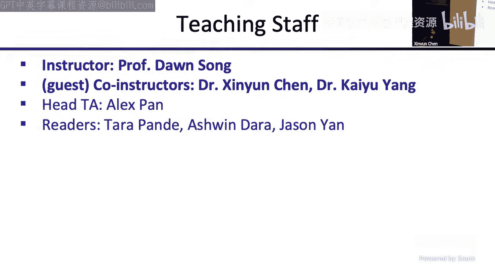

Last semester， we had a very amazing line of guest speakers talking about very broad topics about arm agents。

 So we discuss about the fundamental reasoning techniques。

 the agency workflows and different applications， etcter。

 And we had around 15000 people registered on mockc。😊。

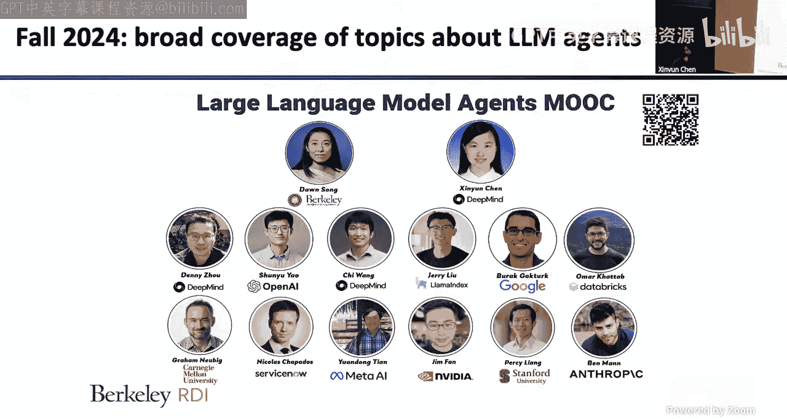

We also launched a hackathon， which attracted around 3000 people， participated globally。And we also。

 we are very grateful for this general sponsorship from our industry partners who gave us around $200000 support in prices and resources。

😊，We will announce hackson winners very soon。 So stay tuned。

Now， let's go back to arm agents。So the code of an large language model based agent is that the。

 the kind of the brain of this agent is a large language model。

 which is going to perform reasoning and planning to take action at each time step。

 Then with this like action to interact with the environment， it will receive the feedback。

 revise its internal memory so that it can better plan for the next step to take。

So with this agent framework， it allows the to also utilize this external feedback and tools whenever available。

 so it is can further expand its capability and to give to get more informed decision in its own decision making process。

 So some common components in the agent framework include tool use and retrieval。

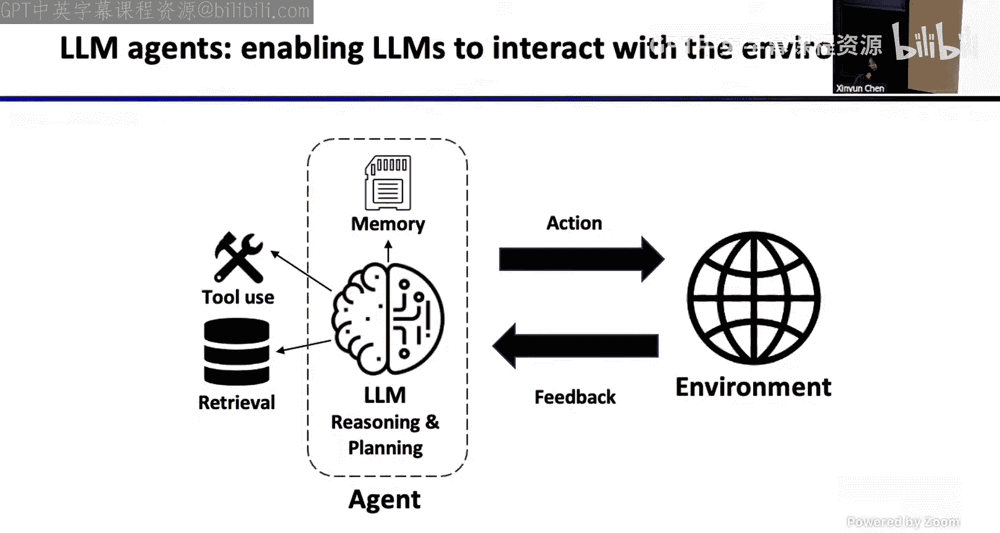

Then why do you want to empower these large models with the agent framework。

Because solving railro task typically involves a trial and error process。

 especially when we deploy this agent in a like a new environment。

 It really needs to like interact with the environment to understand some success failure mode in different actions so that it is able to like revise its own internal memory。

At the same time， leveraging external tools and retrieving from external knowledge for expand armss capabilities。

With the more like a with this agent workflow design becomes more mature。

 it also facilitates the accomplishment of complexas tasks。 This includes task decom。

 allocation of subt， division of labor for collaboration of between different specialized modules and multi agent generation。

😊。

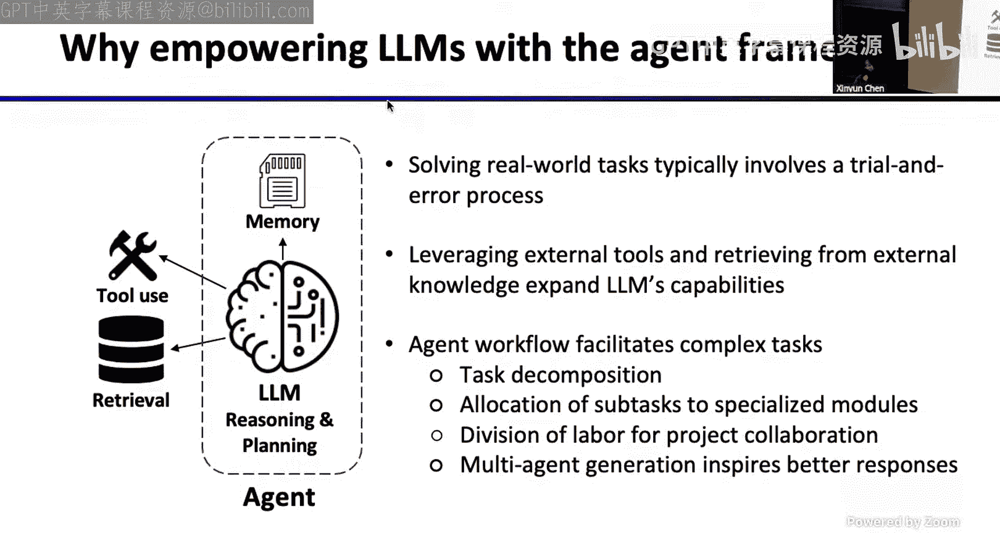

Many people are saying that this year，2025 will be the year of agents。So nowadays。

 we have really see explosion of arm agents for various applications。 and in many domains， actually。

 these arm agents transformed how previous people are thinking about like what these like AI models can。

 how these AI models can behave。 So like some very successful demonstrations and also practical use cases include code generation computer use。

Personal assistant as and these list of applications will keep like a growing in in the future as well。

 And also， there are some like a domain like education， finance etc。

 where we already have seen an emergence of a pretty nice arm based agents。

 Another factor that further drives this excitement about M agent development is about this like recent rapid progress of reasoning models starting from September last year with the release of open air O1。

And starting from that a model， we have also seen a lot of like a great reasoning progress during the meantime。

 For example， last month， we saw the release of the gi 2。0 flash thinking model。

 and also the open I O3 model。 and this month， we saw the release of deep R one andkimi K 1。5。

And also within the same model series， we can see a very just improvement from different version of the model。

 So， for example， there is a rapid progress of performance from open an01203。 And also。

 if we compare the current gi thinking model to our initial version release last month。

 there are also like a lot of improvement we can see。

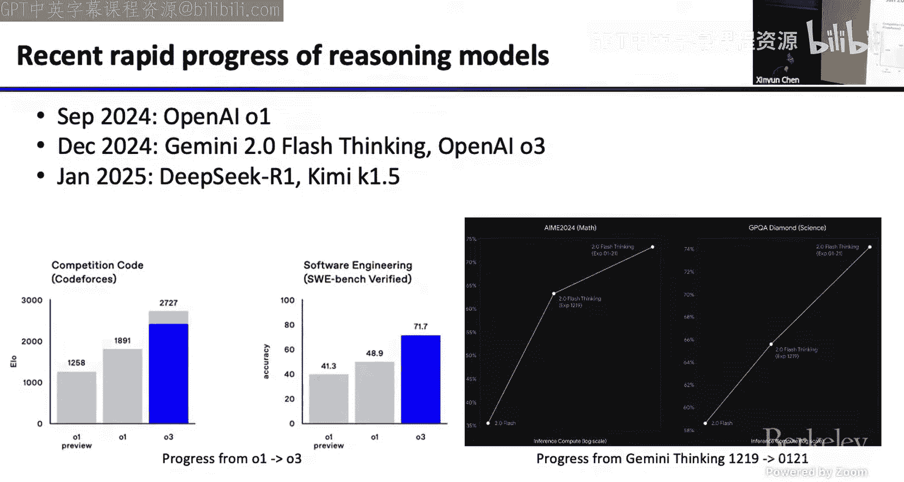

And if we think about this like a progress in reasoning。

 the most impressive performance we have seen so far are in mass and coding。

 especially for solving those very challenging problems。For example。

 last year with the alpha proof and alpha geometry system developed by my colleagues at Google。

 D mind。They received the silver medal or nearly gold medal performance in M M， O last year。😊。

And also with the more recent open air O3 model， it shows that it can be ranked among top 200 among the human participants on code forcess competitive programming contests。

If we think about these milestoneaths， probably they are even very hard to imagine a couple of months ago before they actually happen。

 So first this semester， our course is called advanced large language model agents。

 So we will do a deeper dive into the methodology part， especially on the reasoning techniques。

So we will talk about fundamental techniques for inference。For inference time scaling。

 training techniques and also search and planning。And for the application site。

 we will focus more on software engineering and mathematics。

 So we this includes co generation and verification and also auto of formalization and serial improving。

After this deep dive on the methodology， we will talk about A agents use cases for real world enterprise application and also more advanced agent workflow design and also topics about safety and ethics for real world deployment of these L agents。

Now I will hand over to our head T Alex to talk about cost logistics。 Okay。

 so the course is pretty similar to last week's or last semesters。

 the main difference is we are moving the lab to a later due date So last year the lab was a bit earlier and it is so much shorter this year the lab is going to be this semester the lab is going to be more involved and it will be do or it will be released later and you'll have more time to work on it。

The other main thing， apart from not having a hackathon。

 is we're also going to sort of open up the project。So last semester。

 the project was sort of open ended。 This time we'll have two tracks and applications track and a research track。

 I think I wrote about it here。 So the applications track is pretty much the same。

Content as last semester， the research track is new basically if you want to or interested in submitting a conference publication or a workshop publication you can apply to the research track we'll have a Google format shortly and if we select you then you can sort of work with under the supervision of like some of Don's postdocs and grad students to basically try to submit a workshop paper for this class other than that everything else is sort of the same as last year I would just refer to。

The final， like everything is on this master website and we won't be having a syllabus just keep track of the changes on here and on Ed STEM。

So that's it for logistics。Yeah， and also like same as last semester。

 we will also invite like a very great like speakers to talk about different topics of advance like agents by and applications。

 So we will， we are still finalizing the guest speaker schedule。

 So also check out this course website for the most up to date information in this lecture。

 I will talk about inference time techniques for reasoning。 So in the in of the course。

 we we talk about this advancement of reasoning models。

 which is kind of one of the highlights of large large model development in last year。

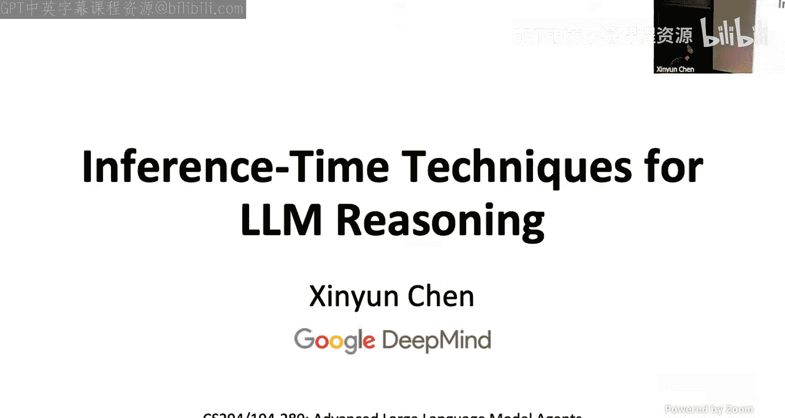

And so here I will go more into details about what we can see from these reasoning models。

So on the slide， I'm showing these like a results， which was i quoted from the O1 blog。 So from here。

 we can see that actually， open I O1s models started to achieve pretty impressive performance across very various。

 very challenging task where previous models are really struggling with。

 So this includes the competition level mass problems like in the Em contest last year and also competitive programming contest on code forces。

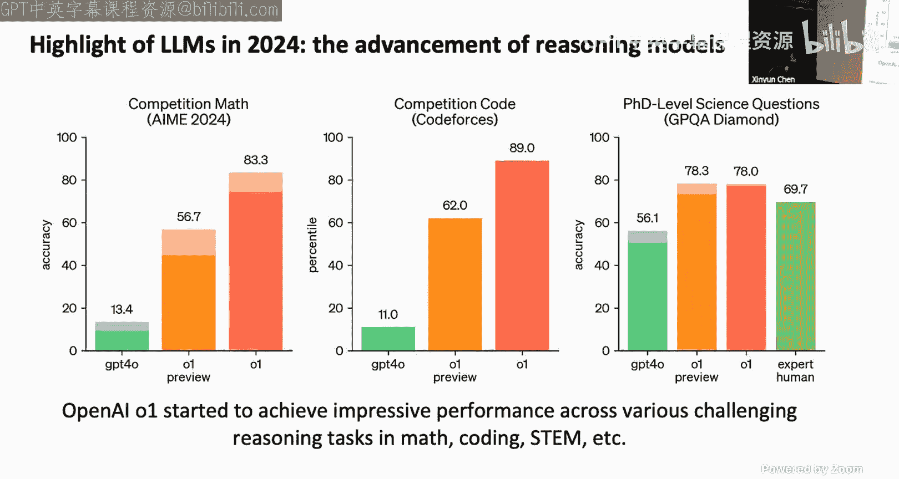

And in the recent like all three results， they further show this stack。

 The performance can further improve with more inference time compute。

For example， here I'm showing this like curves they demonstrated on a benchmark called AIRC A GI。

 So this is a benchmark that includes a bunch of puzzles to test how well humans or AI models can learn some reasoning patterns。

 given the demonstration examples。So this was a very challenging task。

 So for the most existing models before01， if we do not apply any special inference time techniques and just do the like very regular inference。

 then all existing models can achieve like less than 25% accuracy even with the model。

 it can only achieve around 30% accuracy But with the reason3 model。

 if we set the inference time budget to around $20 per it can achieve performance kind of matching the average human annotators or mechanical and if we further scale up this inference time cost to a crazy number like $1000 to solve one problem。

 then actually the model can achieve 87。5% accuracy。

 So this is a very expensive way to solve this task。

 but it shows how this model can perform in the ideal case when we do not care so much about inference time compute then here on the size。

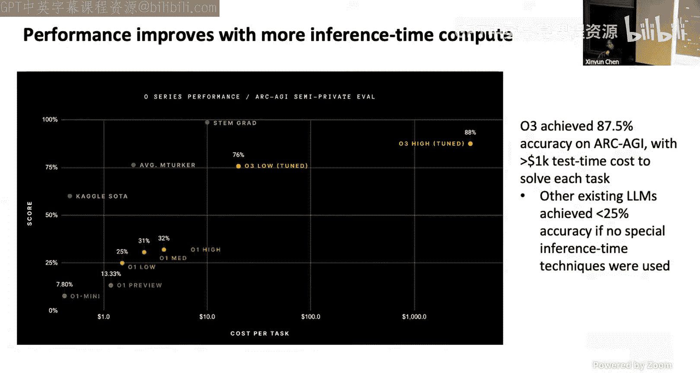

Showing a very simple like open I O1 demo， where basically。

 I called the model to solve a planning problem。So what is different for this O model。

So the main difference is that for the existing before the O I model， when we enter a user query。

 then the model will directly generate this response。 But in the O I interface。

 they include this thought process。 So basically， this process can take different amount of time。

 depending on the difficulty of the task。 for example， for the specific question， I ask the model。

 it takes slightly more than one minute to generate the final solution。And in the O interface。

 they didn't show the like a the raw thought process is that they show a summarized version of the hidden thought。

So from this hidden source for specific planning problem。

 we can see that it summarizes some key stages in the reasoning process of including laying out an initial plan。

 E it in it based on the model's internal belief and then revise the plan so that it can satisfy the concerns and improve the auto。

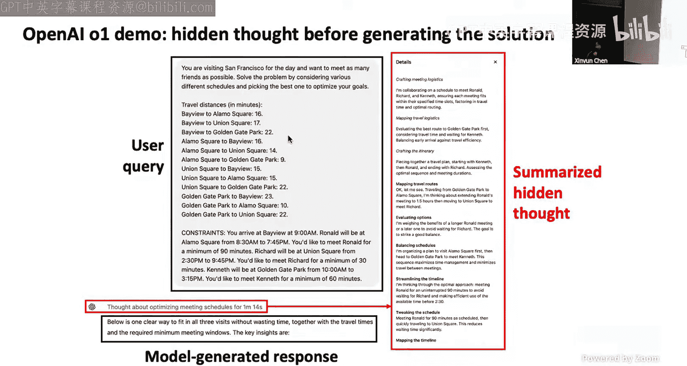

Then with the Germanmini 2。0 thinking model， we also like make these sort tokens visible to users。

So the size I'm showing a demo where actually this。Presion includes an image input。

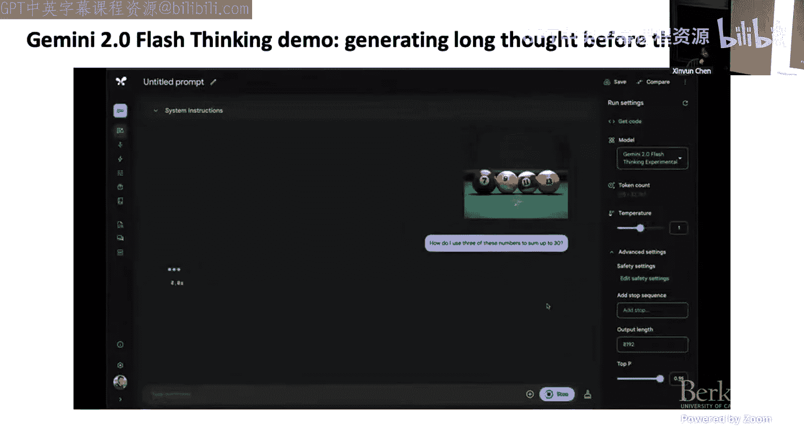

So this question is the math part of this question is pretty simple。 So basically， there。

 there are four balls in the image。 and the question is asking the model to take three out of these stack numbers to so that the sum is 30。

So the thought here， as you can see， is pretty long。 So after the we enter the query。

 the model immediately generates this sort。 and we don't need to read the reasoning process token by token。

 I know it's pretty hard to read。 but the most interesting step we can see from this multimod query is that there is a so the beginning of this like a in each there are there is a specific number which is 9。

 So at some point， the model figures out a very important step for this question。

 So because if you want to get sum of 30， actually， we need to turn this9 into6 by rolling this ball。

 So this is a very interesting like a feature of this of this query when we put this numbers on some boss。

 And also like this like step itself。 is not that like。kind of difficult mathematically。

 but actually it is an interesting trick if we if we do not allow the model to generate this long thought。

 this specific step will be very hard to figure out also like besides these models from open AI and Google De mind there are other like reasoning models there recently like at the beginning of the lecture I mentioned there are also models from the deep team and also the keymi team。

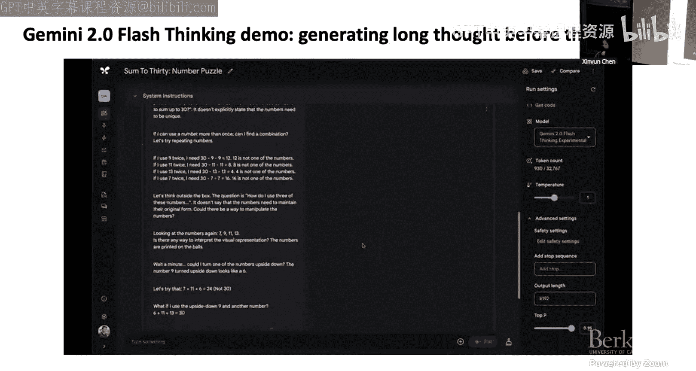

And out of all this like athrough in reasoning borders。

 one core shared idea is that we need some way to trigger the large language model to generate long chain of thought before it actually concludes with the final solution。

In the literature， there are different approaches to trigger this chance of cell generation。

Like in the original chair salt paper， they designed a fu short like proy skin。

 which basically demonstrates this thought process in exlars。And later on。

 there are some works showing that we can apply an instruction prompting to achieve this。

 Like we can use the instruction。 Let's think step by step。And for the reason I chat models。

 we can see that even if we do not give any special instructions to the model。

 the model also tends to generate some thoughts before coming up with the final answer。

 no matter whether the sort is like a short or long。

 So there are different ways to train the model to achieve this， like in for instruction tuning。

 where we actually put this chain of sort data time into our supervised fine tuning。 make sure。

And also， like all you can see from recent reasoning models。

 we can apply reinforcement learning to a achieve this goal。In this lecture。

 I will focus more on inference time techniques for scaling token budget。 in the future lectures。

 we will also dive deeper into reason techniques。 and there will be some other guest speakers who will compare to share their thoughts。

So for this lecture， I will discuss like three parts about reasoning techniques at inference time。

I will first discuss the basic prompting techniques。

 and the common idea among these prompting techniques is that we want to allow the model to use more token budget to generate a single solution。

Then the second part， I will talk about techniques to perform search and selection from multiple candidates。

And the common idea here is that is want to increase the ways to explore the solution space。

In the last part， I will talk about iterative cell improvement will allow the model to increase its depth to reach the final solution。

after all these discussions of different parts， we will also see how we can like a best utilize different combinations of these techniques to seek the best way to utilize the inference time compute to improve the air reasoning performance。

So let's get started on the first part about basic prompting techniques。

Before we talk about more advanced prompting techniques。

 let's first reveal the background about standard prompting。So basicallyically， instead of prompting。

 let's say we want to solve a math problem as shown the slides before line of works on channel solve prompting。

 the common practice is that we just put some question answer pairs into the prompt。 like here。

 the question is the math question。 and the answer is the final answer。

So before the advancement in post training techniques， if we directly apply the standard prompting。

 then the performance is pretty poor on reasoning benchmarks。

The fundamental issue is that if we look at these standard future examples。

 they only provide information on the final solution format。

 but it doesn't tell the model about the rationale to derive the solution。

 Now we can imagine that if we like if we are taking a class and the teachers are basically just teaching you with the the final like official solution without any more context that if you do not have background knowledge yourself。

 that it will make your teaching a lot more difficult。So for the child saw the prompting。

 the idea is that we will include this like a few exemplarers with thoughts。Again。

 let's let's take a look at this example of solving math problems。 So here， instead， in the exrs。

 we will provide these calculation steps to basically demonstrate the model how we should like like or how we should derive this like a solution step by step to to achieve the final answer。

 Then after giving these exampleemp with like of sort rationals。

 then the model is able to solve this problem correctly。In practice， how this。

 how this these models can benefit more from child prompting compared to standard prompting is also dependent on the model's fundamental capabilities。

So here on the sites， I'm showing the scaling curves presented by the original chain of salt papers and also some other related papers about this like chain of salt properties。

So we can see that among like different model families。

 One common trend is that this C T performance improves more significantly with the increase of the model size。

And in particular， if we look at this that gap of channels of prompting versus standard prompting。

 then better models benefit more with C T generation。

 there is suggest improvement on reason performance once the model reaches a certain scale。

I also want to know that here for for these curves。 they are from papers in 2022。

 So these experiments are done using returned only armss。

 So this is why it is important to apply some protein so that the model can generate this source immediately。

And also with these like recent post training techniques。

 they might show some different scaling curves like we have seen some like strong but very lightweight armss recently。

 But then the main conclusions will still hold。 We will still see this overall trend。

 basically once the model becomes better， it will benefit more from this like this allowance of the generation。

 Then in the follow up work called large models are their show reasoners。

 They further find that even with only large models。

 We do not have to provide the model with examples to elicive this C generation。Instead。

 we can achieve this with an instruction。 like in the paper， they demonstrate this instruction。

 Let's thing step by step。 Then after we apply this instruction before we ask the model to generally answer。

 the model can also generate some thoughts before generating the final solution。

嗯 empirical demonstrate this zero show C T significantly outper zero show performance。

 especially on harder like mass and symbolic reasoning tasks。

So geo COT is more convenient than future C T in the sense that we no longer need to manually annotate source ourselves as examples。

But if we compare their performance， zero CT performance is still much worse than future CT。Then。

 a very natural question want to ask is， how can we get the best of the both world。

 how to improve C T performance without manually labeling samples。

So this is what we want to achieve with our paper， large language models as analog reasoners。

 this paper was published at IL last year。 The idea is that instead of directly providing the model with exemprs。

 we ensure the model to first record relevant exemprs to solve the test problem。

 Then based on this like model generaters， then the model will try to solve the test problems like just imagine that these selfgene exrs are just some C exrs provided by external sources。

The benefit of this design lies in two fold。First， these examples are self generated by the large chunk models。

 so we。WeFor our original goal。 We don't need to do any manual labeling here。On the other hand。

 because this instruction is applied to each test question。

 So basically for the for different test question， the model is able to generate different exemprs。

 which are more relevant to the concrete topics covered in the test question。

 So these exemprs are more tailored to individual problems。

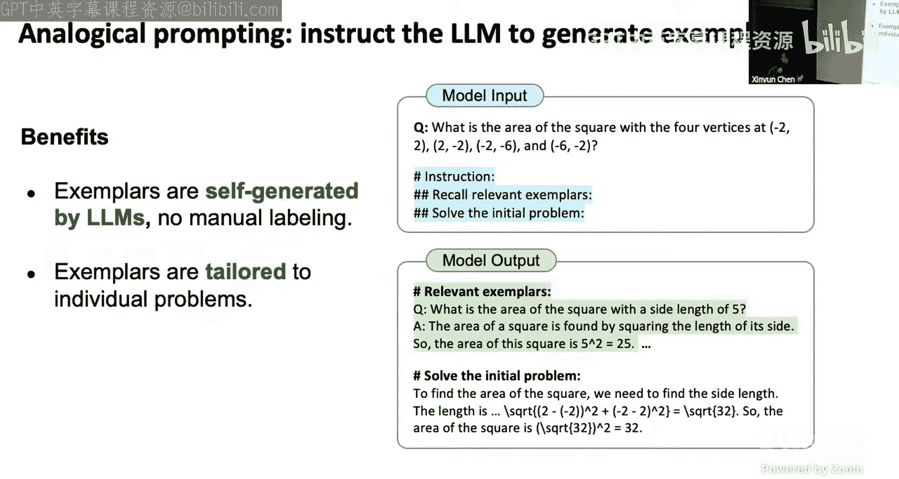

We call our approach analog logical prompting because the least method actually can be motivated by human and logical reasoning。

If we think about future prompting， it is not supernatural if we think about it in the human reasoning way。

 because humans are not explicitly given demonstrations every time for， for each single new problem。

And instead， humans also intrinsically recall from past relevant experience。

So in a classic reasoning methodology book called How to So it from Po。

 They have a very nice description about this reasoning method named。 Do you know a related problem。

So the idea is that when solving a problem。We look for aly solved problem。

 which is linked to our present one by generalization specialization or another gene。

 and we want to learn from this like past results or their methods so that it can help us solve new test problems better。

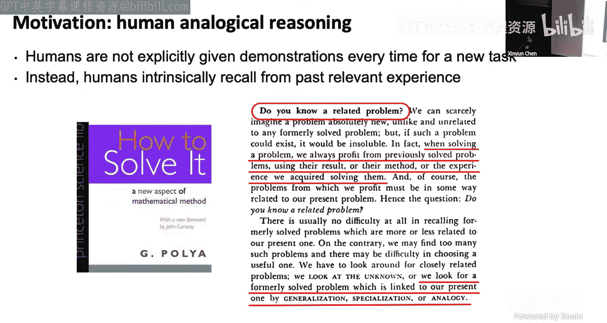

If we think about it from the human reasoning perspective， then besides examples。

 we can also ensure the model to generate some high higher level knowledge。

 which can be like more like better summary of what we need to solve the new problems。

 And this generating knowledge can complement the problems with broader insights。

So here let's take the solving coding problems， as an example。So given a new coding problem。

 we can first that ensure the model to self generate some knowledge。

 which is a more of like higher level tutorial about the algorithms we need to solve the problem。

 And also the model needs to identify what are the main algorithms we need so it can come up with related example problems with their corresponding code。

Then after this instruction， and also， once the model generate is related like a background knowledge。

 including higher level tutorial and exemprs， then the model goes back to solve the initial test problem。

So in the results， we show that basic analog logical prompting not only outperforms steel C O T。

 but it actually outperforms manufacturer C O T as well。

 And we show this performance improvement on in like a mass problem solving。

 co generation and also like big bench reasoning tasks。

If you look at these results at the first time， you might be a bit surprised because knowledge here all these example of problems or the knowledge are generated by the model。

 So intuitively， it might contain more errors than human annotated examples empirically。

 we indeed observe this trend。 We see that， for example。

 for those like examples generated by the model for mass problems around 70% of them are accurate and also they are relevant。

 but the rest can have some like like issues that they are completely relevant or there are some actually wrong calculation steps。

But even though there are some noises in the demonstrations， the model still benefits a lot from it。

So given this like finding， you， you might imagine it。

 this means at least the models should be able to generate some reasonable exemplars or otherwise。

 it cannot learn from it at all。So based on this intuition， we also conduct a like pretty rough。

 like a scaling like study for this analog prompting。

So here we are comparing like models among like different among the G text model families。 I。

 I know these models are all shut down and deprecating now， but but this trend will still hold。

So basically， we can see that weaker large models benefit less from analog logical prompting。

 although if we compare the performance to zero short chain of salt。

 its still its own par or still outperforms their performance。

And with stronger large models like starting from text 0。

02 in the GBT family and logical prompt starts to outperform channel assault prompting with manually designed examples。

AndNotice that actually， this approach can even outperform retrieved examples。

So for retrieval method， what we did is that basically for each test problem。

 we implement a retrieval approach so that it will find those most relevant problems in the in the GSM A K mass cor training data。

So one explanation here is that this generated chain of thought by the model can be more tailored to the underlying reasoning style of these like a pre or instruction tuned large language models。

So this finding actually is also in line with the recent trend。

 like when we are trying to develop the reasoning models instead of like putting the putting like human return source。

 we can have some training methods so that the model is able to discover the best reasoning strategies by itself。

Now， let's go back to the instruction。 Let's think step by step。

So why do we have to use this sentence？ Is there something special about it。

So in the original zero C T paper， they conducted this observation study of different variants of these instruction to trigger the chance generation。

So some of them do not make much sense。 So it is kind of not surprisingly that they do not perform well。

 But if we look at those different instructions in the top category in。

If we mask out these accuracy numbers， it is， It might be not that intuitive to know which instruction should be performed better。

 and it can be like kind of not very good to see that even if you just change a couple of words。

 the accuracy number can change very dramatically。So this shows that current large models are pretty sensitive to pro design。

And because and also in many cases， there is no clear principle about how to write opt forms。

 And this is why nowadays， there are still many people who are writing a lot of guidelines about how to have。

 have the best practice to do pro engineering。So， given this observation。

A very natural question want to ask next is how we can reduce this manual work for writing prompts。

So one idea is that since our large language models can solve like many like challenging reasoning problems and also answering other queries。

 So why don't we also use it to help us do the pro engineering or like pro design in general。

 So in the 2023， there is a paper called large language models are human level pro engineers。

So the hardware of idea is basically to apply a large edge model to propose like prompts。

 And so that we hope this model generated prompt can also perform even better than human written prompt。

So here I'm showing the complete diagram of their method。 So there are two important stages。

 The first is this that proposal generation where we can leverage this model to generate initial instructions。

 given our task description。Then once the model generally different like proposed prompt。

 we then will score each instruction based on the prediction correctness on a small set of problems。

 So here， basically， we will hold out a small validation set。

 which can tell us the quality of each prompt。So here the setup might be like more more similar to the traditional machine learning task where we have this separation of like training and tests。

 but actually we do not need to include so many like example examples here for this validation purpose。

 like in most cases， it is sufficient to include tens of examples or just around 100 problems。

Then in our work published at I last year， we go further。 Will we try to use this model。

 not only just to propose some like some instructions and do some kind of a search mutation。

 we also want to apply it as an optimizer to it creatively improve the prompt。So。

 so the idea of our approach is that we want to insert the M to leverage the past trajectory represented as sorted solutions score pairs so that it can learn to generate better prompt with more steps。

So in this work， we frame it as a more more general framework in the natural language space。

 But in this specific use case of pro opposition， basically。

 this means that we will have two aju models as optimizers and evaluators。So basically。

 this optimizer is the large model， which is responsible for proposing a new instruction。

 given old ones and also the task examplesrs。And the evaluator is the scholar。

 which will evaluate the accuracy or performance of a given instruction。Now。

 let's take a look at how we can design the meta probe to achieve this goal。 So on the site。

 I'm showing an example meta probe for GSM AK to solve the math problems。

The problem itself looks pretty long， but basically are two like a main components。

The first one is this like trajectory， including the instructions we have like explored in the past steps and with their corresponding aies。

 And in practice， we will sort them in the ascending order and we can remove those older ones if the more。

 if the context lens is not enough to put off them in the history。

And we also provide these exemparies to show what's the task we want to optimize。And basically， here。

 for example， for math problems， we only need to include these like Q A pairs with the with the final answer。

 So again， there's no need to annotate any chain of thought or any explanations of how we can derive this solution。

Then for the results， basically again， we are testing all these instructions or pretend only large damage models。

 and we use that pump tool at that time。 and we also try using different models as the。

 including pump model and GT model。So for all these like approaches。

 we are starting from the initial instruction with let's solve the problem。

 which achieves an accuracy of around 61% for this GSM A K task。

 And this is a pretty general purpose instruction。 It is around like a 10% lower than the instruction。

 Let's think step by step。And if we look at the best generated problem among these these。

 we can see that actually this instruction， take a deep breath and work on this problem step by step like around like8% like low higher than this less thing step by step instruction。

 and actually， if we compare this performance to future C T。

 it matches the performance like reported in the palm2 paper where the sort examples are written by humans。

So there are two things we can， we can think about here。 One is that basically here。

 we are seeing another way to basically achieve very competitive performance to future C T without manually writing examples ourselves。

Another perspective he said is that with this like like based pro。

 it doesn't only save us time to so that we do not need to spend so much time to to like manually tune pros ourselves。

 But actually， when it comes with new pros， it also provides some sometimes surprising different angles。

 Like I can assume that like turns take a deep breath at least for me。

 if I'm trying to like revise the pro by myself。 I won't feel that this phrase will be so so helpful。

 but empirically the large model with this loop， actually it can。

Some somehow come up with this instruction that fits pretty well for this model。

No that in this like L M based process， actually， this is not a real opposition in the sense that we do not have any training here。

 It is completely prompting only。 So there's no guarantee that the model can just keep like coming up with better and better prompt。

But in practice， we find that actually this like organization curve holds for different models。

 So we can see that basically this like with more organization steps which is basically this it iterative prompting steps。

 the accuracy increases with more steps and then for tools。

 So it looks pretty like similar to the traditional organization graphs。Okay。

 now let's go back to12 salt。So from a methodologyology perspective。

 what does Cho So really bring into our reasoning， Why is it so effective。If we think about it。

 child of prompting is basically giving us a way so to perform this variable computation of the thought process。

 which where this number of tokens used for problem will be adapt to us of different difficulty levels。

So if we think about standard prompting， basically it for the same task。

 if the answer learns are the same， then basically， if we just provide the final answer directly。

 it basically means that we are forcing the model to use the same amount of time。

 same amount of inference， time budget to solve each problem， regardless of its difficulty。

But with this like a child salt， basically， it shows that for more complex questions。

 because it also require more reasoning steps to solve problem， like for math problems。

 it might require more calculation steps So basically with this idea。

 it allows the model to basically also perform more reasoning steps in the token space so that it can better solve the the test problems in the salt paper。

 they also show that even if。Difficulty of the problems is in exs are pretty simple math problems。

 But actually， the same problem can also general to test problems that require much more reasoning steps。

Then if we think about the high level reasoning strategies。

Co thought also incorporates a lot of like a reasoning process that are very important for us humans to reason about a difficult task。

Such as decomposition， planningning and etc cetera。

So if you want to further improve the model performance。

 and especially if we know what are some good guidelines on the reason strategies we need to use for a specific task。

 we can also explicitly in air with the desired reasoning strategies for problem solving。

So one idea to further approach this decomposition strategy is called leads to most prompting。

And the goal of this I I approach is to achieve easy to hard generalization by explicitlying telling the model what's the best practice to decompose the original problem。

So on the slides， I'm showing this example for solving math problems。

 and basically in the this original list two most prompting paper from my colleagues at Google D。

 it includes two stages。So in the first stage， it performs a problem reduction。

 like given a math problem， it first reduces the problems into simpler sub problems。 So each。

 each sub math problem can be easier to solve， requires fewer calculation steps。

Then given these like sub questions， the model will be able to to like sequentially solve these sub problems and combine solutions to solve the original problem。

The most impressive results from this work is that actually with this this two most prompt design。

 it shows for the first time that we do not need to design the nearest symbol frameworks or requiring any like program execution to but it can still solve this compositional transition benchmarks with a nearly perfect accuracy。

So the results showing their paper is on this scan benchmark。

 So scan is a synthetic data about like translating programmatically generated natural language commands into action sequences。

The most challenging part of this benchmark is about this length split。

 basically in there like a test splits， all the action sequences are longer than the training samples。

So this makes it very challenging for the tradition of like sequence to sequence learning。

 If we directly do this like a training on on their training set。 and then on this length split。

 the test accuracy will be no no more than 25% unless we apply some neuro symbol techniques。

But then basically with this most prompting， they show that if they use them like the latest models at that time。

 which is code 002。 they are able to achieve nearly perfect test accuracy at the same time。

 they only need to use like a010。1% of the Chinese samples as examples。

 So it is that both like more like test efficient like like data efficient to adapt to new tasks。

 and while also the performance is very competitive。

Learning our follow up work published at I last year。

 we further show that we can extend this list to most prompting idea to solve like more complicated compositional in the case of translating hacks to more realistic programming languages。

 like here on the slide， I'm showing this example of translating natural language questions to sparkqueries。

So the main challenge here is that for more real world languages。

 including natural language or program languages， there are more complicated grammar rules。 and also。

 the vocabulary set is larger。This means that especially if we we do not have a model with a super long contest。

 Then a single pro will be no longer enough to cover all the grammar rules needed to solve the task。

So actually， with this challenge， it shows one benefit of decomposition by allowing the model to use different pros for different reasoning stage。

 it also enables the model to use customized pros for each sub problem or or each subtask in the context of agent development。

So here is an overview of our dynamic list to most prompting approach。

 So some details do not matter too much here， like how we do the decomposition。

 but the menu stage we add is this like so calledled dynamic selection of examples for each sub problem。

 So basically here for each of the test like sentence we can discover those example questions with the most relevant grammar rules So they so basically we can assure that for each part of the sentence。

 we can always reach the most most useful grammar rules to solve the task so that the model can have enough context to solve the problem。

So on this like a compositional， like free base question benchmark， the CFQ data set。 again。

 we show that actually， our dynamic leads to most prompting approach orperforms all these baseline。

 which where we need to change a model on the complete training set。And again。

 if we compare these dynamics to both prompting with channel solid prompting and other prompting approaches。

 it also scales better when we increase this example of to generate these future examples。

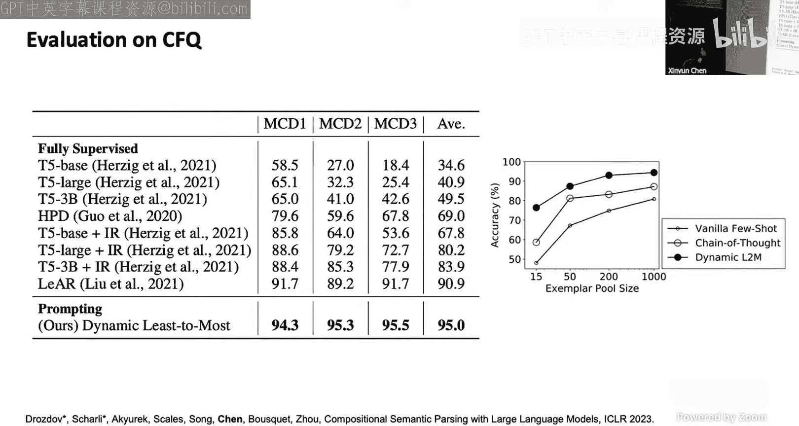

So far， we have talk about how we can install the model to solve the problem in in some like a risk with some business strategies indicated by the future examplesrs。

But we， if we think about it， we can assume that for different reasoning tasks。

 they can require very different reasoning structures。

 like there will be different ways to compose the task and plan for each stage。At the same time。

 we might not want to annotate all this that best practice for each type of task。 Like again。

 we don't want to do this manual labeling of of examples for every single problem。

So in our self discover work we published at New Ris last year。

 we basically in the model to compose task specific reason structures without manually written demonstrations。

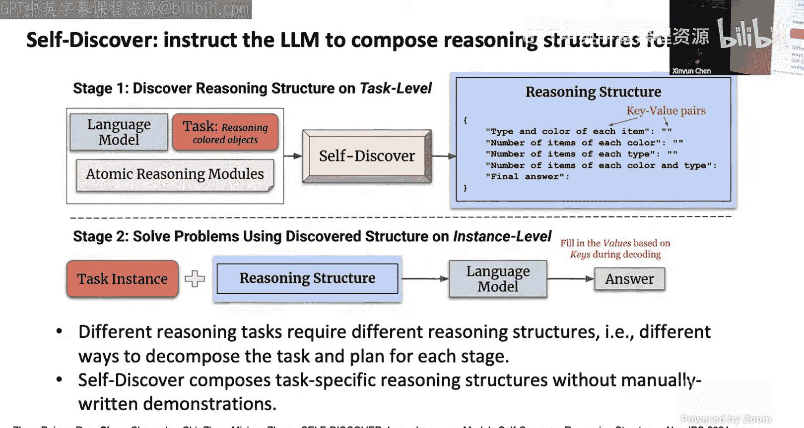

So in practice， how we do is that basically we will list a list a kind of tens of best practice of reasoning strategies。

 including like a child reasoning， doing decomposition， doing some self reflectionlection。

 etc cetera。 Then given a given a new task， the model will think about how it can like utilize the reasoning strategies that are best of suit for the current task and compose a reasoning structure。

 follow it to solve the problem。And for evaluation。

 we also show that with this self discover methodology。

 it outperforms chain of self prompting and also other base other base on a different benchmarks。

 including big benchmark hard reasoning task， math benchmark and also some other benchmarks for social。

 social agent reasoning。So to summarize in the first part。

 I talk about I first talk about channel cell generation and the fundamental idea of allowing the model to perform variable computation。

 to like trigger the sort process。 and this sort process can adapt to tasks of different difficulty levels。

We talk about how to improve the channel performance at inference time。

So in original chain of salt paper， we talk about the future prompting idea with staling of sorts。

AT code instruction prompting to trigger this chance of third generation。And also。

 we talk about how we can install the large model to automate the pro design and discover better problems by themselves。

So notice that the this best practice of interacting with large models can evolve over time。 Like。

 for example， recently， with these post change large models。

 you do not have to put examples for every single task for the model to learn how to do it。

And in for some models， for example， it is better for you to just provide very clear guidelines and instructions on what you want。

 and then hope the model can just follow your instructions and some models prefer those like interactive discussion。

 and some models might prefer just a very long detail instruction at once。

But the principles of how to discover good prompting strategies for reasoning still hold here。

Like two very important criteriaer that we want this approach to encourage model to generate longer chance of thought for complex tasks。

 We wanted to scale with different task difficulty。And also。

 we need this prompting technique to be able to support reasoning strategies required for the task。

So now let's start the second part about form search selection from multiple candidates and increasing the ways to explore a solution space。

So after we talk about the first part， what is missing so far。 Yeah。

 I guess this question is not so hard since I already show the outline of these slides。

 So basically I basically from first part， we can see that we should not limit large model to generate only one solution per problem because the because the model can just have have some mistakes in its single parts solution。

Instead， we should allow the model to explore multiple branches。

 which will allow the large model to recover from mistakes in a single generation。

And there are two ways to basically increase the width of this solution inspiration。

Why said we can generate multiple candidate solutions per problem。Another is that at each step。

 we can allow the model to generate multiple potential next reasoning steps。

It is not that hard to think that with this like a multiple sample generation。

 then the upper bound of the performance will be definitely higher because we allow the model to like kind of select an alternative。

 probably better solution。But the fundamental challenge for lead for approaches along this time is that how to see the best response from multiple candidates。

Because in the real world use case， we do not have an oracle scholar at inference time。So surely。

 for example， in in a chat interface， we can just have the model during multiple like solutions and user can pick whatever they want。

 Then this is kind of a best of an selection case。But it will be more idea if the model can just do this kind of process internally so that we do not have to review like tons of like solutions by ourselves to see what we want。

So along the line of these ideas， I want to first talk about this self consistency work from my colleagues at Google D。

So if we look at this idea nowadays， we will find that this is an incredibly simple idea。

 but it is actually very effective， and it is it is it actually can can improve performance a lot with all the different like models。

So let's say we want to also solve a math problem。 this time we allow the model to generate multiple responses。

So basically， after we have all these responses， we still do not know which one is accurate。

 But here we have this consistency based selection criter。 So basically。

 let's say for this that math problem with a single number as the final answer。

 We will look at these three solutions。 Two of them have the answer 18。

 one of them have the answer 26。 So basically 18 is the most consistent answer。

 So we pick the response corresponding to this like a most frequently appeared answer。

And knowledge here， one important thing is that this selection is only based on the final answer。

 It is not based on the reasoning passes。 The model can come up with whatever reasoning passes it wants。

 as long as they lead to the same final answer， we consider them to be all good。

This is a pretty simple idea， but actually， it it boosts performance across different models and benchmarks。

 here which here in their paper， they also evaluate all the models available at that time and especially on math problems。

 They show very significant performance improvement。Now。

 let's talk about the leastcal effect again with the self consistency approach。

So for the base time here in the curve， they compare with sample and and rank base time。

 This is actually a pretty natural baseline time， which that we can see the response with the highest log probability。

 So then hear the assumption is that if the model like gives like higher probability to the current response。

 it should be more confident about it。But actually， if we look at this curves。

 we can see that self consistency performance scales much better than probability based ranking。

 So with more and more responses like like up to like 40 responses。

 selflf consistency performance is still improving。

 but this is like sample and rank based time has already stopped improving with like as around 1010 responses already。

But there is an exception。 So the exception is that if we train the model to be a very good verifier for the task we care about。

 we might be able to kind of outperform this like a scaling curve with self consistency。

 and we will talk about it later。Another very important factor that contributes to self consistency success is that we need the model to like generate very diverse responses to perform this consistency based selection。

So here， basically in this like results， they also compare with different like baseline。

 So the beam search is actually a very classic search algorithm like in the NP literature before the like area。

 So basic idea is that at each decoding step。 we will keep the top K like a tokens with the highest probabilities。

 Then in the end， we will we will use the like a sentence with the highest overall probability。

And then they also like compare with this ensemble base。

 where they apply grade decoding for like among like different variant of how you formula the pro Because earlier。

 we mentioned that the are sensitive to different prompts。 also。

 they compare the performance to different ways to the orders in the prompt。So again。

 they show that self consistency using sampling scales better with more samples。

So the the the important like factor here is that basically for the sampling method。

 it needs to ensure that the responses are very diverse。 So like we can do。

 we can do this sampling with a high temperature or we can perform nuclear sampling with like by setting the parameters in the right way to enforce this diversity。

 etc ce。One analysis from this work is actually pretty interesting。

 It is related to model calibration。So this is about like actually， how does sell。

 how does this consistency based selection like improve model performance。

 What does it mean when the model is like a can for a given task。

 the the model can come up with a more consistent response。So here， basically。

 they show this curve about to show the correlation between like the accuracy and consistency。

 So here， basically， we can see that if， it follows like a sample responses。

 if more of them lead to the same final answer。 This means that this consistency percentage is higher。

Then there are two like conclusions we can see from here。

 Why is that this du model is more certain with its final predicted conclusion。

 even if they are like coming up with the same conclusion with different reasoning passes。

And empirically， we see that this aggregated solution for these more consistency responses can be more likely to be accurate。

 The final solution can can just be the the right one for the original test problem。

 So this can also explain why this that consistency can be a very simple but very powerful criterion to select the final solution。

So in the self consistency paper， they demonstrate this like an approach on those like a task based reasoning problems。

And actually， this consistency based selection approach is also very powerful for co generation。And。

 in our alpha code work at Google at Google D， basically。

 this alpha code system itself is a pretty like a complicated one。

 It includes that model training and inference time techniques。But here I will， I will。

 many focus on this like inference stage called filtering and clustering。

 and especially this that clustering is basically tries to like。

Do list like a code selection based on the consistency on execution results。

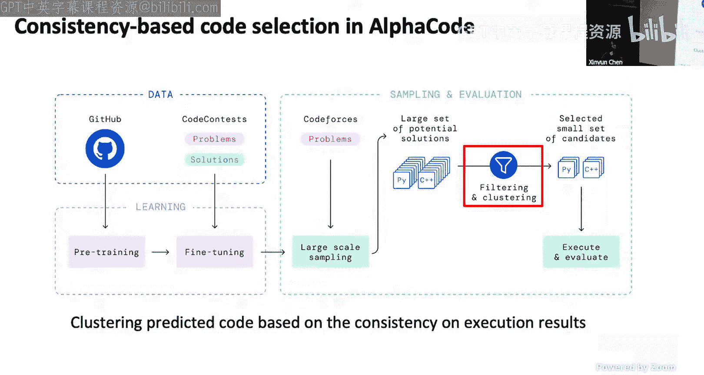

So let's first briefly discuss about the background， the problem setting of competitive programming。

 So basically in a competitive programming problem， it in the problem description。

 it will includes a very long and complicated text to tell about the background story about what we want for the problem for the corresponding code and then also includes a few input of pairs as test cases。

Then for the solution to be considered correct， The gene code needs to pass both the given test cases in the prompt。

 and also usually we will have some hurd of test cases and these test cases are typically like of larger scale and they will be more more difficult than this example test cases and they will cover some corner cases。

 So since we already have some imp examples， we can filter the programs that fail the given test cases already。

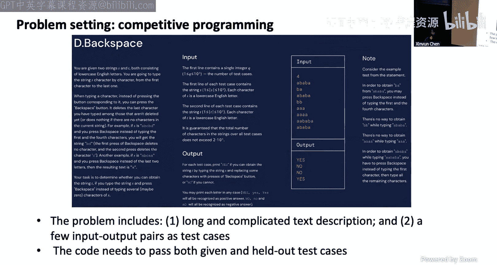

But for the remaining programs， they might still fail on the heardda test cases。

 Like for those of who those of you who have like participated in this like coding contest。

 you might feel the same way。 You feel like your code is great。

 but it just fell on some mysterious hold out test cases。 and you didn't get the score you want。

So basically， for this for the alpha system， what will do it is that we will train another model to generate new test inputs for。

 for these test problems。Then we will execute those stack sample programs on all these model generated inputs。

 and we cluster all programs with the same output together。

The assumption here is basically if we have the model to generate like enough number of test inputs and also they are diverse of and of higher quality。

 then actually， we can assume that all programs in the same cluster are semanally equivalent because they lead to the same execution results。

And then finally， we sample one program from each of the 10 largest class。In our relation。

 we show that this that clustering provides additional performance scan compared to the future only method。

 but clearly， there is still a gap from the oracle selection because theres still no guarantee that the consistent response will be just the best one out of the candidate pool。

Now， let's revisit this self consistency decoding pipeline。

So one limitation here is that for the original self consistency。

 we need an answer extraction process so that we， we can release aggregation among the candidate responses。

So you want to like apply this like consistency based decoding to like kind of border use cases。

The nature next question is how we can do it for free for generation。

 where it is not that natural to have this aggregation and un succession process。

So this is we want to achieve with our work on universal self consistency。

 The idea is that instead of having this like answer instruction process。

We asked the large model to perform consistency based selection。So specifically。

 we threw an instruction to the model， asking it to select the most consistent response based on the majority consensus。

 and also， it needs to take a look at all these candidate responses。So inition here is that clearly。

 we know that it will be hard for the model to judge the answer correctness by itself。

 but consistency should be a simpler criterion to measure。Then empirically。

 we also evaluate this universal self consistency method for different applications。

So for those like free phone generation problems like a summarization and question answering with with like a with like long factual like final answers。

 we see that the universal self consistency also still can improve over the base where the original self consistency is not directly applicable。

And on mass reasoning and coding problems where we can apply this original self consistency idea。

 actually universal self consistency can match its performance without the requirement of performing this answer extraction and code execution。

AndNot here， clearly， this universal小 performance is bounded by the long tax capability。

So at that time， we are using like an earlier model。

 which is not super great at long contest reasoning。

 So we can see that when we include more responses in the in in the prompt。

 the performance might not go like an up as like well as the original selfcon。

 but we can see that with the reason development of long contest models。

 this like will allow such kind of model based selection approach to scale more with more responses。

 and also in practice for most tasks it can be well solve within let's say1 responses in the candidate pool。

 So this will still showcase the usability of this model based consistency selection。Previously。

 we talk about like a for the model based like a selection using the log probability from the original model。

Leist approach of ranking doesn't scale better than the consistency based election。

So to improve further over this consistency based section。

One idea is that we can train a large model as the ranker。

 and we hope that at least this ranker can perform better can perform better than this like a simple consistency criteria and actually it can have some like kind of sense of which responses are more likely to be accurate。

So here on the slide， I'm showing this like this like kind of diagram from the original open paper。

 which introduced the GSM AK data set and also the an also demonstrate this like method of how to change a verifier to。

So the to basically judge the correctness of the mass solution。And also， like later， they have。

 they have this follow a paper called let's verify step by step。 So in total。

 basically for this line of air based ranking works。

 there are two pair there are two ways to basically design the air based method to judge the answer quality。

The first way is the most like in the initial and the most standard approach。

 which is called outcome supervised reward model。 Basically。

 it will verify the correctness at the solution level。 Like given a mass problem， the solution。

 the model will tell you whether the solution is correct or not。Another。

 like an approach introduced in this that's verify step by step paper is called process supervised reward model。

 So the idea is that instead of verifying at a solution space， we can also verify at a step level。

 we can see whether each step is accurate。So in their， in their work， basically。

 they show that this like a process supervised reward model actually scales better with more samples compared to this outcome based reward model and also this majority voting baseline。

But clearly here， the performance will be highly dependent on the ver quality。And also。

 the same verifier might not like generalize across tasks because we know that this consistency based criteria is very simple and actually can be apply to many tasks。

 But for theseer models， you need to design a good training like a strategy and also design a good training data so that it can really like a work across different domains you care about。

So far， we have talked about response selection only at the like a solution level。

 So we only perform this selection after the four responses are generated。

But assuming that we have a very good stepwise scholar。

 then actually leads like solution based responselash is kind of a waste of like using this step by scholar because actually we can we can do more with such kind of a more powerful and more fine verifier。

😊，So if we really have this a good like step wide scholar function。

 then actually we can perform this like a tree search with model。 we are basically。

 instead of waiting until the solution becomes complete During the search process。

 we can just we can prioritize those exploration of like partial solutions at the step level。

 we can explore those more promising steps before exploring other passes。So on the slides。

 I'm showing this like a like a list like diagram from a trail salt prompting paper。

 So from this illustration， you can clearly see what what are the differences of different like prompt methods that trail of salt prompting is basically a chain this selfcon methods is like multiple parallel。

 And then for this that trail salt basically at each step。

 it can have multiple branches to explore the next step and you don't have to complete all these that passes until the end。

So here I will show this how we can apply this like2。 So idea with a simple example of again of 24。

 So basically at each step， there are two important like stages we want to do One is called so generation。

 Basically， this step will try to we will from the large model to propose possible next thinking steps。

 like in the again of 24， these thinking steps are pretty like simple inform format。

 you just need to select the two numbers to perform this calculation。

Then there's another stage called thought evaluation。 where again。

 here we can from the large model to evaluate how promising the current state is。

 like for the for the game of 24， you need to decide whether it is possible to reach the final number of 24 after the lease all manipulations。

So previously， we show like how we we can show how we can do this evaluation at the at the like step level。

 So it will determine the quality of each individual step。

But related to our previous like consistency based selection discussion for this function。

 we can also think about it as a way to just select the best state among the candidates。

 We don't need to just have the model to make this like decision at the point level。

So idea is that basically we can ask that large model to like select the best responses among all these possible next steps。

 and then basically we can also do this voting multiple times since all these selection here is based on large model sampling then with all these different votes。

 the model can finally like select the the majority vote as the final choice to proceed。

Here for the results， I'm showing the list again of 24 evaluation， an paper。

 They also show some other benchmarks。So we can see that with trail salt using breakfast search。

 it scales better than the standard prompting and chain of salt with respect to token budget。

And going further， clearly， we can integrate some more advanced search algorithms like in this original trail paper。

 they just they use the most basic B F S and D fS algorithms。 But in the later on。

 we also see some like papers which are coming up with this multicolor tree search methods and some works are also trying to train a separate evaluation function instead of just prompt the model。

Again， here， the important consideration is that we need to design a good language model and promoting scheme so that it can be effective for self variation。

So to summarize in this second part， I I saw that we can further scale this inference time compute by simply multiple branches in the solution space。

And we talk about consistency based selection， which is a pretty simple but effective and general principle。

We talk about this self consistency， where we can marginalize out reasoning passes and do the selection based on the final answer。

嗯 for co generation， we can also do this re ranking based on execution consistency。

When this large model self evaluation works well so that it can really judge the quality of partial solutions or structural quality at the step level。

 we can also apply this as search method。 And in this case。

 sometimes it will scale better and also it can reduce the token costs because it can already eliminate those nonprom passes during the meantime。

So finally， I will talk about iterative cell improvements。

 which will try to increase the depth to reach the final solution。😊。

So even with the most reason like advanced models， including those reasoning models。

 we can see that they can achieve pretty amazing like numbers on those competitive like challenging benchmarks for solving hard math and coding questions。

 but they can still sometimes make pretty obvious mistakes。

 and people are keeping complaining about it。But if we think about us as humans。

 we also tend to make sometimes pretty trivial mistakes at first thought。So previously。

 we talk about we can sample multiple solutions to help us reduce these mistakes from a single prediction。

But if we think about it again， it is actually a pretty sub optimal way to do this error correction。

Because all these responses are generated in parallel。

 So we do not really learn from the past mistakes。 We can just have having the model generate the same predictions again and again。

So basically， in this part， about inference time cell improvement。

 I will talk about techniques using models to it improve its own response for the given task。

And also， this will align better with us humans like a error crash process。

So the first papers about these ideas include like reflection and self refine。So basically。

 in this process， there are also like two important steps after generating each solution。

So basically， after the model generates a solution。

 the model will also generate some feedback based on what it observes。 in this step。

 it can use its those external evaluation when available。So， for example。

 in the original reflection paper， they focus more on this agent setup where basically the as the agent will propose actions to the environment and the environment will basically like like gives the model some kind of like changes of the observations。

 So this will be external signal to tell the model whether the current step is promising。

Then based on this like a model generated reflection feedback and also these external observations。

Then this legend model will refine its output to a device its next prediction step。

 given both these internal and external signals。In the in the this reflection paper。

 they basically show that this self reflection and self refinement works pretty well。

 especially when we can have a scheme so that the so that basically the model can utilize pretty high quality evaluation or。

 or when the external signals are very reliable。So， for example， in the case of a AFF world。

 it is basically a agent like a navigation task。 So there will be clear signals about observations at each step。

And they also evaluate on the their approach on Hpo Q。

 but they kind of repurposedse this like a Q a task into an agent environment in the sense that after the model generates the solution。

 they assume that this environment will give a signal about whether the current solution is or not。

 Then this is why you can keep seeing this improvement with more trials。

 we will revisit this assumption later。

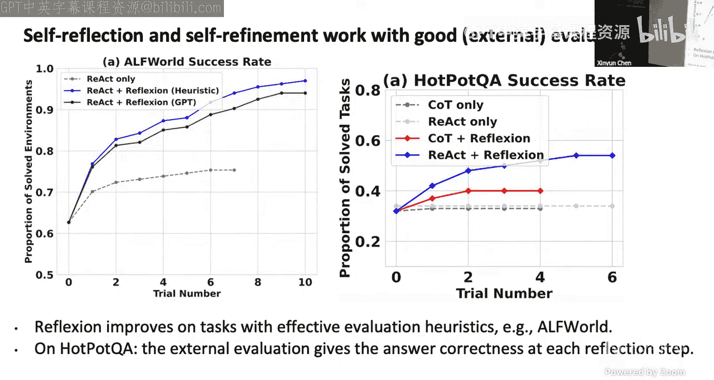

And if we think about this like self improvement loop for applications。

 then code generation is actually a pretty natural use case because when we are writing code for us。

 for example， we also debug our code better within an I D and we do not just write code and we stop we actually really rely on this interactive loop when we are trying to like investigate all this code execution results and see whether it makes sense and also which parts we should revise data。

 and this is also like this one fundamental idea of the recent coding agents。

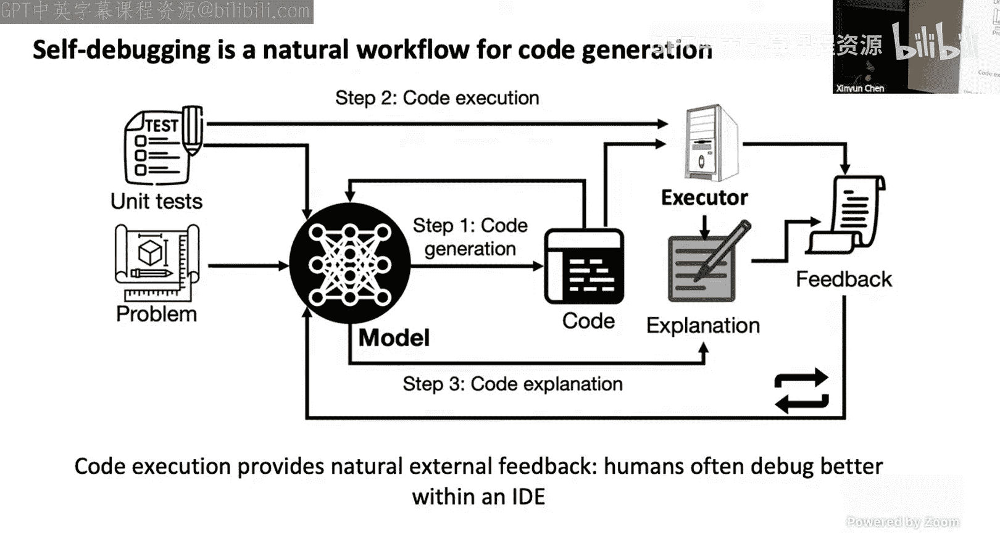

So in our paper， self debugging， we also like。Do a deeper dive into what kind of feedback formats will be helpful for the model to better correct its own mistakes。

So， for example， the the most like a simple feedback message message is basically a short universal information about whether the current code is correct or not without more information。

Aear for unit test feedback， basically， we also include the execution results like whether the current unit test has passed or whether there are any runtime errors。

L for co， basically at each step， we also ask the model to self generate some line by line explanation of the implementation in natural language。

 So this idea is that kind of motivated by human robot duck debugging。

 trying to ask the model to see that what what is trying to do in the code。And finally。

 in the trace feedback， basically， it we ask the model to perform some line line by line simulation of the execution trace by itself。

 This is also one way of debugging by human programmers。empirically。

 we evaluated the like the like latest large models at the time of paper publication last year。

 So basically， we consider see that with this self debugging loop。

 it consistency improves performance across different large models of different capabilities。

And also， if we give more informative feedback， it can further improve the debugging performance。Now。

 let's go back to list of self question for question answering tasks。Previously。

 we talked about this results of Hpo Q A and also in some other words， it can。

 It also shows this improvement of self question on other reasoning tasks。

 like a math problem solving。But all of this significant improvement comes from the assumption with an oracle verifier。

But in practice， this oracle verifier will not be available in in many scenarios。

 especially in the case of solving reason problems。

 you can imagine that when you are taking a math test。

 you don't really have the official solution at hand。 Otherwise。

 it will be just trivial for you to finish the exam。 So basically。

 the question here want to study is how do these models perform if we do not give the model such very like explicit and accurate external feedback about the response correctness。

So in our paper published last year， at I clear large language models cannot not self reasoning yet。

😮，We actually show some negative results from this study。So we compare with this oracle。

 like base time， where we basically utilize the ground truth answer for question and same as previous works。

 we show this huge improvement。L we studied the case of the real self question。

 where basically we do not allow the model to utilize any oracle feedback。

 The model needs to judge the response correctness by themselves。

Then these are the results we show in the bottom table。

You can see that the main issue here is that because large models can really judge the correctness of its predictions。

 it often turns an originally solution into a round one。

 So this is why actually in this exc question without external evaluation。

 this process can lead to worse performance after each round。

So with this study one natural question is probably we didn't the feedback prompt well。

 So this is why it fails。 So to address this question。

 we also kind we also like design like several variants of these feedback prompt and notice that all these feedback prompts are pretty general they are not as specific tuned for one task。

 So we can see that if we just have this like simple general purpose feedback prompt if we do not have any more like of the model training。

Then editing this feedback prompt indeed can affect the self crash behavior。

 but this is more about adjusting the tendency for the model to keep the initial response。

 So in some cases， actually is like a feedback after the feedback prompt update。

 there is no much regression on the reason performance。 But then in this case。

 this also doesn't help the model to improve over the initial performance。So previously。

 we discussed about this comparison。 If we just do this self question over one initial response。

And we further like compare with another method。 where basically we do list that cell question among multiple responses。

So for this， we compare with the multi agent debate baseline。 The idea is that we will。

 we will have the model generated like several responses in parallel ones。

 Then we prompt the large model to review this multiple responses and give an updated one。

For this multi agent debate， we will compare with self consistency。 recall of self consistencyencies。

 just compete generated solutions in parallel and select the response with the most consistent find common final answer。

So in the previous multi agentent debate papers， they are showing some improvement over self consistency。

 But we find that the major issue is that they do not like have a very rigorous comparison in terms of the token budget。

 So actually if we because in the multi agent debate。

 each round for this specific experiment has like three responses。But basically。

 if we keep the same number of response budget， we will see that actually still like self consistency scales better than the multi agentian debate。

 because at some point like this again， this multi agentian debate performance stops improving but with more responses。

 selfcon performance is still like improving on this GSM A K mass problem benchmark。

So given all this discussion， then the question here is that how we can best utilize the token budget by integrating all these different methods together。

So the fundamental question is here， basically， we need to understand how to balance the inference budget for generating multiple samples in parallel or sequentially。

So actually， this is a pretty difficult question because it really depends on the task and the model。

Basically， in essence， it's about like whether the model for your validation is good at self reflection and question for your specific task。

So here Im showing an example study from my colleagues at Google。

 where they are trying to like basically in these experiments。

 they are trying to find the optimal way to scale this token budget to solve the math problems。

 So actually here theyn a model which is supposed to be more specialized at a correcting math solutions and also basically here for for the different difficulty level of problems。

 They study what's the optimum ratio to like perform this parallel generation versus sequential generation。

So I would say least that concrete numbers will really vary a lot among different models。

 but basically here， the overall conclusion is that for simple problems。

 it actually the model can benefit more from self question because it knows more clear about where the current solution is wrong and how it should revise。

 but for harder problems actually there is a better point in like in the middle about how much you should perform power generation and also least like sequential refinement。

Along with this like kind of compute optimum like a factor per different that has difficulty of problems。

 they show that this like compute optum curve can also scale better than this complete parallel generation。

When we think about inference time compute， another factor we should consider is about the model size。

Because intuitively， with the same for budget， we can sample much more solutions from a lighter model。

 So if a， if a like more expensive model does not perform much better than a cheaper model。

 then it will not be a very optimal way to do the inference by calling the more expensive model。

So basically from this like empirical like a study from the paper inference scaling laws。

 So basically again， they will show that with the optimal model with different inference different inference budget can be like a different。

 like when you have like a smaller inference time budget。

 maybe you want to call rely more on like lighter models。

 but basically when you have more budget probably you can utilize the more expensive models which can probably give you some boost on those very challenging problems with the smaller models。

 it might like it will be very hard to come up with the final solution anyway。

So basically in this lecture， we have covered like different ways to to perform this like inference time scaling with like the more token budget。

 So we talk about the basic prompting techniques about this like search and selection to increase the ways of exporting the solution space。

 and also we talk about iterative improvement。And again。

 the best practice to interact with a large edge model should be adapted according to its capabilities。

 So you need really to consider model capabilityability and also the task in your hand about to think about how you can best that combine all these different techniques and design a more like like efficient and effective paradigm for your task。

Finally， I also want to talk about the general principle of how to design effective reasoning techniques。

 this actually will be helpful for both inference time techniques and training time techniques。

So I guess many of you might have heard about this bitter lesson from Richard Sutton。

 but if not I highly encourage you to read this like a web page， actually。

 I would say this is a very important guideline of for many of the like these modern machine learning works and especially with the reason development of large models and reasoning techniques。

So this like article itself has a lot of like text， but I will quote some most interesting。

 like a text in my opinion here。So basically， what we really want to develop as a method is basically those it can continue to scale with increased computation。

And when we want to like improve AI agents， we want to like basically teach the model to discover like what we can't not which content we have discovered。

 So it is more about like having some like a method so that we can in we can kind of trigger the model to know how it can keep improving itself and how to like have the right way to perform reasoning。

So this is the end of this lecture。 Thanks for listening。

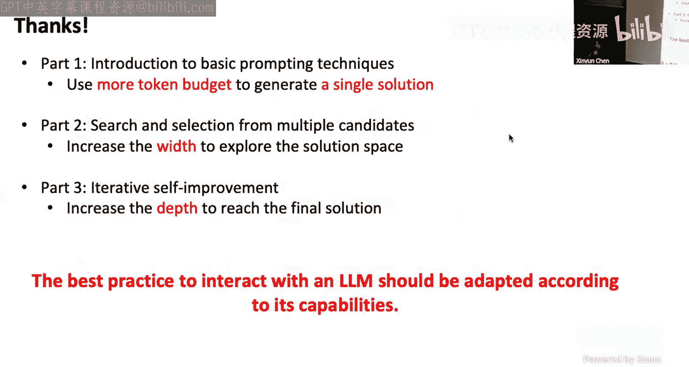