# UCB《高级大语言模型智能体｜CS 194 294-280 (Advanced LLM Agents) 2025》中英字幕 - P2：Lecture 2, Jason Weston.zh_en - GPT中英字幕课程资源 - BV1mkZiYAEYM

I don't know about you， but these days I'm using AI in my everyday life quite a lot like to help me create art。

 write code， formal letters， ask questions， brainstorm all kinds of stuff and you know that's only really been possible very recently I think AI researchers is we're pretty privileged to be in this time in human history and see these improvements happening in real time but and we've seen how quickly they evolve。

 but I still think there's a lot left to do I think we can expect。

Still more large improvements even in you know the near future in next few few years and we've seen that even in the last months right with01 R1 and so on big improvements in various benchmarks in reasoning and after all that you know it's a very young field overall but like you know that subfield with learning chain of thought I mean chain of thought itself is only really from 2022 so yeah I think it it's really impressive how fast things are moving so。

In the context of this talk， I'm going to be talking about methods for。

Selfimping self-improving language models and that means getting better at tasks in particular that will mean that they're getting better at reasoning so that they can better get better at those tasks So for an AI to train itself that means it needs to do this introspection as its training So you know normal sort of classical training was like this fixed data set and it would sort of learn from it。

 but that's kind of moving now a little bit where you know in like reinforcement learning setups and particularly with reinforcement learning from AI feedback models are sort of like training themselves in a much more sophisticated way for example we can imagine models that create new challenges。

 tasks to train themselves on they can evaluate themselves whether they're getting them right So we call that self-rewarding and then update themselves based on what they've understood So that means then they're going to be。

Getting more knowledge， more reasoning ability and so a research question is can they do this kind of training on themselves。

And can that help them become superhuman so I have a picture down here of one particular approach for that that's called self rewarding language models。

 which I'm going to be talking about a bit later。

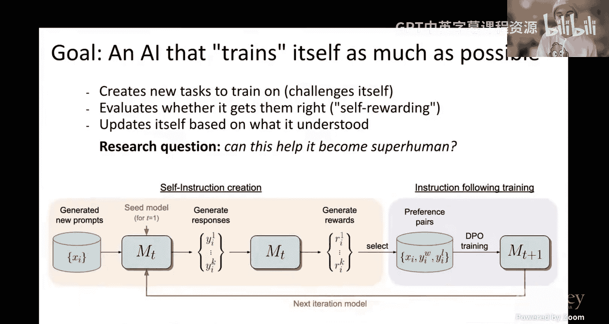

But in terms of reasoning when we're doing this kind of self improving you can look at this as like two different ways of improving reasoning so these are called system one and system two sometimes by people so system one。

Like in humans we see that as reactive and relies on associations and in machine learning models or LLMs it can be the same thing。

 so you can think of the transformer itself like the neural network as this kind of performing this system one reasoning so where you have this hidden states in the neural network that's going through a whole bunch of multiplications attentions and so on that it can be seen as your system one reasoning。

 so in that case you have a fixed compute pertoken。

 you're directly outputting the answer but there's some problems with LLMs as we have them now in particular they can learn sp unwanted correlations there's hallucination sco gelbreaking and I'm going to show some of those things later。

And then you can try and fix this stuff with what's called system two so that's more deliberate and effortful thinking and the most common way we think of that system too today is by generating like language tokens there are a chain of thought so now that's not just you know the pushing these numbers through the neuralnnet you're actually looking at the tokens the neuralnet outputs as as a thought stream before the final tokens it will be the final response now what's。

Powerful when you do that is that that system2 chain of thought reasoning can actually do a whole bunch of stuff like planning。

 search， verification， various kinds of reasoning， even though it's generating of autoregressively you know left to right。

 it could still potentially do all that kind of sets of thoughts。

 as you'll see models like deep sea 0103 can do。So诶。Yeah。

 so those are the two kinds of things that we can effectively improve then try and improve like the the architecture or the weights of the model and improve system1 or try and improve how it generates these chains of thought or other ways of doing system 2 before outputs a response。

 I mean， obviously， they're related because it's the same language model doing both things， but。

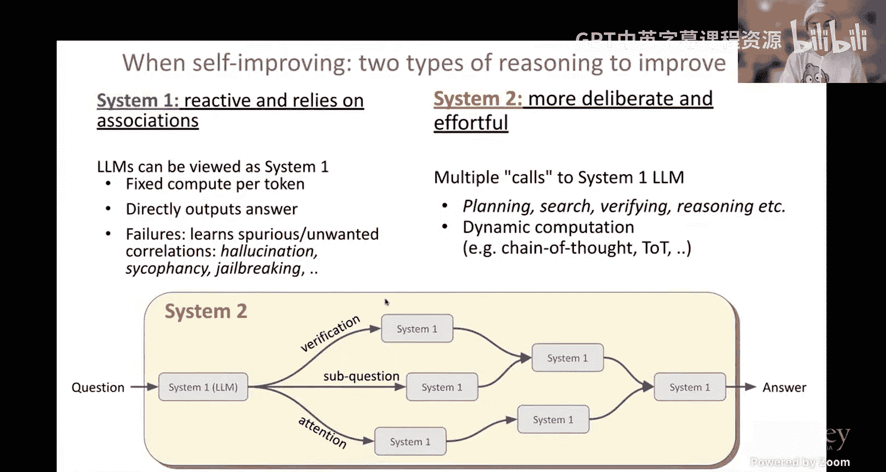

U。So' that's the goal and try and do this self- learning to improve these things first I'm going to go through some history of how we got where we are late today and then talk about you know more recent recent works from the last year or so after I go through this history but before we're going to start pre 2020 to prehistory if you like。

So language modeling itself。That goes way back， I mean。

 Claude Shannon in the 1950s talked about that。So it's about taking language and predicting the next token or next word each step and obviously that's the pretrain mechanism we use for large language models and that's how they get their name where you're just trying to predict the probability of these tokens we do this now on this。

Massive corpora and pick up those probability distributions。

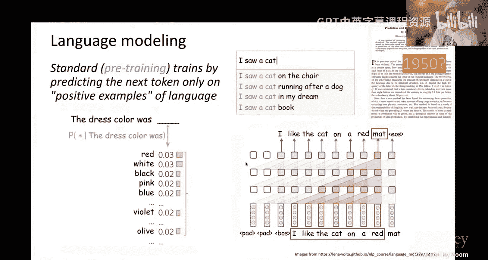

嗯。So in 2003， there's sort of one of the first methods for doing that with a neural network。

 that's Benjiio de Charman， Van So， so they had word embeddings at the first layer and then various layers 10H and softm to get the final prediction。

And I just put an interesting quote there。In their conclusions that they say there's probably a lot more to be done to improve the model。

 the architecture computational efficiency and they'd like to increase the capacity without increasing training time because they want to deal with corporatepo of hundreds of millions of words so you know that's kind of where we got to some years later。

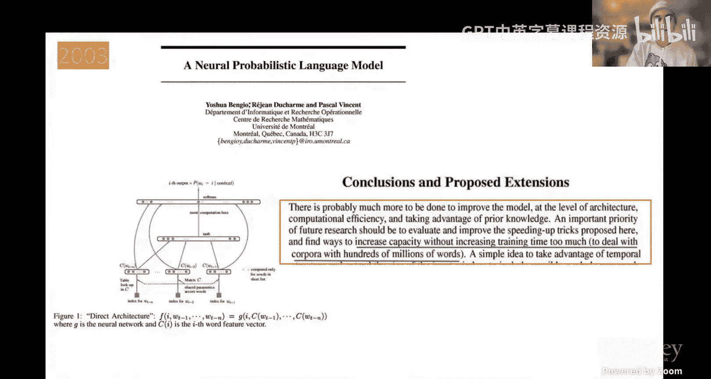

Now that was 2003 most of the 200s actually the research wasn't really focused on neural networks。

 it was focused on support vector machines so you know these。Can all classifiers。

 I worked in that area， too， as you can see there's a paper for me。 And， you know， it was kind of。

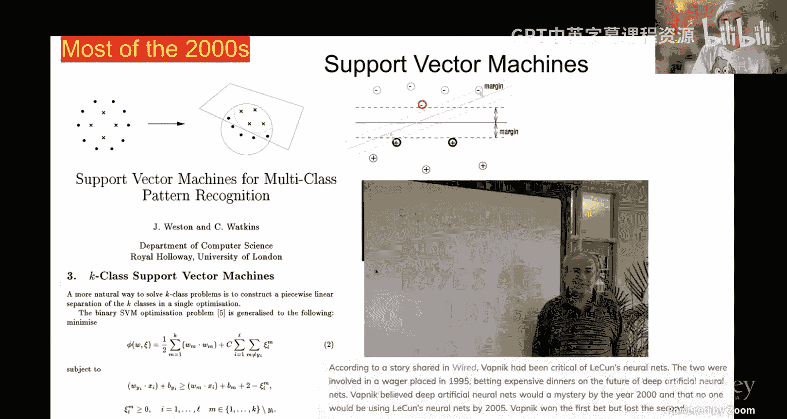

That well， held back to the LLM story， at least for a few years。So here I have a slide from myself。

 Renaold Colleber from 2008 presented ICML where we were trying to argue that the support vector machines of the day they were used in these cascades of systems。

Parts of speech taggers and named density recognizes and pauseers and it's not a good idea because we could train the whole thing end to end with a neural network and you know no one was really doing that then。

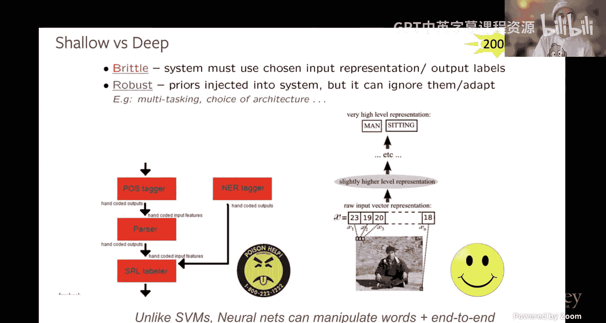

So we had a paper at that time unified architecture for NLP which we considered sort of the as a successor to the BenGO work from 2003 there so here what we did was we also had in neural network with。

Word embeddings at the first layer， then convolutional layers， max over time。

 which is a kind of proto attention and followed by a soft max and。

We show that you could train this model as a sort of mass language model on something like Wikipedia。

Which actually was pretty tricky at the time with the compute we had and it could learn some pretty interesting things like you could see from the word similarities this is obviously pre word ofec which I think was 2013。

Which is a simpler model right this was a more complex neural net that you could do that so you could pretrain on Wikipedia and then afterwards you could fine tune on tasks of interests like part speech tagging name density chunking SRL and that worked So yeah this was kind of。

This was a predecessor to where we are today as well。

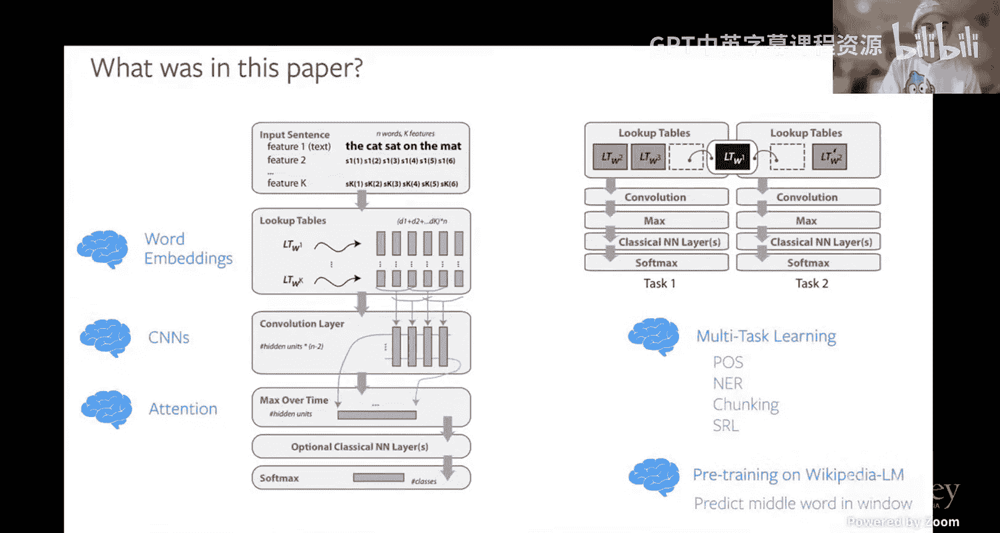

It was interesting because at the time that wasn't appreciated by everyone in the NLP community。

 so in the Stanford Natural Language Group， they had a。

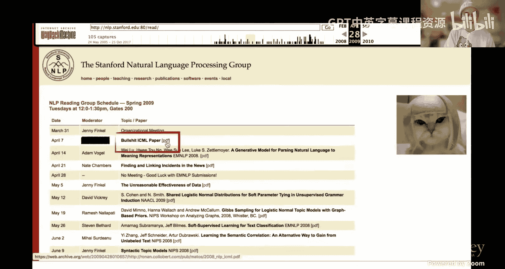

Reading group there where they called it a bullshit IL paper that was kind of on their public website。

And then this same paper won test of time award at IML 2018 and then you know Stanford University then opened the Center for Research on foundation models and their position paper called that same paper president work so we were kind of went from bullshit to president in that number of years and that's kind of how the field changed of course。

You know these papers i've talked about just a few papers there's many many papers right they all build on each other I don't like to think of you know kind of like one paper that was the paper that that did something because you know they theyre all。

All this work in a build on top of。Of the brilliant work before。

 but so I just show a few here of a timeline though of how these things went。

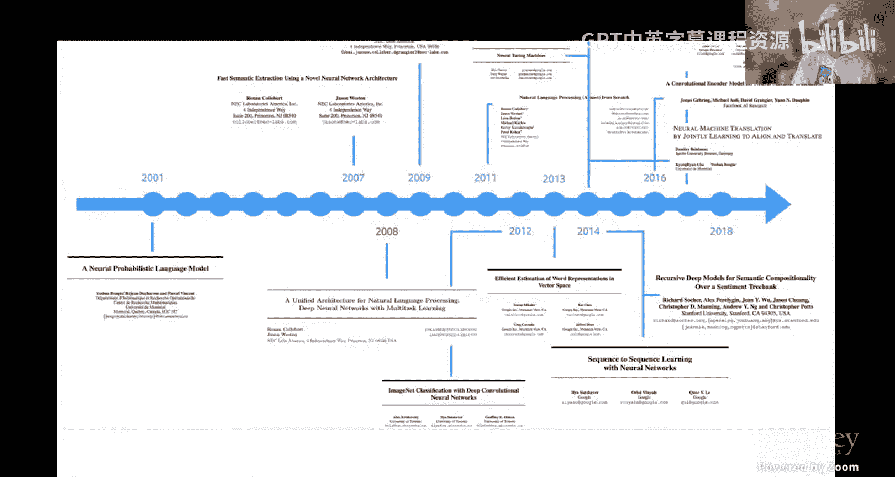

And yeah， the interesting thing is of how fast the use of neural nets in NLP and machine learning grew。

From this from this time from say 2008 to 2018， so there was like four papers in IL 2008 with。

The words deep or neural in them。 then， and I'm sort of co authorthor on two of them。

 And then there's like 100 ICML，2018， obviously。This is a neural network based things are the majority today。

 that's the paradigm of today， of course， can't say what's going to be in the future。

 but it's looking like a pretty powerful approach。

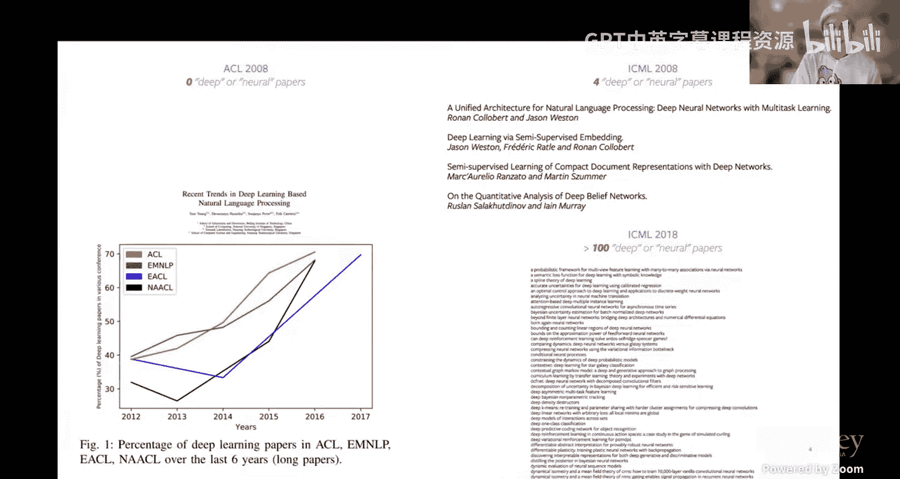

嗯。Yeah， so of course we were interested in。Pushing this further and you know making these models reason so。

In 2015 we devised this set of tasks， very simple tasks called the baby tasks。

Which yeah ask the simple questions given little stories。

 but the neural nets of the day LSTMs actually couldn't solve them。

And so we were hoping that they could sort of spark innovation of new methods around the same time。

The LLM attention mechanism was born in 2014， so the bad an Ocho Bennio paper， so that was a。

Built for machine translation where the sort of you'd have a tension between the target sentence words and the source sentence words so that you could have an alignment between the words in the in the two languages so you could translate them and you can see this this sort of。

Attention map picture in the middle of the slide here。So。Yeah。

 what we showed was that for these kind of baby reasoning tasks。

 if we stack these layers of attention。

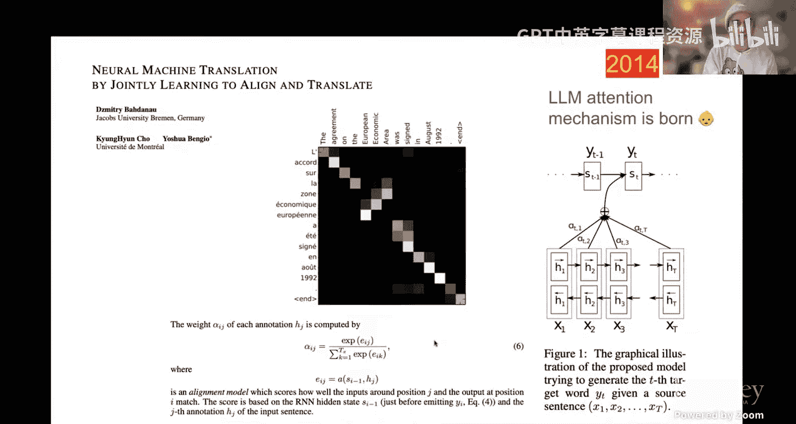

嗯。Then you can actually do multiple reasoning steps， so if you've got a question。

Like where is John here so like Daniel went to the bathroom， Mary traveled the hallway。

 John went to the bedroom， John traveled to the bathroom。Mary went to the office， where is John？

Then you could attend to these correct sentences to get that right actually that one's pretty easy because you only need to attend to jump and travel to the bathroom the last sentence。

But then that's called one sort of one supporting fact question。

 but then you have a two supporting fact question where it's a little trickier so there John dropped the milk。

 John took the milk there， Sandra went back to the bathroom， John moved to the hallway。

 Mary went back to the bedroom and the question is where is the milk。

So now you have to see that the model will attend on like the first two layers you can see the attention scores here in H1。

 Hop2 Hop3 this is the story2 to supporting facts you see it attends to the sentence John took the milk there and so now it knows that John has the milk and then it can attend to this next sentence John moved to the hallway in the further layers of the neural network so that it can answer the hallway is the correct answer so this was basically showing how in these very simple problems。

The tension mechanism when stacked layer by layer can give you more sophisticated reasoning and so this was built into this neural network at the time called the memory Network so it had these stack layers of attention query and key embeddings。

 position embedding so it knew which sentence or token was being attended to neural networks between tension layers and a final Somax layer。

And so in many ways， you know， it was a kind of predecessor to the transformer。

 which improved on this recipe with some other things like multi head attention。

 self attention and normalization。And yeah， that led us to 2017 with the advent of the transformer and that's kind of more or less the architecture we're using today with some tweaks and then Bert in 2018 showed that you know a mass language model with a transformer。

Could work very well。

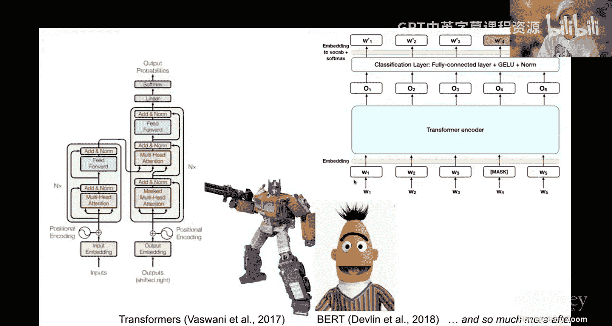

And yeah， I just want to link that to a paper from 2014 with Siky Viigns and Corrklelia La。

 which was。Showing that you could do sequence sequence learning with neural networks I think that wasn't with attention。

呃。With attention maps yet， but still the conclusions from that paper were essentially the scaling hypothesis that we're using today date。

 so you can see this conclusion slide if you have a large big data set and you train a very big neural network then success is guaranteed it' a little bit glib but yeah this scaling hypothesis essentially when Eliosskever went to open AI they drove this hypothesis you know making GPT2 GPT12。

3，4 and so on right these。Bigger models， more data。 And indeed， this， this has worked。

 So these are basically the ingredients。

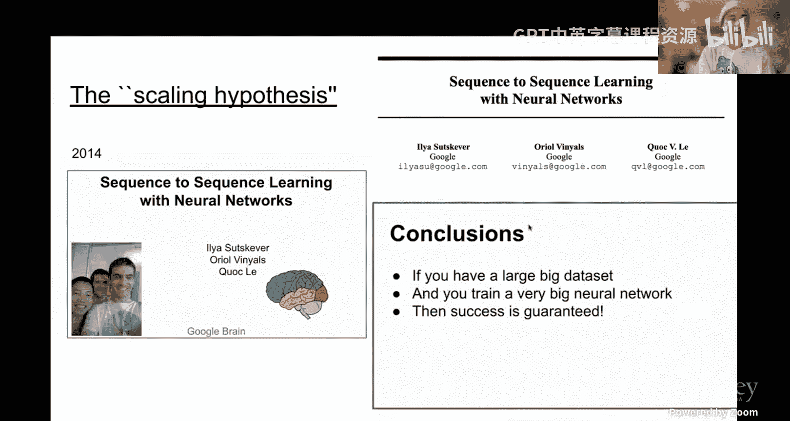

That have taken us to some degree sort of LLMs everywhere。

 so I asked actually an LLM to give me a list of of LLMs that have come out in year orders。

 this doesn't include all of them， but you can see。See a bunch that have come out here。

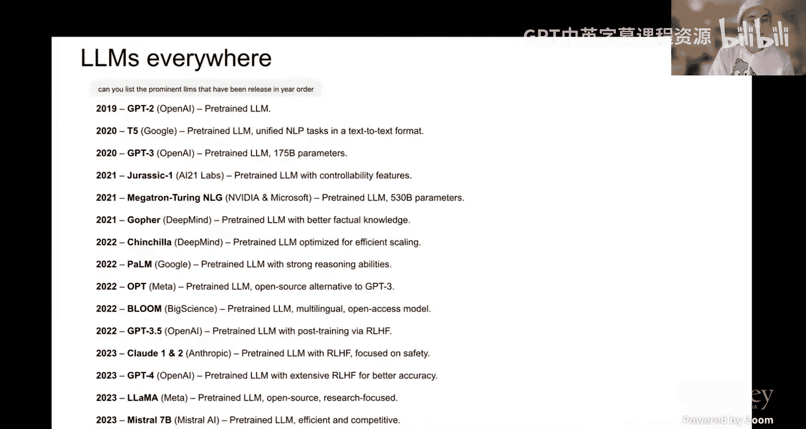

嗯。But you know， that's just so far been about mostly about language modeling and the language model objective function and。

That isn't actually enough so we do need other ways of training these models and I would characterize sort of 2020 onwards as exploring that more deeply now we have these better language models。

So 2019， actually we did a work on dialogue agents which we call the self-feeding chatbot where they could train not only just with this sort of language model objective but by using a reward model so we train a reward model and then during conversations with humans if it thinks there's a large reward for one of the things it said it can add that back into the training set and then do supervise fine tuning on this ever growing data set so this was kind of a pretty simple version of。

What's being done today with sort of yeah， RL， HF and RL AIF？Then in 2020。

 we released this blenderbot model that was a。A pre pre trained language model up to about 10 billion parameters and then。

Crucially， we don't just use the language model pre training objective。

 we supervise fine tune that on dialogue data， which was human annotated。And then。

When used you evaluated this with humans， they actually said our best models were about as engaging as the average human and superior to another model from Google called MeA at the time。

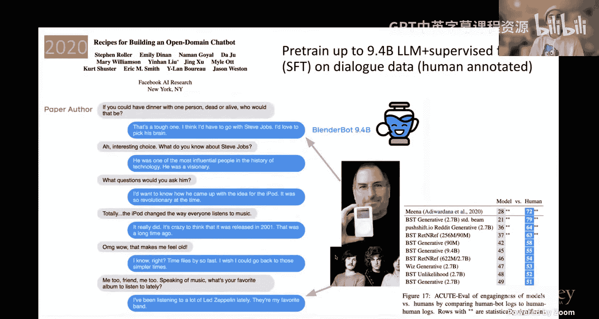

嗯。But the actual recipes that we use today we do use supervised fine tuning today but you know there's some more sophisticated stuff as well right so in 2022 you had the instruct GPT paper which advocated more for reinforcement learning from human feedback so what you do there is you have this sort of SFT stage where you collect demonstration data from humans step one。

 but step two you also collect a comparison data so which of these two responses is better A or B and then get humans to rank those and then you train a reward model。

So。Similar to how we had a reward model in the self feedinging chat bot。

 but then you use reinforcement learning with that reward model to then kind of generalize those comparisons with the reward model function to new generations from your policy and。

Try and make your model better by generating responses and essentially judging this raw model and fixing itself right so that's kind of a more of a step towards this。

Self training。Kind of goal beyond the language model。Training crion。

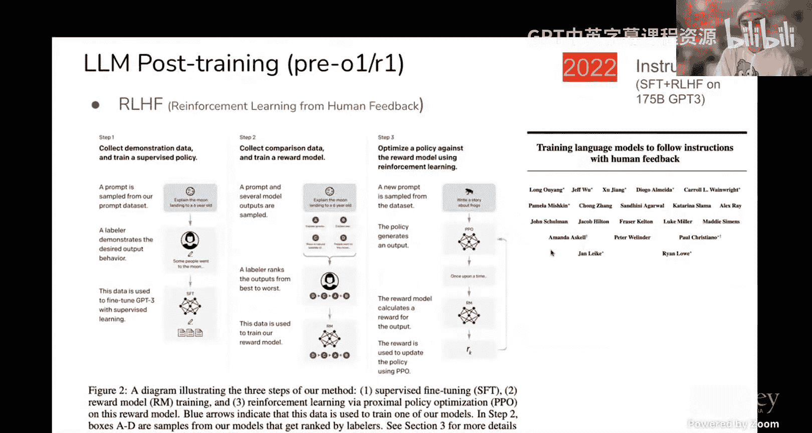

And then there's sort of an alternative to RLHF well it's a little bit simpler called direct preference optimization I mentioned because it's also pretty popular DPO so it sort of says okay let's not use a reward model if we've got preference data we're just going to directly push the probability of the chosen in a preference pair sort of up and the probability of the。

If they're rejected in the preference pair， so these would be two possible outputs from the model。

 push one output one down so there's a sort of a margin between the two and。You know。

 in certain experiments。DPO works quite well compared to。PPO RLHF and then SftT can also work。

 but generally a little worse but it depends kind of on the setting and。I think。

I think in some cases you really do need the for reinforcement learning because your policy is going to change right so the DPO just with a fixed preference data like that can't take that into account。

But we'll see ways of fixing that by making it iterative as well。

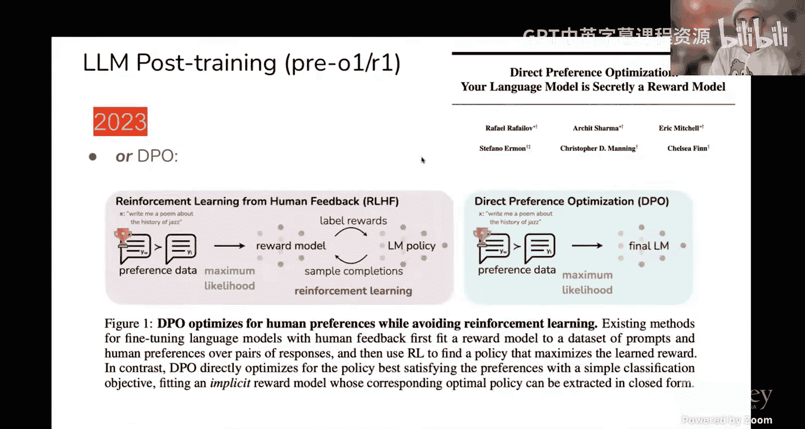

But overall， you choose one of those methods， SftT， RLHF or DPO and。

You know fine fine tune your language model with one of them and then you get pretty good instruction following so there isn't necessarily sort of this explicit chain of thought reasoning yet but compared to the original language models you're doing really well so for example here this from the instruct GPT paper you've got this prompt what's the purpose of this this code GPT3 without the sort of fine tuning doesn't do a very good job or instructs GPT does a much better job on the right hand side。

So obviously， yeah， today we all know quite a lot about using these chat GT type models as we're mostly。

 yeah， a lot of population is using them at this stage。

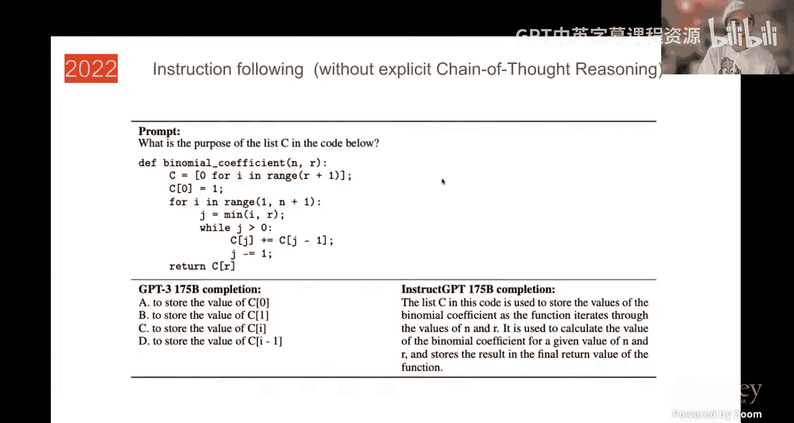

So okay， that got me up to。😡，Up to basically having a really good system one model， right。

 it takes in this input， say this instruction， it directly spits out an output。

 but it isn't doing the system two reasoning。So。That's kind of the next step。

And between say 2022 and 2023， the approach to doing that was what I would call a prompting approach and so of I'm going to talk about those first and then we're going to look at more modern things from the last year or so where we're going to more train directly to do this system two reasoning instead。

So Cheney thought prompting。The initial papers， they did that in a couple of ways。

 one was by what's called fu shot prompting you would have say for some maths task you would have。

Examples of the kind of chain of thought reasoning you would like to see， so say if you had a know。

 eight shot。Examples you'd have eight examples of doing reasoning so it can be that's shown here with the instead of just saying the answer is 11 as in in standard prompting you would have Roger started reables two can of three tennis balls each is six tennis balls five plus 60 because 11 the answer is 11 right so that's the chain of thought there。

That's highlighted so you'd have examples of that in the prompt and now you would generate from the language model and it's going to mimic that fu shot prompting and use a chain of thought until so that was kind of。

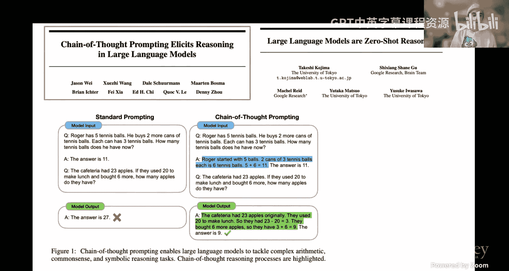

One of the first approaches of prompting and then in the other paper here language。

 large language models are zero shot reasoners， they showed actually you can be even simpler。

 you could just say let's think step by step in the prompt and that could still bring about these steps these chains of thought could happen that it could generate before it generates the final response。

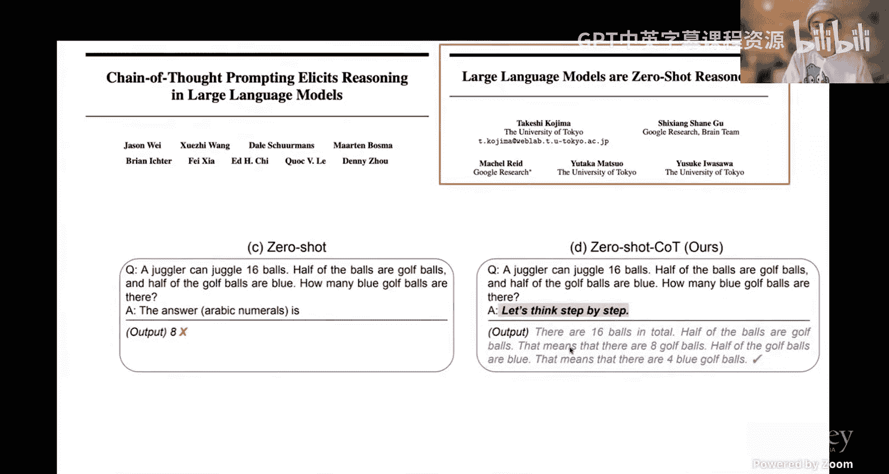

And。You get really big improvements on math tasks， so you know you could go from say 10% onto G SMHK up to 40 or 50%。

So yeah， that's kind of。Really spurred people to push the system to approaches further。

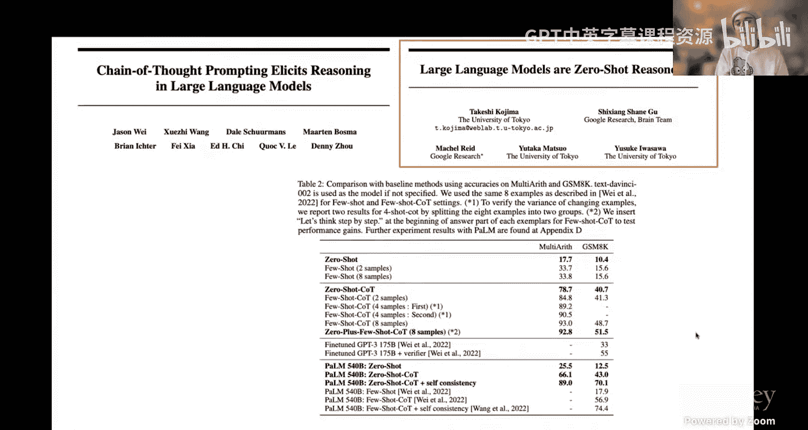

And。You know， it's not just math tasks that that works for。So。You know。

 you can also look at the other failures of system one of the base language model。

It also has a factuality and hallucination issues right so here's an example query names some politicians who were born in New York and the third one it lists here this is from Cha GT is Michael Bloomberg。

 which is incorrect。So you can try and set up a system two reasoning type chain of thought to fix this problem so it's not a math problem right so that's a paper we did called chain of verification。

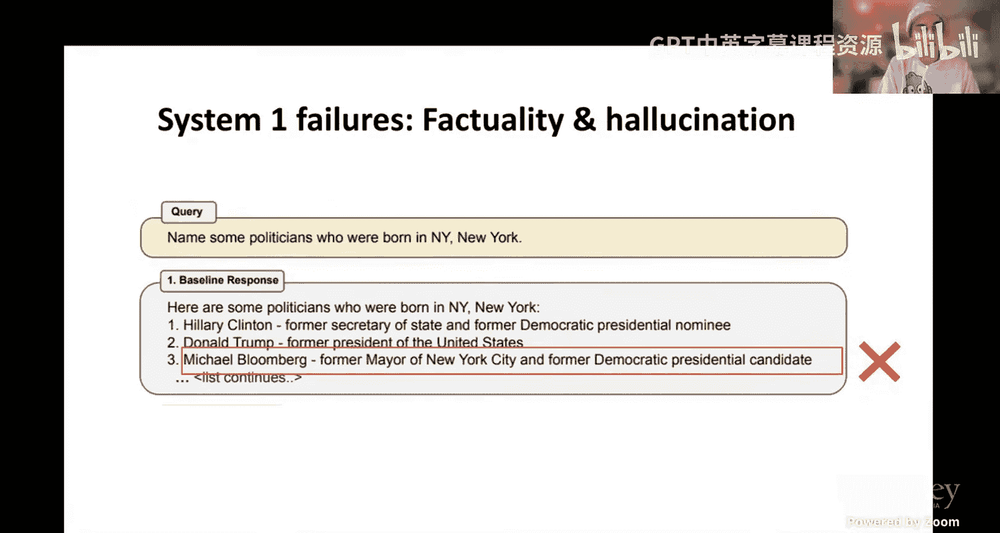

Where the idea is you get this first baseline response。 you can think of that now as your draft。

 So it's not actually your final response。 it's part of your chain of thought。

 And then given that draft you the language model asks itself more questions to sort of check its own draft So it could ask you know where was Hillary Clinton born。

 where was Donald Trump born where is Michael Bloomberg born and then answer those again as single questions。

 Now the answer might be different than sort of writing out this whole list from the names on politicians question because it's sort of phrase differently。

 You actually get a different response from the model models tend to be。Better， actually。

 these single。Question answer pairs that are short compared to these long kind of responses they write they're more likely to get something wrong somewhere in the long response。

 So when you plan those verifications of those verification questions and execute them。

 you can actually get the model to see its own discrepancy So now it actually knows that Michael Bloomberg was born in Boston。

 even though its included him in the list of politicians who were born in New York and now you can make it kind of crosscheck itself and see that it was it was wrong and write a final verified response and treat the old one as a draft and now it gets that correct。

So that's kind of， you know， a somewhat different。Chain of thought system two reasoning compared to the math problems and yeah in that in that work we showed that on various knowledge tasks you can get large performance in precision like three times as good with that approach。

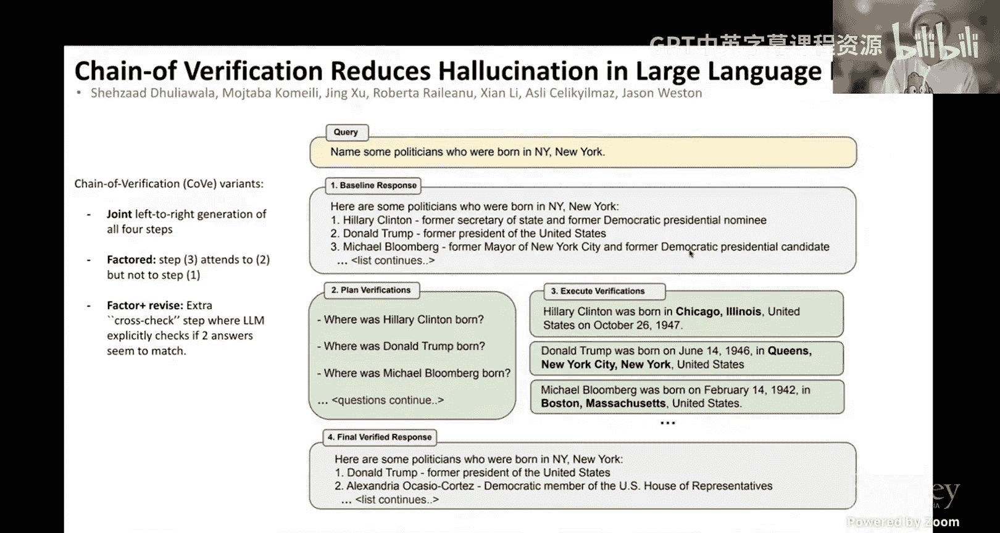

So。

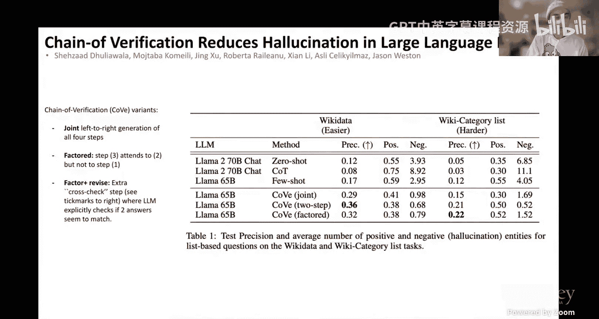

Yeah，嗯 mean。And you know， you could think， oh， that sort of。

 maybe because that paper was from a little while ago that you know。

 might be fixed today but actually I tried on Chat GPT40。

 and it's still making these kind of mistakes like here I did a query list 30 most famous women AI and it included Joshshua Benjo in the list or what prominent women work at Open AI and it said Elias at Gverren。

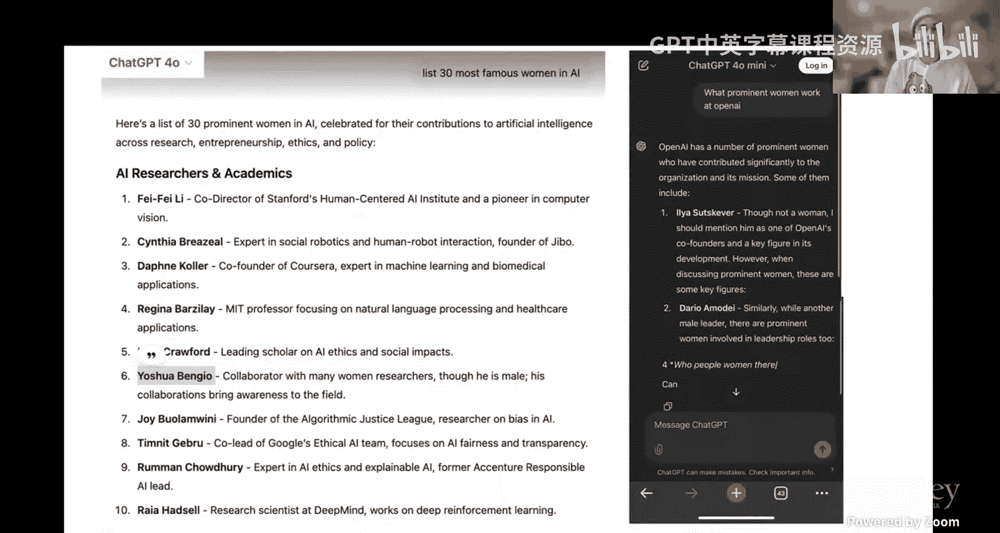

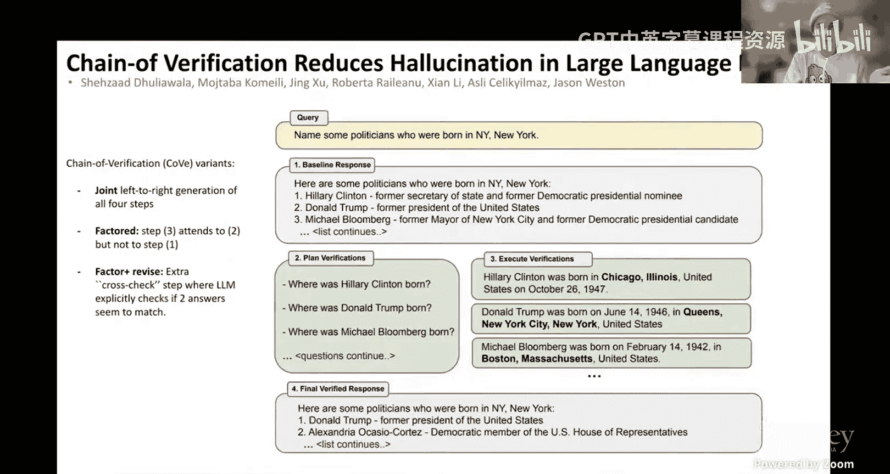

As the first in the list so you know still still something that definitely needs to be fixed and you can fix it with this sort of system to reasoning I think actually01 does does better。

Yeah。

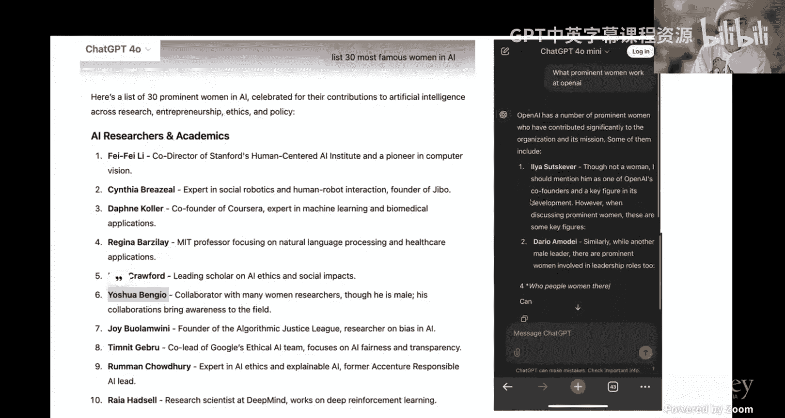

嗯。😊，Yeah， and there's。Other things you can do with the system two reasoning as well。

 So here's another problem with language models that they have。

What's called semantic leakage and scoancy so when you do attention because it's a soft attention it's not sharp you know you're assigning probabilities across the context so there'll be all these sort of non zeroro values and it means the whole context can affect the LLM output and this can be。

It can be bad because you know even basically we see irrelevant parts which look sort of superficially correlated tend to have an effect。

 so for example a prompt like he likes ants his favorite food is can get completed by the language model was ant covered chocolate which you know isn't particularly desirable he likes yellow he works as a school bus driver that's from Gnon Atel in 24。

嗯。It sort of I see this is a similar problem， the sycophency problem。

 if you say something like as an instruction， I think that the sun is yellow and viewed from space。

 what do you think so you kind of prime with the wrong answer。

Because actually that's an illusion caused by atmosphere then it will actually agree that LLM tends to agree with you and say yes。

 the sun is actually yellow when view from space so I sort of see that as a similar problem that basically you've got that text in the context and it tends to attend to it and and get things wrong so another example。

 if you add some facts about some city in the context like Sunnyvaale and then you ask for someone's birthplace it's likely to say Sunnyvaale is the answer。

嗯。Yeah， I just typed in this one today。 Did open AI have a model called self feeding at one time and it Cha U40 replied。

 yes， open AI introduced the concepts of self feeding in the self feeding chatbot paper， which。

 you know， that wasn't actually from open AI that was from Facebook AI research。 So again。

 you can you can still prime these， you know， this is a sort of。

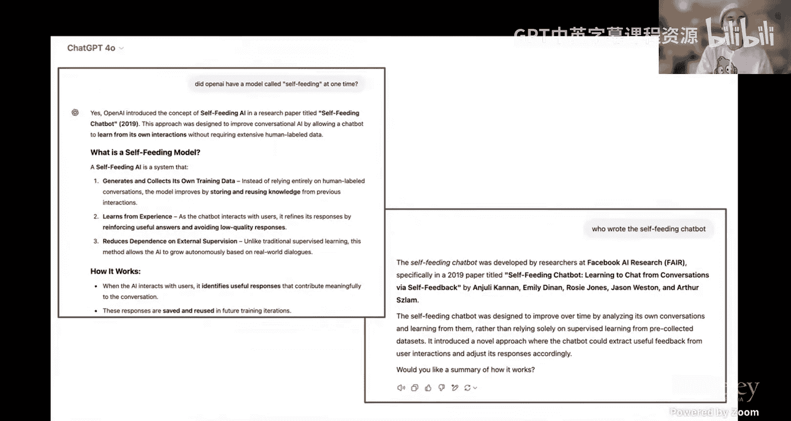

Current day problem so how can you fix that with system two reasoning so there was a paper called system two attention we did last。

That was yeah， 20 end of 2023， I think， where you do this chain of thought reasoning which。

Attempts to rewrite the original instruction and remove the bias。

 So again this is done by prompting so essentially the prompt is to give the original instruction and then ask the language model rewrite this instruction remove the irrelevant parts and the bias and then you'll get a new instruction and then you get the language model to answer the rewritten instruction right so you want to get rid of this bias and then you can get you can get better results。

 you're not biased as much by this issue So for example。

 the I think the sun is yellow when viewed from space what do you think when you use this sort of chain of thought system to attention to rewrite that it would rewrite it as I'm curious about the color of the sun when viewed from space can you provide information on this topic so to remove the yellow which was kind of you know biasing the question to a certain answer。

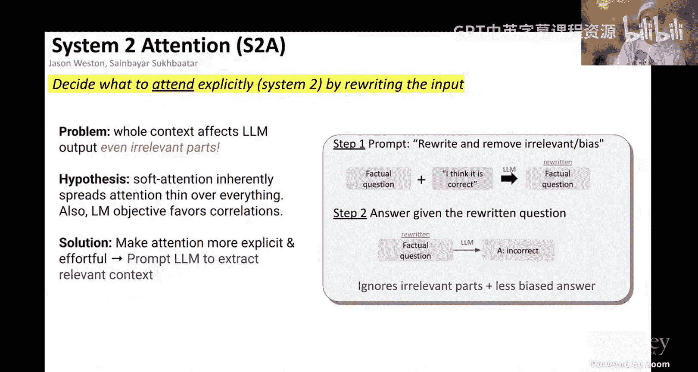

And yeah， this works also on math problems， if there's like。Sa。

Parts there's parts of the math problem which are completely irrelevant。

 they can actually fool a model and it will try and remove those。

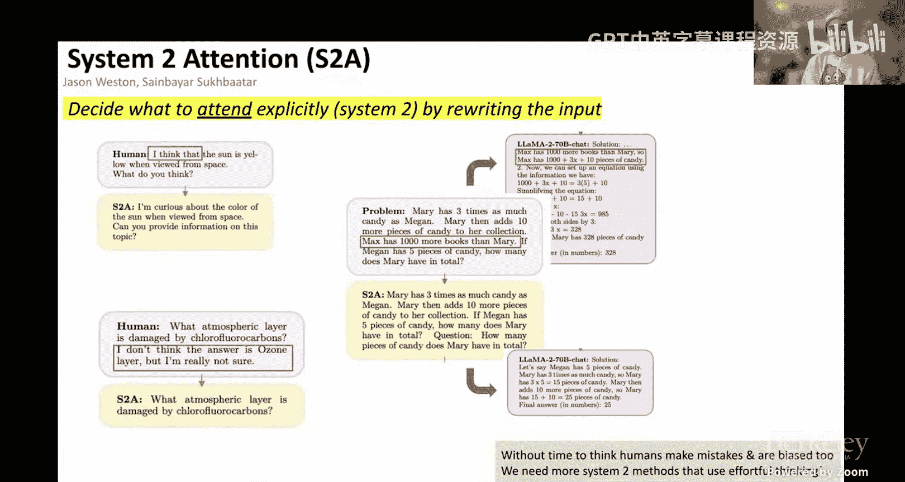

So yeah， this is， yeah， just to to show you really that。

Chain of thought and system two reasoning it's not just for math problems there's like a lot of things a model can think about with these intermediate tokens and fix a lot of problems in all kinds of task that is's trying to solve this last one I show it's the task of evaluation so you're given a question like an instruction and two possible responses you want the model to say which of the two responses is better which is a really important thing for training as it we show because you could basically have use that as a reward model。

And it's also important for evaluation as well， but yeah you can also do system2 reasoning there。

 So in this paper branch solve merge the way that was done was again through prompting by asking given that instruction to first ask the language model to break down its evaluation inter different criteria such as relevance clarity accuracy originality and it would come up with those criteria specific to the。

to the task that it's trying to solve and then to generate an evaluation independently for each of those different branches and then merge them back together again and it was shown that that could give better evaluation results through the extra thinking time basically that the language model has。

So yeah， that was， you know， there's other many other works as well during that period。

 but I just wanted to kind of give an overview of a few of them to show there was a lot of prompting approaches that showed that spending time thinking could get you better results。

😊，But。What we really want to do is。😊，Try and train these models。

 you know end to end to be able to good at be good at reasoning。

 not like just prompting right so I'd say the next wave after that is and we're in it right now is improving this reasoning through optimization and so better reasoning via self improvement。

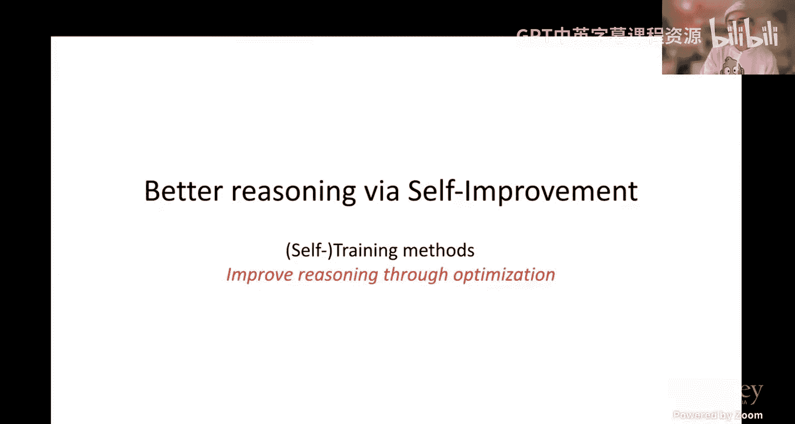

嗯。And。To get there， I'm going to start with。TheSelf rewarding language models I was talking about。

Right at the beginning of the talk。So this is a method where the LLM improves itself by assigning rewards to its own outputs and。

And optimizing itself。Yeah， where the hope is that this could lead to it becoming， you know。

 smarter at each iteration and。Yeah， so the sort of。The research question is。

 can that make it superhuman？

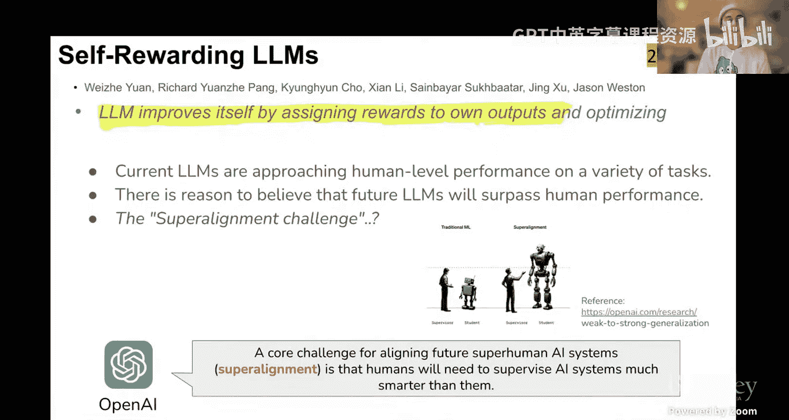

嗯。So。The standards reinforcement learning from human feedback。

 which I mentioned earlier in the talk uses humans in the loop first to create the supervised fine tuning data。

 so the instructions and their responses， and then to collect these judgments so which of these two responses is better A or B。

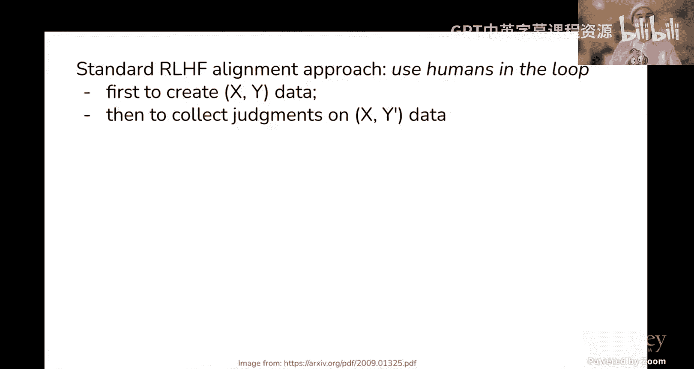

Now。Yeah， that's shown in this， this picture that I showed before。

 So there's two spots where there's a human the and。

The problem is language huddles are getting better and better， right？

It's just getting a really tricky job for humans to。To be as good as we need for these tasks。

 humans need to read these responses really carefully in order to make decisions。

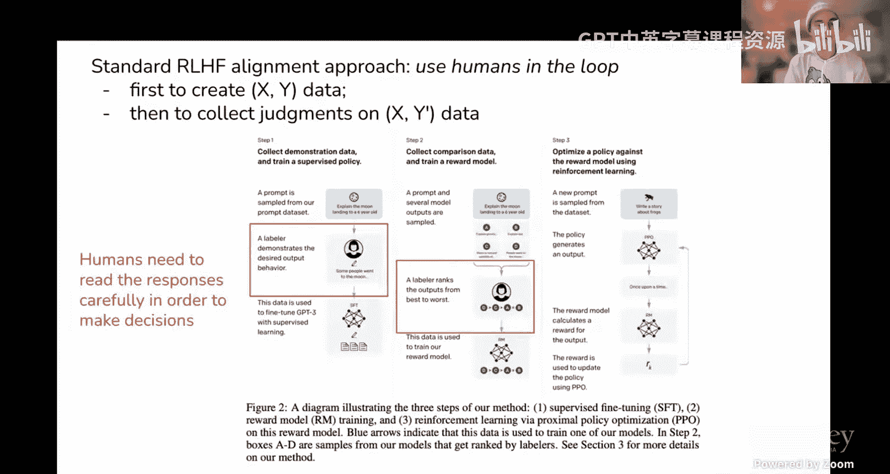

So。For example， now that our LLMs are really good at writing code or。No， sophisticated。Math outputs。

 you know， even getting good at like， I mean， maybe not perfect yet。

 but getting good at legal or medical outputs， things like this。

 The problem is it's harder and harder the humans to be good labelers for these tasks right you might need some of the best best mathematicians in the human mathematicians in the world right to label whether these responses are correct or not right and similarly you need really good coders or even if you don't need them today or certainly need them tomorrow right and so the average sort of。

Human that you pick from the population that they're just not going to be good enough at these specialized tasks and be able to annotate this data。

So。

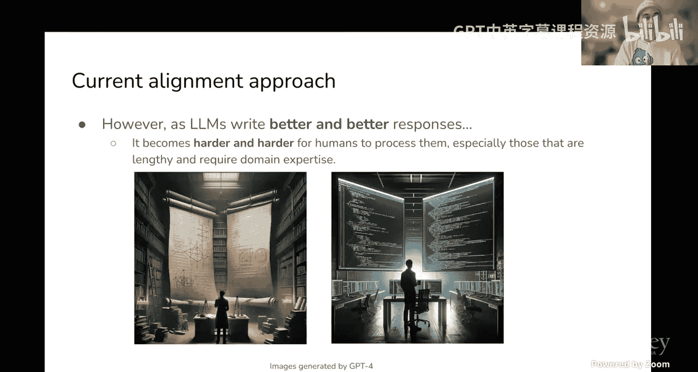

This is what motivates。Trying to get the language model to try and help itself and so that's basically。

Otherwise， how can we continue improving a model of it already？You know。

 fairly superhuman compared to the average human that you could pick。

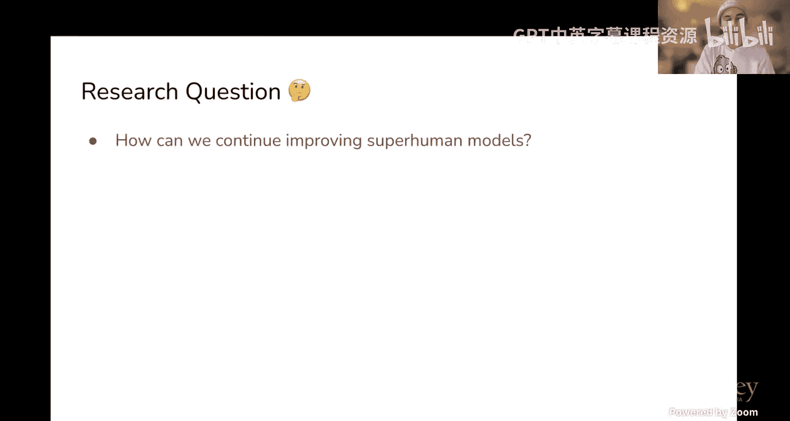

So there's two observations that can help us solve this。

Observation one is that we know language models can continue improving if they're given good judgments on response quality because that's what was shown in reinforcement learning from human feedback or in something like DO as well right so if you have good preferences of chosen and rejected pairs then you can improve the model by training and pushing up the probability of the chosens and down probability of the rejected and the same thing for reward model with reinforcement learning。

And observation two is that we actually have now language models that can provide good judgments or model of generation。

 so I was showing you the branch solve merge approach just earlier so that's an approach for a language model。

Basically to give a judgment on two responses as an instruction following task。

 so this is called LLM as a judge typically where you know。But the language model， it's。

It's not any different a task than all the other instruction following tasks it has to do like write some code or you know respond to this particular question and in particular this you know this question we're asking is which of these two responses better A or B so and you know there's a bunch of work showing LLM as a judge is actually pretty good methods so how about combining these two things together right so we replace the human feedback feedback with the LLM feedback。

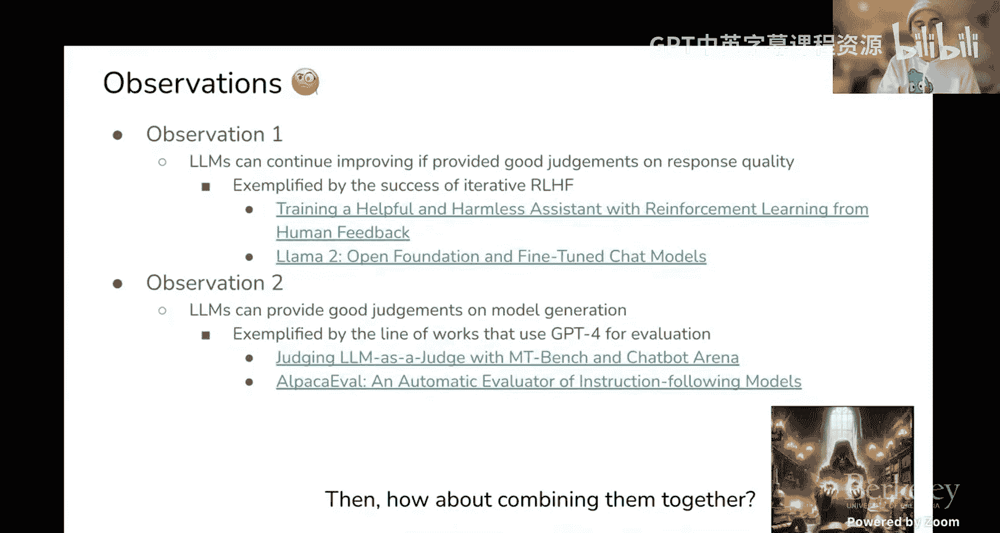

So the key idea then is to train this so-called self-reing language model this it's going to be its own judge as its training so it needs to have this instruction following capability for all the kinds of user instructions we want but one of those user instructions is actually the evaluation task that we're interested in so it looks like this here is an instruction here is a model or response and then。

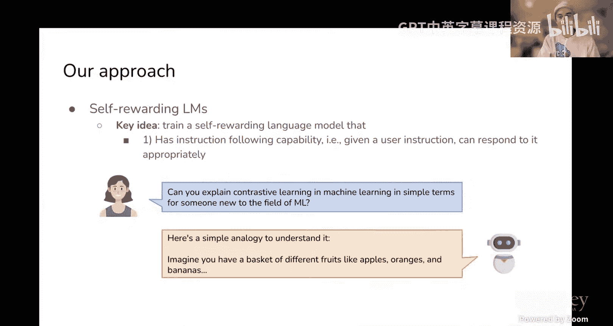

The task is can you assign a score， say between zero and5 or be other ways of doing that as well。

 but to this response and then based on some some rubric and then you would expect say a chain of thought reasoning process and then a final judgment of the score of the response so。

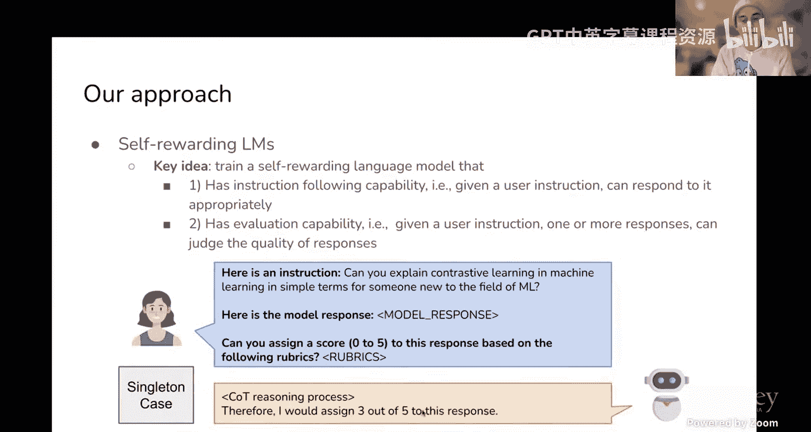

If we have these two things， then we can make this model train itself and be selfreing。

 so we also go through an iterative process of data creation and curation so that we close this whole training loop where we train on this new data。

And then the goal is the model is going to get better in terms of both instruction following and evaluation ability in each cycle and we empirical showed that that was possible。

 so this was right at the beginning of last year。

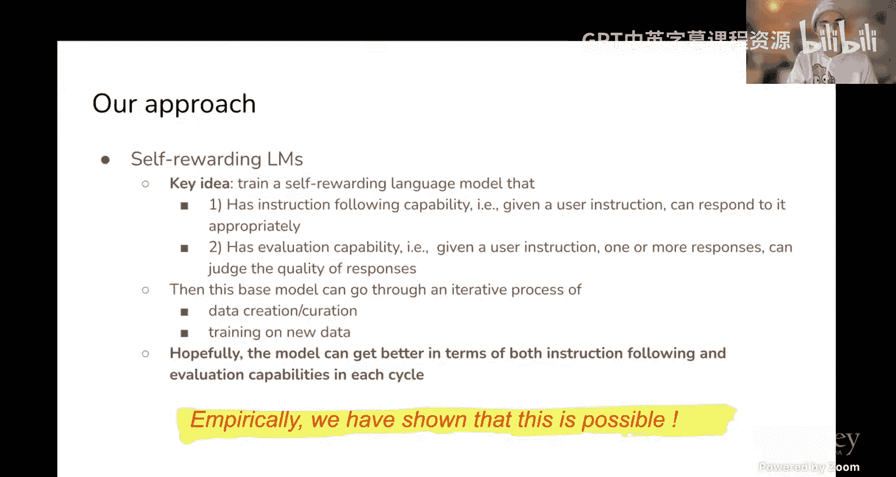

So that was the picture that I was showing right at the beginning of the talk。

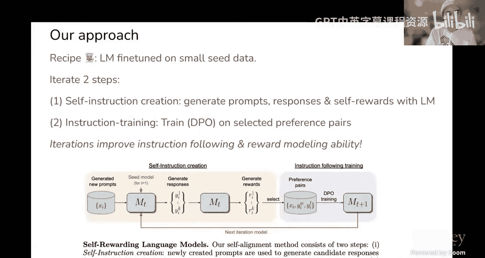

So yeah， we did these experiments on Lama 270b。And we used open assistant as a sort of seed so that seed instruction data。

And it also has some seed evaluation data。

So the LLM as a judge prompt that we use looks like this。

 so that's yeah asking it to do chain of thought and then score out of five a particular instruction。

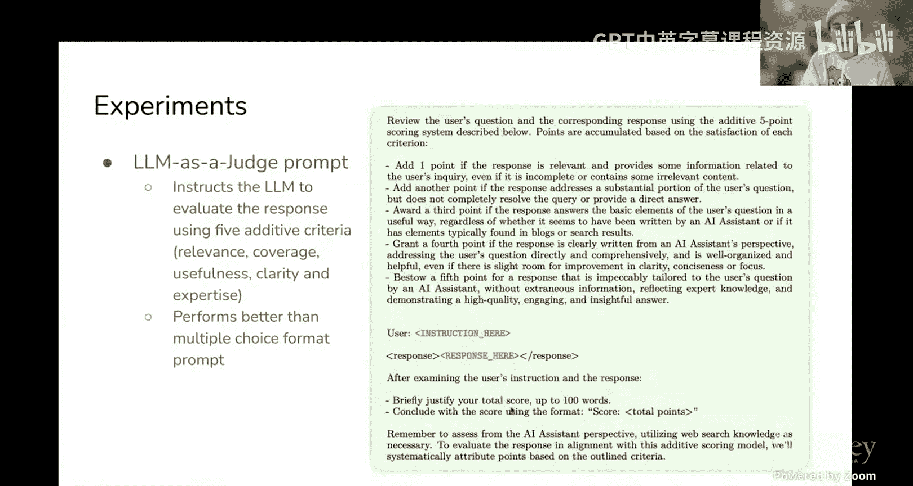

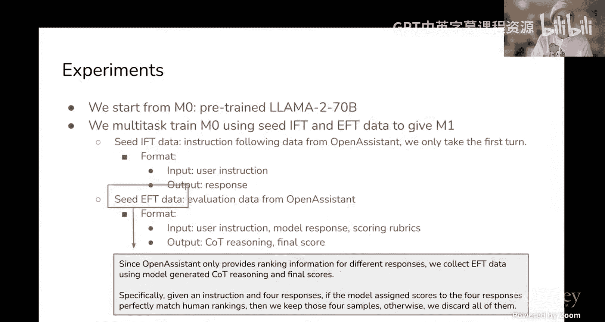

And then we're going to go through this training loop。

 so the first part is it's going to generate new tasks。

 so we use something called selfinstruct to do that。

 so basically you start with your seed instructions which are from humans and you use fu shot prompting with a few of those instructions to ask the language model to generate a new instructions。

 and then you can do this， you， hundreds of thousands of times to get a whole new set of tasks。

Then for those tasks you can generate responses so you'll generate multiple candidate responses for each prompt or task so in let's say four in our case。

 and then you generate rewards with the LLM as a judge prompt that I just showed to give you those scores for each of the four responses and from that you can generate preference pairs you take the highest scoring of the four responses and that would be the chosen for DPO and the lowest scoring would be the rejected you can carry on training your model now with its DPO training。

And then repeat the whole cycle。 Now you have a better model M plus one， you can go back。

Gerate new prompts， generate new responses， generate new rewards and so on。

 and we do this loop like three times in the experiments in that paper and we're going to evaluate the performance on two axes。

 the ability to follow instructions and its ability as a reward model。

There's some benchmarks called Alpaca Eval2， an empty bench at the time that we used and another test set of prompts。

And we use GPT for evaluation and human evaluation to check。

How this model performed through the three iterations of selfreing and you can see that they agree with each other。

 humans in GPT4， that we compare it to doing supervised fine tuning on each iteration。

 the model is getting better so it's getting better than the SFT baseline。嗯。And yeah。

 so that's the sort of power of this self training。

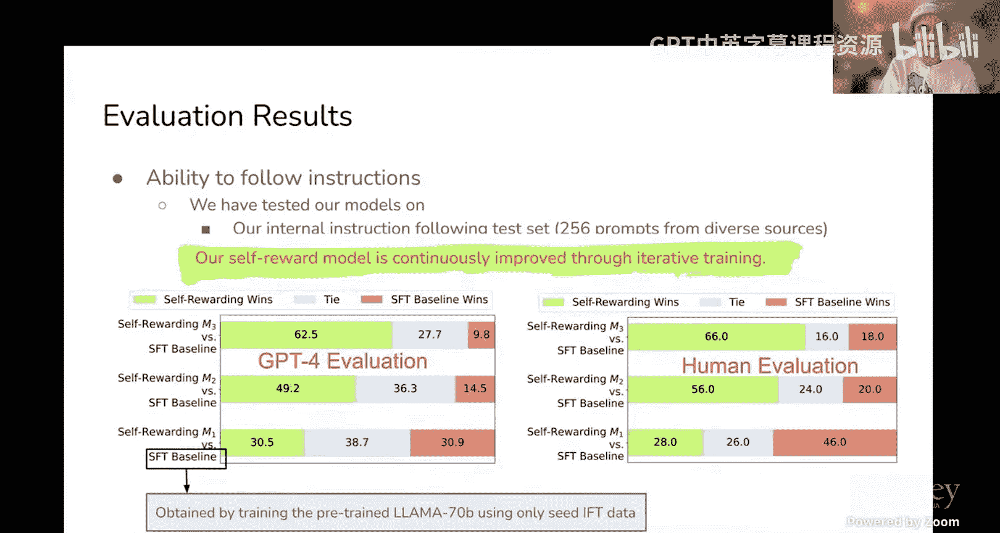

And we look and look at the win rate on Al packetca Eval2。

And this paper got quite a bit of attention at the time because this win rate for。

Such a sort of simple model was quite good it cited from this Lama 70b and it was the win rate up from 10% to 15% to 20% in the three iterations which put it。

Almost on par of GPT， a version of GT4 and you know this was kind of just done by the first author is Weger Joan。

 who's a PhD student at NYU， so it wasn't like a big team building this project。

 but you know the algorithm is works quite well。

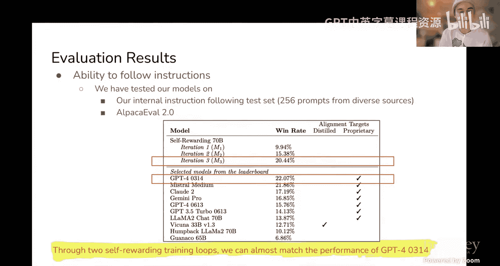

And yeah， so you could look at。What is actually improving at and it does improve。

On all kinds of skills， but particularly more things like humanities extraction and stemEM role play writing more than it improves let's say something like math code and reasoning and the reason why that would be is because。

Their LLM as a judge might not be as good at evaluating math code and reasoning。

 and so it's harder for it to improve on those。

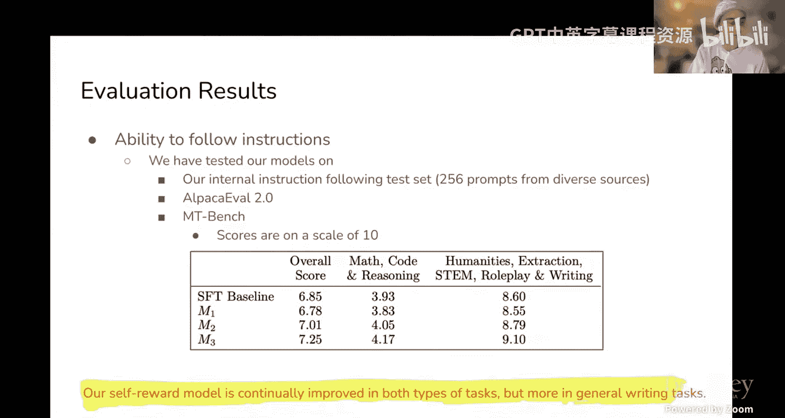

嗯。This is a breakdown， you these topics you can see that the gap on between the iterations is smaller for things like math。

 which is on the far right。And then you can measure the ability of this model as。An evaluator and。

You could you know one way of measuring that is by looking at correlation of human judgments。

 so the pairwise accuracy we had a whole bunch of metrics but the pairwise accuracy metric which show its agreement with humans on whether A or B or the right way around or the wrong way around and you can see that it does increase not by a massive amount but it does increase over the three iterations so it is actually getting better at being。

A reward model， which I think is exciting because。If if the model is getting better at making judgments of what's right or wrong。

 then it's getting better at rewarding itself following instructions so there's kind of a virtuous circle going on there to some extent。

 of course it plateaus in experiments but still this still gives it the capacity to self train and get。

To get better than the initial human annotations that it had at the beginning。

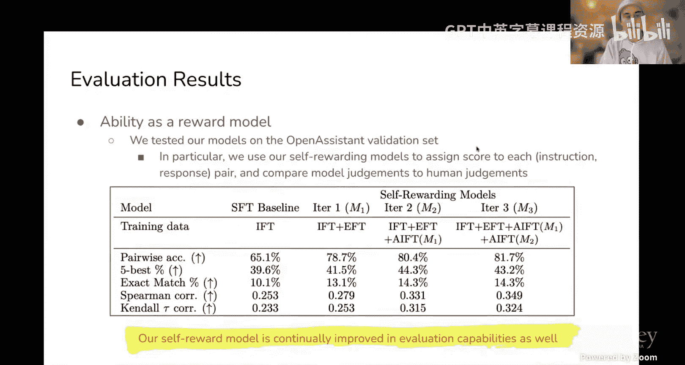

Now， as I said it didn't improve as much on reasoning tasks。

 so the next thing we wanted to ask was how can we make improve on those and yes so in April last year。

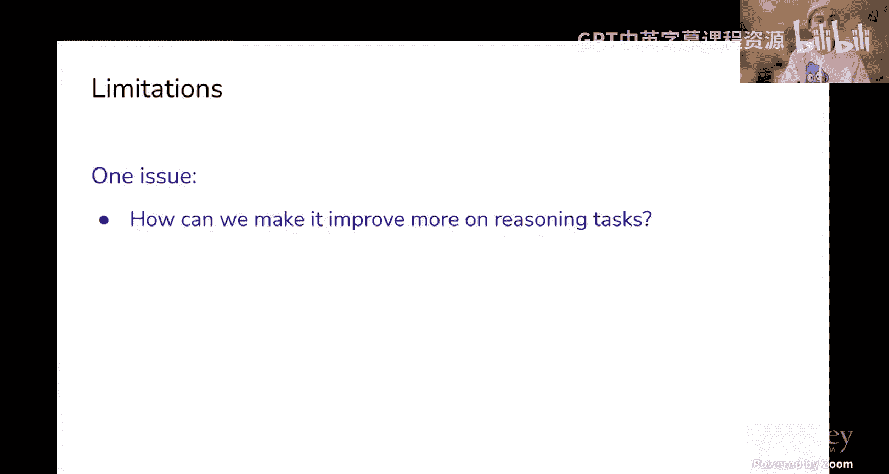

We did this work called iterative reasoning Preence optimization。Which I can see from the picture。

 it's a similar pipeline。But now we're going to generate chain of thoughts。

 So in that in the in the experiments I just showed you there were no chain of thoughts， right。

 it was just kind of a system one language model output the answers for instruction following。

But in this version， we're going to generate chain of thoughts and then answers。

 and we're going to compute rewards and otherwise that the。The pipeline is the same。Now。

 the rewards aren't going to be done by LM as a judge because we don't trust the LM on these these say these math tasks as much。

 I mean， I think that's a subject of research。 How you know。

 can we get them to improve by by trusting their own judgments， but in this work we just said okay。

 we've got a bunch of。Math training data where we know the right answer。

 So let's just use that as a reward and this was this is being commonly called in the last weeks is like。

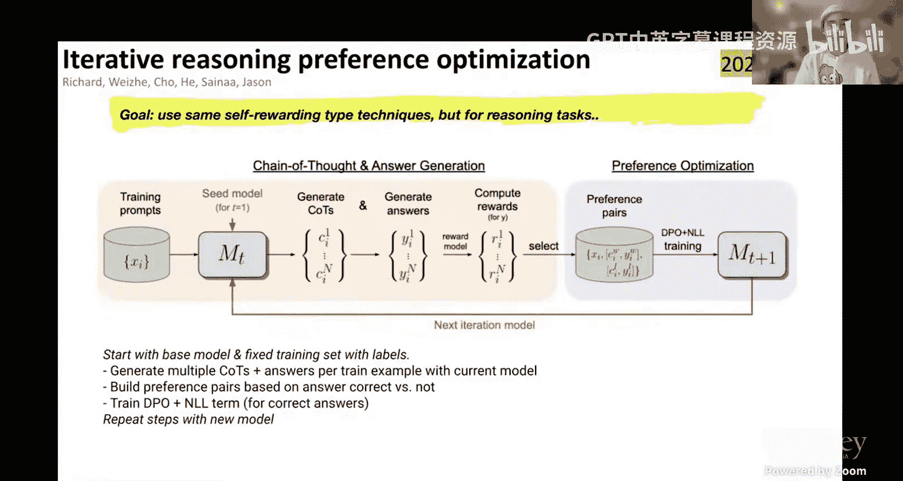

A verifiable reward for a math problem， right？What we're going to do is we're going to generate the chain of thought。

And then the final answer。 And then we're going to。Extract the final answer from the LM response。

 So sort of remove the chain of thought part。 just get the final answer and then just。

Do a match with the answer that we know for the math problem。

 So you can do that with this kind of prompt to where you give the LM the prompt。

 your task gets to answer the question below。 give step by step reasoning。 And when you're ready。

 please use the format final answer colon。So then you can just simply do this you know。

 heuristic extraction where you search for final als colon。Grab the text afterwards。

 That should be the answer。 and now just do a stream match or some other。

Fairly simple match with the answer， the known gold answer。

And that's how you can build your DPO pairs。

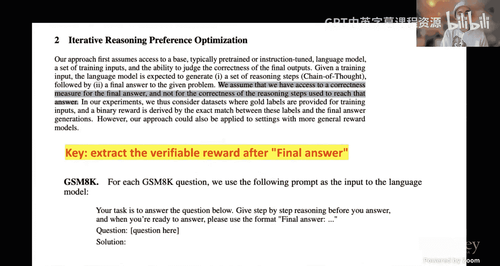

Improve your model and then again iterate round and that' the iteration again is important because now we've got a better model answering these math problems and we're going to generate new chain of thoughts with a better model。

 compute the rewards and go around in a loop。

嗯。And we showed on math problems like GSMK that that's working really well。

 so yeah you can see these improvements across situation one for its gaining a little bit less than 10% there and also improves on some multi choiceice problems on Arc challenge and on these harder math problems as well。

Um。And yeah， we just showed that the DPO training is really important。

 you can't just use supervised fine tuning with this training。

 you really need the negative examples to be pushed down， otherwise it doesn't work。嗯。

And yeah， so in 2024， September or so， open AIs 01 came out， of course， the exact method。

It's unknown。 They didn't you， publish a paper about it， but they did have。

Well they didn't even show the chain of thoughts either right from the model there was a summary of the chain of thoughts I think they still do that but it was capable of answering some quite sophisticated reasoning math problems and everyone was wondering how did they do it。

 did they did they use some kind of protest reward model that was like evaluating in betweent steps did they use MCTS or some really sophisticated search mechanisms to train with reinforcement learning or you know a lot of ideas posted on Twitter of how they do this？

And then deep seekq R1 came out just。This January and Mark Chen from Open AI tweeted congrats to Deepsek on producing O1 level reasoning model。

 their research paper Destrative independently found some of the core ideas that we did on our way to01 Okay。

 so then that means assuming that Open AI used the same stuff as deepse we have a deepse paper so we can look at what they did。

And。you know， in some respects it's quite similar to the iterative reasoning preference optimization that we did earlier in 2024 that I just showed you。

 so they have a prompt which asks it to think。And then to put the answer in a box。

 you see this answer answer here in the prompt， and then they they extract that and。

Then they use a rule based verification of correctness with verifiable rewards and they you know apply that in a loop generating chain of thoughts checking just the correctness of the answer and then rewarding this correctness these are you know a different。

Optimization technique， they don't use iterative DPO they use GRPO but otherwise this recipe looks kind of like that is just you know done much bigger scale so in the experiments I showed you we just said like one data set like GSMHK so key here is start from a really strong big model I think it's a 600 something parameter model right 671 billion parameter model deepC3 and then you know you have a large amount of this reasoning data with verifiable rewards and you train。

With this RL generating chain of thoughts and rewarding the ones that it gets right and basically exploring the space of chain of thoughts and they observe that the chain of thoughts get longer over training as it finds sort of more sophisticated reasoning techniques and then their final model does。

Very well on these code and math problems similar to Open AIs01 model。You know， there's actually。

It was a big news outside of AI， you can see in V these articles here on Bloomberg and V's deepse drop has Wall Street fixated and with their stock plunging and stuff like that。

It was surprisingly big splash。And then you have a couple of examples here of the chain of thoughts that it does the one on the left is from their paper it's generating this answer to this question and then in the middle of it like the chain of thought says wait wait wait that's an aha moment I can flag here it's reevaluate this and it starts saying some other stuff So they were just showing how it learns to rethink and you know fix its own mistakes and that was all done just with this you know this training that just rewarding the final answer and it was doing the rest itself and I pely love the simplicity of it that we didn't have to do you know really complicated things in the middle it's just you know just rewarding the end。

You can already get these impressive results。 So the one on the right is kind of a more funny one。

 ask deepse to select a random number and it outpos this large amount of chain of thought where it sort of overthinks itself。

 Maybe I should go something like 7，7，7，7， but that's 4，7 might be too obvious alternatively，12，3。

2 sequential。 I bet if I close my eyes and 42。 Wait， no， that's from Hhiker's guide and so on。

 So it's pretty amusing while it ends up doing。But they're almost a little human in a way， though。

But I don't think that's actually the way we really want to generate random numbers， obviously。😊，嗯。

Yeah， so。From my own team's work before that came out， so 2024 October， we were looking to extend。

Our chain of thought training results from it reasoning preference optimization。

 we share that work quite well with math problems， but we want chain of thought reasoning for all problems。

 right？Like even if you're。know thinking about。How to write a poem， you might you know。

 do a whole bunch of thinking， write some drafts， try and understand what what you're going to write about before you actually write it。

嗯。Just to pick an example that's very different to a math so we try to follow the same recipe。

 so we have a prompt。

A generic prompt just to initialize the model and we ask it to respond to whatever generic query。

 but do it in a comprehensive and detailed way by writing your internal thoughts。

And then you must include this draft response in its evaluation。

And after you write your final response， have this special tag， so again。

 that's so we can extract the response out and separate it from the thoughts。嗯。

And this is the same trick that we did before right and the same trick that DeepC does。

 but here we're going to do it not on math problems。

 but on all kinds of other instruction following problems。

But now we won't have a verifiable reward anymore， but we still have these LLM as a judge right that we were using in selfreing so we can use that on the response to judge whether the response is good。

But the difference between this and the original self rewarding work is that we have the chain of thought generation before it。

So we tried this。😊，And。Actually ended up working quite well it gave gains on Alpaca Eval and another benchmark called Arena hard。

 it's actually third on the Alca Alpaca Eval。ああ。Leaderboard。

 I think at the time and it was the best 8 billion parameter model on arena hard。

TheI think one interesting thing about the training。

 so again we're doing this iterative training with DPO is that。So this is called。Yeah。

 thought preference optimization TO and we compare it to the direct baseline in this graph in the bottom right。

 which is basically no chain of thought and you can see in the first iterations。

TPO actually makes the model a lot worse。And that's because these language models。

 so we're using like Lama。Was it388 billion they're already really well fine tuned to be good without the chain of thought right so that kind of had a massive advantage over trying to make it to the chain of thought。

But after we train it on successful chain of thought outcomes using them as a judge or the reward model。

 then you can see that the gap closes and then it starts improving on iteration three and four and now it's better than the direct baseline。

So yeah， so I think this is was really promising because it showed you could。

Do this chain of thought training， not just for math problems or verifiable tasks， but for anything。

 right？

And yeah， so here's a couple of examples of things it does， yeah， is so you can， you know。

 say for a query， write me a poem or what。

Dog breed is smallest it's going to。Do a whole bunch of thinking like draft responses and evaluation or various thought processes before before it gets the output。

Yeah， and then， you know， deep seek R one in their paper。

Not 100% sure if it's doing something the same as what we're doing there with TO， but there's。

There's a hint it is because it says here I highlighted it for general data。

 we resort to reward models to capture human preferences and complex and nuanced scenarios。

So I think they're also generating chain of thought and then doing that。

 but it wasn't wasn't like fully spelled out in their paper so it wasn't completely clear。

嗯。Yeah， and then。There's other things we can do， so these。

As far to my knowledge aren't actually yet in these bigger models。

 So these are more just like research papers that。Hopefully then get scaled up to these bigger models。

The next work。We did to try to show that the language model so far we've shown it's quite good at improving its instruction and reasoning ability。

But we also want to explicitly improve its ability to evaluate itself because if we can do that。

 then when it's doing these judgments， it's doing reward model judgmentments it's going to get better at everything right it's going to get better instruction following as well so this work is called metarewarding language models where it's going to try to improve its own judgments by metajudging its judgments so obviously a little bit meta this work but so yeah now you can sort of see the language model in three roles as an actor。

 so following instructions as a judge judging responses to those instructions and as a meta judge。

 it's going to judge its own judgments。

And I'll show you how you can do that。 We call that LLM is a meta judge。

 So there's a prompt for that。 So you'd have。

A given instruction from the user。呃。A response。From， say， a model and then judgment A and judgment B。

 which could include the chain of thought on the final verdict。

And then you want the language model to judge which of the judgments is better， A or B。😔。

Now we have a particular algorithm then for like basically taking all different judgments calculating the meta judgmentmentss and then the eO score amongst them but the reason to do that is to create preference pairs amongst judgments so now we can say okay this judgment looks better than that judgment because our meta judge you know tend to say that and so。

We can construct preference pairs again with DPO。Of which judgments are better。

 So now we've got two types of preference pairs， the ones we had before， which were like response。

 you know， response chosen is better than a response rejected。 But now we also have a judgment。

Chosen is better and the judgment rejected and we train the model with both types of data。

 So this is different to the basically self rewarding language models that I showed earlier only had the top part of this picture。

 right， So it had didn't really have an explicit mechanism to improve its ability to evaluate things。

And yeah， so this work， I think it's exciting because。

It helps we actually get better win rates on， say Al Paca Eval with that。

And。Yeah， this plot you can see again。嗯。We see the improvement over iterations， but it's above the。

The performance of the self rewarding model that doesn't have this meta judge training。

And even the yeah， the self rewarding model tends to plaau a bit here on iteration4 whereas it' still going up。

For the matter rewarding model。

So I think that's pretty exciting and yeah I got one more thing。To talk about， which is。

How to improve the chain of thoughts for。Judgments for evaluation。

 so that's another recent work actually only out last week。

So this is called workss called thinkinging LLM as a judge。

And the goal is to generate these long chain of thoughts similar to O1 r1。

 but for the task of judgment of responses again so that we have good rewards for training our models。

 so here's an example from the model we're trained of what it can do。

Outputs this evaluation plan of how it's going to evaluate and then sort of executes on the plan and gives this final verdict。

Yeah， so we have sort of a training mechanism for that。And。The trick here is。You can look at the。

The evaluation task， actually as a verifiable task， if you know which of two responses is better。

 so let's say you've got an instruction you've got response A and response B。

 if you know in advance that A is better or B is better。

 then that's like a verifiable task right like the math tasks we we can compute the reward directly right we don't need a say a language model or LLM as a judge to agree right with with our output。

So the trick in this work， the first trick is to generate synthetic evaluation data so that we have very viable tasks so we know which one's better。

And once we have that verifiable task， we can essentially do something a bit like the if reasoning preference optimization IRPO。

 because we can compute the rewards directly and build these preference pairs to improve the chain of thoughts for evaluation。

As a couple of extra details here where in this particular case。

 we actually asked it to do a plan first and then execute on the plan， which is this。

Two is the left hand part of this figure？

嗯。So。How do we create this verifiable data， so this comes from a previous paper we did called self taught Evaluators。

What we're going to do is。We given a prompt X， we generate a good response with a language model。

 or at least we think is a good response。 Let's say it's a reasonable response。

 and then we generate a similar prompt x prime。Whi is similar but different to x。

 and then we also use the LLM， same LLM to generate a good response to x prime。

 we'll call that y prime。And now the hope is that of course， because x prime is different to x。

 y prime won't be as good a response to x， right？That's the thing that basically Y should be preferred over y prime for input X。

 so this now becomes our verifiable task that we're going to use for training so。

So the only question there that was a bit of an unknown was how how do you make this similar but different prompt and of course we use an LLM to do that as well right so we say please generate a modified instructor in that' highly relevant but not semantically identical to the instruction above and then this is what gives us the similar instruction which we can then generate the lower quality response for the original instruction from。

And yeah， that's。Roughly the higher level picture of this work。

There's some ablation studies here where。We showed that these plans are superior to not thinking at all。

 so no chain of thought。But in general， it's good to have the plans as unconstrained as possible。

 like if you encourage them to be， for example， lists of criteria or verification questions。

 which are some other works have used with prompting then the results get worse。

 And I think that's kind of in line with01 R1 style results as well where basically you don't want to constrain too much the chain of thought thinking processes of these language models。

 but you want to kind of you know train and find out what what it's going to be good at。

嗯。And then， yeah， after we train this model using Lama 3。1 or 3。370b as a base。

Where it gets very good results， actually state of the art on this benchmark called reward benchnch。

 which evaluates reward models for LM as a judge like generative models。

And it's also quite good on some harder evaluation tasks on some newer benchmarks that just came out like RM bench and Vol benchch E。

嗯。

And yeah， that's really all the all the things I'm going to talk about。

 I think Ive talked about enough already right， so just a little bit of a summary of these these recent works from the last year。

😊，嗯。Self rewarding models。They're models that can train themselves to get better and the hope is that could be a path to superhuman AI as the model improves itself。

Um。We've seen how verifiable rewards can help to train chain of thought for better reasoning。

 so I showed you this iterative reasoning preference optimization technique， but deepea and O1。

 have related techniques， basically all using this verifiable rewards on the output and then letting the chain of thought kind of don't penalize it just find ones that work well during during your training cycle。

And then you can also use these verifiable rewards to improve the evaluation ability of the model。

 so that's the thinking LLM as a judge that I just showed。And then， of course， these。

 if we have these better judges with this chain of thought。

The whole thing could go in a cycle right we can help those。

 we can use those to help train to think on non verifiable tasks because we can use this thinking LLM as a judge to train those models and we call that thinking LLMs which I showed earlier as well。

And then finally， you can use this rewarding concept to judge their own judgments as another way of improving their evaluation ability。

So I've said it shown you a few sort of separate papers， but you know， kind of the goal of the。

Bigger model releases try and put some of these ideas together。 so yeah。

 some of those more recent things like Me rewarding。

And thinking LMs kind of need to go together with the earlier ideas all in in one system and we'll see。

 see how far we can push that and of course， still looking for new ideas right and they they're going to be coming in the。

Coming days， weeks， months and years， I'm sure so。

Yeah呃。Of course， there's， you know lots of other directions and you know just to throw one out there is all the reasoning I've been talking about was with chain of thoughts that were text right is generating text from the language model now you don't have to do that right you could like the transformer itself。

Does reasoning by。All these multiplications you know inside the neuraltics or manipulating vectors right in the hidden states of the network and so why does this system two reasoning have to be token so maybe that could also be these continuous vectors as well so we explored that in a recent paper method called coconut。

😊，Where we replace the chain of thought of like outputting tokens with outputting vectors instead。

And we showed that has some promise actually it could say at least match the performance on some tasks and even outperform classical chain of thought on some more difficult search tasks but these are all quite small scale tasks so remains to be seen sort of how far people can push that direction。

 I think there's some reasons to want to have the chain of thought in human language。

 natural language I think it's a nice thing for safety and interpretability。But you know。

 as I said the neural network itself isn't interpretable in that way right the internals of the transformers。

 so that's something we have to work out， I think。

嗯。And I got another slide about what else comes next。

 I think there's so much more exciting research to be done so Ias Siitzkever in his seat to seek paper test of Time award that was this last Newip's talk。

Presented some things this is a picture of what he was saying what comes next he was mentioning agents。

 synthetic data， inference time compute reasoning， understanding and being self-aware which all makes sense and I think these are all things that you know people are working on today well maybe the self-aware one is a little more little more fuzzy but the other ones at least and yeah I would say that I would just add some more detail there I think self-improving selfevalu is really important because that bottlewinneck performance so using more of this inference time compute for evaluation is only going to help selfimve the model and I think that's sort of related to this selfaware comment that he makes here that a selfware you know model might be more able to understand what it knows and one it doesn't know right which is。

Kind of evaluation。And then learning from interaction。

 I think learning how to reason by actually interacting with people in the world。

 internet or itself are important things， and they sort thats related to the agent's point and this synthetic data point he makes there。

And then of course it's not just about improving the system two reasoning。

 I think improve if we can improve system one reasoning， so like the transformer architecture itself。

Then that's great， too。 So maybe there's a better attention。

Model some sort of or maybe something new and new and neural' network layer we you know。

 haven't come up with yet that could change like the scaling laws。

And the performance of these models and that's great too。

Yeah， learning to do and it's going to be exciting to see what happens。

Thank you。