# UCB《高级大语言模型智能体｜CS 194 294-280 (Advanced LLM Agents) 2025》中英字幕 - P3：Lecture 3, Yu Su.zh_en - GPT中英字幕课程资源 - BV1mkZiYAEYM

I'm super excited here today to talk about a topic that is really close to my heart language agents I'm very excited about this topic in the past two years or so it's really fascinating and have devoted most of my time thinking about this so have to share some thoughts here today right whether you like it or not well since you are in this lecture so most likely you like it but you probably have heard about the term agents about many people are super enthusiastic about it like Bill G said that well bring about the biggest revolution things essentially Gui then Andrew An said that the agenda workflows will drive massive AI progress。

😊，And then Sam Osman said that 1025 is the year when agents will work。However。

 there's definitely also a lot of voice from the other side of the aisle。😊。

Many people think that current LRMs are just thin rappers around LRM agents or just in rappers around LRM。

 so there is nothing fundamental here。Well， others think other regressive LIMs can never truly the reason or plan。

And then。😊，AtoGBT was one of the early prototypes of these Asian systems。

 but it didn't it was like very popular， so it's the fastest growing repository in Gi history in terms of a number of stores。

 but it didn't take long for people to realize that it was at least at the time。

 more of a prototype and there was a lot of limitations far from a production system。

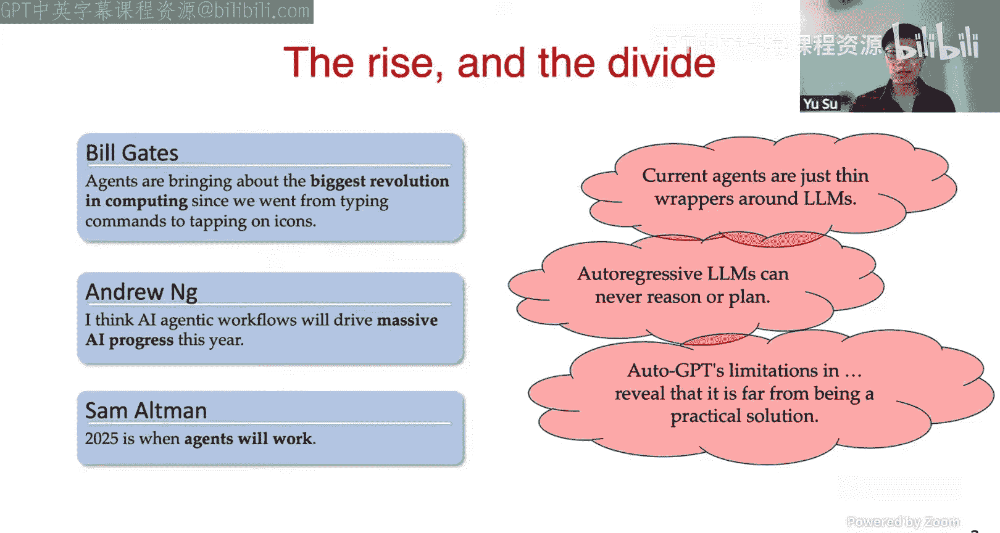

If we take one step back and think about hey what is agents， it's really not a new thing right。

 it's one of the very first topic we cover in AI11 agents and especially using these classic schematic illustration from Ru and Nork and it has been part of the core pursuit of AI since the very beginning so why all of a sudden it became so much more popular again。

😊。

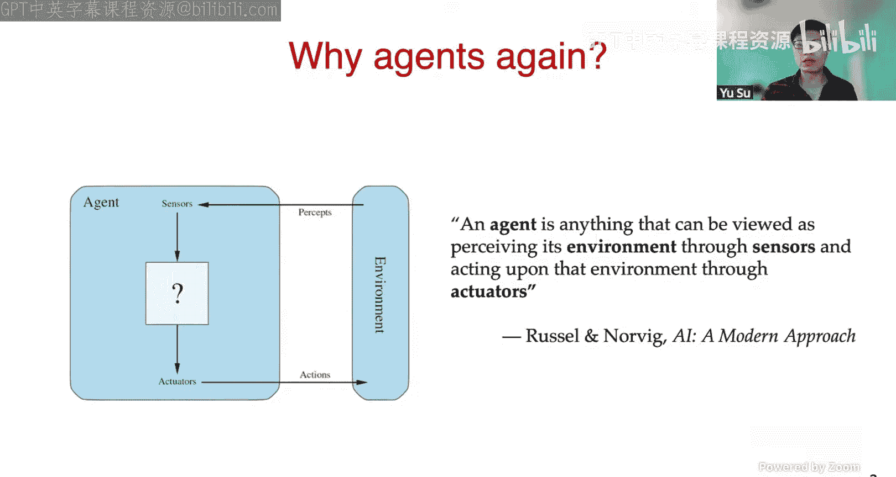

So let's try to define these modern agents。Many people hold this view that hey you have a damage model。

 it has a text in text out interface， so the kind of things that you can do is quite a limited。

 it's still a lot but it's limited that it's not connected to use external environment and then once you connect that to an external environment。

 it can perceive information from the environment and it can exert impact on the environment then it becomes an agent。

😊，That that seems reasonable but at same time also seems a bit oversimplified and incomplete right we often hear things like okay self-reflection that an agent or LIM looks at its own reasoning process and then decide to do autonomously decide to do something else or like you can do multi-agent simulation or lot of other things that don't necessarily involve an external environment or at least that's not part of the core defining traits。

😊。

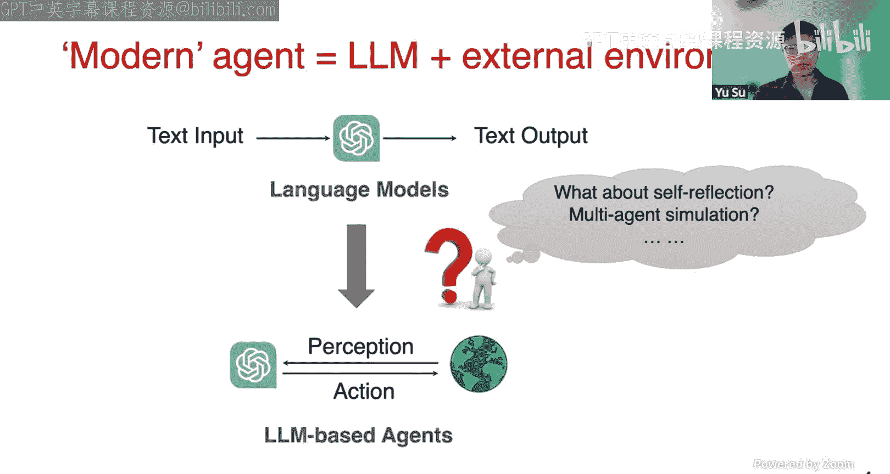

Fundamentally， I think there are two main competing bill in the community。The dominant interview。

 I call it an RM first。So we have an first have an LOM， it's amazing， it's very powerful。

 it knows a lot of things， so let's make that into an agent。😊。

Then if you take this view naturally the implications are you think of like building a scaffold on top of an LM and there will be a lot of prompting and it will be heavy engineering and I think that's also where a lot of the dis sentiments that the agents are just think rap around LMs come from。

😊，I tend to take a definitive view， I take an agent physically right so as I said AI agent have been the core pursuit of AI since the very beginning。

😊，That is just now the got upgrade Now we integrate one or more LMs into DC agents so they gain a new capability so we use the language with reasoning and communication。

If you hold this view， then the implications are all the same challenges facing the various AI agents。

 like how to perceive the environments， how the reason about the environmental states。

 how to build world models to model the state transition dynamics in the environments and how to use that for better planning。

 all of these challenges still remain， but we need to reexamine them through the new dance of IIMs。😊。

And also we need to tackle the new challenges and opportunities。

 like now we can do synthetic data at a scale， we can do self reflection。

 and we can also do O1 style internalized the search。

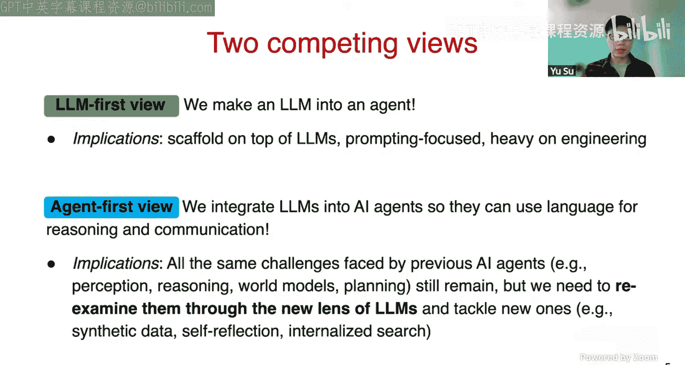

He。😊，If we agree on that view， an agent versus view。

 then we can look at what's really fundamentally different now once we're integrating these LIMs。

 I think it's really the capability of using language as a vehicle for reasoning and communication。😊。

The power of using language for communication is probably more clear like all of us remember the vividity。

 the viral success of tragedy， it was the fastest app to grow to 100 million users in human history and but we also knew that in terms of the fundamental capabilities tragedy was not significantly better than the previous generation。

 but only I decided to tune it to be more chat and re it to the public so I think that really shows you the power of using language or communication。

😊，You get instruction following， you get in context of learning。

 and you can easily customize the output format。

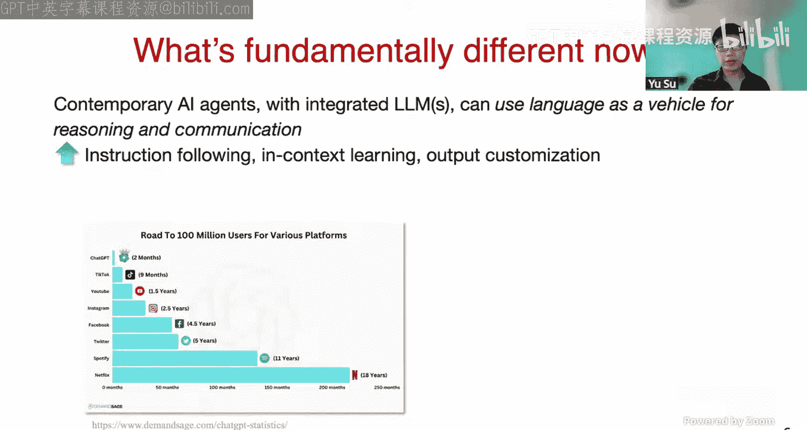

But perhaps a bit more unique this time around， because using angle for communication。

 we have been doing that in decades in dialogue systems。😊。

But this nucleability of using the language for reasoning is probably a bit more unique this time around。

嗯。It is used to be the case that have to do a lot of justification about why this is unique。

 but now with all these new reasoning models， I think this has become much easier so but that's still consider this example right most of people would look at this example and think GT4 was being stupid and contradicting the self if first start the NC is no。

 but with a lot a bit more thinking then you realize that the NC is actually yes。

 but the way I see this example it really shows the power of using language for reasoning so you can decide the agent the model can decide on the fly to use adaptive the adaptive amount of compute for different problems so you've got a second chance unlike in traditional MLL models where you pay a fixed amount of compute for any decision right so you only have one shot and you have to commit to it。

😊，And specifically in the context of agents， reasoning is not just for the sake of reasoning。

 right it's not just for math or coding， reasoning is for better acting。

 so you can use the reasoning to infer about the environmental states， you can do self-reflection。

 you can do dynamic repplaning， but all for the same purpose for better acting better planning in the environment。

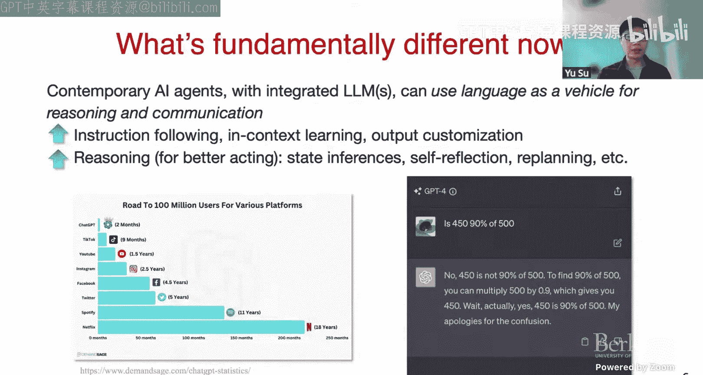

Right。Now we're ready to reconcile this new generation of language agents with the previous agents。

All we need to do is to add a new type of action called reasoning。😡，By generating tokens。

 this in contrast with actions in external environments。Then for that。

 we also need to add an internal environment。Just like in the monologue where reasoning happens。

With that change now we can also reconcile things about self reflection。

 now it becomes just a meta reasoning action， like it's a reasoning over the reasoning process。

 just like the matter cognitive functions。And the reason is for better acting and at the same time。

 due to the power of these LIMs， the perceptioncept and external action spaces are just to expanded as well。

😊。

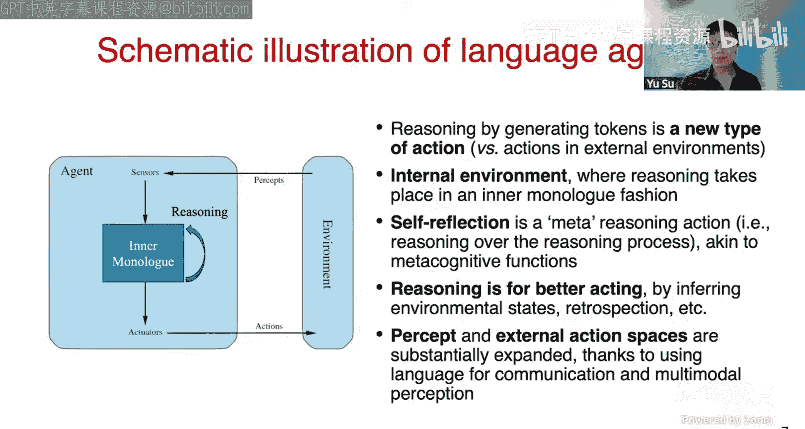

before we proceed， let me just provide a little bit of justification of the use of reasoning here。

 because this is such an overloaded term， if we don't properly definey it。

 then people will frown upon。😊，So I'm sympathetic of the position of you calling all of these as a reasoning because for people who are familiar with like the the。

😊，Due process mental model of human coition by the famous like late Daniel Kahneman in thinking fast and slow you be familiar with concepts like ay perception。

 then intuitive inference and then symbolical reasoning right intuitive inference is fast effort to us and then symbolical reason is slow and effort。

But LMs， they don't have all of those difference。Cognitive substrates for these different type of cognitive functions。

 all it has is in most just one mechanism， which is token generation。

It's mostly we will talk about this data because we will talk about intrinsic。

 like the implicit reasoning， but mostly reasoning happens through token generalization。

 through explicit language production。😊，Right so if you look at this example from G4， oh。

 when you look at this image， its generation incorporates all of these different mental processes。

 like what we would call perception like what's in there and intuitive inference。

 like what you can immediately infer from what you see and also some symbolical reasoning。

 some more complex reasoning。😊，So I think for this reason because IIMs really only have this one mechanism that blends all these together。

 so I think it's proper to call this reasoning and then one may alternative call these thoughts to avoid this overload term。

 but then the risk is that with the further anthropomorphifies these machines。

 so I prefer reasoning over thoughtought。😊，Right another thing that I want to get behind us before we proceed is the name there are so many different names for these agents right now。

 there's AI agents， autonomous agents， our an agents and so on and so forth。

 but I truly think like language agents is probably the most like alistic name for these kind of generation of agents。

 because the language is really the most asedient traits。😊，And what about multi agents， well。

 there is perception in other modalities and they are very important。

 but the language is still doing the heavy lifting like the reasoning and the communication part。😊。

And what about LIM agents， that's probably the most popular name out there。

I think what's really needed here or characteristic of this generation of agents is this。😡。

Peopleopability of universal language， understanding and production。

 which turns out to be extremely important for agents。

But this capability doesn't have to come from an LN。😡，Maybe in a few days we will go beyond LOM。

 but these need this capability will remain so LOMs could be a means to an end in that sense is less as fundamental so damage agents is a more appropriate name。

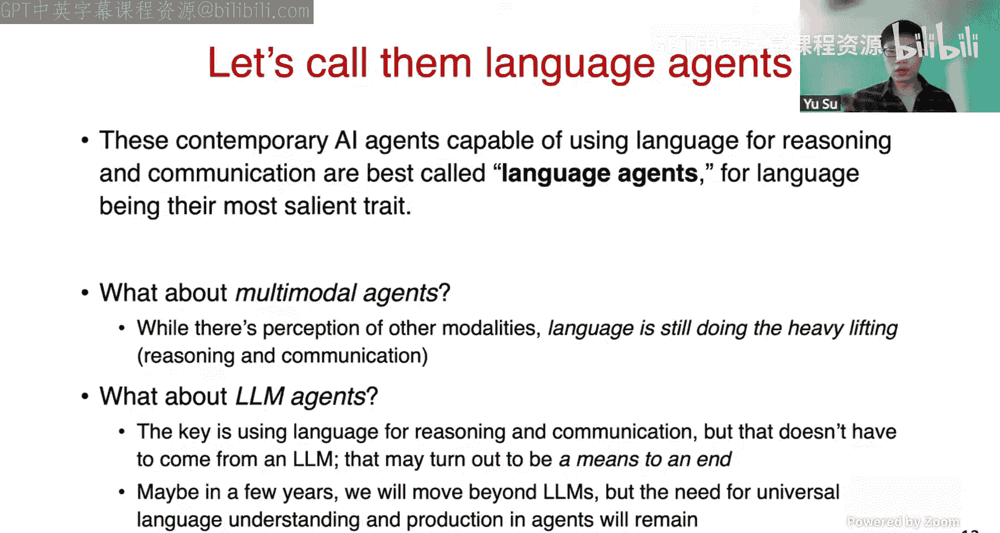

If we take one step back and think about the evolution of AI。

 I think we're really entering a new evolutionary stage of machine intelligence。😊。

So human intelligence is truly a marvel made by nature。

 somehow our brain can take raw inputs from different sensory organs and we present them in a unified neural representation to reconstruct the world around us and also to support symbolical reasoning and decision making right so that's truly fantastic。

Then throughout the history of AI， we have made many attempts to approach human intelligence and manifest machine intelligence into these AI agents。

But earlier generations of their agents were only able to capture some limited facets of human intelligence。

 like symbolical reasoning， like perception in single modalities。

Only recently was this in multimod IOMs and the damage agent did on top of them for the first time。

We have a model that can。😡，Incodeode multisor inputs into a unified mirror representation。

That is also conducive to the symbolbodiwood reasoning and the communication。

So these draft are got to improve the expressiveness。

 the reasoning ability and the adaptivity of AI agents。

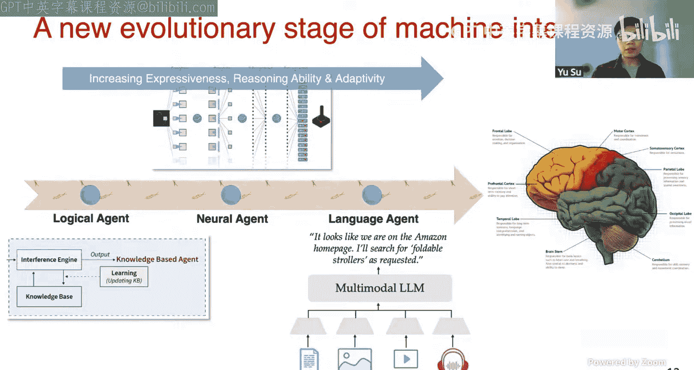

And that's， I think， what makes this kind of generation of their agents so exciting。

We can do a more detailed comparison of these different generations of agents。

 but in the interest of time I will just quickly go through this and just focus on language agents like the expressiveness is pretty high for example we can compare with that the logical agents where the expressiveness is founded by the logical language we use here the agent or the model can essentially encode almost everything especially the globalizable parts of the world but for the nonmobilizable parts like how to recognize the face we still have like multimod like inrs to capture those。

😊，And then for reasoning， now we do language basic reasoning instead of like logical inferences。

 so it's spuzzy and it's。Flexible and it's semi explicit so it's not entirely implicit you have this chain of thoughts that you can see what's going on and fuzzness I want to emphasize that it's not necessarily a bad thing because the world around us it has a lot of fuzzness in it if we resort to like something strictly very sound and very rigid then it comes as a cost of sacrificing the extractiveness a lot。

😊，And then the adaptivity， which is a hallmark of intelligence。

 is also very high in language agents because this a strong prior captured by anLM and the language use in general is very flexible。

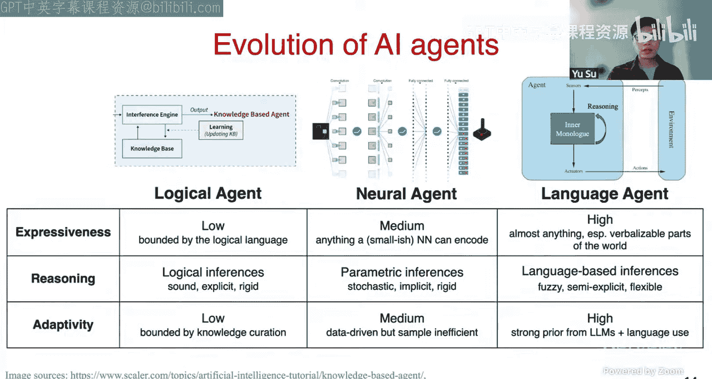

Right so before we proceed let me share with you my own conceptual framework for language agents。

 this is what I have been using to guide my own research agenda in the past two years or so。

The most important things are the what I call core competencies and I try to arrange them in a loose hierarchy so each box here you can roughly define the corresponding cognitiveir function in the human brain and then the bottom ones are the more fundamental ones like perception。

 memory and embodiment and the upper ones built on top of the bottom ones like planning built on top of reasoning and word models and reasoning built on top of perception and memory and so and force。

We also have many cross calling issues like safety evaluation synthetic data is both a challenge and an opportunity and efficiency and many new applications so with this framework now you can。

😊，Look at any new paper about agents and try to map its main claims and main contributions into this framework。

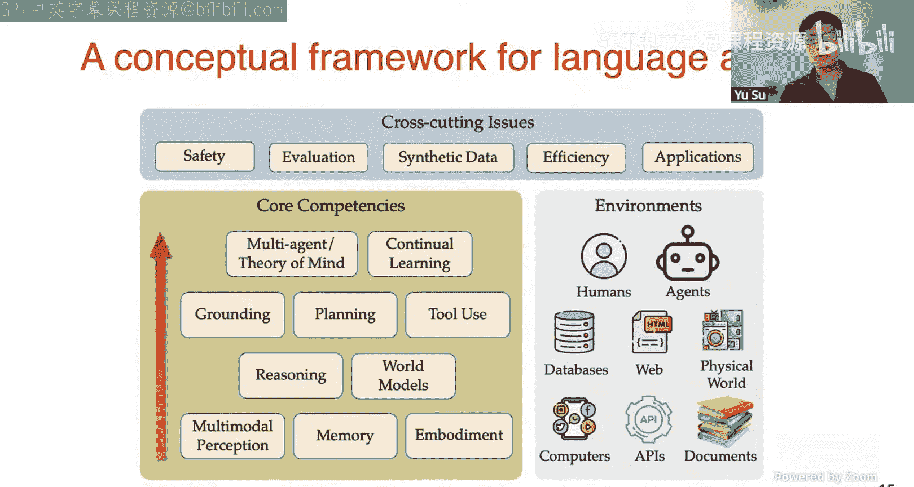

Right， so that's the introduction and for the rest of the talk will。

We'll try to cover three main aspects of an energy agents。

How we model long term memory for which I will use our recent work hipporac。

 then how do these damage models fully reason and I will use our work on graphic transformformer and then finally I will talk about planning。

 especially basic planning using a word model。

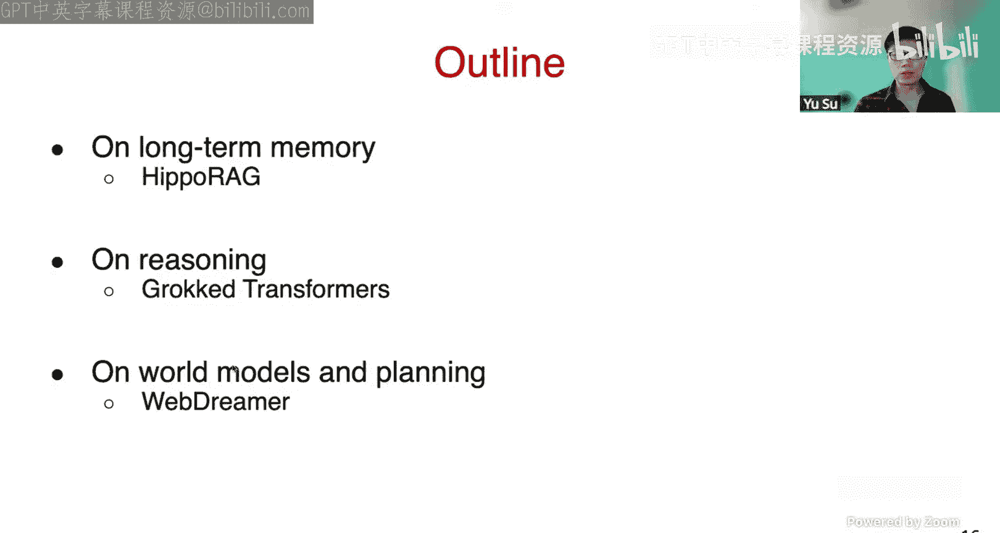

Hey， so that's always memory。

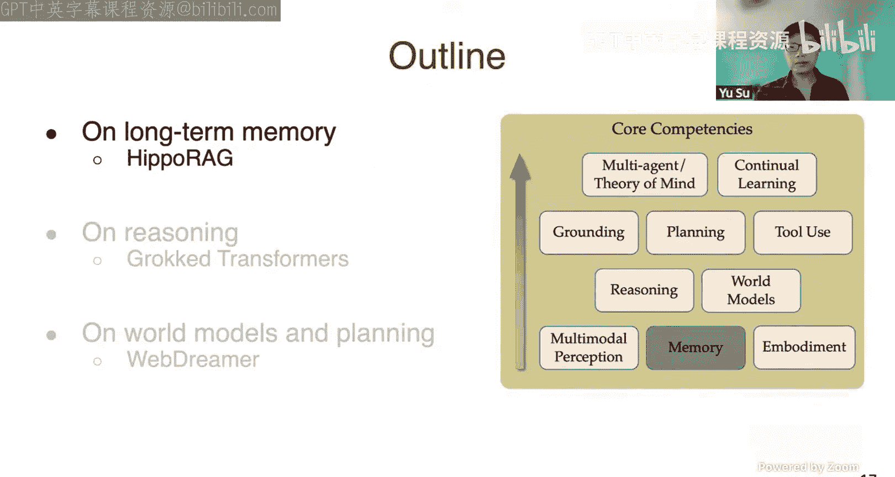

We'll talk about hipporac the main content will be from hippoag but we'll talk about a lot of other things as well it's a new biologically inspired long term memory mechanism for large energy models is that by my。

😊，Student Bau and in collaboration with Miche Fran Stanford。

Right。So if we look at how humans or really most other animals that have a nervous system。

 how they learn， right it's really fascinating that we are all like these 24。

7 nonstop lifelong learners right and all we learn is stored in our memory。😊，So the Eric Kendll。

 the Nobel Prize winner who got to the prize for his contribution in the study of memory。

 especially as a neurobiological foundation of memory。

 once said that memory is everything without it we nothing which I think is very profound。

 because really anything we learn has to be encoded in our memory and through a process called synaptic plasticity。

so basically， we can change our synapses capture to memorize things and to capture all the things we're experiencing and we're learning。

And there are different ways of changing the synapses， like for example。

 you could change the strength of the synapses by either adding more receptors here or reducing more like neurotransmitters。

Or you can do structural changes to the synapses， like by growing new synapses for the same neuron。

 for example， so this is used more often in forming long term memory。Right so we are really 24。

7 learners， even when we're sleeping， we are replaying what happens during the day right that's what how this long term memory gets consolidated。

😊，Ially， we want that the same kind of learning capacity in machines， especially in agents as well。

 because these agents， they are supposed to explore the world。

 do things and then accumulate a lot of learning from that and self improve in some sense， right。

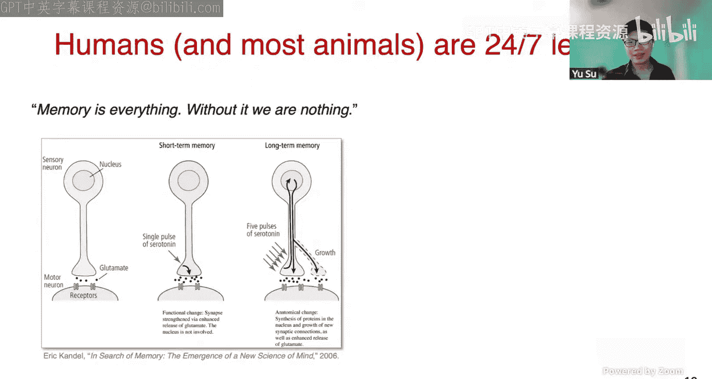

However， that's very hard for the current technologies。For these neural networks in general and LIM。

 these gigantic LIMs in particular， are very they have the notorious issue of catastrophic forgetting。

 so when you're learning new things because of this highly distributional representation of in these models。

 when you're learning a new things， it often has unintended side effects。

 like some other things like unexpectedly got changed during that new learning process。

and to illustrate we can use and in the LIM context。

 we can consider what the people have been doing trying to edit an LRM to inject or alter a specific effect so that's called a knowledge of model editing and。

😊，Such topic in model LM model editing is the so called repo effect。so。

If you want to change just at least one fact in a counterfactual change， like you want to say， hey。

 Leonards is a citizen of Syria instead of United States right and you have some expected rippo effect right because now the citizenship has changed so he should speak Arabic instead of English。

But if you actually look at what what has changed after this edit。

 you will see that a lot of other unexpected things have changed or the things that should have changed but didn't change right so if you look at the neation of this original statements you will see that it was still predict Syria which is wrong you want it to be United States because of the neation and then there is this。

Like the language here also becomes serial， but you want it to be Arabbic and so on so what so all of this just tell you that because of this highly distributional representation of these artificial neural networks that makes continual learning verified。

😊，The human brain and animals somehow figure out a way to do that。

 but we don't quite understand how that happens yet， so cannot replicate that in machines。😊。

But that's highly desired， this kind of cont learning is highly designed for agents and for LOMs。

 so what can we do？😊，あ。A good news is starts for LRM。

It's possible to use an alternative form of memory called numb parametric memory。

So instead of directly changing the parameters of a model with the new experiences。

 we can just hold the new experience external to the model。

 so it's not metric and then just retrieve them using some mechanism as we go。😊，But for that work。

 then of course， this is called Ra rich augmented generation， but for that work。

 there is a prerequisite condition。😊，Like that is when you retrieve something。

 some external information。And you say， hey， this is your memory so you should you should take it。

 you should all your decision making should be based on it then it's based on the condition that these LRMs。

😊，Actually， whoa。Be receptive to such external information right so we did this study called adaptive comedon or stubborn thoughts where we specifically study this behavior when you have this external evidence like from Ra and then when that directed conflict within LM's parameical memory。

 what would happen will they resist that or will they be receptive to that。

Perhaps not too surprising at this point， but what's very surprising at this time is that these RMs turn out to be highly receptive to external evidence。

 even when that conflict with their parametric memory。

So for the two examples here you have a question that the ground truth answer in this case the parametric memory of the LIM is correct。

 but if you give it a coherent counterme like this。

 then the LIM will happily accept this and change its answer and in this case the parametric memory was wrong and you can correct that by giving it the correct countermem so that kind of paves the way where nonparametric memory for LIMs because of their being highly receptive to this external evidence。

😊，Of course， these has other implications like safety。

 like maybe this means that these IIs could be highly gullible， but that's not the focus today。😊，诶。😊。

Now let's talk about how to really make long term memory work for our Ms。😡。

Most people know that RA is the de facto solution today。Given something that is， for example。

 the IM doesn't know or is beyond its knowledge cutoff date。

 then it will retrieve from the internet and then use the retrieve of information as a kind of long term memory to answer the question。

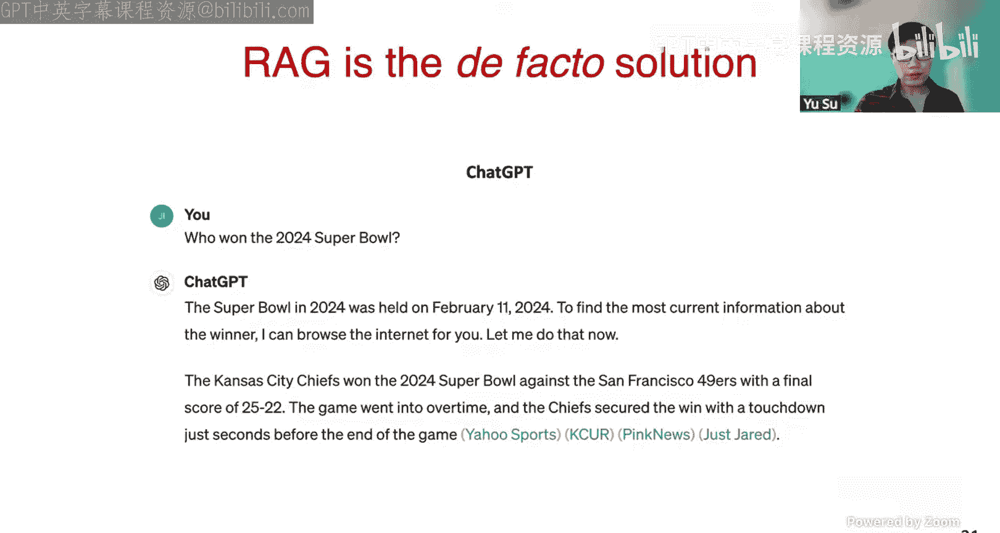

Bs。If you think about how RA works， okay， you embed with evidence into vectors。

 then you do vector based similarity to retrieve them。That seems。Far simpler。

 far less sophisticated than the human memory system。

 where we can recognize patterns in massive data， raw experiences。

 we can create a lot of associations across them and we can dynamic retrieve them for the current context and so on and so forth。

😊，To illustrate some of the limitations of the current em based erect system。

 let's consider this example。Let's say you have。A query。

 which a Stanford professor works on the neuroscience of Alzheimer's that so you have two sail the concept。

 Stanford and Alzheimer's。😊，Then let's assume just hypothetically， you have a bunch of passages。

Each passage only contains part of the information so you don't happen to have a passage that tells you like this person is both a Stanford professor and works on Alzheimer's instead what you have is these separate passages okay this passage says this person works at Stanford this passage says that this person works on Alzheimer's and then you will see like there is one person who works at Stanford and on Alzheimer's but it's in separate documents you don't happen to have one document that tells you all。

so what would happen if you just use emdding based route。

Now you embed each of these passages into a vector。You embed your query into vector。

 you do compare these similarities one by one。Then you will find all of these passages are equally likely because each of them captures precisely 50% of the information right and as a result。

😊，The model has to manually go through all of these passages to figure out which ones are the correct ones。

Right and you can imagine there could be thousands of professors working at Stanford and even more people working out as numbers。

 right so it's a one to many， many to one relationship。😊，But our human memory doesn't work that way。

Somehow when if we have come across like like this person works on Alzheimer's or this person also works at Stanford。

 then we'll build some sort of association among them， such that when this query comes。

 we can very easily and quickly find that hey， this person is connected with both Stanford and Alzheimer's so it's dancing。

 we don't have to go through recall all of this other information to derive at that conclusion。

So in that sense， eming based rock works very differentlyly from human battery。

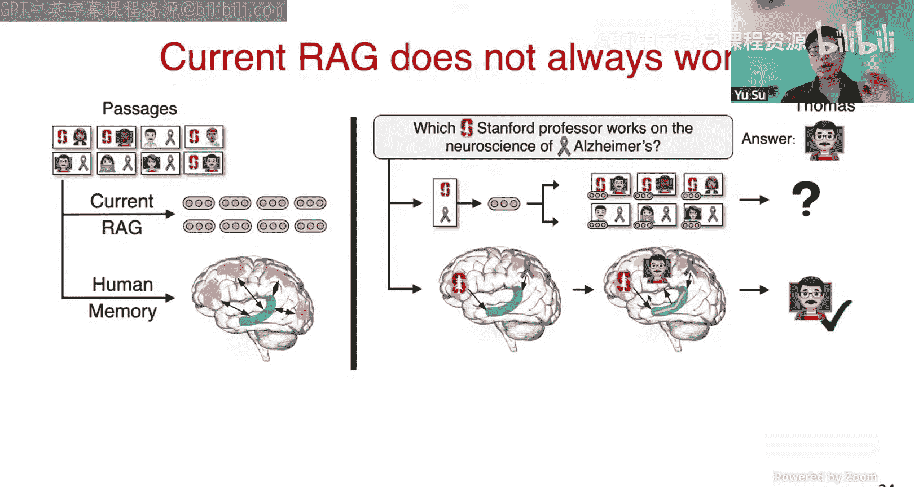

Now to study how this exactly how the human memory works in these regards。

 so we turn to this well established theory of humanlan memory called the Hipoco indextexing theory。

It basically goes like this Ill summarize it in an overly simplified way。

 it says that your wrong memory is sorts on your neo cortex， particularly。😊。

Like the in where the memory was first generated right so when episodesodium memory like the auditory part of it will be stored in the auditory cortex。

 the viral part of it will be stored in the viral cortex and so on and so forth。

 that's why when you are trying to recall something you were like relivieving the moment like because it's just retriing the same neurons as if you were perceiving them。

Right but importantly to。😡，You also have an structured index stored in the hippocampus。

That creates a much closer， much essentially shortcuts that associate all these thesepar memory units together。

And that's what we are trying to mimic here。

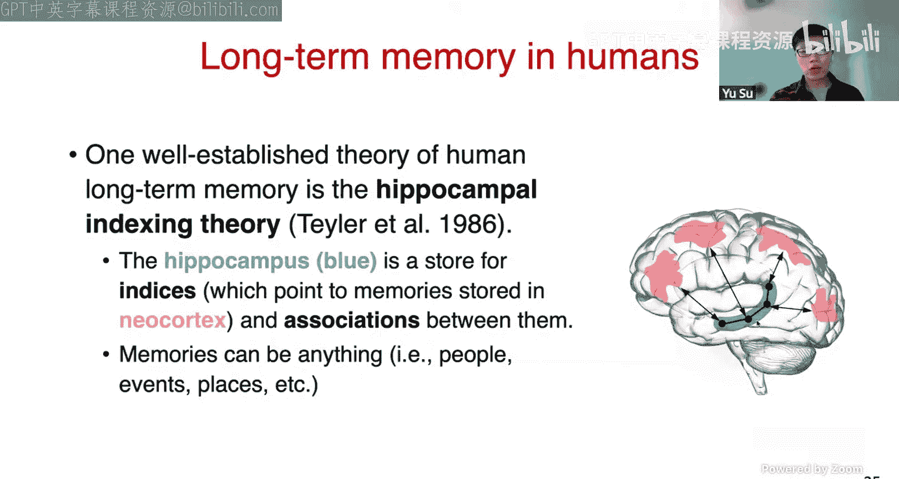

This kind of separation and structure index give you two important faculties of human memory。

 it allows you to do pattern separation。So， you can differentiate。Memories in very fun going way。

 certainly beyond just vectors at least I to the concept level right if you think about your episode of memory。

 the second。😊，This second and the second before they are very similar to each other。

 how can you differentiate the differences that requires a very fine grain separation of patterns？😊。

But more importantly what more relevant here is pattern completion right we can recover complete memories using just partial cues like the previous example。

 the partial cues are Stanford and Ezheimer's and then then you can quickly recall this whole fact that this person is associated with both of them and that's due to this structured index in a Hipocampus。

😊。

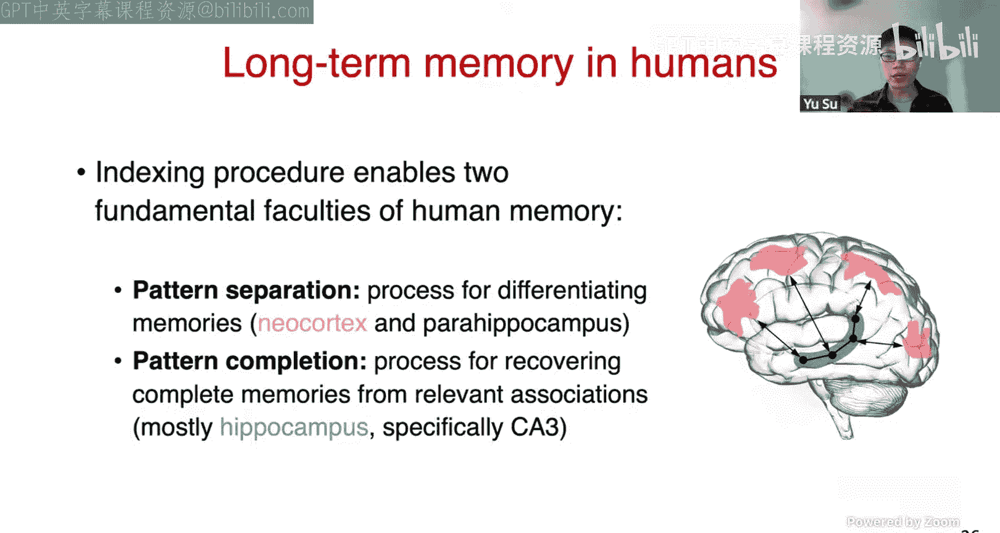

So that's what we're trying to mimic in hipporac。We're trying to build a similar structured index for Ra systems to enjoy some of the same benefits of the human long term memory system。

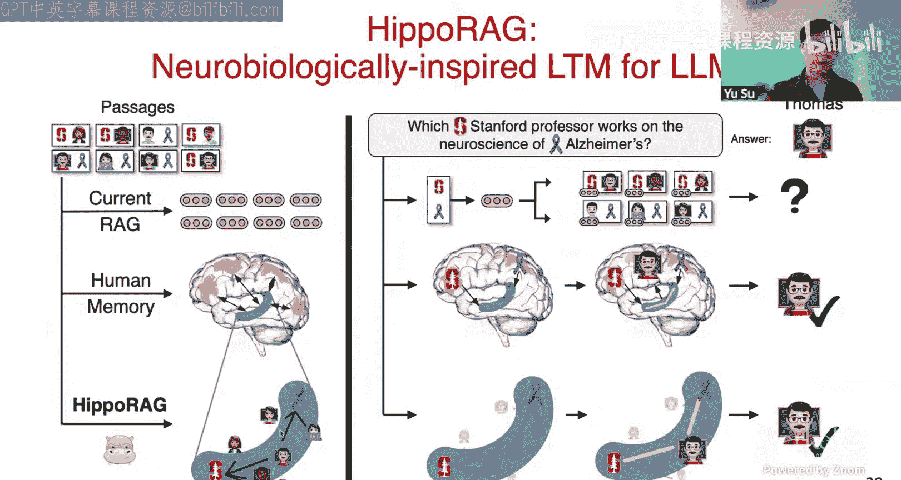

I won't get into too much details， but so I'll just at a high level。

But these in the hippocampal indexing theory， there are three main parts right there there is the neo cortex and the hippocampus and then there's the paraypal regions that connect to the two。

So the new cortex is more about pattern separation， so it will process the raw experience。

 extract patterns out of this concept and so on and so forth。

 and then the hippocampus is more like the structure index so it's the indexing auto association and then the hippocamp regions is more like the working memory that connects the two then do some more iterative thinking around there。

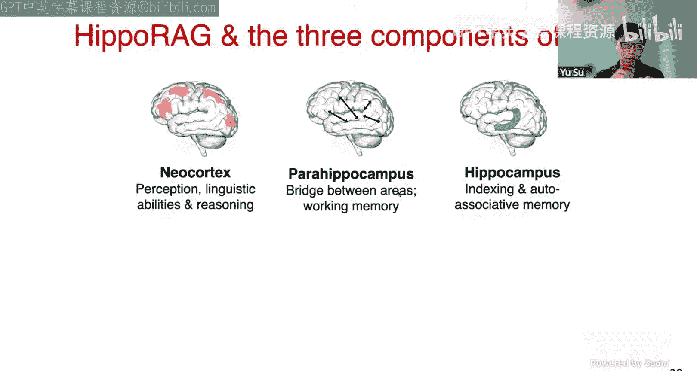

So to mimic this process， we have two spaces， we have the offline indexing phase and the online fi phase for offline indexing。

I say you have these passages as input， we use an LIN to serve as a new cortex that will do open information instruction to extract these triplets like the concepts。

 non phrases and their relationships， like the verbal phrases。So extract these triplets。

Then we do try to build a knowledge graph。😡，Particularly this is a schema that's not well。

 so we don't have a onontology or a predefined schema or anything like that Everything is extracted by an L and from the raw experiences。

😊， so we built a large graph by consolidating all these newly extracted concepts and phrases as nodes and edges。

 that's the offline indexing space， and this becomes our artificial hippocampical index。

Then we use a dense retriever here as an encodecoder to consolidate things。

 like to identify like which concepts are seamless to each other or synonymous to each other。😊。

Then in the online retrieval phase， when a query comes in like the Stanford Alzheimomer example。

 then we'll identify the concept， we use named entity recognition。

 so now we'll get the Stanford and Alzheimomer's， we still use against retriever to find the similar notes in my index。

And then those nodes become the see the nodes for the graph search process。

 so we will use this as see to do a search process on the graph to find like the most related things。

😡，And the particular graph search algorithm we're using here is personalizedize the page rank。😊。

Okay so for people who don't quite remember what a personalized pay grant works。

 I'll do a quick recap， right？😊，Its a random walk process on the graph where you start with some see nodes so those start with probability one。

 then you use a random walks starting from these see nodes to disperse the probability mass to their neighboring nodes。

 so the nodes that are closer to these see nodes or like especially those are intersection of multiple see nodes will naturally end up with a higher weights。

Then in this case， Professor Thomas， who is connected to both Stanford and RS Ems。

 will naturally stand out and getting the highest weight。

 then we can use these weights over concept to reweight the original passages。

 then to retrieve the most highly weighted passage。so that's how people react works in a nutshell。

 of course there are a lot of details that we're now covering but this is the main。😊。

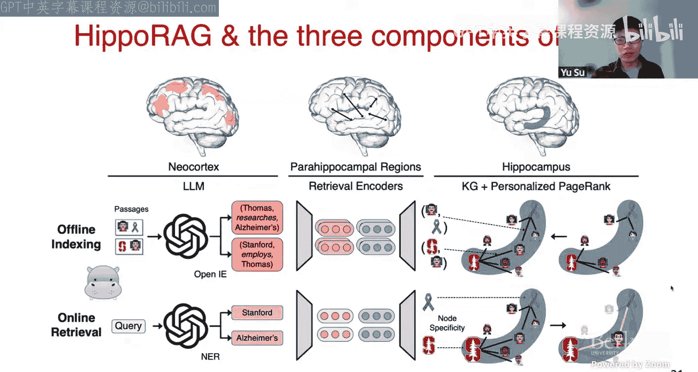

And it turns out like some simple strategy like this biologically possible strategy works also extremely well in practice right it's not enough I think it is of course a neat idea like hey this is biologically inspired how could is that but I think it' iss equally important for it to actually work to work their well and better than existing solutions in practice and that's what we showed with hipag。

😊，So compare HpoR with the state of the arts dance retrievers at the time and show that on multihub QA dataset sets。

 three standard multihub QA dataset sets it performs much better by a large margin。

 and also you can compare HpoR with this iterative retrieval message like ICOT。

 and it also works better than these iterative method。And also because hippo。

 the nature of a really thisstructured index and the graph search。

 though it it's highly complementary to all these existing methods。

 you can easily integrate it with other methods ICOT， and then you get a big boost as well。😊。

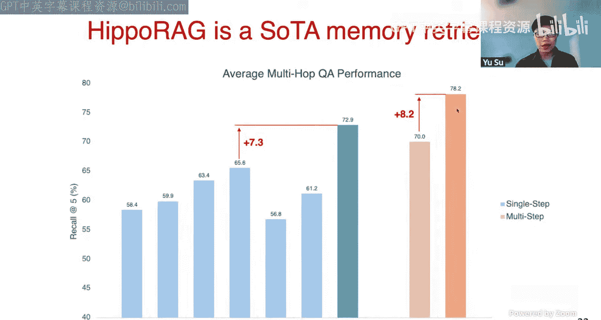

诶。And two， better understand where does this power of hipporac comes from。

 we can consider a type of questions， what we call F binding questions。

Like the example running example we have been working with。

So if you think about the in this information space。

 like the this huge graph of everything connected to everything。

 what's the solution path of structure for this question looks like you will see it's like。

It's not just like a one to one to one kind of path。

It first has start with a one many relation like Stanford。

 there are many professors working at Stanford， then among those is our answer。

 Professor Thomas from this and then for other people to researchers to Alzheimer's。

 that's also a many to one relationship， so there are many people working on Alzheimer's。

If you don't have like prior knowledge about the answer you're looking for。

 then naturally you'd have to search through all these hundreds of thousands of candidates for you to find Professor Thomas。

And hippo by explicitly building extracting and building these associations from the raw inputs that allows you to kind of create this shortcut to quickly find the true N well if you use Co or like ICOT。

 then they won't be able to find it efficiently。

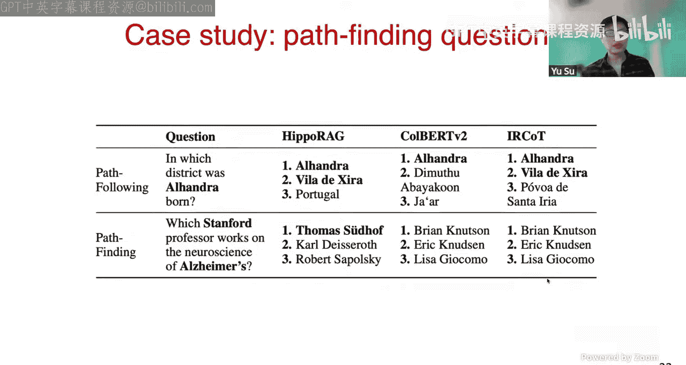

so that was hipporac that was published in Europes。

 which is just two months ago but in today this' pace it feels like ages ago。

 so as andm very excited to share that hipporac V2 is coming very soon so a problem with hipporac all this recent structured augmented ra message like graphraph rack light rag Ra and so on and so forth。

😊，The if you。So the compare favor body was to this like simpler baselines like these small dense retrievers like Co V2 or confire。

 but recently there have been many large embedding models like a grid like a main bed and if you actually compare these structured augmented rack message was done。

 you will see that they are much worse， including Hporac they are working compare compare okay on this multih QA tasks because they were mostly designed for these kind of tasks。

 but if you just look at other scenarios like just some very simple QA or some discourse understanding and so on and so forth like they don't work that well so as a result it's very hard for this method to become just a jobin replacement of like embedding based message。

Then in HyipporagaV2， we did a bunch of clever upgrades to HyporagaV1 and the result is that now V2 is comparable or better than the best lodging bedding models across the board。

 so then it's much more plaus to just use HypoaggaV2 as a drop placement replacement for your rug system。

We hope to release this version。

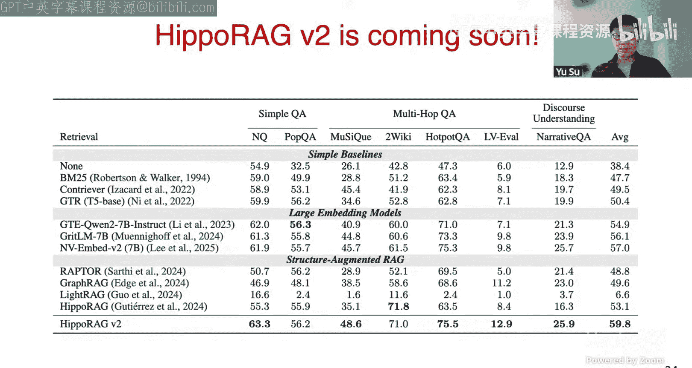

Right， so。For the memory part， the takeaways， so memory is really central to human learning。😊。

And long term memory through parametric connu learning for LMs is very hard， but fortunately。

 non parametric memory like Ra could be a promising solution。😊。

But and the reason trend in RA is to add more structures to embeddings like Hepoag or Graphra to enhance like the sense making capability of these models。

 like the ability to integrate larger， more complexs and uncertained contexts。

And the associatedci of this memory I the capacity to draw multipart connections between thesepared pieces of information。

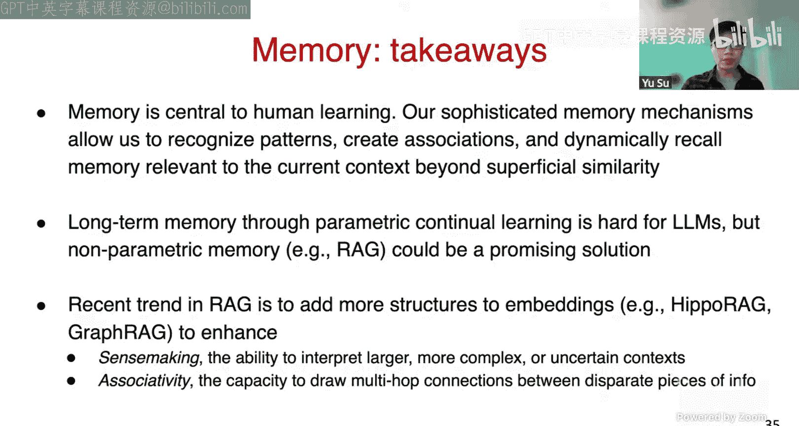

Okay， so that's memory and I think we're still quite far away from developing a very sophisticated memory system。

 but we are on well getting it， but there are still many gaps like how to handle like episode of memory like the spatial temporal aspects of things。

 which is central to human memory， we don't have a good solution yet。😊，Hey， so。

Memory is the most fundamental aspects， in my opinion。

 then let's get to another very fundamental aspect which can be built on top of memory。

 which is reasoning。

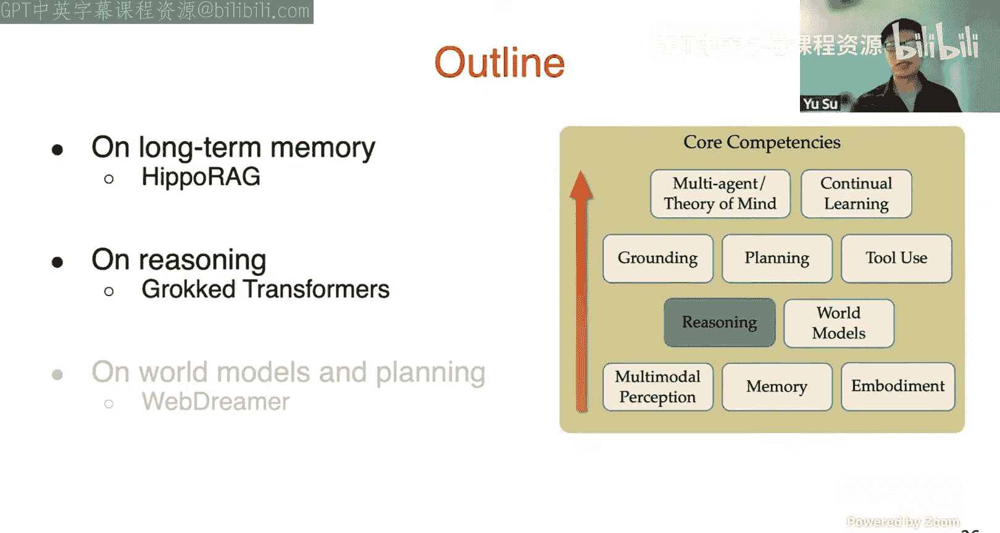

And our discussion today will be mainly based on this paper。

 Gracking of implicit relations in Transformers， it's led by the student from our group Bohi Wang。

 and it's published in New Europes this year last year。

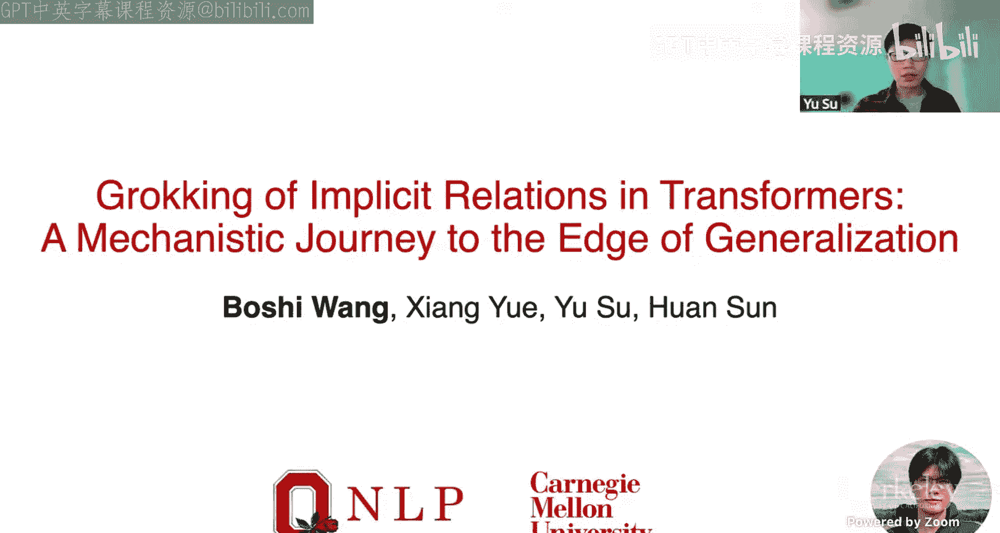

Right so we will be talking about implicive reasoning in implicit reasoning。😊。

We don't do chain of thought， so there is no verbalized chain of thoughts explicitly。

 we ask the LRM to directly predict the N。In this example of compositional reasoning。

 let's say the language model has memorized。😊，Oh no， these two atomic facts。

That Barak's wife is Michelle and Michelle was born in 1964。

 then the model will be given this input a Baroque wife born in and is asked to directly predict the N 1964 in this compositional reasoning fashion。

Right， so if you do change of thoughts， of course， it can try to recall head that Bar's wife is Michelle。

 Michelle was born in this， so therefore the answer is this。

 but we want to push the model to implicitly just using its parameters in a single forward pass to do this reasoning。

😊，喂。Like COT， like especially thisbound COT is all the rage right now， like in01 or01。

 then why does implicit reasoning matter？😊，This is also what I would mean in the beginning。

 like why this the reasoning mechanism of these LOMs is mostly just token generation。

 but implicit reasoning is still part of the reasoning repertoire。

So why does impressive reasoning matter？😊，First of all。

This is the default mode of training or pre training。Because during training time。

 when the model is asked to predict the next token with cross entropy loss。

 there is no COT right as it is not for now so in training time model has to compress the data has to do input reasoning in order to reasonably predict the next token so no matter what I think it's important to understand。

The imps reasoning capabilityability of energy bottles。

Also that the inclusive reasoning fundamentally determines how well these models acquire structured representations of the facts and the rules from their training data and finally。

😊。

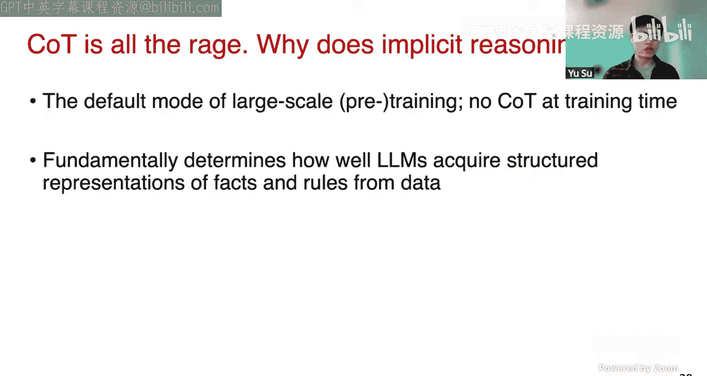

But there's a lot of speculation about how does this01 or O1 style long COT emerge from IL？

I think one plausible hypothesis， as you see in my mind， is like this。😊。

But you start with a capable base model， but if the base model is not capable enough。

 then I won't do much。😡，So you start with a capable base model like DC V3。

 and it probably has already learned all of these basic constructs or strategies for reasoning。

So like spell reflection， like analog reasoning and so on of force then and probably maybe in an increasingly reasoning fashion。

 like just some kind of reasoning circuits in the parameters。😊。

Then reinforcement learning with these verifiable rewards is just to incentivize the model to learn to use the right combination of strategies。

 but it's not learning new reasoning strategies through IM。

And then it also encourages the model to keep trying， don't be lazy。So if we if these hypo is true。

 then。Understand how models， how these different reasoning strategies work within the model becomes even more important。

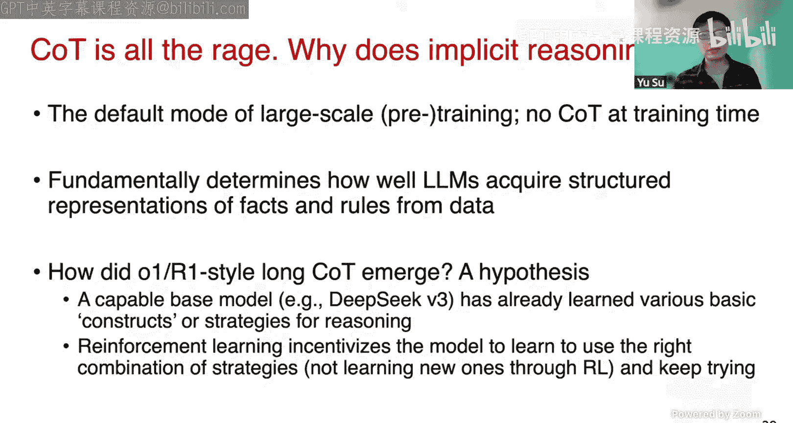

Right so back to implicit reasoning before our work there were a bunch of work a great work that shows that ourMs truly struggle with implicit reasoning I some people show that it struggles with compositional reasoning like this。

 there is a famous compositionality gap。😊，And then some other people show that LMs。

 even like G4 at the time， struggled with simple things like comparative reasoning or comparison。

 like Trump is 78， Biden is 82 then Trump is younger or older than Biden。So。

That was like the previous conclusions， but we。We had different opinions like it seems to like these all like kind of contribute to like this auto aggressive LRMs and never truly reason or plan kind of narrative。

 but we had some different belief we have more faith。

 more confidence in language models and transformers so we want to more carefully study these problem than to see whether we can get some new insights。

😊。

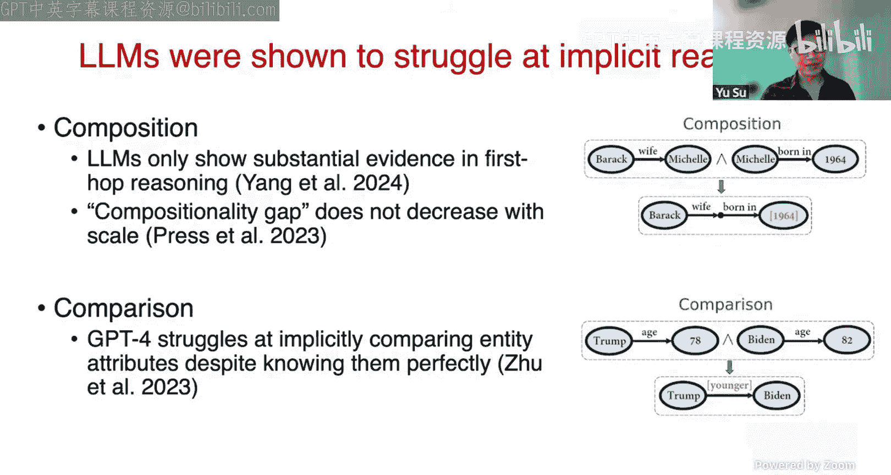

So we started with these research questions first can transformers learn to reason implicit。

 or are there fundamental limitations that prohibit robust acquisition of this skill？

And then what factors， like I said， the scale of the train data。

 the distribution of the train data or the model architecture that controlled the acquisition of implicusit reasoning？

😊，Okay， so with these two questions， let's discuss the setup。

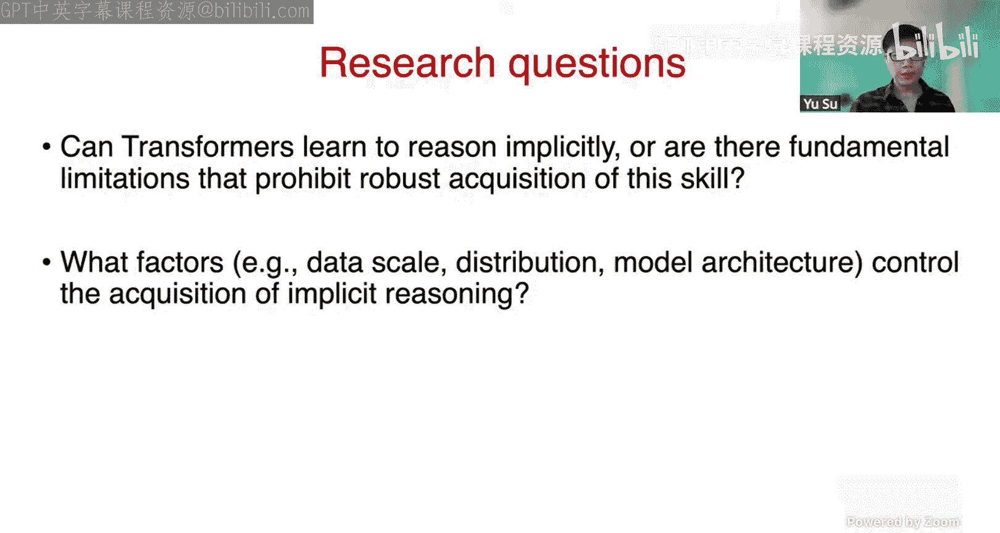

The model and optimization are pretty standard but we want to I don't want to introduce questions here。

 so it's just like a standard deco the only transformer in GT2 architecture and we'll also show that the results are pretty robust to different model skills so you can have a deeper model but the conclusions are the same。

Then the optimization is also pretty standard。

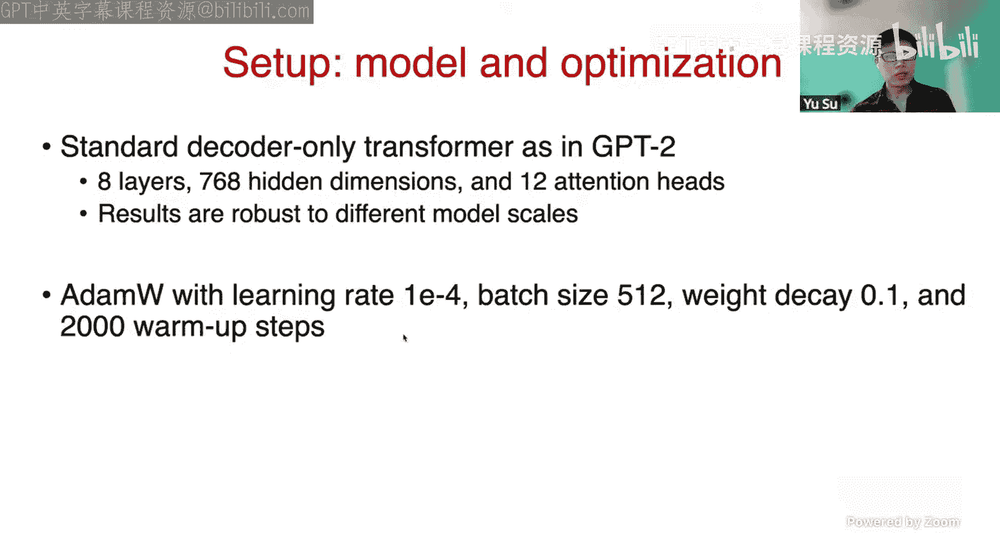

Then the data we'll be using will be synthetic data because we want to carefully control all the factors in this investigation so that we can separate out the problem we want to study。

So you can imagine like let's just consider composition， we study both composition and comparison。

 but let' focus on composition for now。😊，The data will look like just a random large graph。

 it has epsidal entities and our relations we set are to 200。

So then it's a bunch of nodes and then these different relations like this。Then it has。

 these are the atomic facts right like a superstition the scenariory is Ste and then we can use this atomic fact to get some inferred effects with these two hub compositions following the composition rule like if the head entity。

 R one bridge entity， and then bridge entity are to tail entity。

 then we have this composition effect like head entity， R one r to tail entity。

 so it's like barak wife， born in 1964， right？So this composition， and you can think like comparison。

 the data for comparison is similar。😊。

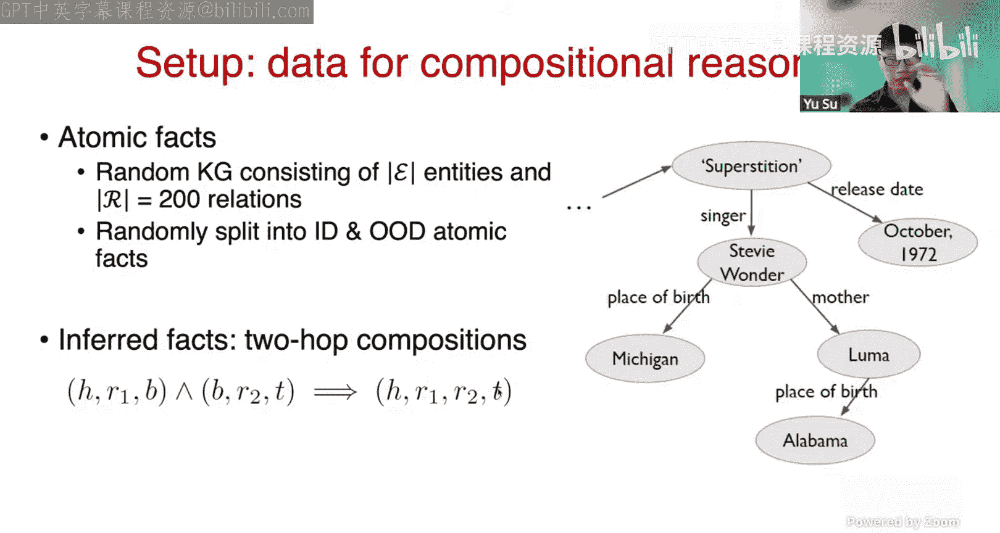

Okay， then the important setup here is that we want to study in learning of detection rules。

A fancy phrase， but let me just decompose this for you。😊，First of all。

 we want the model which is the decoder only transformer to learn inductively。

 so just give a bunch of training examples want to learn these rules and particularly these are deduction rules so this is a typical deduction rule right start on some premises and then you can deduce a new fact。

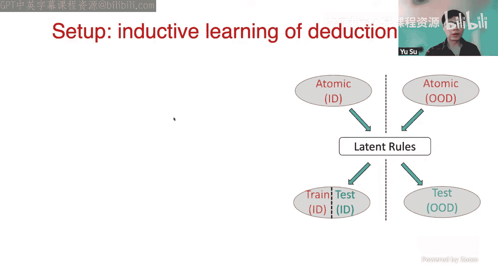

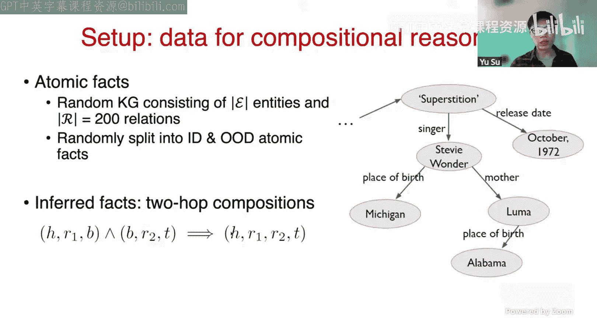

So this is in learning of the deduction rules。Then。There are two。Generalization settings。

But I would call the in distribution setting。And then the out of distribution setting。

 or this setting can also be called systematic generalization。それ we easy go saying this。

Or the atomic fat like those edges in the na graph。We split it into two sets， the I set。

And the all decent。Then they all go through the same rule， like the composition rule。

 you get to the corresponding infer facts。Right。Then for this set of inferted effects from the I atomic facts。

 we split it into two sets， the20。The training set and the tech ID test set。

So these for these in facts。嗯。For in the ID test sets。😡，Even though we have not seen this exact。😡。

Inferd facts in our training data because so it's an uneen infer fact。

 but we have seen all of its constitutes like those atomic facts being composed in with other atomic facts in these ID training set。

RightI know it it's a bit of a mouth， but just bear with me so for any of these infer fact in the ID test set。

😊，Like Baro wife born in 1964， maybe youd have you have not seen that exact in fact in your training data。

 but you have seen like for example， the relation。Like Barak wife， Michelle。

 you have seen these atomic facts being composed with other relations。Also， similarly。

 you have seen the other atomic facts like Michelle born in 1964 being composed with other atomic facts。

 you just haven't happened to see that exact in for fact like Barque wife。😊。

Pot in 1964 that so that you still need some generalization to capture that。For the OD test set。

Then you still have seen all of the atomic facts because otherwise the model doesn't know thatomic this factor exists。

 but you have never seen any of those atomic facts being composed in a composition of fashion。

 like being composed with other relations。Right so that in that sense is a stronger generalization setting so that's why it's called a systematic generalization if a model can do this。

 then essentially it means that the model has truly learned this rule。

 this deduction rule so that you can just apply it to any arbitrary new facts right。

So that's a realistic goal for these learning of detection rules。

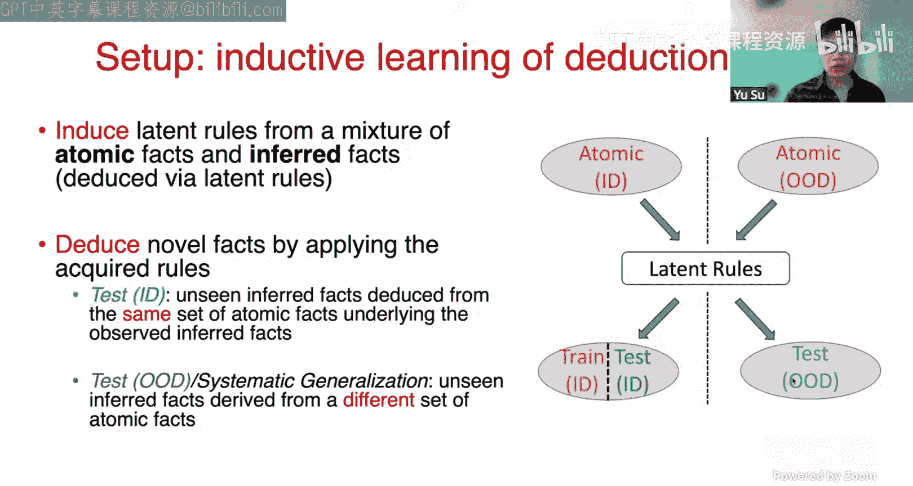

Now， with all this Den setup in minds， let's look at some thumb parts。

 look at some interesting takeaways from our investigation。

The first surprising conclusion we found is that。Transformers can learn to reason implicly。

But only through a process called rocking。What is cring so let's look at this figure for now。

This curve is the training accuracy， you can see it quickly it goes to 100% that means the model the training has overfied at these points。

😊，But if you look at the ID tester curve， right， when the model first overfis here。

 the test accuracy was still very dull。And if you keep training the model way beyond like the situationuration or overfitting but the overfitting happens around that 10000 steps and if you train it like。

20 times more optimization steps， like to these points， this is log scale， for example。

 like keep in mind， then all of a sudden generalization happens。

at least the ID generalization happens so the model gets to 100% test accuracy on composition in the ID split。

😊，Similarly for comparison。😡，The overfieding happens very early on。

 but it takes about 20 more times of optimization steps for generalization to happen。

 and interestingly， for comparison， OD test accuracy also get to 100% so that's a problem we'll look into later。

Right， so that's quite interesting all right， these transformers they can learn to reason implicitly。

 but only through rocking。And it's one of the first studies that establishes this connection between rocking and in reasoning。

 I believe。And we will investigate why that happens in a second。

Another immediate takeaway here is that， as we just said。

 the level of systemity of generalization varies by the reason type for compositional reasoning。

 it never managed to learn to generalize OD， well for comparative reasoning。

 OD generalization did happen。😊，So we want to understand why there is such a difference as well。

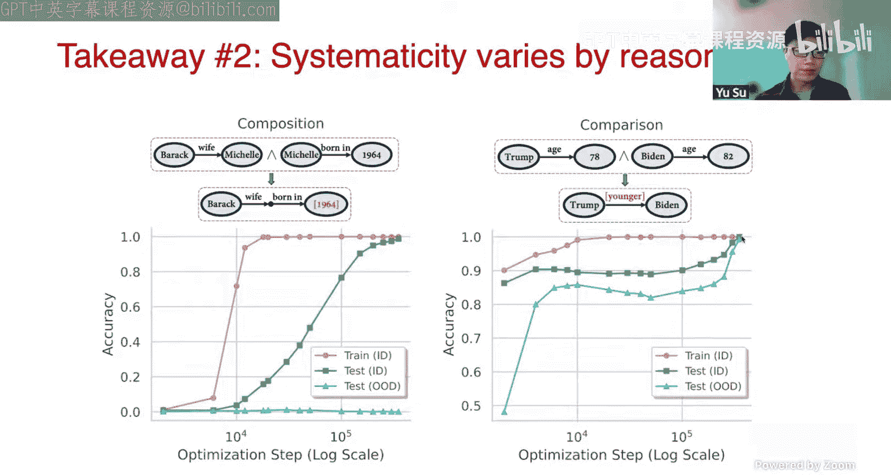

Then another interesting takeaway here is that。Before this study。

 there were already some studies that look at blocking and then I'll try to understand why gring happens and under what conditions would blocking happen。

 then when common belief in the literature was that there is a critical data size。

Once your total amount of data surpasses a certain threshold， then gring happens。

 otherwise it won't happen。But in our study， we try to study this hypothesis very carefully。

 then we find that actually it's not the data size， but the data distribution that matters。

So in these experiments on the right we we keep the the so there is two fact two variables。

 there's the total data size which is controlled by the number of entities and its proportional to a total data number of training examples and then there is。

B which is the ratio of the inferred versus atomic fat so if this number is larger that means that you have more inferreted effects than you have atomic facts。

😊，so on the right we keep the ratio fixed and increase the number of entities or the total data size。

 then you will see the speed of generalization is roughly the same that when you increase the total data size。

😊，はい。It's more or less the same however， when you keep the data size fixed so it's the same number of entities you just change the ratio file。

😊，Like from 3。6 to 18。Then you see the speed of generalization。

Strongly positively cors with this issue。If you have a higher ratio。

 then the generalization will happen faster， and at some points it will be as fast as the overfiling of the training data。

so this really shows that it's the critical data distribution that matters not the sheer size of your training data。

😊。

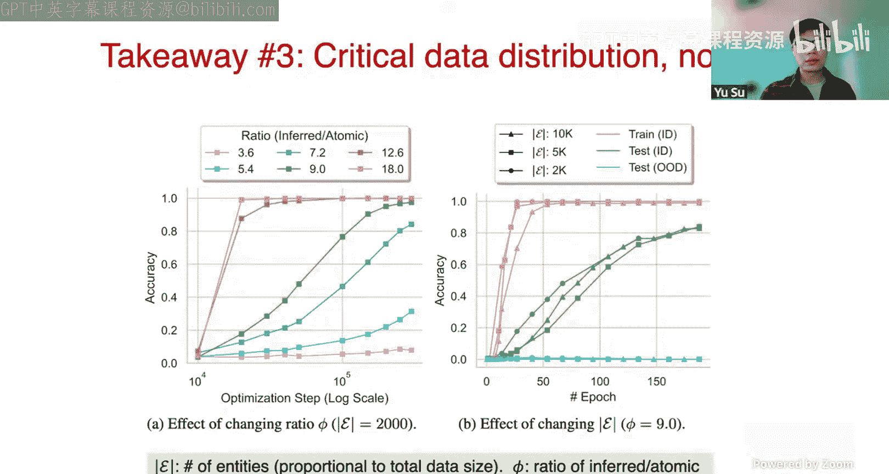

With all those take interesting takeaways， our job is not done here yet。

 because there are still some very important questions we have not answered。

So why does Croing happened？What exactly happens during this long blocking process。

 what's going on within the model and why does the level of systematicity in generalization vary by the reason type so all of these questions require a deeper look inside the model。

That's the mechanistic interpretation part of this study。

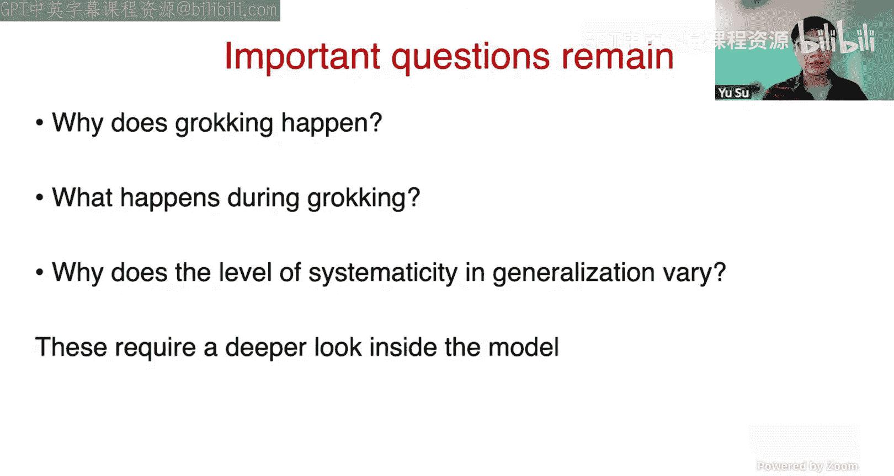

So we will use some popular and nowadays very standard mechanistic interpretation tools。

 one is logic dense， so here we apply the internal states at some position in within the transformer and multiply it with the output embedding metrics so that we can get a distribution with output vocabulary so we kind of get a peek into what this internal repation is about right then we will also use so-called causal tracing。

第。In a nutshell， this allows you。 This technique allows you to。

Measure quantitatively measure the amount of impact of a certain internal state to the output。

 so if it ranges from zero to one， if it's closer to one， that means that this position。

 this internal state has a larger impact on the final decision。

I won't get into the very details because that will take too much time。

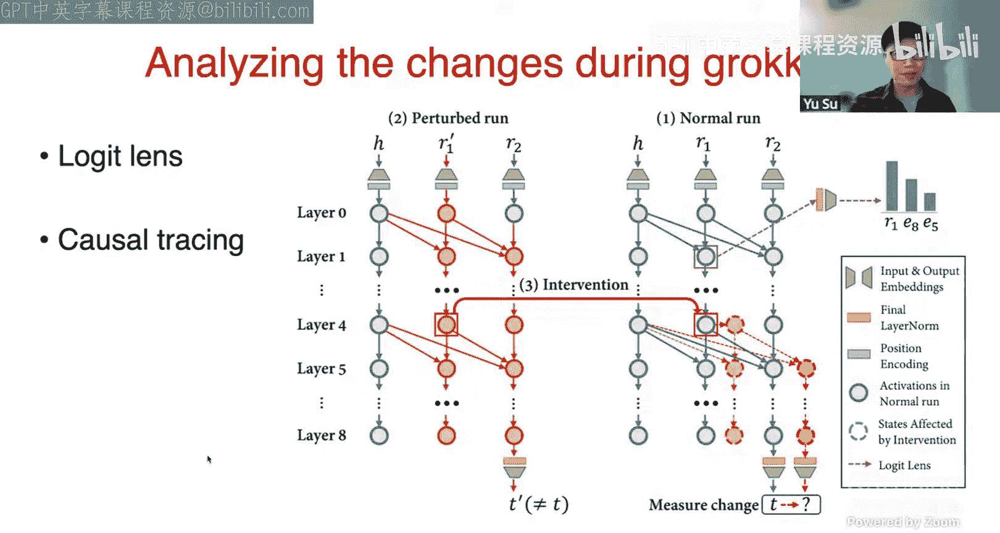

咁。So with these mechanically interpretation techniques。

 now we can try to find or discover rather that。The corresponding generalizing circuits。不我们。

For different reason types。Then this is what we found， very beautiful。😊。

We'll find out full composition。After gring， the transformer will learn a generalizing circuit like this。

 it's a kind of stage circuit。All so this is the input to the transformer you have the head entity r1 and r two and then this is the day year zero。

 this is the day year8 the final layer year then the first。😊。

Few layers of the transformer will essentially do two things。For these parts。

 it will process the first hop essentially， to look at H and R1 and then find the bridge entity TP。😊。

Here we're using logical dance here。So it has memorized this atomic effect in the first few layers to the extent that it can reliably predict B at the year five。

Then another thing that needs to be done here is that it needs to defer the processing of R2。

So you cannot forget about R2 because R2 needs to be used data。

 even though it doesn't need to use R2 in the earlier years。

 it needs to use R2 when it has found B the bridge entity。

So once the bridge entity is identified then in the internal states， then it can be combined with R2。

 and then it has memorized the atomic effects that dR2 is key。

So then you can combine the bridge andTB and the delayed processing R2 to predict T。

Right so that's the generalizing circuit or composition， it has two clear stages。

And that will also determine its generalization behavior that were analyzedd。Well on the other hand。

 the comparison relationship or reasoning has a different circuit， what we call a parallel circuit。

Remember for comparison it's like you have two entities E1 and E2 you know some value of some attributes of this entity like this is Trump this is Trump this is Biden than Trump is V1 is 78 Biden is 82 then the prediction is who is older is like Trump is younger or older or equals than Biden right then the circuit here is more of a parallel circuit so the first few days of the transformer will learn to in parallel retrieve the attribute values like 78 and 82。

Then the。Upper day will use this retrieve the values to do the comparison and then to predict the final n。

 whether it's smaller than equal or log。Okay so different the reason through mechanicalchanity interpretation。

 we can find the generalizing circuit configuration of different reason types。

 and they are indeed different and this different configuration will determine their level of systematicity of generalization。

😊。

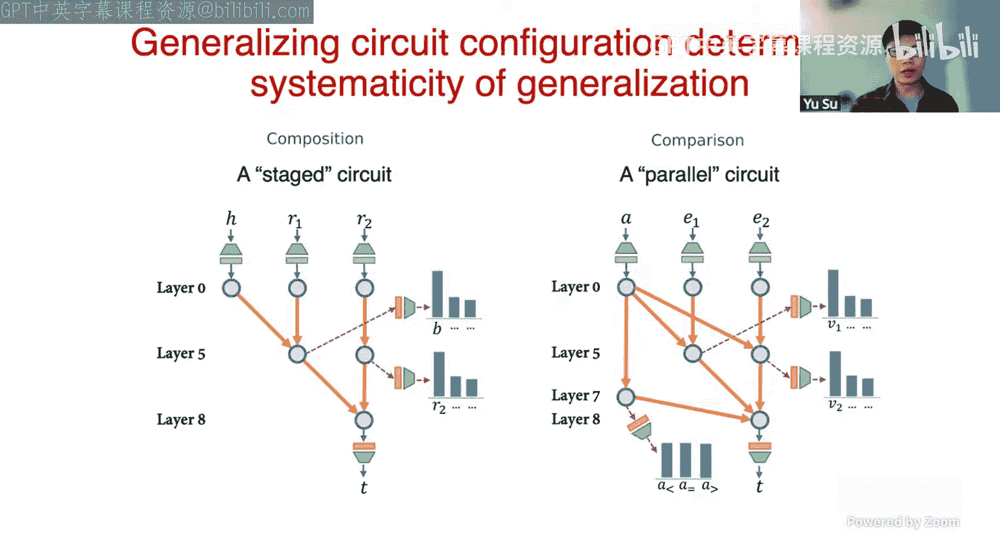

But before that， let me share like a simple way to fix or to improve this systematic generalization。

 especially for composition。😊。

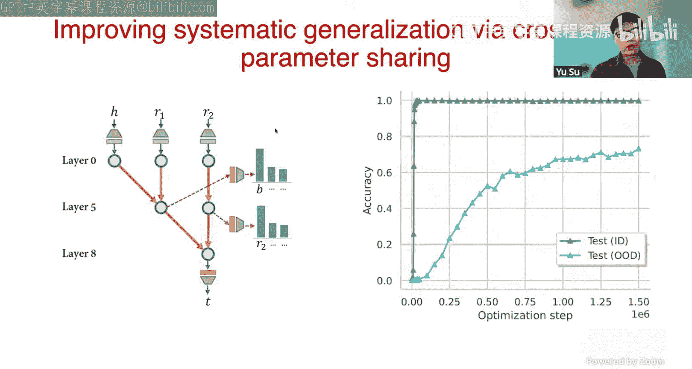

Right。So as we showed earlier， for composition OOD generalization never happened。

 why if you think look at this circuitcate and think about it， that becomes kind of obviouslig。😊。

So for the OD generalization to happen。The model needs to do a few things。😡。

You need to first memorize a copy of the first hop atomic effect at HR1B in the lower layers of the transformer right so that you can find thebri entity at the layer of five。

Then it also needs to store a copy of the second hop atomic effect。😡，But in the auto layers。

Because the second HA has a the processing。So it needs to somehow store effect the atomic effect B。

 R2 T here， not in the lower year， but in the upper layer。However， for the OOD generalization。

 remember our definition of OOD is that none of these atomic effects has been seen during training to be composed with other facts。

😊，In that situation， the model has no incentive。😡，To score the second hopatomic effect in the offer layers。

It' only seen this atomic effect individually， so it can easily memorize them in the lower layers。

 but it doesn't have the incentive to store another copy in the off the years because that requires actual effort。

😊，That's why OD generalralization of composition never happens。Well for comparison。

 you don't have this stage processing， so you only need to store one copy of the atomic effect and you can retrieve that the value in the lower day years here for the comparison so you don't have that issue and that's why O degenization of comparison doesn't happen。

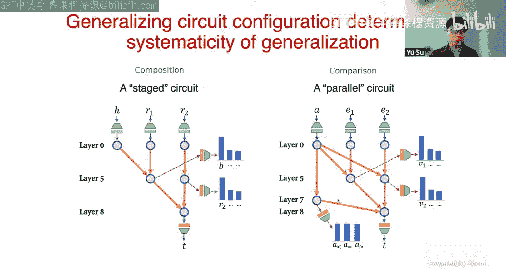

Okay and to further validate this hypothesis we can do we did an intervention here。

 so if that is indeed the case that is because the model doesn't have an incentive to store this atomic effect in the upper layers。

 then we just need to do some parameter sharing some cross the layer parameter sharing。

 so you kind of tie the weights of the lower layer with the weights of the upper layer。

 so it's a parameter sharing and then if the lower layer hasnt memorized an atomic effects。

 then the upper layer will get a copy of it as well。😊。

So we did the that intervention and turns out boom。

 all degeneralizations start to happen for composition。😊。

so this further validates the hypothesis it's a bit dense。

 but I think that this is probably one of the most interesting slides of this or analysis of this work。

😊，嗯。😊，So。Remember， we try to do or try to understand what exactly is going on during gring。

We said that the gring process is when this like this generalizing circuit starts to form。

 but in what exact way that's still unclear so through。Like cost tracing。

 we can actually identify like what exactly is going on during rocking。嗯。let's first。嗯。

Let's first focus on。This figure。嗯。Or let me first say this。

 so we believe gring is the phase transition from root learning to generalization。So。😊。

We're all kingdom。Starts when the model has overfi the training data right so but at that point the model has only done root rot learning so it just brutely memorized all the training data including the inflated facts but not actually in a generalizable way。

 but the because it has memorized all of them so the training loss will be zero right but it doesn't mean that it has captured this generalizing circuit then the blocking process is essentially the phase transition from the initial rot learning to the generalization it's where this generalizing circuits gets formed。

And now let's analyze like how looks exactly it gets formeded。嗯。😊。

The first thing we will do cats is this figure。Right， we look at。Two things。So S5， R1。

Is this position？RightSo this is the fifth this is S stands for state。

 so this is a state of layer five as the position of R1， so it's this one S5 or1。😊。

Then we can use logic dance to decode what's captured in that state representation in that state。

You can see the crocking process。And similarly， we can do that for S5 or2， so this position。

So once Broing starts。😡，The model already has。😡，And this is MRR， so it's the main reciprocal rent。

 but basically it just tells you like this brt CP， the ranking of the brt C in the logic events。

If it's one， it means that the state here will always predict the bridge and the T。

 so that means that it has encoded this information， so when the crocking starts。

B is already there the mR equals one， so that means this state here always predict the bridge entity B。

 which is what we want right we want the first hub to get us the bridge entity that is great。

But remember， we also need the model， to。Do a delayed processing of R2 so that at least point you can combine B and R2 to predict the tail entityT。

But if you look at MRR of R2 at this position。😡，When grocking starts。It does not。😡，F R2D。

So it has to be here， but it doesn't have R two here。😡，Despite that。

The model has a so this is on the training set， so the model has a training loss of one of0。

 so the model has can perfectly predict the tail entityT despite not using R2 here to combine with B。

That means the model is just doing rot learning， so it just memorized that， hey。

 whenever I see h or1 r or2， then I will predict T。

But it's not actually using doing this a stage of thing。

 like getting the bridge entity and then combined with R2 to get another use anotheromic effect and do the reasoning。

But through the grocking process。You can see our two gradually increases so at the end of a grocking。

It always predicts r2， then you have B here， you have r2 here。

 then you can actually do recall the atomic effect here to predict the TMT。So， these。

Is further cor by the causal tracing results here。So。Remember， through causal tracing。

 we can quantifyify the causal strength of each state to the final prediction。

And this is the causal strength of each state at the beginning of gring， and this is after the gring。

 then we can calculate the difference between two and find their di。

You can see the th mainly happens here。😊，Ats S51。So that means in the beginning of Bro even though the model has the bridgeTTP here。

 it does not use it right it just did a road to learning so the director predicts the tail entityT。

But the grlocking process is the process of the model learning to use this bridge entity properly。

 so giving it a stronger causal strength to the final prediction。

 and this combined with the fact that which has shown that through logic dense。

 that the grlocking process is where this R2 start to emerge。

These combineds give us validate the hypothesis that。

Now this grroing process is really the process of forming this generalizing circuit。

 that is sta circuits that we just shown for composition。

And we can actually explain even though not we didn't do any proof of any sort。

 but you can roughly understand why this kind of gring behavior happens through the circuit efficiency and irreularization。

 the generalizing circuits is much more efficient than the memorizing circuit。

 the circuit for rot learning。So。And because you also have regularization， right。

 the L2 regularization term， for example。😊，Then if you just keep training even after overfitting。

 the regular term will decrease and then will gradually favor the circuit with higher efficiency。

 which is the generalizing circuit so that's why you find this is still beneficial to cr way over beyond overfitting because that's when the regularization starts to kicking and。

😊，Thats you the more efficient circuit。But I think at let me give you the definition of planning because that in itself is a very confusing thing for various reasons。

 so in the context of damage agents who will work with this simplified definition of planning even a go G decides on a sequence of actions a0 to AN that will lead to a state that will pass the go test of G。

😊。

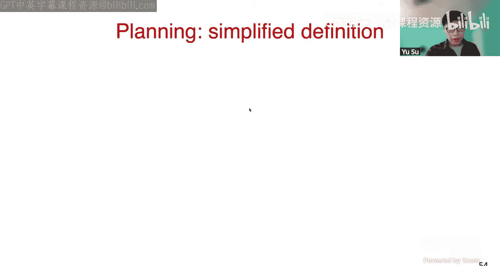

Right， so of course this is over simplified because we don't talk about the state space low observations space and then the actions have they are not just atomic actions they have precond that have to be met before they can be taken and so on and so forth。

 but for this purpose I think it's enough to have this definition then。😊，With this definition。

 we can analyze these general trends in planning settings for language agents compared with the classic planning setting。

 which has been studied in for decades。Generally， I think the expressiveness in ghost specificification is drastically increasing。

 so now we can express our goal in natural language as opposed to some formal language。

 which is usually much more limited in expressiveness。😊。

And also we have a substantially expanded or open ended action space so instead of like some very constrained action space like hey。

 you have a robot， you can move forward， you can turn left and so on so forth now you can have an even open ended action space and we will see some examples soon later。

😊，Then。Because of those it becomes increasingly hard to do automated go test imagine you have a web agent that is just doing things on the web。

 then a lot of the time you just simply cannot just write a go test beforehand like what the goal state will be like。

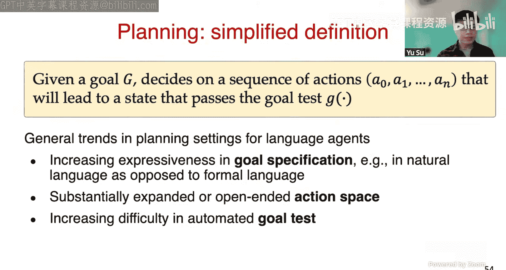

But that's fun because fuzz is really an inherent part of this world。I'll skip this one。

 so I just skip some examples like for web agents like from our mind web you'll see。

Like in terms of the task the ghost specification right the user can say ask for anything on an optional website。

 so it's very broad and in natural language and then in terms of the action space right yeah you have some broad actions like types like you can type you can click you can drag you can hover on some elements but the actual actions like what elements you click on these。

Actual actions are dynamically。Populated on each web page。

 so if you go to a different web page your action space will be different right so and it's a very big action space you have to discover on the slide。

😊，And of course， the gold test is also very。😊，But。And then there's another example of travel planning that has some similar characteristics。

 but we'll skip here so。I think these are some of the general trends for language agent planning and these are I think these are good trends。

 yeah it makes things more challenging but for the value because it now can support much more realistic and useful application scenarios with these language agents。

So let's see Wal can want to talk about this， maybe very quickly。

 but for people who are interested in web agents or computer user agents。

 I encourage you to look at this series of work like Minweb the first LM based web agents and then C where we first introduce a visual perception into web agents and then you ground that where for the first time we make a humanlike embodiment for computer user agents。

 so only perceived environment visually， there's no STML or anything like that and then you directed to pixel level operations on the screen and that these minimal dis design actually works the best across the board and then we will talk about web dreamer which is model based planning for web agents。

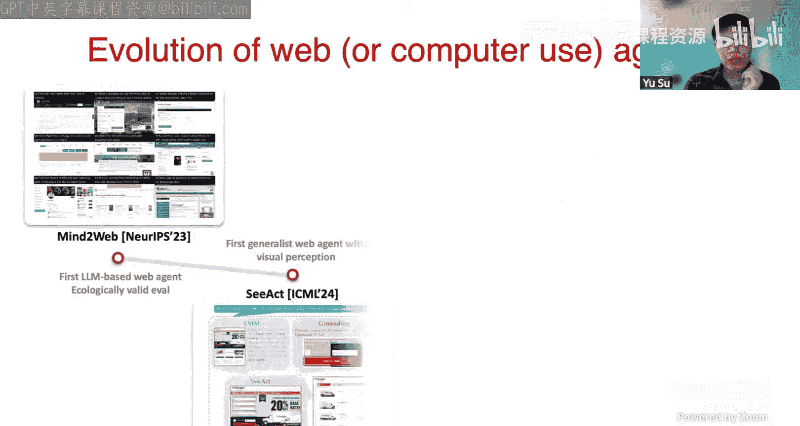

Okay， so let's consider the difference planning in paradigms for damage agents。

The most common one is reactive planning or react right imagine each node here is a web page then at each state you have several candidate actions you can take that will result in a different state or reactive planning you just at each state observe the environment reason about it then make a decision and commit to the decision and then that gets you to another state then you just keep doing this so it's fast it's easy to implement but the downside is that it's greedy and it's sort of ci so you often find yourself stuck in some bad state and there's no way out。

Then naturally， when talk about planning， we just think about search or research。

So you for research compared with reactive planning， you can do backtracking。

 you maintain a value assignment for the states on your search frontier。

Then you explore the most promising branch at some points if you find that not promising。

You can backtrack and then to fight to explore another branch。

So that gives you more systematic exploration。But no。

Downside here is that it's in real world environments like the internet。

 there are a lot of irreversible actions that make backtracking impossible for essay very hard。

 and then a lot of this exploration could also be unsafe or slow。

To just show you how pervasive these state changing and e rulesible actions are in real world environments。

 that's considered just Amazon。com right on these single websites you can have men。Dozens。

 if not hundreds of these stage changing actions like you can place an order， you can make a return。

 you can create an account that you will agree to the terms and use and then that has legal implications you can change your privacy settings and so on and so forth if there is no like this universal magical undo button that you can just quite a bunch of things and then magically undo and then go back to the initial states so that makes research in real world environment hard and then there's also the safety and costly issues。

😊，So ideally， we want to model basic planning。Imagine you have the word model that at the Asian States。

 you can trigger the word model to simulate the outcome of each candidate action。

Then that gives you a chance to。To evaluate the long term value and the safety of each candidateid action before you have to commit to it。

Then you find that the most promising canid action through simulation， then you commit to it。

 take it， assume it to save， and then you get to another stage， then get to this all over again。😊。

All right， so it is faster and safer compared with research。

 and you can also still do systematic exploration。But the downside is really how to get these magical word model。

😊。

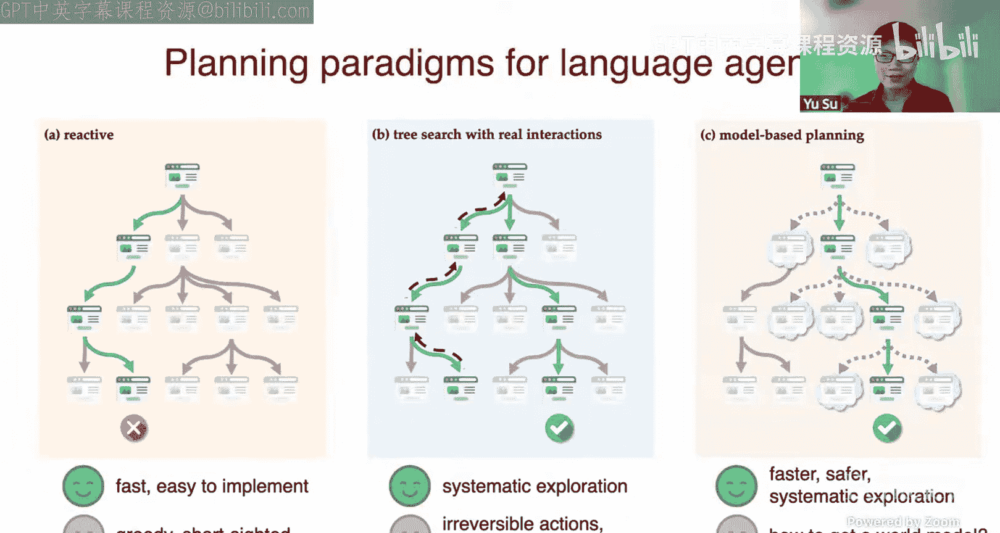

As far with what is a word model because this is another overloaded term for our purpose here。

 we'll take this definition is a computational model of environment transition dynamics。😊。

So basically， if I do this right now， what would happen next？Very simple。😊。

Then if it's that simple and it's so good， what hasn't it been done for language agency yet？😊。

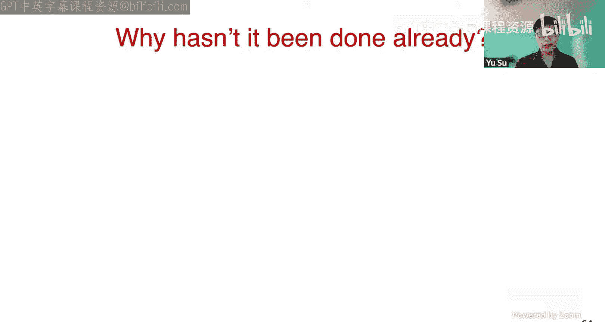

Well， the issue here is。

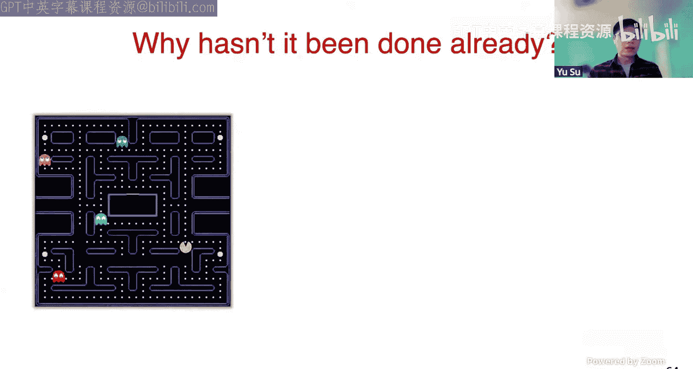

If you think about word models in the classic people learning literature that's usually started in reinforcement learning。

 right EL， where you have these simple simulated environments that you can do millions of times of trials and then you can use that to learn a word model for that simple environment。

😊。

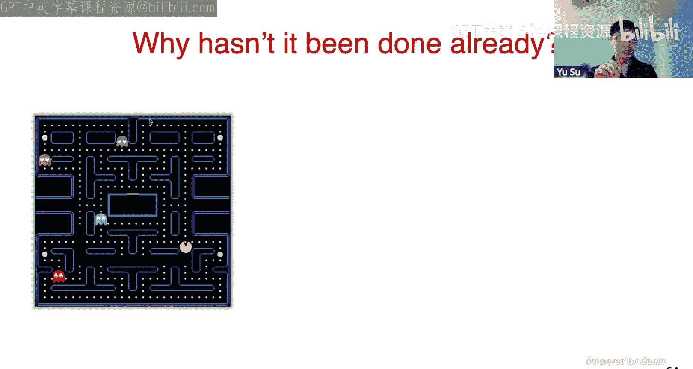

What we're dealing with here。😡，It's much more complicated。😡，Even just for a single website， right。

 there could be hundreds of different web pages on a single webpage。

 there could be hundreds of different actions and they can be constantly changing because the backend databases changes。

😊，And then this complexity quickly compellingly if we consider that there are billions of other websites out there。

 right， In that sense， we need a kind of generalist word model for the Internet。😊。

That seems very hard。Fortunately we find that LRMs can actually reasonably predict these aesthetic transitions so in this example if you ask an LM if I click this icon what would happen then you can recognize that hey this is a shirts then these product so the next estate will probably be about some product details and because it's a shirts so they will be sizing options and other things right because the RMs have this word knowledge。

 common sense knowledge is trained on the internet so it can。😊，Do a reasonable job。

 far from perfect but reasonable。So web tiber leverages exactly that we simulate a word model for the internet using an IOM in this case GT40。

 then when have you' are at a state， you have a few candidate actions。

 you can use the world model to simulate the outcome of each candidate action。

 you can even do multistep simulation， you have another value function which is also simulated by IOM to tell you how much progress you would have made going down that path。

 and then you can choose the highestvalued action， you take that action。

 get to the next state and then do this all over game。😊。

So that's modeldisciplinary planning web agents， it's far from perfect。

 but it's a reasonable starting point。In terms of results we evaluate on V web arena you show that model basic planning is more accurate than reactive planning and slightly des research。

 but remember research is only possible because we are working in a sandbox environment which is V web arena。

 if it's on the real website then backtracking in research will become part。And also。

 the basic planning is much cheaper and much faster。

Okay， so the take away for planning， I think the damage agents are expanding into these new planning scenarios categorized by the expressive but fuzzy goal specifications。

 the open ended action spaces and the more difficult goal tests。

But the language for reason enables new capabilities， planning abilities， like the word models。

 model basic planning and what we didn't talk about today。

 but the hierarchical planning and dynamic re planningning is also very important。

Then the best planning strategy is dependent on the LM if you have a stronger base LOM that it may require less scaffolding。

 so your planning strategy could be more reactive。m but generally how to improve planning in ourM is still largely an open question is I think many people are trying the recipe for ON style reasoning is try to see whether that works for planning。

 but that's still a big open question。😊。

F so I think we're really just standing at the Do up long journey we talked about planning。

 reasoning world models and memory， but there are a lot of other things we didn't talk about and there's a lot to be done just a few immediate future directions I find it interesting think memory personalization and continue learning we're really just a scratching of surfaces there is a whole lot to be done how to enable agent to continue the learning front use and exploration。

😊。

The reasoning like how to make or O1 reasoning work for language agents where you need to deal with this fy world without reliable rewards and how to integrate these institutional actions and environmental states and that's a big open question and I expect there will be a lot of study on this in 2025。

Then planning how to build better word models instead just like simulator one and how to balance the reactive and model based planning。

 because you don't really want to do simulation at every single step， that's very costly。

 even though humans can do simulation we don't do that every single for every single decision right only for those difficult ones。

 but how to balance this reactive and model based planning is still an open question。

How to sustain a long horizon and for safety I think that's a very pressing issue that keeps me really keeps me up at night I think the attack surface of language agents is scarily broad right for web agent the tech surface is essentially the entire internet like someone can embed something on a seemingly benign website and your like for example opening a deep research agent can go there visit there and get tricked via and then maybe reduce your review your private information and so and things like that。

😊，So there are two general types of safety issues， there's the endogenous risks。

 so these are the safety risks originate from within from the agent itself。

 usually because of the incompetency of the agent so it can mistakenly take some irreversible actions that do harm and then there are exogenous risks right so these risks from the external environment。

Okay， so but there are also a lot of exciting applications。😊，Probably the the。

The one with the most clear business case is a search or deeper research if you have not used like Coplexxi Pro or Google Open Air deeper research I highly encourage you to try that and I think something big is being bake here I think this will become a huge thing in 2025。

Then also like workflow automation and personally I'm very excited about developing agents for sciences。

 these are all very exciting。😊。

So for more a more comprehensive coverage on language agents。

 I encourage you to check out our tutorial with De Suny and To。

 we just see that the MLP like two months ago， and all the materials like slides and did videos are available on our website。

😊。

I thank all of my sponsors and be happy to take any questions。😊。

