# UCB《高级大语言模型智能体｜CS 194 294-280 (Advanced LLM Agents) 2025》中英字幕 - P4：Lecture 4, Hanna Hajishirzi.zh_en - GPT中英字幕课程资源 - BV1mkZiYAEYM

I'm very excited to be here today to talk about some of our efforts in developing training recipes for building language models and particularly for reasoning in language models。

😊，Okay， so let me start。I want to argue that AI is here today or we've seen all this progress in AI because of open scientific research and development that is happening in this area and because we had access to fully open model。

However， over time we've seen a lot of research and development in this area is getting closed off but what does that mean now does it mean that now we are done with scientific language model in research and innovation。

 I would argue no， we need still to do a lot of research to understand the science of language models to improve them and also build their next generation。

 also we need to make a lot of advances to push language models beyond language right like in science domains。

 language models for health and move it beyond text。Also， we need to mitigate their biases and risk。

 use these language models in real world， obviously work on LM agents， improve their planning。

 reasoning， test time and scaling， and also make them suitable for deployment and build a efficients model。

😊，So with that， I want to argue to facilitate innovation and also accelerate the science of language models。

 we need these models to be fully open。😊，We want them to be transparent。

 we have access to their data， we want them to be accessible and reproducible by researchers and developers。

So at UW and AI too this is our focus， we like to build an open ecosystem such that we can build language models from at different stages。

 from pretrain to post training to mid training and also building agents。😊，In particular。

 my team is leading to efforts called Open language model， Omo and Tulu。

 which is our open post training recipes。I also want to highlight that this fully open ecosystem is only one piece of puzzle in this landscape of AI these days Okay。

 so with this with this project almostmo， we like to develop study and advanced language model。

 we want all our efforts to be fully open， documented and reproducible and with this we like to empower the AI community and also inform the public about how AI works and so on。

😊，Okay， so in this talk， I'm going to talk about three efforts that we've done to improve mostly reasoning in language models and these three directions are mostly orthogonal and I'm going to talk about pre-train。

 post training and inference time inference test time inference and many of my slides are from my amazing students and team members who have worked on these projects。

Okay， so in the past year or so， we have released and launched a bunch of models and toolkits that we encourage。

All of you to work and improve event and pre training。

 we have released Almo one and two our mixture of expert version and also our full pre training data。

😊，for post training， we have developed our training recipe on top of many open weight models such as Alama。

 Coin and so on， and also we've applied that to our fully open language model O and also we have all the toolkit data and so on publicly available and most recently we continued working on test time scaling we have released Swwaan Open Schol and selflfF which I'm going to very briefly talk about those three as well。

Okay， so just a quick snapshot of where results are standing is in our latest release of AlMma2。

 which we have released ULMma at 7 billion parameter and 13 billion parameter scale。

 the base model at the end of pretraining， it is on par and some data sets better。

 a little bit worse on some data set， but on average on par with Lama 3 and coin 2。5， same as a 13B。

😊，Importantly， we have used less number of training tokens and we argue that Almo2 is on this Perreto optimal curve compared to many other kind of open weight models likenquin 2。

5 Lama 3。1 and so on。 So this curve shows the approximate shows the average performance versus the approximate pretraining flops and as you see those are kind of dual to stars show where。

Mo to that。

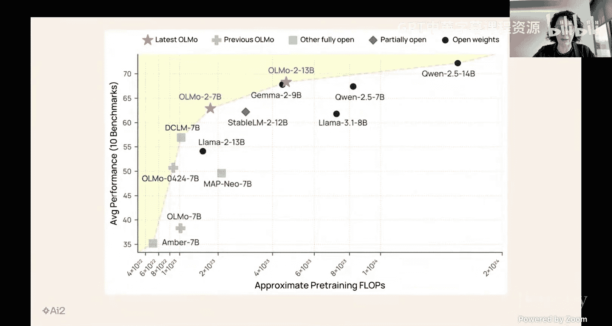

A snapshot of our post training efforts， so most recently we have developed our posttrain recipe on top of the largest open rate model which was Lama 405B and I'm going to talk about how this process is being done in this talk and I can show you that2lu3405B now is on par or better than DeepCV3 and almost on par with GPT40 which is very impressive showing that now we are getting really good result compared to event proprietary models。

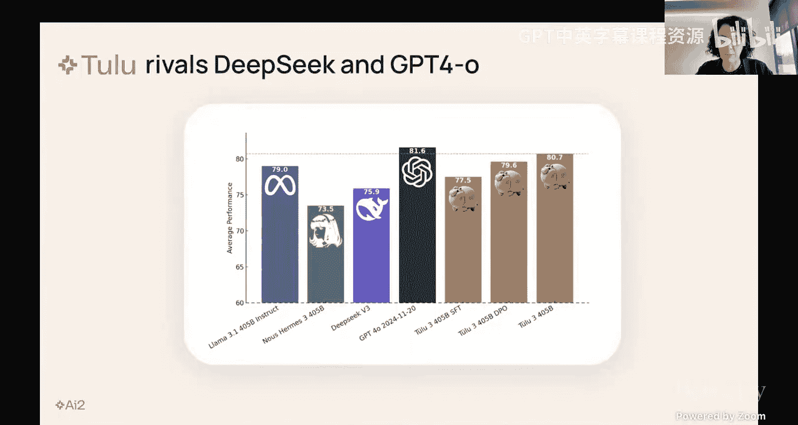

Okay， so with that， I first want to start with post training because a lot of our efforts on how to make these models able to reason starts from post training or happens during the post training and I kind of will talk about how we develop Tuulu along this process。

Okay。So how do we build a modern， large language model， so it is roughly going these two stages。

 pre training and post training。In pre training， the models are trained with predicting the next token。

 where data usually comes from large and large scale data， mostly from the web。

But the model that comes out of this stage is not ready to be used for a lot of applications。

 it is not safe， it's probably not able to follow human instructions and it's not that good at reasoning。

😊，When post training happens now models can do a lot of things， it can chat， it follows instructions。

 you can integrate it with tool use， it's able to reason it's able to tell you when it is harmful when it doesn't kind of follow the instruction and so on okay so we do posttrain to align with human preferences you've seen it in like when for example use chat GPT which of these two responses you prefer and like we collectlect these type of data to say which of these outcomes are more align with humans in。

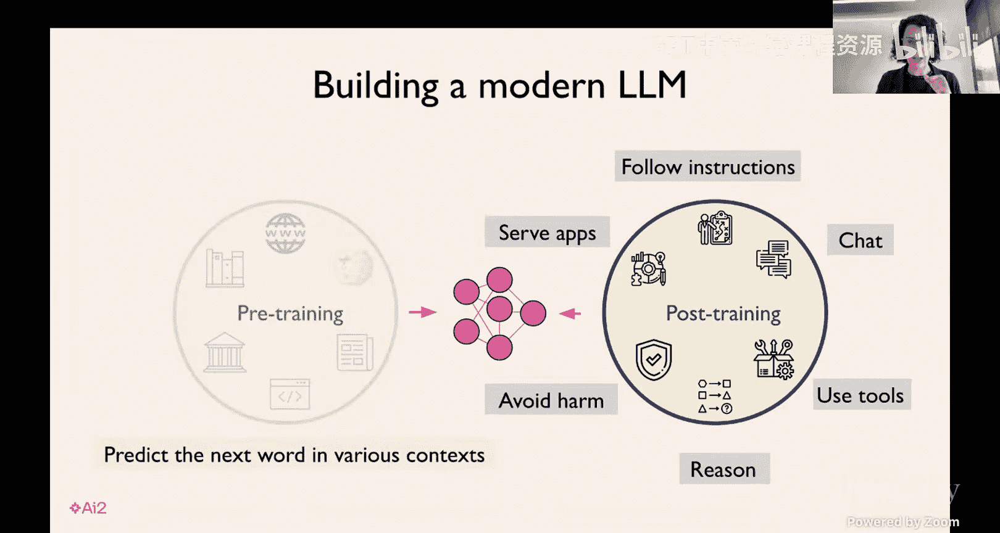

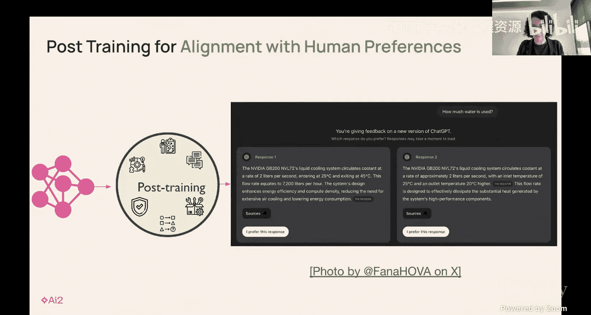

We do post training to be able to follow to do tool use， searching， code execution and so on。

 and also we do a lot in post training for models to be able to reason， for example， in this case。

 we want to teach the model how to kind of solve this arithmetic word problem。

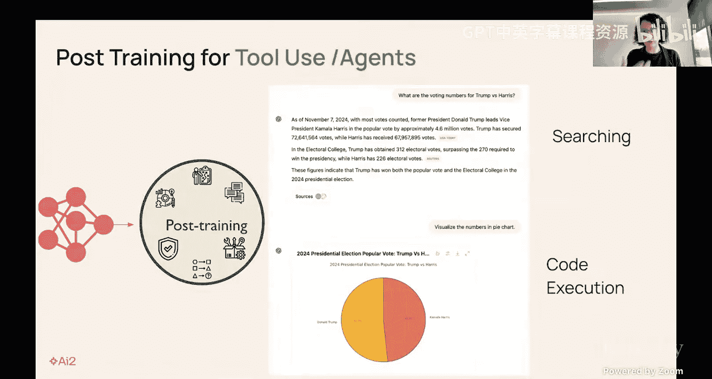

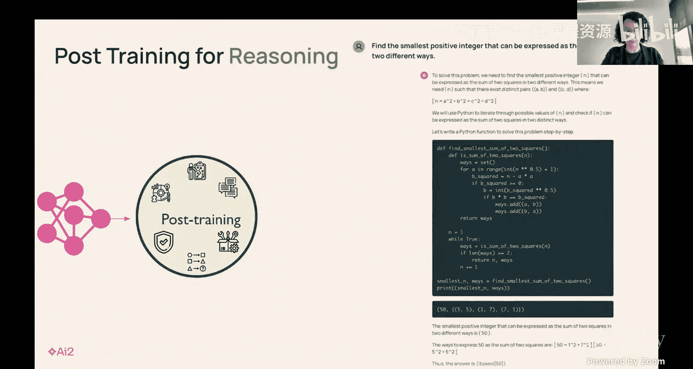

Okay， so。How does it work following many standard language modeling or machine learning pipelines。

 it requires these pieces， data， the data that we need to train on a training kind of architecture and neural network which in almost all cases it's a transformer based architecture and a very thorough evaluation loop to tell us where we are improving where things are not going so well Okay and I'm going to talk about these are the three integral parts in building a very modern successful language model data models and algorithms and during this talk。

 I'm going to talk about。What type of data is important and what type of algorithms are useful for which type of data？

Okay， so data plays a really important role in building these posttrain models and like pretrain model。

 it comes from different sources in many different forms and they are targeting diverse capabilities right so for example we need data to be able to solve math word problems。

 we need data to build agents we need data to kind of tell the model when it is not safe to respond to a query。

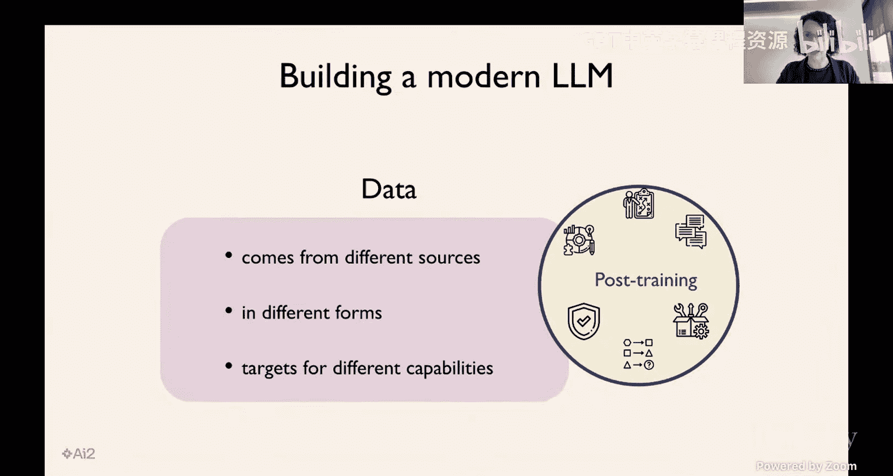

But we need to design and use different algorithms on deciding when to use the right data and how which of these algorithms are useful when okay so this was our effort throughout this tool project which is started from 2023 and now we have an open reproducible and state of the art posttrain recipe and we can apply it on many different open rate models。

😊。

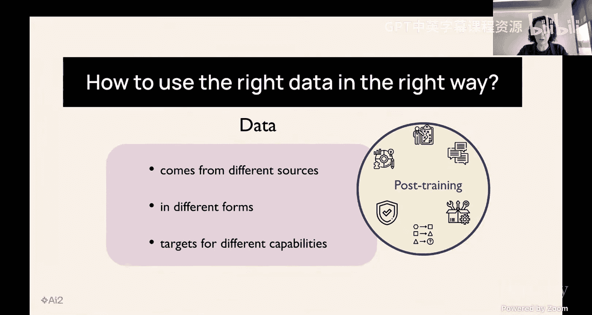

Okay， in the first version which we worked on this on June 2023。

 we pretty much only showed what is the best recipe to develop supervised fine tuning data or instruction data I'm going to dig into all these a little bit deeper in the next slide。

In the second version， we showed that how we bring and digest a preference data。And then finally。

 we started doing very systematic study on what are the best algorithm attemptss to use these type of preference tuning data and at the end of these stages we managed to show that with only open source models。

 we can be as good as chat GPT even upsetting GPT for。😊。

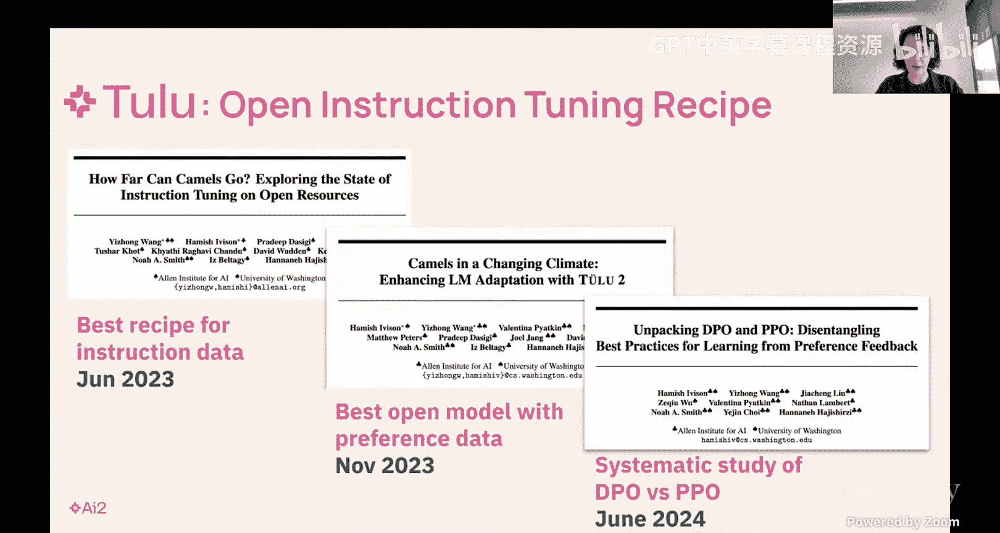

Finally， at the end of last year in November， we released Tulu3。

 which pretty much put all our efforts together such that we developed Tlu3。😊，Okay。

 and then we applied the same recipe on Almo showing that the fully open training recipe also works。

😊，Okay。So what is this training recipe， so it starts from a base model and we are following three important steps。

 instruction tuning， preference tuning and our new novel method we call it reinforcement learning with verifiable rewards okay and sometimes we have to do a bunch of kind of back and forth between these stages and I'm going to talk about how this works。

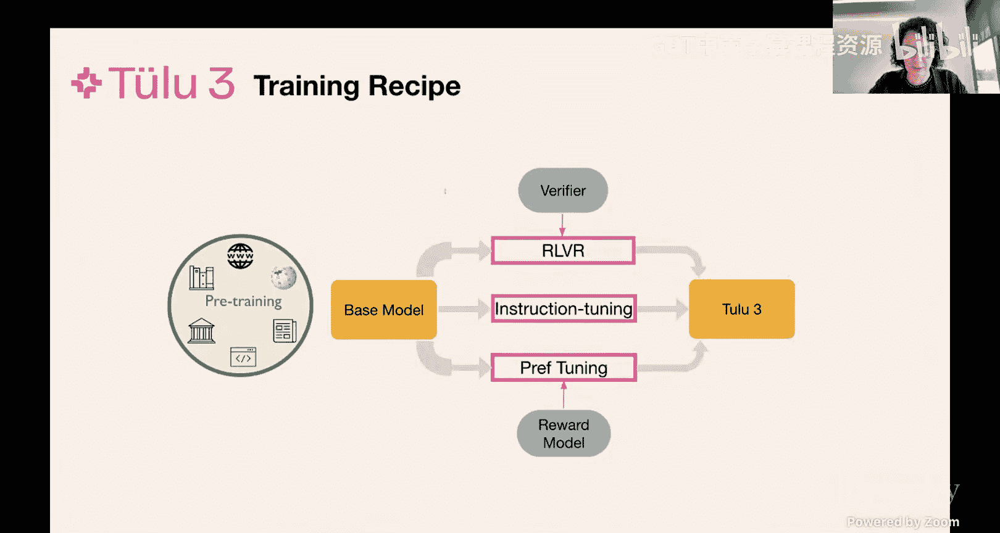

Okay。So let's first start getting the ingredients to start with。

 which is data okay so in order to do a successful pause training。

 we first need to establish meaningful evaluations for targeted skills for example for2 to three。

 these were our goal， we want to have general chat capabilities we want our model to be able to do to be good at knowledgeical math and reasoning coding safety and noncompliance multilingual and also very precisely follow instructions even when it kind of show some constraints。

😊，Okay， so we developed all these kind of evaluation benchmarks。

 like we decided what type of evaluation data sets sometimes we also had to create the data sets our on how to evaluate if our model has acquired good capabilities in all of these categories that I just talked about okay and we also followed really good old machine learning techniques which we set some of these data sets for development and then kept some as hidden and we just evaluated it at the end of when all our training was done。

😊，Okay so given our emphasis on these capabilities。

 we started collecting prompts like kind of queries and instructions that we think our model should be able to answer okay we checked for licenses are they kind of collected with a user consent how the licensing work and then make sure that we decontaminate them with the evaluation sets that we are evaluating on this is very important because we've noticed in the literature people show some really good data sets getting really good results on certain benchmarks but that deconttamination wasn't done carefully because we are talking about very complex instances and it's very easy for some of the test sets to be to be contaminated so we in our open instructionstruct toolkit we have a code available for all these cases and it's really useful to follow this。

😊。

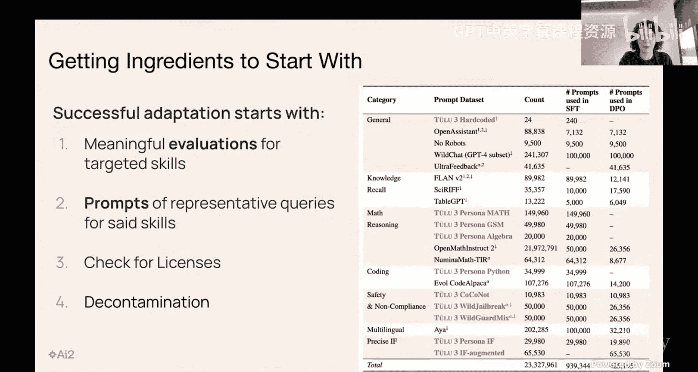

Okay， so now that we have the ingredients， we want to go through the first step。

 which is instruction tuning or sometimes called supervised fine tuning。😊，What does that mean？

It basically is a very simple step， it takes a lot of these prompts and completions。😊。

And then fine tune a pretrain language model to be able to follow these instructions， right。

 so for example， we can have queries like answer these questions one by one。

 summarize this document like many of these type of。Questions and then the final answers， Okay。

 but how do we curate this data， how do we source this data。

We can have and source this data through human annotations， which obviously it is costly。

 it is time consuming， and also it has high variance right now sometimes particular tasks like reasoning。

 we are dealing with complex annotations and it might not be well suited for kind of general annotators。

Another approach which we introduced in our 2023 self Instruct paper was to synthetically generate these data with kind of self loop or self instruction loop with another language model。

 okay， so kind of synthetic data generation。😊，And obviously it is good。

 it's really good in a lot of cases， but it's going to be noisy as well， okay。

 and it is biased to the language model that we are generating this data from okay and most recently we've discovered the optimal solution is combining both of them。

 which we kind of build a hybrid collection of data coming from human annotation and also from synthetically generated by other language models。

😊。

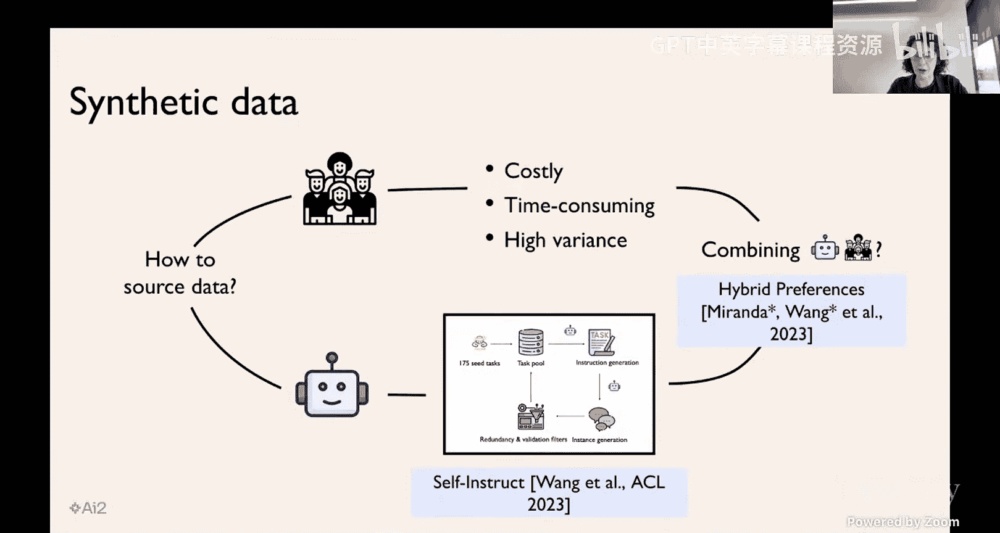

Okay， so data curation has been kind of received well within the open source community。

 we had some earlier work in 2022 on we called it natural instructions and supernatural instructions where we only focused on kind of NLP relevant tasks where we were looking at tasks like question answering summarization。

 translation and so on then we developed the selfstruct a framework where we generate data synthetically this has picked up really well within the community many kind of a next efforts have been introduced within the community to generate more and more synthetic data set like AlPAca。

 YQa and so on and so forth。😊，We all have a very good collection of data sets that are mostly focused on kind of short form question answering type tests like F V1 and so on so so i'm just listing a few of these data sets here for the full set please check our twolu three paper we listed a lot of publicly available data sets either manually curated expert curated or synthetically generated why the community and we kind of combine a lot of them use the ones that we saw most signal out of them in our to build our final SFDMX。

O。So now we have looked at all these kind of data that are available and now we are doing these two repeated parallelizable tracks where we collect this data and now we want to mix them such that we get high accuracy in the capabilities that we care about this requires substantial effort why because for example。

 if I add a lot of data about poem generation， probably my math reasoning capabilities drop if I add a lot of data on math reasoning probably I would lose this kind of creative tasks like like poem generation right so it it's a pretty challenging task to keep a good balance of all these data such that we are getting high accuracy accuracy across the board okay so we are exploring and also in the community people are exploring many different ways of this data mixing including manual kind of。

😊，Eperic color analysis， automated， mixing， and I think the literature is evolving and there are a lot of active research going on in this area。

😊，Okay， so let me show you some of our efforts in how we did this data mixing in our Tulu1。

 which was kind of very simple， there were not much data available in 2023 such that we kind of start doing all this combination。

😊，So first we combined all available open data sets that were available back then， okay。

 and I'm listing them on the left。😊，And some of them are created by humans。

 general public or experts and then some are synthesized with some of the most successful language models back there okay then similar to what I just described。

 we started kind of looking at evaluation sets or data sets targeted to evaluate certain capabilities for example。

 this is the outcome of our fine tuning when we were evaluating on kind of chat type evaluation sets okay and here are how the results compare。

 the red ones mean like the results are not that good and then the blue ones show okay successful results。

😊，Like as you see here， that GPT for ElPACO shows good high results on chat type evaluation。

 shared GPT also showing good results on chat evaluation。

So we did that across many different kind of verticals， knowledge， reasoning coding。

 multilinguality and safety and some of these results are quite exciting， like for example。

 when we train with chain of thought data， we see higher numbers on reasoning type evaluation sets。😊。

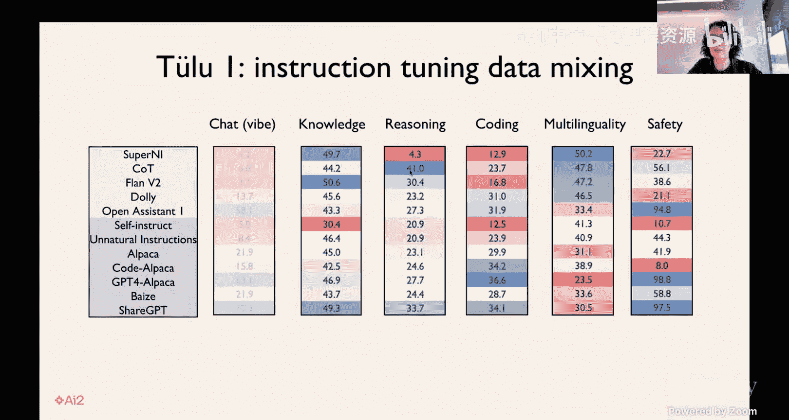

Okay。So now the question is how do we combine them。

 how do we take the best of all of these world because as you saw this data actually lets me go back here。

 this data like sharere GPT or selfinstruct or like I would say open system one that is good in chat。

 they are not that good in knowledge or reasoning type test right so it is important to kind of get the best of all these words。

😊。

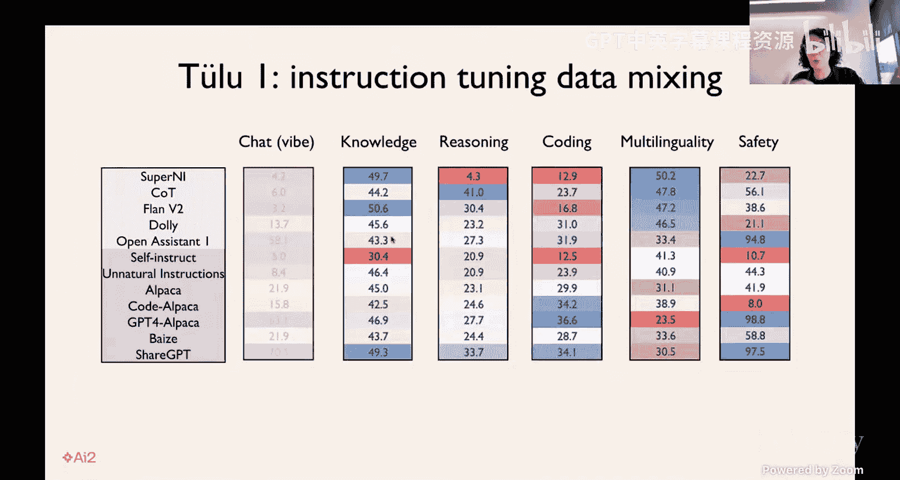

So we tried to look at the data sets that show kind of high numbers across one of these verticals and started combining them and as a result we have a human plus synthetic type data。

😊，Okay， I want to highlight that we saw really good results with shared GT early on。

 but we later dropped this data because license and the way。😊。

the data was collected was not that good， so we dropped this data in our next version。😊。

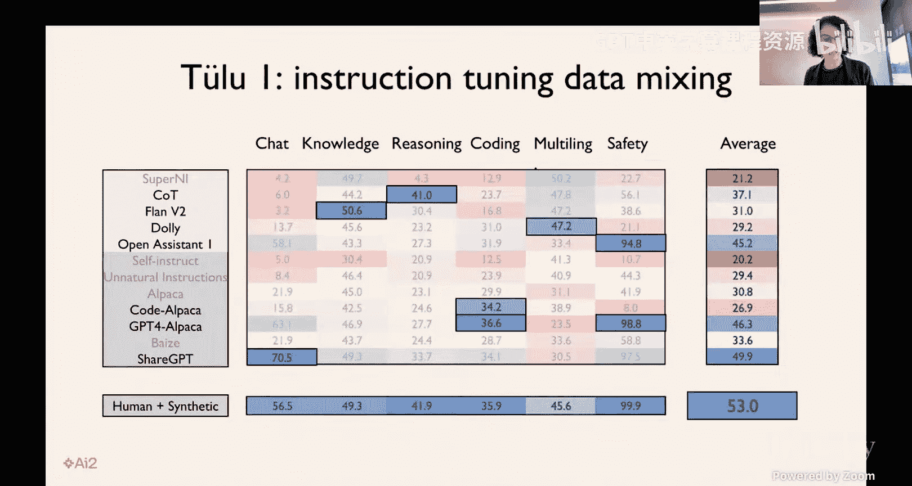

Okay。Now with the emphasis on reasoning， I want to dig a little bit deeper on what type of data particularly is useful for reason。

😊，Okay why is this challenging， Let me give you a math example， We want to solve this problem。

 The question is you can read this here a store has buy to get one free deal on shirts。

 each shirt costs $25 if Sarah wants to buy seven shirts。

 how much will she spend okay so one quick thing could be okay I have this problem the final answer is 125 it's pretty easy to come up with that number okay however。

 if I just fine tune and model with this kind of input output setting。

 probably I won't get that that that much out of this training instance okay so we all observe in the community that it's really better if we start integrating and using this type of chain of thought output where we say we're gonna break this down into okay step one does do this step to do this and I kind of break this down as if you're explaining it to a child how to follow this is steps to come up with。

That final number 100 to 25。

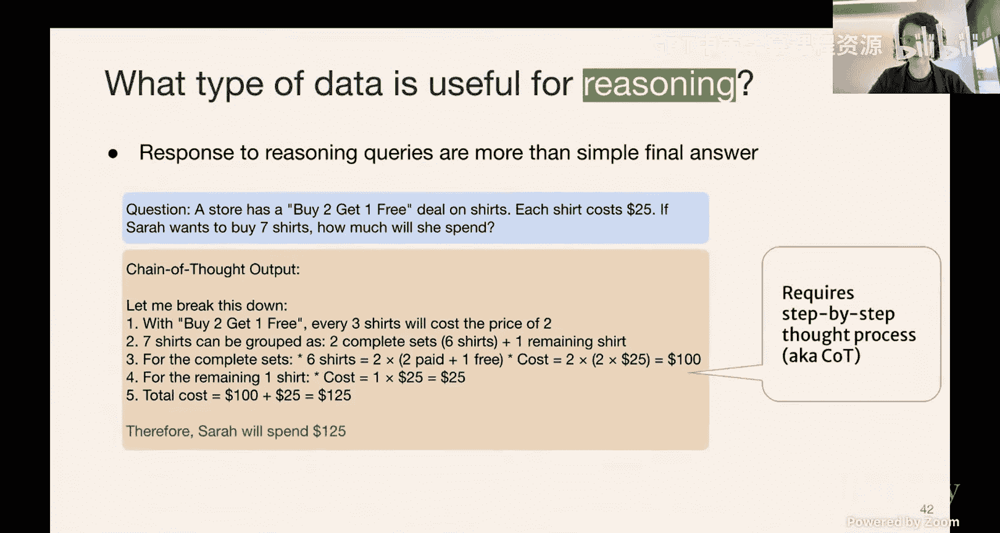

Okay， so why do to summarize， why do we think China thought data is helpful for reasoning。

 it's helping the model to handle complex multi step problems much easier。

It also starts kind of revealing the model's reasoning process。

 also one thought is a lot of these models during pretraining have seen a lot of these type of chain of thought data and then this kind of starts to them up boost this capability up of say。

 okay， remember you knew how to think step by step bring them up when you are looking at these more complex math reasoning problems。

Also， when we look at these type of annotations， this type of chain of thought data makes it much easier to spot errors in the logic and also it kind of resembles how we are explaining things to humans or how humans thought process worked。

😊，Okay， these are all very good points about why this type of chain of thought data is important。😡。

However， it's becoming more and more challenging to observe and obtain manual annotation for this type of chain of thought data。

 it is time consuming it is very expensive right and it often requires expert annotations。

 the example that I showed in the last slide， what's quite easy。

 but think of more challenging math problems， we need experts to annotate those。And obviously。

 it is difficult to scale and also it is not diverse enough like it is very hard to boost diversity with all these kind of limitations that we have when we want to collect this type of chain of thought data。

😊，Okay， so again， our approach to address this solution was hybrid data curation where we look at data mixing and also selecting from existing resources。

 we also did some very kind of and observed a very interesting paper from the literature where they proposed to use different personas。

To generate diverse data okay so so I'm referring to this paper here。

 but the idea is we're going to look at different skills like for example math coding precisely follow instruction but then we devise different personas and then we add the model to generate data for those skills given the persona that it is kind of looking at this would ensure high diversity and enables us to scale further what does that mean。

😊，So we kind of develop this prompt， we say we want to create this data with this specific persona in mind。

 like for example， we want to create a math problem given that we are creating it for a chemical kinetics researcher。

 okay， and now the problem looks like this， Dr。 Smith， a chemist is studying this and so on。😊。

Or we say we want to solve this logical reasoning problem again for that persona。

 for that chemical kinetic researcher， we tried many different personas right。

 we design this type of math problems for experts， for children like six year old children or like a computer scientist and musician right so you give many different personas to the model and then we ask the model to generate it specifically designed for that persona。

With that， we created more than 150K hard math problems and 50K grade school math problems， okay。

 we created 35 k Python coding and a precise instruction followed。😊。

Then these were mostly for generating plants because this was the point of boosting diversity for the types of problems that we are getting。

Then we used a combination of GPT 40 and clo Sonet to generate step by step solutions， for example。

 for a given match problem， a coding or precise instruction following。

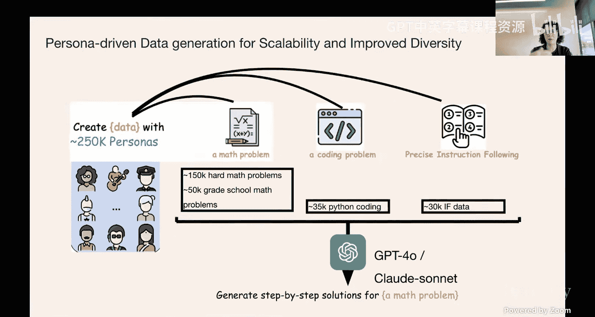

Okay， so now let's look at the results。😊，How successful and useful these data are。 Okay。

 so let me walk through how we read these figures。😊，So in the figures below。

 you are seeing results on two data sets， math and GSM K， which are due to popular math data sets。😊。

Then each of these bars show a combination of using our public data sets。

 like the data sets that are available， for example， for math or general purpose。😡。

Combined with these persona driven synthetic math problems。 Okay。

 and we kind of varied the amount of these persona driven math data in our experiments。 Okay。

 so the first bar， the yellow bar just uses the general public data and the last bar is kind of does a 50 50。

50 between persona driven data and then。General data okay。

 as you see over time we see improvement mostly on the math on GSM8k we saw less improvement and we we think the reason is because GSM8K are simpler math word problems like greater school math word problems and we think the available public data set were already good enough so that's why we didn't gain much okay so to summarize adding more persona driven data consistently improves math performance GSMHk improves。

 but it's much less and kind of we kept a balance on how to use this type of persona。

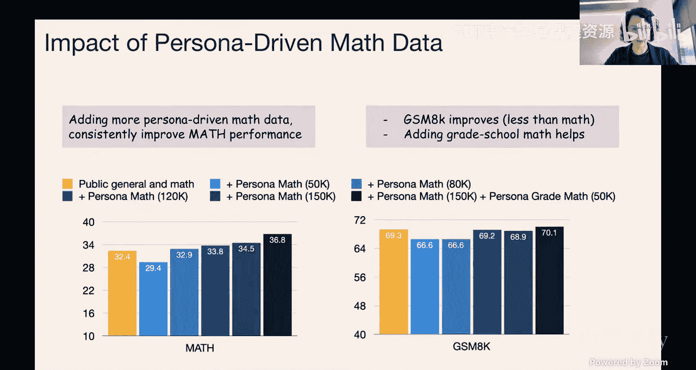

Okay。So we did another step to kind of filter the data how do we do that for every word problem or every kind of instance that was generated synthetically we actually went ahead and asked GPT4 to generate multiple reasoning paths and then we basically did selfcons so in one of the classes earlier I think this semester or last semester you learned about self-consist and here is what we used。

And then we basically saw which one has majority vote and kept those reasoning pads that gave us that kind of a better answer。

😊。

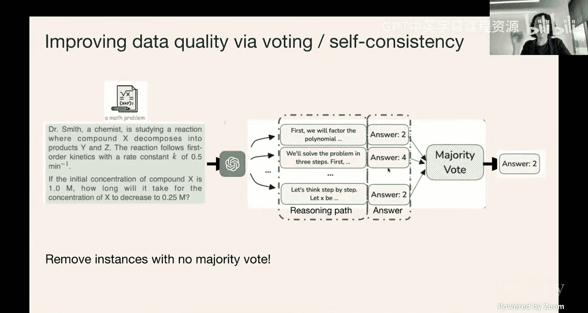

So through this we managed to filter a lot of data。

 almost 40% of the data and now we are seeing that using only 60% of the data。

 we are getting similar performance on math， right this new pink is the filtered kind of processed data。

 which is almost on par， I would say this is just kind of error bar on how different they are from the original mix。

😊，And we saw significant， more significant boost on the GSM8K kind of highlighting that with this better filter data。

 we are getting higher accuracy on GSM8K so at the end of the day。

 now we are able to use this 60% of the data and we are getting good performance from this synthetically generated data。

😊。

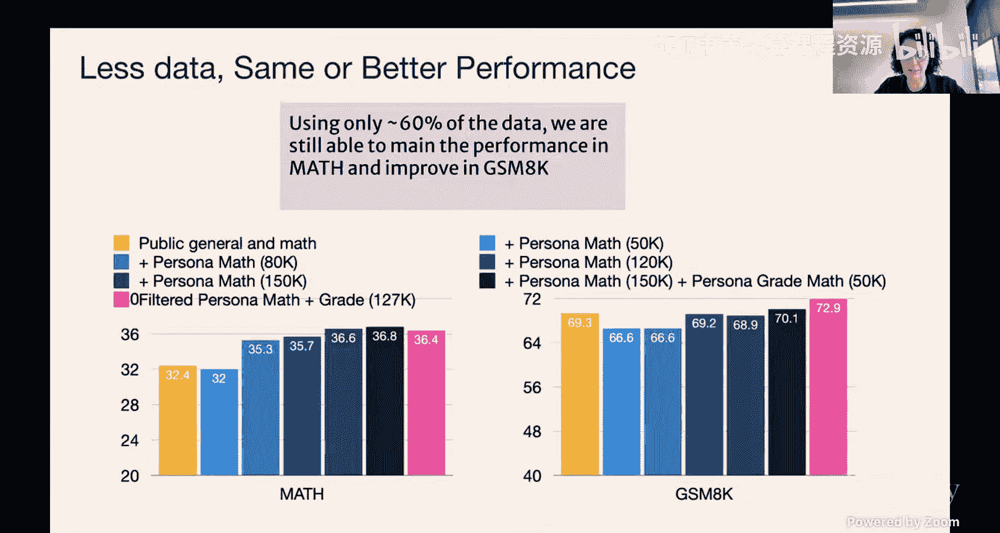

Okay so there are many other approaches in the research community to generate chain of thought data one is obviously manual human annotation as I mentioned this is great。

 this is very accurate but we can pretty much have a limited scale and sometimes it is hard to increase diversity in the reasoning scale in the reasoning style and there are methods that they convert math problems into Python code and then generates solutions that way。

 this is great because it guarantees correctness through execution。

 it is the only issue is it's a little bit less natural like natural language reasoning the same way that you are explaining it to a child so somewhat less intuitive but is still very interesting and it works really well and also this type of self-gene chain of thought which is scalable to many problems the quality of。

😊，The model really depends on the base model。 and we kind of did a combination of all of these methods。

Okay。So putting all these together， so I talked a lot about how we created and curated these synthetic data for math and reasoning。

 then we put all of these together and built our data mix for supervised find tuI and this is the outcome。

 which is the combination of human and synthetic data and we finally built to SFD。😊。

So let's discuss a little bit of results， so this table has a lot of numbers but I want to show kind of some of the ablations we've done。

 the columns show many different data sets that we evaluated on like MMLU TQA。

 popQA and they are all kind of evaluating some of those core skills that we cared about。😊。

And this is our final results on the final SFmics that we discovered。

 and these are some of the alations， like for example， if we remove Wild chatt。

 which is kind of our data mix to approach general chat capabilities， our average will get into 58。9。

 with probably the biggest drop on， as you see here， El Paco Eval on chat evaluations。😊。

Or without the persona data， we get to 58。6 where we saw drops on， for example， math and so on。Okay。

 or math data， if we remove that， we see a really significant drop on this type of math evaluation。😊。

Another thing that we were very careful was we want to make sure our model is safe。

 so we added safety data， but at the same time we want to make sure that it doesn't drop the capabilities。

 the general capabilities of the model and this is what we observed that adding safety data doesn't hurt general capabilities of the model this is also comparing the Tulu SFT data with the other data sets that were available in the community like mammoths data or RLH these were some of the most popular data sets that exist in the community and this is like the gains that we are having like 4656 and these were our earlier like Tulu to SFT is like our earliest data mix in our earlier versions。

😊。

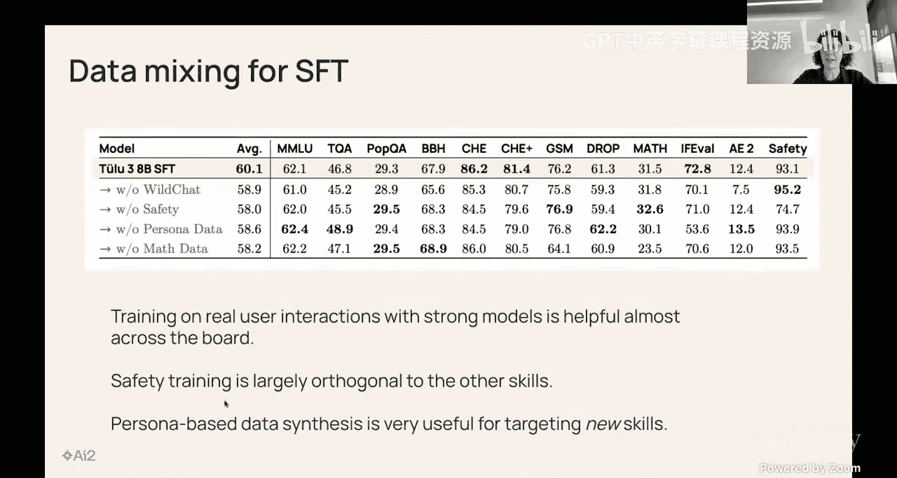

So in overall， will argue that this is a really good mix。😊。

A lot more can be done here and it's really good if like people in the open source community also start improving this dataomic。

😊。

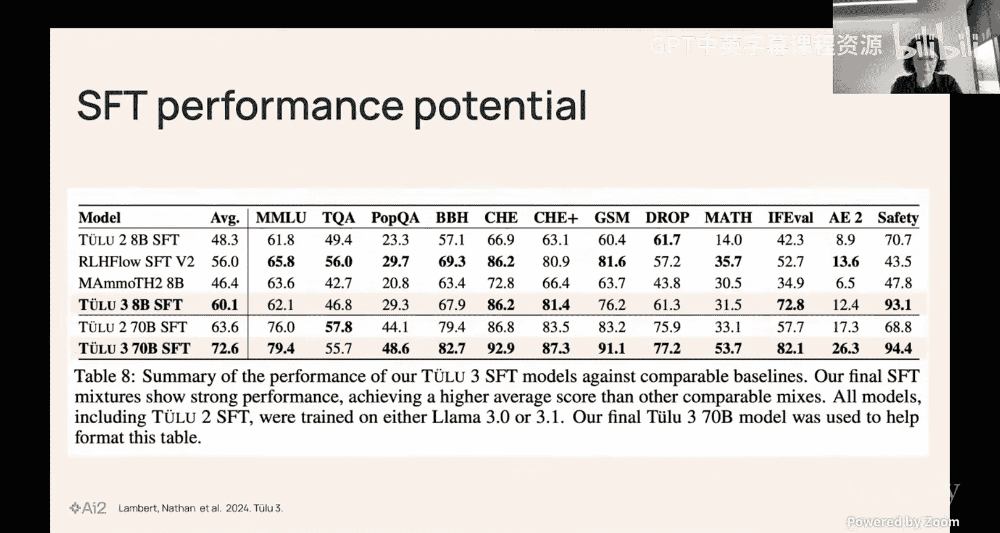

Okay。So step one is done， we took our base model and then did supervised fine tuning with a very carefully curated data mix okay next step is preference tuning where it works with a reward model okay。

 let's see what happens here。😊，So at the Pre fine tuning stage。

 I think Jason also talked about this is the goal is we want to align to human preferences。

 for example， we have this query if we say write a Haiku about AI it talks about the model comes and output something。

 we want to give thumbs up thumbs down if the output seems good or bad okay but in practice what we've observed the rollout preference fine tuning is to show a very strong training signal to make style to have a better style of chats and it shows really higher improvements on chat type evaluation。

😊，It also keeps improving the basic capabilities that we were targeting。

 but in general we saw lower absolute magnitude of improvement for like very kind for example。

 math type capabilities， okay？😊，So。Let's dig a little bit deeper how the preference data looks like。

So we have this prompt， let's say explain the moon landing to a six year old in a few sentences。

 we want our model to generate two responses， okay。

 and then the preference instant tells us one response is better than the other one right and it can be annotated by humans saying that this response to me seems much more suitable for a six year old。

Most recently people look at this called oral AIF where instead of humans。

 we can have another AI model， let's say GPT4 oh cloud onnet also to evaluate which of these responses are better for a six year and then the algorithm to kind of update that at some level sometimes is's called oral AIF okay。

 so but this is the nature of data。😊，Why does this data play an important role in kind of building and imp post training stages is in a lot of cases we are dealing with open endeder generations and kind of have coming up with some absolute numbers to say oh okay。

 this response is good is hard however it's much easier to deal with comparison to say this response is generally better than the other one so the task of annotation has become much easier。

😊，Okay but then we cannot use the same supervised fine union algorithm to deal with this type of preference data now let me unpack RLHF or reinforcement learning with human feedback how do we integrate and use this type of preference data okay so we will use reinforcement learning how does it work this is the most generic form okay the idea is this is kind of the most generic definition of RL the idea is for a given policy which is generate the next token we generate this next token we interact with an environment we get some rewardt from the environment if that generated token was good or bad and then update this state of the world。

In RLHF， the state is getting updated from the prompt that are getting fed into the policy。

The action is updating and finding what responses are。

And then the environment is actually a reward model where it tells us how good a model like kind of tries to up a model that preances that this response is generally preferred over the other one。

 okay， so this is kind of how RLLF works。😊，These reference data will fit into a reward model where reward model is actually a neural network that is trained to tell us for a given prompt。

 which response is better。😊，Okay。How do we optimize this complex situation through PPO training Let's dig a little bit deeper The idea is we want to maximize the reward kind of we want to get the maximal reward as possible okay such that we want to constrain the model to stay as close as possible to the base language model right like we want the policy to don't go that far from the originally trained model okay so this is this is establishing a very important balance between make sure you are aligned with those preferences that are provided to you however don't go too far from the original model that you have in mind。

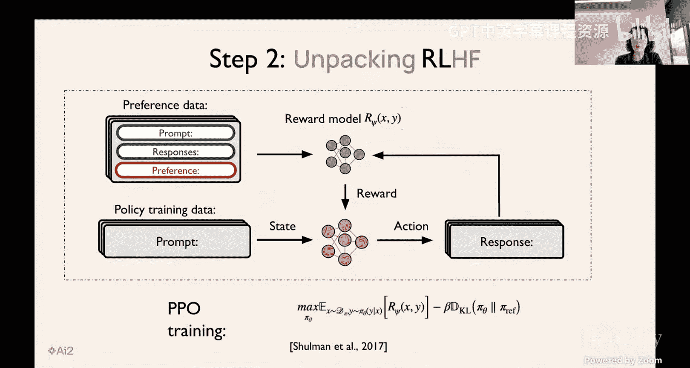

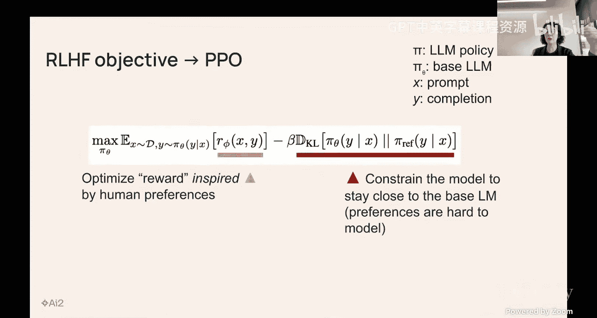

ok。Now in the last year or so， many different variants are introduced on how to optimize that objective okay so in the most in the last year we had this paper called direct preference optimization or DO where the idea is what if we just use gradient ascent on this equation okay let's kind of ignore all that like now we have this reward model and then and then we want to optimize for that reward let's directly optimize for this human preferences and then kind of model it as a as a ranking model okay。

😊。

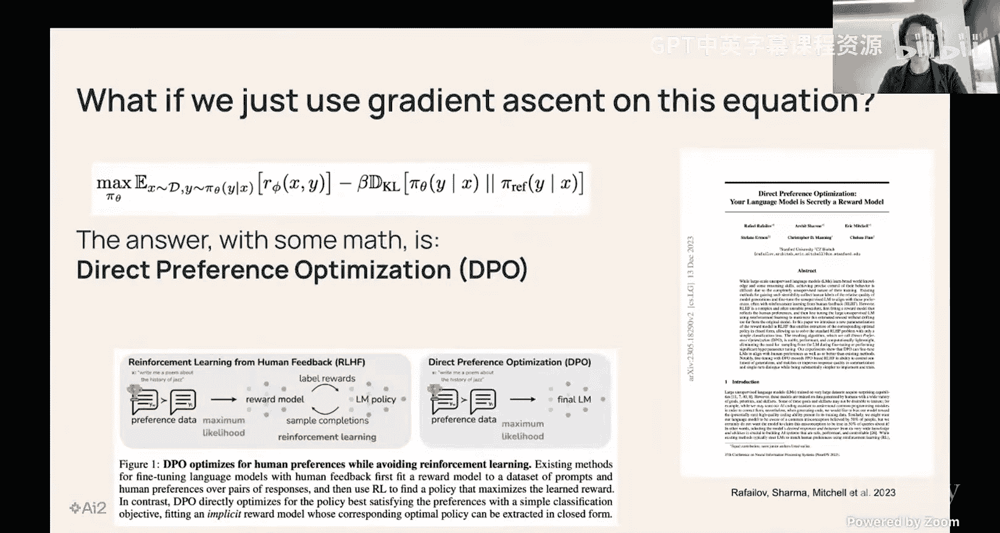

So how does the DPO training work， it's like this where we kind of remove a lot of these details here and we directly go from the preference data into into policy and then kind of given that reference。

😊，er， we want to see how close this preference data is to the policy。

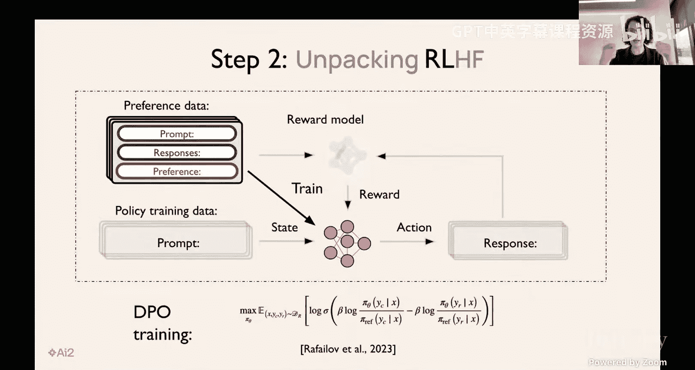

So many new variants of DO also introduced， so here I'm summarizing them， this is the PPO。

 the original formulation， here is the direct reference optimization which directly optimizes the policy given the preference data I would always say think of it as kind of some sort of ranking objective。

 and then the newer variant like CPO， which even makes it more simplify where it doesn't even use a a reference model。

Another variant like lengths normalize DO， which normalizes the same like likelihood。

 but kind of make it normalized for direct length。Okay， so。In how this work。

 we started actually digging deeper into all these algorithms that exist， okay。

 particularly if we looked at comparing between DO and PPO okay so they are all different right they are getting different types of parameters。

 they have different implementation， complexity， memory usage throughput and so on。😊。

Just to give you a very brief idea， in general， we saw PPO performs better than DO in almost all cases。

 however， it is much more complicated to implement and make it work particularly for larger models why because for PPO we need to have two models running like we have the reward model as a neural network and also the policy model which is kind of the actual language model that generates Token okay so it really depends on the developer's preference on which constraints they have。

😊。

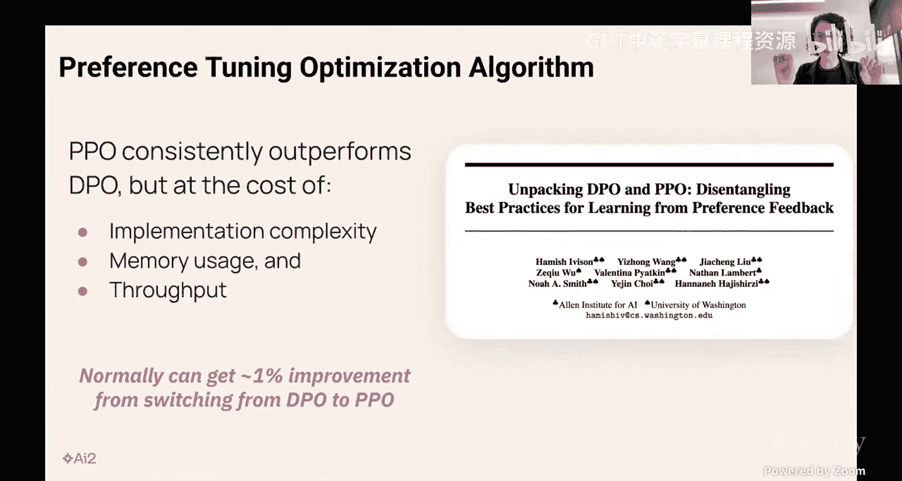

Okay， so let me dig a little bit deeper and tell you what things we abld to figure out which model to use okay。

 for DO， remember we had preference data and policy model for PPO， we have all these components。

 preference data， that type of reward model and the neural network that we have here。

 we have the generations， the prompts and the policy model。Okay。

 so I'm kind of showing the final results I'm not going into a lot of details。

 but here are the results。Let's say this is the average performance on a lot of tasks that we've looked at。

 this is the initialSFT result。😊，When we do DPO with some sort of weaker preference tuning。

 we saw 2% boost。Okay， when we do a lot of ablations and very careful curation or preference data。

 we saw significant boosts， like look at this， we go from 56 to 61 just with better data selection and data curation here。

😊，Then we replaced DO with PPO。 we saw now we just just。Use the exact same data。

 we just replace the algorithm， DO with PPO， and we saw one point boost here。Then we thought， okay。

 now this is very promising。 PPO is great。 Let's now think of a big。😊，Reward model， because remember。

 reward model plays this environment role， and we cannot try to。

Make our model as close as possible to this kind of preference data okay。

 when we started using a bigger reward model， we didn't saw that much improvement like less than like about half a point improvement。

😊，And then finally， when we started mixing prompts of what type of specific design prompts for some task。

 on average， we didn't see much gay。OkayHowever， I want to highlight that this final step on average didn't show us a lot of improvement。

 but very interestingly， when we only focused on reasoning。

 particularly GSMHK and when we started bringing up prompts that are very useful like for improving the reasoning capabilities。

 we saw significant boosts here that here we learn when we introduce prompts that are domain specific for some of those capabilities。

 they play a really important role。😊，Okay， so if you look at this whole thing。

 this was the choice of algorithm， this was the choice of data algorithm model data so so again。

 we saw a really big boost on data。😊。

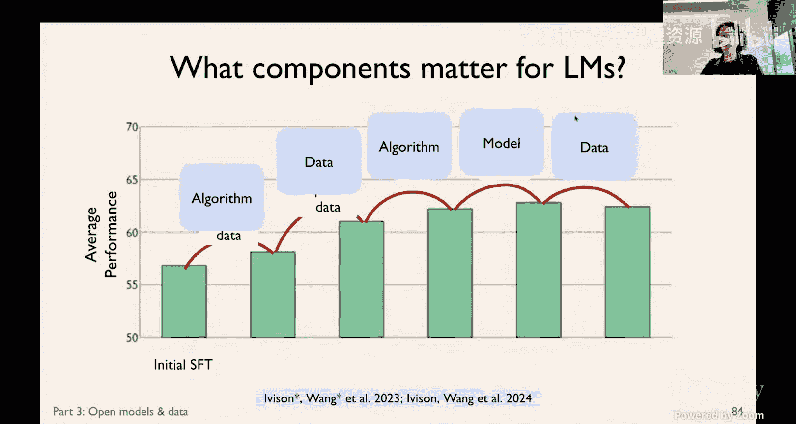

Okay， so takeaways from this， the most important factor in building a really good preference tuning algorithm for us was high quality data。

 PPO works better than DPO， but DO is much cheaper to experiment with and kind of do ablations on data。

 and it's kind of more practical for development， scaling RM reward models。

 help but not significantly using end domain prompt。

 yield performance gains particularly for domains like a reason。Okay。

 so now we put all of those together when we want to build2 or3 okay so from our last study we learned prompt selection is really important so we looked at many different combinations on how to curate data and this was kind of our best mix we want to use some of the prompts that we already using SFD we thought this is really good to maintain accuracy and performance。

😊，We also brought some prompts， some new prompts that we hadn't seen during SFT。

 and then we started bringing in out of domain prompts， for example。

 from domains that we did not study in SFT。Okay， so we then did a lot of response generation from all these models。

 okay， so we had some weaker models like 7b models， Lama 7b， for example， almost 7b。

 all the way to very kind of a strong models like GP 4 all because we want to look at the preferences to see which of these outputs are more preferable。

Importantly， we brought on policy data remember we want to improve our2lu3 SFT right This is the model。

 this is the policy model that we want to improve upon so we made sure to bring some of these data points and these twolu three completions such that we can say this outcome is preferred over something worse or。

We need to get to something better， which is， for example， the outcome of GP4。

 so we also show that it is important to use this on policy data。Okay。

Then we did particularly RLAIS where we asked GPT4 all to tell us which of these completions are better and we ask it to measure across these four categories。

 helpfulness， instruction， following， how accurately it could follow instructions。

 how truthful and how honest these responses are， and then webinize them according to like and then said which is chosen。

 which is rejected。To optimize the algorithm for optimization， we did a DO， PPO and CPO。

 again similarly we didn't see much gains from PPO and for simplicity we stick with DO for this。😊。

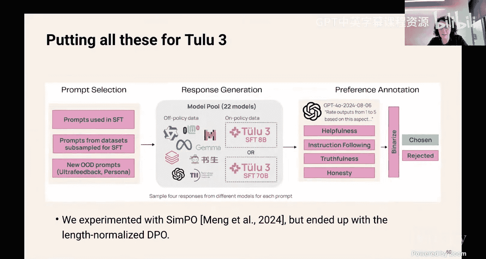

Okay so here are these bottom figures show some of our abls。

 so actually let's look at the the righthand one which is what LLM as judge used for kind of telling us which is preferred which is rejected and we looked at many different kind of highly capable models like GPT4 or Lama 405 and so on and we saw a little bit better results on GPT40 and that's what we stick with。

This middle figure evaluates the off policy versus on policy preferences and as you see。

 this is the initial SFT with off policy we got to 60 adding on policy， only with on policy。

 we get 60。7 and then combining all of them， we got the best numbers。

Here we also checked if it is useful to bring in new out of domain prompts or we just reuse some of the prompts that we had from the initial SFT and as you see again。

 bringing new prompts also improves results。😊。

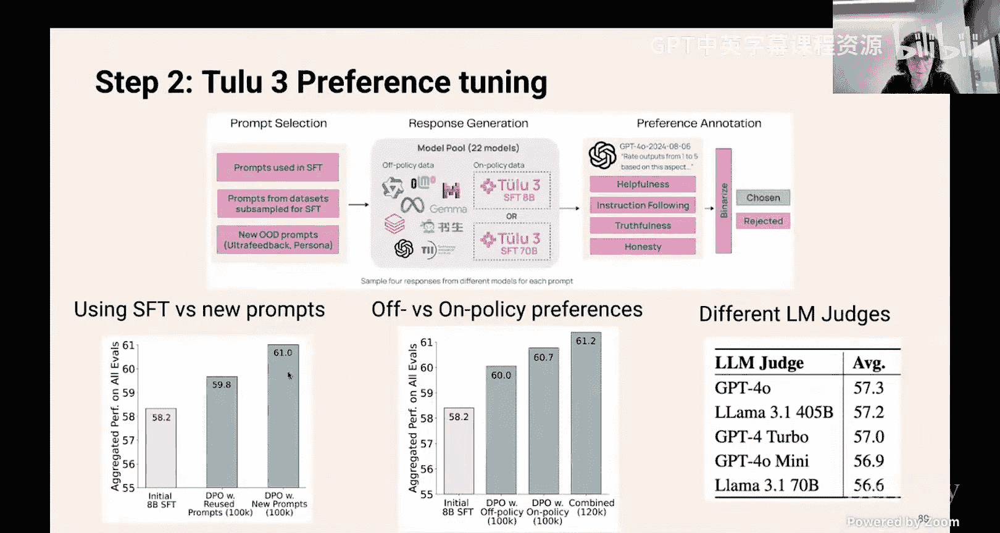

Okay。So what happened up to here， we did all our instruction tuning， supervised fine tuning。

 we did our preference tuning， and now I want to talk about our third step which we introduced as part of our2 to three effort。

 reinforcement learning with verifiable reward。Okay。So let's look at these curves。😊，At the end of。

DPO or preference tuning stage。I'm going to show you these three figures okay。

 so this is training steps on the X axis and under the Y axis。

 we are looking at evaluation performance。And as you see over time， for example， in the al Paca Eva。

We see the improvements are almost getting plateaued， okay？For EfiV。

 which is how we do instruction following， interestingly we see when we increase the training steps in for our DPO。

 we see a little bit drop in performance。And for GSMHK， which is our kind of proxy for reasoning。

 we see initial improvement， but then after some time we started seeing overfitting and then。😊。

Dropping performance， okay， so particularly for these more complex tasks like following instructions and doing reasoning over time we see over optimization is happening okay。

 which is not good。Then we started thinking a little bit about this。

We are using this neural reward model to tell us if kind of some preferences are good or bad， okay？

This neural network tries to assign a score to every instance now。

 okay so it tells us for this give this reward model is trained to tell which is chosen。

 which is rejected， but at the end of the day for every completion it tells us what is the score of this this completion okay。

 for example， for something like this for some prompt like this， it would give us this score of 10。5。

Okay。If we change the input it might give us another score okay also there are studies in the literature that this human feedback that okay。

 this A is preferred over a B， it's not the gold standard of saying what is the outcome。

 what is a good rewarder score for this sentence， for example。😊，Okay。

 instead we thought for tasks that are that we can verify their correctness， we can use a much。

 much simpler reward model， okay， or in fact， we can replace this reward model with something rule based。

😊，For example， if my query is， what is2 plus2？😊，We can easily say if the answer is gold， return one。

 otherwise return zero。 Okay if were if we were only using that neural reward model。

 it might have given us another score like 1000 or it might have given us something like I don't know 5。

5 right What is the intuition or what is the meaning behind that score that the reward model is giving us Okay。

 so that was where we question this。😡，And then we said for tasks that we can verify their final outcome。

 what if we just remove that complex setup and use a much simpler rule based model okay and this is exactly what we did。

😊，So let's look at our RL setting， the prompts come in， the state gets updated。

 the action are generating next token， and then this reward model tells us what is the good outcome or what is the good score associated with this generation。

However， in problems like math that we have ground truths answer。😊。

We can have this verification function where the reward tells us one， if the final answer is correct。

 zero otherwise， okay。Pretty much we had that for GSMHK which is one of our reasoning E math and also precise instruction following let's imagine we are giving the model a bunch of constraints like make sure to start the sentence with S then or to write a poem that has five words right so you could verify if the generated outcome follows these constraints or not and then we can kind of evaluate how how we can easily verify how good the generated outcome is。

😊，Okay， so that that was pretty much what we did， we replaced the reward model with the verification function。

😊。

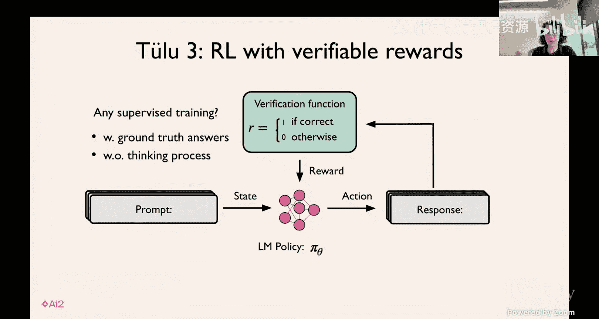

And this the deepS R1 model that released earlier this year also is using similar thing。

 which I think they call it a different name， but a very， very similar intuition。

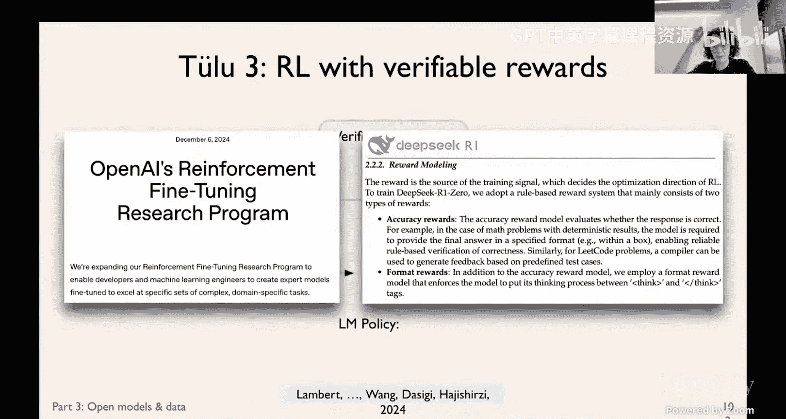

Okay。To summarize， this is our setup， we use gold final answer or verifiable constraints as this kind of environment as a proxy for environment。

This is good because for this we don't need intermediate chain of thought we just need a final answers then we applied classical reinforcement learning algorithm to optimize this and here we used PPO for the optimization and we tried it for three data sets GSMK math and if verification and kind of we showed the results roughly this is the number of training instances that we have used almost in the order of 100110k。

😊。

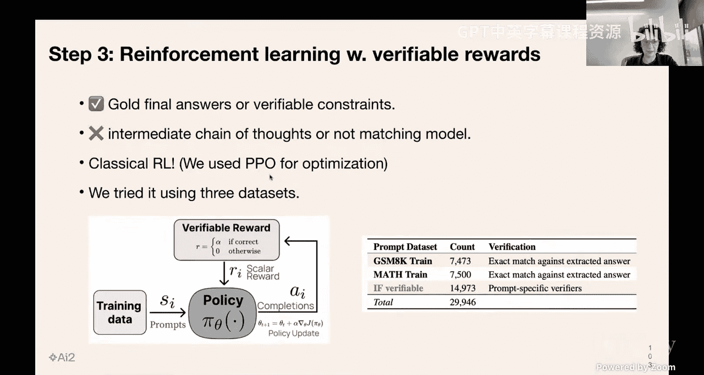

We also evaluated on a big bench heart which is kind of also roughly reasoning type task。

 and then we found that this F data set could be a good proxy to give us boosts on BPPH。

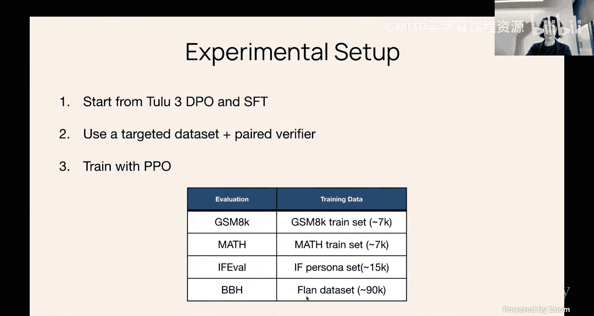

Some some of the verification steps are very easy like math and reasoning。

 it's pretty much just this if10 else， which is if prediction is equal to this number， say yes。

 otherwise zero， some of it， for example， for constraints and constraintsstrain satisfaction and verifications。

 it's a little bit more challenging because we want to see which of these constraints are satisfied and then we see which percentage of those constraints are satisfied。

 but in general pretty similar pretty easy。😊。

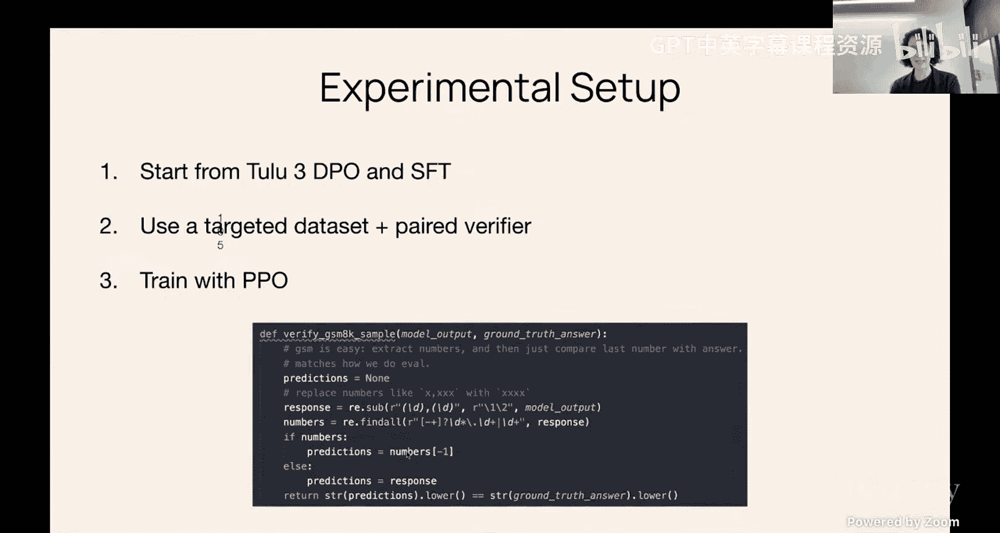

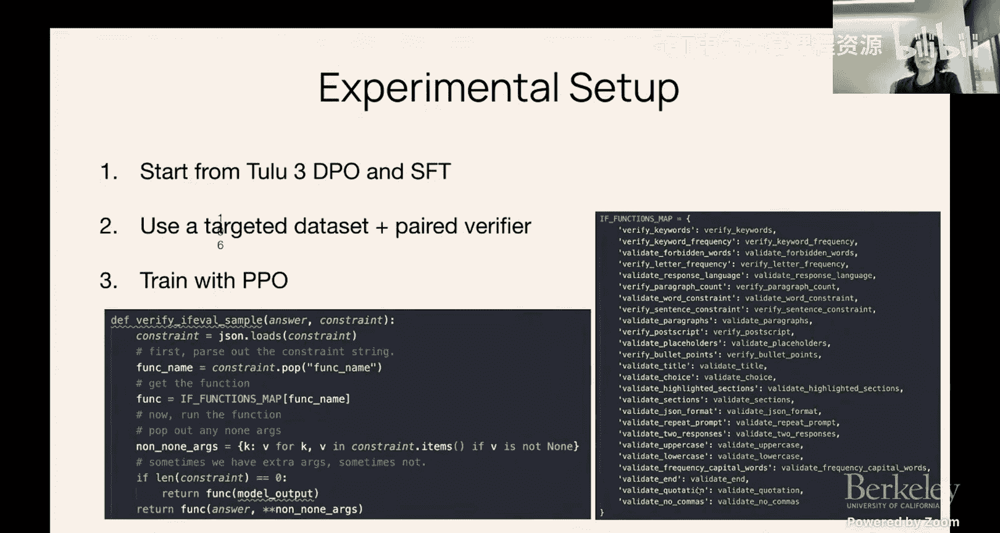

So now let's look at the curves， so I'm just showing this whole graph。

 but now let me go a little bit deeper here Okay， so what does this curve tell us。So on the X axis。

 we see the training steps and on the Y axis， we show the GSM8K， the math reing capability。

This dashed green line is the outcome of the supervised fine tuning model。

 The pink one is the outcome of the DPO model。 Okay。

 so we applied R VR at two stages just to see if it makes improvement both at the end of supervised fine tuning and also at the end of DPO。

what do we see this is interesting curves show results are going up。

 we don't see that much over parameter optimization here， the gains on top of SFD is much higher。

 but the biggest gig or like the highest number is achieved by when we apply it on D。

Same things on math again at the beginning， we saw a little bit drop when we started the DPO。

 but then again start to see improvement。EFV， which is the verification on the constraint optimization and like instruction following。

 when we start from SFD we saw significant gains on DO we saw less gains。

 we are still investigating on this， but we think the reason is we did not have enough data。😊。

And interestingly， when we use F data just to this was kind of we did not finally include this in our RLVR mix。

 but it was an interesting observation just to see that doing some reinforcement learning on FN it shows some improvements on some of the reasoning tasks and it's worth exploring this much more and we are doing it just seeing what other types of verifiable tasks out there such that we can employ RLVR on that。

Okay。We also applied the same recipe on oldmo2 and we can kind of build upon this this is actually a very interesting setting we stacked a bunch of reinforcement learning steps one on top of each other so here we started doing a bunch of training and we kind of cut it here this is the average score and then again started a little bit another step and then under like kind of kind of stacked multiple RRs and then did multiple stages and over time we saw even more improvements so the pipeline is there we can do multiple kind of tries with this to see if we see bigger gains or not。

😊，Okay。I want to take a step back and then talk about this this thing RL VR is not really new。

 this is actually the simplest way to you of using RL with real with kind of data。😊。

But why did it work now， We realize it's because and now base model qualities have improved a lot。

 Therefore， Rl can boost upon them。 Okay， so what does this curve show me。

So these are training steps， this is the accuracy。😊。

And the green bar shows when we do RLVR applying on GPT2 like the model that existed a long time ago。

 which was really bad， so the original number like the base numbers are very low unlike some of these reasoning tag。

 therefore reinforcement learning didn't show improvements。However。

 because now our base models are improving， then applying RLVR on top of them shows significant gains and this is very interesting to observe because now model can start exploring more and then exploited once it sees it is following with the reward with this rule based reward。

😊。

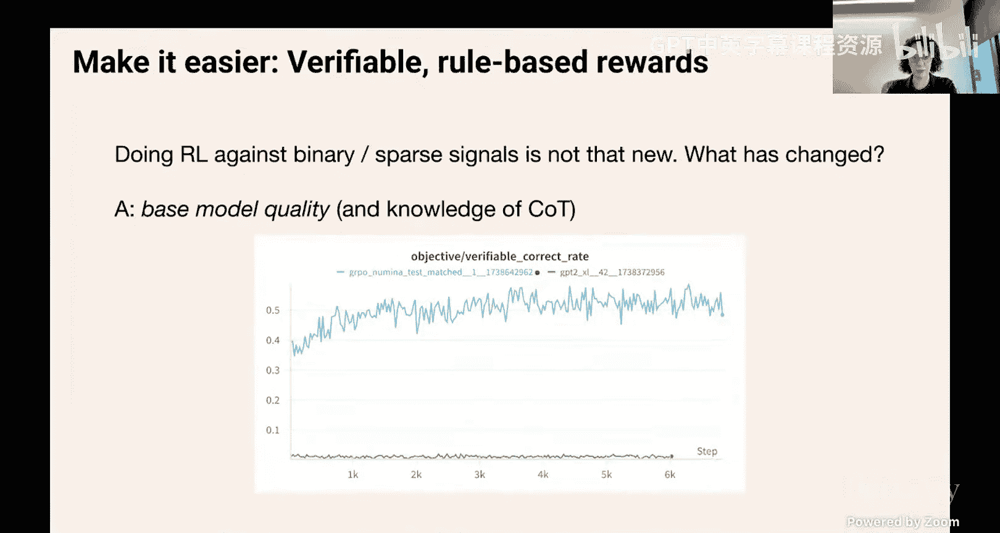

Okay， so putting all these together， we scaled this up from 7B to 70B to 405B and this is kind of our results how it looks and the pink portion you see the results of the Tulu model applied on Lama 405B here are the results of SFT DPO and the final out of RLVR again this is the result comparing with deepS V3 and GPT40 the latest version。

😊，On average， we are very close to GPT40 better than DeepCV3。

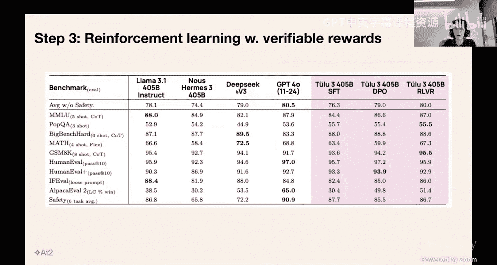

And it's a very exciting area。Here are showing our results on 8B and 70b models， again。

 comparing with open rate models like AQuN Instruct and Loma Instruct。

 which like better significantly and also at 7B 70B。

 where the smaller model are also comparable to the kind of a smaller size of GPT40 minii or cloud highiku。

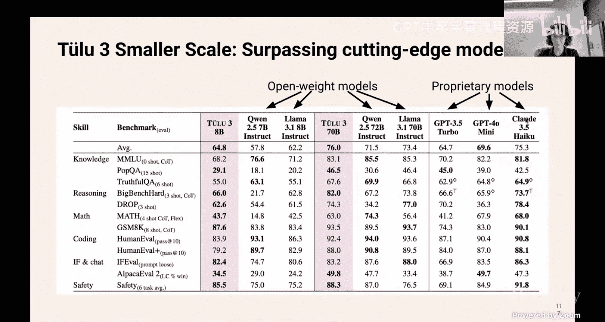

Okay。One other interesting observation was RLVR works better at the scale。

 so here shows our improvement on math in two cases or I didn't put legend so here on the lefthand side you see how much improvement we see on 70B model and this is how much improvement we saw on the right hand side you see how much improvement we saw at 405B and as you see here we started from 60 went all the way to 67 like 7 point improvement on math whereas at the 70b scale we go from 42 to 45 so it was interesting and kind of aligned with our hypothesistheses that when we have better base we can start seeing a lot more improvement during this RLVR step。

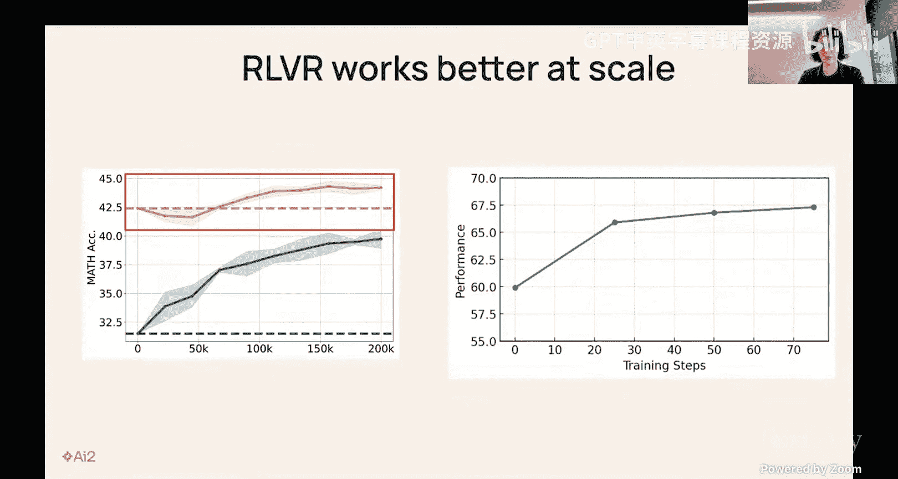

So we are exploring a lot and we know the community is also exploring a lot in this setup for example。

 we have changed our optimization algorithm from PPO to GPO which i'm not going to go into the details but now here are our significant improvement so as a reference tolu 3405B has 67% and now。

When we apply our recipe on Quin Mat model and then we apply GRPO and now we are already getting 84。

6 which is very exciting， shows a lot of progress can be done in this domain。

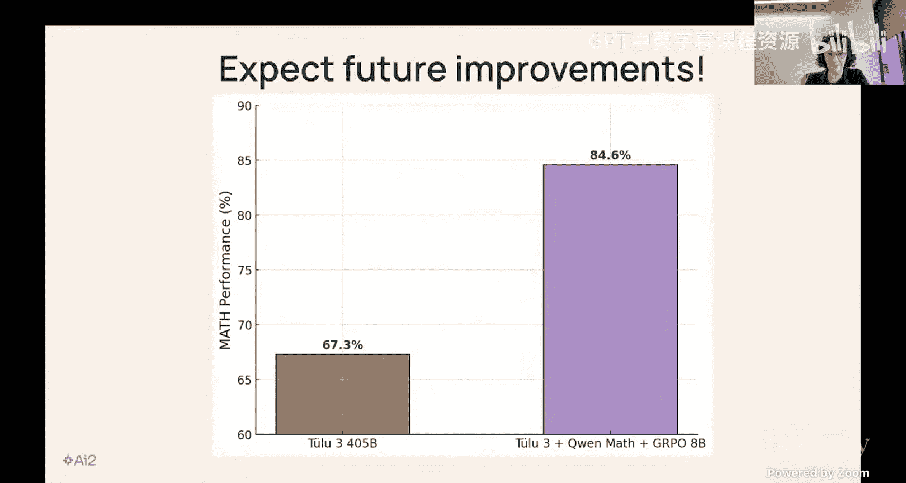

Okay， so。This is it， so we these are putting together all our2lu3 recipe I first told talked about how we got ingredients ready by collecting data。

 then we have different types of data at different stages and we showed how we do supervised fine tuning or instruction。

 fine tuning， preference tuning which we looked at the preference data and URLVR which we just looked at this kind of verification step and then putting all these together。

 we have2lu3。😊。

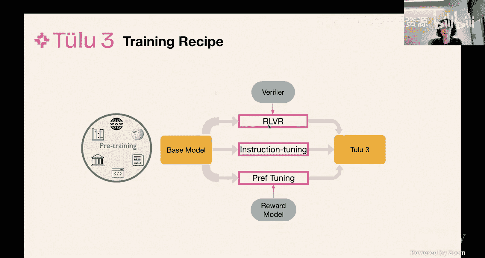

Here is the model we also have the demo of the model available in playgroundground。l。

org where you can play with this， we are using this data to kind of improve the next version of the models and kind of improve capabilities of two to three also all our code data and the pipeline and the framework is ready so。

😊，Whatever posttrained model or adapted model you want to build。

 we argue it's really important to bringing in some of the general capabilities to get better model。

 so I would encourage you to use that data。😡。

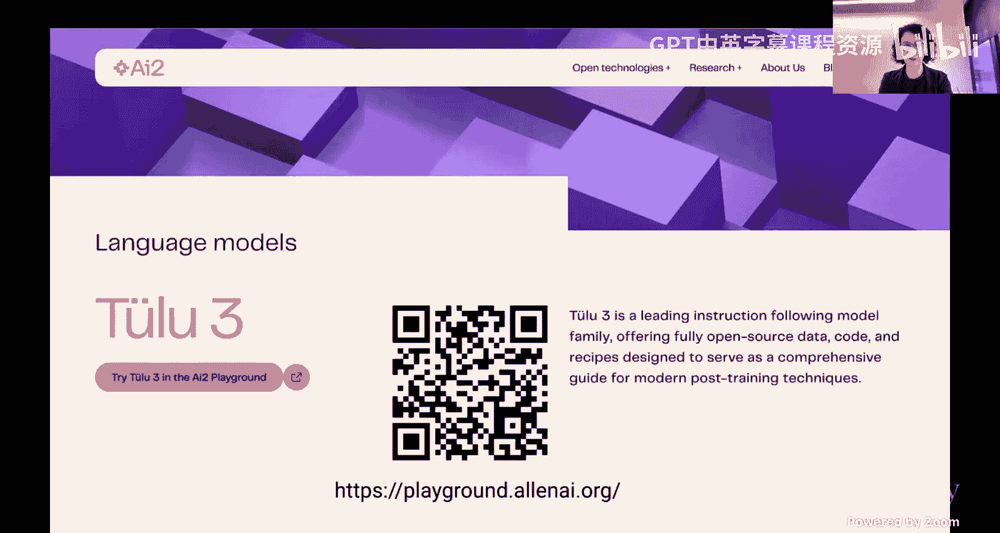

Okay， so this is a fully open post training recipe we have applied it to Lma based model。

 Quen based model， and also on our AlLmo models， which showed significant boosts on the kind of Alma based models as well。

😊，Okay。So with that I would end up my discussions on post training and I want to very briefly talk about test time inference。

 okay which is a very kind of popular topic these days and a lot of people are looking at how to bring in test improvement。

 particularly in reasoning during test time inference。😊。

So I first want to talk about this paper called a swan， which is led by amazing Nicholas Maningkov。

 and it is actually the very minimal recipe for reasoning and test time scaling。😊。

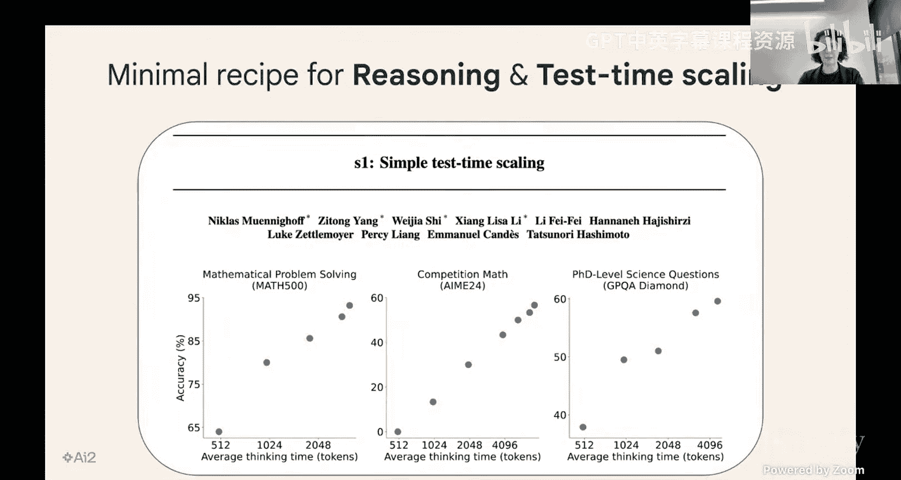

So let me tell you how it works。Very similar to almost everything else that is happening in language models。

 it relies on really carefully curated data， we call it S1K then we applied test time scaling algorithm。

 a very simple one and this is the outcome S1 okay how do we curate data。

 we looked at a very large collection of math， logical reasoning probability questions and so on like kind of more higher level reasoning data it's even beyond the2lu3 data。

 where we mostly looked at grade school and kind of math which was highest school a little bit college level math here we are looking at much more complex like even Olympia or math competition type data。

So we looked at all these logic puzzles mets and we collected 59 k question。😊。

But then we did a lot of filtering here， we filtered for quality， we got into 52K data。

 we picked the ones that were more difficult and then we moved 24K and then we emphasized diversity and we kind of removed the ones that they were very similar we ended up having1K so spoiler alert on our benchmarks using 59K data and 1K data almost similar which is very interesting。

So once we collected these prompts， we started to distill reasoning traces and answers。

 so for example when we have a problem like this we gave this problem which is among our like S1K data and then weOK annotated the kind of reasoning chain of thought with Google thinking Gemin I model also we made sure that this data also includes some of the thinking tokens like okay this happens but let me think more and so on so we used it kind of Google thinking annotations and most recently in S11。

 we replaced Google Ge& I annotations with deepSR1 results where it actually improved the final results which was very interesting to see。

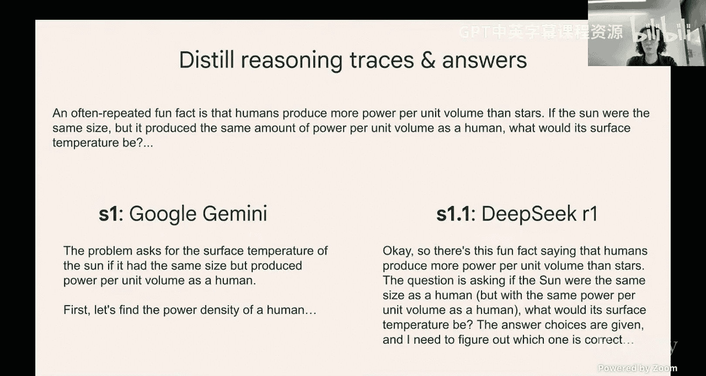

Okay， so this is the final collection of data。The data varies across all these domains from geometry number theory to even very smaller portion on control theory。

 astronomy， and so on。Okay， so this is the data。😊，Test time scaling。

 the simplest method possible which kind of made all of us very surprised and kind of excited where we focused on budget forcing where we have a question like this how many R are in Raspberry we let the model generate response。

 but then if it didn't hit the allocated token budget， we。

Added the token called weight and then let the model generate and basically force the model generate more in order to respond to that right we are kind of using this weight token。

 we are hinting the model that we are not sure if your answer is correct Okay so one more thing to add we did not train a model to decide when to add weight。

 we kind of naturally added weight when it didn't hit our token budget。

And then we let the model generate more until the final answer achieved is uptake。Okay。

 so now training and results， we trained a Qn 32B model on this data and here are our results。

On the X axis， we are seeing the kind of the number of tokens。

 the average thinking time or the number of tokens that are generated and then the accuracy so when we push the model to just generate 512 tokens here is the accuracy right it's like 65 one more thing。

If the model wants to generate more tokens than the kind of the budget。

 we put end of token there or end of a sentence there okay。

 so with that we control the generation so we go from 512 to  2048 for mat 500 data and as you see over time with more generated tokens。

 we see this a scaling trend。On this MA competition data。

 which is kind of much more challenging data， we even want the model to generate longer and longer outcome and as you see here we see again the same trend and also PSD level level GPQA diamond again generating longer and longer token。

 which is very exciting。Okay。So zooming in here are a little bit of how it worked。

 I kind of explained it already， so when the model wants to generate more tokens we push end of sentence to be able to get these kind of shorter sequences and when we want the model to generate longer like even go beyond  a000 tokens。

 we push these away token and force the model to generate more。

We compared different types of test time scaling methods here are the budget forcing this kind of a steeper curve shows the budget forcing or sequential scaling we also did parallel scaling versus real majority voting where we let the model generate multiple paths and then kind of do majority voting or like the selfcon check and we saw some gains but not that significant right so this kind of budget forcing seemed much more successful。

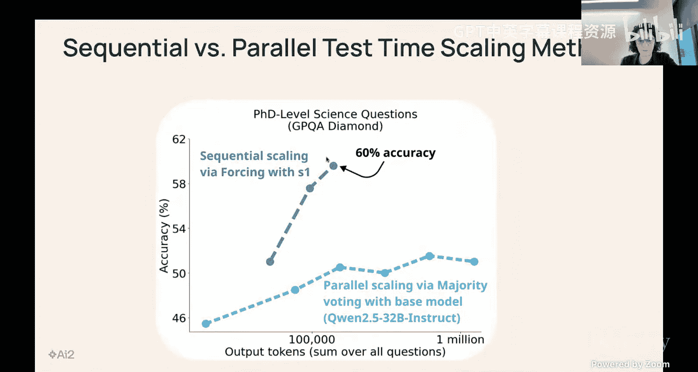

And much simpler。So here are some of these abls that we have done in the model。

 so this is the final results on the left hand side of S1K on all those three data sets。

 comparing with full collection of data like using 59k we see that a little bit higher numbers。

 we get with the full data on AIME， but in other cases pretty much similar。

And our S1K data is really high quality， if we just use random or like just do a bunch of kind of constraints。

 you find that 1000 data points， the results are much， much worse。

We also did a bunch of scaling ablations when we don't increase any any let the model to train longer。

 this is the base number， so these are the gains that we are having with this test time scaling。

If we replace the weight with other tokens like h alternatively or just let the model generate without adding any strings。

 we saw less gains。Okay。So these are our results for test time and scanning I also want to highlight two other approaches that we have been cooking up over time and the idea is and I'm not going to talk about any details on these next two methods but the idea is we want to be very aware and do self guideed generation at inference time in this word selfrag we build a ragbased model。

 retrieval augmented generation model， but in this setting we train a language model to generate tokens but then criticize its outcomes and selfimppro and we did it total the whole loop we generating these critic tokens。

Where the model generates responses， but once in a while it generates tokens to say if the generated response makes sense or not or if the retrieved documents make sense or not。

 so these are also very promising directions in pushing forth test time scaling。

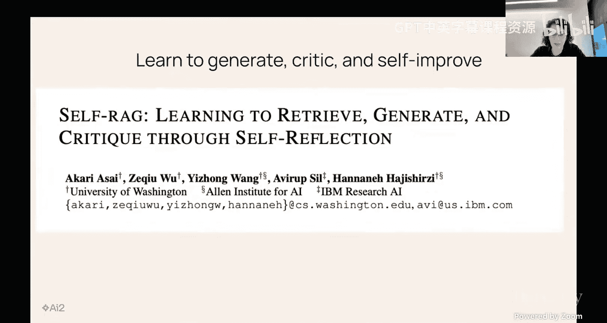

We also showed that how this kind of selfgud improvement loop helps in synthesizing scientific literature and answering very complex questions about scientific tasks that require lots and lots of reasoning so please check out these two papers the results are very interesting。

😊。

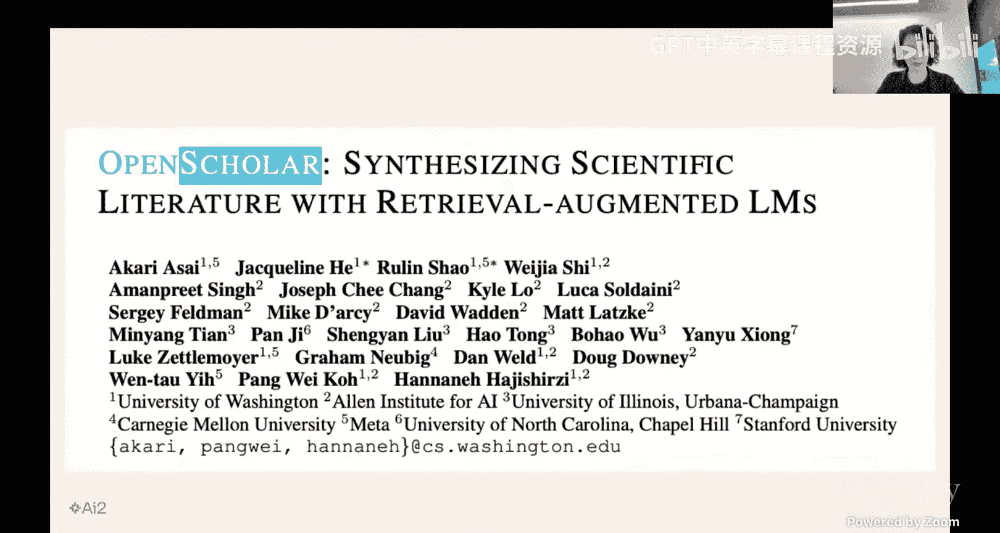

We also have a demo which is opencholar。alen。aiI where you can play with this system。

 type your question and then see how it can answer and combine different pieces of information。

 synthesize knowledge， and then answer queries for this type of task。

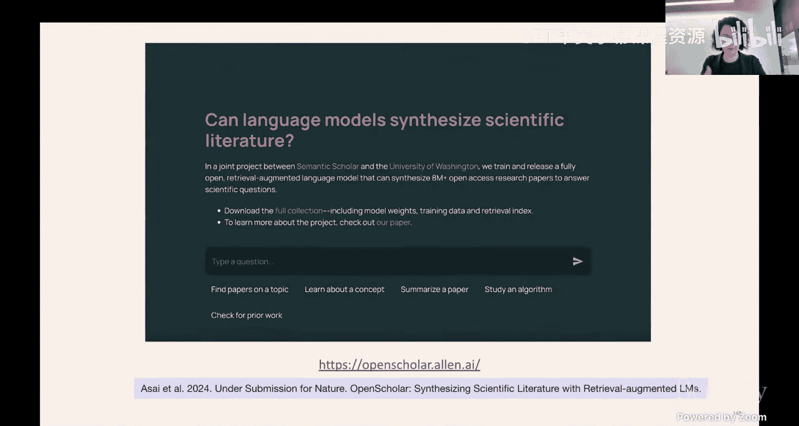

Okay。This is a。

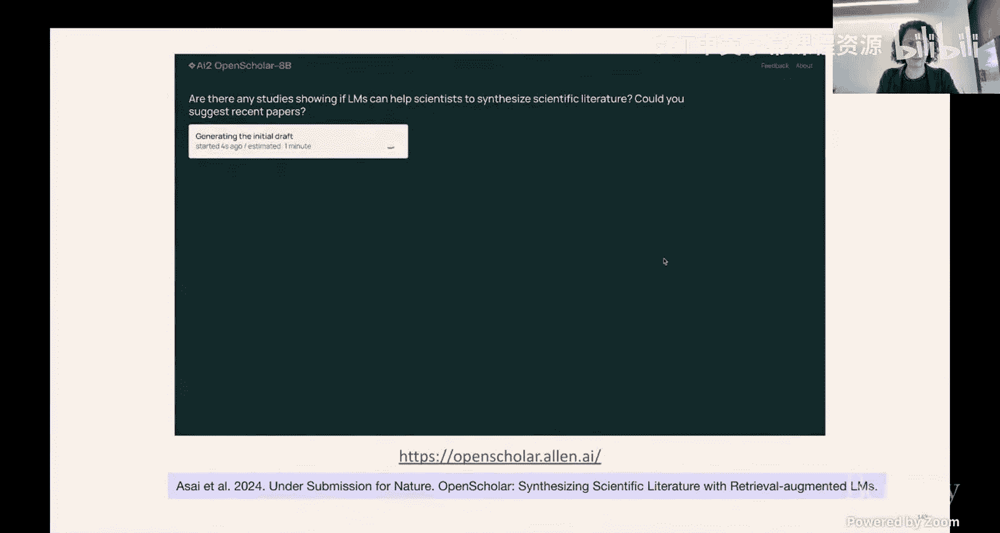

Demo， and I would let you play with it。So I want to very briefly also talk about how reasoning can get integrated during pre training Okay so so far what I talked about was post training。

Integrating things at inference time and now let's kind of go backward and then say see how these things can be added during training remember when I said RLVR didn't work when we had we care based model so we need to push to have stronger and stronger base models okay so this is kind of when when we say training based model it's not just training with the next token prediction where learning grade stays the same and so on we usually do multiple stages of training in this first stage we have the warm up period which which is like which is a various standard method but then we use cosine learning rate to train these models with the next token prediction on trillions of tokens okay but then toward the end of training we curate really really high quality data in a lot of cases designed to do more complex。

Reaing。And then we take the model that is here， the learning rate that is here。

 and then kind of a newly to zero。😊，Sometimes this stage is called mid training。

The role of these 50 billion tokens is very important because we still do next token prediction。

 but these tokens are very kind of are trying to focus on very complex tasks and emphasize on more reasoning oriented setting。

Okay， and roughly this is called nowadays pre training and then me training。😊。

So the pretraining stage， it uses most of the budget in the training stage。

 it uses trillions of tokens， it's pretty much unstructured， diverse text。

 lots of it come from web data and we try to use the best type of data that we could collect given the compute budget that we have。

During meat training， it's almost 1% of training。The idea is we're going to ups sampleample high quality data that we have during pretrainee。

And then to make sure that we have some in domain data。

 but then we make sure to bring some even supervised fine tuning data。

 we bring in a lot of reasoning type data， coding data。

 and we kind of try to emphasize the quality of the data here。Okay so this is for example。

 the pretraining data mix that we use for Alma2， which some of the web pages， some code data。

 I mean the leftmost column matters less the right most categories make more sense to follow right now our web pages。

 code data academic papers， STM papers， some matvape pages and math proof and so on。

 and in total we have roughly four trillion tokens。But then during mid training stage。

 we started to bring in lots and lots of math data。

 which started to patch the math reasoning capabilities that the model didn't originally have。

 for example， this was very interesting observation。We realized at the end of this stage。

 the O model was not that good in doing multiplication。

 but much better in doing addition and subtraction。😊。

So we started integrating some multi synthetic multiplication data in the mid training instead。

 right so you kind of observe， do a lot of kind of evaluations and then figure out。

 do some patching to improve the model and then kind of inject that type of knowledge in the model。😊。

So as you see in our meat training mix， we included a lot of reasoning type data。

And then we started evaluating these models， so this is kind of evaluating our pretraining and pretraining and mid training together on average we see significant boost in both settings like from 50。

 we go to 60 from 56， we go to 68， and the biggest gains are on GSM8K which is our math reasoning capabilities and drop which is also question answering with mass data。

 which is showing significant boost there， which is very interesting。😊。

Okay， so putting all these together here are our Almo2 results， which is on par with Lama 38B。

 we please refer to the paper to look at the kind of the 13B and most recently we're going to have a 32b results。

😊。

Okay， so with that， and I want to finish this that we've seen a lot of progress in today's AI work。

 still we need a lot of research and innovation in many newer tasks。

 so here I've listed a lot of them， a lot of them relevant to reasoning agents。

 language models for other domains and so on， which I really would be excited if I see you work on that。

😊。

With that I want to thank a lot of people who are in my team in the Almo and Tulu projects and also my students at UW and a lot of people at AI too so thank you very much also if you are interested we are hiring for all these projects。

 thank you。