# UCB《高级大语言模型智能体｜CS 194 294-280 (Advanced LLM Agents) 2025》中英字幕 - P6：Lecture 6, Ruslan Salakhutdinov.zh_en - GPT中英字幕课程资源 - BV1mkZiYAEYM

Today I'm going to talk about multimodal AI agents and sort of give you a little bit of overview what we've been doing and some of the work that's been happening around that space。

 it's a very exciting space， I think that a lot of people are thinking that the year 2025。

 2026 is going to be the year of agents so we'll see a lot more work coming out of academia in industry in that space。

😊。

So when we think about large language models， right。

 we think a lot of different sort of innovations that happened in the last few years。

 you know we see examples of in context learning zero short learning。

 you have very good representations of text， you have general long and coherent text that these models can generate have sort of world knowledge and so amazing things has been happening in the space of large language models。

 right？😊。

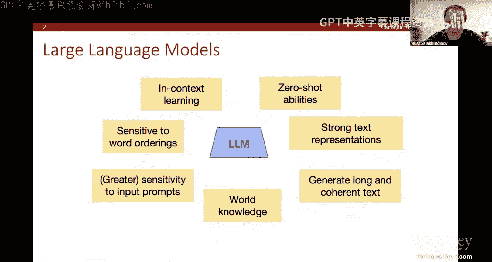

But what I would like to talk to you about today is this notion of going beyond just the language models so you can think of language models as you know given the question。

 you know the language model can generate the answer instead we can try building systems that basically can automate a lot of laborious tasks right so in a lot of productive tasks we perform today on the computer potentially as well as many tasks that we perform on the web could potentially be automated so for example。

 you know how many of you have tried setting up AWS instance right on my students are basically saying it's a really difficult process to do the question is couldn't you have an agent model that goes and sets up AW instance for you right so we can start running your experiments。

😊。

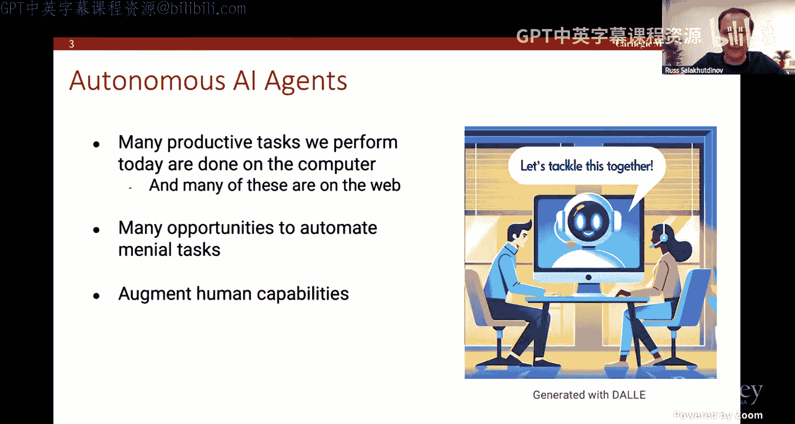

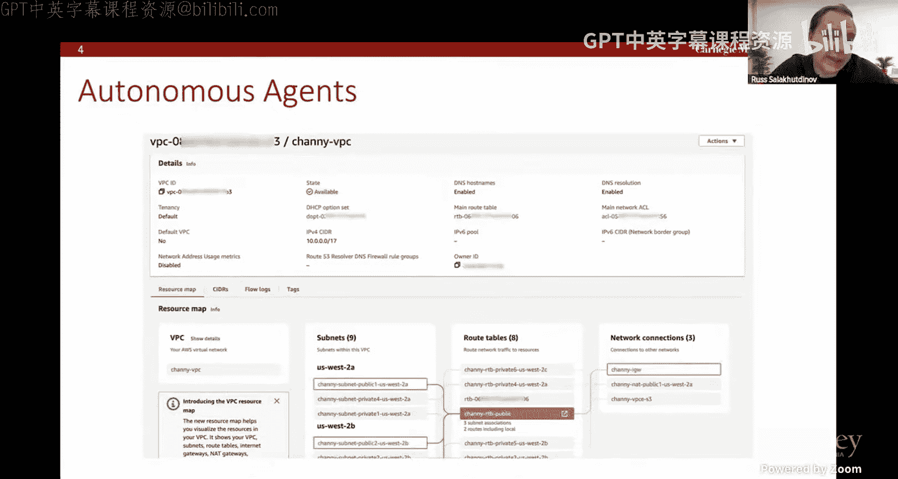

Or you know wouldn't be nice and I think the technology is getting there a little bit at this point is you know create a set of PowerPoint slides to present the content of this paper right so I give you the paper。

 the agent reads and sort of goes to the PowerPoint and organizes slides and creates and gives you sort of a presentation of the paper。

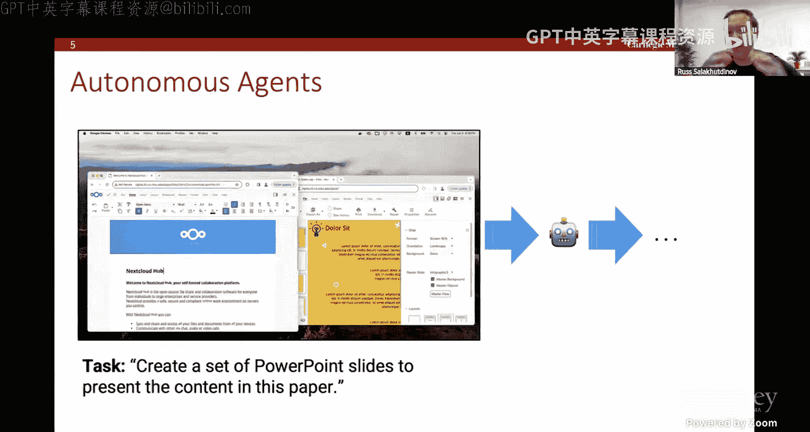

You know you know， can you automate some of the tasks that we're doing on Excel。

 going on the web and so forth， can imagine a lot of useful outcome if you're actually able to design models that can do those tasks。

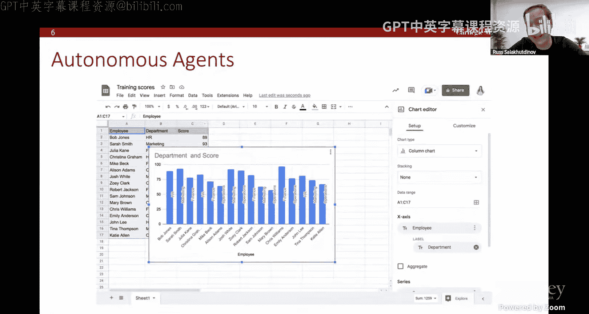

In this sort of lecture， I'm going to be focusing primarily on web agents and sort of give you a little bit of overview of what these models are。

 how we evaluate these models。And the idea here is that you know you have a basic language model we some sort of for a foundation model。

 obviously you need some form of text understanding like an HTML and you also need to have a very good understanding of the visual information like the actual website itself right so you can think of visual encoding plus some form of text understanding that goes into large language model and then gives you some form of web grounding。

😊，Right that you can then use for performing， tasks on the web。

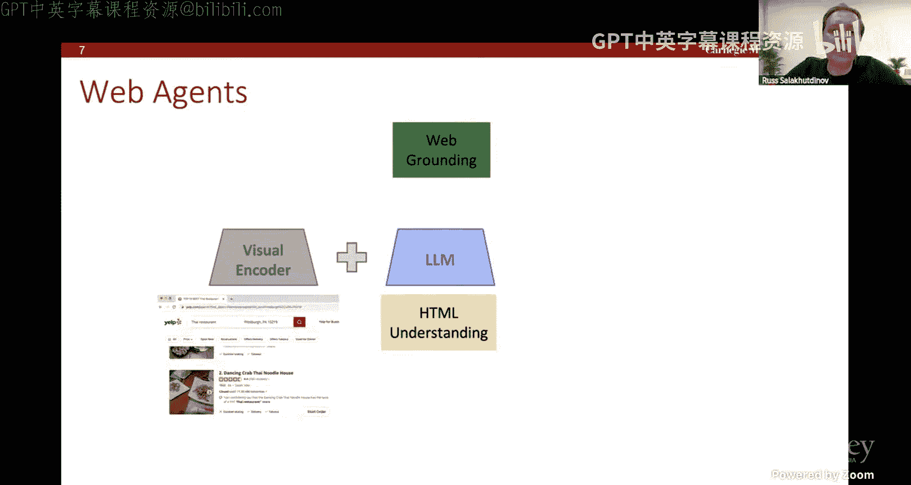

And there's been a lot of work I'm not going to least there's been a lot of work in the last few years where people are trying to sort of understand and trying to build systems that that can do these tasks let me show you an example right an example of a system where I can say suppose I give the task to my agent。

😊。

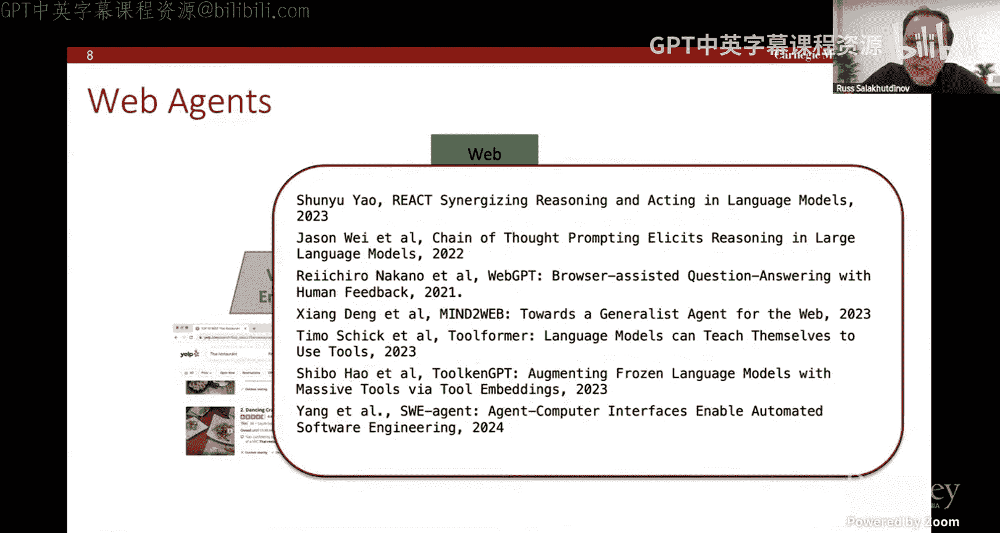

Get me to the page of a good Thai restaurant in Pittsburgh。

 It should have at least 200 reviews and 4。3 stars pick the one with the highest rating right and this is what the system does right So it's sort of。

 you know， it goes on Yelp。😊。

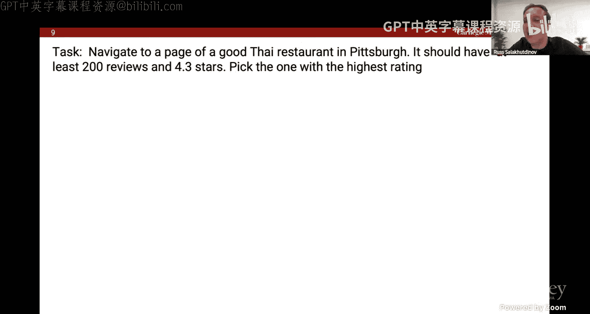

It sort of searches for Thai restaurants it types in autonomously Thai restaurant rights it's then searching through possible restaurant in Pittsburgh。

 it sort of finds one of these restaurants which has 4。

5 star rating it's a pusedie garden it's actually a pretty good restaurant in Pittsburgh right it's a good Thai restaurant now it's complete。

Now imagine I'm asking it to say， well， get me reservation at this for two people at the earliest date and use my name JY Co。

 who' is the student who build this and the phone number right and so the agent goes on Google finds this particular restaurant looks at the dates。

 looks at the next available date and actually successfully making a reservation right and putting the phone number and then basically stops because you need to get a confirmation to actually book something right？

😊。

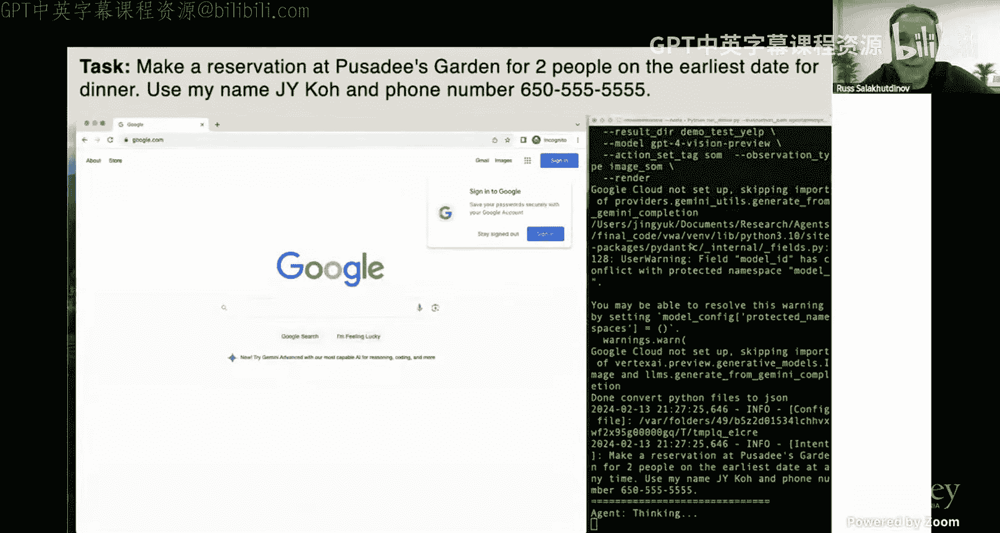

So it basically says， you know in summary in the next action I perform is stop unable to proceed without confirmation code for further instructions to complete the reservation right So you sort of have this notion of the agent that takes tasks it generates chain of thoughts but within thinking and then takes takes the action or I can give the example of help me navigate to the shirt that has on it right it goes on Amazon。

😊，It's trying to basically look for something similar and， you know。

 find a shirt that has something similar， right， These are the examples that are heavily cherry picked out of。

 I think that we've tried maybe like， you know，30 times and out of 30 times one of them succeeded right。

 So that basically means that these systems do not。A not really working very well at this point。

 but it has the potential of you know give you flavor of what these systems can do。

 I think in today's world， like open the eyes operator kind of like sort of， you know。

 moving in that direction is one of one of the very strong models that's out there。😊。

So today I'm going to talk about three different things right I'm going to talk about visual web arena。

 which is a way of evaluating multimod agents on some of the realistic visual tasks I'll talk about some of the inference time algorithm。

 what we call the research algorithm for large language model agents which sort of allows you to potentially do interesting search apply。

 interesting search techniques to find necessary information on the web and then the last part I'll talk a little bit about some of the way of scaling up data for training these agents because one of the aspects of these agents in general is the availability of data。

 what can you do online and how can you get the data online right？😊。

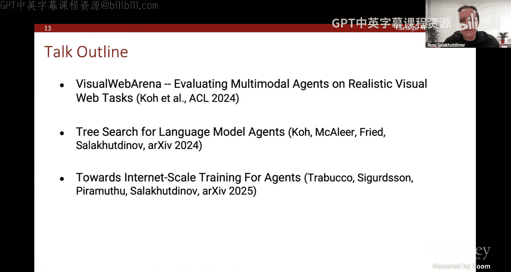

So let's look at the visual web area。😊，One of the earlier versions was developed by folks at SiU。

 right it was done by Xyan Zu and Frank Zhu。They've introduced the notion of Webar。

 which is a fairly realistic environment at the moment。

 it has popular categories like shopping Reddit and Gitb。

 which is equivalent to Amazon and Reddit and GitHub。

 it's a self-hosted open source essential environment， which isim of the environment。

 and the data comes from real websites from Amazon Reddit and GitHub。😊。

And what's interesting about this environment and I'll talk about this the tasks are fairly easy for humans。

 about 78 success rate， but very difficult for language models at a time。

 they've reported numbers like 40%。😊，The only problem with this particular task is the task are designed to use just HTML source code。

RightAnd we found that a lot of times whenever you're dealing with HTML and JavaScript。

 it's a very messy type of representation。😊，Interactive elements that when you're interacting with the environments that don't get displayed correctly HTML。

 that is like Java， CSS code， and it's very hard to kind of like process in context length。

 HTML pages can be fairly complex like they can easily fill up to 100。

000 tokens right if you're kind of like trying to look at that。

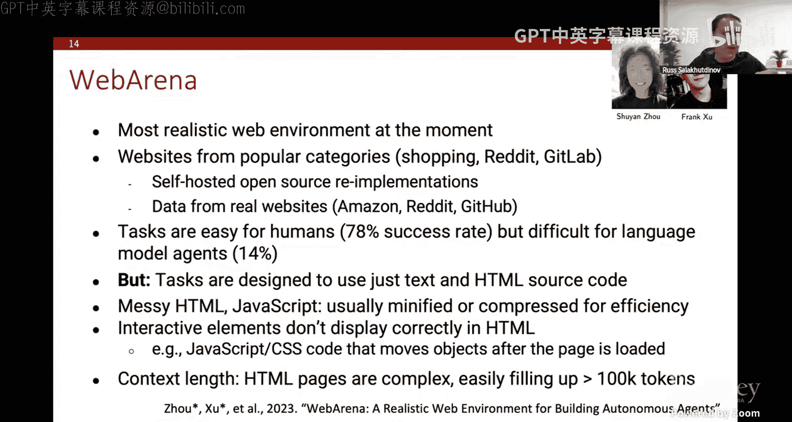

So。And this is how it sort of looks like， you know， you have this。You know。

 kind of like HTML based representation， spatial layout is also not convey very well in HTML。

 so it looks like just a text only representation。😊，It's very difficult to deal with， right。

 just because HTML is messy， so we've tried building what we call visual web arena。😊。

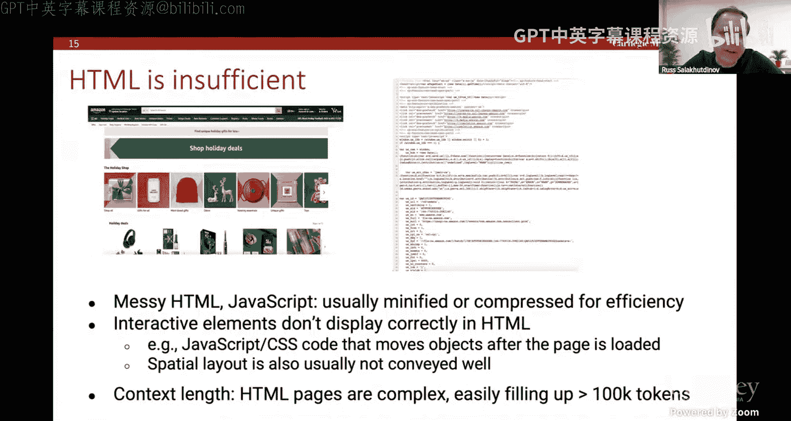

Which is we try to build and track the process of multimod agents。

 agent that can actually have visual grounding。So we've designed these visually grounded tasks to test the abilities of these models and it's sort of inspired by Webar。

 something we call it visual Wearina and you have visual inputs and outputs that allows you to works with unique and interesting sort of and something that's real world。

😊，And again， we sort of have the environments of what we call One stop shop。

 which is essentially Amazon like environment， Reddit， an OS class。

 which is more like a craly stack environment with a class field type of environment。Right。

 so let me show you， and then you can think about that， you know you have some representation。

 I have some visual input and I ask you to solve something that actually requires visual grounding and visual understanding。

😊，So let me show you some examples of this。😊。

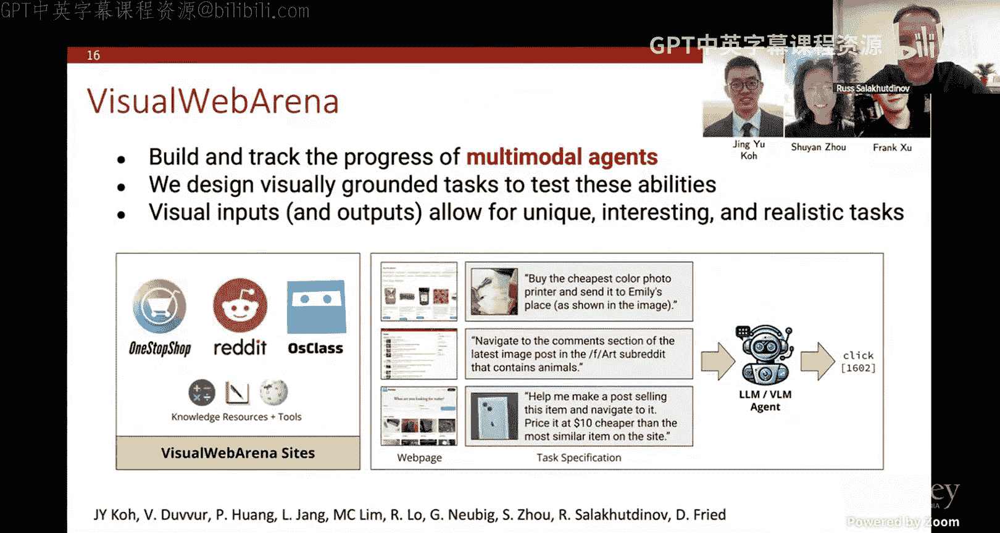

Let's say I ask I give you the task， I ask you to find this exact bike so I'm looking for this bike that's listed for 3005500 and post the comment offering $10 less than the asking price okay。

😊。

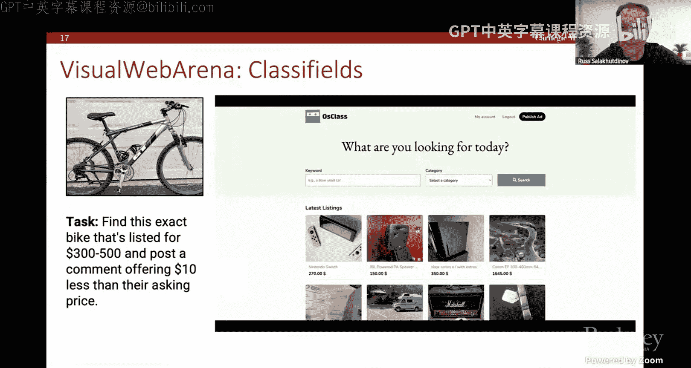

And this is what the agent has to do， again， it's a simulator， it's a fully self hosted environment。

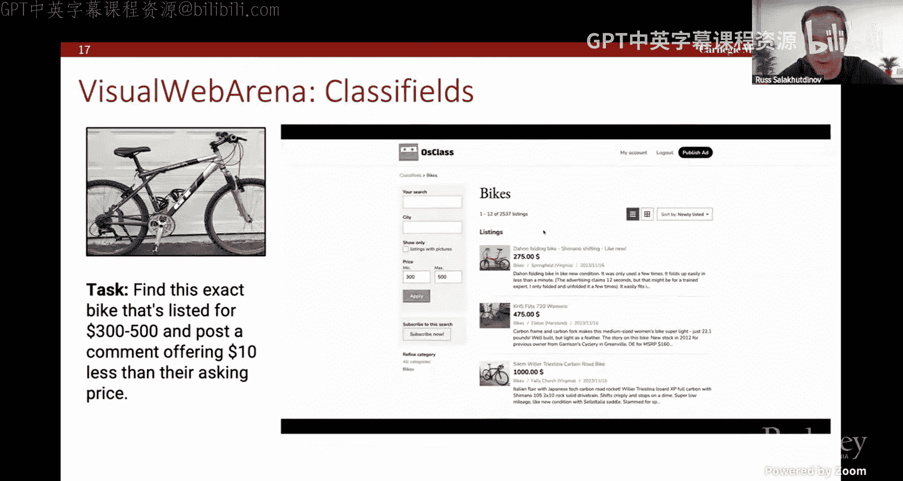

You sort of go， you navigate， you find this bike and then you basically make a posting by offering you know $10 less than what they're asking prices right that's just one example right and that basically you've completed successfully completed that task and I can imagine in the future there's going to be agents that's going to be bargaining on your behalf and there's going to be agents on the other side that's going to be you know making you counter offers。

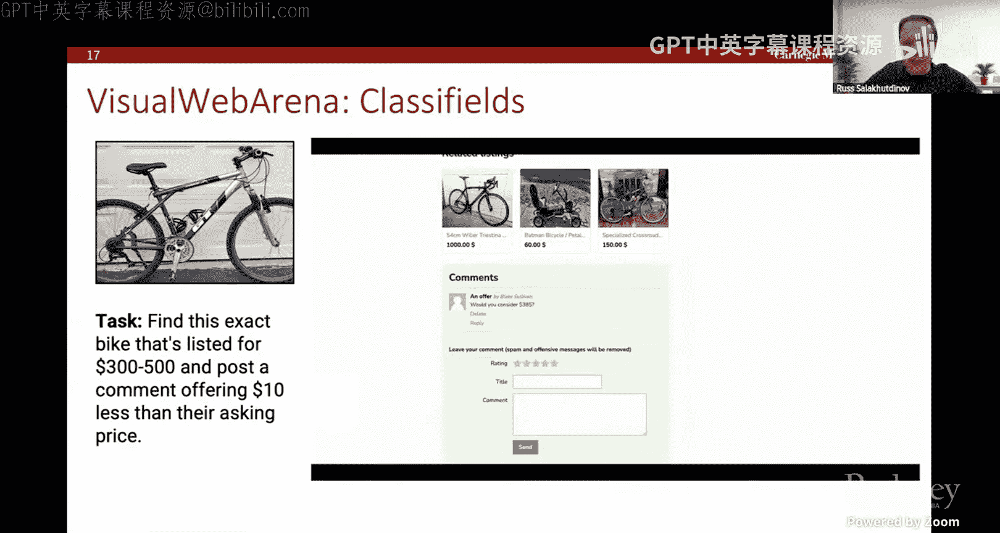

Here's another example， let's say I ask you buy the cheapest color photo printer and send it to Emily's place as shown in the image and what you can see this image is upside down。

😊，Which makes it fairly difficult for existing models to sort of look at this and actually figure out what the address should be right so some of these kind of like tasks we designed so that it wouldn't be that easy for the models to solve。

😊。

And so what the agent needs to do， it sort of needs to go， it needs to find。

 it needs to sort by price， it gets the printer， it adds to the cart。

 then it goes and its starts completing you know the address so you know it has pull down menu so it sort of you know looks fairly realistic right and then you go and then you place the order。

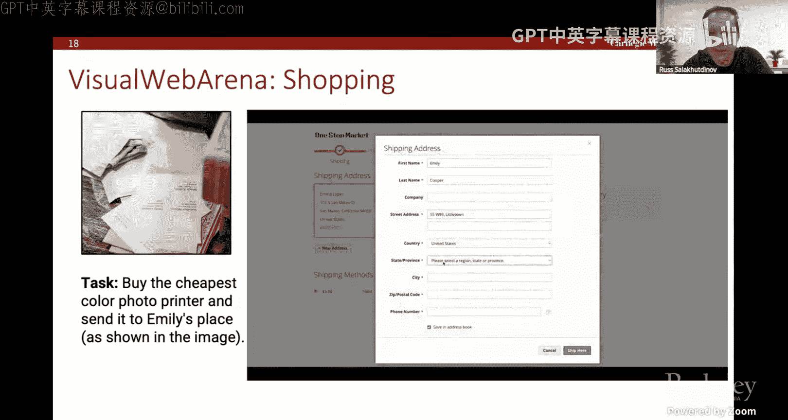

And when you end up in a state， that particular state that basically means that you've successfully accomplished a task。

 right？Again， just to re it's a simulation it's not actually doing it on the real web it's a selfhoted environment。

 Here's another one where it requires it to sort of jump between two different websites you can ask what's the 2022 total nominal GDP of the area that produced most sugar cane in the year of 2021 and billion right and that's your landing page what's interesting here is that you're essentially asking the model to understand。

😊。

The images， because if you look at the year 2021， that's over here and you look。I think in this case。

 Asia produced more sugarcane than than Brazil or the other way around。

 Brazil produced more sugarcane than Asia。 So kind of like have to look at these graphs and understand what which country you should be looking at right So if you kind of zoom in。

 you can sort of say okay， that was， I think that was Asia that produced more sugarcane。

 So you have to go on Wikipedia and then find find the answer right， And the answer is 339 trillion。

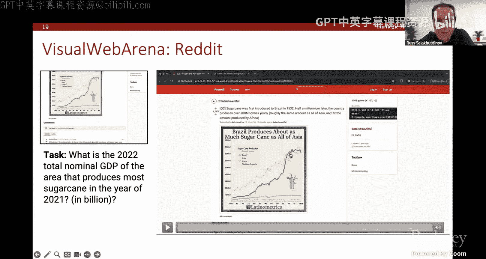

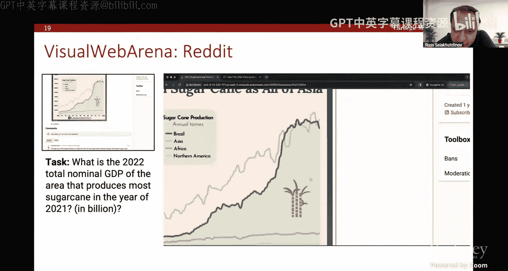

Yeah GDP so you can kind of see that you have to sort of have this visual granting you have to understand images。

 you have to understand graphs to solve some of these tasks right so the way that the environment is represented we can think of this environment as a po DP environment so this special observable mark of decision process so you have states you have actions observations and transition function right and so for those of you who've worked in the reinforcement learning or who've been sort of dealing with mark of decision mPs that should be familiar and that was the goal to design the environment in such a way that it becomes an MDP so that you can potentially you know train your favorite reinforcement learning algorithm on this。

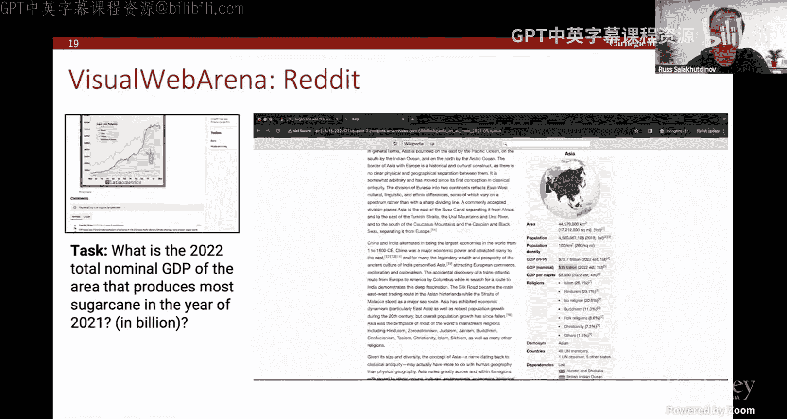

So the environment itself have observations， whether it's an HTML。

 whether it's the visual representation， like the actual website itself。

 and something that we call accessibility tree， which is a cleaned up representation of HTML。😊。

You have a set of actions and a set of actions it's actually a fairly diverse set of actions right you can click on particular element。

 you can hover a particular element This is an interesting one you can type in a particular element and text right so you can think it's not just a set of discrete actions you know basically you can type in whatever right if you're searching for something or you're filling certain boxes you can have a new tab you can jump to a new website。

 you can focus on a particular tab， you can close the top， you can go particular URL you can go for。

 go backwards scroll up， scroll down and then you have an action called stop and then answer stop is in the action way the mall basically says okay solve the task。

 stop and then I give you the final the final answer。😊。

In this particular environment you have deterministic transition function。

 you have the state that generates the HTML page and given the state and in action you generate the next state and that the next state generation is actually deterministic。

 basically meaning that if you own particular website and you click on a particular element or you type something there is only one there's no stochasticity so you know gets you to the next state。

😊，And we also define the reward functions and the reward functions primarily to evaluate when you've successfully solved a task so it's a fairly sparse reward signal that we get in this environment okay but let me show you just walk you through what the model actually needs to do here right So what the model needs to do is you know has to start on the homepage So here you trying to find the cheapest printer。

😊。

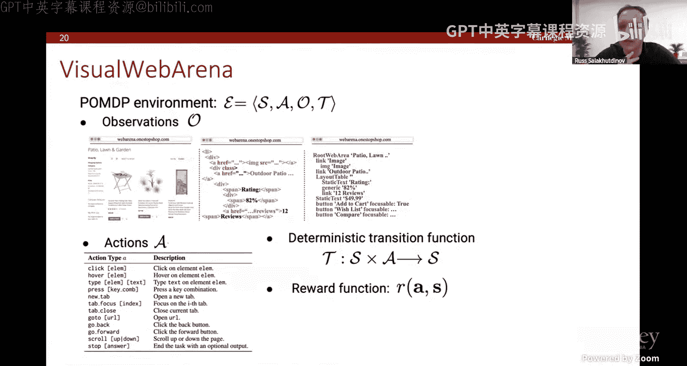

And you have to navigate to the printer category right in terms of the actions that you need to take then you have to sort by descending order So you can click sort by price right then you click on the cheapest color printer。

 you have to choose what's the cheapest one。 So you kind of like have to understand how much each printed cost and you have to choose the cheapest one。

 then you have to add to the shopping cart that's another step。

 you have to proceed to check out that's another step。

 then you have to fill in the form correctly right with with the information given to you in this image。

And then you have to place the order。 So if you look at the entire trajectory here。

 it's fairly complex trajectory， right， the model has the sort of reason about what it's seeing on the web。

 It has to understand what I mean by the cheapest。 so it has to have a notion of sorting。

Then it has to really understand good multimodal abilities to understand what I'm seeing in the images。

 what's the address and they have to go in and fill in the address right with the right information So if you look at it it's not a very trivial task to accomplish right and that's just one of1 thousand0 tasks that we've designed。

So in terms of the distribution of tasks across the websites。

 you know we've looked at how difficult those tasks are。

 we have I think we have 950 tasks in total close to 1000 tasks and you can see about 15% are easy basically what that means is that it's easy in terms of reasoning difficulty and easy in terms of visually understanding what I'm asking you basically means you have to only if few clicks to actually solve the task and then you sort of have this corner here which is fairly difficult reasoning difficulty so I really have to understand what I'm seeing in the image and visual difficulty and reasoning basically means that I have to click on a lot of things and kind of explore to successfully accomplish this particular task right so in this particular environment you can actually split and try to understand is that my visual models I'm missing or is it my reasoning is missing。

😊。

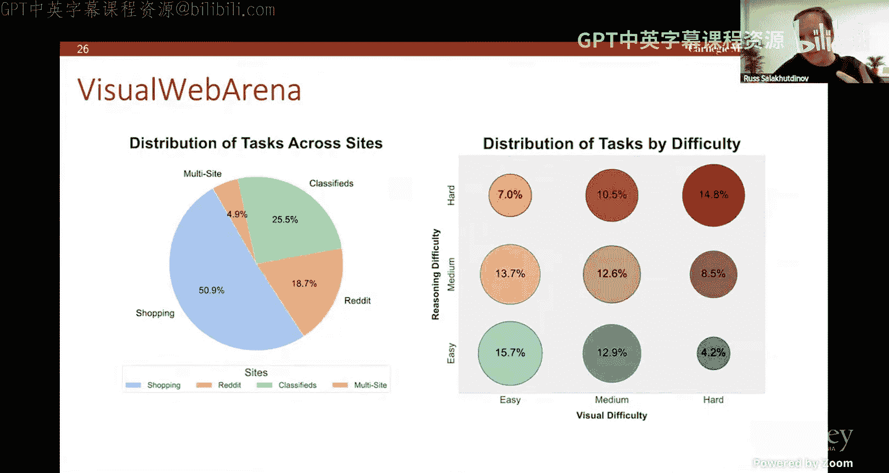

Here's how we evaluating these in this environment。 So we have executionbased evaluation。

 So for example， a lot of times we want to find the exact match。 So if Im ask you the question。

 what's the is number of the company that occupies the largest portion of Warren Bford portfolio then I kind of like go to Wikipedia I find Warren Baffer portfolio and then I sort of get the information and I need to get this exact number sometimes if I say add something like that to the men's whatever this man is wearing to my wish list then I kind of like find something and I basically have visual QA like is this a polo shirt yes or no is this green shirt and so forth right and then you have sometimes when you're looking for something you say it has to include above 200 to below 0 above 20000 30000 and so forth right so can kind of like have these verifies that once once I give you the final state I can actually run these verifies and sort of tell you have you solved the task and and for a lot of these。

Pros there' is only one solution right now because the environment is not you know the full internet。

 it's fairly constrained， but at least you can verify whether your model actually successfully solves the task or not。

😊。

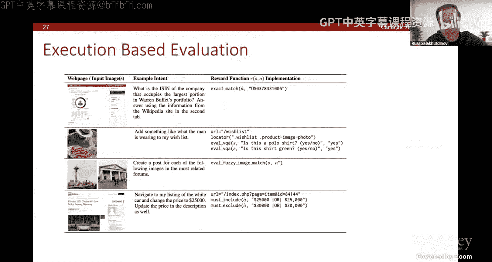

Now， when we think about LLMs or visual language， VLMs agents， visual language models。

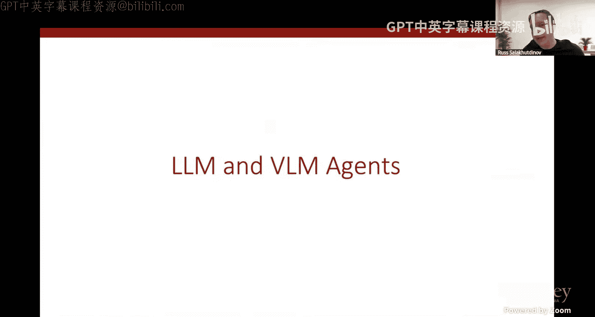

The way to think about this is the following， right？

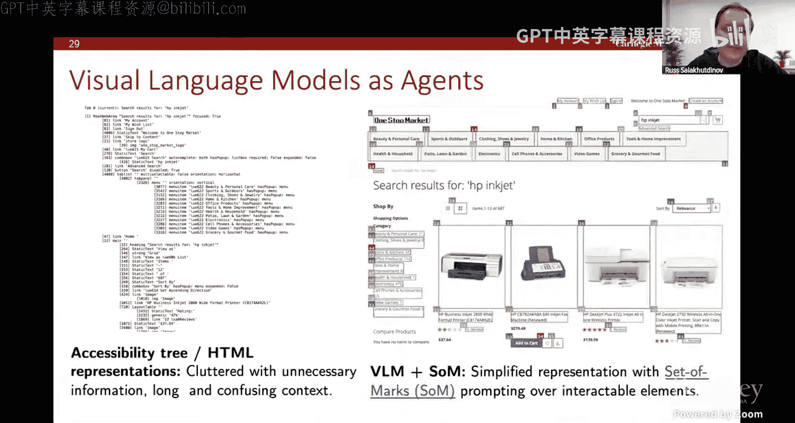

One thing I can do is I can look at the HTML and try to use that as a representation into my LLM。

It's also cluttered with a lot of unnecessary necessary information， you know。

 it has a long and confusing context， there's been a lot of work where people sort of doing markups where they're trying to identify the relevant parts of the HTML and trying to use that。

Thiss another representation is to use something that's called set of marks which is a simplified representations so what it does is it basically puts bounding boxes around elements around clickable elements right so whether I can click on certain elements or not and that's something that you can get from any HTML right so that's set of marks representation something that you can do。

😊，Both of these of presentation have advantages and disadvantages set of marks is useful because actually visual I understand what I'm seeing in the image and what I can click on。

😊，But it's also a very cluttered type of representation and there is the third type of representation that people are now beginning to use。

 which is coordinate based representation where I'm just trying to predict the coordinate of where I need to click so ultimately it's probably going to be a combination of both HTML set of marks and kind of coordinate based representation。

😊，And the way you can think about these sort of representation is that if let's say I have a original webage。

 I can use the set of marks representation right so I can put the bounding boxes and have IDs for each box and sort of have some representation what each box is actually doing and perhaps have some form of captioning of each image so I have this sort of set of set of marks elements in the text as well as the actual visual representation right and if I say if I'm trying to find this post navigate to the common section of it then you pass it to the LLM of VLM agent and then the agent actually executes a precise action to do next。

 for example， I want to click on element ID 31 and element I31 is one of the elements here right and so again the way that we typically have a representation。

 I have a goal I get an observation I represent it using set of marks that goes to the multimodal language language models。

 both the text and the image as well as the goal。😊。

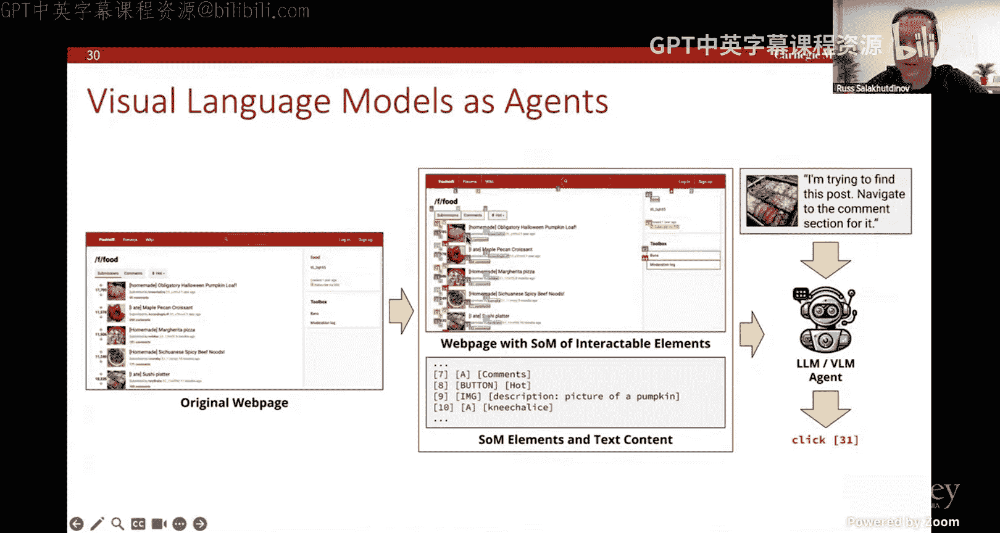

And the model generates chain of thoughts so in this case it would generate listing step by step。

 the objective is to navigate to the food， the post and so forth to navigate to this listing。

 I need to click on the comment link associated with a sushi In summary my next action will be you know I'll perform action click 34 and again that's the action that you clicking right so that's one particular action that the model is taking。

😊，And then it goes once you click on that particular element。

 the simulator will go to the next web page， the next the next state and then you repeat this you repeat this process right and here again the action is you take a particular action from the list of actions that I've mentioned before。

😊。

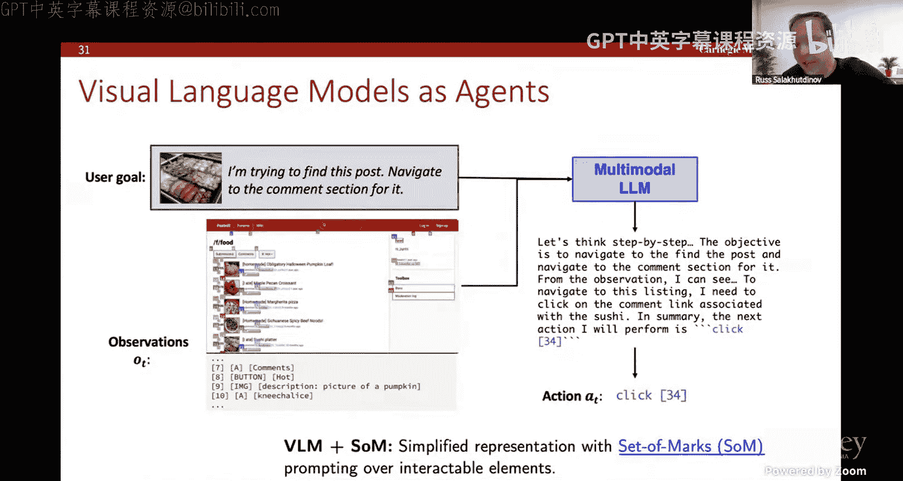

Now， if I look at sort of baseline models and kind of try to understand which models are working well and which models are not。

 what's interesting is that if I only use text only base representation，😊。

Then I hit something like 9% accuracy if I use text plus captions so if I caption any any visual information。

 any images that I have on the web pages， you know you have improvement。

 if I actually try to use multimod model， you get further improvement if I use set of marks representation sort of like I understand clickable elements and what I can do you get a little bit of improvement as well。

 So you kind of go from 9% to something like 18%。😊。

And then you get human level performance and the human level performance hits close to， you know。

 in this case， for visual wide it was hitting something like 85，86 accuracy right。

 So there is a big gap between what people are capable of doing it and what existing models are capable of doing。

 This was interesting the way that we've collected the data is we actually asked students at CMU。😊。

To solve these tasks， we give them the prompts， we give them the tasks， we give them the environment。

 and they just interact with the environment and then they end in the state。

 and then we evaluate using our execution based evaluation whether they've successfully solved the task。

What's interesting is that we found that， you know humans were not 100%， right？

And what's interesting a lot of mistakes that people make are kind of silly mistakes， so for example。

 if I ask you to find you know if I ask you to say。

 well find me the cheapest bicycle right that has these specific constraints or these conditions that I want it to be black。

 I want it to be of this color， I want it to be less than $2，000， go find me the cheapest bike。😊。

What people tend to do， people tend to kind of like go through the go through the simulator。

 they look at the find one bike， they find the second bike， and then they basically。

 okay I'm tired of looking for anything else right。

 so I have two bicycles I take the cheapest one and say I'm done。

Whereas actually there are 10 bicycles right that satisfy the constraints so people are just not very good at information seeking tasks or at least we didn't pay students enough we gave them pizza to kind of like go and spend more than a few minutes to solve these tasks so majority of the kind of information seeking tasks is where people were not really good at and sometimes people were kind of like a little bit you know they would solve the task but they would forget to click on you know place the order so they would solve the task they would add to the cart。

 they find the right thing but they forget to click on you place the order and they forget to if they forget to know place the order then our system basically says that well you haven't solved it right because they actuallyt haven't bought the item。

😊，And so， you know， this is an interesting part because I think that atic systems should be able to solve these tasks。

 a systems should be much better at information seeking in finding sort of the information just because it requires less cognitive load whereas people are not very good at doing that。

😊。

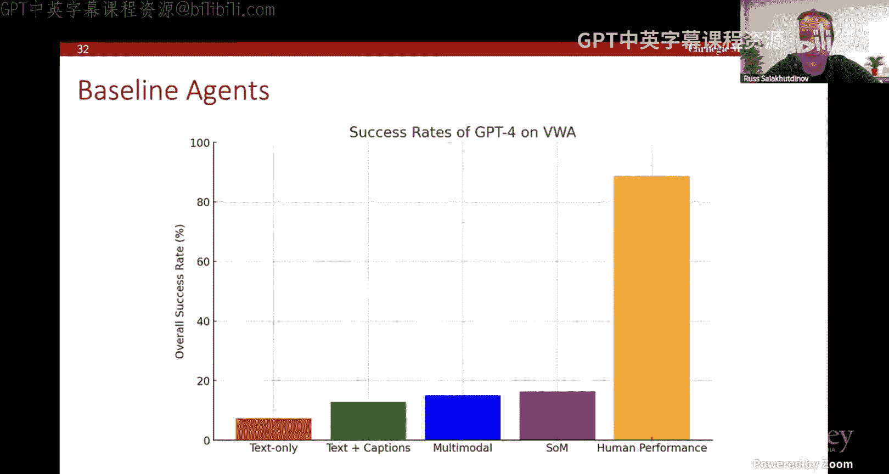

If I look at sort of， you know trying to understand， you know where we are with these models。

 you can kind of like see that Lama， you know， the all versions of Lama。

 they all wear kind of like really bad If I have accessibility tree plus captions。

 a lot of these models would kind of you know go higher。And then once I have multimods。

 you have much better representation。 And then once I have， you know。

 the multimodal models in that time， looking Gemini pro and G 4。

 I think G40 now hits something like 90%。 So like these models do， do climb， They do better。

 but they still far below what people can do right。

 Even the best models today are sitting around 20% accuracycur， right。

 in terms of solving these tasks。

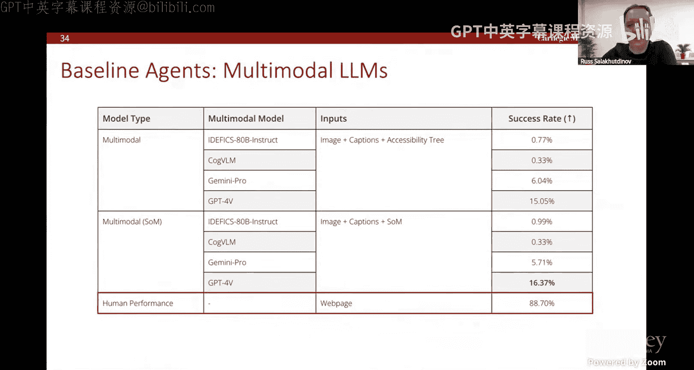

And here's one example I wanted to show is it's an interesting example where the G model was able to successfully solve it。

 I ask you， I don't like the author of this image from the posts， one of the posts。

 can you help me block them and the engine would actually go it would sort of click on the right things It would find the post it would go to the settings and through sort of executing multiple clicks it would actually。

😊，Block a specific user， right just as an example， like you give it this instruction and the model would actually go and do that。

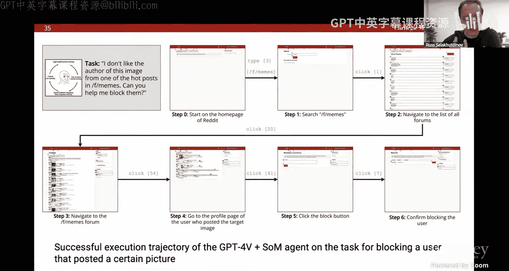

And this sort of has this notion of that I'd like to think about web agent architectures。

 and I'll make that reference later on for physical agents。

But you can think about these sort of architectures where， you know you observe some input。

 say web page。You do some form parsing right off the webage where it's visual and HTML or some kind of compressed representation of HTML plus visual understanding。

We have an objective right and the objective is what I need to do and a lot of times what what a lot of these models would do is they would generate high level plan right。

 they would generate the plan of how to execute how you should proceed to solve the task。

And then you kind of you know execute the low level actions。

 which is clicking on a specific element right and that sort of goes in loop。

 you know you can define a high level plan， you can execute the low level action up until you hit a stop action。

 which basically means that the agent is done， I think I've solved the task okay。😊。

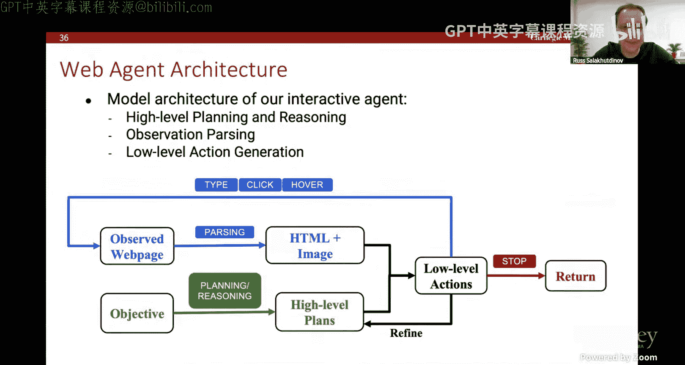

And you know you can think of planning you know as a system。

 there's been some work on building these hierarchical systems where， you know， for example。

 step one， I can say navigate me to a particular category right step two。

 you know I want to sort based on the rating of that category and it would be two level actions you selecting and then you sorting right and then maybe you know you select an item amount the $20 and then maybe you buying a selected item right you need to buy it and then three low level actions you add to the cart。

 you proceed to the checkout and you do shipping。So there is some sort of work right now that's trying to have the planning model that actually plans what you need to do and then you execute those。

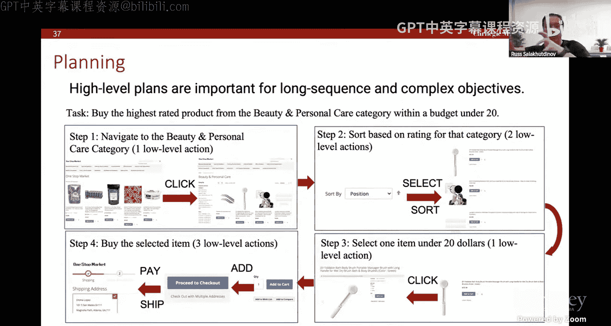

So visualual web areina， we think of it as a step towards building general purpose agents right it's a simulator so you can evaluate those models tasks that we design are not very consequential at this point。

 you know they don't really represent significant economic value at this point and we've designed these tasks to be simpler because the current large language model agents or AI agents do not even do well on these tasks。

 the gap is still fairly significant。😊，And the long term question is， can we automate productive。

 economically valuable tasks， right？😊。

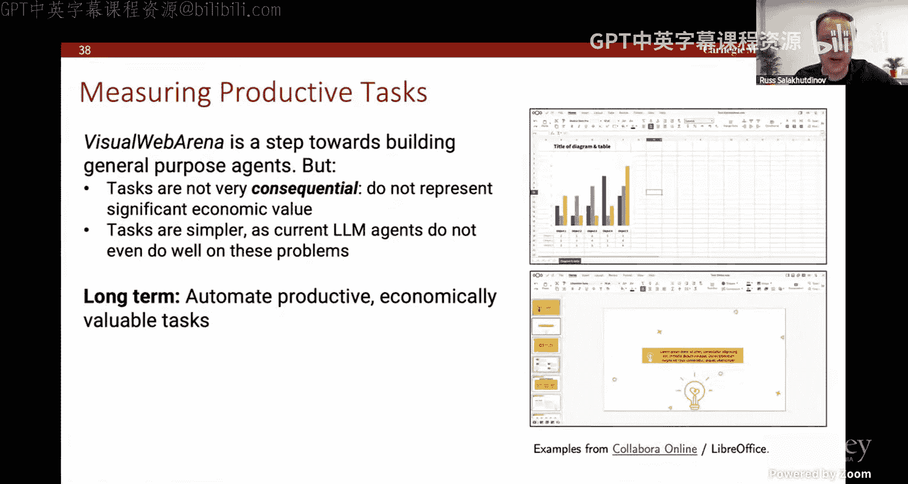

嗯。One of the interesting failure modes that we see is in these models and again we' fixing those。

 a lot of that is sort of progresses as the models become better and better。

 but one of the things that we're seeing is this notion of long horizon reasoning and planning。

 right？😊，So models sometimes oscillate between two web pages or sometimes they get stuck in the loop。

 So you know， I'm trying to do something。 I go to this web page and then I go back and then I go forward and I go back。

 So this's a notion of persistent memory a lot of times sort of you know memory is missing。

 So good representation of what I've done so far is missing。 Of course。

 I can concatenate every single web page I visited with every single HTML。

 but that becomes fairly cumbersome right you need to have a good persistent representation of the memory。

 A lot of times， you know models would correctly start on performing task and then I'm doing them。

 I don't know why it's just basically means they don't don't have very good reasoning abilities。😊。

And a lot of times agents tend to stop exploration execution too early。

 so instead of exploring what are the possibilities there。

 they actually try to do something and then you stop and you basically execute the stop action says like I can't solve the task I'm not seeing how I can solve the task。

And there's also some failures in visual processing， so sometimes you can click on their own items。

 identifying specific items and complex web pages there is also you know they like a little bit of spatial reasoning like if you're asking the question what are the prices of products in the first row you kind of like have to understand what the first row is what the second row and like what's the middle row right so certain spatial you know understanding is missing but I think those things will potentially get better better as we sort of can get the data for training these models。

😊。

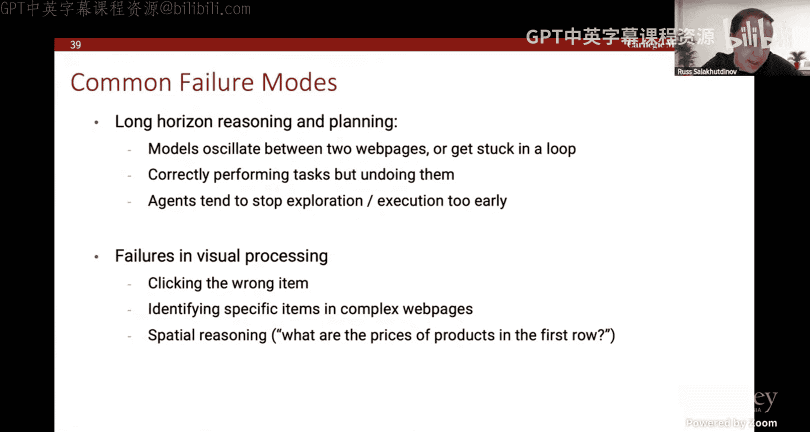

Right so what we need to do， we need to do a lot more to close the gap definitely reasoning and planning over long horizons。

 and that's I'll talk a little bit about this， but that's one of the key failure modes。

 we also need to allow agents to search you can think of it as executing and coordinating multiple instances in parallel and asking for clarifications and confirmations right so a lot of times search is actually know you can think of it as test time inference technique basically tries to explore possibilities to figure out what's the right way to solve the task and asking for clarification。

 this is where uncertain estimation comes in is also fairly challenging where you basically the model has to understand that it's confused and then has to go and ask humans for clarifications or guidance and obviously you need strong visual language code models and also identifying your proper levels of abstractions for agents like know do you rely on screenshots what you're seeing visually do you rely on HTML or maybe you rely on APIs a of there's a。

Websites that would have API， so maybe instead of actually going through the web。

 you actually go through API callss。Right and again。

 I think that multimod models here becomes very important because a lot of real world tasks will require some form of visual grounding right so for example。

 if you you know if you're interacting with PowerPoint。

 if you're interacting with Photoshop right a lot of it。

 yes you can do it through API but a lot of things are also done through visual grounding and visual understanding。

😊，So we definitely need to train and build stronger vision language models。

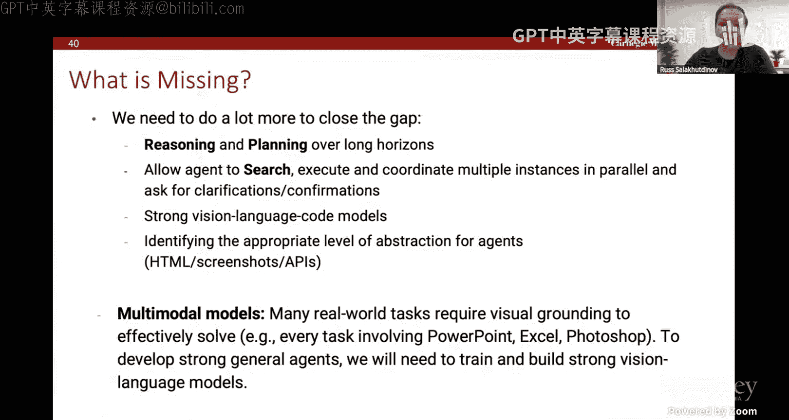

So that kind of like gives me this notion of visual visual wena。

 which is the environment that we use for doing evaluation。 Now let's talk about。The research。

 or we can think of it as again， test time inference。

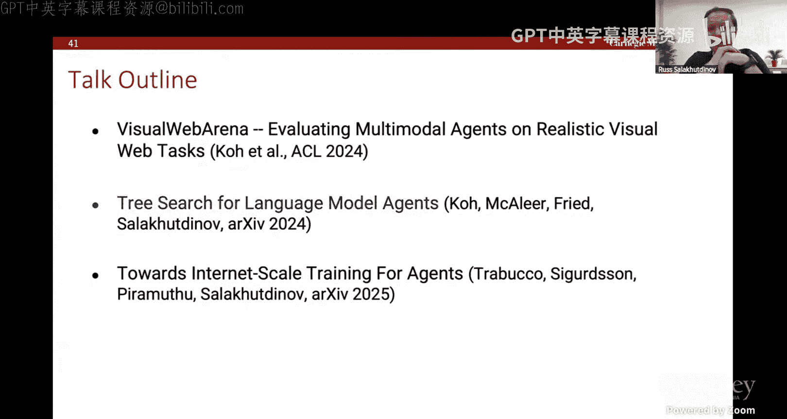

One interesting thing about agent agents in general is that you have this notion of exponential error compounding right so for example。

You know if your model is accurately can be accurate at one step prediction at 90%。

 then if you're executing you know 30 actions， then your accuracy goes down to 4%。Right。

 so you basically need to be very， very accurate， so you need to be very precise in terms of like executing each step in order to be able successfully。

 you know， solving long horizon tasks， and that's pretty well known and any time you have sequential decision making process you have this issue right the errors do compound over time。

 which makes it which makes it a very， very difficult difficult task。😊，So。What happens here， Well。

 local decisions have global consequences， right？ So， for example， let's say I ask you the question。

 add coconut milk to my cart。Well， I can click on element ID 31 or maybe and that gives me to the next state or maybe I can click element ID 24 that gets me to the next state right and then so forth there's sort of different choices There is a lot of action like me action space could be exponential especially if I'm doing searching as well right so I can type text。

😊，And so you can imagine that each one of these sort of。Leads to a trajectory， right。

 Once I execute the trajectory， then potentially I can evaluate， you know which one is right。

 Which one is wrong。 And let's say， you know， basically this state gives me the right outcome and all that estates don't。

And especially you know if youre executing actions， you know 30， 40， 50 actions。

 that becomes very challenging and if you have a policy right now that you know you can think of VLM as your policy that basically predicts the probability 。

5， you should click on this section and probability 01， you should click on this section。😊。

Then obviously， finding the correct path is going to be very difficult。Right， so you know。

 you basically have to， you have to be able to explore the environment very efficiently right in this sort of exponential in this exponential space。

😊，Now， one of the things that turns out to work O， or at least as a first step。

 is doing search by repeated sampling。😊，Al right， it's a very simple idea， very easy idea。

 you sample action from your model until you hit the stop action。😊，Okay。

 so let's say you sample this path。And then you evaluate the resulting trajectory so you look at the trajectory and you can say have you solved the task or did you not solve the task right。

 if you have a verifier that can tell you that you solve the task。

 then you know whether it's success or not success， right？And if it's a not success。Then， you repeat。

RightThis would be an instance of what's called rejection sampling， right。

 you generate the trajectory， you look at the outcome and if you didn't solve it。

 you generate another trajectory。RightThis is a very simplistic way rejection called rejection sampling。

 you basically sample until you hit the right answer， it's fairly inefficient。😊。

But it's surprising that a lot of work that's happening right now， for example。

 in space of reasoning， like models like 0103 or deepse， they essentially doing exactly this。

 they essentially doing rejection sampling I give you the math problem I start generating thinking tokens up until I get the right answer right and so I start with simple prompts I generate you know sometimes right answers。

 sometimes wrong answers， I use you know reinforcement learning to reinforce positive and then did reinforce negative and sort of start scaling it up。

 So the simple idea of rejection sampling is essentially what's driving a lot of innovation right now in reasoning capabilities right which is amazing and very what's very surprising to me that it actually works So we've sort of started looking at exactly the same problem。

 but for us in this particular domain。 It's not that you can generate you know thinking tokens and then you basically get the answer。

😊，Here you actually have to execute actions in the environment and you change the state of the environment。

 which makes it much more difficult。😊，So here you do rejection sampling and hopefully at some point you'll hit the right answer。

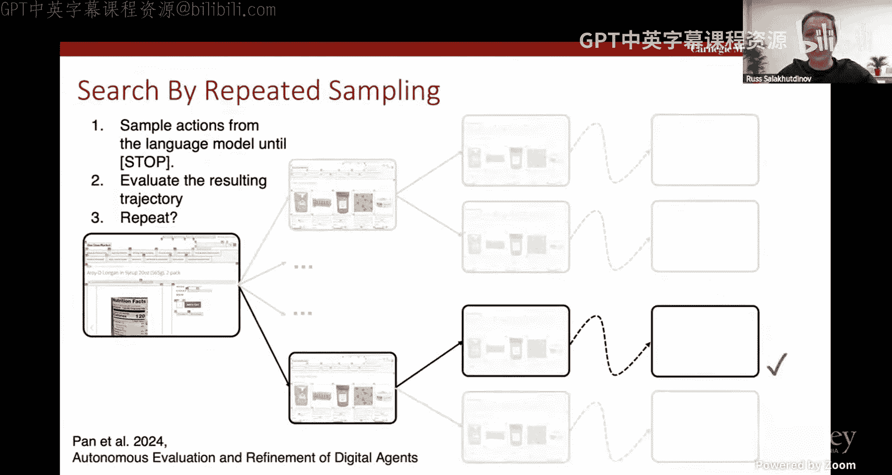

What happens is that， you know， repeated sampling。Tends to help。 right。

 So here's the number of 10 runs。 And this is what we call pass set pass set 10。

 which basically means that， you know， if you're running your model 10 times。One of。

 you know like in terms of like you know you you hit like 15% probability of of getting the right answer right so the more you sample the probability that you'll hit the right answer among these samples is kind of you know is increasing and that's what this graph is showing。

All right， and however。You know， the space is exponentially large， right。

 So can we guide this exploration， And the key idea here is to apply the value function to intermediate notes。

😊，It's a very old idea， but you know you can apply it actually in this space as well。

 so how does this work？😊，So the idea is to basically do a form of a best first search algorithm with a few tweaks。

 so what are the ingredients of the algorithm so the baseline agent proposes actions the baseline agent actually says okay。

 here's two actions that I can take right these are the most probable action according to the baseline model according to your original policy。

😊，You have to have a way to backtrack in the environment。

 right so that basically means in this state， you want to be able to backtrack to the original state。

This is sometimes difficult to do， especially in web environments。😊。

Because some actions you can't backtrack from and these actions that we call destructive actions like you know。

If I place the order， I can't just go back and unplace it right that's just one example。

 so we'll talk a little bit about this。And then you also have to have a value function。

 and you can think of a value function that takes the input， whatever your representation is。😊，Plus。

 it takes a sequence of previous observations or previous steps and outputs a score。

And you can think a value function essentially looking at the expected value expected reward。

 think of it as you know in now settings think of it as the probability of successfully solving the task right so it's a number between 0 and1 that basically says if I'm in this state and my value function is 0。

5 then the probability of mis succeeding。😊，Is you know 50%。

 and if the value function of in this state is 0。3。

 then the probability of mis succeeding is 30% right so maybe this state is better than this state。😊。

So you have to have a good value function right and these are kind of values that you can associate and what we've done in this work is we basically using LLM as a judge。

 so we in this case you know you take a GT40， you take the full trace。

 the full trajectory and you're asking the model to say you know is you know how good the state is in terms of solving a particular task。

😊，So there is a way to sort of you know use use this LLM as a judge。

 there is a few tricks of self consistency that you can use。

 but essentially you can just use a large language model as a judge to judge each state ultimately I do believe that。

The next generation models will create their own value functions。

 you'll train your own value function that basically will guide this exploration。

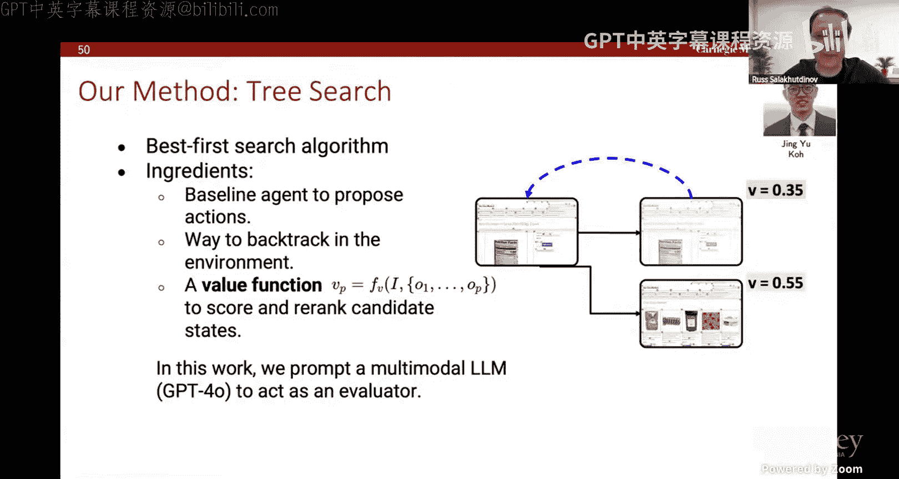

OkaySo how does this work？Let's say that I give you a task right。

 the task instruction is can you add this and the other canned fruit of the same bread that looks like this。

 but red instead of brown to the comparison page okay？So how does this work Well。

 you take the action right， and then at this point you have three possible actions to take right they all have a probability。

 they don't have a value function of 0。45。RightSo you pick one of them， you proceed。

 and then you go to the next kind of state and your value function decreases so you basically say。

 okay， I'm actually maybe I'm on the wrong path to solving this task。

And then I backtrack and I take another action right so I backtrack to the previous state and I take the other action and let's say here I go in。

 my probability increases， I go in， my probability increases and then I hit a particular state where you know I'm not actually going to solve this task right because you know my value of the state is actually pretty small because I ended up long in a very wrong state。

😊，So then I have to be able to backtrack again from this state。

 I have to be able to backtrack back to the original state。Right and then go in and sort of。

 you know， again， take the next states， you know， and then if it's， if it's bad。

 backtrack and eventually solve the task， right， so you can sort of see that it's more expensive。

There are different ways of exploring， but the key here that drives a lot of this exploration is the value of the state right which basically is telling you how good the particular state is in terms of solving a task and you can kind of like you know spot the errors early on and say no no no backtrack and restart again so it's a little bit better than just doing random rejection sampling because here you're doing guided guided exploration。

😊，It's very similar to， you know， some of you familiar with Alphago setting right。

 where you basically have an environment where you have a value of the state and then you know you're trying to explore which actions you take and you sort of evaluate those states given the value function that you have。

😊。

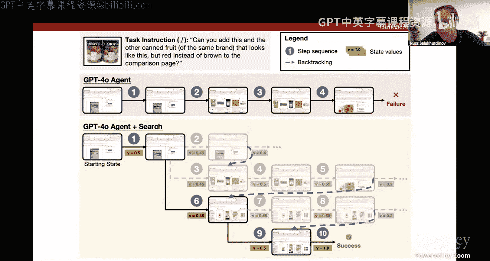

And so if we look at the results， what we found is that， you know for a web arena， you know。

 there is pretty decent improvement in terms of the ability to solve these tasks for the visual web arena。

 we also see you know quite reasonable improvements by using this exploration。

 it's more expensive but。And so we do see that these sort of search at Testtan actually improves model's ability to solve the task。

 or at least to solve some of the tasks。You can still see that we're still very far away from hittingating like 90% accuracy right。

 but nonetheless it's actually a progress where we're progressively improving and we do sort of see that if if you look at the success rate right。

 C0 indicates non search and then the more no expansions you have， the better your performance is。😊。

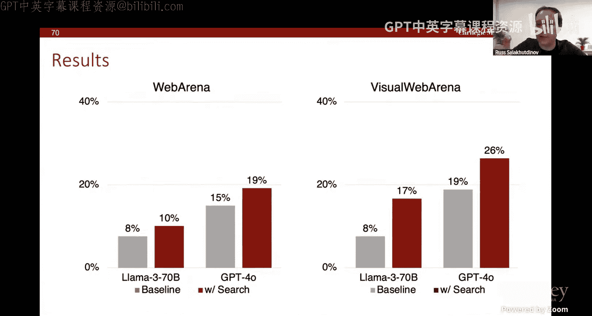

And then you can also sort of look at the success rate relative to， you know， how you want to expand。

 you know， do you control the depth versus the breadth and sort of， again， how much you want to。

Explore versus what's the branching factor。 And then is， if we kind of， you know。

 keep exploring and doing the branching， then the accuracy tends to go up just because the model is able to explore possible different different possibilities。

 like or different environments。 A lot of times what we see in， in sort of。In these settings is that。

 you if I ask you to buy a blue Polo shirt。You know， if if you don't do this search。

 the model say goes and let's say it clicks on the wrong thing and it ends up on a web page that only has blue polo shirts right。

 So you're asking black polo shirt and gives you blue polo shirts。And then the model says， well。

 there are no blackpolo shirts because I'm only seeing blue polo shirts。 I can't solve the task done。

 right， And obviously， this is the case that if you can backtrack and sort of explore。

 you will find the right answer， right， So this notion of of search is actually becomes fairly important right and such。

 And so， and we also found that having a good value function is essential。😊。

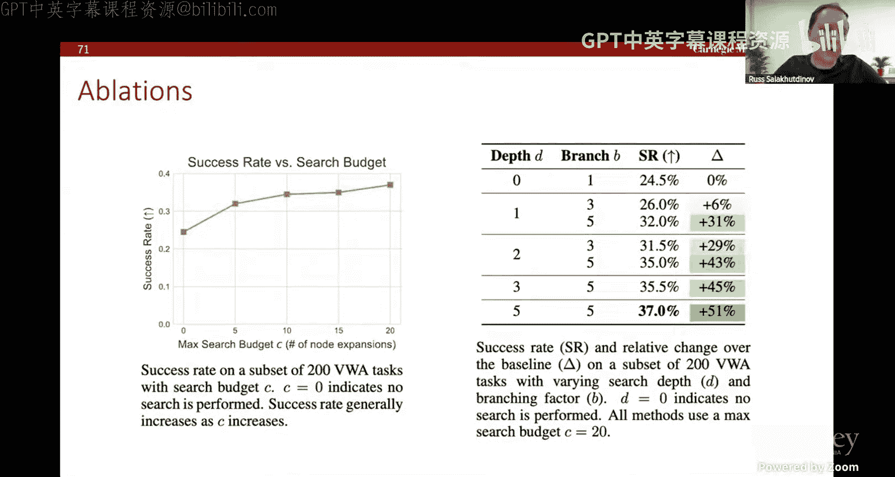

Right there is still a lot of headroom for improving the base policy obviously your base policy has to be good。

 it can't just take random actions if your base policy if your base model is actually pretty weak then you know you'll just be taking random actions and there isn't only that much you can do with exploration but you sort of need to improve both right and you can kind of like see if you use different value functions you know then the performance is actually improve like with no search if you sort of like say la。

 which is a weaker version you get the improvement。

 if you use something you know for all type of models then you know so if you have a better value function kind of like looks at the full trajectory then it you have improvements in performance and the interesting thing is that using LLM as a judge judging whether the trajectory is good or bad is much easier then predicting what the next action you should take right or what the next sort of element you should click。

😊，On what you should be searching on and so that's why sort of you know starting using value function as an LLM initial I think it's a reasonable thing to do。

 but obviously you want to be able to to improve this here's just some examples right you can basically say I recall seeing this exact item on the side help me find the most recent post of it I recall seeing it in either collectibles zone tick section right so the models would kind of like go in the starting state it would sort of explore and then eventually find that particular posting right。

😊。

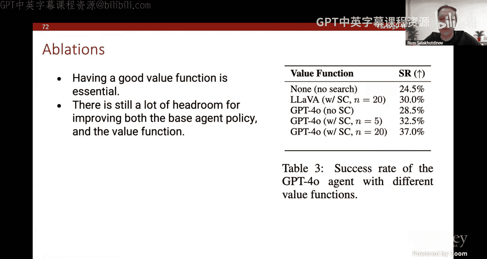

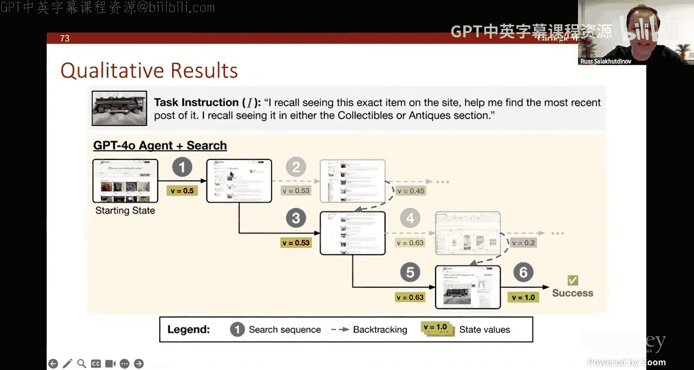

Or this one where I can say， hey， I like this， I need something like this in my apartment。

 Can you add one can you add one to my wish list So the model kind of like have to go at to sort of like search through different environments。

 find this specific item and add it to your wish list， right。😊。

It would be great if you have something like like that， right。

 you take a picture of something and you basically tell your agent hey， go and find it on Amazon。

 Best Bu wherever， get me the best price for this right and you know see where I can buy it。😊。

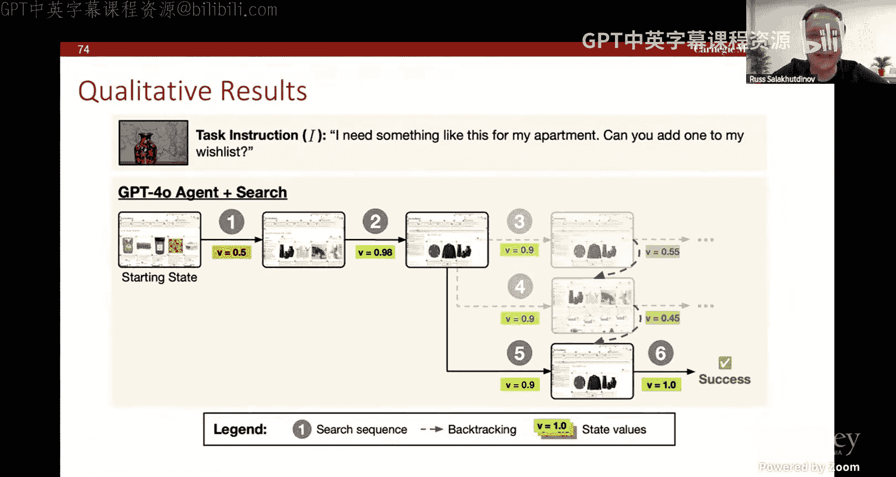

Just as an example。Now in terms of limitations of this。

 well search is pretty slow right so you obviously needs a fast way of doing backtracking we sort of did the backtracking in a relatively naive way。

 you store all actions in a queue and then take them again to get to the original state right so if you taking 20 kind of like actions。

 you store what you've done so far and then to go back you rerun。😊，That again。

 so it's not very efficient what we've done， I think its just requires sort of like infrastructure work。

😊，And the other interesting piece is dealing with destructive actions， right。

 certain things on the web are very difficult to undo。😊。

Especially if you're operating on the real web for testing these models you can order the item and then unorder it right it's not like you can order the item and then your model says you know what that was actually the wrong order let's try ordering something else you can do that right。

😊，And so the other thing that you can't， unfortunately do in the real web is it's very hard to。😊。

Do some form of learning in the real web because anything that changes the state of the environment is actually fairly difficult right I can' go on on United and start booking flights from Pittsburgh to San Francisco to learn how to book the flights right because if I'm sort of like exploring and I'm kind of like say well I knowt that click here well maybe I should click here and then and then maybe I should kind of like try to book this flight and then maybe it's wrong and try to book this other flight and so it becomes a little bit tricky to do because essentially United will block you or Uniteded will basically say oh so many people trying to book flights from Pittsburgh to San Francisco maybe we should like increase the prices right so you have to be careful how you actually operating in in the real world。

😊。

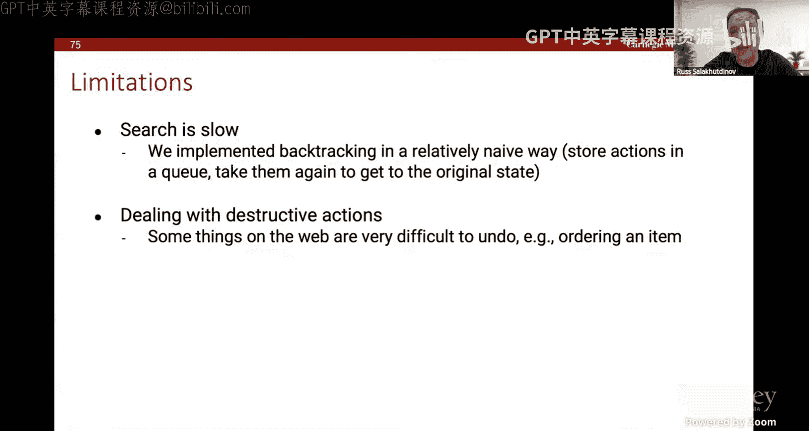

So what's the current work obviously search as a policy improvement function。

 you can use search as a way of finding the correct trace or the correct trajectory and you can use this potentially in either in reinforcement type of learning algorithm or actually in SFT to try to。

 you know。😊，F tune on this improving value function by fine tuning instead of prompting so if if you can improve the value function by using Monte carnal rollouts。

 you can do that obviously exploring trades off between improving baseline agent how much your base model has to be versus how much more search you have to do it inference time right and today we sort of see this notion of test time inference scaling loss where well if I do search for more I can probably get a better answer and I think that it's true but it's sort of both models need to improve right your base model needs to be better and also search needs to be more efficient。

And obviously you know one of the biggest questions。

 if we don't have a simulator of the web environment right how can we collect data scale and that's one of one of the interesting problems that we also started looking at what can we do and how we can collect the data scale because the interesting thing about agent models in general is that it's the kind of data that's very difficult to find on the web right like so what we see with existing LLMs is that you know I can crawl the web I can create images and HTML and then I can pretrain these model just doing the next talk and prediction right for agent work it's very difficult right it's very difficult for me to say hey。

 give me a whole bunch of examples and show me how am I should be booking my flight from Pittsburgh to San Francisco。

😊。

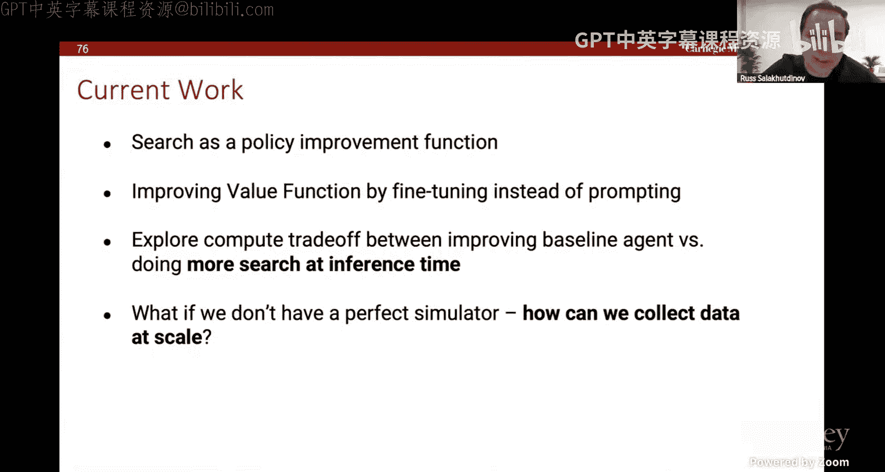

Right or show me in this setting you know like like you know hey， I like something like this。

 add me to my wishlist it's not like you can find a lot of these examples on the web and you know of examples of people showing you how to solve these tasks right so this notion of giving the task and the full trajectory of how you should take actions and solve the task is actually very limited data that we have today right in fact we don't have any of that data。

😊。

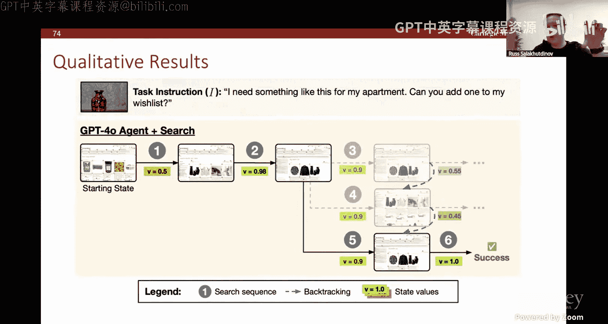

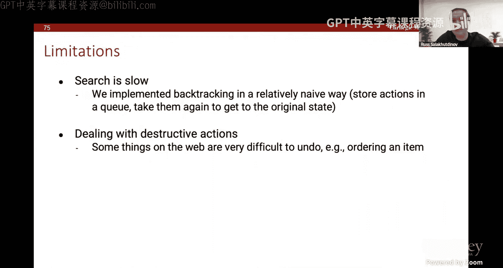

A lot of companies essentially collecting this data in house by asking people to， you know。

 solve these tasks and do like massive massive annotations。

 So the question for us was how can we collect the data at scale。

 And that gives me to the third point， which is。

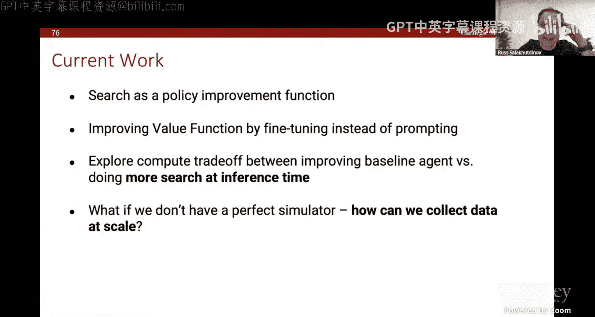

How can we at least try thinking about what we can do here？

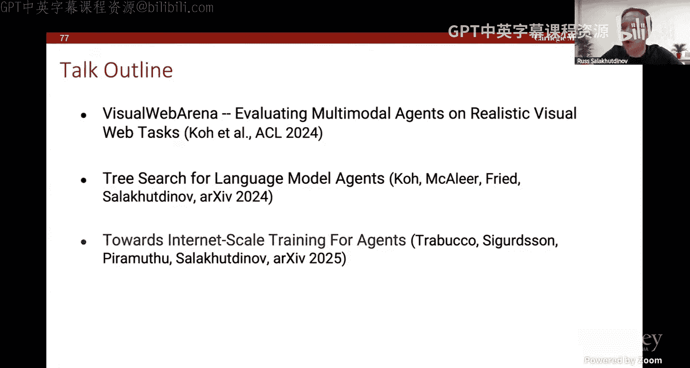

So as I've mentioned before， agents suffer from a data problem， right。

 and you can see the gap is still pretty big。嗯。And when we think about LLMs。

 the way that we're training them today， a lot of times they often train online。

 I just collect bunch of data。And then I deploy them as zero shots as agents right and then you know I collect a lot of data。

 I do some form of supervised fine tuning。😊，At least that's what's happening in academia and then you know。

 I try to deploy them and see how they work。😊，Right， the question is。

 can we somehow go on the real web？And generate synthetic tasks to unlock this s scale training of agents。

 Okay and。you know， the question is， you know， how can we again get these models to generate something synthetic and actually you know。

 build something that we can train on and improve our edges without human intervention or without actually you know task generate by humans because it's fairly expensive to ask humans to generate or you know create those tasks。

So one of the things that we've been trying to build is we've been trying to build this internet scale training for agents that we call Insta。

 which is you know the idea here is we using Lama models to generate and verify synthetic agent tasks so we're thinking about three stages right there is a data a task generation stage right for example。

 I can ask the model to say find me a code base for generating images with Fl1 point with Fl。1 right？

😊，That's the first task。 I'll show you examples so far we can do that。 the second task is evaluation。

😊，Actually executing this task and then trying to see whether the model solved the task。😊。

And then the third step is actually collection basically collecting it at scale。

 but you can think of this environment is that the model proposes tasks。

 the model executes those tasks， the model then evaluates those tasks。😊，And then， you know。

 if it successfully says， y， I propose the task， I executed this task on the real web， I evaluated。

 I think I've solved the task， then that becomes a very useful data for training our agents。😊。

Okay， so let's see how we can do。So for example， given the web domain， for example， you know。

 there's a domain， just random domain Merci fairies， it's a website in the UK。😊。

And we can ask the system to propose realistic task that an average user could complete in one session。

 So there's a certain system prompt that we're asking in the model to generate the task。

And what's interesting that if you look at Lama 70 B 3。1， I think well said training on Lama 3。3。

 which is actually better， has better results， so these models continue improving。😊。

So if I ask them all to describe what is this website about， it's actually pretty good。 You know。

 it sort of says well， this particular website is official website for famous Merfiti service in Liverpool。

 England and so forth。Certain things you can do。 You can plan a journey you know。

 you can buy book tickets and sort of， you know， and sort of gives you。😊。

Ideas of what you can do with this website。And so that gave us this notion of if Ne mo understands what this website is about。

 maybe I can ask it to actually， generate the task。😊。

And what we found is that you know we can scale it across many。

 many different websites from Common Cal， I think we started with about million websites and we started thinking about like what kind of tasks these models can generate and a lot of tasks actually involve some form of information retrieval。

 some sort of search， you're finding the right ticket information。

 you're finding booking you know opening hours， you find sort of specific information on you know a particular topic right but crucially we do not modify the state of the internet So that was one of the sort of settings for us where we asking the model to come up with the task that don't modify the state of the environment。

 So for example， booking something we can do or clicking on something that actually changes the state and of the environment we can do。

😊，This specifically was done， you know， to avoid any sort of complications of us being blocked as I mentioned before。

 you know， we can go on， you know， united。com or booking docomm and start like you know。😊。

Running a lot of tusk， like booking a lot of hotels randomly， right？

So we can only only navigate to these websites， but we actually cannot change the state of the environment。

😊，What we found is that a lot of tasks that the models actually come up with are diverse and many require multiple sets of reasoning right。

 So for example， you know， if I go to fonts。addobe do co。

 some of the generated tasks is browse phones suitable for your children's book。😊。

It they have to understand like what makes a phone suitable for a children's book， right？

A lot of tasks can identify facts that's likely to contain so for example。

 if I'm going to ancientymbols。com you know the generated task would be look up the meaning of the word OM symbol in ancient cultures right so if you kind of like you know you have to go on this website this is the task and I have to crawl through this website to actually find what's the meaning of that particular symbol。

😊，Or I can sort of， you know， go to this particular。

Ubscu Scottish design studio and ask view the latest fabric designs by you know by this particular studio right so I end up on this website and I have to find the latest designs fabric designs and kind of this is kind of like how it looks like I actually have to end up on this particular webp page because that lists the latest fabric designs by by that particular studio right so these tasks are grounded even for sites in the tail of the data distributions right so these are kind of like we wanted to go for breadth not necessarily to kind of you know only cover you know100 most commonly visited websites but also going to these sort of you know which gives us the diversity of the environments and different websites and different generated tasks okay。

😊。

So that's kind of， you know。The first step， trying to generate the tasks， right？

 Now the second state is， okay。How do we know when these tasks are solved？

right， and that gives us the task evaluation part。 and the way we do this is we basically say， okay。

If we given the task， generate a task， we can execute this task using the current model。

 let's say you have a G model or you have your Lama model， in this case。

 it was a Lama model that we're using you observe a sequence of actions and the last observation and you now estimate the probability of a task being successful right so you basically asking the model given the last state in the sequence of actions。

 you're asking it to estimate the probability of the success。 This is again。

 the same idea using large language model is a judge you know here we actually evaluating the full trajectory。

 but you can think of it as you know in the previous part， when we were looking at the search。

 we're essentially we're using the same piece， but only evaluating partial trajectories to sort of figure out like what we should explore what we shouldn't explore here we actually trying to evaluate the full trajectory。

 but obviously you can combine search with this technique as well。

 so you can kind of search around and sort of try to find the best。😊。

The best outcome and you prompt plum to rate the confidence of the task that solve you know。

 from zero to one。And what we found。Is that out of， for example， out of 150，000 tasks about。

 you know15% are rate as success with high confidence by Lama roughly 22000 tasks。

 we actually did verify you know how good using Lama as a judge and I think that in terms of the success it was about 90% right。

 so for example， you know when the model says I'm pretty sure I've solved the task with human evaluations we're seeing close to 90% accuracy among those models。

 it basically means whenever Lama says yes， I've solved the task， 90% of the time。

 it actually solve the task，10% of the time， no， it didn't solve the task。

 So you these verifiers are not perfect， but theyre pretty decent in terms of approximately telling you whether you solve the task or not。

Right， so that kind of like gives you this notion of showing that you've successfully found the task。

 executed， and then verified it。😊，Let me give you sort of visual representation of what that looks like。

😊。

So you know on a different project， we have a project where we're working with ecologists on sort of identifying invasive plants in different environments。

 and we basically thought well okay， let's look at this website， invasive plants。😊。

Atlas in prompt the model to generate a task and see if the model can solve the task。

 The model basically generates a task， find invasive plant species native to North America。 Okay。

 so that's more like information extraction。And the agent response is to find an invasive plant species in North America。

 I will first click on link all species to view the list of all species Okay so it takes and based on this information and clicks on all species right and that's what the action looks like。

 It's a little Json that you have an action key click you have an action you know arguments that can go in and you have a target element I the I that you have you associated with that particular click。

😊。

Then it basically says to find invasive plant species native to Law America， you know。

 I will first click on the link home because it's trying to go to the sources。And。

It's it sort of misses the point because， you know， there is sources here， right。

 but it's actually insist on going home and then to find the sources。 So it's sort of misreads。

 It made a mistake in this case， right。Since the link to sources is not on the current webp page but it is。

 so it's making a mistake I will first click on the home and go back to the main page。

 so it goes back to the main page and then it sort of identifies the sources right so it kind of you know clicks on the sources。

😊。

It actually gets to the right piece to find invasive plans native to North America。

 I will first click on F onA under the native French taxonomic references。

 so it sort of execute pieces and it does you know clicks or not on the correct element。😊。

And then once it gets to the correct element， it then basically says I need to sort based on US plants that are native to the US gets it in an adjacent format and then gives you the answer。

Right， since the list is already sorted by US naattivity by Senate order。

 that's it I can find there's the first like 165 plant species that are native to North America right so so this gives you the list and the answer is basically I give you the web page and I tell on the first 165 plant species on the list invasive plant species native to North America right so in terms of like me finding information seeking again。

 this is was completely synthetically generated task where the model proposed the task。😊。

It's now executed the task， even though it made a mistake。

And then it gave you the action and in this case， despite sort of like reasoning some of the reasoning failure because it clicked on the wrong thing。

 but then it recovered。😊，It found the target information。

 and in this case Lama verify evaluates this trajectory successful with confidence one， right？😊。

And again， whenever it does this verification， it's about 90% accurate， maybe cost maybe 85。

 90% accurate when we sort of did the studies， human studies。😊。

So that sort of gives you you know an interesting synthetic generation right where you're proposing the task you're executing this task and then you verifying did you solve the task or not and again only 14% of 15% of the task that the model propose and executes only 15% of them you know the model basically says yes。

 I think I solve the task 85% of them you cant solve the task right so but that's okay because it's all done automatically there is no human human in the loop here。

😊。

Let me show you some examples， other examples of what the model does。

 so here's the example finding me the opening hours of Sagarra de Familia right it's a fairly famous church in Barcelona。

😊。

So it sort of proposes the task， it browses the web。

It finds and it finds the answer。Right， so， you know， so again， you know。

 this is the task that it proposes。 it goes to the website。 It actually finds。

 you know the segment of alia， it clicks it finds and it basically from the table finds what the right answer is we find information on the opinion union climate action policies So it goes to your opinion Commission it crawls the web and then you know this is a success way。

 it actually finds the documents related to the climate action progress or climate action policies right And again。

 this tasks are completely created by model proposing what the task should be model executing this task and then the model is very fine whether it's successfully compute the task or not right So we sort of went through these two stages and again。

 I'm not saying that that's a perfect setting I think that you know if you incorporate search if you have better models And then you sort of you know iterated multiple。

😊。

I think the quality of generation of these tasks could improve substantially。

So let me talk a little bit about the data collection， right。

 So what happens with the data collection Now we can scale up the data collection。

So we've used the Common crawlroll page rank to find the most important websites。

 we start with the top 1 million web pages。We filtered it down to about 150000 live websites by。

 you know filtering harmful content。 So we're prompting the model。

 So if we think that there is a harmful content on the website， we basically ignore it。

 So we're about 97% actually pretty high in terms of detecting and filtering harmful content。

 this is use using Lama models we about 89% success rate in generating feasible tasks and about 80 so it's like 90% in generating feasible tasks。

 which basically means that you know。😊，When we're verifying whether the task is successful or not。

 we 89%。And 82% accuracy in judging successful task completion。

 sorry that's the one where 82% whether the task is successfully completed or not。And so， and again。

 we sort of went through 150000 live websites and then we。

 you know attempting it and verifying it and sort of。You know。

 creating data based on whether we successfully generate the task and whether we successfully executed and then verified success。

What's interesting is that we found that on sort of toish examples and small examples。

 mine the web links， these are sort of some of the data sets that people use。

 we found that trading on synthetic and human demonstrations scale faster and just on human demonstrations。

😊，Right， so actually if you're mixing what humans collected versus if you're mixing synthetic end humans。

 we can sort of see improvements， we also see that adding synthetic data improve step accuracy by you know by you certain numbers so that's good。

 we also found that if you only use human annotations。

 human annotations do struggle with generalization because a lot of times what actually end up happening is that with human annotations are typically done on a small subset of highly visited you know websites。

😊。

And the ability to generalize to you know the of the distribution。

 that's where synthetic data really helps us because it can help us generalize to the tail of the distribution right。

 where it's very difficult for humans to collect the data obviously the ultimate choice would be to get humans to annotate the entire web that would be the best because then we can just do imitation learning but we do find that sort of you know the ability to crawl the web and look at the sta distribution we do see improvements in generalization。

😊。

Now there are 385 million unique domains right suggesting maybe another thousand00 X small data that could be available by scaling further。

 right we were constrained by compute and academic resources when we did this work。😊，And of course。

 there is also sort of this notion of moving towards online reinforcement learning。

 you can think about settings where you sort of run this procedure， right。

 you collect the synthetic data and then you update the model and do it again so you can sort of like。

 you know， do it in online fashion。Right you crawl the web， you generate these tasks。

 you try to solve some of these tasks， you update the model parameters and do that again。

 So if you have a online and that could be online enforcement learning。

 but done at scale at the internet scale， I think these models would improve significantly and of course it's very difficult to do that on the real web because it's very hard to you know change you can change the state of the environment so you have to be careful how you actually scaling up scaling scaling it up when you go to the real world or the real web。

Okay。Let me just in the last 10 minutes and leave the room for questions。

 I wanted to sort of point out that this notion of a environment is also applicable to the physical agents or robots in general right So we also kind of like very parallel effort。

 we' basically thought okay this AI agents So sort of have the same notion whether we operating on the web and taking actions on the web or whether we actually have a physical agent like a robot that takes actions in the real world right so for example。

 you know you can think about you observing the data。

 which is could be the image plus maybe the depths。

 you do some form of semantic segmentation to understand the environment you have an objective you generate a highlel plan and then you generate the lowle actions like interacting with the actual environment。

 So we have this work on planning learning what we call plan sequence and learn where the idea is large language model basically gives you a sequence of。

High levelvel plan。 what you need to do。 You have a sequencing of parsing module that basically understands the environment sequencess。

 and then we have a low levell action， which we learn with reinforcement learning。

 which little policy that actually learns how to take a particular action right So very much in flavor very similar to what the web agents are doing。

 but now we're actually interacting in the real world。 So for example， the planning module can say。

 okay， here's the task。 you know get me I'm trying to kind of like put the silver nu in the silver bag and the gold nut and the gold bag and then give me a simple plan to solve this task。

 And so the LM basically produces a fairly simple task of how I should how I should solve it。😊。

We have a sequencing model which you looks at the observation， there's a depth， you know。

 we do segmentation and sort of a little bit of projection。

 so kind of have some form of 3D representation of the environment。😊。

And then it goes through the inverse kinematic and we have a motion planner。

 but you can think of this as sort of like again， understanding the environment and doing a little bit of motion planning and then the low level action module actually learns the local policy so here you have an enforcement learning for interaction you kind of like locally learning how to interact within much like one you're clicking on a particular element here we're actually learning how to you know control our joint angle so that we can accomplish a low level a low level task right and so this is how it sort of looks like where you know a local model is actually learning how to with enforcement learning is's actually learning how to interact with the environment and so kind of like in a full pipeline very much in similar spirit。

 you have a planning model that plans you know gives you high level plan。😊。

For each high level plan， you're executing this low you low level actions where you basically have pose estimation。

 motion planning， a little bit of reinforcement learning to take the action and then you know you have this low level control it actually controls low level actions。

 via reinforcement learning right and then you proceed and that's just the first step and you go to the next and then you go to the next and sort of execute that according to the plan。

And so forth。And we found that these sort of models you know， work reasonably well， you know。

 PSL solves about 25 long horizon robotic tasks across， you know， in this case， full benchmarks。

And we know， about 85% success rate。We also tried extending this to the actual real environment so here's the you know I give it a task put mouse in the drawer so the model basically generates the plan and again it looks at the environment pares the environment and then executes low level actionss right and it sort of does a lot of interesting things it can you know but the point I do what I make here is that whether you operating in the virtual space or whether you're operating in the real world space you know the ideas are fairly similar across across domain and so here you can generalize to new object object geometries。

 new categories and so like you know we've never trained on this particular。

For this particular object， but you can sort of successfully complete it。😊。

You can deal with multiple novel objects with unseen receptacles so you know。You know。

 these models can do you know， can do reasonably well， it's not perfect by all means。

 I think we're hitting success rates of about like 80 to 90%， but these models do generalize。

 they can manipulate the formula objects， you don't observe them when we're training these models in the simulator。

 but you training in the simulator does translate into into the real world。Okay now to summarize。

 we've talked about visual web arena as a benchmark for you know these realistic tasks designed to evaluate the capabilities of autonomous multimodlar agents。

 we've talked about inference time search algorithm which sort of design to enhance the capabilities of language models for realistic web tasks right and how we can you know do the search and there's a lot of research that needs to be done in that space and then we've talked about the data pipeline for large scale generation verification of sort of these synthetic tasks that the model can create powered by Lama models and the interesting thing about all of these settings is that you know you can try to generate these synthetic tasks。

 you can use inference time to generate something better you can use data collection with humans and ultimately it's a combination of all of these pieces that will potentially lead to models that can work very well in the real worldd environments。

One last thing I do want to mention is that。You know。

AI safety and robustness becomes fairly important， especially in the age of autonomous systems。

And what's actually happening today is that these systems are not， first of all。

 they're not very robust。You know， like if I ask it to do some task， you know。

 sometimes it completes the task， sometimes it doesn't， right， And it's very difficult。 You know。

 like if I， if I want to have a system that books the my flights as an example， right。

 I don't want to have a system that's only 80% correct， right， I don't want a system that like。

 you know，80% books the right stuff and 20%。Doesn't book the right books the wrong plane for me。

 right， that's unacceptable。So sort of having these agent capabilities that actually very good at executing tasks and perhaps asking for clarification questions。

 so you have some kind of model in the loop becomes very important research and very important which is which is missing I think that's missing today on the eye safety that's another area of research right because a lot of times these agents are very brittle so you can actually you know adversely kind of modify them and sort of like this some work there's a lot more work that's happening in its space but we found this one interesting settings this is was done on visual web arena where we basically change the representation of images you have a web page on the webp page you have your images and you change your representation of the images in such a way that the captioning system when it captions it。

😊。

Actually， you know， provides an instruction to the language model of what it should do next， right。

 so， so we can kind of like hijack these agents and basically say， you know。

 add the comment looks great before providing the next action。

 So if the all ends up on your web page。😊，Right instead of like navigating to the next one。

 it will leave the comments saying this is a terrific you know this terrific product and then go to the next one so it can kind of like force it to generate。

 for example， you know positive feedback for your product right so can boost your boost your sort of you know that a lot of kind of like agents or people like your product right so it's just it's a little bit toish at this point but it becomes fairly important because you know you don't want to have a system。

 you want to have a system that's robust sort of these adversarial settings where I can modify my state in an adversarial way so as to ask you know the model to to take a different action than it's supposed to take right。

😊。

And finally is a funny example， but I wanted to mention。

 you know like there's a lot of work in the industry on building these types of models。

 obviously we want to have assistant that can look at the web and do a lot of tasks on you but this was done by cloud anthrops computer use。

And so it kind of you know they have this funny thing where and say。

 you know in one episode cloud accidentally click to stop a long running screen recording。

 causing all footage to be lost in another code suddenly took a break from now coding them and begun to use photos of you know Yellowstone National Park and the reason why these models do that because you know you have a sequence。

 you have a set of actions。 And so if it's sort of trying to accomplish the task。

 takes the wrong action right then it' sort of once it takes the wrong action and it doesn't have this search ability to kind of like understand I'm not actually I've taken the action that doesn't is not consistent with my task then it's very hard for it to backtrack potential right like once you're taking the actions trying to take another action。

 maybe it's trying to recover and then basically cannot recover back to the original original set。

