# UCB《高级大语言模型智能体｜CS 194 294-280 (Advanced LLM Agents) 2025》中英字幕 - P7：Lecture 7, Caiming Xiong.zh_en - GPT中英字幕课程资源 - BV1mkZiYAEYM

Hello everyone。 I'm Ta X。 I'm very glad to get the invite to present this multimod agent areas。

 I saw you already listened the the exact same area。

 multimod agent last week hopefully I would bring something new in this direction， So first。

 I want to show this plot to everyone。😊。

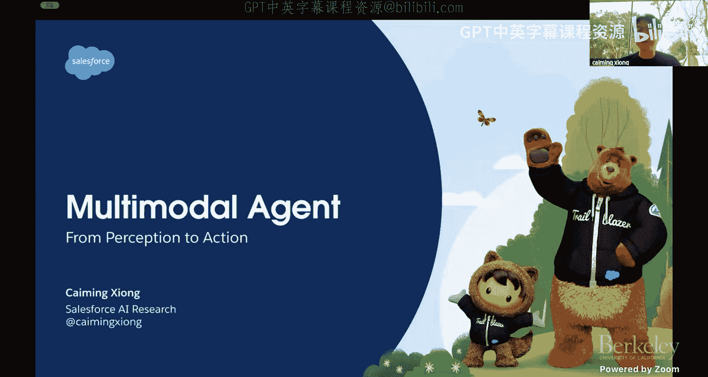

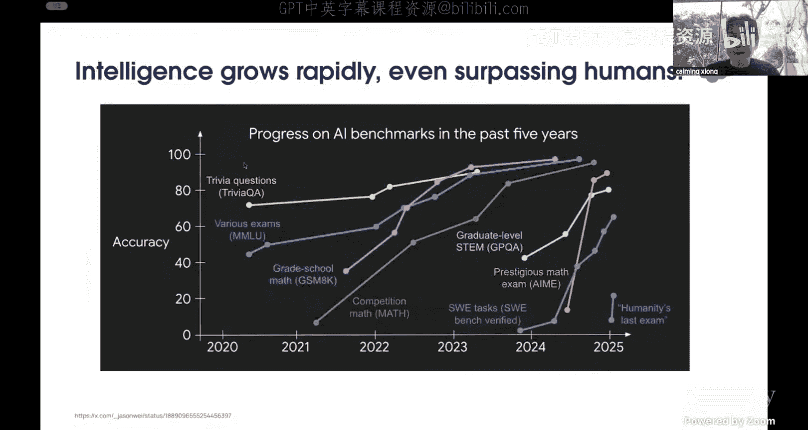

So how， you can see how crazy it is right in the past for five years。😊。

Almost all the benchmarks get saturated。And now we have the last one， which is the this。

The the one that proposed this year the human last exam seems like when we saw this one。

 they solve the AGR。啊I'm not sure about the we can solve it。This year。

 but I I believe well have a better， much better result for this data set with benchmarks by end of this year。

😊，O， since we have。So much the powerful frontier foundation models。

Then what we should do on those models， how we could leverage them to make our world make our society better。

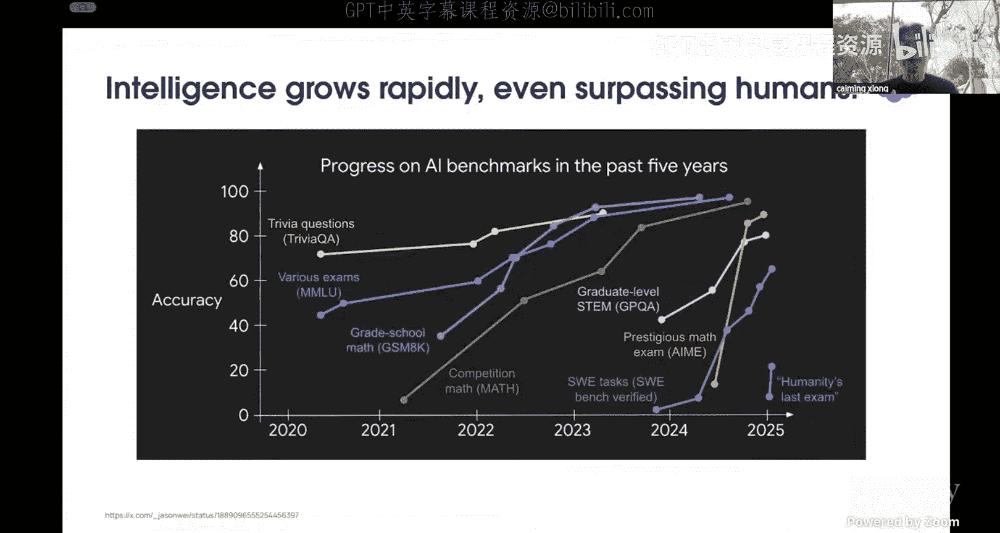

I think the answer is agent。We believe the multimod AI agent is the next generation of applications。

W。It's because。We want agent not just reading text。We want the agent can hear， can see， can speak。

Confuse even。 And we want agents that to process a task， like a human。That。

Because most of the task when we。It will I when we do in computer。

They involve multiple apps interfaces。So powered with those the new advanced the the。

Language model or the large condition model， which is vision language action models。It could make了。

The digital interactions， more accessible， more automated， and increase the。Humans productivity。

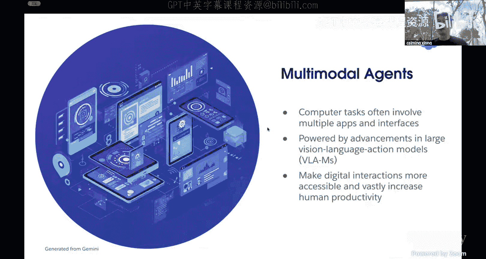

So okay， so what the status of the multimod agent。好快啲。Actually， it's not far away。

We already see a lot of the multimod agents be used in the real world or。

Or some of them is using will， like I say， some of them in the in the still in the research。Like。

 for example， the coding agent， I think some of you。

 maybe lots of you are using the the coding assistant or agent products like the cursor Ra or Darwin。

In your daily work or research。And those agents is not only that can accept the code text。

 they also can let you to upload the images， and they could to generate the code or fix your bug through the images you send。

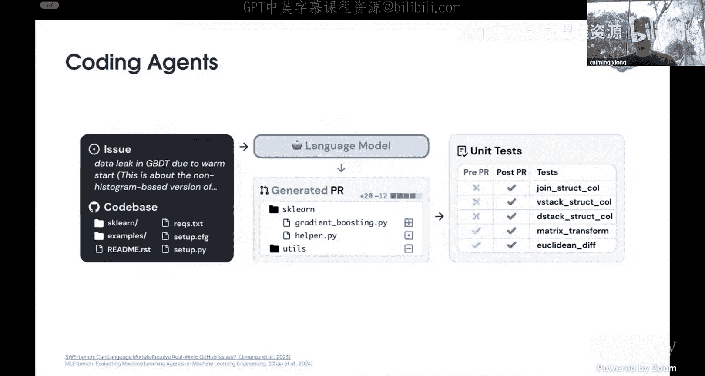

Weap agents。The Web agent is also a market model agent。That。

The agent could help you help you could automate some control in your browser or apps。

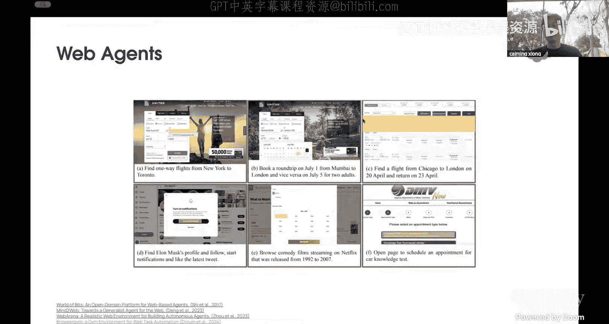

Same as the mobile agents。

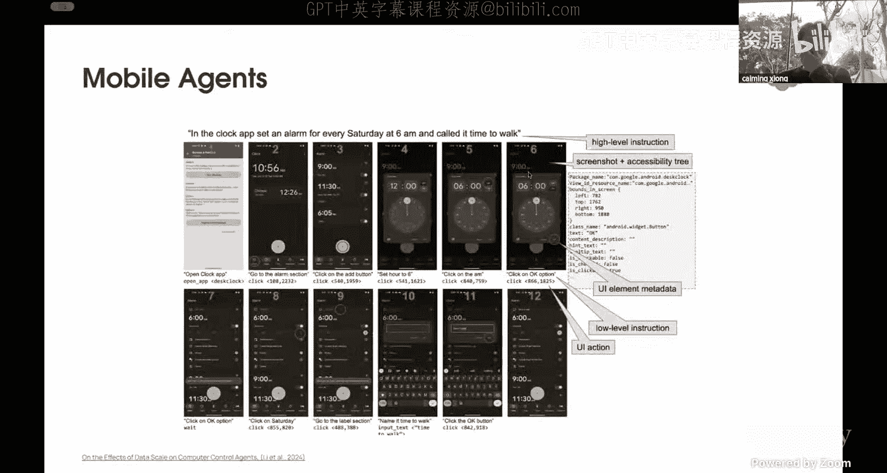

And the even physical agent。Super amazing， right。But this is a a。Robot called Alex from figure AI。

It's not just show you interact with a single robot。

 even they could let robot and robot collaborate together。

Throughlue the power for the these foundation models。So all of agents。Some of in production。

 some of is still research， some of it' a time of stage。

And I believe we are going to have more and more this type of applied use cases。Of multimod agents。

So then question is。How are we going to develop them？And what is important。

 what is the challenge for developing those multimod agents。And what is the important component。

 What we should focus on。

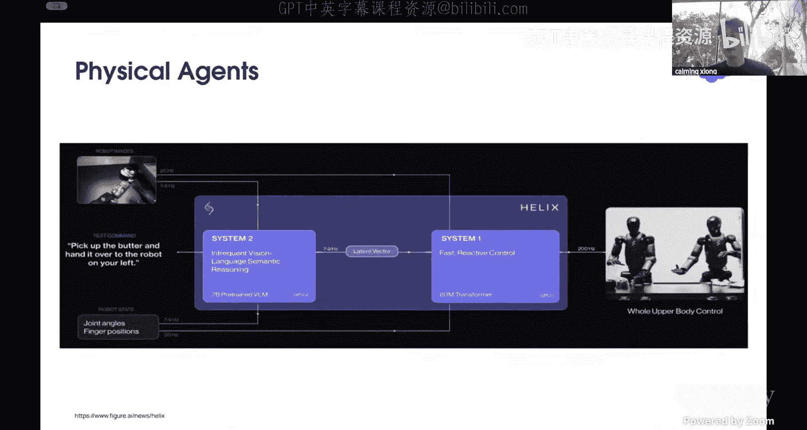

Soli today's agenda。I will talk about the multimod agents from least three areas。

 First is development benchmark。We need an interactive environment。

 we need this environment can be more re configable， expandable。

 not just static benchmarks for multimod age。😊，为你的data。How we get data。To check our multimod agent。

The third one。Whats the model we should to build on。We interact with computers every day。

Id use that to perform a lot of different tasks， including那个 web browsing。

 editing some personal videos。呃，买了就我发哦，不上 life。Or do en coding to to implement some software software。

And follows tasks。They are not just we are if not for those tasks。

 if not just interact with a single app。It is a workflow that will involve multiple applications。😡。

through诶故意屙小艾。And with multimodal agents。It could it have a big potential that can help us to。

Revolutionalize this interaction between us as this computer environment。

The agent can follow our high level natural language instruction。And to automatically。

 to do those interactions。For example， in this image。In this in this size。It's a tough call。

Update the bookkeeping sheet with my recent transactions over the past few days in the provided folder。

It is a very important task。For this type of task， I think everyone would like to have an agent to help them process those tasks。

要衣服 them么吧。However， to build those agents， you， you need。How can you trust those agents？

We need to have a benchmark。Though currently， there is a major challenge。In develop片老。

Marinmodel agent。But we don't have a benchmark。That is depends on the real interactive environment。

That that this， this environment can cover。The more diverse and complex， the real world。

 the computer use。The scenarios。And also can support the different operating system interfaces， apps。

So with this type of benchmark。After the agent passed that benchmark。

 we we can trust this agent for our daily use。到。Currently， we there have some。

 they already have some good benchmarks。But they are not have this property， I just mentioned。

Like个ment one。The mental web is a real good benchmark。

 they include a lot of good the kind of the real the testing， however。

 for each the test in the mental web it has only single demonstrations。

AWithout exccutable development。So the function from the rental web is。For each task。

 there is only single solution， which is not 200%。And with that benchmark， it would。

Long to to make a lonely。Donong make some we we would paralyze some alternative to correct solutions。

The Web arena is another good benchmark。 It is an excable development。😊，However。

 it simplified the observations and action space that it only cover very limit the task and applications or domains。

Like it only cover web navigations on a few websites。到咩嗯都咩。So in that one is a restricted。

The the testing in the the use cases for the agents。And also。

 it cannot use to evaluate the some open open mind tasks in the complex real world scenario。

that maybe they require some task require the navigating between the multiple different applications and interfaces in the open domain。

To a the gap。Between啊 the development。the the real the他 real world use case and the the model development the the development the model development呃 the the simulation environment。

So， we introduce the O word。This is the first the the scalable and the real computer environment。

For development and benchmarking of multi multimod agents。嗯。Why it is， I we say。

 it is a real computer environment。Its。And， and， and it could be used for the both development and benchmarking of the multi model agents。

那是。Because the O S word first， this environment allows the the free from the law。

 free from the keyboard， the most control of the。The real computer applications。And it's not the the。

 the， the fixed， the。The evaluation set。You could to configure。Your tasks。And execute those tasks。

Through入 at least in an。Through this in the active way。To this one。

 then you can use the O earth word。To evaluate some open ended computer tasks。

And with the arbitraryu applications， so it's not fake。

Maybe you can do range from different use case like software development。

 use case or the image editing use case。The o world can serve as。A unified and real world。

 real computer environment that。Allows the users。 So in three way。

 they can allow users to define the agent task。Deffin new agent task。Without to build。this new。

ADomeat particular simulation environment。So it's as an environment。

 the Earth's world is more flexible。😊，And and give the users more control。啊。

 for the the development design for their time for their for the scenarios they care。So， let's see。

How are we going to use the OS word to create。The different task。The first。For each task。

 you have a natural language task， an instruction for the task。So you see here， you have a task。

 You want to create this。Ting environment。Like updating this one is， I just mentioned this task。

 updating this bookke sheet。Adverive instruction。In the earthward。

 they provide the li state setup for this instruction。So the set up is it a file。 You。

 you just need to buy this file。InIn this file included multiple components。

The right part is you need to configure the initial tasks。啊。Like this Excel files means a task。

And also， you need to add， what is your post processing。诶。And those configurations。And also。

 where you can， you can to retrieve the filess and information in in the yellow part。

 And the last one is how you're going to evaluate。After you finish the task。In了意万个门。

After you configure your initial state， the setup。The earthword will initialize the this computer type。

 this development with a virtual machine。And in the virtual machine， they will initialize。

 so the initialization will will start run in this virtual machine。

 and you get the initial states of of the test development。那七八个 convenientient。So， for example。

At this moment， you could use this virtual machine to restore the task。Again and again。

 just to reuse this virtual machine。啊。And because of we use this virtual machine， so it's a safe。

 isolated environment， we don' need to worry about some damage in irreversible the damages when into testing。

So when the task environment gets set up。Then you can start to to run your agent to interact with this environment。

For example， you can use TP24 way to create an agent。Andre they interact with this environment？

Or you can use any other open source model build agent。

The agent will receive or observe different information that can be provided by the environment。

First， of course， is the user query， the natural language instruction from user。

And also it can to receive the observations from the development such as the screenshot。

Look accessibility tree。Under some customized the streams， maybe the terminal outputs。

So in so here is an example like the left side is a it's called a set of mask。

 which is a screenshot plus plus the the the the information you extract from accessibility tree that you can add those the label like in the。

In the image so it make the they can provide more information or job screenshot。And also。

 the left right side is is the dormitory。It a accessibility tree， but course website is a dorm treee。

So after the agent receive those observations， of course。

 you not feel like every agent needs all the observations， it depends your agent。

 if you are vision based agent， maybe only use the screenshot or SOM。If it's a tax based agent。

 maybe you only use accessibility tree。 It depends on what agent youre。

 you're going to build or to interact with your environment。So after you receive those observations。

 the agent will do。It depends how you pay agent， but the agent finally will generate some excable actions。

Like you click some position or you will drag some， some content， drag some box。I think个退。At the。

M let to manipulate the keyboard and， and mouse。And then each of those actions will be。

P represented you it's a cold string。And generated by the agent。And then the development。

 the simulator will execute those the cold strings in the virtual machine。

 and you will get then you will get the new observations。

The OS word we are using the the the pi auto GF3 to control the mouse and keyboard。啊This is well。

We used the library。So between the， So this is， this interaction loop will will continue based on the the your instruction it will repeat。

Multiple steps until are it terminated。 Maybe its done or fail or it。嗯嗯。

It's reached the maximum number of steps you set。In our experiments， with that its the 15 and 150。

So after you you so now you you can， you can you can from you set up the task until you then you run your task and then after task you stop。

 you get a result， then you will do evaluation on your task in this environment in OS work。

In other words， it's different from other benchmarks。

 we implement this execution based the reward function。啊。So when呢 when呢 when when。

When the final step reach the goal， of course， they'll get a positive reward。

Or even partially a trip you get a some sum number between 01。 If not， it's totally failed。

 it will get0。Together this reward， we are not just use a the。Single the the evaluation metric。啊。都要。

So the here is to evaluate this the successful successful execution of those tasks。诶。We。

 we thinking there is no single way to evaluate。The the successful of fail。我 a task。

So we make this evaluation more open。What is open， So open means that you can construct。

The evaluation script by yourself in earth for development。Because some on task。

 you need to retrieval。他们 task让你做 my权。To to evaluate your task。

So we use this example via the evaluation。2。Design the evaluation matrix for task。

 So not just a fixed one。 So its an open one。 And you， you can base on different task to。

 to design your different evaluation matrix。So that you can facilitate the diversity of the task。诶。

按照。And could make the evaluation more reliable， especially for the for these complex real world。

 open ended tasks。

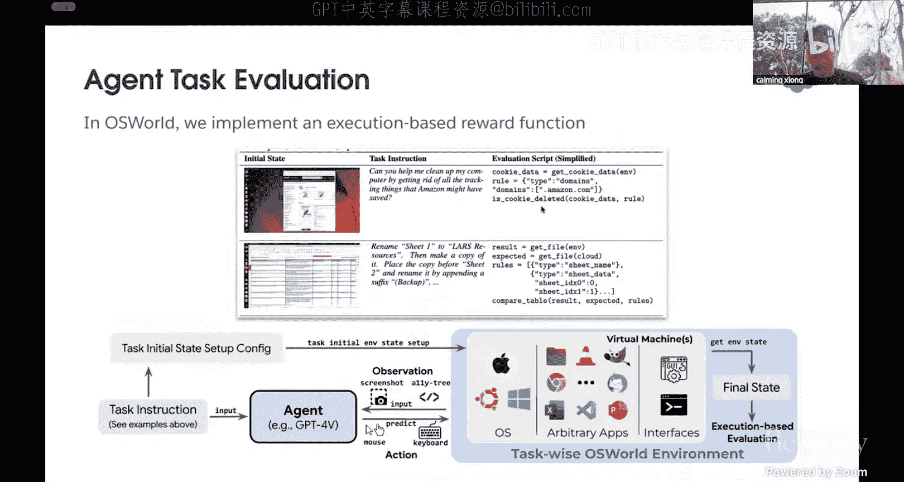

So we create is a powerful low O S world environment。😊。

So that the people can use this environment to benchmarking their the multimod agents。

Besides we build this development， of course， we also build a benchmark on top of the OS word。

Here we introduce the 369 real world computer tasks that。Inve。啊。

Widely used to the web or desktop apps。like the。呃。Like his office。

 O S and data use workflow and professionals。All of them， each task is。

Its we did a lot of retreat search on in the Internet。 So all of them it's based on the real world。

 the computer use cases， the experience。啊。And we ask the。

The people who has the serious background to。Interact with the the the the initial stated the initialized development in the OS world。

嗯。And and and and and interacts the environment and and record those。The trajectories。

And also handcrafted lots of the execution execution evaluation script the evaluation scripts。

 execution based evaluation evaluation scripts。To verify the task completion。 So in the left side。

 you can see the distribution of the different tasks。So total they have 369。And 100 is a。

 is a workflow task， which is multi app。 means this task me to jump。

From jump between jump across different apps， multiple apps。And they have the 268。

 which is roughly 70% is a single app。And in those those tasks some of them。

 which is roughly 20% is through the the other data set like Web arena。

And the there's a special here is we also add the30 task， which invisible。

 because you need to also know you need to also know agent should also know how to say no to to the user。

So we think adding the inflat task is important to make it more comprehensive for the or the scenarios testing。

And we also have a small number of 43 task for windows， not just on thetos。And as I said。

 because we we thinking this example based。The evaluation script， I mean。

It's it's very important for the the real world evaluation on multimod agents。

We construct the 134 evaluation script on 369。

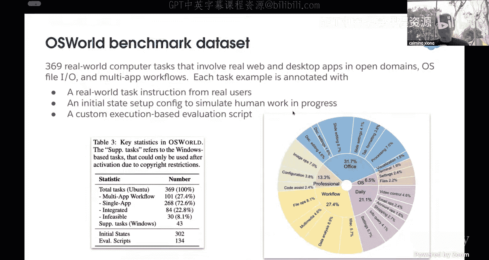

Example， the sample。 So you can see the ratio is's a very big。So here is some some examples。

 samples we we sampled from our 300。

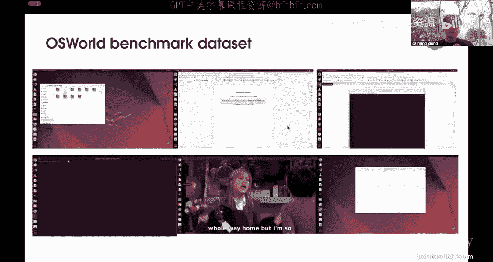

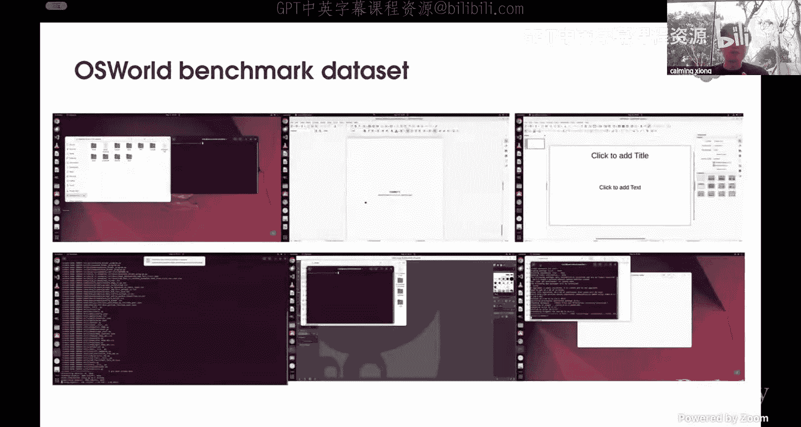

The the facts of the in our benchmark。

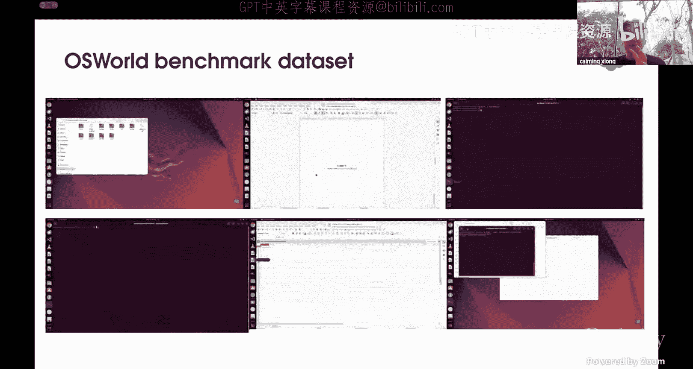

So you can see I they cover very diverse the the apps and cause different the。

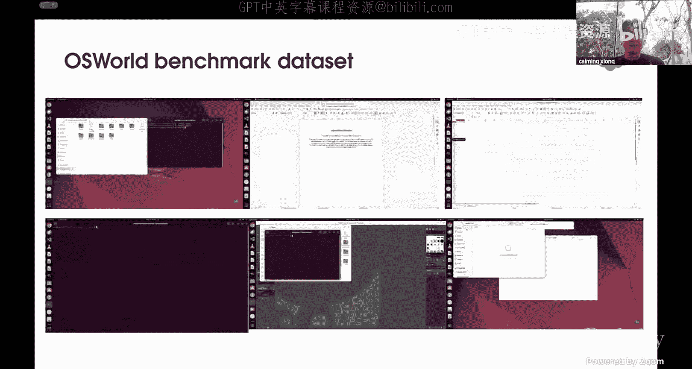

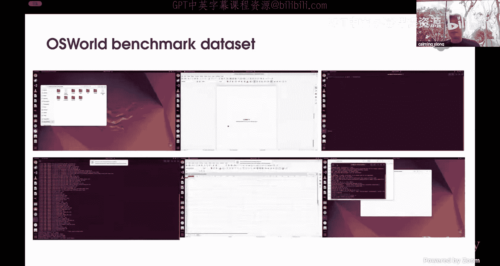

呃， userer intenses。But we comparedd our the our benchmark with the current existing popular benchmarks。

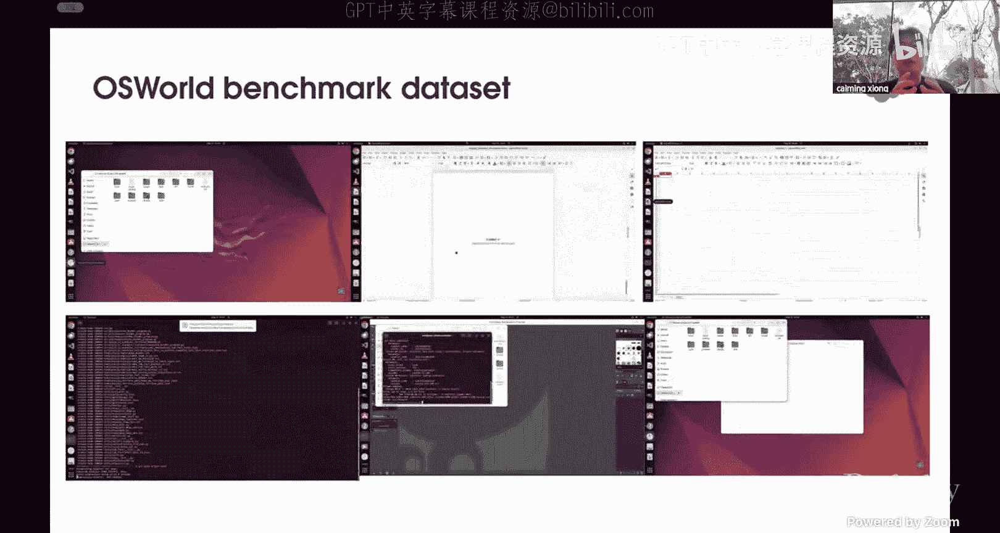

From the those different， the perspective， such as。Whether it provides the controllable。

 excecutable environment or whether it's easy to scale to the new environment。

Or you can support a multi model or whether it could be the do the cross app task。

 cross app the tasks。Or it can very could the star talk from the intermediate the initial state and so。

So we can see that our benchmark is。Have the more。powerfulful more， I mean。

 they cover different the the scenarios。The request as a as a as a benchmark for the multimod agents。

And in right side， we also did some analysis how complicated the task。In the OS Web benchmark。

We come。 We did some comparison with the weina。So the green是吧， sorryry。

 the the the the blue is vibrantina and yellow is oward。呃，那。呃，The media completion time。

For we night its roughly。30，40 seconds。And for the in earth world。

The media completion time is lovely。100，100， maybe 110 seconds。嗯。I did also have some。

A significantific the number of demos， maybe need need even more。

 even even need 900 seconds or even more。means that the the the complexity of this benchmark is also higher than the existing benchmarks。

After we create a benchmark， we test the benchmark with the state of art。

 the AM or VLM from the open source and also cross source the。呃， the foundation models来个。呃GBT4， GMI。

 Bud， etc cetera。On the left side is the prompt we used。

We designed four different testing in the settings。Through based on different observation。

The they are the one is only half accessibility， which could be that the the the L M can directly to run it。

The second one is only screenshot， which is pure。And the third one is screenshot plus accessibility。

And the fourth run is set of marks。We did some on the。

Some some simplification on accessibility tree because usually accessibility is very long and includes a lot of the redundant information。

 so we did some simplification to reduce them。And to to to shock the length of the this text representation。

So this is the the result， the the the numbers。We get。😊。

Let's do some excellent some analysis on this table。So first， let's see the。

At the bottom of this table is a cu performance。Rough 70 to 75%%% success rate。And if you go to see啦。

The performance of those the。那。Stff art， open source and。放听 close model 。Is still far behind。

farar from the the real human performance on those daily use tasks。 It's not like a super hard task。

 It's a daily use task。A second啊 you you see like个 from different the。You， the scenarios。

 human performance is kind of stable。 its， its plus minuss。That's 3 to 5%。But for the。Those。

Buntier models， the呃 large foundation models。The performance change dramatically。

And even the model from。samme company那个 you see了。For example。诶。In the， in this， okay。

 in the set of mark。TheGPT4 V andGPT4 O。ItThe performance gap is huge。Right， it's。It's 10，10% gap。

 even the performance since the performance only just 20% they have 10% gap。And of course。

 So this is table is results it we get last year and this year they have new models from the from the from those air vendors。

 the open air and the topic they have some big movement on there。

 but still it's far away from the from the human。不要。

We do some analysis on what factors will will influence this the performance。The first。

 we did some analysis on the screenshot resolution。The we。嗯。So， first we。

We the one point in the in the in the。Y axis is a successful rate and X axis is a down samplingling rate。

 So we so we because of VM is most of V is still trend very small resolution， not very small。

 but it's comparing with now we have better resolution。

 but usually the V I not trend as a full resolution is trend on a small one。

 So we do some down sampling on the on the resolution。And then we calculate。

 then then we run a evaluation。In the GPT4 way screenshot， as you improve the screenshot。

 it get a better performance。But in the SOM its。I think the trend still is to improve。

 but still this is a noise here。As generally improve but not as much as not as clear as the screenshot。

 I think it's got SOM include also includes some the they have some extra information it gets from the accessibility tree based on so they have some tax in information inside So it decreases the impact of the resolution。

And then we're also doing some analysis on the how much the the the historic context will influence the final performance so。

We did this。We， we choose different number of the the。The length， the trajectory length。啊。你放。In the。

GP4V SOM is improved as you add more and more the the historical the information， the steps。

But in a threeshot one。It doesn't it even make it it's even worse。We think it's made it because。

The SO M have， like I said， it include those the information from the text the presentation accessibility。

And our aim is perform the current foundation model is perform better on the text rather than the the pure vision image。

 So I think so we think that is the reason getting better and better with more and more context。

But for the screenshot it getting getting worse， I think it still is because all the the current of the the foundation model。

 it's not be well trained for the the computer use with scenarios， so。啊，It means呃。

We need to improve still have a gap like the open source community or the cold source companies need to improve those the vision capabilities in the foundation model。

If we want to get a better the multi model agent for computer use。And in the right side。

 its it's a it's a length distribution of the accessibility tree。

 So although you can add more and more those text representation in the multimod agent and it's can to get by the performance。

 but they have the issue there its the accessibility tree is to pro。

So roughly is at the 90% percentile， it's the 6 k。So if we want to add more the history， the context。

 then we need to find a way to get more more simplified or to call more conci accessibility tree。

 So maybe there have some work how to select the relevant information in the accessibility tree before you fit into the system。

 but when you do this step， maybe you your system will be slow because you need do this information to maybe you need try another big model to do this information processing on on in the。

That add the extra latency对。And we also analyze the model performance on the Uontu and Windows。

We found their correlation is pretty high。 It's 。7。And。

So which means like啊 we could use the OS word framework。 It would be effective。You could to get a。

If you can test your model in good in the one in one scenario。

 it should be it should be effectively transferred to the another environment。啊。And we also did a。

Some a， like if when we change the position size。Of the windows。

In the the different app windows in the in the screen。啊，The the results although show very different。

So， which means。It still means that the model is not the those foundation model is not very robust for the for this type of disturbance。

So yeah， so through we can find their have。There is they have a lot of work we should。给你都引出。

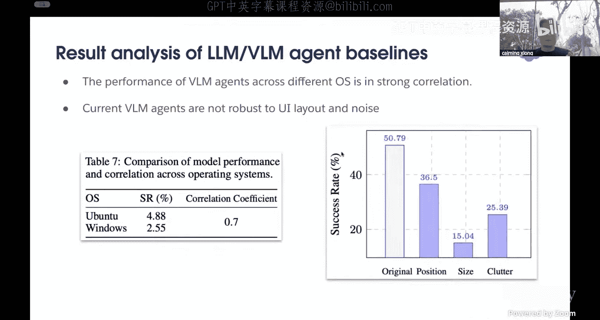

啊。And good news is recently they have a lot of the new progress in these areas。Anthtroic。

 they have this new cloud 3。5 and also the 3。7。 and we can see the the very significant improvement from。

Here。4een。15%。To22%。But still far away from human，72%。Of course。

 if you increase the number of steps from 15 to 50， it's getting better。

 but still still have a bigger。

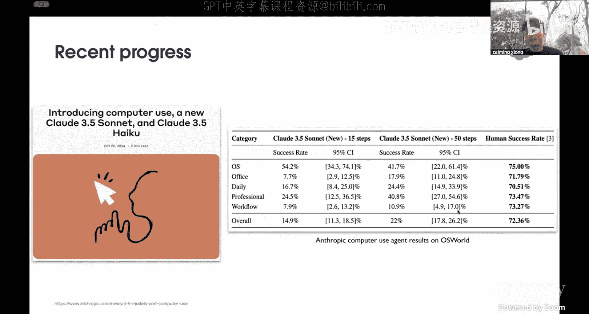

And open AI also have this new model called operator， the CD。啊。

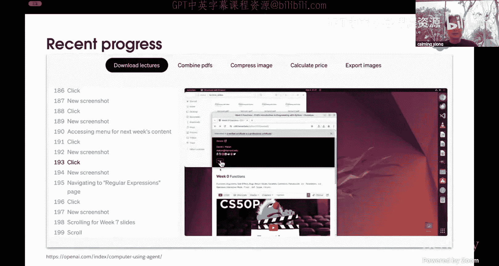

And in their recent performance。ACUA， sorry， in a recent performance。

We can see open AI is significantly better than the cause 3。5。啊。And at the the 200 steps。

 they can get even那个338%。Comping with like maybe only half 15%。4our months ago。

 so it's improved super fast。But this I this is like you have  200 step。

 but most of task in the earth was its roughly。It should be most of it can be solved under the 15 or even 20 steps。

 so which means they still have a big improvement， they are big space to improve the multimod agent for this computer use。

Okay， so this is through the environment and benchmark discussion， you know， we we have。

 we have made a big a lot of great progress on this computer use areas for multimod agent。

 but still they have a lot of the the staff we need to improve still have a lot of opportunities there。

And after this， let's go to the data part。ISince we still need the data to train our model。

To for follow agent training。I think we have a bigger challenge than we do in the LM trend。hy。

Because the agent model is not a single step。 It's a multi step。 It's a trajectory。

Collecting the trajectory data is super expensive。And second is it's very hard to directly to get the trajectory data by the internet。

And and second， even you say you have enough money， I can， I can just to hire people to collect data。

But cut to the do's annotation to cut the trajectory data iss very time consuming。

And theres a limit the scalability。Not good for getting anymore。

The the cost and time consuming of the the data collections were human。 and also there's no free。

 large scale trajectory help you can claw， then what you should do。ok。

Why don't we like the model to形。So here I want to discuss this paper called Age trick。啊。

To which it to synthesize agent trajectories。Through this getting playway strategy with the Web tutorial。

 So what does it mean。啊。The first。😊，We know， they have a lot of the a large collection of the tutorial like tutorial like text in the Internet。

 right。And those text they， they provide the， the， the step by step guidance on how to perform different tasks。

 So we read it， we， we read those tutorials to then how to interact with different app and complete different tasks in。

 in our， you know G U I environments。诶。And then those， those tutorials， the the。

They cover different the the scenarios。So we could to systematically to filtering。

Or filtering those instruction contents。From the Internet。And of course。

 those data is not that clean because it's written for humans。

 so they have a lot of noise text descriptions and of course， ATM formats there。啊。

 so so we need to extract the the valuable the knowledges啊。That呃。That knowledge the depth from。

 from the。Those tutorial like text。And then transform those unstructured text into into a structured the the。

The agent trajectories。啊With the the the the definition or high level description of the task。

Let make it to allow the the agent to use to to try and mimic the human task completion。

So in the agent trick， there have the three stages to do this。

The first stage is called automatic tutorial collection from Internet。So in step， we。

 as I just roughly described these tracks and filter those tutorial data from the internet。

AreUsing a bunch of heuristic filtering and， and some class fell like you with the fast text and then then transform it into some structured。

呃。的 formatmat啊。with using LM。And step 2， its。The guided replay for those trajectory generation。

 which is啊 using a VLM vision language model agent。

To execute those tutorials based on the structure tutorial。

 the structure step and run it step by step。And through that。

 we were to collect the the high level trajectories， including the。

 the high level description of the task。The observation of each step。And the and the reason。

 reasoning of each step as the final actions。And then we given those data。啊，We will all。

 we will run a e run run a。Separate evaluator to evaluate the to assess the quality of the trajectory。

To ensure the to filter out some bad trajectories or high low quality ones to maintain。

 to make sure its to to ensure this the the effectiveness of this data for the training。

Under step 3 is， it verified those agents by Cnning a model。

And fine tune the for the agent models to demonstrate the improvements and。

The significant performance improvement across different benchmarks。

Well that is roughly a steps for three stages for agent trick。

 So like I mean describe these three steps， let's go a little bit deeper about the each step。

The first step is like it this a tutorial collection from internet。

 So we start from some the big large copper like right Pajama， DCM。啊诶 we。

I did the the using maybe the some filtering。With based on keywords or some structure features。啊。

As we did after this step， we felt that maybe 99% of data。And then for the remaining data。

 we extract the sub subset subset of the the remaining data， the filter data。And use the OEM。

ho did some annotation。It is a good呃 it is a good data。

 It is bad data for啊 for for the as a tutorial。And then after this annotation。We trained a fast tag。

Ct file and use that one to talk about all the the the the whole the filter data。

And with up then when you get this the tutorial data。

 we run another round of M to paraphrase those data。To follow some predefined。The， the format。啊，那。

呃 used for the the guided for guided plan for the stage two。 So this is the。This is a data flow。

 the the flow at the follow step。 One will you do the preferory。 So you can see we use some。

The heuristic filters。To do the the first step the the data filtering。 and you can see like。

Just after this 1，2，3， the sixth step， you could it will filter out more than 99。9% data。

And after you get this filter data， we， as we we select some schedule。

 we select a small size small number of the data。And use the prompts L M to classify it a G U I tutorial or not。

 But this is the prompts we use。啊。After we do that。

 we also have the human to do some to to sample some often to verify。

 we find that a funds score is pretty high， it's like they can get roughly 88， 89%。

And we find for some。Long text or long text， the the the documents。啊。

The A is perform better than the human when they embed the tutorial in the long context。

Which is normal啊 which is which is not surprise but啊 so initially we more trust the LM on the long context classification that用。

😊，And after we filter those tutorial data， then we formalize。

The the tutorial data into a specific the structured format that we want to used to follow follow model follow model。

 follow the the the the replay， the guided replay。啊。Here we organize。

 So the left side is the prompt we used go。 So we want through this prompt。 We want to convert。

呃The tutorial。Into these six， into five five parts。First， it。啊乐。

The the platform and target development that specify what is operating system。

 what software versions。So thats be used for the initial estate。

And second one is the task description which to provide conci problem statement。

Wch is the the the instruction。The third one is the prerequisites， which requires the dependencies。

 background knowledge。And third one， the fourth one is this step by step， the， the the instructions。

W whichhich include this listening guidance and the command syntax。

And the last one is the expected outcome which can use。

 which is used for the verification or success indicators。So after we get this。

 after we paraphrased the tutorial， then we get this structured tutorial。

 and then we create a V agent and fit into this step by step tutorial and agent will to start to run。

Interact with the the environment step by step。啊， through this observation action loop。啊。

And through this， after the whole execution， we will recorded all the observation action。啊。

Intermedia reasoning。And the whole trajectories。啊。And then let low will fit into。

Another VM evaluator to assess the quality or correctness of the trajectory。I ensure啊。

We we got a high quality data。So here is an example of in the finalized date the final version of the data after you're doing all those steps。

啊。So you could see the left side is the observation。呃 sequence。And right side， including the。呃。

The action， the， the thought， if we step。And the the actions the action code。不 that。So computing the。

The data we collect using the agent trick， with the prior works。

The parallel the other the data set people use to train model。First。😊，Our data could be。

Through agent trick， you can collect much more data。Here we showed this 10 k。10 K is not the maximum。

We just do some of them。It could be much bigger。And second， the complexity of。

The data is not not not low。 Actually， it's pretty good。 They But every step is 12 steps。And。

You also will have a lot of the， the information。You will， you will have HTMLM。

 you will have accessibility。 You also will have a reasoning。 You support， you could get videos。

 you can get screenshots。😊，And。You can cover different websites。到。The a trick。It。

Maintains the diversity and realism， because it's from real world。

And it's also adjusting the scalability issues。That the human annot data may have。Given的 the the bug。

So here is the， the distribution of the， the， the trajectories from the the。

So this is the distribution， the last side is the the distributions。

 the the data we the different number trajectory from different websites。

And the right side is from the high level， different vertical， different domain。

 What's the the distribution。And in the data。So you can see the how。

You can see how the the the the coverage of the data set。

 the the domains through in the agent check the。呃，呃呃明就 say那个 the data site created by the agent。

So we did some the we like we said we we find tu model to check the。

呃The performance呢 to to to see了 how good。This synthesized data comparing with other humannot human annotated data in the the benchmarks。

The China the agent in the benchmark。 So we did it on this comparison on the Web re data on the benchmark。

Yeah。And models trend on agentric data significantly out from both I think open source and even close source TP forO models。

 which demonstrate the just synthesized trajectories also。It it's also high quality。

 and it's also can use to train the呃 a a better model。

This is the about how we do use the agent check to to do the data synthesis for the GUI agent。啊。

I那个这个 away from this agent trick work is。啊。Laging the Internet cor is still a important way because they have a diverse task resources。

And second is呃。嗯。We。Second is though。In the end with the reasoning and reflection。嗯。

ItReadianReadian reflectionction is very important的呃 the the the factor。For the trajectory。

 which we will talk about in the model side later。Yeah。But how， however。

 is still have an issue here is because you， for each instruction。

 you still only get a single trajectory， which is an issue that the。

Not like you only have a single solution for for for each in for the query。

 It could be have market for instruction。But still have this issue here because it's only an im learning process。

But I think we have the solution for it is OS word。

 So you can use agent trick to do to create data for the SFT training。

 and then you can use that high level instruction and right in the OS word。

For呃 for thef state theIL权。And then you can solve this exploitation exploration。好晒。Great。

So we we are try， we try to answer the question like we can use the data synthesis to make the existing real vision language model be perform better on the the Gui agent tasks。

那。😊，Then will， so the second the next I want to discuss is。When you do data synthesiss。

For to improve this action capability， action core capability for agent for external task。 How。

 how about it could also help for。Your internal， the the task itself。Like understanding。

We know like the vision language model is trained for the understanding。And if we want to do it。

Can we call from Web data website， It website have this type of data。还定要 answer一次。Not very。

Then how can we see the fact？So first， let me see like， why we need do it。

 Why we want to synthesize this type of action data for multimod。

 multimod L M to improve to for understanding。 understanding should be。

The the the the capability of skills it should have。But actually， it's not perfect。😊，Well。

 fuck long perfect。On the open source model。So here is the four examples from the four different。

Perspective to explain why we need the model to itself can do the action calling to improve understanding。

All those tasks， either， they need more f the vision capability。

 or they need some reading capabilities， or they need some external knowledge。

So here we introduce a tackle。Whi is through synthesize its Trump thought and action data to improve the multimod understanding capability through adding its action calling capabilities。

Skills in in the model。So this is some examples we showed。

I after adding this action calling capability， which is trained through the the synthetic data we will discuss later。

It can generate。The the thoughts and the actions。And through observations， they will。

 they will do again until they get the results。So this is the one example like to。

WeWe just show this field in this La model。And this another one is be is called the localization and the functions。

 the visual functions。And this is to query the external knowledge。The tax knowledge。

 so not just model only。And this mixed the vision O CR and some the the calculate。

Calculate the capabilities。O， so let lets talk let's talk go back like个 how then how we create the synthetic pipeline。

😊，And，过了。for to to to sense that to generate this data for the for the c o。呃，陈。

There there a lot of details here， but don't worry。 let's explain it one by one。

It's not that complicated。The first for this data since pipeline， they have the two part。

First part is called model based generation， and the bottom part is the programmatic。

A programmatic generation。嗯。So in a model based， the generation。The first。

 we take the existing image QA。We get those image and the Q A pairs as input as we prompt them prompt the。

The model， the， the frontier models。I say like you have。

 you have this image and the Q pair as generate the Trump thought and action。

Given those the the action or called action lift。All2 thought if。They do not have the。呃。

 relevantlevan的 the relevant action in the list。啊。Adeline， is you generate rate。

And opposite generate either the2 thought with action or2 thought without action。

Then we will verify the。The out the outcome， the output。If it's correct， then we will pass it。

If it's not。Then we will convert this pair as the direct answer。Pa。So in this way。

 you will get the data， not all of them have the action， some of them have action。

 some of them only have Ch thought some of them without this direct answer。本来你是f的的的那那那。

The this is part the top part。And in the bottom part。We do the programmatical generation。

This way is we do not have the QA pairs in in this programmatic generation process。

 so we only have the image。Then we use the model with a maybe the detection model。

 depth model OCR model and different models。 and also or could be human to label some data。Onbox。

And we get those stance and notations in the image。And we designed some manually templates。

And you start to generate the the Q A pair。And through that one， we can to synthesize what actions。

In the formula answer to question to answer。So this is the template we use to do the programmatic generation。

 So some them some of them is about counting。 Some of them is about。The 2。

2D special reasoning or 3D special reasoning。 and some of them is the mixed understanding and counting of。

 So if we try to mimic different the reasoning or the the action call needed to answer different type of the。

呃，The the the questions。And the then here the the bottom is the action set。Which cover like O CR。

Get object localization， depth estimation。AndC regular to no to to me and query language model。

 accurate soft math equation is pretty diverse。都。走 through this two way we collect the data。

And of course， in this data， we， we need to， we we there have some of them is's the the2 sort action data。

 Some of them is not。 Then we we need to do some analysis on the those data。

And attached on the benchmarks。So first one， we through our the experiment。 first one， we found。

To get the model， get the the the multimod foundation models to have this reasoning or action culcities。

You need use An。啊。In the results， we found few short or in contact standing and doesn't work。

And second is。嗯。😊，没放到你下不看漂。For tasks with this action， adding this action capabilities。

Its really to improve the their capability to solve the task。

 It cannot solve before to improve their understanding capabilities， which means that the。

Even understanding this capabilities。It also could be enhanced by adding adding external tools。

And make it to through this function call or to calling to improve it， which is not supply for the。

It's also interesting to see these positive results。

So it it can give the give us a different the another direction that are when how can we。

 how could we improving our models on on understanding。And this is the second。Observation， we find。

The best C， O T data。The the back， the the the the filter data。啊为。We the the the best one。Which。

 which can almost so。啊。Its is it it is test on different的 the。The scenarios。

 the in scenario it test on this A， O VQ A blink math time M MU。Its almost improve all the tasks。

 which means that this so adding this action capability in the model in the data sorry to create this2 sort action data。

 it can improve and with this data the model and the multiple data model。

 it can improve the model understanding capability in general not like just improve one model。完完不。

And the third observation from this the taco experiments on the C T。

 the jump thought action data set we。We find the quality is more important than quantity。

 Not just as more you will get better the government。ok 诶。So。

This paper is talk about how we could to add in the action core capability into the multi model language model or foundation model。

And it。And first， you need to find the model， not through the few short。 A second is CO T data。

 It consistent to improve those the models。The the through this fening and only the this instruction。

 this synthesized data。And the first one is the quality， is more important quality。

 which is start new， but it's some lessons we learned from here。

So so here is we have discussed about the development benchmarking。And the data c。

 I think个 now you already have the the。A comprehensive view， political view about。

About these multi agent areas， if you want to test the agent， if you want to generate the data。

 and if you want to do the I in the environment。You already have those tools and you can start to create your multi model。

So the last 1， I want to spend some time talk about the model。Although。

 I'm not say like this is the best model。 but I think you can maybe you can learn from some insights from those model。

 I think。 so right now every they have new models。😊，嗯。You。So they they always have have a better one。

 So I hope that we can discuss some different things about the model here。😊。

So I want to discuss this paper It argue with our paper， which is a unified pure vision model。

For了 GI agent。For the to your agent。We finally have a three the。

Now that problem is three issues like we want， we want to solve。啊。First is。

Most of GI agent is tax based， user text representation， like a accessibility tree。

Second the video grounding。And performer capability capability is not good。

 I think it's because most of the model not really to to train their model for the computer use。

And third one is most of the model is。To generate an action directly without with。到。

Here is some more concrete the the slides about this free observation or issues。The first one。

 you can see。They have different the the textual representation。啊Some那个 in the web is hML。

 maybe dormory and in the OS S， they have another type of accessibility and mobile have different one。

嗯。And all most of， and all of them its people long， length。

And it could be longer and longer at the complexity of your GI。啊。

So and comparing with the the the vision， pure vision bit， vision is just one。

whatever your background code looks like。The the the the image is saying。That is one and about the。

The， the benefit of the GUI。The second one is the the because of different systems use different tools。

 their action space is very different。Its not a big issue。

 but its still an issue and it will prevent this effective cross development learning。

And also like that， you cannot to leverage different data， the training data， together。呃， which。呃。

Not good for the scalability。Then is this visual grounding capability。So here is we tested on the。

 the mobile desktop and Web scenarios。啊。We found the。诶。Those close socing models perform surprising。

Bad l。So it means like the model doesn't really to optimize for the the computer use scenarios by then this is T 4 gO。

 but the new one operator or cloud 3。53。7 is。And here is an example like the the current the existing methods。

They trained the agent to generate the。The low level actions directly， like with the pie。

 the director， the code。Rather than and the sophisticated the reasoning。And。riasoning concept啊。

 reasoning the the the the the text。W whichhich would do may to to get the those those models or those agents very struggle on on the complex scenarios in the real world。

 that may require more a careful planning。啊。Which those planning could be planning knowledge could be transferred from the。

The text they text copper， which trend in the L M。So given those these three issues。

 we propose this a with model。First， it's the pure vision based。

So it doesn't matter what its accessibility tree format module is using in the system or in the web browser。

And the second is it this we improve the the grounding model to combine we a new uniformified form format combine all the existing data and。

And全 model to improve the grounding。And third one is we explicitly to include this reasoning process。

 what we call it in a monologue。Into our training， the model training for了啊 for the action general。

And在 said呢。For the a。We eliminate these dependencies on the platform specific the textual representation。

 because it is vision pure vision based。 It's directly operate on the screen screen images。

So it make the model put more more generalizable into different interface。啊。And the we。

We we we we developed a standardized the the action space that。啊， we call to啊。

Combine the different the data into the same the action format so that we can leverage more data。

The the the the existing data。And more crucial is the right side is we in incorporate this in the monologue during the training。

Which can developly sophisticated the reason patterns。啊。And which through through。呃。

 this呃 by leveraging the一个 knowledge of memories， Titans is already memorized in the AM。

I think this is important啊呃 to to to build more more robust the this mode。

So in each interaction step。呃The our our agent。We to generate this in in the modello。

 the two step to component the these two new two parts。

 the thought and low level instructions are between your visual observation and the final actions。

So through this way， you could to， through this thought and low level instruction and action。

 you can consider this this enables the the more the agent can and do it step by step from the different complexity because at the beginning。

 you get a high level instruction and you do in this thought the chunk of thought。

 So you decompose the problem into some the small depth。And with those steps。

 you can do generate a flow level instruction for each step about action。

And then you can get better the the， the。concretecrete or code to access question。

 So then it make the could make the model be make the agent be more robust more accurate。

But来 its motivation for。For for the training， we have a two step。 First step is the grounding。

 and the second step is the planning and reasoning。 and for grounding。We did some tricks。

 which is grounding packing strategy。 What do you mean the grounding packing strategies like we were to find all the the grounding pairs。

 the grounding samples， which based on the same image and the con as a market turn and grounding。

AndAs one example。We find that can improve the training efficiency and even in to have a bit improvement on the performance。

And in a second stage， it's。啊， we。Add this in the model log in our training。啊。

And which make the agent good to generate this intermediate thought and the low level instructions before before they generate action directly。

In the data part。啊。As I said， we， because it's a pure vision based。

 we can easily to combine different data set together。And define a same format for the outcome。

啊Then we can leverage all all most of the existing data and create a new data to全 our model。

And for a monologue。We use。 we， we prompted the frontier model， like D P40。啊 given this the。The。

The observation image and highlight the U I element。

With the with the instruction and final goal and final the all the the code。

 the action code and from T4 O TP T 40 to generate in the monolo component。

So this is an example the previous the previous is on。 They have the arms instruction。

Previous action， of course， the observation will we don't add here。 And this action。

 then later after this step， the we they will we will have the the thought and。

A low level instructions。In the in the new data， in the new training。

So this way we create the Ar with collection， which is combine a number of different data sets。

then we finally， we get for stage one， we get the 1 million the GI grounding data and for stage  two。

 we get the 35 35 K multi step trajectory which is explicit in the monologue reasoning data it's great。

And then we do same thing like we do before we I we run our model。

 we turned our model on this agent ugly collection data set。嗯。

And we demonstrate we showed this this ugly model perform exceptional on the。

The the grounding data grounding task so。The the top。It's the grounded task。 So it has no planner。

We can see the significant outperform the existing models on on。On on those tasks。

And we also want the full， the two stage training。 So we also have the model。

 a single model to both rounding and planning reasoning action。啊， we found after。

You did the plan the the second stage training。 It even improve this granting task。

And and a cheap state of art performance。And we then we also did the development， the the evaluation。

On the offline setting on mental lab， it also showed its achieved superior performance across。

Defined the metrics。On the offline side。And also， on the enjoy setting。

We also did the this evaluation on the online setting， which its mental web and the angel world。

 which is this mental web life is different mental web， mental web。

 Its provide a dynamic web based development。都都读的 evaluationvalu。啊。And we can see the。The。

 the performance of。All the ugly model。The the superior performance。好的 even拜托人就。呃。

And that one thing I want to emphasize is if you see the here is a with 7 B model with G4 O planner。

啊。It could be。Its performed a state of art。A in these tasks。

Which means like our the our the as model。Have a better of grounding capabilities。

 And this definitely can improve the。The final performance of the the this plan task is at this planning task。

And and this is not it also we found like they still have a big space to improve for grounding。

 to improve， which will improve the final performance on the different computer use。

I will do some analysis on。啊。For different components in the other on the performance。Both stage one。

 stage  two is important In is also very crucial for both the the high level reasoning and low level grounding time。

And we find in the monologue actually helps to solving the harder task which which in the in the right side you see。

 one is self plan enforce plan， enforce plan means reinforce it to it must generate in the monologue。

And it can achieve the 20% of。Resolve 20% of the ground arrows。

And the right right left side is two examples with and without in the。

And we also by see the cost platform benefits in the a。

 The arguments is trend on the Web and mobile data。Also was is a computer use。啊。

We thought it it's remarkably although we。We didn't try exclusively。On the is computer use。Genario。

The the model still perform pretty good。啊。And and bit and bits using a with 70 to be at the grounding plus if4 O is even the it just。

Even better than our computer use。So so here I want to take here。 I want to to you can take away一。

First。The as model。It's a unified framework。啊。It can。

 it can perform pretty robust across different platform with only a visual observation。

And I think the， the video， the pure vision， followed them。It's。Half a。

Big advantages on the computer use of G U I。Use CA。

 which I think openI already agree with this is my comment because they have the operator。

And second is， although they have a lot of progress。

 we still need to improve both grounding and structure reasoning don't just try to improve reasoning。

 Actually， they have bigger， bigger the the space there。 you need to improve in the grounding size。

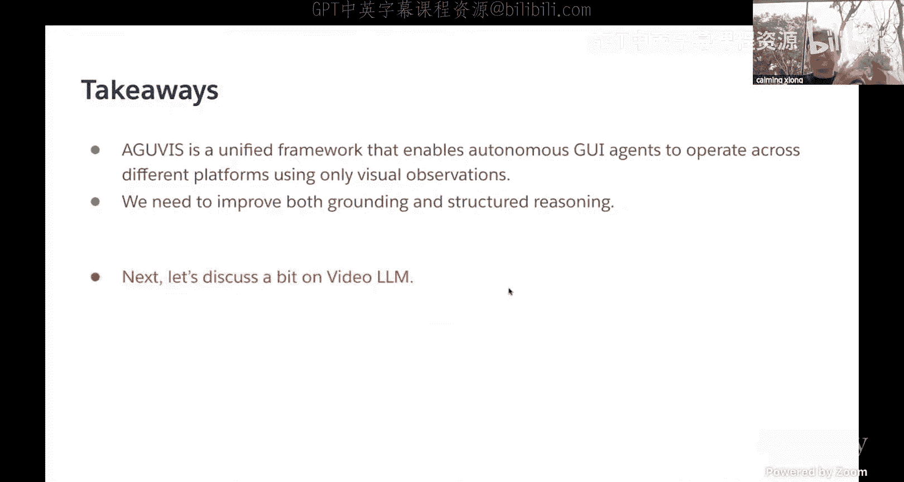