# UCB《高级大语言模型智能体｜CS 194 294-280 (Advanced LLM Agents) 2025》中英字幕 - P8：Lecture 8, Thomas Hubert.zh_en - GPT中英字幕课程资源 - BV1mkZiYAEYM

Hello everyone， I'm really really glad to be here， be able to share a little bit more about our work and I would of course like to organize the organizers for inviting me to be part of this class。

😊，嗯。All right， so you know， three and a half years ago had just finished two big projects。

 one of them was Alpha code， the other one was Alpha Tensor。

 I'll tell you a little bit more about those in the future。

 but basically during the Christmas holiday in 2021。

 I stumbled on this talk from 2019 called the Future of Mathematics。😊，And the talk is over an hour。

 the comments were extremely positive。 one person was saying， you know。

 this is the best lecture and the best YouTube video I've never watched anything more enjoyable。😊。

So you know， it's pretty intrigued and I press play。

And we started a chain of inelectible events that basically takes me here in front of you today。

So in this talk， rather than focusing on the details。

 I'd really like to focus on the big ideas that allowed us to work on Alpha proof and why we believe it has an integral role to play in the future of mathematics。

😊，I'll basically talk first about the rise of formal mathematics and what that is。

 then about our experience in reinforce enforcementment learning and the lessons we took away and how these two things meet with NAA proof。

So Galileo said quite a long time ago that the laws of nature are written in the language of mathematics。

 it was an incredible prediction or insight because we've made a lot of progress in Galileo and indeed now just a few equations on a single page can describe how the universe works extremely precisely。

😊，Also in a famous essay called the Unreasonable Finess of Maematics。

 Eugene Wicner argues that mathematics not only have like a descriptive power。

 but also have predictive power， one example he gives if I'm not mistaken is the development of matrix algebra in using quantum mechanics。

😊，Of course， once you can describe and predict the natural world。

 you can start to shape it and if you look around us you know in the world we live in。

 the civilization， the culture， the tech， you know that makes our current world well basically mathematics is just at the core of everything。

And。And maybe I would also like to argue that mathematics is a root note to intelligence。

 so root node is a word that Dens really likes to talk about and basically it means that from that road is going to go on a whole tree of possibilities and why could we argue that is because you know mathematics requires reasoning and planning。

 generalization and abstraction， knowledge and creativity， open endeded and unbounded complexity。

And over the years， I also understood that mathematics is not just these kind of application of logical rules one after the other。

 it's really a sort of art， and so it even requires a knife for beauty。

So I used a lot of keywords here but you'll see them reappearing during my talk and I hope that will make these a bit more concrete。

嗯。In summary， I've tried to convey to you that mathematics is a root note to understand the natural world。

 but it also might be a root note for intelligence。And。

So I think it's worth kind of really thinking about mathematics and seeing what can we do for that？

But before that， I'd like to give you a really super brief history of formalization in mathematics because basically mathematics hasn't always looked the way it looks now。

😊，About 500 know before Christ know the Greeks had a great revelation。

 they understood the importance of the concept of mathematical proof and in some sense can you really imagine you know it's like you find something that will tell you with certainty that you have attained kind of eternal truth and you can discover more and more truth of a universe it must have felt incredible and since then pre proofs is that the heart of mathematics and what constitutes the proof however has evolved over the millenniums of mathematical history。

One of the first breakthroughs I'm sure that you know is with Euclid and his book elements that have definitions。

 axioms and theorems， and so that's really kind of the start of axiomatization。

 but that has really kind of been developed much more in the early 20th century with Hillilberg program that really developed this to land on what we have now。

😊，So that's kind of aximatization on one side on the other side you know like mathematics you know at the beginning it didn't really use symbols and that's for a very long time you know even if the Greeks had kind of fine aximatization and started to use some symbols the rest of the world kind of describe really mathematics with a lot of words and so here you have like a square and 10 times it root ipo239 today we would write this as X plus 1x equal 39 but look at this description of how do you solve these thing take the coefficient of the root divide it into two parts and multiply one of them itself at these239 etc cetera。

 etca right now you're just write kind of this concise kind of formula and there are two things here that comes you know it's first you know replacing kind of you know using special in the machine learning ling using special tokens for four or four numbers right like we will present like the digits have special special kind of characters。

But also even more important I don't know which one is more important。

 but that helps with also kind of， I think only in the 17th century。

 Ronne Decarte kind of comes up with the idea of using kind of the early letter of the alphabet to denote constants and the end of the letter of the alphabet's XYz to describe unknowns and so that's basically how you end up with this formula。

 but it takes you know like N， I don't know how many it takes until the 17th century to really come up with those notations。

And I think it's not hard to argue that precise notation and axiom optimizationization really eliminated ambiguities and logical error。

 that symbolic notation made complex manipulations more tractable and requires much less cognitive load。

 it also kind of packs information extremely densely。In terms of notation。

 I can't remember exactly who said that and if it was a joke or not。

 but someone was arguing that maybe the Einstein notations was his biggest contribution that might be pushing it a little bit with。

Given the impact of general reactivity， special reactivity and his work to introduce quantum mechanics。

 but certainly kind of ancientstein notations are very important area actually if you read machine learning code you see that appear in a lot as well but basically once you you have those symbols and you can lift yourself up from kind of particular examples you start to be able to observe different common patterns across different contexts and so that's where abstractstruction and generalization comes up you can unify dispar areas of mathematics and actually you can even create nu fieldss and so my favorite example here is really the people who are looking at the five axioms of Euclidean geometry and actually I don't know for thousand of year I think trying to see if they could remove the fifth axom and that actually led to non-uclidean geometry and in particular Romanmanian geometry which you know in。

😊，In the theme of general re was essential to get general re。So you know。

 this formalization has helped mathematics， but also the other sciences in particular physics。

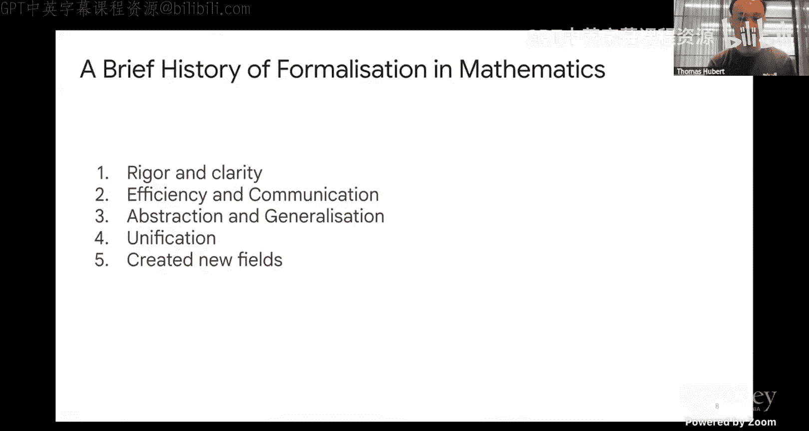

And so I would like to argue that basically computer feminization。

 which basically means writing mathematics in code。

 is just the next logical phase in this gr a of mathematical formalism。

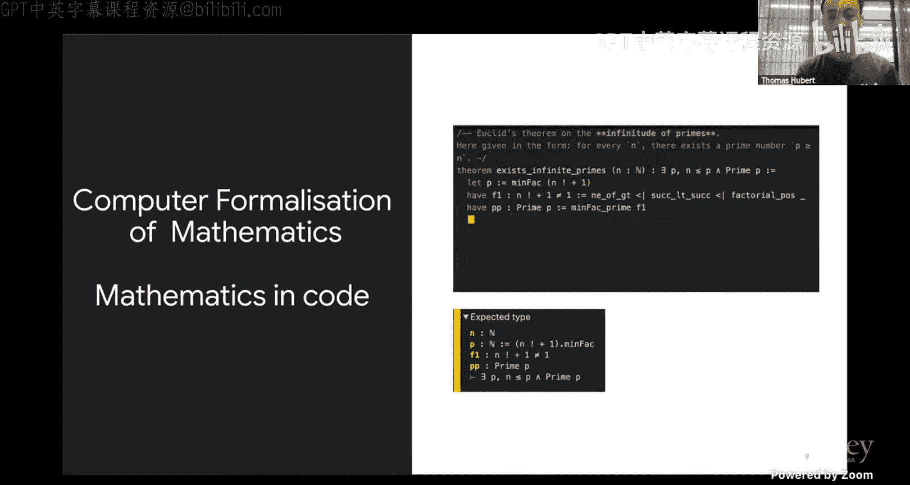

So there's been quite a few languages to describe mathematical reasoning。

 such as Clarkk and Isabel and Lene is one of the most recent ones originally developed。

 I believe for software education， but also with mathematics in mind。

And mathematicians so in lean kind of the tool that would make the next big step in mathematical formalism it's a programming language is a fair improver and interactive proof assistant leanin has a really vibrant open source community of mathematicians and it's been used to formalize like cutting edge mathematics field metal mathematics and then mathematicians on the huge quest to basically build the math library of the future so let me go there it's called Malib it built open source on basically the free time of mathematicians it has two big goals it aims to be general and unified so in general it means that it has the weakest assumptions and the strongest results。

And unified is that it only has one definition per concept so I was actually pretty surprised when I learned about this unification idea because you know I thought that mathematics was written in a very you know structured way already but apparently it turns out that know for a given concept you may have several papers that basically talk about the same concept but that define it in a different way that is not necessarily compatible with each other and so you need to do quite a bit of work to actually kind of try to find the unifying definition that analyze all those ideas and so that's actually what takes the most time in building math。

And。Maybe you can see in the representation I gave here that it's one monolithtic library where everything is connected together and so this is very important for modern math because basically modern math is about kind of trying to connect all areas of math and there's been observations that actually you know like ideas here can help LD from there and for instance maybe Fmas last Theorem proof is a great example of this connecting two different areas to try to prove one huge theorem now there is also something called the Lngs program and really explicitly tries to do that and connect all these areas so it's really important that you have a library that basically can connect all different areas of math。

Currently， the library cohort covers about 80% of the undergrad curricula。

 and most of the library however is above the undergraduate that has a lot of， you know。

 or irregular coverage and because I think particular examples are complex analysis or PDE theory。

Okay， all great but why do all of this right is because you know computer harmization unlocks kind of enormous synergies and maybe to explain myself a little bit I have to step back and for those of you who are code as maybe you know like just understanding the right code and be able to use all the software stack that should be already a huge win for mathematics but basically the other property of when you write mathematics in code with those languages such as lean is that you get perfect verification so when you write a proof and you write the correct proof lean is going to tell you yes。

 this is correct and when you've made a mistake lean is going to tell you this is your proof is not correct or is still incomplete。

😊，So from these two things， you get some instant wins first you know your correctness concerns completely disappear。

 you can trust giant proofs and you can delegate proof checking entirely to the computer。

And so I think it's important to note and it's my understanding that it's not like all areas as mathematics are suffering from concerns about correctness。

 I think in reality most maybe areas where mathematicians feel pretty comfortable about their ability to discern you know correctness from mistakes but I've been hearing that in maybe some of the areas more abstract areas actually they start to be real concerns for correctness so that's not everywhere but that starts to be important。

So these are the instant wins， but you those perfect verification on software stack has really kind of a knock an effect that could lead to game changers。

So first you know I think for all of you who are codes to bring all the tools that we have developed for coding should already be a big big win next have transformed mathematics into a video game so what does this video game look like when you have what other levels the levels are a different theorems and then you know you can interact in those levels and basically kind of L will tell you yes you've completed the level or not with this perfect verification feedback you always have harder level and maybe contrary to you know other games where I don't know you have to shoot other people this is a super meaningful useful and profound game you know you are basically adding new truths for eternity。

And the the lean people describe this as as， you know。

 they could do this 14 hours a day and theyre constantly getting positive reinforcements。And。

It also means that you know it's great for education first you know like a lot younger people now are really used to using computers and softwares and it's great because it's interactive right its when it's fun it's easy to learn and you can also create kind of software such that you know like the detail of the level of detail is adapted to the person who is reading rather than you know。

😊，The level that the author thought was interesting。

 I don't know if you read a lot of mass papers or you look at solutions of some problems you are trying to solve。

 sometimes because well this next step is quite obvious。

 but maybe it is not for you and youd love to see more detail。

I have also an example from actually from my dad who recently tried to learn kind of Gaa theory in a different online class and so he went through week one and week two and week three all good。

 but then when he was going through week four and trying to do the homework he realized that there was something he didn't understand and he basically needed someone to explain to him and he messaged the professor but unfortunately the professor didn't reply and so he was basically completely stuck but imagine that instead you he was doing this in lean then L would have said exactly you what is right。

 what is wrong， what is missing， etc， and he would be able to have like constant feedback without having to ask his teacher。

And now I want to go to the last point， it's actually a point that has been made by Terriita I think about a year and a half ago at least and he describes that basically using computer formalization will unlock massive collaboration between mathematicians and so why does he say that well apparently the current state of mathematic kind of collaboration is that you can do you know most of the papers is a single author or two author paper and kind of the math is really five author papers and the reason why is because every author needs to check everyone else's work and so basically kind of having more and more collaborators doesn't really scale but you still need to check everyone else's work and so that's where like a computer formalization and path verification comes in is that if you could trust the computer to check the proofs？

Then suddenly can it opens up kind of working on mathematical projects to I don't know。

 thousands of people because you could have someone you've never met who lived in the middle of nowhere who contributes a little bit to your proof of limbma there and then Le would say yes this is correct and then you can just move on and so there's been there's been kind of maybe you know there's been a few projects like least。

 I think Maly is maybe one of of the coolest demonstration where you have hundreds of mathematicians working together to build this library of the future。

 but I think Territo is also arguing that you could use that to do new mathematics and has actually launched project in the past called Universal algebra where he was exploring that but basically I think in the EM at the moment where all about scaling and here basically you could scale humans to do mathematics and potentially maybe tackle harder problems。

All right so you know should everyone go to you know computer formalization it's awesome。

 the reality is that there are still challenges for computer formalization in my estimates but only 0。

1% to 1% of mathematicians have adoptedly it's a small community of mathematicians a vibrant one but why is that it's because it's actually not yet a great tool for mainstream research like a lot of you know programming languages。

 it has a steep learning curve and it also requires a significant time investment because you know to get perfect identificationification。

 you need to be able to write every single detail。And so you know that takes a lot more time。

 maybe that's not the place where you want to focus。

 you want to focus on the things you don't yet know how so not on the things that are more obvious to you and so that will be improved the tooling and the library mature but at the moment there's still some things missing and obviously you there is also a passive lack of necessity for research but I'm hoping that the arguments I' outlined in the slide before are going to change a little bit at that point。

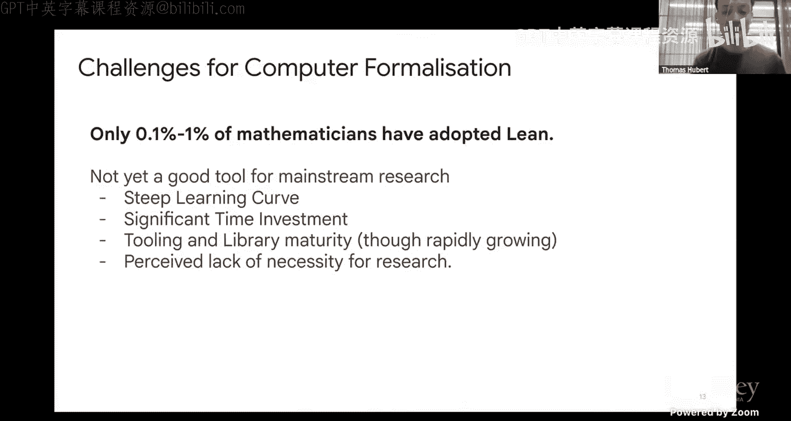

So now I just want to show you a little bit what it looks like。

 so you know this is a proof that you may know about。

' called about how it's about proving that there is an infinite number of primes。And okay。

 so this is what it looks like in me， I hope you can see that it's big enough。just。Okay here it is。

 this is the firearmorem statement and I think what is kind of remarkable is that because you can use Unicode this looks pretty much what you would write yourself on a piece of paper says that for all n natural numbers there is exist P such that p is bigger than n and p is prime so that's how one way to say that there is an infinite number of primes。

And。This is what the proof look like so fairly compact in this case。

 and the fact that you can understand all of this is because basically lean is a language based high levels syntax and a mirroring normal mathematics。

😊，So let me go a little bit on what it looks like to interact with this so here is the first line of the proof and this is actually the main insight that Euclid had is to consider first n factorial+ one and the mean factor of it so what is the mean factor is the mean factor of n factorial+ one。

AndSo I want to draw your attention on the box on the right there called the tactic state and so basically that's what L returns to you it says。

 oh here are the things we know and here are the things we still need to prove。

 so we know that n is a natural number， we know that p is this mean factor of n factor plus one and you still need to show that it exists a p such that p is bigger than n and p is prime。

So let's go second line， second line says， oh， let's prove that n factor l+ one is not one and you have actually the proof in line with maybe a few more characters and you really want to prove something this easy。

 but on the right you see that you have a new fact in your arsenal is that n factorial+ one is not one。

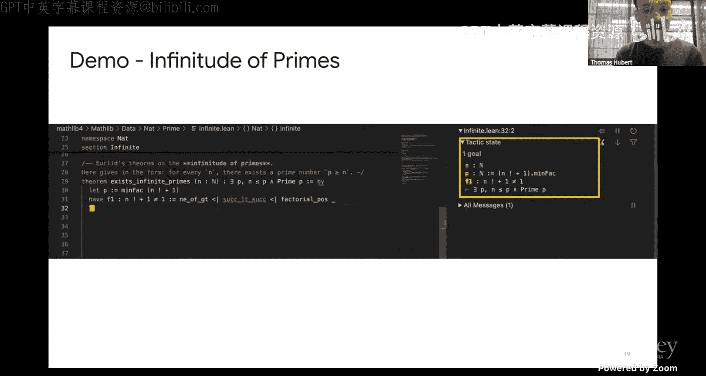

And then we're going to say now let's prove that P prime and the proof is say well is because it's basically we took the minimum factor right the minimum factor is kind of it' obvious that it's a prime unless unless the thing you've taken up is one and so that's why you have this thing you needed to prove before and then kind of the proof continues and at the end you should see in your tactic state nos。

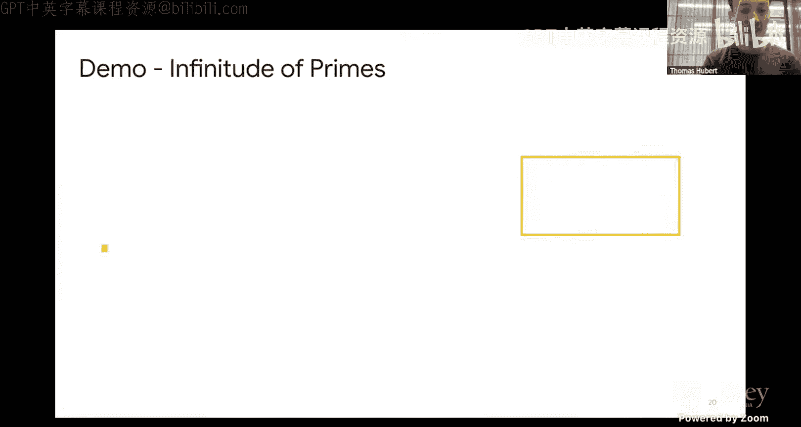

And it used to be， I think in the previous version of L that you also received kind of this Staaimo and I think unfortunately has been removed from the current version of L。

 but basically you it's your little reward for completing this level。😊。

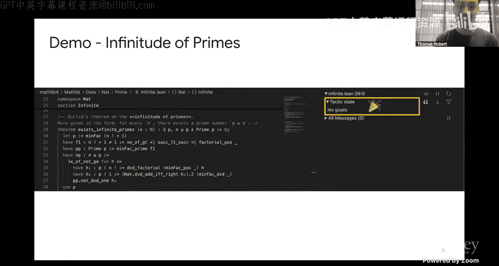

So just to recap right computer formalization， there is a really vibrant community that has a huge enthusiasm for this。

 they are building the library of the future in their own time， it has many。

 many ways in which it can unlock enormous synergies， but it still has some way to go。

And this community and myself as well， we have the belief that this will inevitably play an integral role in the future of mathematics。

 you know， just this work kind of pushed the computer formalization。😊，All right。

 so now I want to talk about some concurrent development in AI and focus on something that was extremely popular a few years ago。

 got forgotten a bit in the last couple of years and nowadays making a compact big time。So hopefully。

 you know， like you've picked up of my hints with this little reward， this environment。

 this interactiveness， this video game， I want to talk about reinforcement learning。😊。

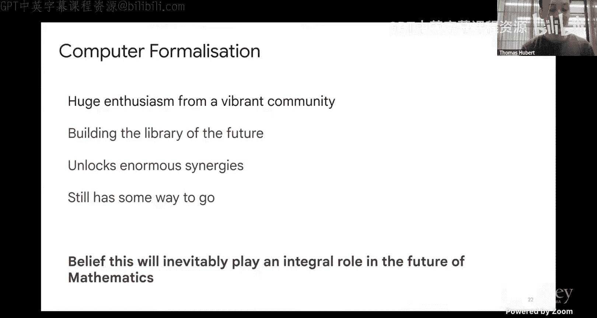

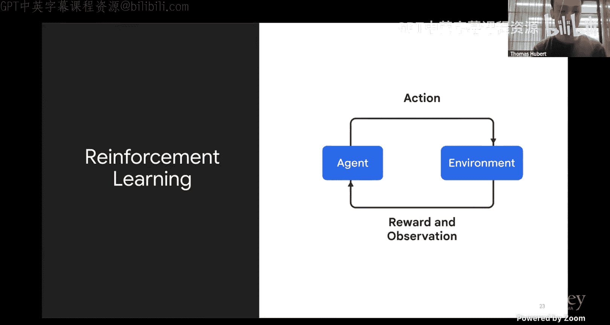

So。What's reinforcement learning also known as RL basically is just trial and error learning it's a very very general framework of an agent trying to achieve a goal so really this agent learns by interacting with an environment to maximize a reward and I think there is sometimes misconception about this reward has to be very dense or has to guide you towards the solution etc。

 not at all in the you know in the framework of RL the reward can be basically have I achieved my goal or not。

 so basically in RL we really need to have a goal but then your reward can be goal achieved equal then one otherwise zero all the time。

If you don't really have a goal that you want to try to achieve。

 then maybe that doesn't fit very well into the R framework， but if you have a goal。

 then you super super framework to work with。

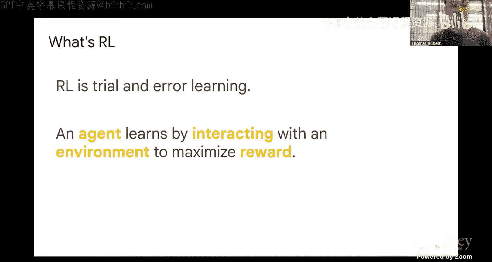

Especially since you know it has actually been proven to work really really well so here's a sample of the most successful stories coming out of Deep mind when ArL was basically runt game so as you can see there are a lot of examples of games and video games so for instance you know the seminal work on Atari the work on Go and Starcraft and Strtigo but as I said you know ArL is not confined to games it's about trying to achieve a goal。

😊，And so here， like on the on the bottom row， there is alpha Dm and akatensor。

 would which I used to discover new algorithms。 And the bottom on the rightitis is basically RL was used to try to control in a tokam the shape of the plasma to get better nuclear fusion reactions。

 So you can see， you know， it is a very general setup。

Now you know I had myself the luck to spend my days on Alphago and its descendants and this is what I call the zero series and especially from Alphago Ze。

 we showed that we could train an agent to master the domains。

 and when I sayMaA actually mean you know being the world champion hands down at the time when those things came out and we learned to do that without any human input information or you basically learned everything from scratch。

And so I want to talk to you about the zero philosophy which I think is a great philosophy for research is about this so if an agent can learn to master an environment tabular as so without any information and basically you'll demonstrate shown that you have a system that is able to discover and learn new knowledge by。

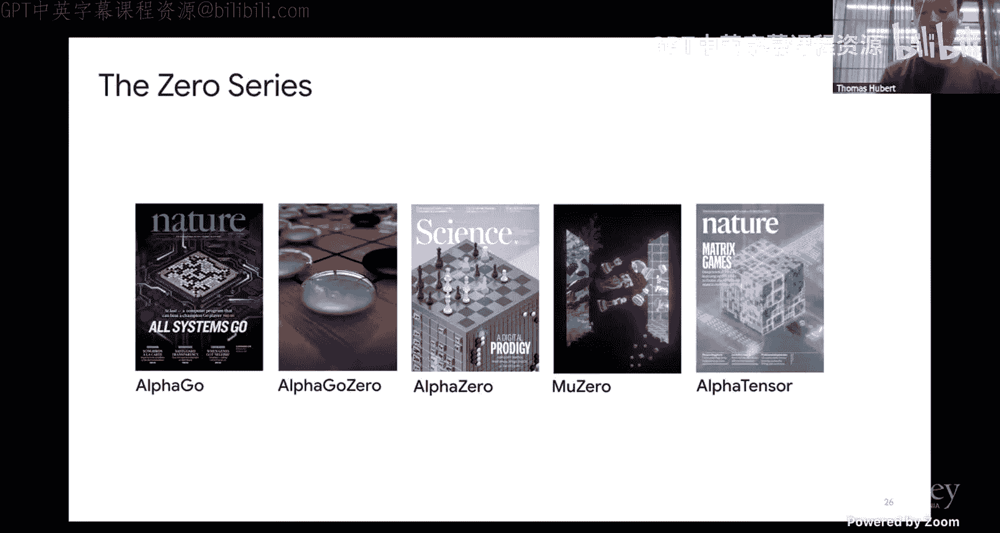

And。It also means that， you know， this algorithm is， is general and should apply to other domains。

And I think you know like the ability of being able to discover new knowledge。

 this is particularly important to advance science because a big part of doing science is to just explore areas that are not yet well understood and advance knowledge and you need to accumulate knowledge continuously generate and discover new interesting proof and you know that's a huge part of doing science。

So you know especially for research I think this is like a great way to demonstrate that you can discover new things I would say that especially now with the big success of LLMs you know maybe a more pragmatic point of view is to be able to start you at a certain knowledge base and then you want to know that your algorithm is going to continue to discover new things from there so you don't really need to start on zero what you really need is to have this algorithm that can discover new things and we'll demonstrate that you can do this。

With with those with this research and these alpha zero things。

 So let me go into some kind of examples alpha go0 and alpha0， as I said， you know。

 they learn simply by playing against themselves setting completely from random blank and what we observed is that。

They basically rediscovered human patterns， accumulating thousands of years of human knowledge maybe in a matter of days。

 but ultimately some of those patterns were kind of discarded in preference of new discoveries that humans don't even know about。

 they didn't even knew about So in go I believe that you know Alphago basically starting a new move at move I would say move fine a move I wasn't even played by humans and I've heard if I'm not mistaken that Magnet Carson was saying that because his coach was really good at using engines and he got to use Alphago like engines when those came out he got a big advantage momentarily over the other chess players because basically these things was playing very differently and people were not used to it and they didn't know how to handle those in the situation。

Let's kind of go and ch and actually if you look at， for instance。

 the figure I showed on the bottom right， this is kind of this is trying to show the frequency of alpha0 playing that particular pattern called the for instance the caran defense and you can see that you know it basically discovers it after two hours of training we plays it for about four hours quite consistently and then you know this kind of pattern starts to disappear from the game Al zero is playing probably because has found kind of a way that makes this better not very interesting anymore while on the bottom the queen's gambbit seems you know the frequency at which the Queen's gambbit is played is just increasing over time of a training time。

All right， now let me talk about alphapha tensor and so this was a work that was trying to find what is the best way to multiply two matrices together and so maybe the naive algorithm that you may have learned at school requires kind of N cube operations when you're trying to multiply two n by n matrices or two by two matrices you need eight multiplications or four by4 multiplications you need 64 multiplications this is tri。

And so there was at some point a big discovery from a person named Strasen that found that for two by two matrices。

 actually you could do it with only seven notifications。And he also showed that this was optimal。

 you couldn't do better than that。But as soon as we went to four by four k matrices。

 basically we knew nothing more than applying structural algorithm twice。

 and so you know still reduces from 64 to 49 modifications。And so in Atesa。

 we try to discover a new efficient and probablyvably correct algorithm or basically tasks that look like matrix modification。

And you know， it actually did， it found new things in actually many different sciences。

 discovering like brand new knowledge that human had never known about。

 and so you know if you had only trained on what human had known and then you would have never discovered drugs。

As a big bonus as part of this work， we showed that basically you know we could basically as as zero could tackle huge action spaces so that I wrote here 10 to the power 30。

 but basically for practical purposes。This is just intent。And so all those successes， you go， ch。

 sensor decomposition are all specific to a certain task， if you want a certain level。

 but under the hood is basically the same alpha algorithm that is running and making those discoveries。

And so what we had in mind is like， is there an environment that captures a much broader class of tasks relevant for science and you guessed it and say yes。

 it's mathematics？😊，But just before we get there， the lessons we've learned from all this one。

 so what made those systems superhuman？I've listed up what I believe are the foremost important properties first is to scale up trial and error and basically to discover new knowledge。

 you need to try something new and be able to learn based on the feedback you receive and if your feedback is not grounded you know if you invent your own feedback then I think it's really hard once you venture out of what's known and so you really need a way to measure if you achieving your goals or not where you are in the where are you in your solution。

 etc cea， eta。AndAlsourro uses a lot of search and I believe it's my belief that search can really accelerate the discovery of new paths and skills and it's because most of the time when you sample you know a different action not not the action that is that has the highest probability if you try that action most of the time is' going to be bad but sometimes is going to be good and you need to discover why that action might be good or not and so you need to follow up on kind of playing well after you play that action。

And I think you know for instance， Alphago and Move 37 is a good example of that。

 it had a very low probability of being played， but it was still exploring the search and then it was discovered that was a really good move and so it became it was played and described as being very creative。

😊，The final one is you need to have a good curriculum to take you all the way to superhuman and in the Alpha Zero case in Goh and Che Senchogi。

 we relied on the fact that it was a two player game and so you could do selfplay。

 you basically always have the right opponent to play against and that was really important。Okay。

 so now let me try to connect those two。Scanandd of trying and and， we have。

 you know lean is the environment to explore mathematics completely in Sil and the algorithm is going to come from a0。

Again， Linn is going to give you us and of this ground feedback signal， is going to tell us you know。

 what have we proved so far what's left to be proved and is's going to tell us when we are done when we get a correct proof。

Or such， we can rely on alphapha zero's search algorithm。

 it works pretty well and maybe kind of the question mark is what do we do with the curriculum？

in some sense， you， where are the levels coming from？

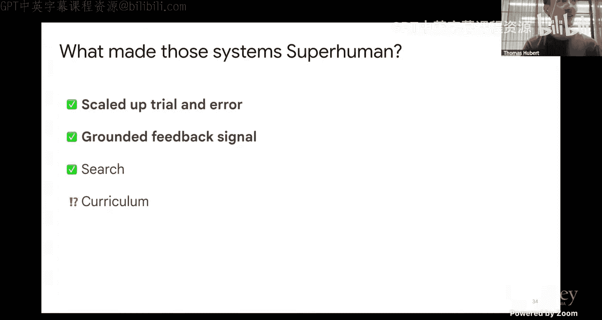

But so you understood kind of the idea of alpha proof is to use alpha0 for mathematics and in particular formal mathematics。

😊。

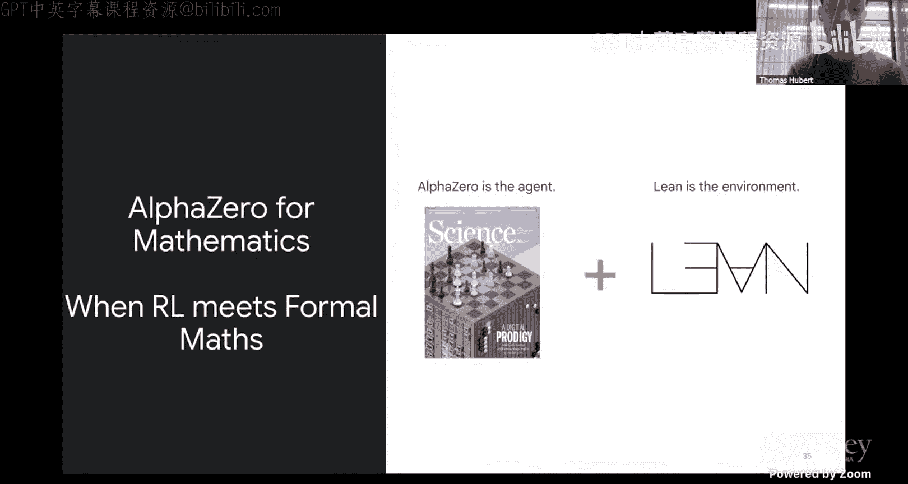

So you know， let me make a napkin kind of master plan for Alpha proof。

 so L gives us a way to scale up trial and error with an environment to explore mathematics completely in Sica and a perfect feedback signal for proving。

And then now if we extrapolate from the work we've done in the other domain， Eco code。

 we can therefore reach superhuman intelligence and discover nes。

 just like in go chest tensile deposition， provided。

 we can generate high enough quality and quantity of problems and RN works。And some。

Very bullish on our works and so as I said， the kind of the question that remains is。

How can we generate high enough quality and quantity of problems， where do the problems come from？

And so I think one of the answer has to be that you know the problems partly comes from the humans and maybe the most important reason why is that is because we want to help human mathematics。

We could try to create alien mathematics， but really what we would like is to help human mathematics and kind of contribute in that community and maybe a more pragmatic reason is that humans have already come up with a lot of problems that are quite interesting。

But of course we shouldn't throw away the second part where AA proof was define the problem and so I think there is maybe two ways to slice one is AF proof defines a problem around human mathematics and we've done a little bit of that already with photoformization and testMM so it's perfectly fine if you don't understand what I'm in here and I'll try to explain those a bit later。

But then the other part is basically really augmenting human mathematics so you know ideally as proof would be able to discover new areas in mathematics。

 build new theories， etc that humans find interesting。😊。

Yes so these are maybe where the problems can come from so before we move on I want to take a step back because if we're thinking about AI for mathematics you know there is potentially a choice there is a choice of doing it in natural language or inform language so I've been arguing a long time now for the formal part but but you know actually most effort in AI at the moment is informal mathematics or doing basically mathematics in natural language and。

And the reason why is because basically all of the data of mathematics。

 by many orders of magnitude is written in natural language， of course。

 so you have these master live library that is growing and contains quite a lot of mass。

 but it still a few orders of magnitude smaller than the amount of mathematics you can find textbooks in on archive on published papers。

 et that are all written using natural language。😊，So that's kind of the tradeoff you get when you use formal mathematics is you really have a very small amount of data。

 that's when again you know you bump into the question of how do you get the problems where the problems come from。

However， I guess it's my opinion that because natural language mathematics at least the reasoning part is not verifiable。

 I believe that this is an issue if you're reading your goal is to build a system that can go beyond human knowledge and create your knowledge。

 you can of course improve the reliability of those systems。

 but the problem in mathematics is really that if you build on any false statement。

 then you it destroys everything you do afterwards you really need like 100% reliability。And。

That's a property of mathematics and that's why I think that know verifiability is very important and basically lean is already superhuman at verification。

😊，And I say all of this for mathematics， but actually I believe this is true for many important impactful applications that we cannot solve yet and scientific problems in particular。

So in the domains we cannot solve， there is almost by construction。

 there isn't much data available because the domain is relatively poorly understood and maybe it could even be a completely new domain that has just been discovered。

You could also have applications that are somewhat niche and maybe if you think about what AGI would do。

 you could argue that maybe mathematics is a bit niche。

 but it's still extremely impactful and it's conceivable that generalization from all the other data would be somewhat limited。

And so if we are data scarces， we really need a process that can continuously generate and discover new interesting facts that are not yet represented in the data。

 and you need a way to ground those new facts so that you can check that you are basically constantly adding news and building on top of yourus and so this is really as across foundational bit is that perfect verification when in the long run be the most important property for mathematics。

Let me recap RL meets formal math， so we have a proven recipe to be a lesion that can discover new knowledge by themselves and reach superhuman intelligence in certain domains。

The key ingredients have highlighted scanoc trial and error and graming feedback。

 and basically formal mask provide us with those key ingredients。

So these are the big ideas that you behind us。So now let me talk to you a little bit about the IMO and our participation in 2024。

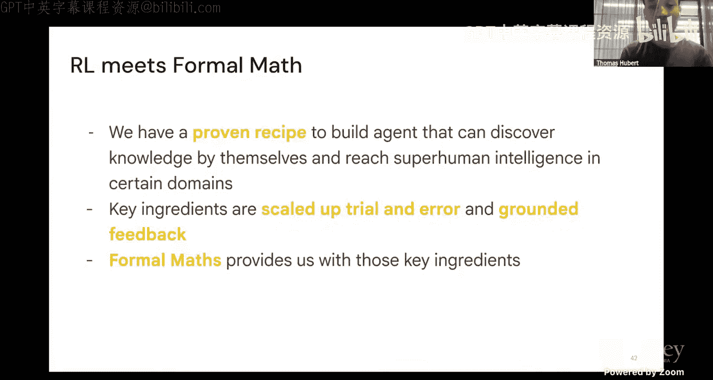

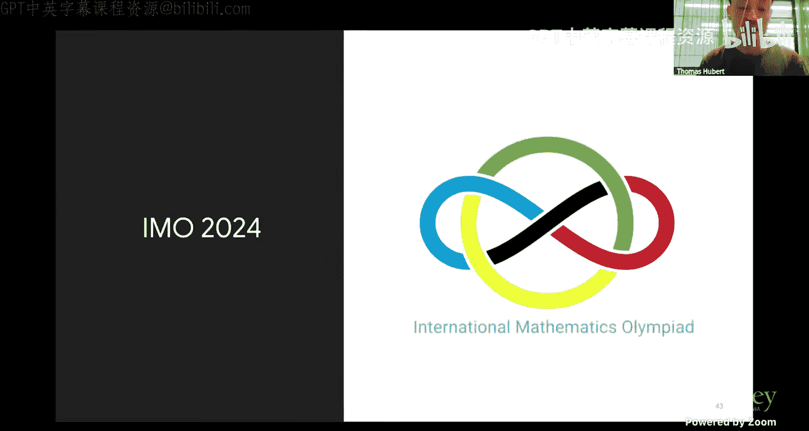

So first what's the Ya， the YaO stands for the International Mathematics Soinmpia and it's basically the world championship level event in mathematics that brings together the best young minds from around the world。

So every country brings their top six high school students and they try to solve six problems in two sessions of four and a half hours。

So basically in total， they have like nine hours to solve six problems in these six problems they are two easy problems。

 two medium problems and two heart problems。So let me first try to illustrate what it means to take the top six high school students for the USAN。

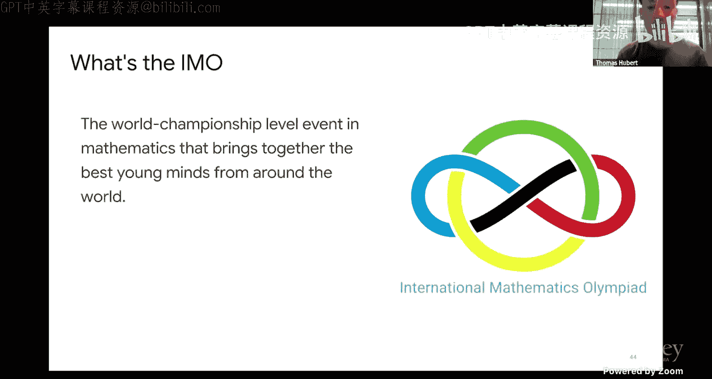

So let's say there's about 17 million high school students。

It's not like every kid loves math and is going to do a mass competition might instead play video games and maybe in the future actually build a math library of the future but anyways at the moment there's about 60。

000 of them that participate in these AMC competitions。嗯。

If they do well and they are still kind of into this。

 they might go and participate in this AIM mini competition。

And so for those of you who have been following kind of the benchmarks used in AI you may know about this math benchmark that basically contains a lot of AMC and AIE problems and so the reason why is that basically AI need what you need to do in the AI andMe is to the solution is always an integral between one and1 thousand0 and so it makes it easy to check whether of your system has outputted the correct answer or not like the correct number you can check that very easily and kind of use that as a granted feedback the problem is it doesn't tell you whether your reasoning to get there is correct or not。

Now， you know like if you need to guess 177， then I think you know I can I still believe that it's indeed it's more likely that you have correct reasoning when you come up with the right answer and so you know that might still help to improve the reason and it's basically what's happening。

 it's improving the reasoning of of those models。But anyway， when you do really well at the AME。

 you may participate in the USA Masoleimp， there's only 215 now。

 then if you are in the top there you may go to the IMO camp and from there only the top six people are selected。

You can see there is like basically six or seven orders of selection。

 and I'm told by my colleague who did the IO for the UK that they study for1 thousand of hours。

 maybe an average of three hours for three years of really intense training for this competition。😊。

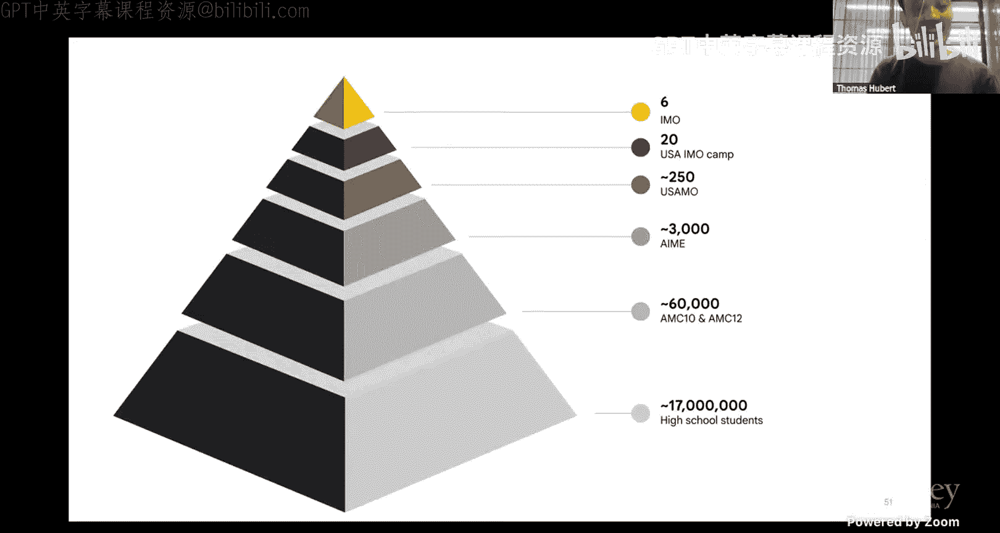

Now let me share a little bit about the problems。And I'll start with this quote from Poian law。

 the Poian law is not anyone， he's not new to the IO， he was actually the coach。

 the national coach for USA for the last 10 years。And he said， I tried DCS problems while at D IMO。

 it took me hours。In context about the IMO problems are specifically selected to be nonstand。

 so during the IMO itself national coachess meet to pick the problems to appear on the exam。

 one of the most important tasks on that group is to avoid problems similar to problems that appeared anywhere before。

 and so they go through great legs to ensure this。And so。That's why basically we really wanted to。

 you know we picked the IMO as a goal for us is because we thought there was really a test of reasoning and lot of knowledge and you know as Pochelo says。

 even for specialists， even for the national coach of the USA has been doing this for 10 years。

 it will take him hours to solve those problems。And the final property of participating at the 2024 I know was that those problems were not leaked right。

 and so you really needed to kind of be able to reason to solve those problems。

As I said you know they are like easy medium and hard problems easy is you know。

 in fact those problems are not easy at all because only half of the participants solve two or more problems and so you know you take the top six from each country and half of those won't be able to solve the easy problem。

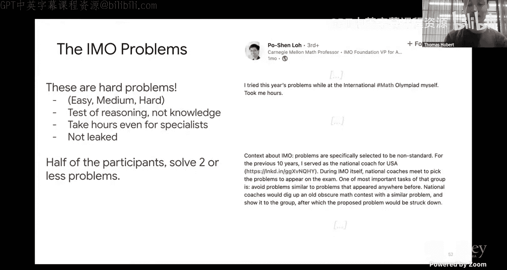

All right so now let's go really to you know this IMO 2024 and I'd like to relieve a part of it with you so you know we had contacted the Ya organization we had we had agreed with them that they would send us the problems we had contacted some judges also part of that competition so they could grade our solutions and and we tried to participate so I just want to make sure you know kind of I。

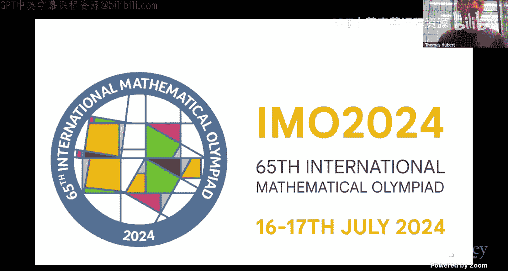

I clarify exactly what our IMO participation was and I think a good way to think about it is more like an Apollo program and so what we really wanted to know is can we actually reach the moon can our solar system solve the 2024 IMO problem at all you know given the computer that Google can give us at that time and enough time for doing a reason。

And。So it was really about this like can we， you know。

 can we build a system that can solve those problems and so。

 and I think at the time when we got started。It first believed that， you。

 this was like five or  ten0 years away。

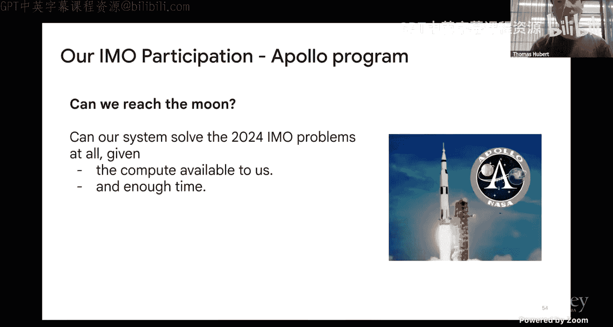

Okay， so now let me take you to you know seven months before January 2024 we are seven months away and we need to make a decision about geometry so why geometry is because you know Mathled is very spa in 2D Euclidean geometry doesn't have much of what you need to know about Euclidean geometry mostly because you know researchers don't really care about 2D Euclidean geometry that is useful for the IMO and so。

We're a bit unsure what to do we are debating whether maybe you know we actually don't do geometry at all or we try to fill in that part in Ma sleep so that our agent has the basic knowledge that is expected every students to have and so we are debating this when you know miraculously another group within Google Deep Mind turned out to have been working exactly the IMO geometry problem and they already have a system that is very。

 very strong you know their system was already approaching goldlevel metal performance on the geometry problems and we learned about that because they published a paper in nature in early January 2024 so miracle but we decided to join forces with them for July and so Al geometry will tackle geometry and A approved will tackle a random math theory and polymetrics。

A couple of months later we are debating another thing。

 so we've been training out our proof on proving clearance but not all questions are on the form proof that actually some require an answer to be determined like find or X such that you know and this is not just you an integer a D&E。

 it could be you know it's the set of you know like these numbers that have these property etcger。

And so it's actually not obvious how to do well in formal language because you hand this kind of toological case where you know。

 he says well what are already eggs that property Pholes and says was is the set of numbers where Phole and you have like a really easy time to prove that but that's definitely not what kind of the judges were after。

And so actually you the answer itself is a bit of a subjective thing and we debate where we should do either we do what what's known outside as the E mode。

 we basically feed in the correct answer to alpha proof and we ask Al proof to prove it or we go with hard mode where we try to determine the answer。

 we have something that determines the answer and we prove it。

I personally don't really like easy and hard kind of keywords here because it's fairly well known that kind of the bit that is the hardest for IO is the proving part。

 it's not really to guess the answer。But， but anyway， so we are debating we， we。

We're not sure exactly what to do， but after thinking about it through it's pretty clear that we need to do hard on and what's cool is that actually kind of guess the answer is exactly what kind of Gemini is being trained on and so we decide that we will generate candidates and serve with Gemini and well attempt to prove and disprove all possible candidates。

😊，うさかと。여자 사5면 빠지。Now the final thing we are debating about is about kind of the input that the system should receive so you receive the natural language description of the problem you know for instance in English。

 actually if you participate at DIMO you can choose the language in which you receive the problems not everyone has to read it in English you can have it in Russian or in Chinese or in Japanese you can choose your own language unfortunately they don't propose lean as a language and so we are debating whether we will send kind of English to the system or or we'll ask our experts internally to manually formalize the problem and send that as an input to the system。

And so we debate this a little bit with our judges and very quickly we have the same opinion because what we really care about is the mathematical reasoning and problem solving at D IM right and that's that's what we are therefore。

 not really about our capabilities of actually translating the problem in in formal language and so we decide that it's okay for what we want to achieve that we will give the formalized problems as input and so we ask our Linux experts to manual formalized the problems for the system。

So if I recap， you know， our protocol is going to look something like this。

 so we are going to officially receive the problems at1pm。

AndThe lean experts will first manually formalize the problems。

And then that's where kind of the after that DI comes in。

 so we'll generate hundreds of un date with Geminac AA proof will try to filter all the easily disprorovable ones and then we are going to run test time error so again I haven't told you what is test time error but I'm going to get there。

Okay。Day one， we are there Tuesday at 1 PM we sees the problem。 P1 is an algebra。

 P 2 is a number theory， and P3 is a commaries， And P1 P2 actually requires an access to be guest。

And so， you know， we ask our experts to manually formalize the problem。

 then Gemini to guess and second dates， and then we get alpha proof to try to disprove all those and second dates。

And so we have already very good signs is that Al proof is able to disprove 99% basically of guesses for those two problems in a matter of minutes and so this is a really good sign because we've observed in the past that when Al proof understands the problem it's going to be able to disprove a lot of kind of false index。

 but for problems it doesn't understand at all， it wouldn't be able to disprove much at all。

So that's really good sign for day one。On day two right we receive again at 1pm the problems。

 we knew actually that P4 and P5 had to be geo and combinmetrics because there is a rule that the easy and medium problems。

 all categories have to appear in easy and medium problems but we are pretty happy to see that p6 was algebra functional equation because we knew that also alpha proof was particularly strongly in functional equation problems that's that p6 is in the hard category and it's the hardest problem so even if it' again of the good category for alpha proof nothing is guaranteed。

It turnsurns out that you know alpha geometry is able to solve the geometry problem。

 I believe in seconds， so really， really powerful。Youd get there， say basically。

 you know they came in， they run that thing for a few seconds and then it was done for them。

The P5 co metrics was actually very tricky and our human express failed to formalize that problem on the day and the PC6 algebra。

 it also requires sensor to be determined and Gemini generated a bunch of sensor and when we as a proof try to disprove it。

 it could only dispro 7% our guesses so it doesn't have zero traction on the problem but it doesn't have probably as good an understanding as on P1 and P2。

😊，All right， so you know day three Thursday AA proof hasn't proved anything yet but we had a way to track progress and so we observed on the day one problems that P1 you know AA proof had actually solved half of the problem and so actually in that proof there are at least know two ways to split that problem into you'd you know case on the fact that something is either either even an odd or that it's rational or irrational and so AA proof had kind of know come up with these ideas of splitting this problem in two by itself and in instance in the even odd case it had proved the event case and hadn't finished proving the odd case it wasn't able to prove the odd case yet in P2 when we look at it AA proof had arguably solved the whole problem so I don't know if you know that in the IMO there is know there is a whole section where after the competition。

after the students have submitted their answers the team captains can argue with the judging committee that actually you know like the student has done this much and so therefore they deserve that much points and so you know if we had followed that process we believe that with whatever A proof had we may be able to argue for the whole program so let's say you know six out of seven points there。

And。And then on P3， the commats program， I proof hadn't made any progress。On the day two problem。

 as I said you AFA geometrytry had already solved in seconds the problem。

 so seven out of seven points， the P5 combins we had made no progress I think by that time we had a formalization of it。

 but what was really cool is that actually on physics。

 AFAproof had made progress and had proved a particular case that we now know is was two out of seven points。

So probably on Thursday， it had actually made quite a bit of progress on all the problems。

 and we may have already have like about 18 points。

Now Friday we receive this email is the name of my colleague Rihi but's actually sent by AAproof and Aproof is sending an email each time it solves one of the IMO programs it says I have discovered truly marvelous proof of IMO 2024 p。

 but this email is so short to contain。Of course it's a joke and the whole proof is there in the email and so when we see that we are extremely excited because you know we know we kind of have P2 after geometry has P we're making progress on P1 and we it seems like it looks like we have solved the hardest problem P6 so you know extremely excited I run to my colleagues' desk or Nsh we one of our Linux and so we basically copy paste that proof to official lean and it thinks a little bit and says yeah all good proof and so I run back to my desk I don't think too much I just forward on that message to Dens and Sege so Dens has a this。

And I wanted to share that for two things one， I think it shows you the trust I have in lean if I didn't trust L I would probably wouldn't have sent that email kind of seconds after kind of getting confirmation from Ly that this was all good and the second thing I thought a little bit after that is like was this making of a stupid email where I think actually we are in a company where it's cool to do this and Demi since gave were following what was happening during this competition。

嗯。A little bit later in the day actually we receive another MA and it's a full proof of P2 so now there is nothing to argue about you know perfect proof solve by alpha proof and a little bit later in the day actually on that same day we also received a full proof of P1 so in conclusion you know final results P1 P2 and P6 was fully solved by alphaA proof and P4 was fully solved by alpha geometrytry。

And we actually tried to keep running over the weekend in the hope of getting one point on P3 because actually the agent made some progress on it。

 but it turned out that it was not enough for a partial point。

So we reached the score of a silver medalist and missed the gold threshold by one point of course I just want to reiterate that you know we definitely use more time and more compute than what's available to the human participant。

I want to come back a little bit on the P6 problem because it turned out that it was arguably one of the hardest problems in the last years at DIMO。

 only five out of 609 of the participant solve this program fullying and you know it's the top six people of every country who comes in and only five in totals of the problem fullying。

And Sa Magaers， who is fields medalist and a Hemo Gold medalist as well。

 he said that he actually spent a couple of hours on this problem and did not solve it and I find the fact that the program can come up with a somewhat complicated construction like this very impressive。

So in no ways am I saying that you know we are close to Tinggawa's kind of math abilities and he may not help spent these two hours really trying to solve this and these things you know you need to you these are kind of you need to practice to solve these things and so in a ways am I saying that we are close to fields metal level but I think we all interpreted this as a really。

 really encouraging science for the future to be able to do something really nontrivial。

Let me conclude this Iop part with some of the challenges we observed。

 the first is the gaps in masline and so the most blatant one is geometry actually the T geometry was not there you know I kind of it may have required us to actually completely write that part in Maly so that we could we could do we could do the geometry problems or we may have decided not even to try the geometry problem。

And。Also I want to say that even in P1， we observed that actually there were some gaps in Ma that we suffered from and so in one of the proofs where you have to prove that it's you know either irrational or irrational。

 I proof had proved the rationalal part and it was struggling on the irrational part so this is not definitive but。

In fact， we observed that the natural way to prove this would be to use a certain serumem that turned out to not exist in muscle。

 so you know this is not an excuse if a proof could have conjectured that CR。

 proved it in line and used it to finish that proof。

 but it turned out that that problem was more difficult than it needed to be。

Now combins problems were also very difficult， you know just P5 was extremely hard to formalize a lot of you the necessary API to represent those problems about kind of actually kind of ironically clear about agents。

 environments and strategies。Is not present in mu and that was made that problem very hard to formalize and the reality is that even when we had formalized it we did not manage to make progress on P3 and P5 so comb tricks were difficult for ARP。

And of course we use many orders of magnitude more compute than human contestants in some way you know I think you know we actually successfully landed on the moon。

 I think that is actually the important part and we will want to be more efficient for the next trip。

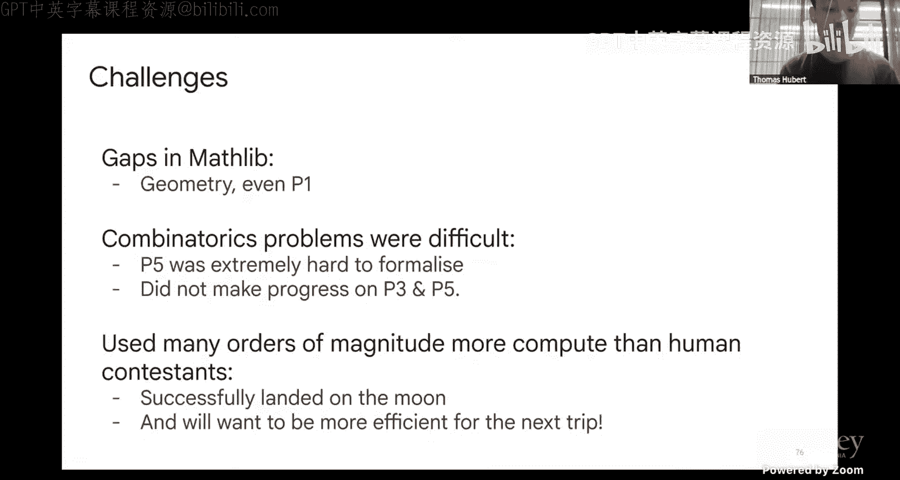

All right， so now let me go into you know the methods and before we get there I want to remind you that you know when we're talking about the methods there were two important aspects we need to think about。

 one is where do the problems come from and how how are we going to have an agent that learns to prove those problems？

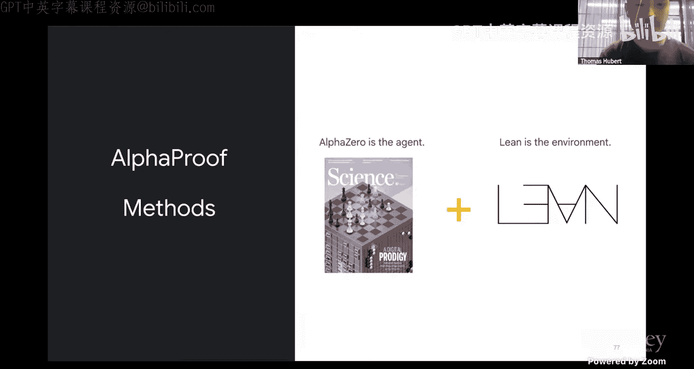

So we train several models one model is a formalizer model so it takes as an input of problem described in natural language in output a lean formalization。

 so this is based on the idea that you we are going to lean onto human definedfined problems instead of inventing our own problems and we are going to try to translate them in lean because they all exist in natural language but they don't exist in we are going to try to do that you know trying to do that with humans don't scale at all。

 takes a long time and so instead we want to try to train a model that can do this automatically。

Okay that's the formalizer model and now we also have a prover model so the architecture prover model is that it takes this kind of you know the if you remember in my demonstration before this kind of yellow box the tactic state the lean state that tells you know what do you know now what do you need to prove this is the thing we I're going to send as an input to the prover model and then the prover model is going to sample n continuation for the proof n things you might consider potentially part of the proof n alternatives and then you take this prover model and you put it in the alpha zero search so you're going to search over actions which are basically one line in the proof each time you add one line in the proof you send that to lean and lean tells you oh what do I know now what do I need to prove now。

And that's basically how the search works if you know a little bit about As Euro and MCTS like search。

 they try to exploit you know what kind of the networks tell you the neural networks tell you。

 they exploit the high prior and high value path。But it has a mechanism also to explore low visited path。

 for instance you know that's how 37 alphafago is discovered is because you know it might have a low prior and might not be considered the right move by the network。

 but they was still going to try to visit it in case it might be an interesting move。Okay。

 so now let me put these thing together in the pipeline step one we do auto formalization。

 so we train a formalization model and auto formalmalize human creative problems。And。

So this is really the answer to the question where the problems come from around human mathematics and here I want to highlight a few advantages of using kind of formalization of a problem first is that when you know like when you send the problem to L and Lin says this is a valid syntax。

😊，It means that you know your question makes sense it's not kind of something that doesn't make sense so it's either true or false you know your generating something that is either true or false okay the problems might not be interesting you know they might be triggerly true or trigger false but but they are either you true or false and so one way to see this is you have the human problem in the middle and you try to generate kind of link kind of variance of it and and you know if your if your model is really good and it would do the perfect translation but maybe also it will generate problems kind of that kind of look like that problem right。

😊，And so when we have this formalization model， the way we used it is we were able to get about a million informal problems and there's a lot of problems to train for the about a million of them。

 we passed them through our formalized model and we generate roughly for every you know problems describing the natural language we generate roughly100 possible translation for it and now we've just created a huge database of formal problems。

😊，Okay now we we need to train the prover to be good at proving and so that's where you you don't really want to be completely in the alpha zero philosophy where you really start from scratch here you want to be pragmatic and you want to start with something that is already can do a few things so you take a pretrain model in in case it was pretrain on a lot of code and then kind of the next step is you're going to train the prover model supervised on Ma the MaL has about like 100。

000 definitions 200000 here and 300，000 lines of proof and basically you are really going to do supervised so you you are going to place yourself inside of a human proof you're going to look at what is the mean state there then youre going to look at what the human said was the next step in the proof and you're going to train the model provides it so in some sense very similar to regular kind pretraining but you get much more information from me。

And so when you've done that， you know your proven model has learned a really good prior over you know the actions to take unfortunately you know mass Lib is about you know I don't know but especially if you want to do the IMO。

 mass Lib doesn't contain much IMO like kind problems， it's all about research math。

So if you take that to a model and you try to apply it on the I。

You get around your presence of right on am。I'm not going to say hot zero percent I actually I' not sure。

 but really close to zero percent。And so that's where you start to have to discover new knowledge about how to solve those AMML problems and so that's where you enter the next stage of the alpha zero reinforcement learning stage and so you are going train the provenr model by R and the recipe is very simple is our recipe for each formal problem you are going to generate experience or either provinging or disroving that problem by searching over the lean steps once you've come up with what you think is proof you're going to use lean to verify the proofs。

 Lin is going to say this is not a proof， this is a proof and for the things that are a proof。

 you're going to reinforce your proven network on those proofs and so what happens is that at the very beginning the prover model either able to prove the very the easiest problems really really easy problems is going to learn from that experience and kind of climb the next rung on the ladder that leads all the way to IML strength。

It's going to be able to then solve a few more problems a bit harder and by learning from those it would go and get better and better and better and all the way to the IMO and so from this stage we decided to do a kind of really the I zero kind of pipeline because what we wanted to see is that of course we want to solve the IMO but we want to do it in a way that we think we generalize way beyond the IMO so you our real goal is to do real mathematics it's not to stop the IMO so we want to have a method that is not tuned to the IMO we want to have a method that can discover new knowledge and so all these proving strategies for the IMO this is completely discovered by the model by itself。

So that's step three and then final step is this thing called test time and so to give you a bit of context as I alluded before you know even for Pocheion or the USA culture or think hours orter tell you know the problems at the IMO are not obvious so even if you have like field metal level neural network of mathematic in you cannot really solve those IMO problems instantly or even for them it takes hours to solve and why is that is because know those problems that been design this way and you really want to learn something about those problems but it's almost like kind of a real scientific kind of experiment you you first need to think of experiments in these cases like what could be true what could be false then you need to run the experiments you know try to prove or disprove those problems and learn from this experience learn about that particular problem。

And the way we did it is that you know AsA proof is going to generate variant of the problem we are caring about。

 so in this case know we have these six problems at the IMO， these are the problems we care about。

 can we generate variance of those problems and basically then run URL exactly as in the previous step to try to discover knowledge。

 especially about those problems。So I'm trying to illustrate this in some hyperplane where you have the agent and the problem so yeah try to imagine this a bit so on the bottom left basically you have a double of problems that the agent can already so easily and so it's a generous checkpoint every like little black dots here and represent kind of a problem that the agent already knows how to do。

And then you know， like very far on the top right， you have this very hard problem that you want to solve。

 so imagine maybe it's the p6 problem at the end。And so as I described。

 the first thing we did was we generated variant on that so we basically explode kind of that problem into many。

 many variants and if you are doing this well， you may hope that it will generate one variant that is actually already solvable by the agent。

😊。

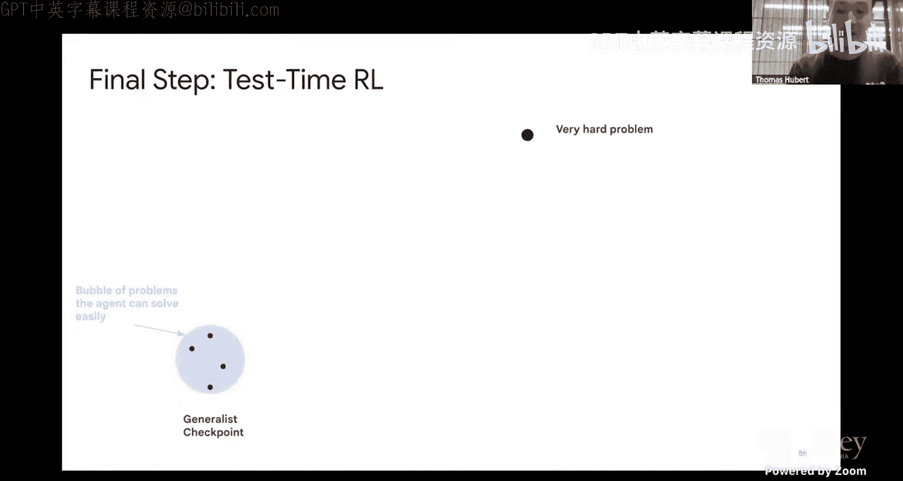

And so you solve that one and you learn from that proof。

 exactly like before and you learn a little bit about that problem， and then you repeat that process。

 you repeat that process， you learn about that problem until you reach that problem。

And you can solve it。 And so that's how actually， P1 and P2 and P6。

 all of them require the somehow allowed to be sold。Okay。

 so I want to finish this section with some challenges for I group。

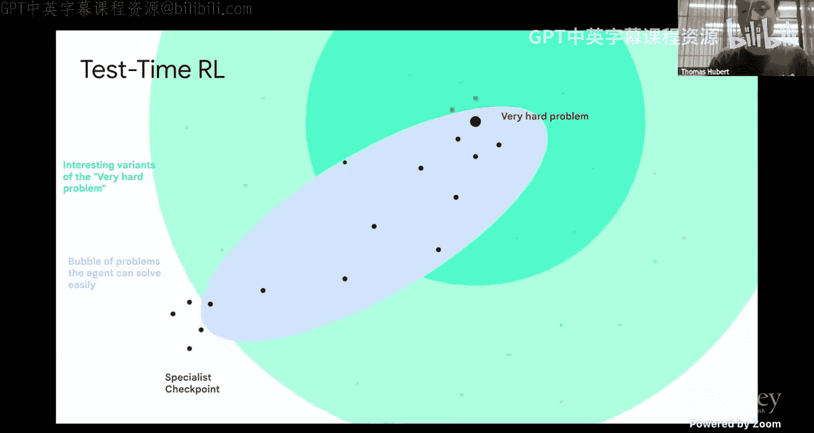

嗯。So we inherit some challenges from formal mathematics， as I said。

 you know most of human data is in natural language。

 but we started to have a good handle on how to translate that human data so that we could learn about it。

So it's still a big challenge， especially as we move forward， but maybe we have some handle on。

Maybe something that is a bit harder is that we cannot easily learn and work on areas that are not supported by muscle。

 so for instance you know like in the geometry case， but if you have nothing about it right。

 you can't even express kind of the geometry problems that humans have come up with and so that's kind of a real challenge to think about。

And。And so this could be solved if you start to understand how to do creative bi of new objects and theories。

 you understand interestingness and beauty in mathematics。

But this is definitely a really cool challenge for future work。Cool， so you know。

 what's next for Alpha proof， as I said， you know， like kind of from the very beginning。

 actually of the Alpha proof project， the idea was to try to see if we could you know。

 learn about mathematics and potentially go beyond human mathematics。The IMO was a really。

 really cool milestone that I think was extremely correlated with that goal。

 but that's not where we want to stop。So obviously what we want to do is we want to broaden to the entire mathematical landscape。

 we don't want to be stuck at high school mathematics and we want in the future to be able to contribute to the front of research mass。

And going back to you know you the understanding that the Greek got 2。

500 years ago of the importance of proof， it would be fantastic if we could democraize democratize kind of this idea of a proof and share that with every thinker from an elite mathematician to you any other person。

 and so can we have as a proof as a useful tool for every thinker？

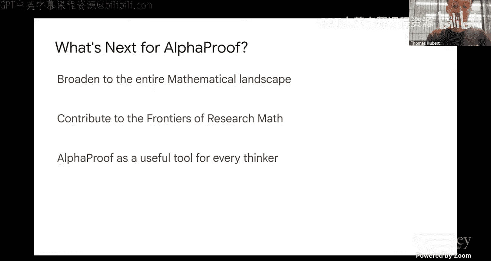

I want to conclude saying that you know the big ideas they are really important。

 but equally important if not more， is the people you are doing this with and the mindset that everyone has on the team。

I was pleasantly surprised to hear that you know in mathematics as well you need to be really optimistic otherwise you will never be able to prove anything。

 I think this is also true in theI machine learning need to be absurdly kind of optimistic to be able to achieve kind of absurd goals and really you know individually this was the most impossible but you know we had this belief that together it was impossible to fail so these were the team members that contributed to this amazing project and yeah let me let me conclude that and thank you for listening。

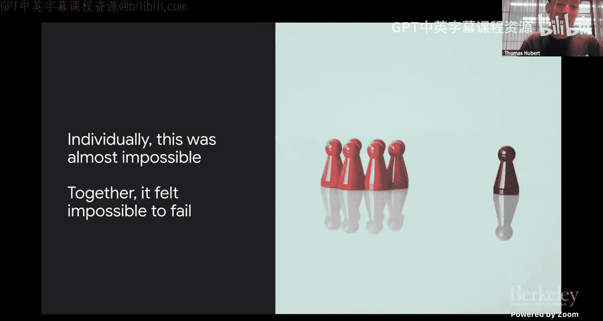

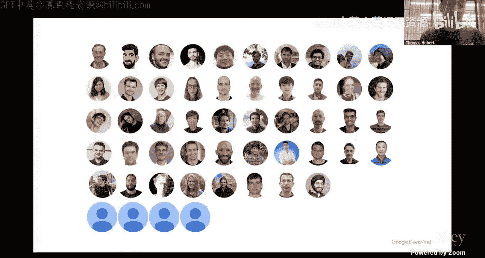