# UCB《高级大语言模型智能体｜CS 194 294-280 (Advanced LLM Agents) 2025》中英字幕 - P9：Lecture 9, Kaiyu Yang.zh_en - GPT中英字幕课程资源 - BV1mkZiYAEYM

And hey， it's great to see you here。 I'm Kau， and I will talk about formal reasoning meets L Ms towards AI for mathematics and verification。

😊。

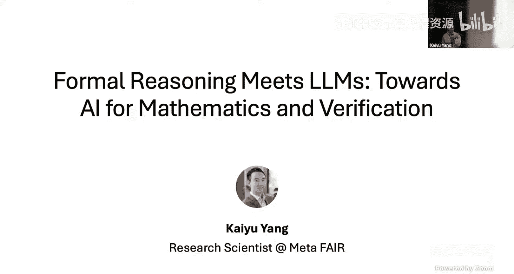

Okay， so we are now kind of in a arm race of large language models in which every leading company releases a new model in every a few months。

 so at the center of this arm race is mass and coding。For example， when open AI introduces0 one。

 you typically see this kind of chats showing that it capability in various on various benchmarks。

 And you see the mass competition like AI M E and coding competition like code forces are usually highlighted。

😊。

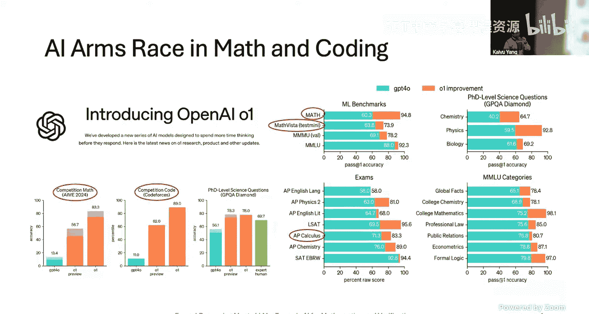

And similarly， when Google released Gemnai and when X AI released G。

 they also highlight the capability in math and coding。

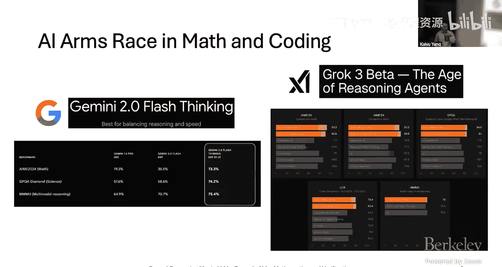

And in November 19 in November 2023， X T X markets， which is a British hedge fund。

 launched the AI M O price。 That's 10 million for AI that can win a gold medal in I M O。

 And not long after that in July 2024， Google Deepmin announced that alpha proof and alpha geometry。

 have achieved the silver medal level。 I guess that's the content of the last lecture。

And if we want to go beyond high school competition math， we have this Apple AI。

 It introduced a benchmark called frontronier math。

Which includes research level mathematical questions thats curated by professional mathematicians。

And not long after that， open AI O 3 announced that it can solve more than 20% of that。 and we。

 which came as a surprise because when frontier mass benchmark was released。 people thought， okay。

 this is going to be， it's going to take a few years for language models to make real progress。

 But really after less than one year， we have groundbreak results from open AI。

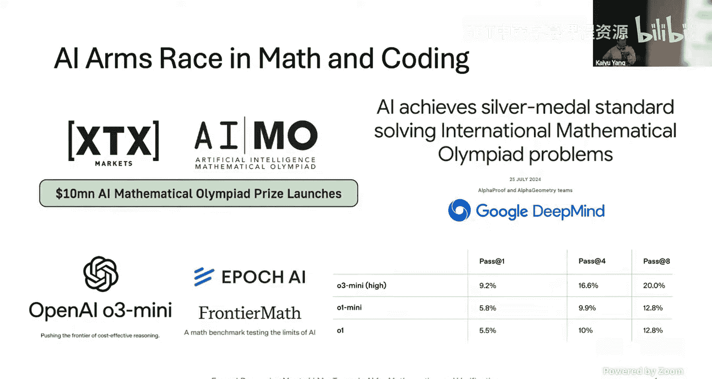

So why are people interested in maths and coding， Why are they often highlighted。

One reason is that math and coding are proxies for complex reasoning and planning and reasoning and planning。

 they are not only important for human intelligence。

 but they are also one of the major challenges for current life language models。

And they can really unlock unlimited applications if you can make language models。

 be able to reason and be able to plan。 For example。

 you can have them do travel planning for you and also have language model agent scheduling calendar invite。

 calendar invites for you。And the second reason that people are interested in mass and coding is they are relatively easy to evaluate because in for a math problem。

 you can check the if the answer is correct。 And for coding。

 you can run the unit test to see if they can pass all the test。

 but if you ask your language model to write a like a claim fiction。😊。

Or you ask it to compose a symphony。 It's going to be much， much harder to evaluate。

You can argue that。Like crime fiction also involve reasoning and composing a symphony definitely need planning。

 So they also need reasoning and planning， but they are just not as easy to evaluate。

So I put it relatively easy here because that as we will come back。

 we don't think checking the answers or running the uniti test is a perfect evaluation。

 We are just arguing that it's a reasonable evaluation。

 and we will revisit this point later in the rest of this lecture。😊，Okay。

 so we know language models are racing to be good as mass and coding。 And next。

 we want to briefly introduce the main techniques behind them。 Like。

 how do we train language models to solve math problems here we focus on math。

 But the discussion largely also applies to coding as well。

 And we will see later that mass and coding are deeply connected。

And state of the art math language models are trained using many two techniques。

 One is supervised fine tuning or SF T， and the other is reinforced learning or R L。

 And we're going to present a very high level view and emphasizing the need for data and for verifiability。

Start with SFT。 So in SFT， you have a base model。 that's a generic language model。

 which and on Internet scale data sets。And to learn mathematics。

 you give it additional data that's focus on mathematics。

 so you can grab web pages from mass overflow， or you can have papers from archive。😊。

And the result of this fine tuium is called the base math language model。Well， it's。

 it has seen a lot of mathematics， but it still hasn't yet learned how to solve problems。

 So the next step is to give it a lot of problems and with with detailed step by step solutions for these problems。

And optionally， you in the solution， you can use external tools。 So here。

 the model is trained to produce not only natural language reasoning。

 but also it can call external tools like Python。 this is this is an example of a problem it can solve。

So the most important thing in this pipeline， as you can see， is data set。

You need data set for a continue pre traininging。 That's the web document collected from web from the mass forums like stack overflow。

 And you are also have to to annotate a lot of data for further fine tuning consisting of problems with step by step solutions。

And I I would say collecting this data set is one of the most expensive art in this pipeline because it cannot be fully automated。

 You need human to annotate the data， to clean the data and to， to transform the data into。

 into the data set that can， you can use。So what if our data has only the final answer。

 but not the intermediate steps。This is a scenario where you don't want humans to annotate data very expensively。

 but maybe you can more cheaply get the data that has only the final answer。

So can we still use this data set to train the model。And the answer is， yes。

 we can use reinforcement learning to train the model to generate solutions with only the problem and the final answer。

 Here is how it works。 So you have the problem and you give it to the language model。

 and the model generates a solution。 that has intermediate steps and that also has a final solution。

 and you can check if the final solution is correct。 You。

 you give by comparing it with the ground truth。So here it's a correct。 it's a correct solution。

And the model can also generate incorrect solution， and you can check。

So this the result of this verification can be used as reward signal in reinforced learning。

 and you can use algorithms like GRPO to optimize the model to achieve high rewards。 Well。

 you you can treat the reward for a correct solution to be one。 And if it's an incorrect solution。

 the reward is going to be0。 So this approach is， is very simple approach and very powerful idea。

 It's actually， the idea is there for several decades。

 But it was first shown to work for for training reasoning language models by deep R1。

 That's fairly recently。And this idea is getting a lot of momentum。

 just to see how much momentum it has just one month ago， two pioneers in reinforcement learning。

 Richard Sutton and Andrew Bato won the ACM Turing Award。

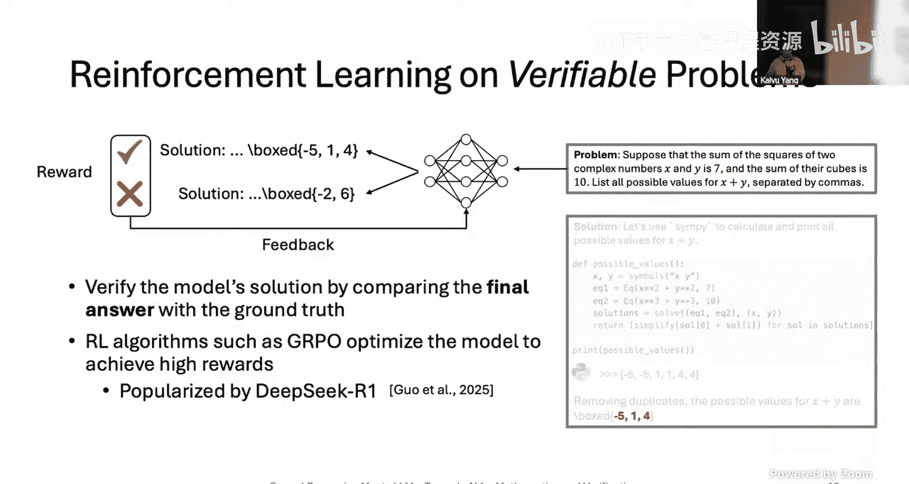

So here in reinforcement learning， the key is really the verifiability。

 So you have to be able to verify the results。 You have to be able to tell if the solution is correct or not。

 otherwise， you don't have the reward。 so if the solution has a final answer。 that's a number。

 if it has a numerical solution， you， you can always check by comparing with the ground truth。

 But what if it's a proving problem。 So you are asked to generate a proof。 But there's no。

 really no well。No， no， no easy way to tell if the proof is correct or not。

 Can we still do reinforce learning， We will revisit this point in the later of this part of this talk。

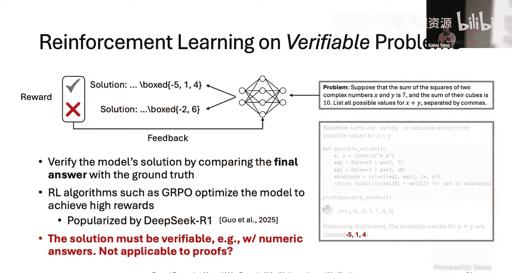

So here we have covered the main techniques to train language models for math supervised learning and reinforced learning。

 I would say any state of the art math language models is kind of like it's a combination of a very strong base model。

 And these two techniques for post training。 and maybe more importantly。

 marvelous engineering efforts。So the algorithms are very straightforward。

 Pretty much every leading industry lab is using the same algorithm。 But what。

 what really matters is is who has the better infrastructure， better engineering and better data set。

So then we will ask， will AI soon solve mathematics since we have this very powerful recipe。😊。

And the answer is definitely no。 So we have a few gaps。 So the， the first gap is。

 how do we go from free college math to advanced math。

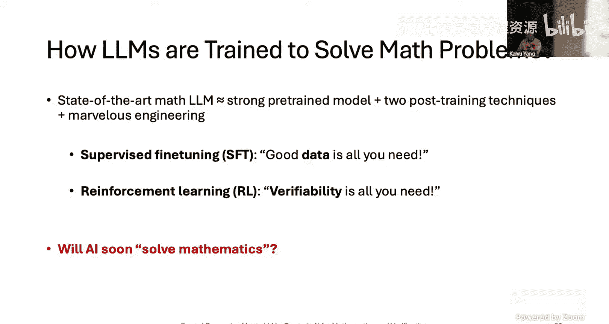

Existing successes are as we see the most limited on。Pre college math， like I M O or A M E。

 And if you give language models more advanced mathematical problems， they still struggle。

 So this code is from Terry Tao， who is one of the most prominent mathematicians nowadays。

And he said， he played with open AI， O1。And he finds they still struggle with the most advanced research mathematical tasks。

Well， this is kind of expected because mathematical research is， by definition， novel。

 And by since it's novel， you don't have a lot of data to train language models。And also。

0 ones0 threes results on frontier mass， as we mentioned before。

 they are on advanced mathematical problems， but they comes with a few caveats。Well。

 the first caveat is。ThereThere are financial ties between Apple AI and open AI that were later disclosed。

 But I would say more importantly， there's a difference between frontier mass and real mathematical research。

The problems in mass frontier mass are designed to have numerical solutions。 So they are advanced。

 They are very advanced mass， but they are designed to have a numerical solution。

 So this is kind of counter intuitivetuitive because we， we know most problems in advanced mass。

 they don't have numerical solutions。 but they designed the benchmark in this way in order for the models to be evaluated。

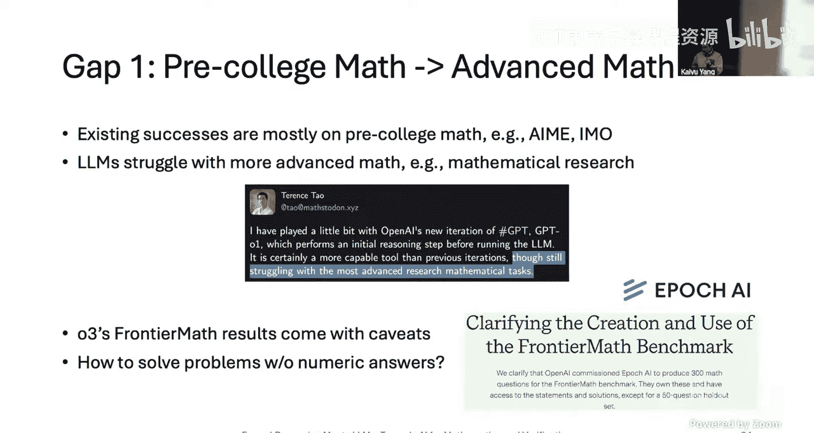

And so this is related to and the second gap。Current models are very good at guess the answer。

 But how do we get it to write proofs。And， and recent study has found language models still struggle in writing even very basic proofs。

So Put name Ben Put name is a mathematical competition for undergrads。

 and people recently tried using open AIs reasoning model on Put name。 And here's the result。

 I'm very unimpressed by chat G T in the recent Put name exam。

 And it can most answers are worth one or two points out of 10 points。So， this is。

Checked by human mathematician。 And recently in another paper。

 researchers evaluated language models re proofs for the USA MO exam。

 And they showed that all the models scored around 5%， which is pretty low。

And the errors those language models are making can be they they can be pretty easy to spot once they you pointed them out。

 But if it's in a long proof， it's very hard to detect them。 So here's the example。

 we are asking the model to prove a very simple inequality。 So if ABC satisfy some condition。

 And then there should be some you， you have some results。And here it's making an arrow。

 when it tries to multiply an existing inequality by a positive number。

 it should preserve the direction of the inequality， but it flipped the direction。 So that's。

 that's a very simple  error， if you pointed out。So。We argue that like current language models。

 the current approach for training language models is not sufficient for solving these problems because it relies heavily on。

 on data and on verifiability。And when you work with advanced mathematics， as we said。

 you don't have enough data。 the data is very scarce。And when you work with proofs。

 you don't have verifiability。And in in the in advanced mathematics， most problems requires proofs。

So if language models are not enough， what else do we need。

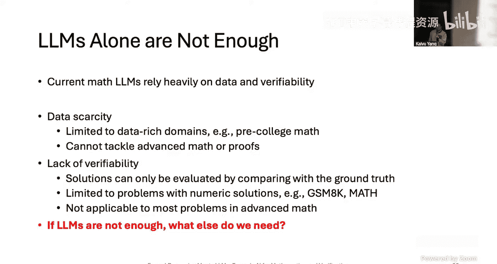

In a recent position paper we released on archive， we argue that one important missing point is formal reasoning。

Here， formal reasoning means you， you grant mathematical reasoning in formal systems。

And formal systems， they can include like first order logic， high order logic。

 dependent type theory or even computer programs and their semantics。

And the role of formal system here is to try to verify the proofs and provide automatic feedback on the proofs。

So this is very useful because the feedback it provides can mitigate data scarity。

 You can have the model learn from automatic feedback。

 and you don't need to collect as much human created data。And second， now you can do verification。

 which enable you to evaluate the model rigorously。So therefore， we argue that to move forward。

 we really need to integrate formal reasoning into the current approach。

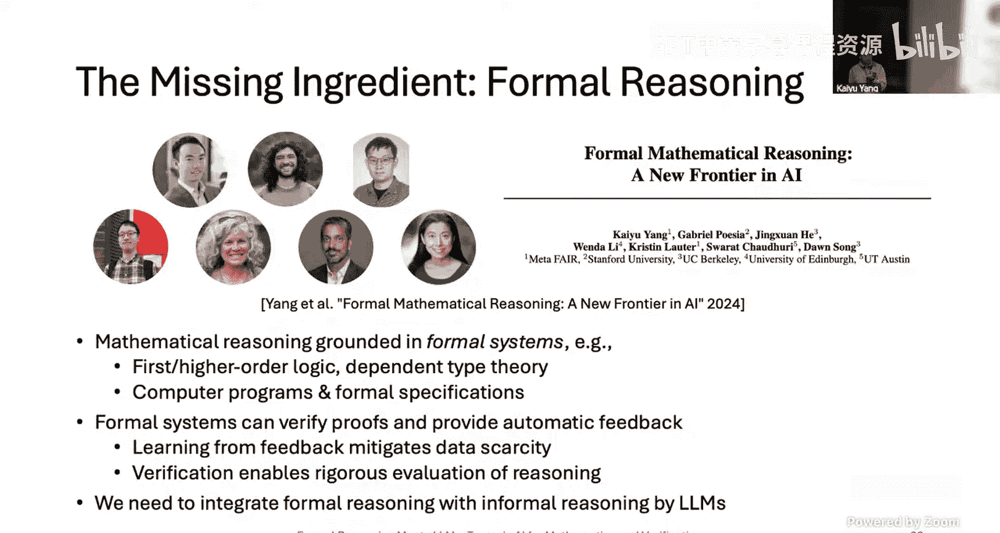

So we're going to very briefly introduce L， which， which is a kind of formal system we focus on in this talk。

 And it it it's also used in alpha proof。 So guess people already have some familiarity on L。

 So here is a here is a programming L。 In this program， you first define natural numbers。

 So a natural number is either0 or a successor of another natural number。

 And then you define addition between two natural numbers。 So this is just a recursive function。

And then you can state and prove some theorems about natural numbers and addition。 For example。

 you can prove A A plus B equals to B plus a。And this here is only one file in L。

 And if you are using L to write formal mathematics。

 it's similar to using Python or another programming language to develop software。

 So you have one file。 And this file has a proof。 And the proof is， it has semantics。So it， you。

 you are starting。 it corresponds to a proof tree。At the root of this tree is the original theorem you want to prove。

And every step in this proof decomposes the proof goal into several simpler subgo。

 And you can do that recursively until all the sub goals are solved。And this is one file。

 and files are organized into larger units like a project can can have many files。

And the project can be open sourced on Github。 For example， in your project。

 you can define real numbers and someone else project can build on your definitions of real number。

 and they can formalize， for example， like optimization theory。

So this is similar to how you develop software。

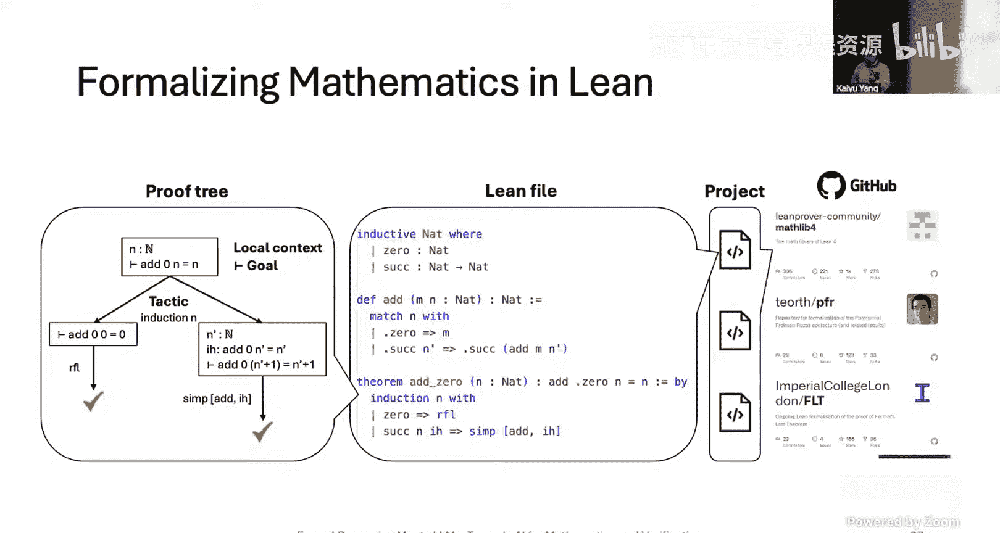

And one example of using AI with L is alpha proof。 That's the content of the last lecture。

 And they it's a， it's a very successful example。 And it uses L to generate a lot of thes and a lot of proofs and use and verify those proofs and do search and reinforce learning to learn the model。

So in， in the rest of this lecture， we will be talking about many two tasks at the center of using Ling and AI。

So first is theory improving in theory improving， your input is a serial statement。

And you want the model to generate a proof here， Both the statement and the proof are written formally in Lin。

 and Lin can check if the proof is correct or not。 So there's no room for the model to hallucinate。

And the other task is auto formalization。 In auto formalization， you have the informal mathematics。

 for example， from a textbook， and you want to use your model to translate it into formal mathematics。

So next we will be first focusing on theory improving。

A very straightforward way to do theory improving is you just give the model what you want to prove。

 and you ask the model to generate a step in the proof。

 or you can ask it to generate the entire proof。 And well， because they， if you， you。

 if if you can generate the next step， you can kind of using search to change steps together into a complete proof。

So I， I would say， like the central problem here is how do you generate the next step。

And a very straightforward solution is， okay， we have human written formal proofs。

And we can train a model to， to， to do supervised learning on those data so that the model can learn how to generate the next step。

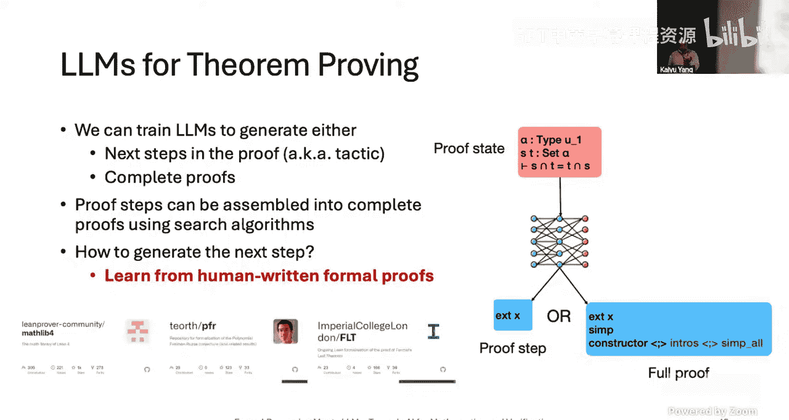

And this idea has been actually here for like for a while。

 and earlier work used classical machine learning algorithms like canist neighborhoods。

And around 2019， people have started to use deep neural networks for this task。And even later。

 people are starting to use large language models。 and I would say。

 until the use of large language models， we really see a boost in the performance because the model can acquire a lot of mathematical knowledge during pretraining and use that knowledge in theory improving。

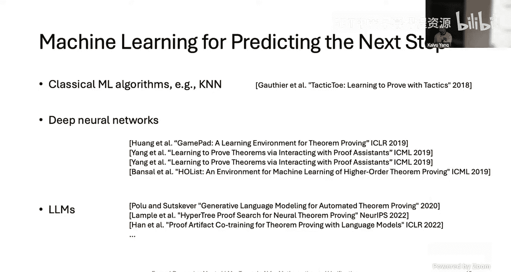

So we will be mainly talking about this paper called Ldojo， which was published in New 2023。So。Well。

 it in this paper， we provide open source data sets， tools and models for season improving L。

 And compared to previous approaches， the main difference is first。

 we are completely open previous approaches are are private and they don't release the data set and models。

 and they， they were done in private labs。And second。

 we propose a new model to generate the next step in the proof。So here' is an overview。 So in L。

 we can extract data from human written L code。We extract about 10000 theorems and proofs。

And for each proof， we have the steps in the proof。

 And we also have the the lams used in the proof and also the definitions of this lems。

And after extracting this data set， we use this data set to train a machine learning model。

 And once the model is trained， the model can interact with L to prove nu。

And so here is the model we introduced for this task。 It's called rettrival augmented prover or reer。

The motivation is that when you prove a season， you almost never start from scratch。

 You use existing las。And in order to use existing las。

 the model have to know what las are there and try to decide whether a la is useful。So here。

 given a proof state， that's the goal you want to prove。 And also given a library of la。 So we found。

 we first do retrieval in this phase， we encode everything into vector。

So the state is is now a vector， and each lamma becomes a vector。

And we compute the similarity between the state and each lamma。

 and we use the result to retrieve the the top lems。And after the lemmas are retrieved。

 we combine the lems with the state and use another language model to generate the next step。

So here the model is very simple。 but the really important point is how do you get the data set。

 And as we said in L Dojo， you can extract the data set from L like from L products like Male and other L products。

So here is a summary of typical neuros improver。So on the left， you see a tree。

 So that's the tree doing proof search。 You have a initial state。

 and your model can generate multiple potential next steps。 and you can run those steps。

 which gives you the next proof state。 And you can do that repeatedly until you find a proof。

 so for this part， you can use any search algorithm like DF S or monocol tree search。

And the second part is， how do you generate the next step。 So on the right。

 you see at each node in this proof the tree， you have the current state。

 So you give the current state to the language model， and it generates suggestions for you。And here。

 optionally， the language model can take a formal math library。

 which is the library of Las you can use。And so after the Liia work。

 we've seen a bunch of work trying to improve on that。 For example。

 one thing you could do is what we call expert iteration， So which is。So you have a approval。

 even if it's not very good， you can use it to prove some to attempt to prove some newem。

And in this process， you will get some new proofs。 And once you get the new proofs。

 you can add them into your training set。 So now you have a better training set。

 and you can use the better training set to train a better prove and you can iterate。

 So in in this way， we show that if you run for more iteration。

 the performance usually improves until you you hit some saturation point。😊。

So we've seen a very simple way to build a theory improving model。

 You just extract human written proofs and you train a language model to generate the next step in the proof。

嗯，OK but。We would say it's， it's a great step， but it comes with limitations。

 So the first limitation is。Still data， because language models work well。

 only if you have a lot of training data and the amount of human written proofs on the Internet is very limited compared to say Python code。

And also， another limitation is inherent to the task of the proving。

 So if you think think about other tasks that AI has been successful， like playing goal。

 So what's the difference between playing goal and proving a the。The main difference is in goal。

 you have a 19 by 19 board。 So the possible action you can take is。

 is constrained by the size of the board。 It's finite。 But in mathematics， arguably。

 you can your action space is infinite。 So there is infinite number of thing you could potentially do when proving a。

So since the action space is infinite， it's really hard to cover this entire space。

 if you have only learn from human created data sets。 And even if you re use reinforced learning。

 it's very hard to explore the space efficiently doing reinforcement learning。That's a good question。

 So in， in the work we've been weve we have talked up to now。 we are just using supervised learning。

 So there's no curriculum involved。 But if you use reinforce learning is natural to have the model first learn from relatively simple examples and then try to generalize and if you look at more recent work in using reinforcement you improving。

 one major difficulties is how how do you choose examples to present to the model。

 So you want the examples to be。Not too easy， but also not too hard。嗯。

So how do we solve the limitation regarding the action space？ So in a more recent work。

 we try to take a step in that direction， but we choose a very limited domain as a。

 as as a playground。 So we prove inequalities in mass olympiate。

So inequalities in mass Olympia iss like you have a few real numbers like ABC。

 and they satisfy some precondition。 And you want to prove a post condition like this。

And we choose this domain because the proofs in this domain is highly regular。

 So here is what humans would do。 humans would do typically two things。

 One is you you can apply an existing lama like AM M GMM inequality or k inequ。

 And the other thing people typically do is to rewrite the current formula into into a form so that an existing lama becomes applicable。

But even with these two kind of actions， the action space is still very big。For example。

 for proving this particular inequality， you can apply AMGM and AM MGM can be applied in more than one way。

 So you you have more， you have very big branching factor。

 and you can also apply other inequality like the T2 inequality。

And you can also potentially choose to rewrite the formula into this form。 So here the。

 the actions you can take is essentially infinite。So how do we navigate this this kind of infinite action space。

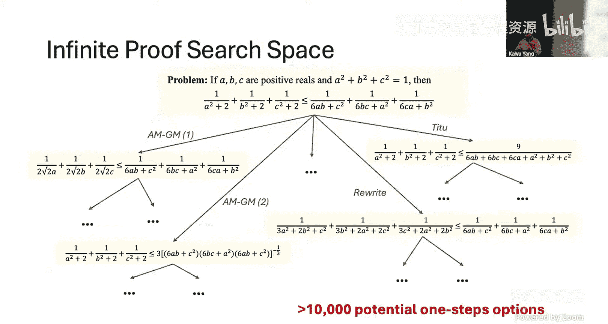

So one thing we do before before trying to solve the problem is， okay。

 let's try to see how O1 solve this problem。

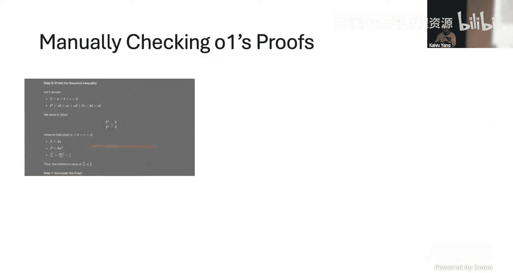

And we give a lot of inequality problems to O1， and we manually check their proofs。So as a result。

 we find a lot of errors in there in the open produced proofs and。

We checked 20 examples。01 preview proved none of those examples。

And the more powerful03 and also deep deep are one also only improved 3 or four out of 20 examples。

 whereas a typical gold medalist， like a human gold medalist， can prove at least 15。

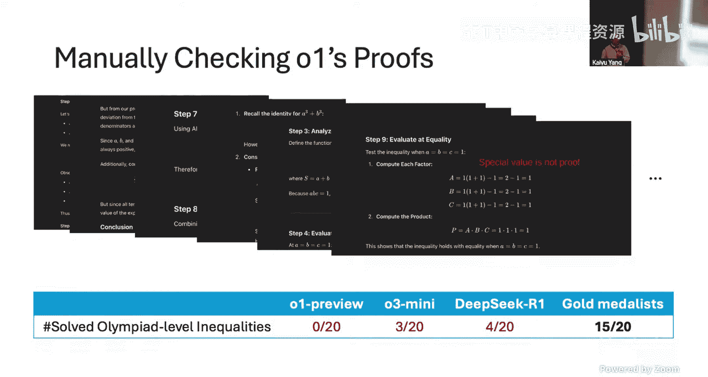

So then let's come to our method。 So， as we said。We categorize the steps you can take in this particular problem into two kinds。

 First， we call it scaling。Scaling is you， you apply an existing lama like cautious ws to a part of the current formula。

So in this example， you find that the left part of the formula can can be can be used for k Was and give which gives you the result on the right hand side。

So what's special about scaling is the number of scaling you can do is finite。 This is because， okay。

 you only have a finite number of las， and each lam can be applied in only a finite number of ways。

So it's actually possible to enumerate all the scalings all， all the possible scalings in this space。

And besides scaling， another category is called rewriting。 Rewriting is you。

 you are given a formula and you want to transform the current formula into another form。

 and rewriting is very different from scaling the sense that the space is infinite。

 So given any formula。 there are infinite number of ways you can you can rerite it。

So the key insight here is that after we make this categorization。

 our algorithm can enumerate all the possible scalings using a symbolic algorithm。

 whereas the rewriting， the like the infinite。Base can be handled by large language models。so诶。

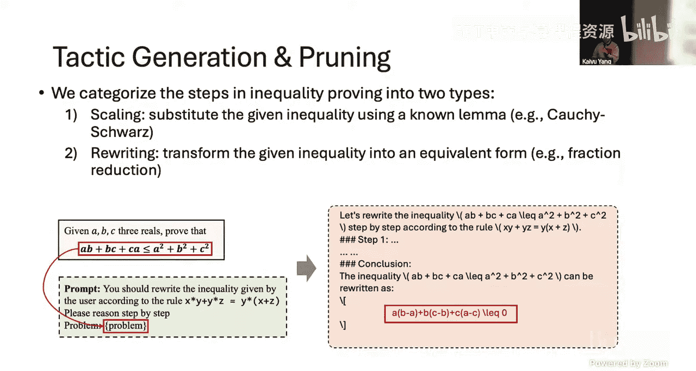

We combine the next step generated by the symbolic algorithm， with language models。

And we use some heuristics to filter the results to reduce the number of goals you have to improve search。

And as a result， we solved a much more。Problems compared to deeps R 1 and also also O3。

 So here on the top， you see R1 proved4 theorems。 Human can prove 15。

 whereas our system called lips can prove 16 theorems。And at the bottom。

 we evaluate our system with on a few benchmarks and compare with existing methods。

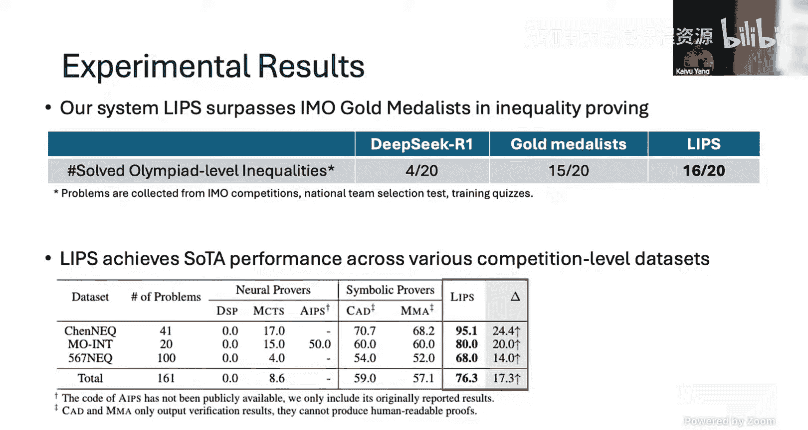

So here's one example， one interesting example proof discovered by our system。

 So here is interesting because it's from Evanvan Chen， who is a I M O coach for the team USA。

 he has a problem set。 And he said this problem has no hope to be solved by AM MGM。

 but we find that the proof discovered by our system uses only AM MGM combined with clever rewriting。

 so it can actually find proofs that humans do not know how to find。So here is the takeaway。

 The challenge in theory improving is how do you efficiently explore a potentially infinite action space。

And while， this is a very hard problem。 But if you are working on a specific domain of mathematics。

 you can use domain insight to structure the action space so that the action space become more feasible。

But it is an open problem of， like whether you can generalize this approach to be domain general。

So after talking about the improving， we will be going to auto formalization and。Like。

 feel free to read to bring it up any questions， any time。So in auto formalization。

 we have informal mass， and we have formal mass。 and we want the model to be able to build a bridge between them。

 like translating from informal to formal。And here， actually。

 we have two slightly different sub problems。First is， how do we auto formalize the Syrian statement。

And second is， how do we auto formalize the proofs。In statement auto formalization。

 the model only take the statement and prove the and produce the statement in in L。

 but improve auto formalization， the model have the informal statement， the informal proof。

 and also the formal statement。 and it only produce the formal proof。

So these two sub problems have different challenges。

 Let's talk about statement formalization first for formalizing the statement。

 It's really hard to do the evaluation。Because for example， here。

 the informal statement says there exist an infinite number of primes。

 and the formal statement says for any natural number N that exist a P。

 that's greater than equal to n p is prime。 So， so this is obviously a correct translation of the of the informal statement because it implies the infinity。

 But the problem is it's not the only incorrect solution。 So if， if we produce this solution。

 we change P greater than or equal to n to be strictly greater than n。 well essentially the same。

And we can even make it more different。 We can make an also a prime。And for any human。

 you can easily see， okay， these three statements well， they they are slightly different。

 but they are essentially the same thing。But this creates a problem for machine learning。

 So if the machine learning model produces one of them。

 how do you know if it's equivalent to the ground truth。You may want to say， okay。

 can I like check the logical equivalent。But the reality is this kind of checking the equivalence between two Syrian is computationally invisible in general。

And in practice， researchers have resorted to heuristics or human evaluation。 But if human。

 if you rely on human evaluation， it's going to be very expensive and not reproducible。

 And if you re， if you resort to proxy matrix or heuristics， it's not going to be accurate。

So that's the challenge for evaluating the auto formulaized statement。 How about proofs。

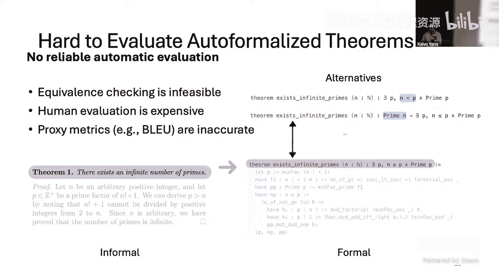

Proves we have another challenge。 human written proofs are even if they are very rigorous。

 they are not rigorous enough to be formalized。They often have host like one kind of poet like mathematicians often say。

 okay， this case is left to the reader。So if， if it's left to the reader。

 your model has no way to figure it out from the text。 It has to figure it out by their own。

And there are more subtle holes in the proof that we will cover later。

 But in all for the model to be able to auto formalize the proof。

 it kind of have to fill in all those kind of gaps， which can be very difficult。

So we've covered two key challenges in auto formalization。 for statement。

 we don't have a reliable automatic evaluation。 And for proofs。

 the model have to fill in all the reasoning gaps。And in this project。

 we want to address both problems。 So that sounds very intractable。

 But a lesson we learned in this project is that since intractable in general。

 can be made tractable if you restrict to a very specific domain。

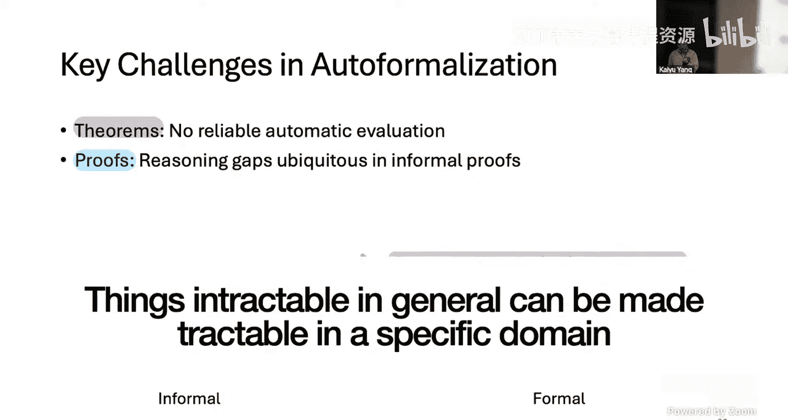

And the domain we choose is Euclideian geometry。Euclidean geometry， it's。

 it's one of the oldest branches of in mathematics。

 and it has been used to test human intelligence for more than 2000 years。 And recently。

 it has become like of interested by the AI community because of the alpha geometry work where they have a AI that can solve I M O level geometry。

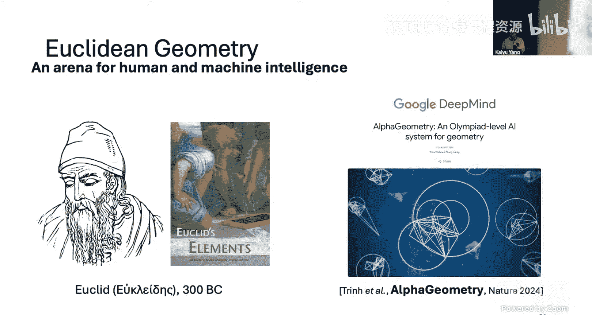

So in this work， we， we show that Euclideian geometry is not only a good domain for theory proving。

 It's also a good domain for auto formalization。And more concretely。

 we collect a benchmark called L Euclid in Euclidean geometry。

 It consists of 48 problems from Euclius elements book 1 and more than 100 problems from UniiG。

 which is an an existing data set。So let's look at one example in our data set。

So this is directly from Euclius element。 It's proposition  one from book 1。

 It's basically you have two points A and B。 And you want to show that it's possible to construct a equilateral triangle。

So for each problem， you have the diagram and the informal s statement and also the informal proof。

And when constructing the benchmark， we try to manually formalize this problem in L。

So on the right hand side is our formalization in L。As you can see。

 it corresponds very closely to the informal version。 like the first step is you。

 you draw a circle BD that centered at a。 and the be should be on the circle。

 and the second step is you draw another circle。 And you try to find the intersection。

 and you connect everything And then that's a eucate triangle。

 So they are only like five or six steps in the in the formal proof。

 And each step corresponds perfectly to to what what's being done in the informal proof。

 And we did this for all the 48 themes and proofs in euclise elements book 1。

 And this isally very plealicing for me because。To the best of our knowledge。

 we are actually the first to formalize euclius elements in a proof assistance like L。And well， we。

 we want to keep the proofs very faithful in the sense that there is a direct correspondence between formal and informal。

 And， as we will see see later， this is not always trivial。And during this process。

 we find a few very interesting  errors in euclius elements。

I think we can probably go over one of those arrow just to see how formalization can help you check mathematical proofs rigorously and uncover bugs in a proof that you may think it's already very rigorous。

So this is Op 24 from Euclius Book 1。It says if you have two triangle。And then。

The two triangles have two pairs， pairs of edges equal to each other。

 So A equals to DF and A B equals to D E。 So blue equals to blue， red to equals to red。

And the angle A is bigger than angle D。So you want to show that B is greater than E F。Well。

This is doesn't look very difficult。 And I'm going to show the original proof by Euclid。So first。

 you try to move the triangle from the left to overlap with the triangle on the right。

So C will become G。And then you try to connect F and G。So now， the problem becomes。

provingroving E F greater than E G。this is easier because E F and EG are now in the same triangle。

And according to a previously proved theorem in the same book in the， in in the same triangle。

 a bigger。Angle corresponds to a bigger edge。 So you only have to prove。

The relationship between these two angles。You have。

 you have to prove the big angle here is indeed bigger than the small angle。So how。

Just notice that we have aless triangle here。 We have DGF DG equals to DF。

And by a previously proved lemma in an angle， in an triangle。

 you have two angles equal to each other。嗯，So。Then you can。

 you can argue that the bigger angle is bigger than the DFG， because like it's a super of the BFG。

 and the DFG is equal to DG F。And DGF is bigger than the smaller angle。

Then you have proved the bigger angle is bigger than the smaller angle。 Okay。

 so this is very trivial。 But the proof is actually wrong。 Anyone knows why。No， O， what。

 what technically is's not wrong for this diagram。 but what if they look like this。

So let me try to replay the proof。First， move the triangle to the front left to the right。Second。

 connect G and F。Now， we want to prove E F greater than E G。

And we want to use this socialless triangles alpha。 So this alpha are equal。

 and we want to prove x greater than y using alpha， which does not work directly。

 because in the previous diagram， alpha is a part of x。 But now alpha is outside x and y。

 So you cannot use it as the angle in the middle anymore。

 So the original argument break in this diagram。So how do we fix this proof？ Well， luckily。

 it's fixable。 Otherwise， we will， we will probably。Publish a bigger paper。嗯So。First。

 notice that the angle D G E， That's alpha plus y。 It's a inner angle in a triangle。

 So it's smaller than pi。 That's trivial。 And second。2 pi minus alpha minus x。

 That's D FE is also smaller than pi。 If you add this inequalities together。

 alpha will cancel out and you get x greater than y。 So it can be fixed。 But as you see。

 this proof is quite different from Eucus proof。 So that's we why we think Eucus has made an  error here。

Or technically， it's not an error。 It's like this proof has two cases。 This case。

 these two cases are slightly different。 and one case is more challenging than the other。

 but Eucus omitted the more challenging case and focused on the easy case。Okay。

 maybe that's a very interesting digress that's not related to AI。

 but it showed how AI and L can make things more rigorous。Let's go back to the to AI。嗯，受。

In our benchmark， we the first thing good about it is it enables you to check whether the auto formalized different statement is correct。

So here is how we check if the statement is correct。 We have a ground choose。

 and we want to check if it's logically， if the model generated statement is logically equivalent to the ground choose。

 So given two statementss， T 1 and T 2， we check it by proving T 1 implies T 2 and T 2 also implies T 1。

And here we use a automated reasoning tool called the SM T solve。 But if you remember。

 I said this is invisible， but how it becomes feasible now。

 And it turns out now it's feasible because。The theorems in Euclidean geometry takes a particular form。

 They are not general theorems。So。Problems intractable in general can be made tractable in a specific domain。

And so that's how we check the C statement。 Another problem is auto formalizing the proofs。

 So here in Euclideian geometry， we want to show that。

We show that there is a well known kind of gaps in the proof。 we call diagrammatical reasoning gaps。

 I'm going to show that using an example。 So proposition one from Euclius elements book 1。

Given two points， A and B， you can construct a equilateral triangle。Here is Eucus proof。

 draw a circle centered at a and B is on the circle。 drawaw another circle centered at B。

 A is on the circle。Take their intersection， C and connect everything。

 You get a equal letter triangle。Anyone disagree with this proof。No， okay。 the problem is。

 did we prove C actually exists， Did we prove these two circles actually have an intersection。

We didn't。 And actually， if you try to prove it because so this is proposition  one。

 So to to prove this proposition， you can only use the axioms。 There's no existing las。 And you。

 if you try to use Euccleus axioms to try to prove these two circles intersect， you。

 you cannot prove it。 actually， So it's not provevable。

But no one bothers to prove it because it's just so obvious in the diagram。 It becomes a problem。

 If I want to translate this proof in L。 When I formalize the proof in L Lin does not know what is the diagram or what is obvious in the diagram。

 So I kind of try， have to formalize what is obvious in the diagram。 I， I believe this I。

 I was in the in the zoom last in the last lecture。

 I believe someone ask a question about how do we formalize Euclidean geometry in L。

 I think this is very closely related to that question to formalize Euclidean geometry in L。

 the most important thing or one of the most important thing is how do you formalize the concept of being obvious in the diagram。

And luckily， this， this problem has actually been solved before。

 So this is a work from Abigad with a professor in philosophy now in CM M U。

 So Abiga essentially identify a set of axioms。 that's not in euclius axiom system。

 you can think of it as like an unspoken axiom or hidden axiom。

 And so what is being obvious in the diagram。 It is just if a fact is a consequence of those axiom。

 then it's obvious in the diagram。 So now we have a computational meaning of obviousness in the diagram。

 And we can implement a automated reasoning algorithm to try to derive things that are obvious。

So let me put everything together。 So in this work， we have a benchmark。 So in the benchmark。

 we have a diagram。 We have informal mass。And we have a ground truth。

 formal statement that's written by human。 So now we use a model to do auto formalization。

 It generates a formal theorem， and we can check whether it's equivalent to the ground truth using SM T solvers to prove that they imply each other。

So after checking the statement equivalentvalence。The model can also do proof auto formalization。

Say it generates this proof。 And we give this proof to Lin。

 Lin will identify a a set of holes in the proof。And we give those holes to the to S T solver。

 which will tell us if the holes are obvious in the diagram。And if everything works。

 then we conclude， okay， this is a correct formalization。

 So what our benchmark really do here is we provide like a protocol that you can use to rigorously evaluate auto formalization。

And so after collecting this benchmark， we also did some very simple experiments using just G 4 and G 4 vision。

 And here we don't train the model。 We just give a few demonstration to the model and ask it to auto formalize the decision statement。

 So blue here is G 4 and green is G 4 V， which also takes the diagram as input。

And so here are two takeaways。 One is， if you look at the X axis you is how many demonstration demonstrations you give to the model。

 So if you give the model， more demonstration， iss going to do better。

 But even if you give five demonstrations or even more。 the model get only about 20%。

 which is pretty low。 which shows auto formalization is very challenging。

And if you compare green with blue， you see green is a little bit better。

 which shows if you give the diagram to the model， it。

 it has a stronger understanding of the geometry problem。And here are some takeaways。

 We identified two challenges in auto formalization for serum statement。

 You don't know how to evaluate for the proofs。 There are too many holes in the human written proofs。

And we address them by limiting to a specific domain。 So in this domain。

 we can build a equivalence checker to for the statement。

 and we can build a tool that can fill in all the gaps。But still， the open problem is really。

 how do you generalize across a broader set of mathematical domains。嗯，So。Now。

 we've covered both tasks auto formalization and theory improving。

 And this is the end of this lecture。 and I'm happy to take questions。😊。

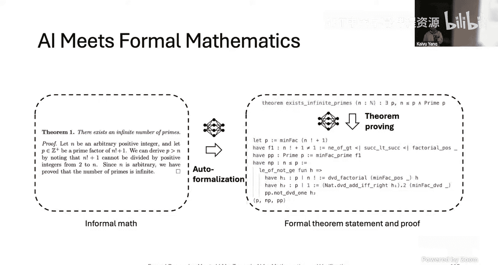