# UCLA《大语言模型的强化学习｜Reinforcement Learning of Large Language Models 2025》中英字幕 - P12：-12--UCLA RL-LLM- Chapter 3.2_ Reinforcement learning with verifiable rewards (R - GPT中英字幕课程资源 - BV1yGzGBgErC

RLDR with large language models is based on the use of chain of thought。

 So chain of thought abbreviated as COT is a technique for large language models to talk or think to itself before producing an answer。

Compared to immediately producing an Azure， COT greatly improves the performance。

So let's imagine asking the question， a juggler can juggle 16 balls， half the balls are golf balls。

 half the ball golf balls are blue， how many blue golf balls are there。

 and then we prompt the model with answer， the answer in Arabic numerals is。

 and then we press enter so that the chat bot has to produce an answer。As you can see in this output。

 the output is incorrect。 The correct answer is actually4。

 and also the language model didn't do any thinking。 It just immediately produced the answer。

So instead， if we want to induce the model， if we want to push the model。

 if we want to encourage the model to think before answering， then for the answer。

 we prompt the language model with the phrase， let's think step by step when we do this。

 the language model then goes on to think step by step and it starts talking about what the steps that you would have to take in order to arrive at the answer and in the end it produces the correct answer alongside an explanation of why of how it got to this answer。

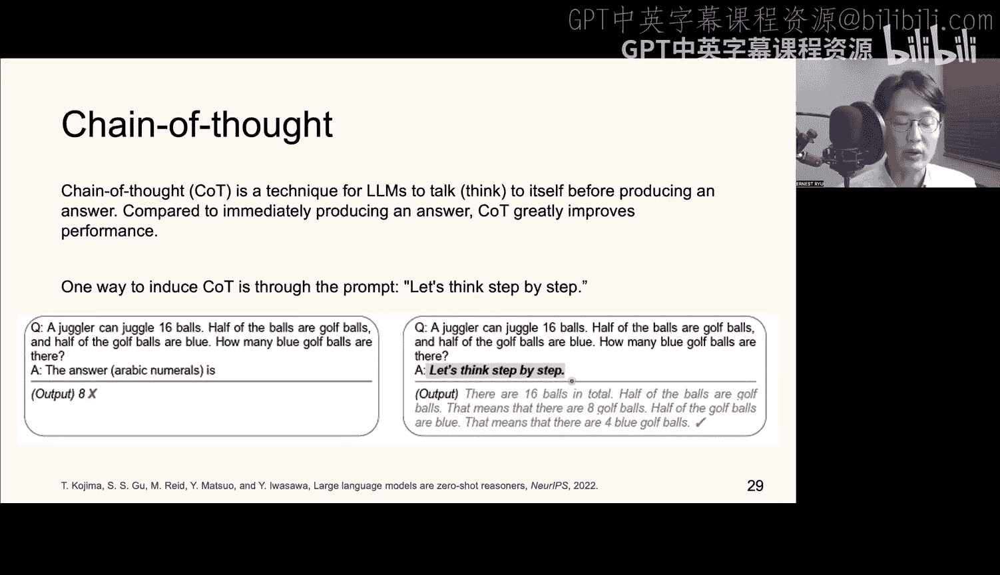

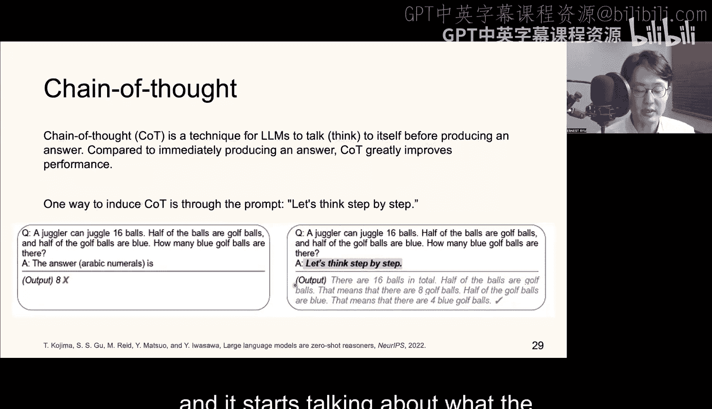

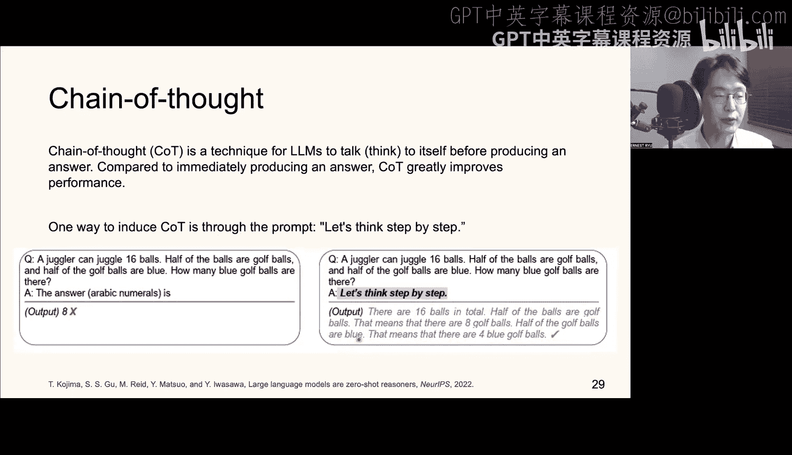

Another way to induce this kind of COT behavior is through ICL prompting。

 So here is an example of standard prompting。 Roger has five tennis balls the audiodia there is a math problem。

 How many balls does he have now well the answer is 11 and then the second question。

 the cafeteria has 23 apples and then the audio some math problem and then if we press enter the model will mimic the formatting behavior that was within the prompt So it will just go on to answer the question immediately and it says the answer is 27 So that's not what we want we want a chain of thought thinking behavior So what we do is in the model input we give the math problem and then instead of immediately providing the answer for the answer key we say Roger started with five balls two cans of three tennis balls each is six tennis balls。

5 plus6 is 11 and therefore the answer is 11 So in the prompt we show examples of a chain of thought text and followed by the answer being produced when you prompt the language model in this way when you provide another question through in contexttex learning。

The language model infers that well for this answer as well I should do some thinking before I produce the answer so it goes on to say stuff and then through this chain of thought reasoning it's able to arrive at the correct answer so chain of thought prompting is an extremely powerful mechanism when you measure things quantitatively so if you provide the language model with a collection of math problems and compare the performance。

 the accuracy， the proportion of correct answers with and without chain of thought prompting the difference is night to and day and for this reason a modern modern large language models are instruction fine de tuned even to exhibit this kind of COT behavior。

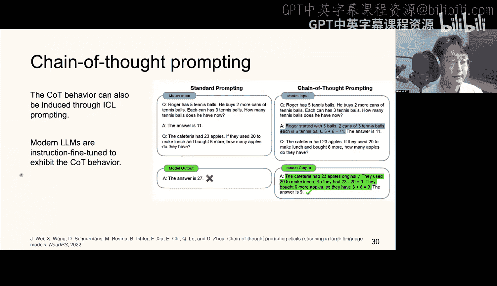

Another component that I want to talk about as an ingredient of RLVR is co training language models with code。

So automatic program synthesis was a longstand challenge within the field of programming languages people。

 a lot of people thought of what if we could write a computer program that writes a computer program。

 Is there a way for us to automatically write a computer programs。 Well， we found a solution One day。

 La language models that just started to write a good code。

 Here's an excerpt from the paper Chen at all， entitled Evalating large language models trained on code。

 and this is a paper from Open AI that followed the G3 paper。😊。

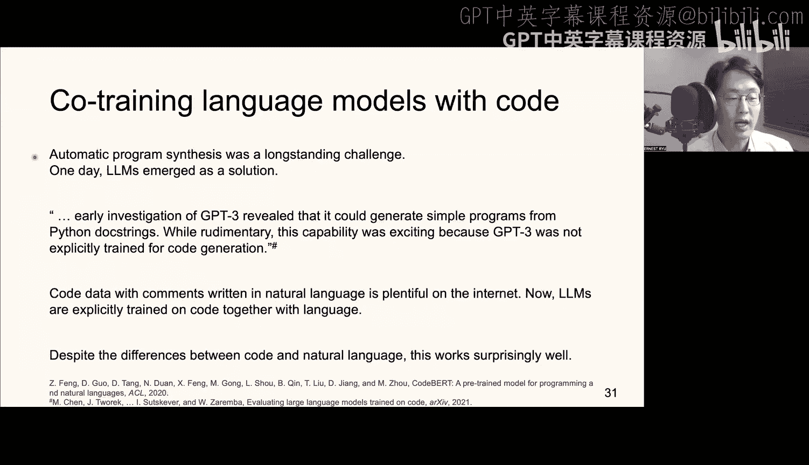

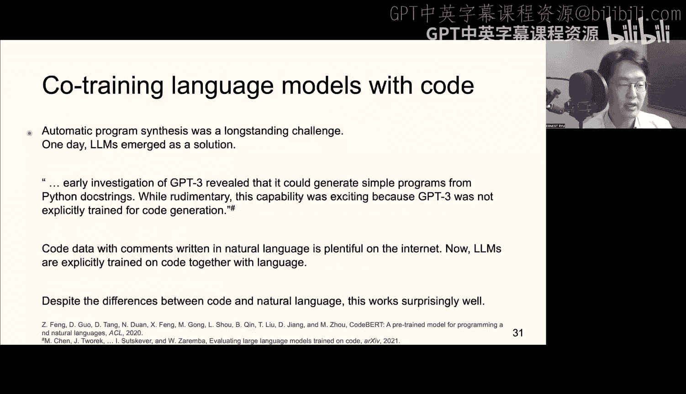

This excerpt says early investigation of G3 revealed that it could generate simple programs from Python dockstrs。

 So a Python dock stream is a set of comments within a Python code that describes what the following code is supposed to do。

 So usually a human writes a Python program and then goes on to write a Python docstream to help other users of the code。

 understand what the following code is supposed to do。And what they're saying is that GP3。

 upon reading a Python doc stream， was able to actually generate programs that actually does the thing does the tasks described within the Python doc strings。

 And this is quite remarkable。 So and they go on to say that while rudimentary。

 this capability was exciting because GP3 was not explicitly trained for code generation。😊，Now。

 the nice thing about code is that there is so much code on the Internet。

 and also this code comes with a lot of comments written in natural language。

 So since this Chinaal 2021 paper， the standard practice now is to train these large language models explicitly on code together with language。

 So they perform So people perform code training of language models， models with code。😊。

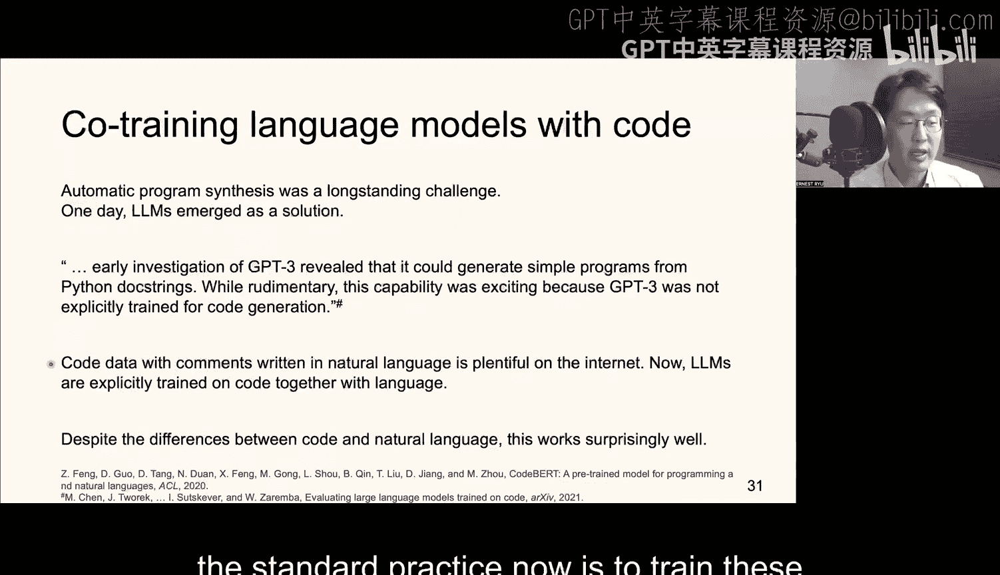

A priorory， you might think that code written in a programming language。

 which is not a natural language， would be very different from a natural language text and therefore training them together。

 a priori might not seem like a good idea， but it turns out that despite the differences between these two kind of languages。

 code training language models on these two types of data， it works surprisingly well。

And， in fact， it works so well that coding is now the main use of large language models。

 So here is a plot of a figure extracted from anthropics report， and it shows that actually 37。

2% of the tokens that they generate are generated for the purpose of coding。

 So perhaps it's a misnomer to refer to L O Ms as large language models。

 Maybe we should refer to them as large coding models。

 because coding is the main usage of these models。😊。

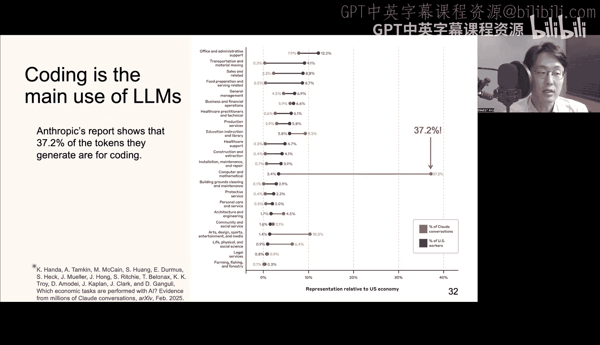

And what's also interesting is that coding improves the natural language， noncod of reasoning tasks。

 So there is transfer between coding and logical reasoning。

 If you want to improve the logical reasoning， language capabilities of language models。

 Then you then you should train your language model together with code。

 Here are some excerpts from papers that describe this phenomena。

 So this excerpt from the paper by Shao et all published in 2024。

 it says code training prior to math training improves model's ability to solve mathematical problems。

 code training improves mathematical reasoning。😊，This excerpt from the paper Modihi etal。

 published in 2024， states that we empirically show that formal logic problems enhance the reasoning capabilities of state of the art large language models。

 and this excerpt from the paper Abibumi etal published in 2025 states that we find a consistent result that code is a critical building block for generalization far beyond coding tasks outsized impacts across all tasks。

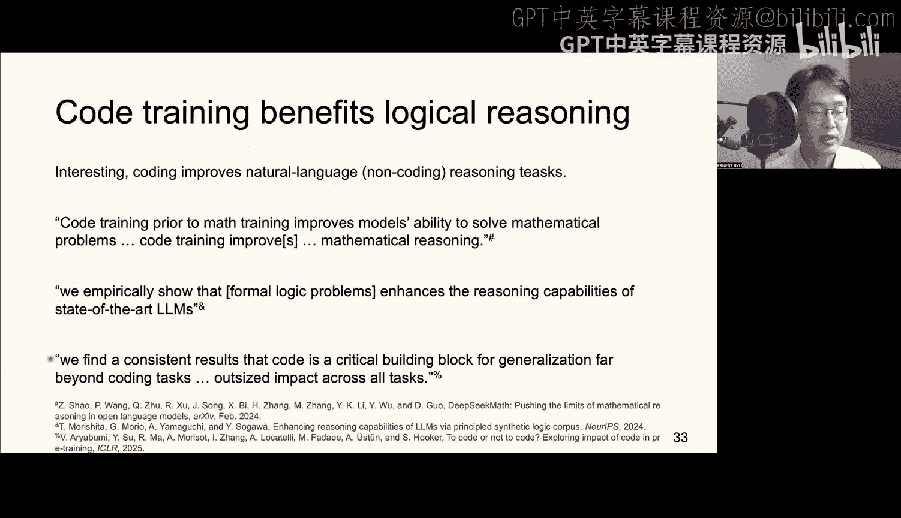

One more ingredient for our discussion of R LVR is math problem solving with large language models。

So recently， there has been a lot of research on using large language models to solve math problems。

 Now there are two types of such research。 T number one is solving math problems。

 easier math problems often at high school or lower level in natural language and the numerical answer is reported at the end and then you check the answer。

So if you recall the math that you did in high school or middle school， well。

 these math problems are written in natural language。

 you do you solve the math problem and sometimes in these classrooms， you have to show your work。

 but actually not always sometimes you solve the math problem， you produce a number at the end。

 maybe the answer to this problem is 17 divided by 2。 So you write that on the piece of paper。

 you submit submit that to your teacher and then that's graded。 And if it's correct， it's correct。

 if it's incorrect， it's incorrect。But type number two of this kind of math problem solving research is to produce mathematical proofs。

 So this would be something like prove the intermediate value theem of in calculus and doing something like this often produces no numerical answer to check but rather it produces a proof。

 either written in natural language or it can be written in a formal proof assistance such as leanan。

 So very briefly leanan is this formal proof language where you can write mathematical proofs and if and once you're done writing。

 you can sort of click compile and if it compiles and that confirms that the proof is correct。

 otherwise the proof is incorrect or incomplete。😊，Now this second type of mathematical problem solving research using large language models is certainly very exciting。

 at least it's very exciting to me， but I want to in this lecture I want to avoid the discussion of what a formal proof is。

 so I'll only talk about the first type of math problem solving research with large language models。

😊，So here are the data sets that are used in this kind of research。

 So GSM88K is a collection of 80008k math problems at the level of elementary school or middle school。

 So here's an example problem Natalia sold clips to 48 of her friends in April and then she sold half as many clips in May。

 how many clips did Natalia sale altogether in April and May pretty simple enough and then the next data set is the math 500 dataset So this is high school to early undergraduate level math problems Here's an example If the domain of the function log X squared is x less than a and or X bigger than B for some A and B find the numerical value of a plus B Okay and then to up the difficulty level the next problems of dataset is Amy the American invitational mathematics examination 2024 problem sets。

😊。

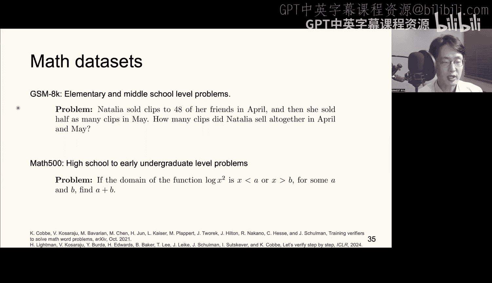

Amy is a math competition。 And if you were to look at this problem。

 I won' I won't read through the problem， but this is not that easy to solve。

 So Amy problems are designed as math competition problems。

 and they are designed to have integer solutions between 0 and 999。

 So that makes these problems hard to solve， but pretty easy to grade。

 If you have the answer key and if you don't ask the student or the AI system to produce it's the intermediate work。

 you can just check the final answer because the final exam answer again has to be a numerical value。

 This is different from， let's say the A O or IMO math olympiate competitions。

 because in those competitions， a mathematical proof has to be produced。 And the proof is graded。

 So the work intermediate work is graded。 But here it's much easier and grading proofs in automated fashion is very difficult。

 But here it's much easier because for Amy， you just have to check the final numerical answer。😊。

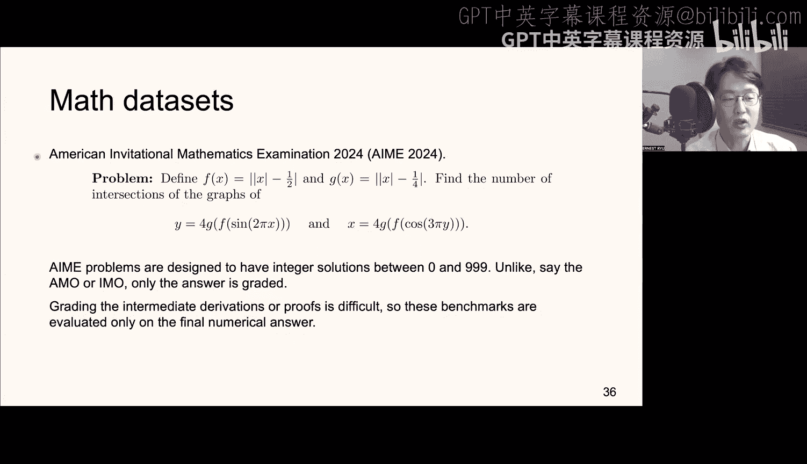

But what is the point of this， Why do we have AI solve math problems？ Well。

 one hope is that if we train our AI systems our large language models on math problems。

 this may improve the general logical reasoning capabilities in other areas。

 and maybe there's a transfer effect between solving math problems and other natural language task that involves a degree of logical reasoning。

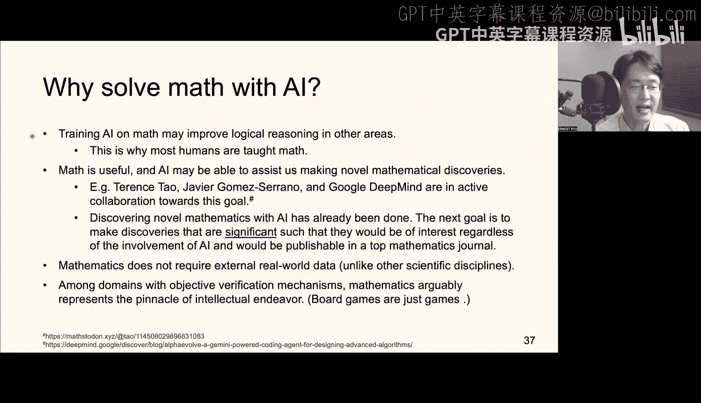

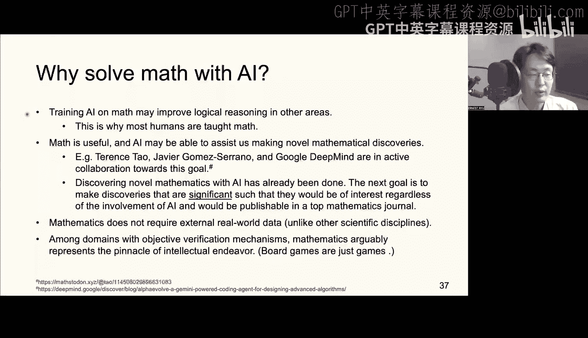

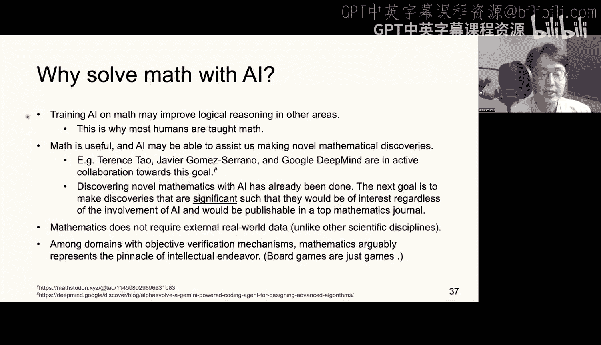

And in fact， I would argue that this is the primary reasonable why most humans are taught math。

 so most humans go to school in their childhood and most humans are taught mathematics。

 but at the same time most humans don't go on to， let's say。

 take careers that require complicated mathematics， signs and co-sines， the trigonometry。

 calculus algebra， what is the proportion of humans that actually use this kind of stuff in their career。

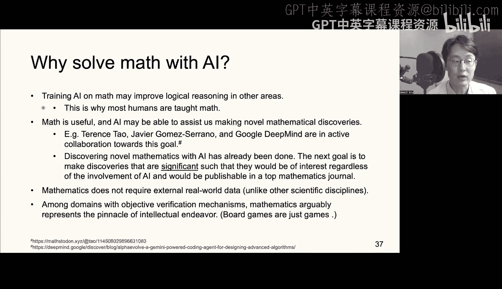

Probably not a lot。Another reason why researchers are doing this is because well， some people。

 including myself， have the view that mathematics is useful and AI may be able to assist us in making novel mathematical discoveries。

 so as an example， Terrence Tao Javier Goez Serrano and Google Deep Mind。

 they are in active collaboration towards producing a new novel mathematical discoveries with the assistance of AI and this press release by Google Deep Mind。

 it describes their current efforts。😊。

II will point out that discovering novel mathematics with with AI has already been done。

 This is not un hypopothetical。 This has been done。

 So since new mathematics has been discovered with the use of AI。

 the next goal is to make discoveries that are new and significant。

 significant enough such that there would be interest regardless of whether AI was involved in this discovery or not。

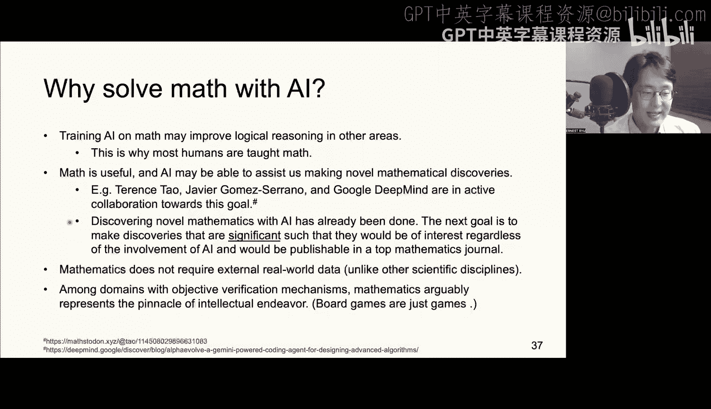

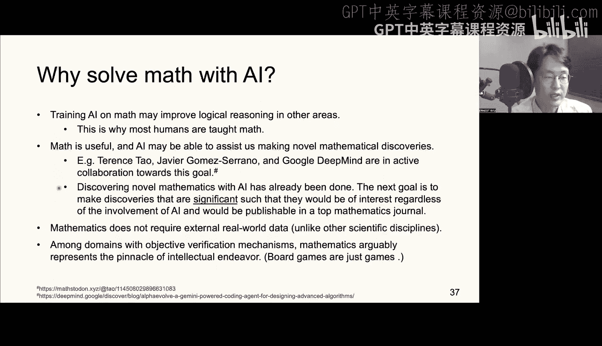

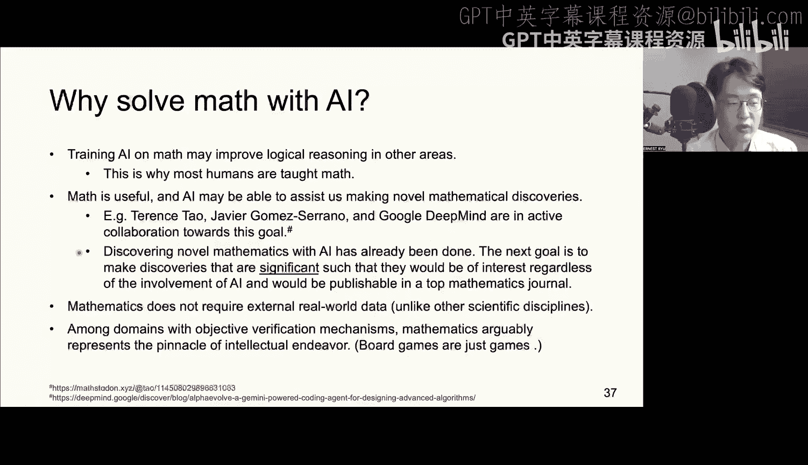

A nice thing about working with mathematics is that mathematics is this field that does not require any external real worldl data。

 unlike scientific disciplines in the domain of mathematics， if you prove a theorem。

 then if the proof is correct， then you don't need any external validation。

 that is the correct truth。 whereas in areas like physics。

 you might come up with these very sophisticated and elegant equations that describe the equation of motion or describe explain some phenomena。

 but then you must go out and do experiments trying to prove or disprove your scientific theory in mathematics。

 you don't have to do that， mathematics is a closed system， actually very much like board games。

 So among the domains with objective verification mechanisms in mathematics。

 the verification mechanism is the correctness of the proof。

 I would argue that mathematics represents the pinnacle of intellectual behavior。

 So board games are interesting。 but those are just games if you can solve mathematics using AI that would be a。

😊。

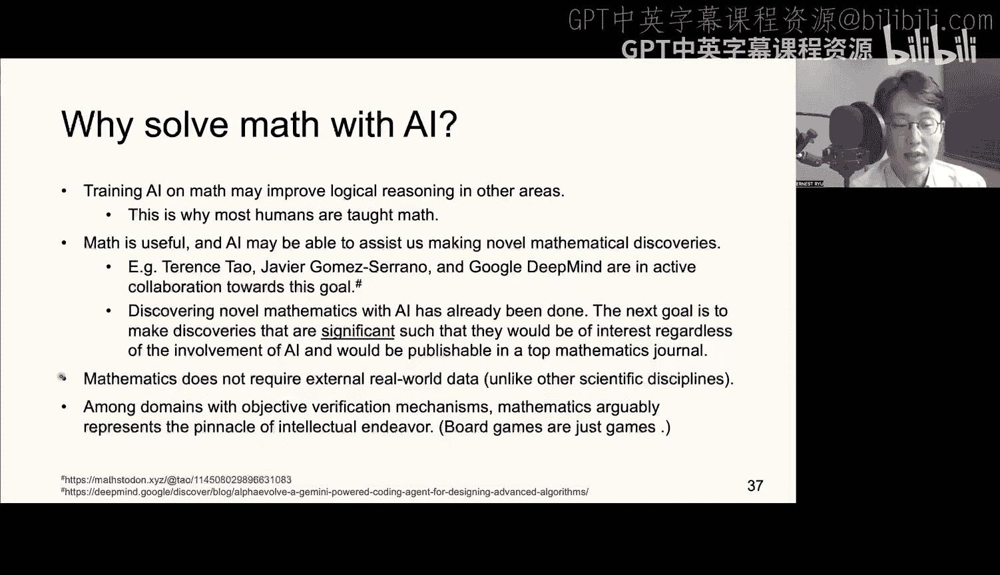

Aar greater accomplishment compared to solving any board game however complicated it may be。

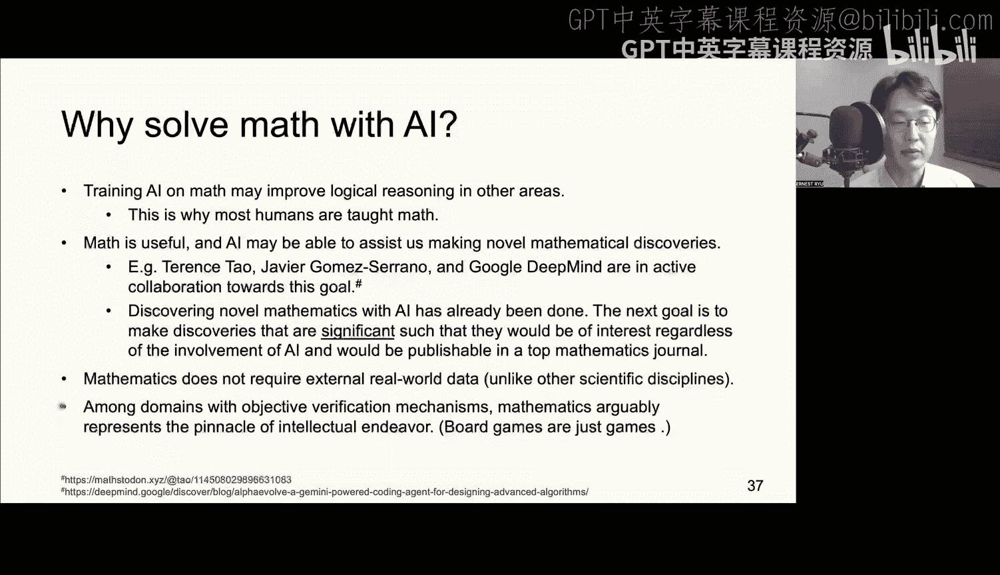

And this takes us with a paper deep Se math， This is a paper that preceded the deepea R1 paper。

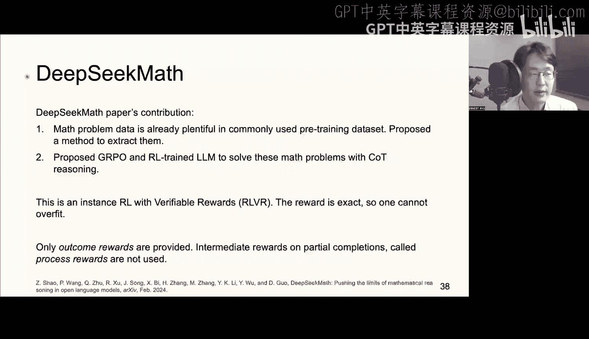

So the Deepse math papers contribution is twofold。 The first main contribution comes from the observation that math problem data is actually already plentiful in the commonly used of pretraining data sets。

 so the deepse math paper proposes a method to extract this kind of math problem on data。

 and then algorithmically the second contribution is to propose GRPO and perform RL training of the large language models to solve these math problems using chain of thought reasoning。

This is an instance of what's called reinforcement learning with verifiable rewards R LVR。

 The reward in this case is actually exact。 This is not a reward model。 The reward here is。

 did the model produce the correct mathematical answer。 Now。

 barring the cases where the answer key has errors。 The reward in this case is exact。

 There is no possibility of reward hacking。 So we cannot overfit to this reward function。

 There is no notion of over optimization with respect to this reward function。

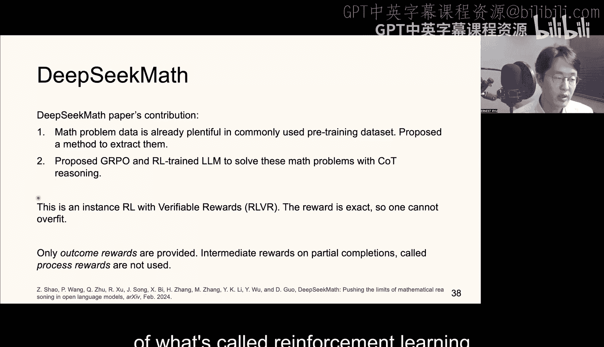

In the deepse math paper， only outcome rewards are provided。

 so the math problem solving is graded only on the correctness of the final answer。

 there are no intermediate rewards on partial completions。 In other words。

 process rewards are not used。 The chain of thought the intermediate work is not graded。

 Only the final answer is graded in this reinforcement learning with verifiable rewards。

And here is the GRPO algorithm proposed by the Deepse team。So again， the algorithm is， as always。

 includes in a while loop within the Y loop， we sample a problem X。

 and then we sample G responses y1 up to yg。 so these are responses to this problem and these responses would produce a final numerical answer at the end。

Let's write boldface R for the collection of rewards。

 So these responses are fed through a outcome reward checker。 namemely。

 you extract the final answer at the end of the response and check whether the answer is correct。

 And if it is correct， you give a positive reward。 If it's incorrect， you give a negative reward。

And then for GRPO， we have the PPO clip loss function with the advantage estimate or the R hat that is given by performing a normalization on the vector of rewards。

 and then for term two， we have a KL regularization penalty constraining the RL tuned language model to deviate not too far away from the instruction fine tune to language model。

Interestingly， in the GRPO algorithm， the authors choose elect to use this length normalization。

 So these responses to the math problem are going to be different in length。

 maybe for some responses， a very short chain of thought thinking was sufficient。

 and it quickly produce an answer。 maybe for some responses。

 the chain of thought reasoning had to think for very long before producing the final answer。

 So this GRPO algorithm has this length normalization term。

 and this is a noteworthy because this normalization factor is not present。

 It doesn't come out of something like the policy gradientd or the PPO derivation。

 It was not part of the PPO description of it it was not part of the description of the PPO algorithm。

 but the GRPO algorithm chooses to use this。 And I'll come back and comment on this length normalization term in a later slide。

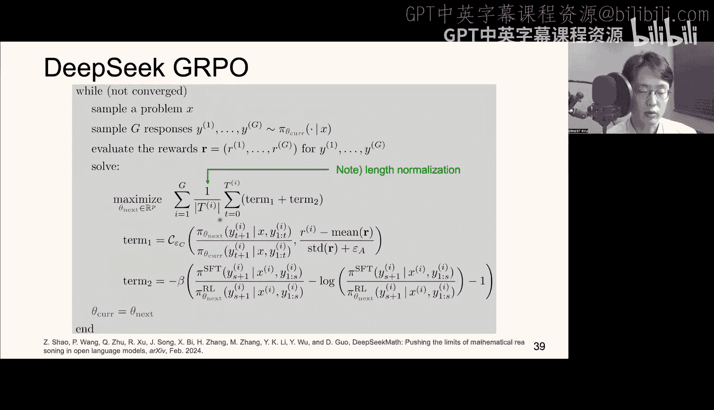

And then the deepse math paper was followed up by the deepse R1 paper。

 Deepse R1 does basically the same， but it scales up the RL VR on coding mathematics， science。

 logical reasoning， etc cetera。 more tasks with verifiable rewards。

The deepC R1 paper reports the finding that the model learns to utilize chain of thought more extensively and the performance improves significantly。

 So as the training progresses， the accuracy of solving these math problems。 In this case。

 the Amy math competition problems it grows， it improves as the RL VR training progresses。

 and as the RL VR training progresses， deep C R1 learns to use longer and longer COts。

 So here you see there's no slowing down as the RLVR progresses。

 the language model chooses to use longer and longer COT problems to solve the math problem。😊。

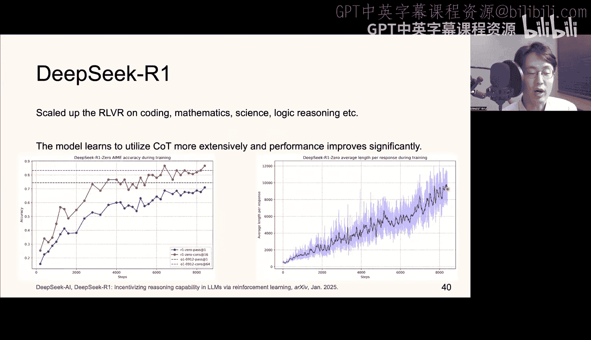

Next， let's talk about the deep Sea R1 pipeline in further detail。 As you can see in this figure。

 the overall pipeline is quite complex， so we won't talk about all of the details。

 but I will highlight some of the parts that are noteworthy。

So at the start of the Deepse R1 pipeline is the Deepsek V3 base model。

 This is a pretrain and post trained large language models with several interesting low level architectural innovations。

 RLHF is used in the training of deepse V1， but RL VR is not yet used。

The Deepea R1 paper starts by applying R LVR to this deeps V3 base model。

 and this yields the model deepse R1，0。 Deepse R1，0 works well。 It learns to use longer CO T traces。

 the performance on verifiable tasks improve， but the CO T traces suffer from poor readability。

 So in order to improve on the deepse R1，0 model， the authors do additional some additional things and eventually arrive at the deepse R1 model。

 and I'll highlight a few key steps in this pipeline。😊。

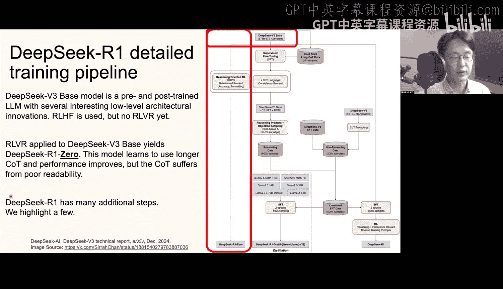

In this highlighted step， the authors use the deepC R10 model to produce some chain of thought reasoning traces。

 and then the authors filter them out and collect some of the good ones and then they used this to train the base model。

 the deep V3 base model via supervised fine tuing to produce COt behavior。

 This supervised fine tune tune model of train via next token prediction on the COt data is used to warm start the RLVR process。

 One of the issues with the pure RLVR training that went into the deep C R10 model was that there was no mechanism to promote readability in the COt traces and particularly in one particular behavior that the authors noticed was that the COt language would alternate between Chinese and English English because a lot of the pretraining data comes in English and Chinese because deepse being a Chinese company presumably they use a lot of Chinese pretraining data as well。

 So to prevent this language alternation。 they impose a language consistency reward。

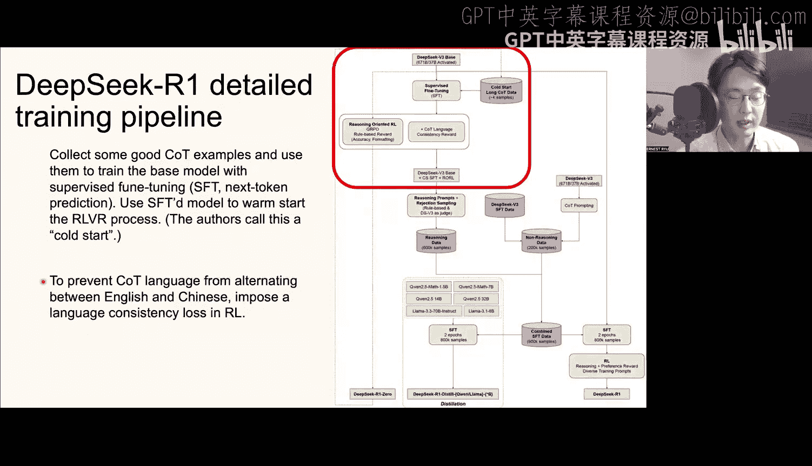

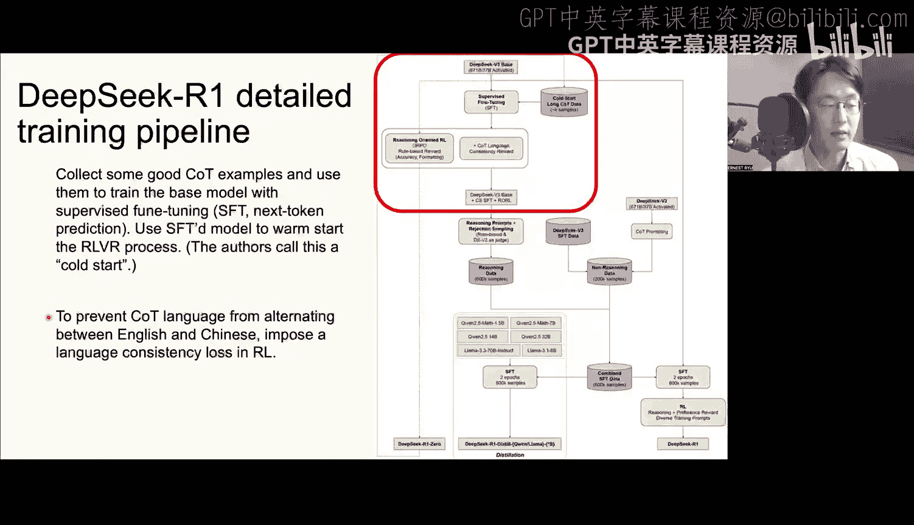

When a language changes within a COT trace， and this was able to resolve this language changing behavior。

When training the deepCR1 model， the goal was to produce a general purpose model that is good on a wide range of tasks。

 not just code and math。So to do so， the authors built a data set with good COT traces for verifiable and both non verifiable tasks。

 such as creative writing tasks， and then they SFT trained the deepCP3 base model on this dataset。

The base model， deepse V3 and the eventual model， deepse R1 are both 671 billion parameter models。

 So these are pretty large models。 granted， these are so calledled mixture of expert models So the effective number of parameters that are activated during inference is smaller than this total parameter count。

 But nevertheless， these are pretty large models。 So in order to train a smaller version of these deepse models that would be more amenable to academic research。

 The authors performed distillation。 So this distillation takes this final SF data set and trains a smaller pretrained and it takes a smaller pretrainedquin or lama model and perform supervised fine tuning SFT training。

 So this results in the deepse R1 distilled models。

 and these distilled models perform much better than directly training thequin or lama models on our LVR。

 finally， we take this SF trained models。 So the SF data is produced through this complex pipeline。😊。

SFT trained data is produced by models that underwent RLVR。

 but this SFT trained model is simply the deepC V3 model trained SFT on this data set。

 And then for the final final model， this SFT trained model is further trained on RL VR。

 Also another final stage of RLHF is performed and the deepC team uses GRPO with a reward model to perform the RLHF training。

 So a PPO and DPO are not used。

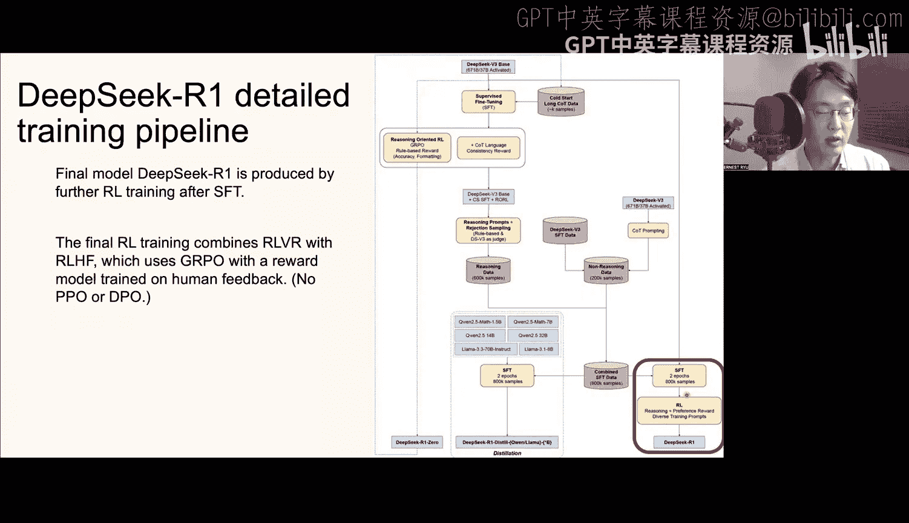

So that's how you get the final deepse R1 model。

So this is the system prompt for the deep C R1 model。 a conversation between the user and assistant。

 The user asks the question。 The assistant solves it。

 The assistant first thinks about the reasoning process in the mind and then provides the user with the answer。

 The reasoning process and answer are enclosed within the think， think token。

 and the answer answer has respectively。

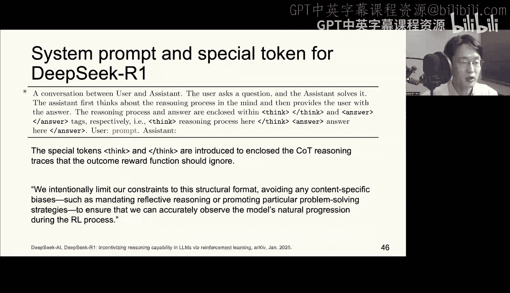

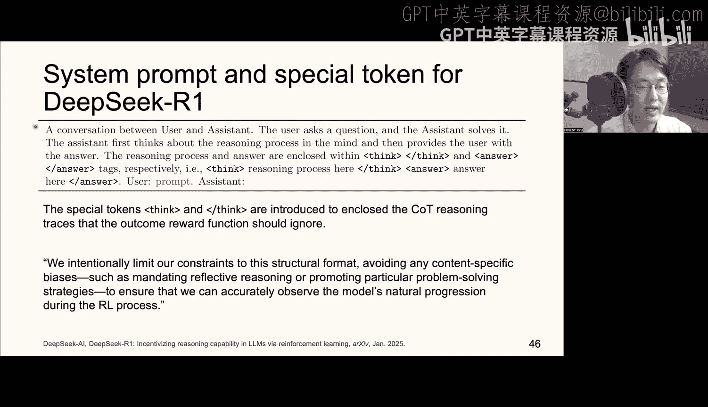

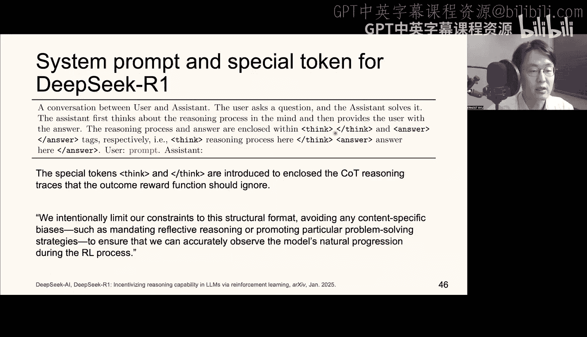

Then the user provides a prompt and the assisted produces its answers。The special tokens。

 open think andclo think These are introduced to enclose the same chain of thought reasoning traces。

 This allows the outcome function to ignore anything that is produced within these think think tokens。

 The outcome reward should only look at the answer produced within the answer tags。

 Here's a quote from the deep C R1 paper。 The authors say we intentionally limit our constraints to the structural format。

 avoiding any content specific biases， such as mandating。

 reflect reasoning or promoting particular problem solving strategies。

 to ensure that we can accurately observe the model's natural progression during the RL process。😊。

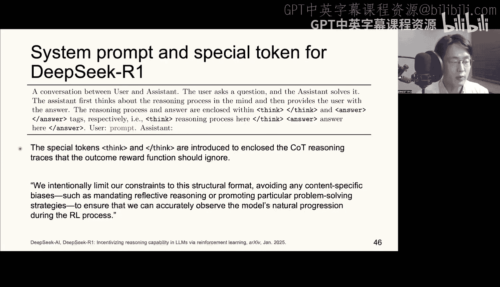

Let me quickly define the term emergence within the context of large language models。

 Emernce refers to the phenomenon where a complex and often unexpected behaviors or capabilities arise from a system as it scales。

 particularly when these behaviors were not explicitly programmed or evident in smaller versions of the system。

This term is frequently misused in unscientific contexts。

 often due to its association with a sense of mysticism。

 When people say things like the ability to program emerged in large language models。

 this sounds like some mystical AI magic happening。

 But I would argue that the term emergence while a defined vaguely is still a useful term that accurately describes a real phenomenon that occurs in large language models。

 Indeed， many of the capabilities exhibited by large language models are emergent。 For example。

 when you train a large language model， you don't have to explicitly design the language model to be a translation machine。

 but if you train large language models on sufficiently large pretraining data。

 the ability to perform translation will emerge。 And this is nice because we acquire certain capabilities without explicitly created data or specialized architecture design。

 But this is bad because the scale at which a certain capability emerges if it ever emerges at all is unpredictable。

😊。

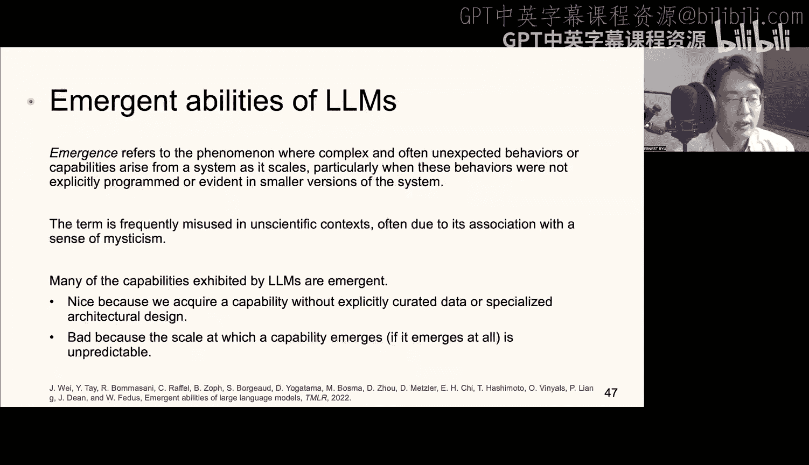

The remarkable thing about R L V R on large language models， as reported in the deepse R1 paper。

 is that nonlinear reasoning emerged。 Here's a quote from the paper。 It reads。

 one of the most remarkable aspects of the self evolution。

 is the emergence of sophisticated behaviors as the test time computation increases。

 behaviors such as reflection where the model revisits and reevaluates its previous steps。

 and the exploration of alternative approaches to problem solving arise spontaneously。

 These behaviors are not explicitly programmed， but instead emerge as a result of the model's interaction with the reinforcement learning environment。

😊。

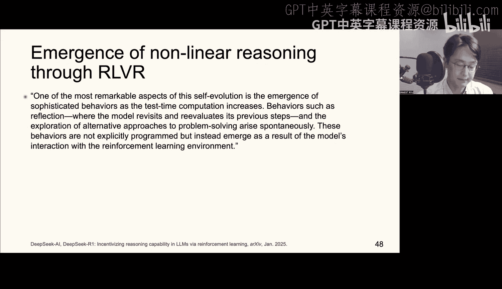

So deep Sea R1 happened and it really surprised a lot of people。But this raises the question。

 why did RLVR suddenly start to work？In hindsight， the approach of RLVR is something that's fairly obvious。

 and indeed other researchers have tried it earlier。Here's a tweet from Ross Taylor， it reads。

No one is saying RL didn't work for reasoning， The argument is about internal reasoning emergence。

 not the absolute performance boost with RL。Quite the opposite， in fact。

 we had a PPO on Lama to base models two years ago with verifiable rewards and had 90% accuracy on GSM 8 K。

 We already knew that R L worked。 He。 We even did this with the Bronze's age Galacta model。

 and it also worked。😊，What did it work was that we didn't see emergence of longer traces with backtracking。

 checking error correction and other branching like behavior。

 So when people say the base models wasn't strong enough。

 the the contention is that there wasn't enough knowledge in the base model。

 subsequentequ R L compute and context window length for the model to develop long CO O T internal reasoning on its own。

 That's the argument， not whether R L worked。 It always did。

 but the magic seems to have emerged relatively recently。

So earlier attempts failed because nonlinear reasoning capabilities did not emerge and improvements from RL saturated。

But this answer doesn't fundamentally answer the question that's being posed。

 The following question is， so then why didn't these capabilities emerge in the earlier models。

 Can we do a postmtem analysis to understand why it is that RL VR suddenly started to work。Well。

 I think this paper by Gandhi Atal published in 2025 provides the answer to this question。

 So in this paper， the authors report that report that thequin and deepse base models exhibit certain key cognitive behaviors for reasoning。

 These include verification。 So systematic error checking， up back tracking。

 abandoning field approaches， a sub goal setting， decomposing problems into manageable steps and backward chaining。

 reasoning from desired act outcomes to initial inputs。So this figure taken from the paper。

 it gives an example of verification， so let me tell my answer， backtracking。

 let's try different approach， sub goal setting， let let's try to get to a multiple of 10 backward training so working backwards the Adi AdiA。

These two plots compare the Quen model and the Lama model。

 This first plot shows that the Quen base model before it undergoes RLVR。

 it already exhibits verification and back tracking behavior， although sub goal tracking。

 sub goal setting and backward chaining is not a behavior present in this Quen model。

But this plot shows that the Lama base model shows none of the four key cognitive behaviors。

The authors then go on to show that RLVr only works for models with these cognitive behaviors。

 and because the Lama based model does not naturally exhibit these key cognitive behaviors。

 RLVR on Lama fails。 and that perhaps explains the failure reported by Ross Taylor in this tweet that I shown two slides ago In this plot。

 the authors compare the performance improvement thatquin and the Lama based models get when you undergo RLVR training for the Lama model indeed。

 you see some improvement， but the improvement saturates much earlier， whereasquin。

 you get a much larger improvement。 If you look at the COT response length。

 Lama doesn't really learn to utilize COt traces， whereas thequin does。😊。

So then probing this scientifically further， can we fix this Well。

 what we can do is we can teach prime the Lama model these four cognitive behaviors using SFT。

 then RLVR starts to work。 So in this plot， this curve is the RLVR performance of the Quen based model。

 this is the RLVR performance of the Lama。 But if we prime thequin and Lama models on these four key cognitive behaviors using supervised fine tuning and then perform RLVR。

 then bothquin and Lama work very well with RLVR。😊，And if we look at the prime Lama model。

 the prime Lama model is able to utilize all four types of key cognitive behaviors in this reasoning。

So to me， this analysis and presented evidence is quite convincing。

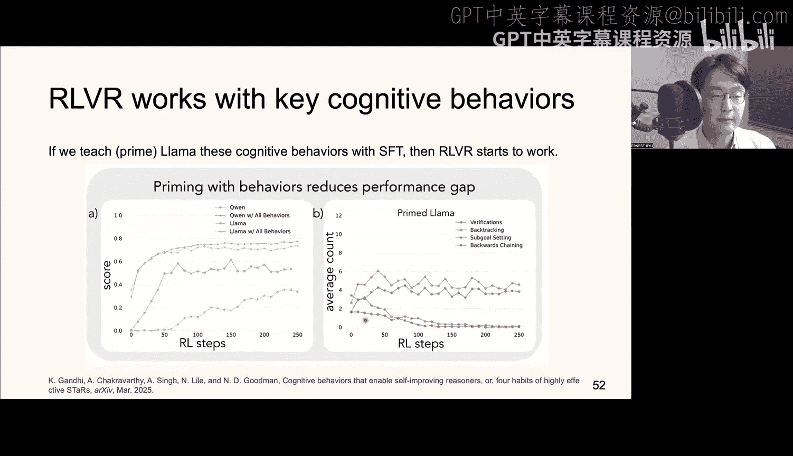

But then this still leads to a followup question。 And that is。

 why doesn't the Lama based model exhibit these key cognitive behaviors while thequin model does。

 Well， that comes down to the training data。 So the open web math and the fine math。

 these are math problem solving datasets。 And if you examine their answer sheets。

 they do contain these key cognitive behaviors。 the exact composition of the training data for both the Qn and Lama models are not made public。

 So this is within the realm of speculation， but perhaps thellma model was not trained on these datasets。

 but maybe thequin model was indeed to further verify this hypothesis when we take the Lama based model and further train it on the open web math dataset RLVR on Lama。

 it starts to work。And for the deepse models， I'm guessing that the deepseq B3 base model was trained on these kind of math problem solving dataset sets that exhibit these key cognitive behaviors。

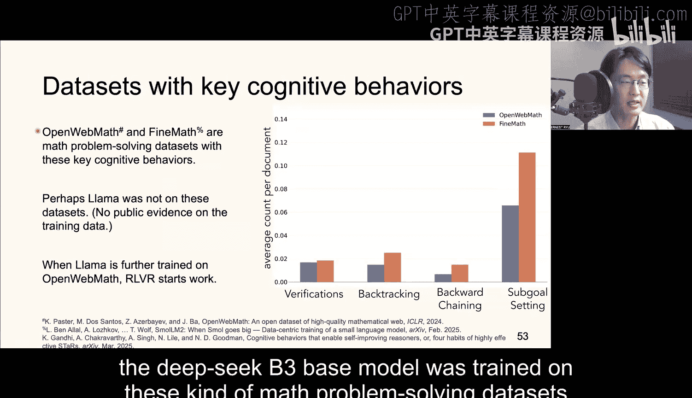

Okay， next， let's talk about test time scaling a majority vote or selfcon or consensus is a simple technique for improving the accuracy of reasoning models。

 What you do is given a math problem given given a certain and prompt。

 you simply generate n reasoning paths and you report the most frequent answers。

 So you do a majority vote and this would work provided that the answers produced by these n responses are not all distinct。

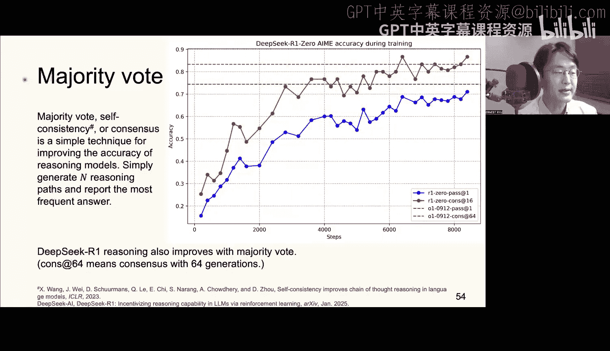

In this plot produced by the deep C R1 team。 you see that this blue curve corresponds to R10 pass at1。

 So this is the accuracy of solving the mathematics problems。

 problem with one evaluation of the deep C R10 model。

 And after about 8000 steps of R VR it reaches 70% accuracy。 But if you take the same model。

 and it perform the evaluation 16 times and perform the majority voting， then the accuracy improves。

 and that's this red plot。 So this is deep C R1 consensus at 16。 And as you can see。

 the performance goes up and it even reaches something like 85% accuracy。

 So the performance gap between the single evaluation of the model。

 and the 1616 evaluation majority vote is actually quite significant。😊。

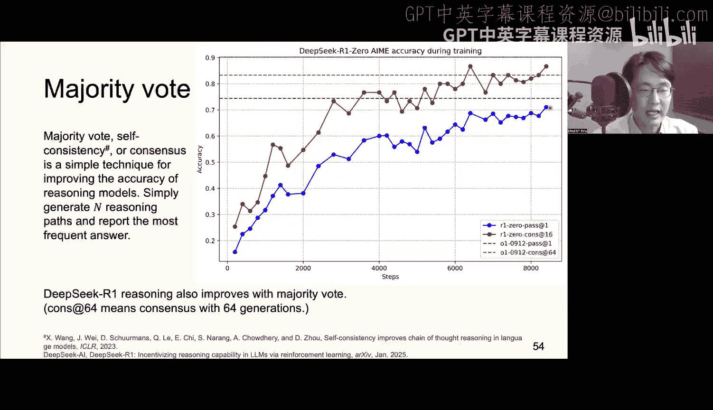

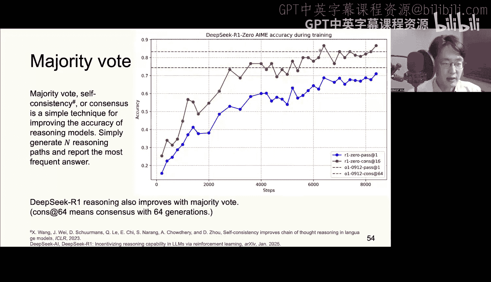

And the authors of the Deep Sea R1 paper are making the point that they surpass this pink line。

 which is the G01 model evaluated at a majority vote with 64 generations。

Test time scaling refers to the use of more compute at test time during inference to improve the quality or the accuracy of the output。

 for large language models， the deep C R1 paper shows that majority vote remains a valid approach to test time scaling。

 and the test time scaling aspect of a majority vote is pretty clear。

 you do a single generation that incurs a single compute costs。

 if you do multiple generation that's additional compute costs。

 but as you saw in the previous plot with these additional compute costs。

 you can improve the accuracy。 So the trade off is clear。 RL Vr is another form of test time scaling。

 So through R LVR， the model learns to use chain of thought traces for test time scaling。

 So if the model generates longer chain of thought traces， then this incurs additional compute cost。

 and as we've seen in the previous slides， the use of longer chain of thought traces。

 which incurs larger compute costs。 This correlates with improved performance。

But the aspect of controlling the test time scaling is not actually right now very clear because the way the deep CR1 model is trained。

 we don't have any control of the COT trace length。 So if the model decides to use additional time。

 well that's the choice of the model， but as a user。

 I may want to get a result earlier at the expense of potential accuracy is there a way I can control the COT length。

 Well this leads us to the idea of test time scaling with budget forcing given a COT reasoning model which may or may not be trained using RLVR。

 we can control the COT length using a budget forcing technique。

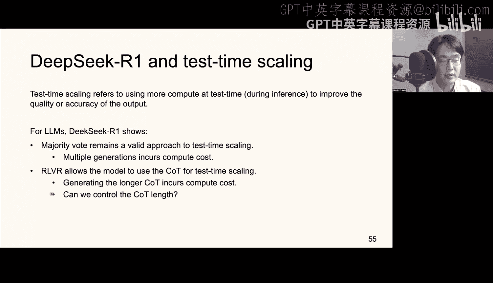

So if the language model is producing a long and long COT trace and you want to terminate it early。

 you can append the final answer text at the end of the COT trace。

 and you can basically force the model to produce an answer right there and then。

If the model has term terminated the COT and is trying to produce an answer。

 you can actually continue the COT reasoning further。

 So the way you would do this is you can delete the answer that the model has produced and then you can append a weight at the end。

 and this will allow the model to continue reasoning。

 So this is a test time scaling plot presented by muingoff published in 2025 where they show that well this thought is just the a natural response of this language model in solving the a math problem data set。

 And as you can see， it achieved something like 50% accuracy。😊。

If you want to do faster inference at the expense of the accuracy。

 you can do this and what you will see is that you can control the maximum length of the COT trace and you will see the scaling plot going downwards On the other hand。

 if you want to improve the accuracy at the expense of spending more compute power having longer COT traces。

 then you can use this second technique to insert the weight to connect the end and as you can see。

 the performance improves as you use more compute for the longer COT traces。

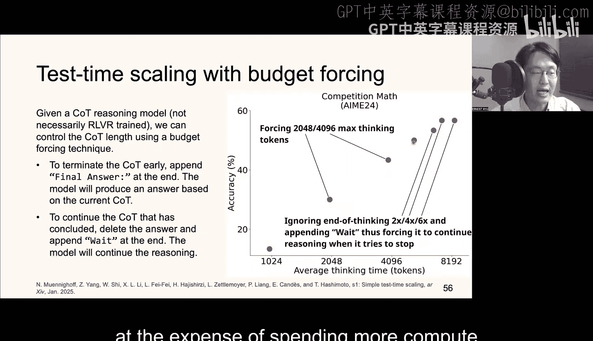

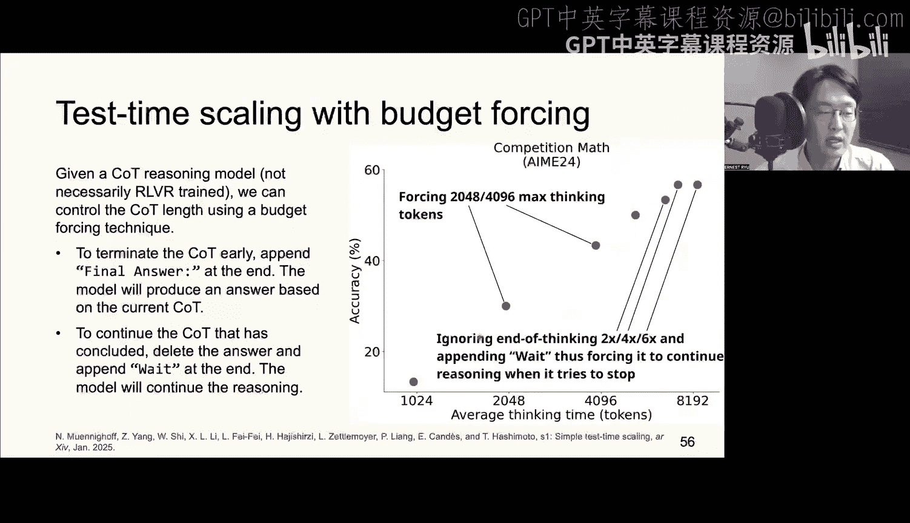

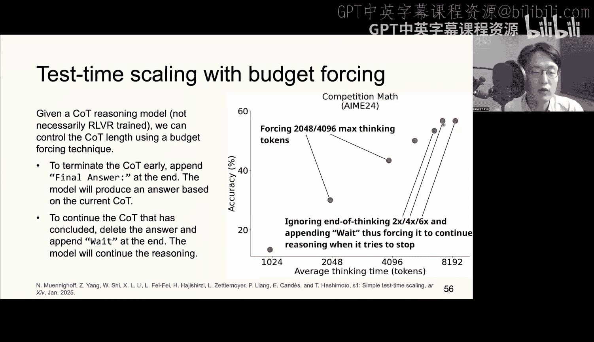

Interestingly， the deepse Rwin authors also report some negative results for test time scaling。

 For one， the deepse team reports that their attempt to use process reward models did not work very very well。

 So process reward models abbreviated as PRMs。 PRms are trained models evaluating the correctness or the usefulness of intermediate steps。

 PRms are generally very hard to train because these require significant human annotation。

 you might imagine hiring humans to grade intermediate COt traces as to their correctness or usefulness。

 but to hire these kind of humans for annotation would be very expensive。

 and also these process reward models being reward models。

 they are susceptible to over optimization and reward hacking。

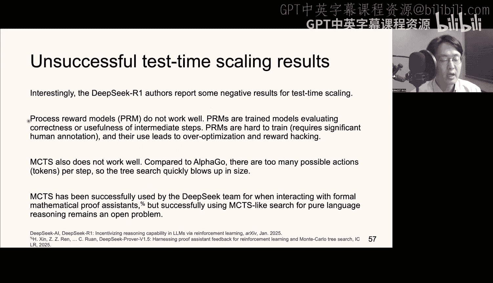

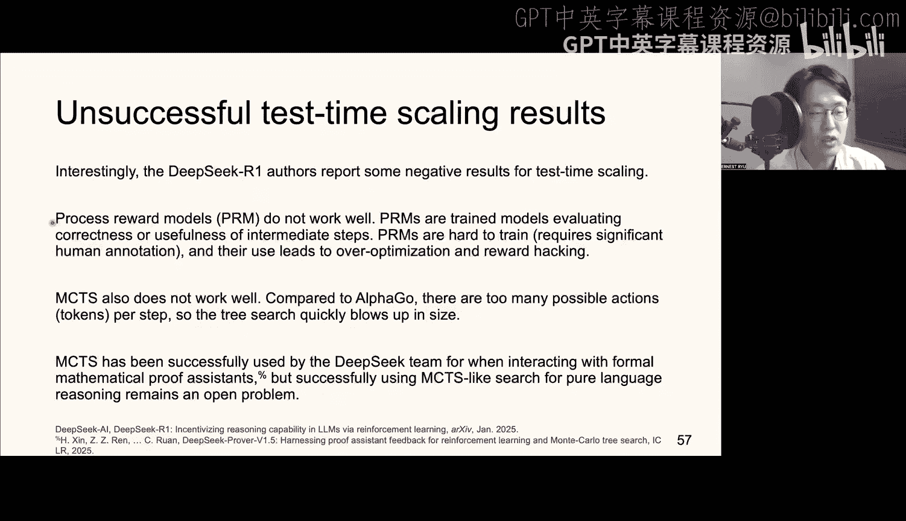

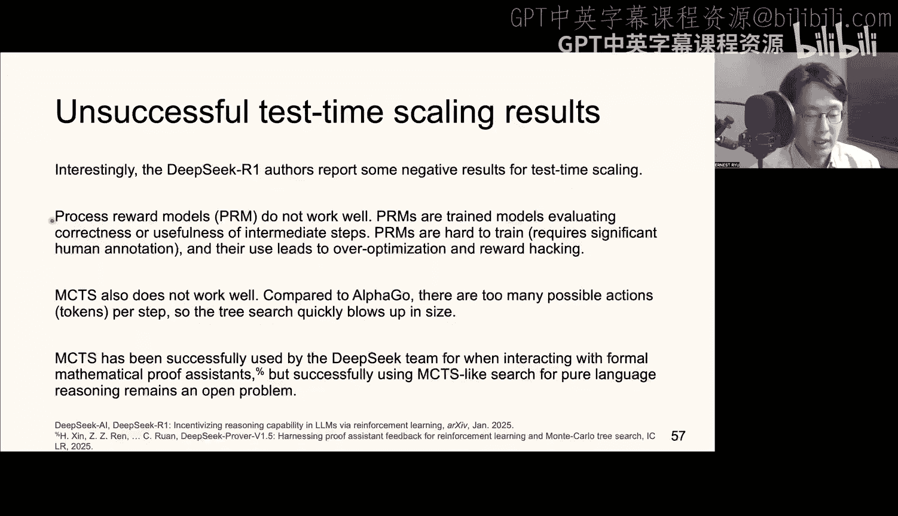

The Deepse team also tried MC C T S and reports that that their attempt didn't work very well。

 So compared to something like alphaphago within the domain of language generation。

 there are just way too many possible actions， tokens that can be generated per step。

 So the tree search just quickly blows up in size and just becomes intractable。

 I will note that M T S has actually been successfully used by the deepse team when interacting with formal mathematical proof assistance。

 So that's a different paper cited here below。 But successfully using MC T S like search for pure language reasoning remains an open problem。

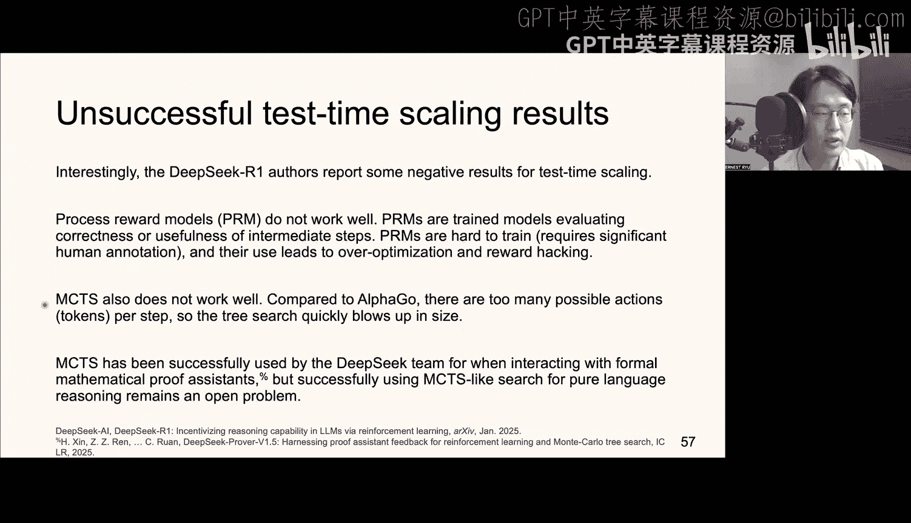

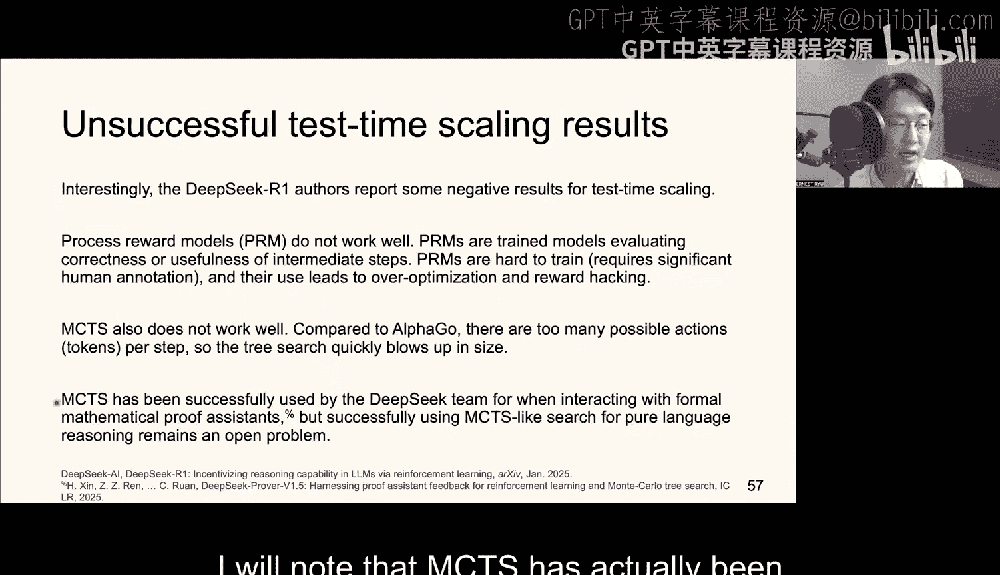

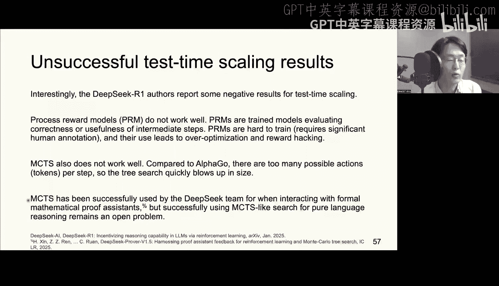

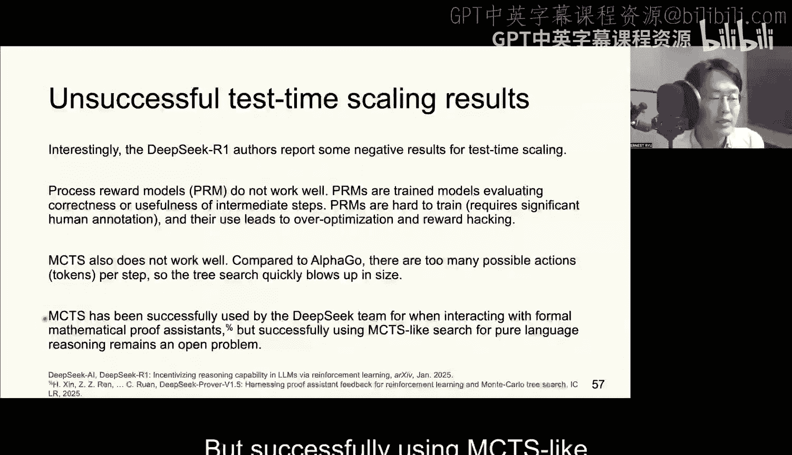

Now recall the GRPO algorithm proposed in the deepse math paper and also used in the training of deepseq R1 here I'm resttating the algorithm forphysical comparison and here take a look at this length normalization term again。

 as I mentioned， this length normalization factor， it does not arise in the policy gradient or PPO derivation。

 but for some reason the deepse team decided to put this in in their GPO algorithm。

 It turns out that this length normalization is a problem and we should resolve it。

The algorithm dopo is proposed as a variant of GRPO that has a length normalization term outside of this outside group summation。

As an aside the Dopppa paper also proposes some other interesting changes to the GRPO mechanism。

 one such proposal is to use different clipping mechanisms for the upper and lower clipping thresholds in the PPO clip objective。

 but Neil let's not cover them。Another variant of GRPO is Doctor GRPO Dr GRPO is the abbreviation of GRPO done right。

 This removes a length normalization altogether and it also removes the advantage normalization。

 so when computing this advantage estimate or this a hat quantity GRPO Dr GRPO suggests that we should subtract out the mean。

 but we should not divide by the standard deviation。

But what's the problem with length normalization in GRPO。

 Why does Doppo and GRPO propose that we fix it？ Well， if you use length normalization。

 you incur a bias with length normalization， when the length is small。

 well you multiply by a larger factor and the length of the response is long。

 then you multiply by a smaller factor。 So when when you use length normalization。

 if you have a shorter response that produces a correct answer。

 that is strongly preferred and that's boosted up by a lot。 and that sounds like it's not a problem。

 But the problem arises， when you have longer response is， when the response length is long。

 that the impact of that is down weighted in the loss function。 So if you think about this slowly。

 the incentive that comes out of this is that if you think you cannot get the correct answer to a given problem。

 So if you think if the agent thinks that the answer is going to be wrong。

 you might as well make the answer， the response very， very， very long。That way。

 you will receive last penalty。And it turns out that this unforeseen incentive is actually what caused deep CR1 COT to grow longer and longer。

What is the evidence Well， so here are some plots taken from the doctor GRPO paper in this first plot the authors compare the reward。

 the proportion of correct math problems between GRPO and doctor GRPO and the performance is roughly the same。

 but if you compare the two with GRPO that does use length normalization。

 the COT length grows and grows in an unbounded manner。

 whereas with Doctor GRPO through training the training finds an appropriate COT length and then the COT length actually doesn't grow as the RLVR training progresses。

Now， if you separate the response length， the COT length between the correct and incorrect answers。

 it turns out for the correct answers between doctors GRPO and GRPO。

 the COT length comes out to be roughly the same。 but for the incorrect answers。

 it turns out that with doctors GRPO， the incorrect answers。

 there's no incentive to make the COT length for incorrect answers very long， so it doesn't grow。

 But for GRPO due to this length normalization bias。

 the GRPO algorithm effectively has the agent think， okay， well， if I'm going to get it wrong。

 I might as well make the response length very， very long。

 and that's indeed what happens as the RLVR training progresses。

What about normalizing with respect to the standard deviation of the rewards， Well。

 for the GRPO advantage estimate， the questions with lower standard deviation。

 So these are problems that are either too easy or too hard。

 So if most of the responses are wrong or if most of the responses are correct。

 then you would have a smaller standard deviation， these questions are given higher weights doing the policy updates because you would divide it by a smaller standard deviation。

Now， to me， it's not clear if this question， this so-called question level difficulty bias poses a significant problem。

 but nevertheless， Doctor JRPO removes this standard deviation normalization to remove this bias。

 and they use just this advantage estimate R minus the mean of R。

And one can actually show through these kind of policy gradient derivations that Dr。

 GRPO's advanced estimate， it corresponds to an unbiased policy gradient estimate。

 so if you were to compute the expectation of this kind of policy gradient estimate。

 you would be able to show that this is actually the expectation is actually proportional to the gradient of the usual objective function。

So in the sense of having a correct first principles derivation。

 removing the standard deviation would be correct。

This is a recent paper that was also mentioned in the prologue。

 It's titled SFT memorizes and R L generalizes。 in this paper。

 the authors define a simple toy task or。In this paper。

 the authors define simple toy tasks and train on them with supervised fine tuning and RL VR。

 and they compare the performances。 An example of this task is to look at these four cards and compute the number 24 using these four cards。

 and one correct solution would be 7-5 times-10 plus 4， which would result in the correct number 24。

The results summarizing these plots， roughly speaking。

 they show that RLVR leads to better generalization compared to SFT training。

So why does RL generalize better？ So here's my hypothesis。 When you perform supervised fine tuning。

 this process lacks any explicit negative signals。 supervised fine tuning by definition。

 it shows what are some correct responses， correct generations。

 but it doesn't tell you anything that is wrong。So when a behavior。

 when a certain behavior is absent from the training data。

 that the model gradually infers that those absent kind of completions are undesirable。

 and this is understood through a mission。 but this is a very very indirect signal。

 it's perhaps weak and inefficient。 By comparison， Rl provides explicit negative feedback。

 an action that leads to lower rewards， these are penalized。 when you perform Rl。

 there's no exact credit assignment across all the actions。

 in the sense that let's say you're solving a math problem and you made one mistake at a certain step。

 and you arrived at the incorrect answer when you perform reinforcement learning。

 all actions that led to the poor outcome， the incorrect answer。

 these are all down weighted without any finegrained attribution as to which actions were actually bad and which actions were innocuous。

 In any case， the model nevertheless receives direct signal about something some behaviors to avoid。

 and maybe this is more。😊，Efficient in uncovering the exact causal relationship that generalizes well。

So with the advent of reasoning models like Deepse R1 and Open AI01， which were trained using RLVR。

 people have started to say that through RLVR language models learn reasoning。

 but there's actually some contention on this matter within the research literature and here's a paper that argues that RLVR does not teach new reasoning patterns for the large language models。

Let me be specific， this paper shows that there's some evidence that RL does not teach new reasoning behaviors。

 so what does that exactly mean the authors argue that RLBR reinforces it makes more likely the correct reasoning pattern that the model already knows from pretraining。

Here is the mental model， the base model， which has not yet undergone any RLVR training。

 is able to take many paths for solving a given problem and among these many paths。

 a lot of them are incorrect and will lead to the incorrect answer and therefore will lead to zero or a negative reward。

 but some of the paths are correct and will lead to the correct answer and will get a correct reward。

The authors argue that after RLVR， the model will be able to more efficiently sample the correct reasoning paths that lead to the correct answer and will suppress the incorrect reasoning paths that lead to incorrect answers。

What's the evidence for this claim， So the author is proposed that we should try evaluating the model with pass add K。

 Now the pass at K is different from consensus add K。

 This is a metric where the model produces the answer K times and we record the generations as a success。

 if anyone out of the K generations turns out to be correct Now this is not a metric that you can use in practice because in practice。

 you don't know the answer。 So it's not enough that one of your menu responses is correct。

 you need to identify which one but for the purpose of scientific inquiry。

 this is something we can certainly try。

The authors show that RLVR actually worsens the performance when you measure the performance by pass et。

 Let's take a look at this plot I'll take from this UA Eal paper published in 2025。

This paper shows that thequi2。57b base model has a pass at K accuracy that improves in this way Now if you perform GRPO 150 steps。

 300 steps，450 steps and evaluate the accuracy on a single evaluation indeed as you perform more GRPO steps the performance improves from 10% of 25%。

 35% 42%， it improves as the GRPO progresses and indeed that's the whole point of GRPO but if you evaluate the model over here。

 actually the use of GRPO hurts the performance。

The mental model is that the Quen 2。57B model has the capacity to solve something like 65% of these math problems。

 it's just that it also has the capacity to produce incorrect solutions。

 but somewhere within the model the correct problem solving strategy is present。If you perform RLVR。

 then the RLVR process suppresses the incorrect problem solving strategies and boosts up the correct problem solving strategies。

 but the claim is that RLVR is not teaching the model brand new problem solving strategies that it did not already know and indeed the proportional problems that these models can solve at pass at K。

 it reduces as the grRPO training progresses when we consider pass at 256。

However， there is a follow up paper that disagrees， so this paper argues that through RLVR。

 language models can learn new reasoning strategies。

So this paper argues that with their proposed prolonged RL technique areed as pro RL。

 they can prevent the socal entropy left phenomenon。

 and they can have RL learn novel reasoning strategies that are inaccessible to base models。

 So in these plots presented in this Liu etal paper published in 2025。

 they show that if even when we evaluate at pass at 256， the base model has this amount of accuracy。

 but through RL VR， we can improve the pass at 256 performance through RL VR provided that they use the better version of RL VR using Pro RL。

😊。

So what is this better RL strategy。 Well， the issue is what they refer to as entropy collapse。

 a key challenge in prolonged policy optimization。 So if you run something like GPO for too long。

 you encounter what's called entropy collapse。 This is a phenomenon where the model's output distribution。

 it loses diversity in an early stage of training and this results in sharply reduced entropy。

 Now when this happens， the policy prematurely commits to a narrow set of outputs and this severely limits exploration and without sufficient exploration。

 the Rl stagnateates because Rl works by trying out different things。

 trying out new exploring new strategies discovering by chance that something works well and then reinforcing that。

 But if the current policy commits to a narrow set of reasonable inde but not perfect strategies and refuses to explore than the RL stagnateates。

The authors of this were proposed pro Rl to remedy this entropy labse。

 There proposed pro Rl incorporates components from the dopot training loss and periodically recess the KL penalty。

 I'll defer to the paper for the details。 but the takeaways are that one naive Rl with GRPO stagnateates and it may not be able to learn new reasoning behavior takeaway number two。

 there are ways to effectively perform prolonged Rl training that avoids this kind of stagnation and takeaway number3。

 LLms can learn new reasoning behavior in pro Rl training。

 So in order to learn new reasoning behaviors， you just need to perform Rl for long enough。

 but to perform Rl for long enough， it's not enough to do regular GRPO because that will result in entropy apps。

 but if you do Rl in the correct way using pro Rl avoiding entropy appsse and train for long enough。

 then language models can learn new reasoning behaviors using RL VR。 That's the claim。

Then again， there's another paper that kind of disagrees and and and presents the view that RL VR does not really teach new reasoning behaviors。

 So in this paper by Wang etal published in 2025， the authors present a quite surprising observation。

 It turns out that RL VR provides a benefit， even if you only have one single training example。

 So only one single math problem， RL VR works， it turns out on any single math problem within the math problem problem solving dataset。

 although some problems have a higher sort of signal is able to improve the performance of the model better than others。

So here's the one training example， this is a math and physics problem。

 the problem reads the pressure P exerted by wind on a sail varies jointly as the area A of the sail and the cube of the wind velocity V。

 so the yadi yaya let's think step by step and produce the final answer within this box。

And if we take a look at this plot， this plot shows that if you perform RLVR on this particular this one single math problem。

 then you get this performance following this purple curve， though as the RLVR progresses。

 the accuracy on the entire math 500 data improves to something like 70% with this just single math problem with the answer key。

The performance is so good that is it is comparable to actually performing RLVR on the entire math training dataset set Now not all of these math problems individually contain that strong of a signal。

 so here's another problem they refer as the 13th problem pi 13 if you train on that single problem than here is the performance。

 it is worse than training on the entire math data or on this single good special math problem。

 but nevertheless the point is that even training on just one single example。

 RLVR works and you get a benefit from this RLVR training。😊，So why does this happen。

 Why is it enough to even use just one problem when performing RLVR So the hypothesis is that RLVR reinforces the correct reasoning pattern that the model actually already knows from pretraining and even when you use a single problem。

 the model generates multiple reasoning solution paths and the function of RLVR is to reinforce the correct reasoning steps and and download the incorrect reasoning steps。

Different from something like supervised learning， the language model does not overfit when training on a single math problem。

 presumably because every time you perform the COT reasoning， the COT traces are different。

 and you can think of the language model as trying out a bunch of different solution strategies and by checking the final answer。

 the language model is getting signal as to whether which kind of problem solving strategies are correct。

 which kind of problem solving strategies are incorrect。

 and that overall improves the COT reasoning capability of these language models even if it's solving the same problem repeatedly。

The findings of these papers are not exactly contradictory。

 but they're also not perfectly consistent。 And I think it's worth pointing out that in a newly emerging and rapidly evolving field。

 there is a certain kind of fog of war。 The research findings are often noisy。

 This is because researchers are still navigating through various pitfalls。

 And the best practices and know hows have yet to be established。 Therefore。

 when you're engaging with the research literature in such on such a recent and rapidly evolving field。

 it is important to approach these papers with a healthy dose of skepticism。

This is different from reading， let's say， a textbook or reading a 10 year old paper that has stood the test of time。

For the last topic of this chapter， we'll talk about some techniques to induce reasoning capabilities without the use of reinforcement learning。

 rather with the use of expert iteration。So RLVR and reasoning is an exciting new development and it is certainly the focus of this course。

 but RL using policy grade and type methods is not the only way to induce reasoning capabilities in large language models。

One nonrL approach is expert iteration， so an expert iteration。

 a meta description of the algorithm has this form so where we have a for loop itating iterating starting n is equal to0。

 we start with a model n and then we get an enhanced model M plus。

Well， how do you get an enhanced improved model。 Well。

 one approach is to use test time scaling approaches。

 such as majority voting or Monte Carlo's tree search based on the current model M。

 Another enhancement technique is to use outcome verification on the behavior of the model M。

 So you have an enhanced model。 And then you train the next model by fitting on this enhanced model。

 And then you repeat。 So when you go to the next iteration， the base model has improved。

 So the enhanced model is further stronger。 And then when you fit on on that model。

 then this next model will try to match this enhanced model and the base model having improved the enhanced model yet again。

 will be further stronger。😊。

Star is the abbreviation of self taught reasoning。 The idea is that we can use few shot IL pros to make a model perform COT reasoning without the use of RL。

 we can enhance the COT reasoning system using expert iteration。

So here's the first idea that goes into star and that is rationale generation。

 So we generate a COt traces。 and we keep ones with a correct answer。

 So this is based off of outcome verification。 Here's an example。

 So we provide this question what can be used to carry a small dog。

 and then there are several answers。 and we have the model through IL prompts generate a bunch of responses。

 COt traces and here is an example of a COt trace that has been generated。

 and it turns out that for this particular question the correct answer is selected。

 So we filter out the COT traces that lead to the wrong answer because we assume that we have the correct answer key。

 So we're doing outcome verification。 but we keep the COT traces that do lead to the correct answer。

 and we regard these COt traces as good。

Here's the second idea that goes into a star。 So that is rationalization。

 So for problems that the model got wrong， we actually tell the answer to the model and habit it generate an explanation justifying the answer。

 So here's a question where do you put your grapes just before checking out here are some answer choices and this label is provided with this problem and these choices。

 So the language model is given this hint。 And then we have the language model produce a COt trace with the knowledge that this is the correct answer。

 and indeed with this hint the language model often is able to produce some justification that justifies this choice B。

 So when the language model generates a COt trace and produces a correct answer。

 then in the end we remove the hint and we use this COT data as if the model generated the COT trace on its own without having access to the hint。

😊。

And then the third idea that goes into start is to reiterateerate this process。

So here's the algorithm star written in a pseudocode format so let's read through it in the first step。

 we copy the original base large language model and then we iterate in a for loop。

 So we have the model perform rationale generation generating a COT trace justifying the correct answer and some of the answers will be correct but for the incorrect answers。

 we performed rationalization。 So we give the hint to the model and have the COT traces be generated and then for the ones that the model get correct we form this data we trained the model on this data set。

And then we go back to the step， and then we repeat this process again。

In our expert iteration notation， this data set so this data set is generated using our enhanced model because the generation of this data set is relying on this filtering mechanism where the model MN produces responses and we filter out the ones that lead to the correct answer。

And through this star iteration， we expect the data set to gradually improve because as the iteration progresses。

 more problems will get solved。 So this first step of solving the problem just using rational generation。

 this should solve a larger and larger proportion of problems as the iteration progresses。😊。

And indeed， this paper shows that without using policy gradient time updates without using explicit reinforcement learning。

 COT reasoning is learned。 The authors show that with a base model GPA， the accuracy is 3%。

 but then with the star approach， they are able to improve the accuracy to 10。7%。

This paper was published in year 2022， presently in the year 2025。

 a GSMAK accuracy of 10% is not very impressive， but at the time in 2022 with the much weaker GP starting from the much weaker GPTG model achieving this accuracy without any reinforcement learning mechanism and without any human annotation was actually an impressive accomplishment at the time。

Recursive self improvement is a recently proposed technique of a similar kind。

 It's quite interesting。 So the idea is that we consider tasks with an unambiguous notion of difficulty。

 such as adding two integers each with n or fewer digits。

 So the maximum digit size that that quantifies the difficulty of this task。😊，For each problem Xi。

 so Xi is consider this a prompt， consider this this a specification of a problem。

 let's write a difficulty to denote the formal notion of difficulty on this kind of task。

The key observation here is that if a model is trained on these problems with a certain level of difficulty。

 So let's say the model is trained on problems with difficulty up to n。

 then this model can solve problems with a one higher level of difficulty。

 with a reasonable accuracy， not perfect accuracy accuracy， but with a reasonable accuracy。

 and this reasonable accuracy can be boosted with majority voting。

So what we do is we train a model on data such that so data and the correct label。

 such that the difficulty is less than n。 So think of training the model on adding small numbers。

 then we perform this loop where we through majority voting。

 we generate a data where we collect the labels Yi for problem instances with higher difficulty So we generate slightly harder problem instances。

 we don't have access to the ground truth label， but we have our current model trained on the easier problem instances generate the label Y the correct answer Y this answer may or may not be correct。

 but through majority voting we should and if we do majority voting with sufficiently many attempts then we can expect the labels to be correct then we now augment our data set to include incorporate the labels the problem instances and the labels on the slightly harder problems and then we train this next。

Model on this enlarged data set。So notably， only data on really easy instances are used。

 the model learns to solve harder instances without any labels on the hard instances。

 and so this is also referred to as easy to hard generalization。

 The model requires some starting point So the model needs to have ground truth labels on the easy problem instances。

 but we want the model to be able to look at those trained on those and eventually be able to solve the harder problem instances and that's what this is doing。

In our notation of expert iteration， the M N plus the enhanced model is the Model M coupled with majority voting。

 The test time scaling enhanced Model M N plus is good at solving problems of a slightly harder difficulty of difficulty level N plus1。

 even though the model M N is not very accurate on these instances。😊。

So here are some plots presented in this paper by Lee Eal published in 2025。 So in addition。

 initially the model learns to perform 10 digit edition， but after many rounds。

 the model is able to perform a 19 digit edition up to a perfect accuracy。

 even though the model was supplied only with ground truth labels for performing 10 digit addition。

 it was never provided any ground truth labels for performing 19 digit edition。

 another problem that they consider another task they consider is ma solving。

 So the model is shown how to solve simple mazes and then eventually the model is able to solve harder and harder maze instances。

 multiplication is another example。 So multiplying small numbers the model is provided ground truth labels on that。

 but eventually the model learns to solve a multiplication between larger and larger number pairs。😊。

All right， so that concludes this chapter and this lecture series on reinforcement learning with large language models。

We are in the summer of reinforcement learning and artificial intelligence。

 and these are really exciting times for machine learning researchers。 Thank you。😊。

