# UCLA《大语言模型的强化学习｜Reinforcement Learning of Large Language Models 2025》中英字幕 - P2：-02--UCLA RL-LLM- Chapter 1.1_ MDP foundations, imitation learning, and value it - GPT中英字幕课程资源 - BV1yGzGBgErC

Okay， let's start with chapterpt 1， deep reinforcement learning In this chapter。

 we will not attempt to cover the entirety of modern deep reinforcement learning。

 as that would be a little bit too ambitious。 Rather。

 we will cover the parts of deep reinforcement learning that are directly relevant to the reinforcement learning of large language models and test time scaling。

In terms of background， I'll assume some familiarity with neural networks and back propagation。

 but I will not assume any prior familiarity with reinforcement learning。Okay。

 so then let's start with the basics of MDP。So reinforcement learning considers sequential decision making within a Markov decision process。

 And the key distinction between reinforcement learning and say something like supervisorvised learning learning is in the sequential decision making aspect。

 For example， in supervised learning in classic supervised learning。

 you have something like image classification where the neural network。

 the model looks at a picture and determines whether the picture contains a dog or a cat。

 And that is a single decision。 as another example。

 your supervised learning model may look at an email and determine whether it's a spam email or a legitimate email。

 and that's a single decision to make。 But in reinforcement learning。

 the model the agent is required to make multiple decisions over time in order to in furtherance of a certain goal。

 For example， if an Ral agent is playing the game of chess or go。

 Then the agent must make multiple moves sequentially， if an oral agent。😊。

Is controlling an autonomously controlling a vehicle。

 Then the R agent must must continually input control decisions， whether to break。

 whether to accelerate， whether to turn the wheels。 And， and those are sequential decisions。

And the environment in which the RL agent acts is called a Markov decision process abbreviated as an MDP。

So necessarily， a Markup decision process has a notion of time here。

 the time could correspond to the literal progression of time， let's say in units of seconds。

 but usually time corresponds to a sequence of sequential decisions。 So， for example。

 in a game of chess or go。 The progression of the game does correspond to the progression of time。

 but it's not a literal measurement of time。 It's a literal measurement of the number of turns。

And in certain Markov decision process， you might processes。

 you might consider the time as being a continuous variableable so when you have a continuous continual controller。

 so for example， when you're controlling a rocket then that in that markov decision process fundamentally in terms of the physics。

 time is a continuous variable but for the sake of simplicity and also for the purposes of doing reinforcement learning on large language models。

 it's going to be sufficient for us to consider time as a discrete variable， so for our purposes。

 time will take discrete values， starting at01 to and it will end at a terminal time big T。😊。

So the way the dynamics works in a Markov decision process is at time T。

 you will be at state denoted at ST will denote the current state of your system and then your policy pi so pi is denotes the policy is denoting the action of the agent will choose a certain action A so the policy will look at the current state and will choose an action A。

And then given the state and action， then the environment will have a certain transition probability get denoted as P。

 and that will yield that will provide a reward denoted as R T and the subsequent state S T plus1。

So the entire action， the entire the whole trajectory of the Markup decision process is denoted as tau。

 so the entire dynamics of the Markup decision process or the agent acting within the Markup decision process it starts at an initial state S0。

 then the agent takes an action a0 and then the agent collects reward 0 and then also transitions into state S1 as governed by the environment and then the policy again the agent takes action A1 given S1 then collects the reward R1 and this goes on and on and then in the end we will terminate at state S big T。

The states will reside within a certain state state set big S and will also define the notion of a terminal state。

 Okay so and we will make the notation that S plus is the set of states， the nonteral states union。

 the terminal state and also for the sake of a nondegeneracy。

 we will always assume that in a markup decision process， the state set is not- empty。

 So if you have a Markup decision process without a state that that doesn't really make any sense。

 So the state set is always assumed to be non empty， there is at least one state。

At every time at every turn the agent must make an action and the action will reside within the actions set set telegraphic A and as with the state set as well for the actions this。

 the action says， the action set will also be assumed to be non empty。At time T。

 the agent will collect a reward Rt， and we'll assume that the reward Rt is a real number。

 so it's not vector reward。 it's a scalar reward that one collects at time T。

 and we'll also assume that the reward is finite no plus infinity or negative infinity rewards。

And in a Markup decision process， we will choose a policy to maximize the sum of rewards。

 so what exact objective we choose to maximize in an MDP， we willll explain that further soon。

 but the reward is a thing that basically defines the goal within the Markup decision process。

Capital T denotes the terminal time or the stopping time。 so the agent。

 the trajectory or the episode it starts at state 0 and the agent acts within the environment。

 the environment governs how the agent the states will evolve and it will end at time big T and this will be defined by ST being equal to the terminal state so the agent will do its thing it will act within the Markov decision process and once it hits a terminal state then that's that's game over so within a video game。

 think of the terminal state as a state where you either die so the game ends or maybe you win the game so it's the final move you make and you win the game and at that point the game is over so so that's another way to get a terminal state。

Some markov decision processes will not have a terminal state in such a case， Then we will bake tea。

 the terminal state to be the terminal the terminal time to be infinity。

 If the probability of transitioning to the terminal state is 0。

 then necessarily the terminal time is plus infinity。

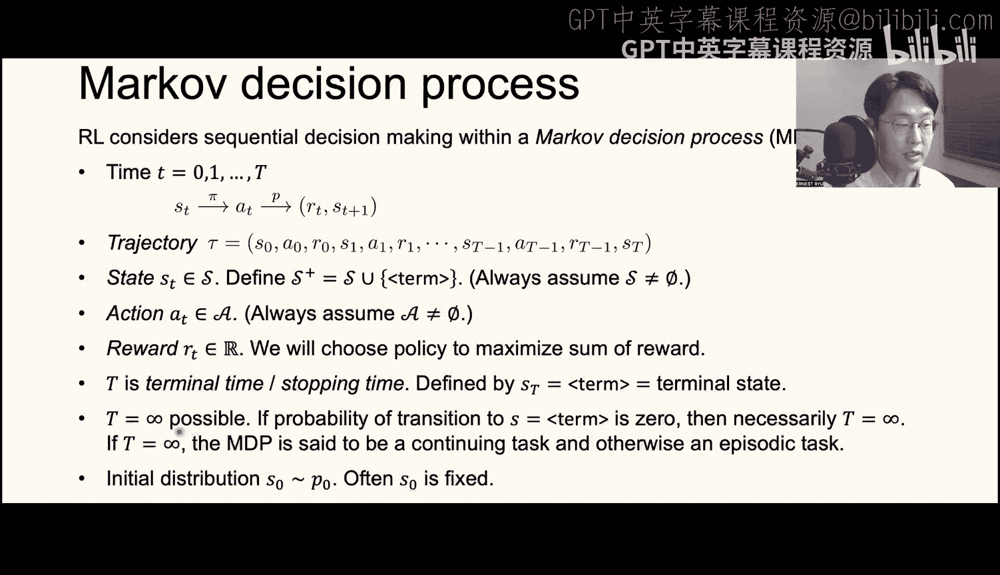

Now， when the terminal time is plus infinity， the MDP is said to be a continual task。

 so here's a slight typo if t is plus infinity， MDP said to be a continual task and if the terminal time is finite。

 then the task is referred to as an episodic task。The initial state S0 is is assumed to be sampled from an initial distribution P0。

 Now often the initial state S0 is fixed， for example。

 if you play a video game you turn on the video game you start at the same state every time。

 in which case the distribution P0 would be would correspond to a determin state random variable。

So not really a random variable。Okay， so then given your current state S。

 the agent chooses a certain action and then given the current state and an action taken。

 you transition and the way you transition is governed not by the agent but by the environment which is the markup part of the markov decision process and that's referred to as the transition probability so given the current state and the current action。

 we collect a reward which can be a random variable conditioned on the current state and the action and we will transition to the subsequent state here denoted as S prime。

Now this transition probability is usually not precisely known to the agent。

 so think of the agent as an entity that is making decisions while doing the learning and really that is what machine learning reinforcement learning is right so you are thrown onto an environment。

 you don't know exactly what the physics is you don't know exactly what the transition probability are。

 you don't exactly know the rules of the video game that you're playing but you need to interact with the environment and you will learn something about the environment and given that information given what you've learned。

 you need to make decisions。😊。

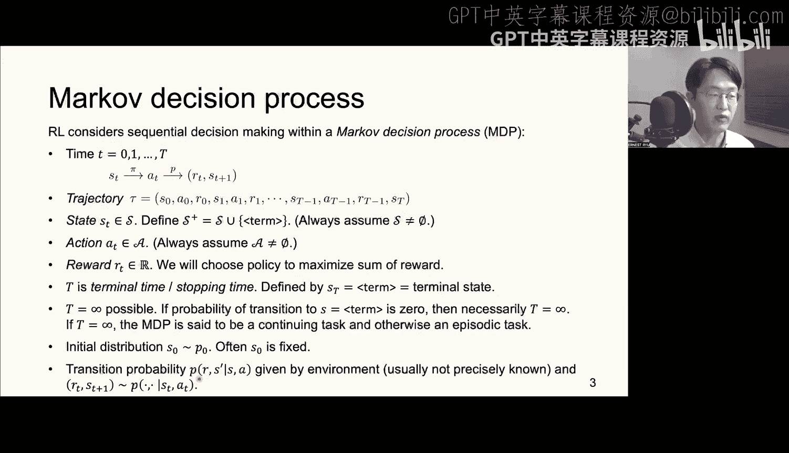

And so in that sense， the transition probability is usually not precisely known and it is something that must be learned throughout the interaction with the environment。

 and again， this transition probability governs the transition from state action AT to the next reward R that the agent collects and the subsequent state S plus1。

Sometimes， although not always， the reward that you collect is a deterministic function of the current state and the current action。

 so if this is the case， we write Rt is a function of a deterministic function of ST and AT。

Sometimes the subsequent state is a fullymin deterministic function of the current state and a current action。

 so in some video games， let's imagine you input a certain command and that will precisely determine what happens at the next step let's say you press the upward arrow then that takes your video game character to the position that is one above where you currently are and well that would be a deterministic transition sometimes you do something and then let's say in a video game you choose to open a chest and then that chest can contain a random amount amount or a random sort of a loot so you can give you let's say a sword or a shield or some money in a video game and the state that you arrive at is random so sometimes the subsequent state is a deterministic function of your current state in action sometimes it it's a random a variable as as conditioned on the current state and current action。

😊，For our purposes， we'll assume that the dynamics is stationary， so in general。

 the rules of the let's say the video game or the rules of the MDP。

 it can change as the steps progress for example， let's say you have a video game where that your character is necessarily either wins or lose within。

 let's say 10 moves in which case then the action that you should take at move one will probably be different the strategy should be probably different compared to the action that you would take at move number 10。

 knowing that the game will almost will immediately end after your current action。So in those cases。

 the MDP， the dynamics is nonstationary and when the dynamics is nonstationary。

 the transition probability will be denoted with P subscript T。 but when the dynamics is stationary。

 then the way your character moves， the way you interact with the environment does not depend on the current step。

 so in which in those cases， then the transition probability is denoted as P without a subscript without a dependency on the time T。

The action A is chosen by the agent via policy pi， and the agent observes the current state ST and to make the chooses the action AT。

Now the policy pi can be stochastic or it can be deterministic。

 So if the policy pi is stochastic then the policy then pi of a given S。

 this defines a probability distribution So if you sum this value so this will output a number a nonnegative number and if you sum over all the possible actions a。

 then it will sum to1。 So hence defining a probability distribution and when that is the case。

 then the action is sampled in accordance to this probability distribution conditioned on the current state S T。

Sometimes you have a deterministic policy， so in those cases we denote the action a pi of ST as a single action that the agent will take and we will write the action AT as equal to pi of ST。

Often， we will make the policy be a parameterized by a neural network。

 so we will write pi is equal to pi theta。 So that means the policy pi is a neural network parameterized by a certain neural network parameter theta。

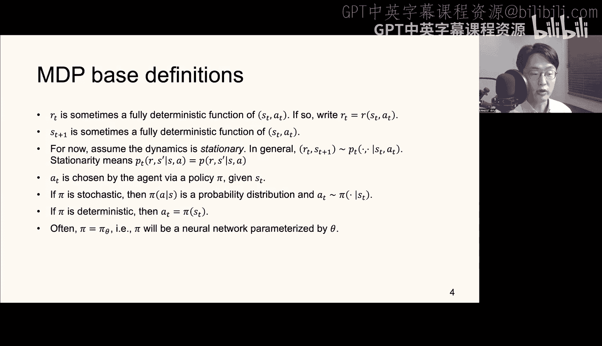

In general， when you have an MDP， an agent may not be able to observe the full state。 So。

 and the system may not be a Markovviian with respect to the observation。

 So let me give you an example of this。 So let's say you're outdoors and you're living in an area where a tiger is exists。

 and you see a tiger。 So you see a tiger。 and the tiger notices you and then hides behind the tree。

Now now that the tiger is hiding behind the tree， you no longer see the tiger。

 but so that's your current observation。 So at that point your current observation is what you see with your eyes and there is no tiger within your observation。

 but the state in that scenario is well basically the position of the tiger yourself and all the animals within within this outdoor area。

 so given your current state， you can argue that the system is the MDP is Marovviia。

 you can argue that well given all the information about where everybody is。

 then the past is irrelevant。But in this scenario where you have partial observation。

 you only get to see what you can what you see with your eyes。

 then the past observation is relevant because even though you do not see the tiger right now and that doesn't mean you're safe。

 In fact， you know the tiger is hiding behind the tree。

 so you will know to not approach the tree and try to evacuate as soon as possible。😊。

So what I just described is an instance of a partially observable markov decision process often abbreviated as PoDP Po DPs are just much more challenging than MDPs to do learning within。

😊，And it has a lot of practical real world applications， but for us for in the context of this class。

 we will just assume that the agent is able to fully observe the current state S。

 so we will assume that there is no distinction between the full state which makes the system Markovviion versus the agent's observation。

😊，And that's because we will make this assumption because we will be considering reinforcement learning on large language models。

 and in large language models， this is not an issue because the language model is able to observe the full conversational history and the full conversational conversational history is indeed the full state。

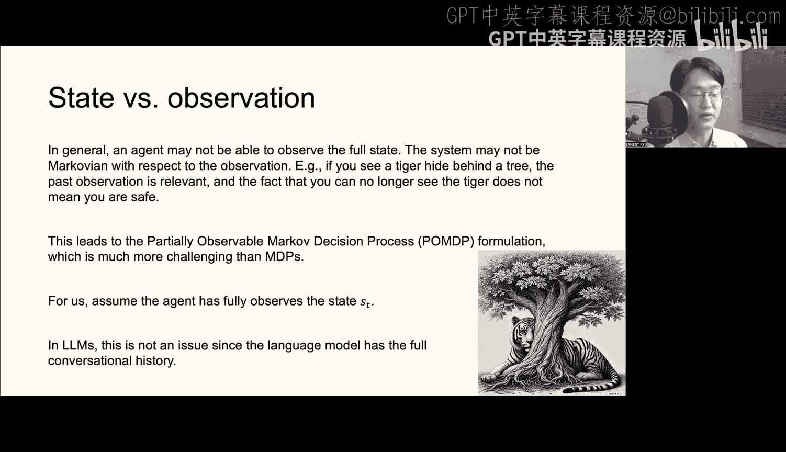

There are many further generalizations of the standard MDP， and we won't cover them in the course。

 So one generalization which I've already talked about is non stationary dynamics。

 Another generalization is the terminal time， a big T being predetermined as opposed to be determinedmin by hitting a terminal state。

And in fact， if you have a predetermined terminal state。

 then that's an instance where you have nonstationary dynamic。 Also。

 the agent's policy pi can be a time dependent policy so the agent can choose to given the same state。

 the agent can choose to act differently depending on what time step it is at。Mathematically。

 you can prove that time dependence dependent policies are necessary only if the dynamics is nonstary。

 and since we are going to assume that the dynamics is stationary。

 we don't really need to consider time dependent policies。😊。

It's also possible that the set of possible actions may depend on the current state。

 So maybe depending on where your video game character is at。

 you have different allowable actions that that you can take。 So in this case。

 then the action A T will come from an action set that depends on the current the current state。

 for simplicity， we won't consider this generalization。

But I'll just make the comment that when you're working with Markov decision processes and reinforcement learning in practice。

 it's actually not that common for the MDP to have this nice pure structure where the most simple structure that we're considering is again discrete time stationary dynamics。

 the set of actions do not depend on the current state it's often what will actually be the case is that your MDP will have to will incorporate some of these variations so from these lectures I hope you come to understand the principles。

 the core principles， and once you have that understanding then you can adapt the base theory to the particular MDP at hand。

😊。

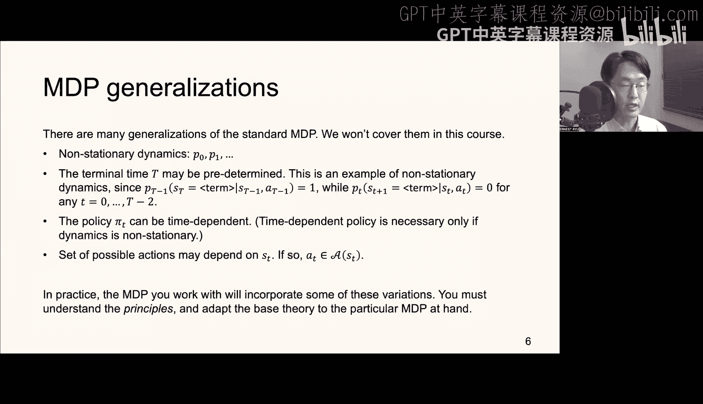

Alright， so let's dwell further on this terminal time notation。

 So the terminal time a big T is a random variable。 and this is something that to keep in mind。

 And it might feel a little bit unnatural。 but if you think about it， well。

 if you play a video game and let's say the terminal time is determined by the time at which the game ends because you either win the game or you lose the game the terminal time will be different every time and be different depending on what you do。

 depending on what how the environment acts。 So the terminal time is a random variable。

 And and since we assume time is an integer value。 terminal the terminal time is an integer value and random variable。

😊，But because a big T， this terminal time is a random variable。This kind of summation。

 which we will encounter quite often， The summation from the current time to the terminal time。

 This is an object that requires caution to work with。 So， for example。

 if we take an expectation of the sum from the current time to the terminal time。

 We are not allowed to swap the order of the expectation and the terminal time。 Now， why would that。

 why is that not allowed。 Well， you see the expectation is supposed to consider the randomness within the summation and also the summation index。

 the summation limit， big T。 But if you were to pull out this summation。

 this actually doesn't make any sense because big T is a random variable。 So after the expectation。

 you are supposed to get a determinous equality because you've already taken the expectation。

 But big T is a random variable。 So you shouldn't you can't pull this out。

 Otherwise you will have a random variable outside of the expectation。

 this cannot be possibly be the same thing。😊。

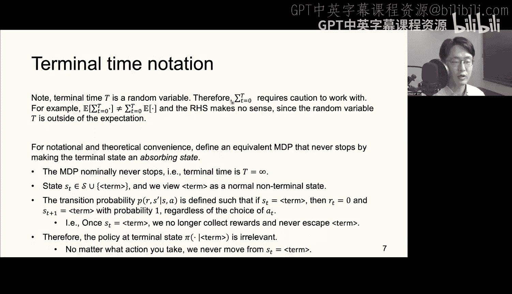

So yes， so the right hand side makes no sense because random variable T is outside of the expectation。

😊，So what we'll do is in order to simplify our notation and sort of our theoretical discussions。

 we will define an equivalent MDP that never stops and we will do so by making the terminal state an absorbing state。

So the MDP， the equivalent NP， nominly never stops。

 So the terminal time big T is equal to plus infinity。 Well， now。

 when big t is equal to plus infinity， for example， in in this scenario， we would。

 we would be allowed to swap the expectation and summation because well。

 now big T is no longer random。 So it's just a summation from 0 to infinity。

 And that can be inside or outside of the expectation。But the way we do this is we say now。

 the current state is either a non terminal state or a terminal state。

 and we will now view the terminal state as a normal non terminal state。

But what we'll do is the transition probability P is define such that if you are at a terminal state。

 then you never move and you never collect any reward。 So once you're at a terminal state。

 you're stuck there if you're at a terminal state， then the reward is zero and the subsequent state will be a terminal state with probability one。

 So you never move and you will never move regardless of whatever action you take。

Okay so again， to restate this， once you're at a terminal state， no matter what action you take。

 you will never collect any further rewards and you will never escape from the terminal state。嗯。

So under this definition， then the policy at。So under this definition。

 the policy at the terminal state becomes irrelevant because no matter what action you take。

 you're forever stuck at the terminal state and you never move。

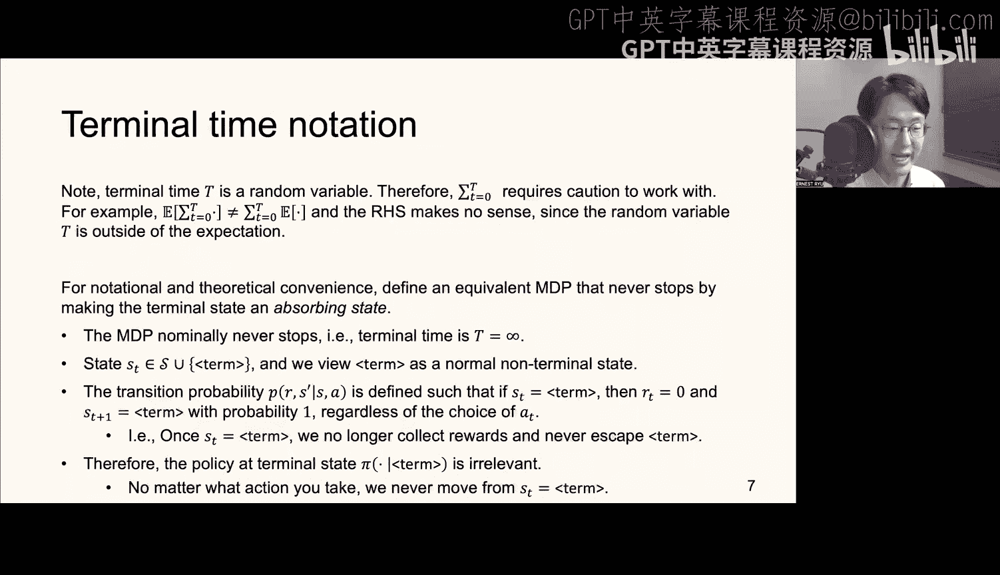

Okay， so how should we how should an agent learn to act within a Markov decision process Well。

 let's start by the idea of imitation learning So an imitation learning or behavior behavior behavior cloning we train a policy of pi theta so pi theta is a policy parameterized by a neural network such that it mimics it imitates it clones an expert policy so pi expert is a policy of an expert agent and we ofning。

So pi expert is an expert policy， and this usually comes in the form of human demonstrations and the agent learns to mimic that。

So here's roughly how you can do it。 So step one， you sample a trajectories starting at state0。

 ending at a terminal state S。 So this is generated with the triplet。 So P0。

 that's the initial distribution governing the generation of S 0。 We have the policy pi expert。

 So this is given by expert demonstrations。 and then the MDP transition probability P。

And then given this， we form a data set of a state action pairs。 Okay。

 so the given the current state， the agent， the expert agent chose action A AI。

 and this is what we want to mimic。 By the way， there is no notion of there is no notion of rewards within this process。

Then what we do is we train the model by solving this minimization problem。

 so here the L is something like a cross entropy loss and we have the policy pi theta be given the current state S。

 and then it is trained to mimic the action that the expert agent taken。

So this is basically supervised learning it's not pure reinforcement learning in the sense that there are no notions of rewards when you're doing the learning。

 but it's simple， it's an intuitive idea。 So if you have an agent that makes good decisions chooses good actions。

 we train our neuralral network policy to mimic that。So then is this a good idea？

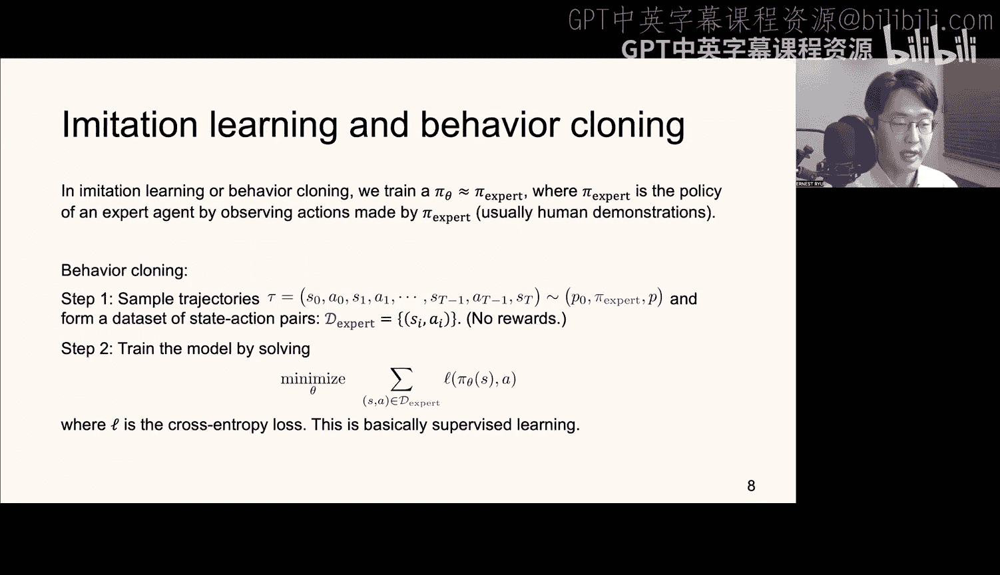

Well， first， let's make an observation that in large language models。

 large language model pre training， these models are trained via next token prediction。

 And this can be thought as an instance of behavior cloning now。

What is next to predictiondication in large language models， Well。

 when you train a large language model， what you do is you show the language model a bunch of text and then you ask a large language model。

 what should be the next token or the next word that comes after this text and you will have this data collected from the Internet。

 So on the internet from the internet， you will have text written by an actual human being。

 So the next word you will have data of a next word that is actually written by a human being and you'll have the large language model try to predict what that correct next word ought to be。

And the observation that next looking can prediction of large language models can be thought of as behavior cloning is a simple but I think quite relevant observation。

Behavior cloning it can serve， it may serve as a good starting point as an initialization。

 as we will see with， let's say， Alphago and a large language model pre training。

And that is to say a behavior cloning is quite useful。However。

 in many reinforcement learning settings， the requirement of expert demonstrations can be quite ownersrous can be quite expensive。

 So imagine let's say you were playing a new video game or a new board game that nobody else has played before and you want to use behavior cloning。

 Well then the only way you could get data would be to hire a smart human being to figure out the game and play the game intelligently and that'll be quite expensive。

But in the large language model setting， actually the pre training data is plentiful because the pre training data consists of just texts written by human beings。

So this is this is quite nice。 behavior cloning imation learning is quite nice when you have plentiful expert demonstration data。

 however， behavior cloning by itself does not work very well in the following sense。😊。

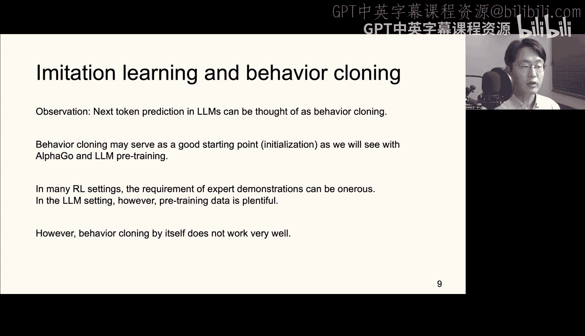

In supervised learning， it's well established that if you train a model on one distribution and if you test it on the same distribution。

 it will perform well， but if you change the test distribution， then the behavior。

 the performance degrades a change of distribution from training to test test setting is referred to as a distribution shift distribution mismatch covariate shift concept drift。

 etc cetera。 This is a well understood and well studied behavior。

Now in behavioral cloning this in its pure form where you only train on expert demonstrations。

 this tends to fail due to covariate shift now why does a covariate shift happen when for an agent trained only on behavior cloning。

 well at test time when the model is deployed the trained model。

 the model trained on behavioral cloning it will observe trajectories given by this distribution where the current agent is making the actions and that's determining the sequence of states that the agent visits。

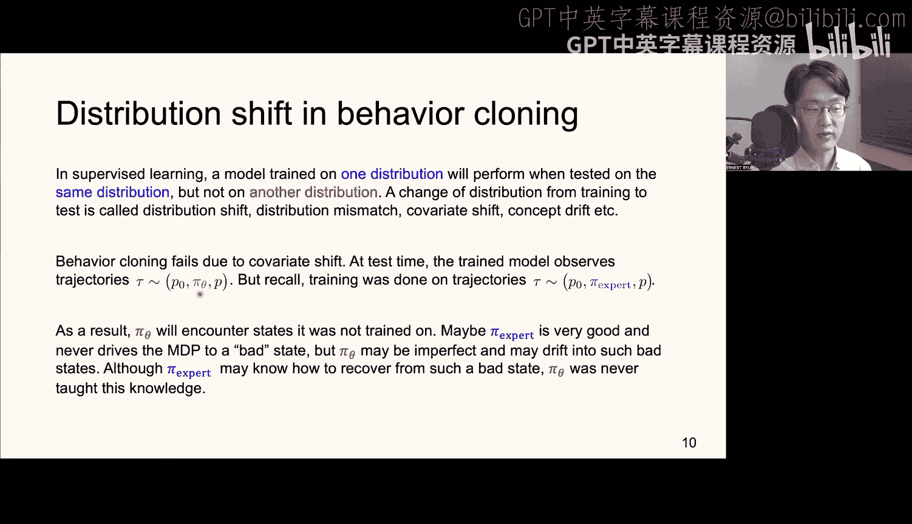

But this is not the distribution that this agent was trained on。

 This agent was trained on distributions was trained on a this distribution where the expert takes the actions and the states that are visited are determined by the actions of the expert policy。

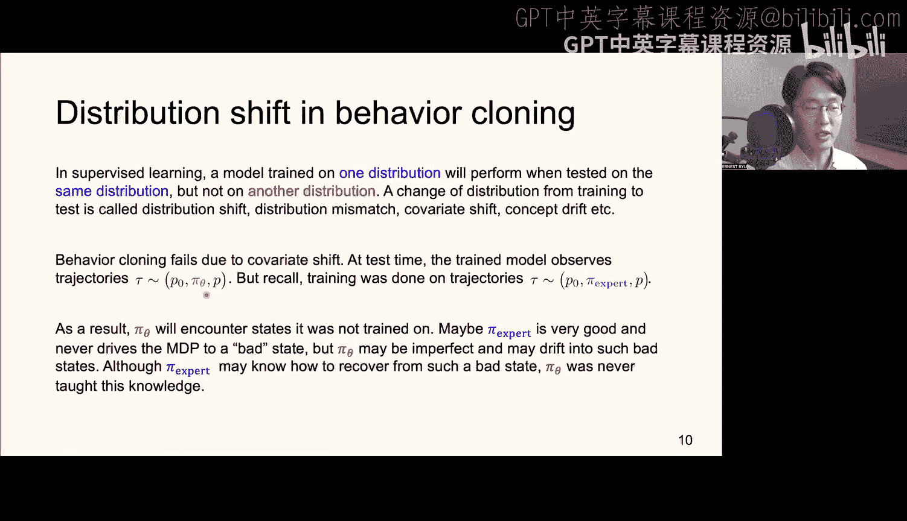

So as a result， the policy trained only on behavior cloning it will encounter states that it was not trained on。

 Maybe the per policy is very good， and it never drives the MDDP to a bad state but the trained the behavioral clone policy will necessarily be imperfect because after all。

 this is deep learning and in deep learning， we don't train models to perfection。

 So the trained agent policy will be imperfect， and it may drift into such bad states。 Now。

 if you were to ask the expert policy。 the expert human。

 The human may actually know how to recover from a slightly bad state。

 So let's say let's imagine you're driving a car and the car slight swerves slightly to the left。

 an expert human driver would know to how to recover and just turned the handle to the right and that will recover and and put the car on the right course。

 but the agent policy， the trained on behavior cloning may have never encounter。

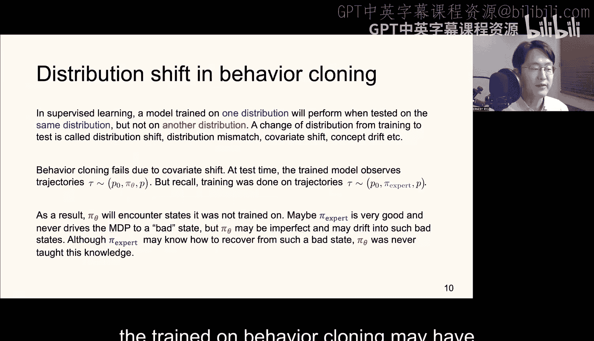

Such a scenario because the expert policy was so good and the Asian policy is only good at mimicking the behavior of the expert policy under these good states and once the Asian policy enters one of these bad states。

 it's never taught how to recover from these states， so it just doesn't know what to do。😊。

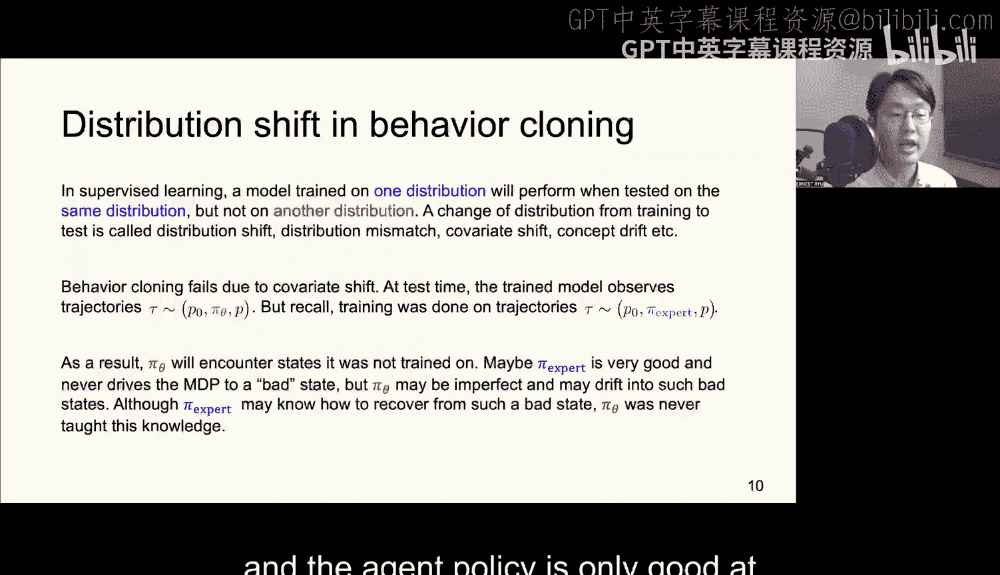

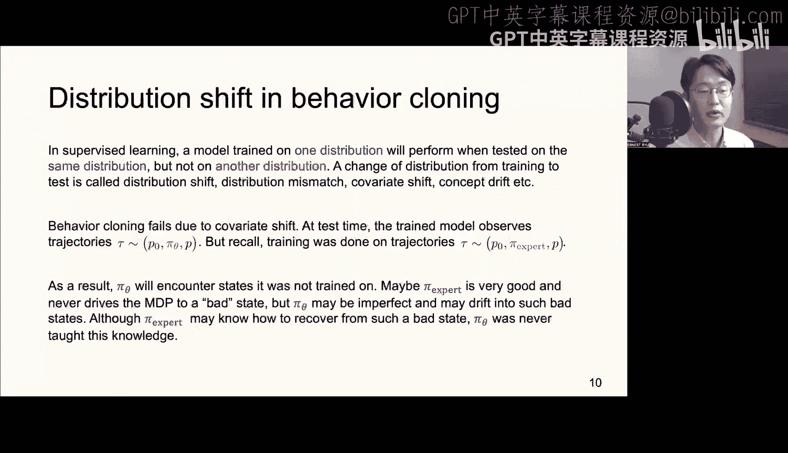

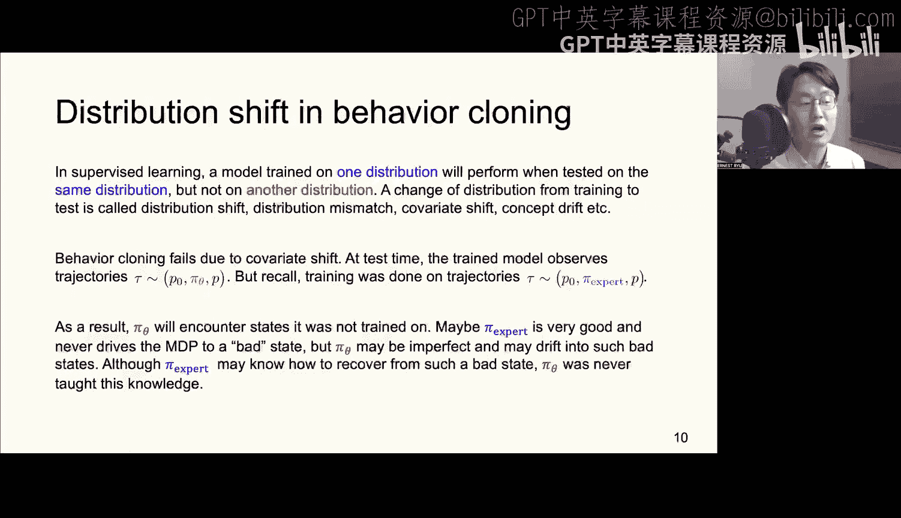

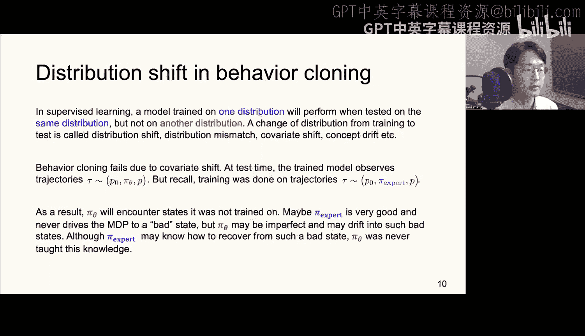

In fact， recognizing this issue of distribution shift leads to a key insight in reinforcement learning。

 and that is that in reinforcement learning， the training data depends on the policy that generates the training data。

 and this is different from supervised learning in supervised learning we sort of assume that the data is just given to us and the model learns from the data。

 But in reinforcement reinforcement learning。 the agent that generates the data interacts with the environment。

 So if you have a different agent， then you get a different distribution of data。 And this。

 by the way， is true for both imitation learning or rewardbased usual reinforcement learning。

And this leads to the distinction of off policy versus on policy learning in off policy learning。

 the reinforcement learning agent trains on actions taken by another policy。

 maybe it's a completely separate expert policy， or maybe it data generated by its old self。

In on policy learning， the RL agent trains on actions taken by the current policy by itself。

And off policy RL suffers from the issue of distribution shifts and behavior cloning or imitation learning is certainly off policy learning。

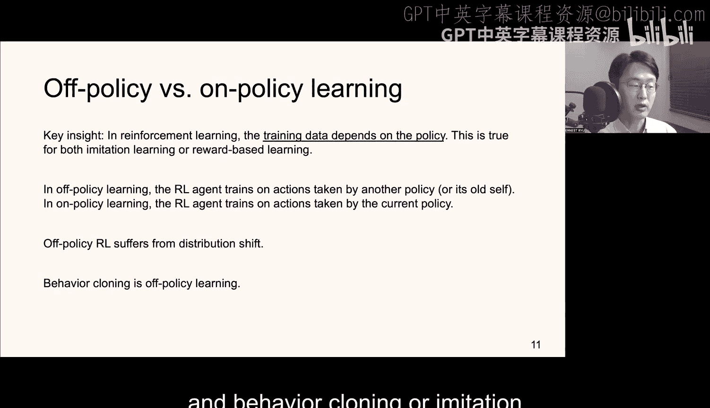

So the algorithm dagger a data aggregation is more on policy imitation learning。 so in each round。

 the current policy is used to generate trajectories and the expert provides labels for the states and by retraining on this aggregated data dagger mitigates a distribution shift。

So let's read through the algorithm to understand what it does。 So we start at step number0。

 So we sample a trajectory from the expert policy and that forms our data set。

 Our data considers state action pairs。 So it's a data set consisting of the current state of various states and the actions that the expert agent has taken。

 Then in step number one， we train a policy from the demonstration data and then step number two。

 we have the trained policy take actions and we will sample we'll sample our trajectory based off of that and then we'll collect the actions that this trajectory has LED to。

And then we ask the human expert to label the individual actions with with the individual states with the correct actions。

 so the current policy pi theta generates the states， it will also generate a bunch of actions。

 but we assume that those actions are not good and then we ask the human expert to annotate these states with actions and now we make that our data and then we aggregate our data so we have the actions taken by the expert on the previous data and we combine that data with the expert actions on the new states。

 so the difference between the previous data and the current data is in the distribution of the states we're asking the same expert policy to annotate the states with the correct actions but we are the data is now aggregated to incorporate a wider range of states in particular the states that the current action would the current agent will take。

Lop back to step number one and repeat this process。Sometimes dagger works just fine。

 but sometimes this is a little bit unnatural， so asking human experts to take an action on states generated by a policy that the human expert is not taking action on is often very unnatural So let's say you have a human expert driver。

 the human expert expert driver can sit at the steering wheel and drive the car very well。

 but if you just provide a certain state of the vehicle and the road to to the human expert and ask the human what would you do here how strongly would you press the accelerator by how many degrees will you turn the steering wheel。

 this is kind of an unnatural way for a human to provide labels。

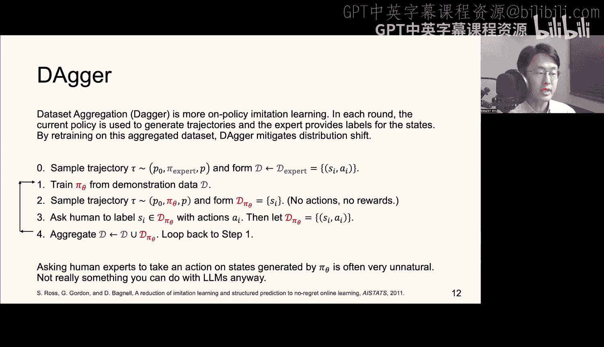

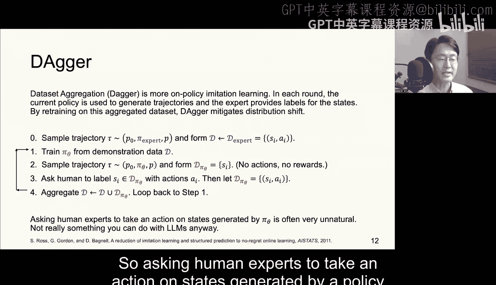

InIn any case， this is something you theres not really something you can do with large language models anyway。

 So the way a dagger like algorithm would would manifest in the setting of large language models would be something like you have。

A completion of a partial completion of a text。 And you ask another human。

 what would be the word that follows the current text。 And this is an unnatural way to write text。

 because as a human， the way you write text as you think about what you're going to write and you just type away。

 that's how you write。 If you， if you're given a partial a partial a part of a paragraph that somebody else has written。

 And if you're asked to continue the writing thereafter， this is a little bit unnatural。

 And it's something that wouldn't quite work in the setting of large language models。Nevertheless。

 the idea behind dagger is quite interesting and the idea that the general idea that we want to make the imitation learning be as on policy as possible。

 this is a notion that will become relevant again when we talk about reinforcement learning with human feedback and expert iteration。

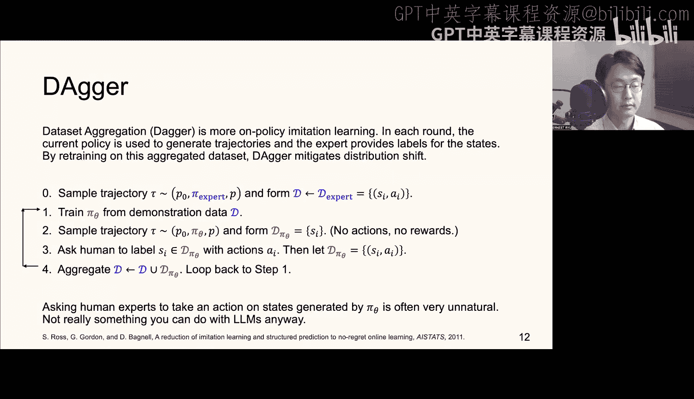

Okay， so now that we've covered imitation learning， let's now move on to pure reinforcement learning。

So so far， we have I've described the dynamics of the Mark of decision process and also imitation learning。

 where without a specific goal or objective precisely defined， we just try aim to imitate an expert。

 which we assume to be good in some sense。But in the classical reinforcement learning and MDP setting。

 we have a goal。 So the goal， an objective of an MDP is to maximize the expected discounted return。

 So specifically the optimization problem we wish to solve is of this form。

 So here we have this expectation。 And we want to find the policy pi that maximizes it。

 So what's this objective。 Well， first， let's define the cumulative discounted return。 Okay。

 so the cumulative discounted return is the sum of all the reward。

 So reward at time 0 reward at time1 reward at time t -1， and this is the final reward。

 right so there's we don't get under our notation， we don't have a reward at time terminal T big T。

 So this is this is a sum of all of the rewards。 But they are discounted。😊，Okay。

 so here gamma is referred to as a discount factor， and it's set to be a value between0 and1。

 So if the gamma discount factor is less than one， then what that means is we prefer to collect rewards sooner rather than later。

 So if gamma is， let's say 0。99， then the reward that we get at step 0 is considered is has a value of unit 1。

 but the reward at time 1 is only 99% as valuable as a reward that we would collect at time step 0。

 and then the reward that we get at time time step 2 would be gamma to the power squared gamma squared as much valuable。

This cumulative discounted return is denoted as G0。

 we refer this is the cumulative return and the terminology is the reward is an instantaneous reward。

嗯。When the terminal time is infinite， when we have a continual task， its so when this is possible。

 and if the reward is bounded， then we often use choose gamma to be less than one to ensure that this return is finite。

 So when big T is plus infinity， this summation can become infinite。

 it can become infinite when gamma is equal to one。 So， but when gamma is less than one。

 and the reward is bounded， than is guaranteed that this sum is well defined。

 it results in a finite summation。😊，So imagine the initial state being sampled from distribution p0 and we act according to the policy pi and then that will generate a trajectory either finite or infinite。

 and we get a cumulative discounted return as our random outcome。Now， the expectation。Now。

 the expectation superscript pi， this signalss the expectation over all actions where we take actions according to policy pi and we transition according to the transition probability P。

嗯。😊，Okay，And so then we take the expectation over those cumulative discounted returns。

 and we want to maximize the expected cumulative discounted return。 So if you specify a policy pi。

 then this expectation will be defined and we want we want to follow。

 We want to find the policy pi that attains the maximum expected value。Also for further notation。

 G0 is the cumulative discounted returns starting at time0。

 but we will write a Gt to denote the cumulative discounted returns starting at time T and also the discounting starting at time T。

Okay， so then now let's define the value function or the state value function。

 also called the V value function denoted with V。Okay。

 so V pi is a function that takes it as input the current state S。 Now， for v pi。

 we take the expectation of g0， the cumulative discount of return。

 when as we act in accordance to the policy pi。 but we assume we start at state state S at time 0。

 So instead of sampling the initial state with these initial distribution P 0。

 we fix the initial state to be S。 and then we assume we act according to pi。

And then we take the expectation。Okay， so this is the expected return starting at state as following policy of pi and note that the according to this definition。

 the value function at a terminal state is by definition equal to0。Okay。

We'll also define the state action value function， which is also referred to as the Q value function in this way。

 So it's basically the same definition。 We take the expectation with respect to pi of the cumulative discounted return。

 But here what we do is we start at state S。 and we initially commit to action A。

 So action a0 is not sampled according to pi。 we are choosing action a for a the initial action a 0。

 and then the subsequent actions will be sampled from policy pi thereafter。 So again。

 action 0 a0 is is different。 A a0 is just fixed to this specific value。

 and then the subsequent action starting at a1 will be sampled from the policy pi。Okay。

 so this is referred to as the Q value function and again by definition。

 if we're at a terminal state， then the Q value function at a terminal state。

 regardless of the action is defined to be zero。

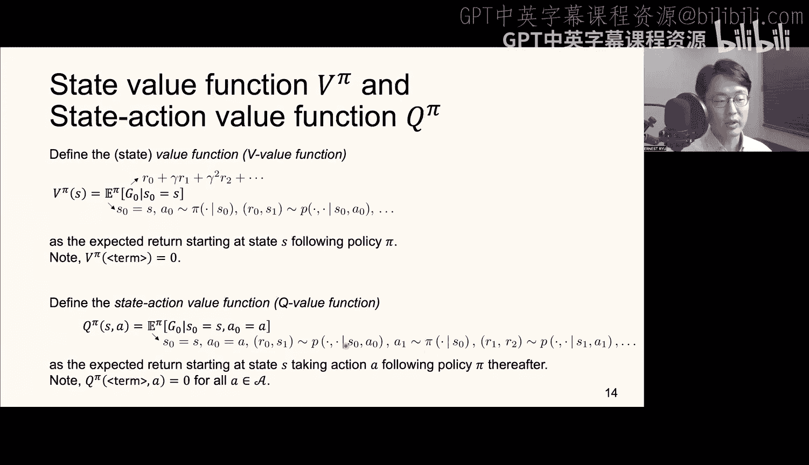

So the V value function and the Q value functions are fundamental quantities in reinforcement learning。

 so let's explore some of their basic properties。So since the expectation E pi it denotes the expectation of overall subsequent actions。

 by definition， sort if you think about it， if you take the Q value function。

 well the Q value function considers the initial action a0 and then we take and the subsequent actions are chosen to be chosen from policy pi thereafter。

 but if we then say well， actually a0， we're going to choose that let that sample down from probability probability from policy pi。

 then that actually is just the V value function。 Okay so instead of fixing the a0 action。

 if we let it， if it choose it from policy pi， then then yeah that's that's what the V value function is。

Also， by the stationity of the Markov decision process。

 if we take the expectation of Gt conditioned on the teeth state being something。

 Well thats the same thing as starting at a time 0。 So taking the expectation of g0， starting at S0。

 So it really doesn't matter at what time we start it's either the starting time doesn't really matter doesn't affect the expectation。

 So we get v pi of s regardless of the starting time。

 the same is true with the Q value function as well。

 if we fix the state S T and action A and take the expectation of Gt。

 that's the same thing as just the Q value function。Okay。

 next we have the one step transition probability property of the value function v pi。So okay。

 so here is the one step transition property。 V pi is the expectation of the initial reward at times 0 plus gamma times v pi of state1 okay so here the way we get these random variables is we start at state state at times 0 is equal to S。

 we choose the action a0 according to the policy pi。

 then we transition according to the distribution， the environment P we get a reward R0。

 we get the subsequent state S1， So we take the expectation with respect to the reward R0。

 and then we plug in the subsequent step into the function v pi。

 the value function V pi with the discount factor。So this is the one step transition property。 Now。

 why is this the case， Let's prove this。Okay， so v pi is by definition this right this is the again。

 the definition of the value function。 but then if you look at this summation， well。

 this summation is just we've excluded t equals0 from this summation so I pulled out the R0 and then we have the subsequent discounted rewards。

 but I'm going to also pull out a factor of gamma from here。Okay， so then this。

 if you stare at this for a while， this is actually just equal to G1。

 So themulative cumulative discounted returns starting at time step 1。

 discounted by a factor of gamma。All right， so now let's take a look at this expectation and now we can do using the tower property。

 we can do some conditioning。So within this expectation。

 we're going to have an expectation conditioned on not just S0， but additionally condition on a 0。

 R 0， S1， and then we take the expectation of everything going forward。

 So starting at so we condition on S1。 then what follows that is a1。 the action1。

 and then the reward1， state 2， action 2， reward2， state 3， action 3 so on and so forth。

 So we condition on things that come after S1。And then in the outer expectation。

 well we were always conditioning on s0， but we now now need to take the expectation of a 0， R 0 S1。

 So we have a0， R 0 and S1， and they are sampled in this way。

 So a0 is sampled according to the policy pi， and then R 0 and S1 is sampled according to the MP distribution P。

Now， if we take a look at this inner expectation， well in this inner expectation。

 we're conditioning on r 0， since we're conditioninging on r 0。

 well r0 is a deterministic quantity as far as this conditional expectation is concerned。

 so we can pull it out。 and then gamma is a literal constant。

 So we can pull it out of the expectation。 So then we have an expectation of G1， a condition on S 0。

 a0， R0 and S1。😊，But if you think about g0， G0 as a G1， G1 only contains it contains reward1。

 reward2 and thereafter it does not contain S0 a0 and R1。

 So because of the Markovvian property given S1， then the past is irrelevant when we take the conditional expectation。

 so we can drop the conditioning on S0 a0 R0 and just take the conditional expectation of G1 conditioned on S1。

Then by stationity， well， this quantity is simply equal to v pi with S1 plugged in。

 so now and that's it that that gives us the one step transition property of the value function。

Next we have the one step transition property of the Q value function。

 so Q pi of essay can again be written in this way where we have the reward at the initial step and then we take the expectation of gamma times Q pi with the subsequent state and the subsequent action plugged in so the current reward and the current the subsequent state is generated by the environment。

 the MDPP and then the subsequent the next action a prime is generated by the policy pi。

OkayThen the argument behind this follows from the similar kind of reasoning where we have using the tower property of conditional expectations。

 making an argument based on the Marcobian aspect of the MDDP in dropping some conditioning it's the same similar kind of reasoning so I will and it' written the steps are written out here so going through the precise steps and understanding it completely。

 I'll leave that as an exercise。In the following， we're going to show a crucial property of the so called Belllmon equation。

 and this will require the use of the Bonock fixed point theorem， so let me explain it now。

So let X be a metric space with a metric D。 then we say an operator T is gamma contractive if this inequality holds Okay。

 so for those of you without a math background these words might seem a little bit sort of intimidating。

 but let me sort of explain。 So it's not that big of a deal So okay so x is a metric space with metric D so that means x is a space that has a certain notion of distance。

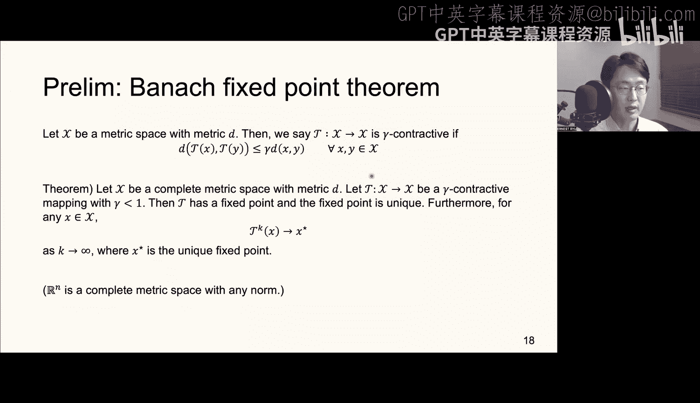

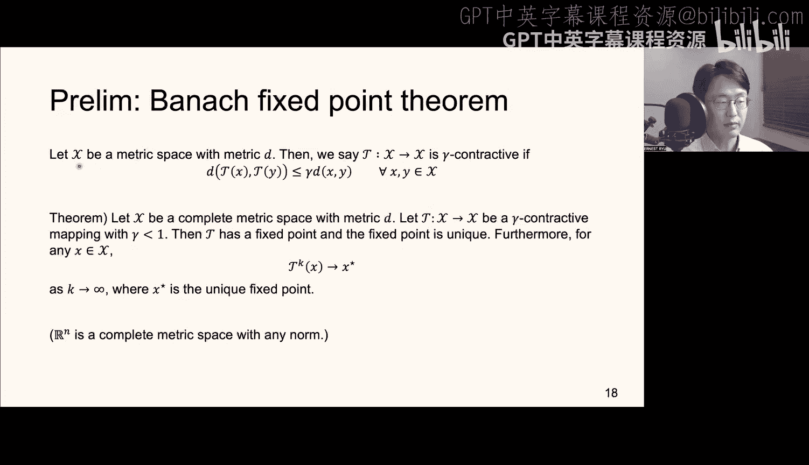

In the context of this class， in the context of our application of the Bo fixed point theorem。

 x is going to be an n dimensional space with the so called L infinity norm， the maximum norm。

And we say an operator that maps from a vector to another vector is contractive if if you have an initial distance between two inputs。

 x and y will have a certain distance， and then if you feed that through the operator。

 the two points get close to each other by a factor of at least gamma。

 So that's what this contractiveness is。So here， so here's the Bna fixed point theorem。

 So if we let X be a complete metric space with a metric D。 So completeness is it。

 it just means that any khi sequence has a limit。 So it， again， if you don't have a math background。

 that might seem a little bit sort of， you know， too much math jargon。

 but basically all the spaces that we consider the n dimensional space， it's a complete metric space。

And let's let an operator T be gamma contractive with gamma strictly less than1 then the operator T has a fixed point and the fixed point is unique。

 so furthermore， if we take any point and we just repeatedly apply the operator T so this notation means we apply the operator T K times repeatedly and if we let the number of applications k goes to infinity then that will converge to the fixed point。

The the idea of the Bno fixed point theorem is used in two ways。

 One is to show to establish that a fixed point of a certain operator exists。

 Another is to use it algorithmically， namely we directly apply the algorithm as prescribed in this theorem namely we have our fixed point operator we apply it repeatedly and that allows us to computationally obtain converge to the fixed point that we desire。

 and this will lead to the algorithm value iteration。Okay。

 so now let's establish properties of the Belllmon equation。

 which is another fundamental object in reinforcement learning。Okay， so here's the theorem。

 Let pi be a policy。 And let's assume the discount factor is between 0 and1， strictly less than1。

 Let's assume that the state space is finite。 So one can it's possible to work out a a similar kind of result when the state space is infinite。

 but that just complicates things unnecessarily。 So we'll just assume that the state space is finite。

 Let's also assume that the reward is bounded almost surely。

 So the absolute value of the reward will be less than an upper bound R and this R is going to be some finite value。

Then this value function with respect to pi it exists， so it's a well definedfin quantity。

 and furthermore， the value function satisfies this bellman equation。

 so this is the one step transition property that we've established and it turns out that this one step transition property。

 it actually fully characterizes the value function of the pi。So conversely。

 if a function satisfies the bemin equation， then the function。

 it turns out to be equal to the value function。Okay， so let's approve this。

 So the welldeness of the value function。 What that means is it just means that the expectation needs to be finite and that follows from the boundness of the expectation。

 So if you take the expectation of this quantity， which which is what defines the value function well that could in general that could come out to be an infinite number。

 So in which case the expectation would not be well defined， but gamma is strictly less than one。

 we're using a discount discount factor is strictly less than one and also the reward is the reward is bounded by value R。

 which is a finite value。 So using then the geometric sequence argument we can show that the reward is going to be bounded in this way。

 So the expectation is well defined。Next， let v pi be the beman operator for the value function for the V value function。

 and it's an operator that maps a function to a function。 Okay， so V is a function of S。

 but well feed the V through this bellman operator and their output will be another function。

 So we will evaluate that at S。 We'll define this bellman operator in this way。 So well。

 if the input is S， then we condition on the initial state to be S。

 we take an action according to pi。 We transition according to the probability distribution P。

 then we take the expectation of r plus gamma the function V evaluate it at S prime。So again。

 the Belman operator is an operator that maps a function of S to a function of S。

And then well we've already established the one step transition property。

 so that means that if v pi is the value value function with respect to the policy pi。

 then the beman operator applied to V pi will be a V pi itself， so to put it differently。

 the value function is a fixed point of the Belman operator。

So then what remains to show is we want we still want to show that the value function is the only fixed point of this Belman operator because we we've already established through our once that transition property argument that the value function is a fixed point of B of the Belman operator。

 but maybe there are other fixed points。 And we wouldn't want that。

 So let's show that the value function is the only fixed point of the Belman operator。

So what we'll do is we'll define this infinity norm， this maximum norm。

 which is simply the maximum possible value of this function of this V function as a function of s and the maximum of the absolute value of the output。

So then if we do so， then this Lfin de norm is a norm on the space of functions from the stage to real numbers。

If the dominant operator is a strict contraction with respect to this infinity norm。

 then by the Bock fixed point principle， by the Boock fixed point theorem。

 then V pi will be necessarily the unique fixed point。

So it remains to show that the Belman operator is a gamma contraction in the L infinitor。So okay。

 so to show that this is a strict contraction， what we do is we feed in V1 and V2。

 so V1 and V2 are just two different functions of S and let's feed this to the Belllman operator and see if we have a contraction property。

Okay， so we， we take a B of v1 minus b of V2。 the difference， and then we apply the L infinity norm。

 The L infinity norm is by definition， the maximum of the absolute value of the inputs。 Okay。

 so so this is by definition of the L infinity norm。Okay。

 and now let's plug in the definition of the Belllman operator right so we plug in the definition of the Belllman operator。

 so the beman operator， we condition on the input S。

 we sample we take sample action according to policy pi， we get reward R。

 we get this next we transition to state S prime and then we plug that into V1 and same and here we plug into V2。

Now if you look at these expectations， you'll note that the expectation is the same。

 the R is the same， so the reward part it actually cancels out with each other and then we are left with v1 as prime minus v2 as prime so that goes here Also there's a factor of gamma and that's comma so we can pull it out outside of the expectation。

Okay， next we have the absolute value of an expectation that's upper bounded by the expectation of the absolute values。

 absolute values。 So we push in the absolute value into the expectation to get something larger hence the upper bound。

Okay， then so we have max of gamma that goes over here。

 and then the expectation of the difference that's upper bounded by the maximum possible deviation。

 right， So the difference between v1 and V2 evaluated at as prime that could take various values。

 but that's certainly the expectation of that is really less than the maximum possible deviation。

And then now if you look at this， well， this is just gamma。 So now the dependency on S is gone。

 So there's this maximum can be ignored。 We have the factor gamma。

 and then this is the maximum of the discrepancy between V1 and V2。

 So that's the L infinity norm between V1 and V2。So the output of the Belman operator on v1 and V2 is less than or equal to gamma times the Lfin norm on v1 minus v2。

 and hence we have established that the beman operator is a gamma contraction。Okay。

 we also have a beman equation for the Q value function。

 So let's read through the theorem again Let pi be a policy。

 Let's assume that gamma is a discount factor strictly between0 and1。

 we assume that that the state and actions spaces are all finite。

 we again assume that the reward is almost is bounded almost surely then the state action value function。

 Q pi exists and it satisfies this beman equation。 So the beman equation for Q is a little bit different。

 well Q and V are different and so have different beman equations， but the conclusion is the same。

 So this is the beman equation the Q value function satisfies the Belman equation and the Q value function is the only function that satisfies the Belman equation。

 So that is to say the beman equation if it characterizes in an if and only of sense。

 the Q value functions。The proof is basically the same。

 but Ill also go through a sketch of the proof， so Q pi is again well defined because the reward is almost surely bounded and the discount factor is strictly less than one the same argument as for the V value function。

For the Q functions， we are going to define the bellman operator。

 I'm going to use the same notation B pi， but it's going to be a different beman operator。

 So this is the bellman operator for Q。 And again， by the one step transition property that we discussed the Q value function satisfies It is a fixed point。

 So then it remains to show that Q pi is the only fixed point of the beman operator So we define the infinity norm as the max of the Q function where we maximize over both the state and action inputs and then we show that B pi is a strict contraction with respect to this L infinity norm。

😊，And I'll leave I'll leave so this is something that you can work out。

 the steps are mostly the same as in the V value function。

 and I'll leave this final step as an exercise for you and but once you establish that。

 once you show that B pi is the strict contraction， then the proof is complete。Okay， next。

 let's define the notion of an optimal policy。So okay， so we'll say。That a policy pi。

 a star is optimal。If the V value function dominates the v value function with respect to pi star。

 it dominates the v value function with respect to any other policy and what I mean by dominate is the v value function is a function of the state S。

 so the v value function for the optimal policy ought be ought to output a value larger or no worse than any other over across all the states for any other with respect when it against any other policy pi。

Okay， so and once we have the optimal value function v pi star。

 we'll just write that as v star for the sake of notational simplicity and we'll write Q star as the optimal Q value function with respect to the policy of pi star。

So as we will soon establish the optimal value functions V star and Q star are unique。

 but the optimal po pi star is not unique， so there are circumstances there are MDPs for which the best course of action is not unique。

 but among the choices of best actions you can take if they are all the best actions and they should result in the same Q and V value functions。

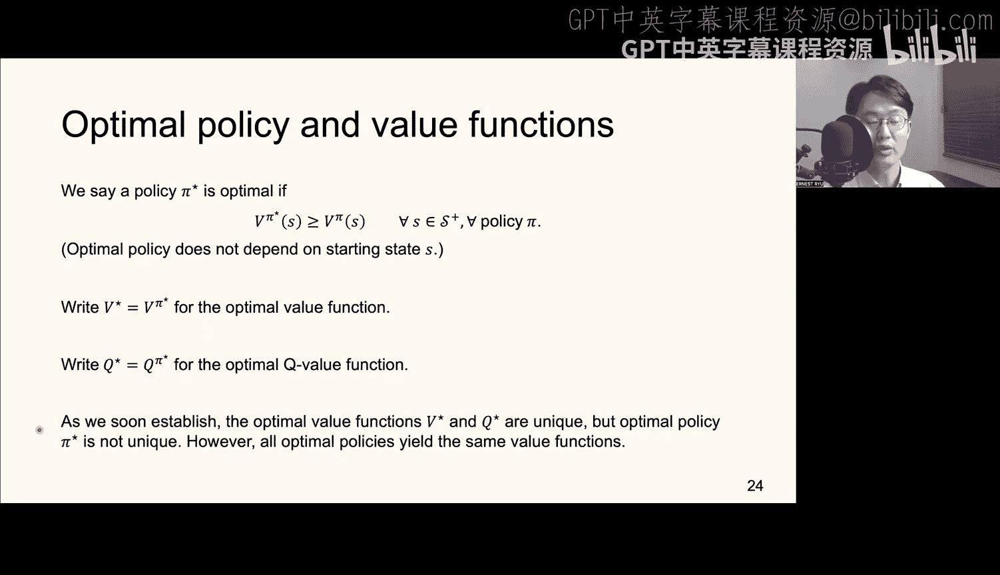

Allright， so now let's state the beman optimality theorem for the optimal value function v star。

 let's read through the theorem。 So we'll assume that gamma strictly gamma as a discount factor is strictly less than one。

 the state and action function action sets are finite the reward is bounded then in this case the optimal value function v star exists and then it satisfies this bellman optimality equation and conversely if if a function satisfies the beman equation。

 then it is the optimal value function okay so the optimal value function exists and one way to characterize the optimal value function is well the optimal value function is defined by this inequality right so this is the definition of the optimal value function but an alternate characterization an equivalent characterization is through this fixed point equation through this beman optimality equation。

Finally， the set of if we。Noow the optimal value function， Then we can take this expectation。

 which is the equal to the optimal Q value function。 And we maximize that over the action A。

 that leads to an optimal deterministic policy。 So pi star is given by is given by this optimal value function。

Okay， so before getting into the main proof， here's a quick lemma that I wanted to that I'll be using。

 So for any function U S and V。 so U and V are functions of S， we have this inequality。

 So what does this inequalities say， Well， if we take the absolute value of the maximums between these two functions。

 Well， that's smaller， then the maximum of the absolute values。

 So if you push in the absolute values into the maximum then that become that's larger。 Okay。

 so why is this the case， Well， the proof is kind of mechanical， but I'll just quickly go through it。

So let's consider the maximum of u minus of v。 Well， okay。

 the maximum of u minus v is necessarily upper bounded by the maximum of v absolute value of u minus b v。

 why is the case， Well， U minus v is always less than or equal to the absolute value of u minus v。

 So the absolute value makes the thing larger。 So if we take the maximum over s。

 then we get this inequality。And the next we have this inequality， which follows from the fact that。

If I were to consider this。If you compare what's within parentheses。

 then U minus max of v is smaller than u minus v right because v is well。

 v is smaller than max of v and we have the negative sign。 So on the left hand side。

 this becomes smaller。 then we take the maximum of both sides and that retains the inequality。Okay。

 so we have this I also symmetrically we have this inequality。

 So we swap the roles of V and U and that's， of course， the same right。

 So so max of U minus so here we have U V， U V， we swap swap the order， V U V U it's the same thing。

😊，Then we conclude with this identity because we're taking this thing and this thing and we're taking the max。

 well， I mean these are just two the same thing a minus b b minus a。

 the maximum of that is the absolute value of a minus B so but here the consequence of these to inequal is that this is less than max of absolute value。

 this is less than max max of value。 So combining through these to inequalities。

 we have this quantity less than equal to the max of absolute value So putting these all together this quantity is on the left and this inequality is on the right hand side of this inequality。

Okay， now let's proceed to the proof of the Belman optimality equation。

So let B star will write B star to denote the beman optimality operator for the V value function and this is again an operator that maps a function to another function so let's define b star V that's a function as that's a function of the state S so what we do is it's defined as we condition on state S and then we take the expectation of we take a reward we take the expectation reward plus gamma times the sub that a state s prime where R and s prime is given by the environment given state state S an action。

 but what's the action well we consider all possible actions and we maximize over the action A。Okay。

 and this operator turns out to be a strict contraction with with respect to the maximum norm。

 Why is that the case， Well， B star of v1 minus b star of v2。

 the maximum norm of that Well that's by definition。

 the maximum over of the discrepancy over all states now let's plug in the definition of B star into here。

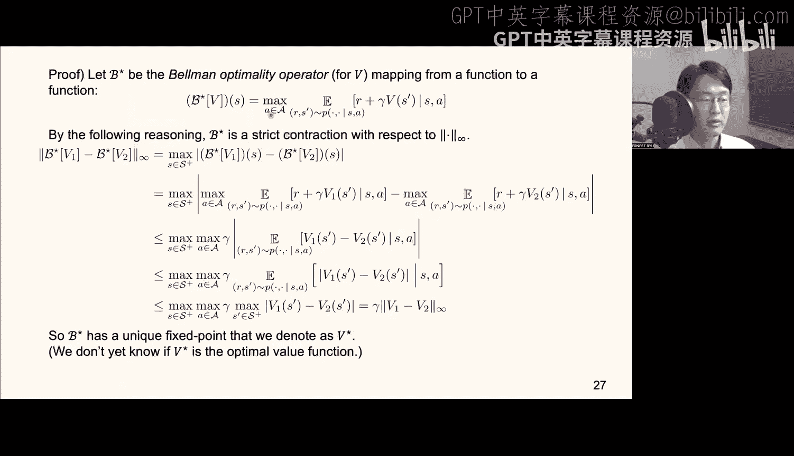

Okay， now then what we're going to do is we're going to apply the lemma that we just proved right so we have an absolute value of the difference of maximums willll。

We'll push that into the maximum。 So we we'll have a maximum of absolute value of the differences。

 When we do that， the R's will cancel that with each other。

 the gamma is a constant factor so we can pull it out。

 and then we have a difference between V1 and V2。 both evaluated at S prime。 Next。

 we're going to push in the absolute value into the expectation since that only makes the expectation larger。

And now we look at this thing， well， this is an expectation of the discrepancy。

 well this expectation is necessarily smaller than the maximum discrepancy of maximized overall S prime。

😊，and again， now we look at this。 The S and A has now been removed。

 so there's no dependency on S so that these maximize maximums go away。

 We have gamma times maximum of the discrepancy between v1 and V2。

 So that's the gamma times the infinity norm between V1 and V2。

 so this establishes the contracted property of the operator B star。

 And now by the boock contraction theorem， we now know that B star。

 the beman optimality operator has a unique fixed point。

 And let's denote the unique fixed point as as v star。

But just to clarify in terms of for the sake of being step by step precise in this proof。

 we now know that v star has a fixed point， which we write as V star。

 but we do not yet know if v star is an optimal value function。Okay， so let's figure that out。

 So what we'll do is we'll define pi star to be a deterministic optimal policy given by this。

 so v star is the function that is given by the as a fixed point of the bemon optimality operator we' will consider taking starting as state S we'll consider taking action A we'll take this one step transition expectation where we plug in the next sub state s prime into v star and we'll maximize over the action a and pi star will be given by we'll choose actions that maximize this quantity here we have an agon max。

 the arg max den the maximizes and ties our broken arbitrarily if there are ties。Now， again。

 we don't yet know V star is the optimal value function。

 and we don't yet know if this pi star is an optimal policy。 It's a well defined quantity。

 but we don't know if if it's yet an optimal policy。 We'll show that it's optimal。Alright。

 now next let's show that v star is equal to v pi star。 Again。

 v star is the fixed point of this beman optimality operator。

 V pi star is the value function with respect to this policy。

 It's some policy and let's show that these these produce the same function。Okay， so V star is again。

So v star is given by the beman optimality equation， right so this was the beman optimality equation。

 If we go back the beman optimality equation is is given by this。

 So indeed this is here I'm using the fact that v star is defined as the fixed point of the beman optimality equation。

Next， let's use the definition of pi star。 So pi star is given is by definition the action that maximizes this quantity。

 and here we're maximizing with respect to a。 so yeah， I mean。

 this maximum operation can be replaced by the use of the policy of pi star。Next， we note that well。

 okay， so we are let's writing a pi star， so let's just write the expectation of pi star。

 this is just rewriting the notation so that we have a more compact notation。

So pi star here means that we will be sampling the action A from policy of pi star。

So we've now established that V star is E R plus gamma V S1。Now here we again have v star of S1。

 so since v star is equal to E R gamma v， let's just plug that in again right so here v star is equal to E pi star R1 plus gamma of v star S2。

Okay。All right， now we have this expectation within the expectation， so let's simplify things。

So here we're conditioning on S1 now the MP is Markovviian。

 so it doesn't really matter if we additionally condition on r0 R0 is in the past compared to S1。

 so this additional conditioning on r0 does not affect this expectation。Next。

 let's push in gamma into this expectation， which we can do because gamma is a literal constant and then let's also push in r0 into this expectation。

 which we can do because this is a conditional expectation， conditioning on r0。

 So as far as this expectation is concerned r0 is a constant So we're allowed to push it in into the expectation。

Now we have a double expectation where we take the inner expectation is conditioned on R0 S1。

 the outer expectation is conditioned on S0。 so now using the tower property。

 we can eliminate the innerconitional expectation and just write it as a single expectation。

 So expectation， So we have expectation of r0 plus gamma r1 plus gamma squared v star S2。

Now we can now repeat this process add infinitum， and if we do this。

 then we had gamma squared of r2 plus gamma cube of r3 so on and so forth until the episode terminates。

 and this results in this expectation then in the end becomes V pi star。Okay。

 so we've now shown that the fixed point the fixed point of the Belman operator v star turns out to be equal to v pi star where pi star was defined in this way。

 So v star is in fact a value function。 It is a value function of the policy pi star a priority。

 we did not know whether v star is a value function with respect to some policy。

 but now we found the policy。 The policy pi star yields the value function V star。Okay。

 so then now proceeding before proceeding further， we need another lelemma。

 So let's let's read through this， let pi be a policy and let B pi be the bellman operator and let B star be the bellman optimality operator。

 So B pi was as defined in the previous theorem。Let V be any function of S。

 then we can show that the output of the Belman operator is less than or equal to the Belman optimality operator。

 So this function dominates this other function for all input states as。Also， for any function U。

 a function of S and also any function V， if it satisfies that u is less than or equal to v。

 then and if we apply the Belmant optimality operator to both functions。

 then the Belman optimality operator preserves this dominating inequality。So this lemma。

 I'll leave the proof of this as an exercise， it's relatively sort of mechanical in the sense that you write down what the definitions of these things are and the identity follows relatively immediately。

Okay， so now we know that pi star is， well， pi star is a policy。

 and we now know that v star is equal to v pi star。

 We don't yet know whether pi star is an optimal policy。 Okay。

 so let's show that pi star is an optimal policy。 Let we start by assuming that lets let pi be any other policy。

 Okay， so v pi， well pi is any other policy， not necessarily optimal。 v pi is well。

 it's a fixed point of the beman bellman operator。 V pi， not v star。 B pi。

 So v pi is equal to v pi applied to v pi。 That's less than equal to v star。

 The beman optimality operator applied to v pi。Okay。

 so now that we have v pi is less than or equal to B star v pi。 we have this dominating relation。

 so we can now apply B star to here and here to conclude that B star v pi is less than B star squared v pi where b star squared means we apply the beman optimality operator twice。

So now okay， so now B star is less than B B star v pi is less than b star squared v pi。

 And since we did this once， we can do this as many times as we want。

 So by repeatedly applying the the B star operator， the dominant optimality operator at K times。

 we get a function that is pointwise for all S dominating the the previous ones。

And this limit is going to be V star。 Now， why so？ Well， we've already established that v star。

 A B star is a contraction， and it has a fixed point。 And V star was assumed to be the fixed point。

 V star by definition， is the fixed point of v star。 So this convergence will be towards V star。

And we've already established that V star is equal to v pi star。 So V star。

 the fixed point is the value function of the policy pi star。

So this shows that v pi is less than or equal to v pi star。 so v pi star。

 the value function dominates any other value function with respect to any other policy pi。

 so that by definition makes so we've established this so that by definition makes pi star the optimal policy and v star now therefore becomes the optimal value function。

Okay， and then finally it remains to claim that well v star， since v star is equal to v pi star。

 what we do is this expectation where we take the expectation of r plus gamma v star that's equal to well v star is equal to v pi star。

 So we just replace that and that becomes the same。 Well。

 but then if you look at this where you do this one step transition conditioning on the current state and the current action。

 that's exactly the Q value function with respect to this policy。

 So this is  Q pi star and that is equal to we define annotation that  Q pi star where pi star is the optimal policy is a  Q star。

So that and that concludes the proof。Okay， so next we have the beman optimality equation for the Q star value function。

 the Q value function。 So let's read through the theorem statement again。

 So we assume that gamma is between0 and1。 So it is a strict discount factor we assume the state and action based or finite。

 we assume the reward is bounded。 then the optimal value Q value function exists。

 It satisfies that this beman optimality equation。 So this is again， a beman optimality equation。

 but it's a different slightly different from the one for the v value function for the Q value function。

 the beman optimality equation looks like this。 And this precisely characterizes the Q the optimal Q value function in the sense that if you have the optimal state action value function。

 Q star， it satisfies this beman equation and then any function that satisfies this beman optimal equation is the optimal Q value function。

And finally， if you take the optimal Q value function and take the agons of that characterize that is an optimal deterministic policy。

Okay， so let's prove this， let B star be the beman optimality operator for the Q function that which is so this beman operator optimality operator again is a mapping。

 mapping a function to a function is defined in this way。

And I'll leave it as an exercise to show that B star is a strict contraction with respect to the infinity norm。

 so B star， but it is that's something that can be shown with steps very similar to what was shown for the V star the Belman optimal value operator for the V value function。

So and now by the B contraction theorem， B star has a unique fixed point and we will denote that unique fixed point as Q star。

It remains to show that Qstar is the optimal state value function。

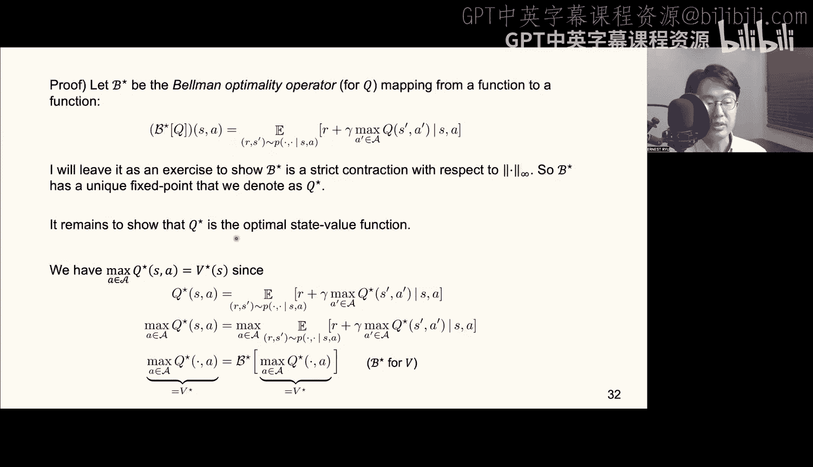

Because Q star is now just obtained as a fixed point of this beman optimality operator。

 so let's show that Q star is the optimal state value function。To show this。

 let's first recognize that if we maximize the Q star function as a function with respect to a。

 we get the v star function， the optimal v value function。 Now， why so？ Well。

 Q star is by definition， by construction here， it's the fixed point of the beman optimality operator。

 So here in this equality。 I'm using the fact that Q star is a fixed point of the beman optimality operator。

 then what I do is I just maximize both sides with respect to a。Now。

 let's if we examine the righthand side， well， the righthand side is， well。

 let's just view this max  Q star as let's just view this as a function of S right or S prime right and and is that is what it is。

 This is just a function of S prime。 and we have the max over a out here。

 If you sort of stare at this for a while。 This is what we have on the right here。 This is a B star。

 the B star for the v value function applied to this function of S prime。So on the left hand side。

 we have this thing， the right hand side we have this thing。 Oh。

 it turns out the left hand side is the input to this B star beman optimality operator for the V value function。

 So this tells us that， well， okay， this quantity is the fixed point。

 It is the It is a fixed point of the B star opt Belman optimality operator for V。

 And that tells us by the previous theorem that this is， in fact。

 equal to the optimal value function V star。By the previous theorem that we had an optimal policy pi star exists and in fact a v star is equal to v pi star。

 so we can now conclude that  Q star is equal to  Q pi star because so the question at hand was is Q star equal to the Q function correspond to the optimal policy which we already know exists by the previous theorem Well Q star again is by definition by construction is a fixed point of the beman optimality operator for Q so here I'm using the fact that Q star is a fixed point of b star and then here we just characterized a max Q star as equal to v so I'm going to plug that in and in the previous theorem we've shown that v star is equal to v pi star。

And then if you look at this， this is just the one step transition property for a Q。

 So this is equal to Q pi star， the Q function with respect to the policy pi star。

 So now we know that oh， actually Q star is， in fact。

 the Q function corresponding to the optimal policy pi star。

 and that makes  Q star the optimal Q value function。Okay， so through these theorems。

 we were able to establish that the notion of an optimal policy， the optimal v value function。

 the optimal Q value functions are well defined。 Furthermore。

 we were also able to characterize characterize the value function and the optimal value function as fixed points of the beman operator and the beman optimality operators respectively。

 The fact that the value function and the optimal value functions are characterized as fixed points。

 This is used throughout reinforcement learning to design a wide range of reinforcement learning algorithms。

😊，In terms of the use of the Bonock contraction principle our proofs relied on it to establish existence of fixed points of these bellman optimality and Bellllman consistency and Belllman Opity operators。

 but in this slide we're going to talk about evaluation， which uses the Bock fixed point principle。

 the Bock fixed point theorem， as a means to design an algorithm。😊，Okay。

 so the V value iteration is defined as follows， so we repeatedly apply the beman optimality operator for for the V function。

 and it looks like this。 So Vk is a function， Vk plus1 is the output of the Belman optimality equation and more specifically if we undo the v star。

 the Belman optimality equation notation， it looks like this。 And as the iterations progress。

 we extract the greedy policy from the V function in this way。

The value function the Q value iteration is quite similar。

 it's analogous where we repeatedly apply the Belmon optimality operator for the Q function。

 and if we undo the B star notation， the definition of B star for the Q functions look like this and as the iterations progress。

 we extract the greedy policy from our Q function through this agon max。

And now that we've done all the hard work we now know that these value iterations converge why so。

 well because for gamma between0 and1， we have already established that the Belman optimality operators for V and for Q both they are gamma contractive。

 so by appealing to the bona contraction principle， we now know that fixed point exists。

 which is the optimal Q and V value functions。And that the iterateance of this value iteration converge to the fixed points in a geometric rate。

Now value iteration in this exact form is usually not implemented because this is only implementable for the so-called tabular setting where you have a very small number of state and actions and you can compute things exactly in deep reinforcement learning you cannot implement value iteration exactly however。

 value iteration still serves as a conceptual framework for designing and understanding many practical deep RL algorithms for example。

 DQN。😊。

As a quick side remark， I'd like to advertise my prior research in this area so the quickest aside is that the value iteration is actually in terms of the iteration complexity。

 it turns out to be suboptimal and it can be accelerated with a different algorithm a variant of value iteration called anchored value iteration since this is kind of besides the point I won't go through the details of this algorithm but I'll just make the claim that the anchored value iteration exhibits this rate which can be shown and this rate is particularly meaningful when the contraction factor gamma is very close to one and it turns out this is well faster than value iteration at the rate is better than value iteration is strictly better than for all values of gamma and this rate is actually optimal as it matches a complexity lower bound up to a constant factor。

So I just want to point out that since value iteration is suboptimal and since there is a known at least faster in a worst case sense。

 variant of value iteration， this may suggest that algorithms designed as approximations of the vanilla valueeration may inherit the suboptiity of the vanilla value iteration。

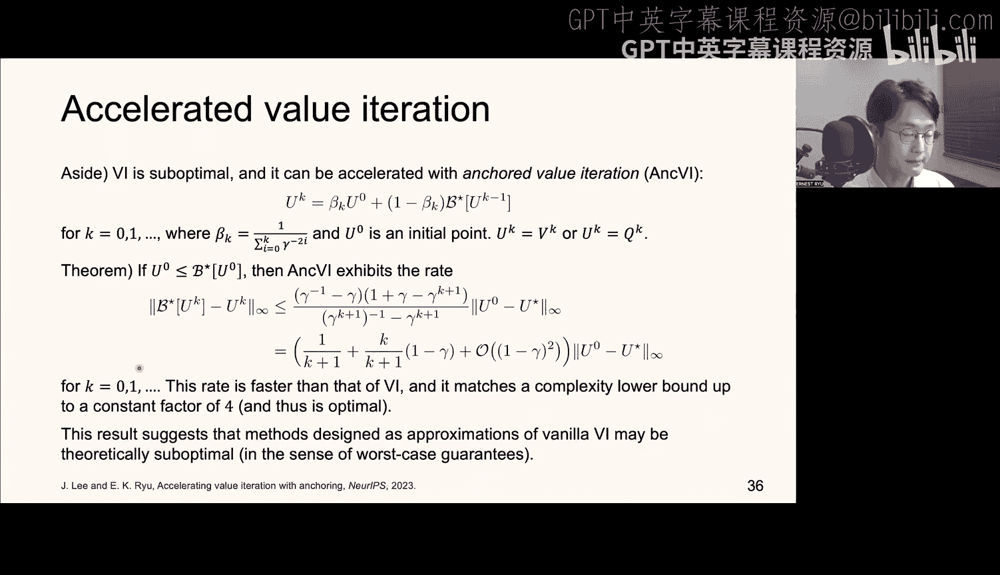

another iterative algorithm that is in some very loose sense。

 a dual of value iteration is called policy iteration， often abbreviated as Pi。

 So policy iteration is a classical algorithm that alternates policy evaluation and policy improvement steps。

 So here is the outline of the algorithm。 So we start with a certain policy initially。

 So this initial policy could be whatever it can be any policy， it can be maybe just a random policy。

 So at every state just choose a random action and whatever。 And then we start the iteration。

 So at the beginning， we compute the value function。

 So there there's more than one way to express value policy iteration。

 But in the first step is called policy evaluation and we compute the v value function or the Q value function。

Next， based on the V and Q value functions， we perform policy improvement where we if we were to compute the Q function。

 we would choose our policy pi to be the greedy policy with respect to the Q function。

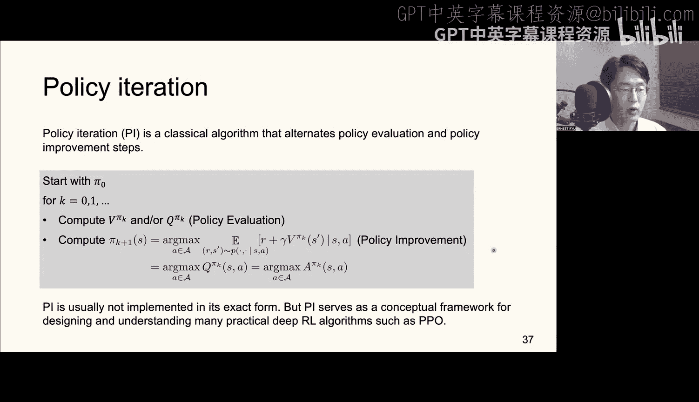

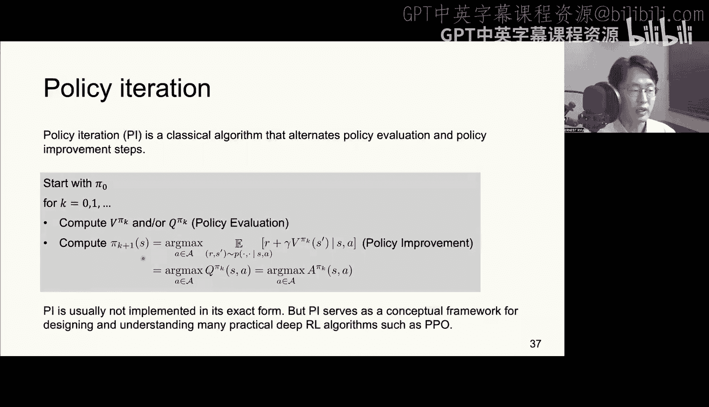

So the policy iteration， like value iteration， is a conceptual algorithm and it's not implemented in this exact form。

 it can be implemented in the toy tabular setting where you have a very small number of states and actions。

 but in most practical settings PI cannot be implemented in the exact form。😊。

But policy evaluation policy iteration， it serves as a conceptual framework for designing and understanding many practical deep R algorithms。

 such as PPO， as we will see later。😊，And policy iteration provably converges。

 so I won't go through the proof， but here's a theorem statement。

 so be considered policy iteration and under the standard assumption that we've been assuming so far。

 the value function will monotonically increase throughout the iterations and after finite many steps the value function will become equal to the optimal value function。

😊，Okay， now finally， I'd like to make some commentary about the discount factor gamma。

 So so far in all of our theory， we've been assuming that the gamma。

 the discount factor is strictly less than one。And in the lectures going forward。

 I will usually incorporate the discount factor in the analysis and the analysis will often implicitly assume that gamma is strictly less than one for theoretical soundness。

 although the calculations will remain at least morally valid when gamma is equal to one。

 and that is because a lot of the reinforcement learning literature is developed for the case where gamma is strictly less than one for because that makes a lot of the theoretical considerations easier In fact。

 our previous argument based on the Bna contraction principle。

 it no longer works when gamma is equal to one， because when gamma is equal to one。

 the beman operator， the bellman optimality operators become nonexansive but are no longer strict contractions so the same arguments no longer hold。

And in fact， certain pathologies can happen when gamma is equal to one。

 but the reason but why should we consider gamma to be equal to one well。

 but that's because in the setting of performing reinforcement learning on large language models。

 which is the interest which is our main focus of this lecture series。

 people often elect to use gamma equals to one， so this is actually the undiscounted case。

 the undiscounted MDP which has gamma equals one， that's our main setting of interest。

So it's instructive to understand what can go wrong in the undiscounted case and how can the previous theorems that we've established fail？

Well here's scenario number one in scenario number one。

 there is basically no problem so there an optimal policy exists。

 the value function is uniquely defined as a fixed point of the beman optimality operator and the fixed point is equal to the optimal value function and this is the case when the state and action spaces are finite v pi is well defined and there are a few other technical considerations but basically you can the problem would arise when this expectation when this summation of this potentially infinite sum becomes undefined that's the problem。

 but if for any policy pi， this expectation is well defined in the sense that the summation is has expectation a finite expectation。

 not neither plus or minus infinity， then things should be mostly fine。So for example。

 if you have a setting where you get a reward only at the end of the episode and you never get any rewards if the episode never terminates。

 then everything should be well defined。And the reinforcement on large language models without the k penalty falls under this case。

 so there are reasonable circumstances where this scenario one， where everything is good。

 bad and bad holds。

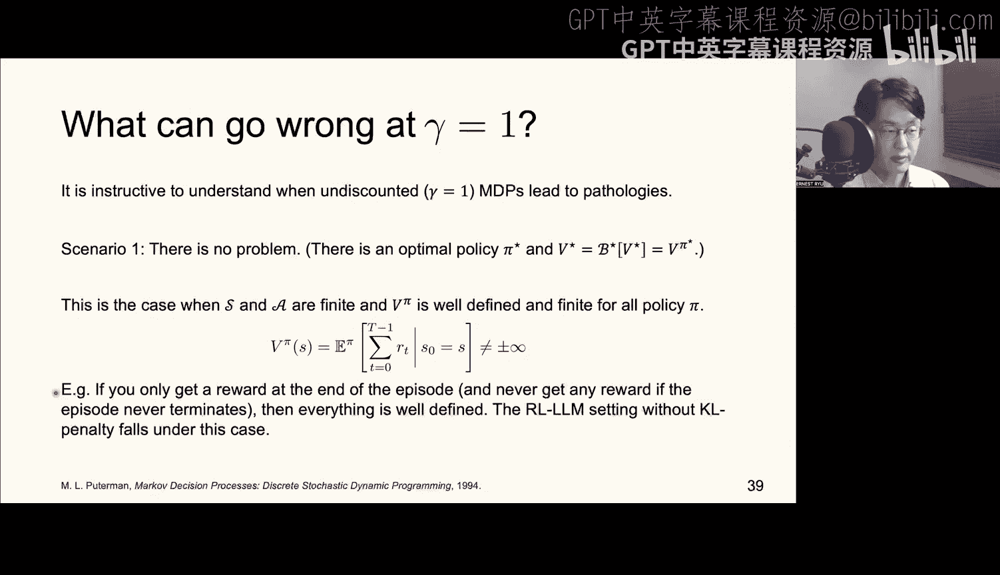

Here's a scenario number two you get plus infinity reward by exploiting a cycle with a positive reward。

 so let's consider this sort of grid world environment so let's say in this grid world environment you can move in any direction out of every steps and what happens here is the way things are set up is if you reach this point。

 then you will get10 reward， which is a lot of reward and the episode will terminate but if you reach this corner。

 then you will get a reward of one。😊，But in this case。

 what you can do is you can move in these cycles， keep rotating around and just collecting this plus one reward forever。

 and that would lead you to getting a 100 cumulative reward。

Something like this manifests in this classical Mario game。 So in this classical Mario game。

 this is a well-known exploit where you can repeatedly step on this turtle shell and just generate infinite points and infinite lives。

 and this is not really a problem when you have a discounted MP。

 So when gamma is strictly less than one。 even if an optimal policy exploits a positive reward cycle。

 the optimal cumulative discounted return will be finite due to the discount factor。

 but when you are not doing discounting， then this can lead to a positive infinity reward。

 and this will result in the value functions being taking infinite value and the greedy notion of greedy policy not quite working out。

 things will sort of break down， you'll run into trouble when you try to work work with these the usual mathematical objects like V and Q in this setting。

😊。

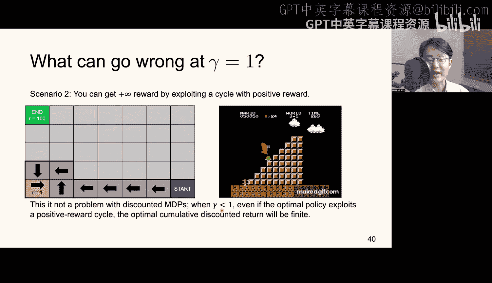

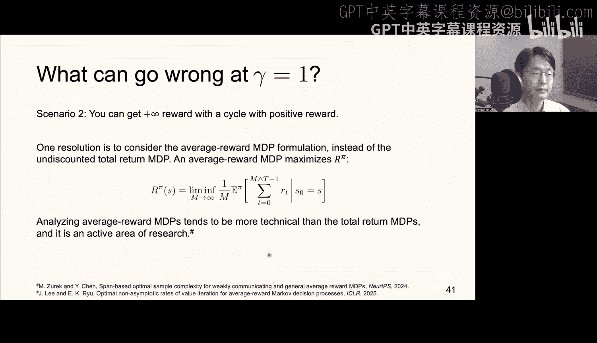

So then what do you do in this kind of setting Well one resolution is to consider the average reward MDP formulation instead of the undiscounted total return MDP so in an average reward MDP what we do is we consider the total reward up to time M and then we let the limit of consider the limit in which M goes infinity and where we divide by one over M and we consider this the expected average reward analyzing the average reward MDP tends to be more technically challenging than considering the classical total return MDP and this is an active area research and just to sort of plug my personal research this is something that I've worked on as well。

Another scenario in which things can go wrong is the total sum total return may not be well defined。

 so for example， let's say we get a sequence of rewards that alternate between plus one and minus1 and then if you sum this up and get a total reward then this total reward is not it's not summable it doesn't blow up to plus infinity or minus infinity it just becomes all this alternating thing there are some reasonable remedies to this so you could consider the C r or able sum of this you could consider the limb of the partial sums but these are complications that we do not need to get into so but in any case these are the things that can go wrong when gamma is equal to1 it's good to keep in mind that these the total reward may sort of lead to trouble when gamma is equal to1 but on the other hand there's not that much it's okay usually okay to consider an analysis in the discounted case。

Where gamma is strictly one strictly less than one and just kind of extrapolate that analysis and say that when gamma is equal to one。

 which is the case of our interest， things will probably be okay。

 things will probably behave the same way as in the discounted case。

 that's what people usually do and sometimes you run it people run into trouble but usually it's okay。

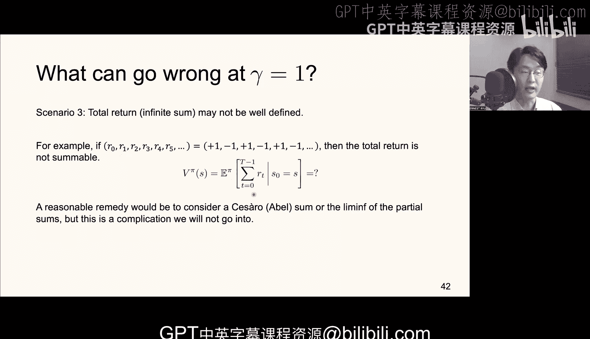