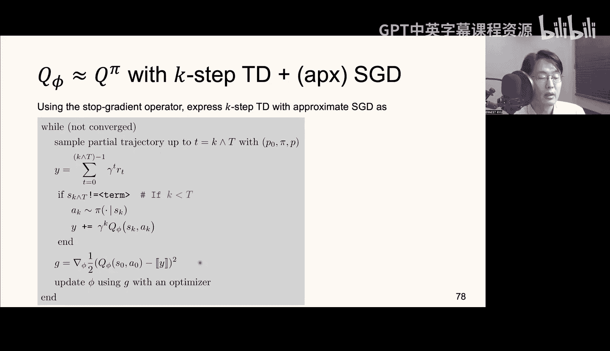

# UCLA《大语言模型的强化学习｜Reinforcement Learning of Large Language Models 2025》中英字幕 - P3：-03--UCLA RL-LLM- Chapter 1.2_ Deep policy evaluation.zh_en - GPT中英字幕课程资源 - BV1yGzGBgErC

All right， next let's move on to deep policy evaluation。

So first let let me define the notion of policy evaluation versus policy optimization。

 So the goal of reinforcement learning is to find a good policy， not preferably the optimal policy。

 but in these lectures we will start by studying how to evaluate a given policy of pi So if I specify a policy。

 how good is it will theoretically what's our evaluation metric and what are some computational means to to perform to approximate this evaluation and this process is called policy evaluation。

😊，We will later move on to talk about how to optimize how to improve the policy pie。

 This is called policy optimization， policy improvement control， and this is the purpose。

 this is the main goal of reinforcement learning， but for the sake of sort of learning it's instructive for us to first understand policy evaluation and then move on to policy optimization because policy optimization often uses policy evaluation as a subroutine so we should understand the subroutine first。

 the easiest thing first and then let's talk about we'll talk about the more complicated thing。😊。

Okay， so the first approach to policy evaluation is a simple one。 It's called Monte Carlo。

 So we first consider approximating the value function v pi of a given policy pi and the way we do it we use it we do Monte Carlo approximations and the way we do it is we simply do a rollout of n times。

 So n independent trajectories。 we will。Simulate n independent trajectories and for all of the trajectories。

 we will compute the cumulative discounted returns and we'll take the empirical average will average over the n independent trajectories。

Okay， so this should work because the quality on the right hand side is an unbiased estimate of the value function。

 and if the number n is sufficiently large， then by the law of large numbers。

 this should be a sufficiently good approximation。But this approximation depends on the initial state S and if we start at a different initial state then we will get a different sequence of rewards。

 so what we need to do is if the size of the state state space S is small。

 then we can do this approximation individually for all of the states to approximate V pi as a function of S and we do the approximation for every single distinct input S。

😊，However， when the state space S is large or infinite， then it is not possible。

 it's not computationally feasible to approximate the value function for each individual state separately。

 so in this case， we must approximate the value function v pi with a neural network which we do know as v phi So v phi is some sort of neural network which which takes phi as its neural network parameter。

 so we need to fit the neural network by optimizing with respect to the parameter of phi。

So what we do is we'll solve this minimization problem where we minimize with respect to the neural network prono or phi and the idea is well conceptually the loss function is we will sample an initial distribution from distribution initial state from distribution p0。

 and then we will minimize the expected square loss between the true value function and the approximate value network。

 so we will refer to V Phi as a value network since it is a neural network meant to approximate the value function。

Okay， so this loss function is initially a little bit problematic because it requires access to this unknown quantity。

 V pi， right， because V Phi is our neural network。 So that's fine。 But V pi， we don't have access to。

 So what do we do， Well， let's just first take the gradient of L。 If we take the gradient of L。

 then we get this thing。 So we push the gradient n。

 We differentiate the square term where we get this thing。😊。

Then we will let's write out V pi according to the definition。

 so v pi is conditioned on the initial state s0 being S。

 we take the expectation of the cumulative discounted returns while following the policy pi。

Then well， you see here， we will be we are conditioning。On the initial state S 0。

 so we can push in V Phi into the expectation， because as far as this expectation is concerned。

 V Phi of S。 Well， S is not even a random variable。 so we can push it in。

And then we can notice that well s is equal to s0 within this expectation。

 so we can just replace that with s0 and also by we can use the tower property to combine these two double expectations into a single expectation。

 where now this single expectation is taking an expectation with respect to the initial state as0 and the subsequent trajectory governed by pi。

And now this， we have something that will refer to this as G and this G is something where we take the expectation of G。

 we get the gradient of L。 So now G serves as a stochastic gradient of the loss function and now and this G is a computable quantity because G requires access to the neural network。

 the gradient of the neural network and this we can access via back propagation and then this is a quantity that we can simulate using Monte Carlo simulation because now by undoing this expectation we have something that we can simulate using the current policy pi。

Okay， so here's how we can perform policy evaluation using the neural network value network V P Now we do this while while we don't havet converged。

 we sample a trajectory with the current policy pi and then we compute this quantity where using the trajectory we compute the cumulative discounted return and we form these quantities by accessing the neural network v phi this is a stochastic gradient and then we update the neural network parameter phi using the stochastic gradient by passing the stochastic gradient into an optimizer so we can pass G into like the SGD optimizer SGD with momentum addom those kind of neural network optimizers and using that we will fit this neural network the value network v phi to fit the true value function of V pi。

To expand the same algorithm， we can write it in this way where here this is explicitly describing the process through which reampd the trajectory。

 but this is the same algorithm as was shown in the previous slide。

 so this is nice but one problem with the Monte Carlo policy evaluation is that we need to simulate a full trajectory in order to form this schastic gradient and that seems a little bit inefficient do we need to simulate an entire trajectory to form this。

😊，Well， that temporal difference learning tries to remedy this inefficiency。

 So in temporal difference learning， abbreve it as TD learning， we use the reward of one transition。

 Okay， so what we're going to do is we're going to use the one step transition property and recognize that V pi is equal to expectation of R plus gamma v pi where we plug in now the transition to state S1。

How do we do this， Well， how do we approximate this expectation， Well。

 we're going to do a Monte Carlo approximation of this one step transition。

 So we have one we have starting at state 0 as 0， we take an action， we get a reward。

 and we transition to state 1。 And then we will do an independent such one step transitions。 Okay。

 so we start at the same point。 And then we transition to some state S1 N separate times。

 and we also collect the rewards reward zeros n separate times and and we form this empirical average。

 Now by the law of large numbers， if n is sufficiently large。

 then this summation should should be a good approximation of the true expectation。

 So so far so good。😊，But there's one problem with this formula and that is that in order to execute this。

 we must know the value function V pi at S1 exactly。

 And the whole point of doing policy evaluation is that we do not know V pi。

 so the fact that we need to use the unknown quantity v pi here is a little bit problematic。

Nevertheless， let's proceed， so we'll do the same thing as before we'll define our loss function。

 our fitting function as in this way so at the initial stated sample from distribution p0。

 we will minimize the square discrepancy between the value network V p against the value function V pi and then here we take the gradient in ofl so again we push in the gradient inside the expectation to get this quantity and here we are replacing v pi with this summation so this is the same step as was done three slides ago so I won't go into it again but then here we're going to do use a tower property and we will within with the inner expectation we'll condition on s0 a0 R0 and S1。

😊，Okay， so as far as this inner expectation is concerned， these four qualities， S 0， a 0， R1， r 0。

 S1。 These are deterministic values。 So from this expectation。

 we can pull out v phi of s 0 within the summation we can pull out r 0。

 We can pull out a factor of gamma because gamma is literally a constant and here from the summation we had we had a t 0。

 but we pulled that one out。 So we have the summation index starting at a t equals 1 going up to big t -1。

 And then we have the remaining rewards。 So this summation involves rewards R1， R2 R3 and R4。

 It doesn't involve r 0。But if you stare at this， this is the G1 quantity and this expectation is conditioned on the past。

 but due to the Markovan property， we can ignore the conditioning on S0 a0 or0 and we only can keep the conditioning S1 and then if you stare at this。

 well， this is actually bitationity v pi of S1。Okay， so here again we have now this quantity。

 which is a stochastic gradient of our loss function L。

 but it's still we still have this problem where we need to access the value function V pi。Okay， so。

If we imagine performing this fitting where we use a policy evaluation with temporal difference learning TD。

 then what we would do is at state zero， we sample state zero， we sample action zero。

 we sample the transition and we form this quantity which serves as a stochastic gradient。

 and we pass this stochastic gradient to an optimizer like atom or SGD。

But the problem of this implementation is that it's not actionable due to its reliance on the true value function V pi。

So an approximate SGD implementation。This simply replaces V pi with our value network V Phi。

Now this G is no longer an unbiased estimate of the gradient of the loss function when we use v pi。

 this is this produces an unbiased estimate， this produces a true stoacy gradient。

 this G is no longer an unbiased estimate， but this is a heuristic that people use frequently and in many cases this works out just fine。

More precisely， the implementation should be something like this。

 so at state0 we sample action a0 we transition to state 1 and there are two scenarios。

 one scenario is when we transition to a non-teral state and in the other setting we transition to a terminal state Now if we transition to a nonteral state we plug in gamma v phi S1。

 Now when we transition to a terminal state this mathematically is equal to plus gamma v phi S1 because the value function at the terminal state has value 0。

 but the value network usually is defined to take in non-teral state so you just don't want to you don't want to plug in the terminal state into the value network。

So yeah， so and in this we define this as we write this as quantity Y。

 this quantity y is often referred to as the target value。

 and we form this biased stochastic gradient G， and then we've passed this biased stochastic gradient G into an optimizer like SGD and atom to perform the value network fitting。

As a minor aside， how do you compute this approximate schastic gradient in terms of imagin writing your pitorrch code。

 How would you write this。 Well， option one is to just straight up。

 just compute this because this is a very explicit formula right So this first term is a scalar and it requires access to things that we have access to So we have the R0 reward。

 that's a scalar。 we can evaluate the value network so we evaluate that。

 and then this here we have to access the gradient。

 Well this gradient we compute using back propagation。

 usualual back propagation on the value network in neural network and that we can just multiply the two。

 So this is correct。 and there's nothing wrong with doing this。

 This might be slightly memory inefficient， but it's it's fine。

 But so it's a little bit cumbersome because you have to well just manually do the multiplication。😊。

But here's another option。 What if what if we just considered this。

 we forward evaluate this and then we backproagate to compute this thing Well。

 this actually is incorrect because if you apply the chain rule to this well the chain rule then applies to both this evaluation of V phi and this evaluation of v phi so you get an additional term and you will not get back the same G that we need。

 This is the bias stochastic gradientd that we've decided to use and if you evaluate this gradientd you don't get this you get something else。

😊，So here's the correct option option number three What you do is you four to evaluate v phi at S1 and then you four evaluate this and then you perform back propagation on this quantity where this weird looking bracket。

 this bracket denotes the stop gradient operator。In Pytorch。

 in order to perform the stop rating operation， you call the method detaach on a particular tensor。

And what the stop gradient operator does is it treats whatever goes into the stop gradient operator as a constant。

 So it stops back propagation。 So when you apply the gradient to this quantity。

 the chain rule is not invoked on the input of this stop gradient operator and that and if you think about what what that what the result of that will look like you will get back of this biased schastic gradient。

 So option number three is what people usually do in terms of the Py towards implementation and so should you。

😊，Okay， so using this stop gradient operator we can express the TD policy evaluation in this way。

By the way， there is this terminology called the semi gradient method。

 which I would like to introduce to you。So temporal difference learning plus approximate SD for policy evaluation uses this biased stochastic gradient。

 and this is probably not an instance of a gradient descent。

 So there's prior work showing that there's no way to sort of squint at this and reinterpret this as a gradient of another function。

So these methods that replace the true value function or something like that with with some sort of learned approximation。

 in this case， the value network， these methods are called semi gradient methods and the name semi gradient method。

 it just merely means that this kind of resembles a gradient method。

 So you start from a gradient method， make a small modification in this case。

 and you get a semi gradient method。嗯。😊，So。But are semid methods good， like， is this a good thing。

 I this a good idea？ Well， one thing you can try to do is you can just try to replace the gradient con with this without the stop gradient operator。

 Now， if you stare at this for a while， what you'll notice is that this would be this is trying to directly minimize the bellman error。

 So and in fact， well， when the value network v phi has0 bellman error。

 bellman error meaning the error with respect to the fixed point error residual fixed point error with respect to the bellman equation。

 when the beman error is0， well we already know that V phi will become the true value function。

This is something that has beenexplored under the name gradient TD。

 but this approach tends to perform worse than the semi gradient TD。

 So for those of you who are uncomfortable with the fact that we did this heuristic where we just simply replace v phi with v pi with v phi and just slapped in this stop gradient operator if you find this uncomfortable that is certainly an understandable sort of sentiment。

 but there is a sufficient prior work showing that this is something that works well and the alternative more I guess theoretically more or more sound methods approaches based on more sound derivativerivations such as gradient TD they for some reason don't work as well So there is enough prior work and prior know how to justify the use of this semi gradient method。

So what I've just described to you is a temporal difference policy evaluation and it's actually the one step TD policy evaluation in fact。

 we can actually take this a little bit further and perform what's called K step temporal difference and this interpolates between Monte Carlo simulation which can be thought of as infinity step temporal difference and the one step TD。

😊，Using the case step transition property。So using through a derivation similar to what we've seen with the one step transition property。

 we can show。That the value function is in fact equal to the sum of the initial k rewards。

 and then we transition to a state SK and we plug that into the value function and have that be discounted by a factor gamut to the power K。

Now here we have the summation K so this is called the Eve symbol because it's the V symbol flipped upside down。

 So we have K Eve T， this is just simply the minimum of between K and T but it's more compact that's why people use it this is used because there's a possibility that the episode terminates before taking a K steps so if that's the case then to to be fully accurate。

 we need to take into into account the possibility that the episode terminates earlier so that's why we need to carry around this kind of a cumbersome notation。

 but if you just don't want to think about it， then you can just imagine t is plus infinity so here we just have k K and K and that gives us the Kstep transition property。

So here's a proof of the Kstep transition property again this follows from the similar arguments as in the one step transition property so I won't explain all the steps in detail。

 but basically here we start up with the notation where consider the equivalent MDP that never terminates so the terminal state becomes non regular non-terminal state but you get stuck at the terminal state and you stay there forever so that we can do the summation up to infinity we do the similar kind of conditioning as we did before and then we sort of come back to the regular the original MDP where we do have terminal states so after those arguments we get this Kstep transition property again we sum the initial K rewards and then we transition to state SK and we plug that into the true value function and by the law of large numbers if n is sufficiently large then some finite sum should approximate this expectation sufficiently well。

And in order to perform compute this approximation。

 then we would need to sample an independent partial trajectories， so starting at the same state as0。

 we will perform up to k transitions。So in that sense。

 it's a partial trajectory because we do not sample the trajectory until completion。

 but we still need to keep around this K ET notation because there's a possibility that the episode terminates earlier than K steps。

Okay， so then to do a K step TD to fit a value network to fit to a value function。

 we do the same thing as before， So we compute we consider the same square discrepancy loss。

 We take the gradient of that。 We do a similar kind of analysis， and we get this stochastic gradient。

And here is now the idealized K step TD SGD fitting algorithm。

 So we sample a partial trajectory up to a K steps。

 Then we form this stochastic gradient where we again sum the initial K rewards and transition to state Sk。

 we plug that into the value function V pi。But again， we have the same problem as before。

 this is not actionable if we don't have access to the pi so and this is what the thing would look like if we expand out the sampling of the partial trajectory。

So then as before we have an approximate version of this where we replace the use of v pi with the value network V phi this again。

 as with the as with one step TD， this results in a biased stochastic gradient。

 but nevertheless this tends to work pretty well in practice。

This can again be expressed more concisely using the stop gradient in operator。

 so we applied the stop gradient operator to the evaluation of V Phi at the transition to state SK and then we take the we perform back propagation on that。

So let me lets now that we have two approaches for policy evaluation Monte Carlo versus a TD either one step or case step。

 let's go through a comparison so by the way TD is also referred to as bootstrapping in the literature for both cases the goal is to perform policy evaluation and so that is to train a value network that approximates the true value function and when we use v pi and when we need to use v pi we'll replace it with v phi and that's well that's what TD does then that's called bootstrapping the Monte Carli evaluation it updates v Phi the value network by waiting for the episode to terminate TD updates v p without waiting for the episode to terminate and if the episode has not terminated then TD will bootstrap and use the value network to and evaluate it at the transition to state now when。

Initially start the training at the very beginning。

 Well V5 will be a randomly initialized neural network。 The values of V5 will be totally inaccurate。

 So bootstrapping， the use of TD may cause instabilities。 But later， when V5 becomes accurate。

 then waiting for the episode to fully terminate may become wasteful。

 So roughly there is there is a tradeoff。 and as a rule of thumb。

 the intermediate value of K equals 5 is a good compromise that people often use when people choose to use TD。

Okay， so we talked about policy evaluation with respect to the V value function。

 but we can also perform policy evaluation for the Q functions。

 and this actually just follows from basically the same set of principles so you can perform Monte Carlo' policy evaluation for the Q function it looks basically the same as in the V function case the gradient computation requires slightly different conditioning。

 So here if you were to remember the Monte Carlo policy evaluation derivation for the v value function in this inner expectation。

 you would condition on S0， but not condition on a0。

 but since this is we're considering the Q value function。

 we should condition on the action at time0 as well。 So there are some minor differences。

 but overall the reasoning the calculations are mostly the same。

And then we sort of have the same very similar set of considerations。

 so Monte Carlo about policy evaluation for Q can be implemented exactly just as in the case with the V value functions。

😊，And we can do temporal difference learning TD with the Q value function。

 and I won't repeat the calculations or the discussions because they are mostly the same。

 but we also again have the same consideration where the unbiased asstochastic gradient estimate utilizes the exact Q pi and the Q value function which is not actionable so we replace that the evaluation of Q pi with the Q phi。

 the Q network， and that results in a biased estimate biased stochastic gradient。

 but the performance in practice is good。And for the Q function as well。

 there is a case step TD version of a temporal difference learning。

 temporal difference policy evaluation， and it shares basically the same set of considerations as with the V value function case。

So again， the differences between the Q and the B cases are minor。

 so I'll just move along without going through all the written out steps in detail。

