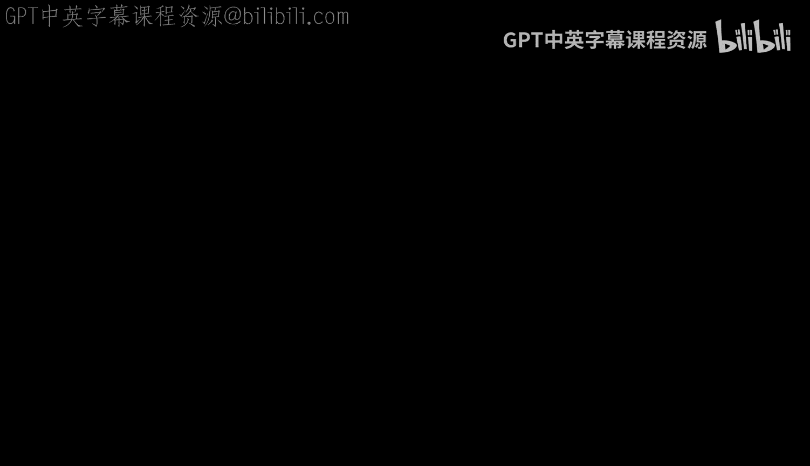
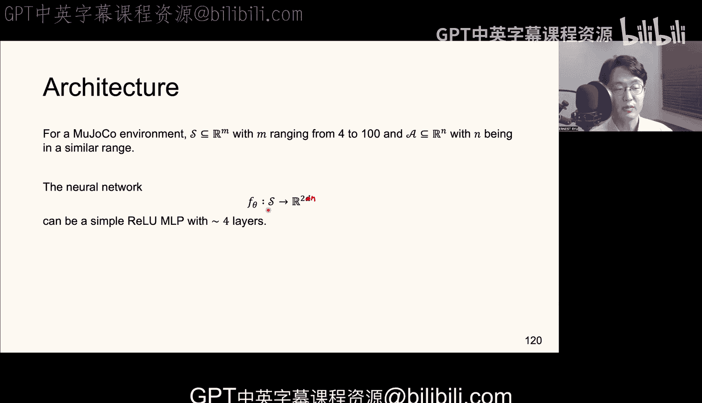

# UCLA《大语言模型的强化学习｜Reinforcement Learning of Large Language Models 2025》中英字幕 - P4：-04--UCLA RL-LLM- Chapter 1.3_ Deep policy gradient methods (A3C).zh_en - GPT中英字幕课程资源 - BV1yGzGBgErC

All right， so the next， let's talk about deep policy gradient type methods which perform policy optimization。

 These types of methods include A3C， TrRPO and PPO。So so far。

 we've talked about policy evaluation that is approximating the true value function v pi or Q pi for a given policy pi。

Next， we're going to talk about policy optimization for policy optimization。

 we're going to be solving this maxim problem。 We will maximize with respect to the neural network parameter theta。

 this objective function J of theta。 and this will be defined as the expectation of of of the value function with respect to the parameterized policy pi theta So pi theta that is our neural network。

 it's our policy， and it will be represented by a neural network parameterized with theta The initial distribution initial state s0 will be sampled from distribution p0。

 and we will take the expectation of v pi theta with respect to the initial distribution S0。

 this is the same as taking the expectation with respect to the initial distribution of p0 and same following policy pi thereafter where we take the where we try to maximize the expected cumulative discounted returns here there's atypo distribution。

Wwhichch is as pi theta because the policy pi depends on the neural network parameter theta。

So for policy gradient methods， for the sake of simplicity。

 let's assume that the terminal time is finite with probability1。

So let's write tau to denote the full trajectory。 let's use this notation and we for use the notation that the objective function J theta is again equal to the expectation of the pi theta and here again this is the expectation of the cumulative discounted returns where the initial state s0 is sample from P0 the action is chosen according to the policy pi theta and the transition is given by the distribution P as governed by the MDP we'll put this notation together and write as tau generated by p0 pi theta and P and this cumulative discounting returns will be written as g0 So theative cumulative discounted return。

 starting at time  zero as a function of the full trajectory tau。

The probability distribution of the full trajectory tau can be written as follows， so P theta of tau。

 that is the probability distribution of tau， and it is the product of the initial distribution with all the transition probabilities and the probabilities of the policy pi theta。

For notational convenience， let's do the following。 So we'll let a tilde be some whatever action。

 one of the possible actions， and we will set pi theta to be equal to have probability one on this action a tilde。

 if we are at the terminal stage。 So in other words。

 once we reach the terminal state as equals terminal。

 Then the policy pi will always take the specific action a tilde。Remember。

 once we reach the terminal state， then the actions are whatever action we take is irrelevant because the idea is that once we added a terminal state。

 we can never escape whatever action action we take。Then with this definition。

 we can write this product as an infinite product， so it simplifies the notation。

 and the reason we want pi theta to have a value one with the determinacy action is because while we want this product to this infinite product to be well defined。

 and if the policy of pi and the probability P has well probability 1。

 once we reach a terminal stage then the infinite product is well defined。Okay。

 so using this notation， equipped with this notation。

 now we're ready to take a gradient of this objective J。

So we'll take the gradient of this objective J。 So this is the gradient。

 this gradient is gradient with respect to theta So to remind ourselves。

 we'll just write grad of theta。 And then this J function is defined as well， this expectation。

Now let's write this expectation as the summation over the probability distribution。

 So this is summation over all possible trajectoryject is tau on the probability distribution on tau。

 and let's push in this gradient into this expectation， this summation。 So this G theta this G0。

 this is a quantity that does not depend on tau that depend on theta。

 So the only quantity within this summation that depends on theta is this probability distribution。

Okay， so we write it in this way。 Now I'm going to use the socalled log derivative trick and write grad P as p times grad log p。

 Why so well if you imagine taking the gradient of this。

 the gradient of this is going to be grad P over P and the one over P will cancel out with this Okay。

 so replacing this the grad P with P grad log P， that's called the log derivative trick。

But now that we've written things in this way， well here we have P theta。

 so summation over p theta we can now reinterpret this as an expectation。

 so we have an expectation of g0 times grad log p unless we refer to this as a little G Okay so with this writing。

 we have a little G is now an unbiased estimator of the gradient of the objective function J。

So in principle， if we had access to infinite number of reinforcement learning samples。

 an infinite number of computation， then now that we have a formula for a stochastic gradient。

 we could just do stochastic gradient ascent on the stochastic gradient little G。

 and that would perform the policy optimization。The problem with this， however。

 is that this little G quantity is an unbiased estimate of the stoacy graded。

 but it has too large of variance， so we must reduce the variance of this quantity if we want。

 if we have any hopes of this working with a moderate amount of samples and computation。

So let's enhance this。 We'll enhance this stochastic gradient by reducing the variances。

 and we'll have a series of tricks to do so。 So we can reduce the variance by removing the password rewards under until time t 1。

 So what does that mean Well， so， so so to start out with this equality we've already established in the previous slide。

 right， So the gradient of this objective function J。 that is expectation of gra log P times G。😊。

Okay， now what is grad log P。 Well， P theta is a product of a bunch of distributions， right。

 so that' p0 times p times pi theta。 Now among those terms。

 the only terms that depend on theta is the policy of pi。

 and also the P theta is defined as a product of distributions。

 So then log P theta becomes a sum of log of distributions。 And among them。

 the only terms that survive the gradient is the ones that involve a pi pi theta。

 the ones that involve p0 and p， they do not survive the gradient with respect to theta。Okay。

 so we have this whole thing is a summation of this log and then。

 but let's push in this gradient evaluation inside the summation。 Okay。

 so this here we have the gradient outside， we push it inside。 Oh by the way。

 also G0 that's a product that is multiplied to this entire thing。 So that that goes outside here。😊。

But then G0 is a quantity that does not depend on the summation index little T。

 So we can actually just push it in with within this summation。 Okay。

 so this was by the the way this was defined。 G0 was multiplied on the outside。

 But let's push it inside the summation。 And that's， that's fine。Okay， now next。

 let's undo this G0 notation and just write it out as the summation as the summation explicitly the cumulative discounted return。

And then we have the summation。 and this summation has two parts。

 Let's decompose a summation as a sum from 0 to t -1。 and then a summation。

There's a summation from a T to t minus1。 Okay， so there's a bit of ambiguity here。

 so there's a typo let me。Correct this。 So here this should be T prime T prime T prime。Okay。

A little better。Al right， so I just simply decompose this summation into two terms where the summation index now depends on this outer summation value。

And I claim so next I'm going to make the claim that this term actually does not contribute。

 I'm going to claim that this term overall contributes to zero in expectation so I can just drop it and when I just drop it。

 I'm just going to be left with this remaining thing so that's what's written over here。Okay。

 and then now let's take this term and reinterpret this as well just this is just the cumulative discount in return starting at time T so I I'm going to write that that as a big G T and then we have the gamma power T over here ands and we have this and so the thing within here that is let's call that little G again。

 this now the thing inside here becomes an unbiased estimate of the gradient of the objective function J so this little G becomes a stochastic gradient。

Okay， so within this sequence of manipulations， this step still needs to be justified。

So let's do the justification。Okay， so let tao T be a partial trajectory starting at state S0。

 going up to state S little T。And and let's consider one of the terms。 Okay， so this what this thing。

 grad log pi summation thing。 This is a term that was with one of this was， so you know。

 we're going to keep this term， right， So let's pay attention to this。

 So here we have a summation from t equals 0 to big t -1。

 So we're considering just one of the one of those terms， okay。All right。

 so let's examine this thing。Tauti we're going to consider the conditional expectation of this quantity condition on taaut taauti conditions up to state S。

 so as far as this expectation is concerned this state ST is deterministic because we're conditioning on it and if you look at this summation。

 this summation involves all the past rewards， reward zero reward1 up to reward t minus1。

 so all of these rewards are also deterministic as far as this expectation is concerned because we're conditioning on all these past rewards。

The only random variable that is not deterministic is A because we condition on ST and then the action A will be chosen in accordance to policy pi theta。

So that leads to this writing， so the only random variable randomness remaining is at and it will be sampled according to the policy pi theta。

Now， let's do the expectation notation and write this as a summation。 Well， if we do so， well。

 we have grad log pi theta， and then it will be summation of pi theta times grad log pi theta。 Well。

 now let's let's undo the log derivative trick。 We do the derivative of this。

 This becomes grad pi theta divided by pi theta that cancels out with a pi theta that comes from the expectation。

 So we get this。😊，And then this quantity， I just you write it over here。Now。

 if you look at this quantity， this quantity has nothing to do with A right。

 so let's just pull this quantity out in front of the summation right it over here Okay so this goes in parentheses。

And then we have this remaining thing Now in this remaining thing， we have a summation over A。

 but well， we can swap the order of the summation and the gradient here。

And when we do so and we evaluate the summation here over here， we have a summation over one。

 because this is a summation over all possible actions and that should result in。

 well we're adding all the probabilitybabilities。 So that should always be one。

 So gradient of1 is equal to 0。 So as a whole， this becomes0。All right。

 so the conditional expectation of this quantity Y T turns out to be0。 it's a zero mean quantity。

So this here I proved this through this careful conditional expectation analysis。

 but I'll just I want to give you also an intuitive argument as to why this should be the case。

So intuitively， when we consider a grad log pi theta。

 So that is trying to measure how we should change the parameter。

 the neural network parameter theta in order to update the update log pi theta or update pi theta。

 the probabilities that the action A should have。 Well， the probabilities of the action A。

 it does not actually affect any of the past rewards。

 if you think about it right so all the past rewards reward are0 up to R t minus-1。

 that depends on the earlier actions， but if we consider the current action A that shouldn't affect how things happen in the earlier steps。

 So by keeping this term， the past rewards， they only contribute to unnecessary variance。

 So so they will result in a zero mean term and they will contribute to unnecessary variance。

 so it's better to have them be removed。So then to further complete the analysis。

 this quantity of yt。 So remember yt was defined as this thing within this conditional expectation and we've established that the conditional expectation of yt is equal to 0。

 Well， then by the tower property the total expectation of Yt is equal to0。

 and then if we have a summation over all the yts， well that's going to be equal to0。Okay。

 so through this， we've established that this term right。

 so if we ignore this term because we're going to be keeping that。

 if we just keep this term and consider the summation over time from time zero to terminal time。

 those are just a sum of zero mean random variables， so if we take the expectation of that。

 well that becomes zero mean。Okay。All right， so that was removing the past rewards was one trick for reducing the variance。

 let's do this further。Okay， so next we have this enhancement number two。

 and this is to use a state dependent to baseline。Alright， so let B be a function of S。

 And we're going to call this a state dependent baseline。 But what it is is mechanically。

 B is just just a function of S。 and it's all， but notably， it's not a function of a。Okay。

 so be is a function of S。 and let's define Gt as this thing。Okay。

 so G T is this summation grad log pi gamma to the power T G T。 So if we did not have the B term。

 then this would be a s a biasased estimation of the gradient of the of objective function。

 So G would be a stochastic gradient， as we have established in the previous enhancement number one。

 but we have this additional B term here。Okay， and here I'm just rewriting in this step。

 I'm just rewriting what a GT is， okay。So without B。

 we've established that ised this is a stochastic gradient。

 but our claim is that with an arbitrary choice of B， we still retain the unbiased estimate property。

 So whatever we choose B to B， G will be an unbiased estimate of the gradient of the objective function J。

So why is that the case？ Well， what we need to show is that well。

 this part doesn't contribute to anything right？ So we've shown that the term involving G that gives us the correct gradient。

 So the term involving B， that should have0 B0 in expectation。 How do we show that， Well。

 we do something similar as before。 So we again consider the partial trajectory where we condition from state0 up to state T。

 So we consider this conditional expectation where we have grad block pi times B as a function of S。

Again， when we do this conditioning state S S is determin as the quantity as far as this conditional expectation is concerned because we're conditioning on ST so we can pull out Bt from the conditional expectation and then we are left with this quantity this quantity again so A is the only random variable left within this conditional expectation using the same argument as before we if we evaluate this quantity。

 we get gradient of one which is zero so so this term contributes to zero mean and we again we use the entire property and we sum all of these so this becomes the sum of zero mean random variables and the result as a result they don't contribute to the mean。

😊，Okay， next， let's look at enhancement number3。 So enhancement number three can be written a little bit more generally in terms of as a theorem。

 So let's do so。 So let Q hat from t equals 0 to terminal time -1 be a sequence of random variables that satisfy this certain property。

 So Q hat conditioned on the partial partial trajectory up to time T。

So up to state S and also the current at the action at time T80。

 so up to state S and80 we take the conditional expectation on a Q hat。

 if it turns out that this hat is equal to Q pi theta。

 the Q value function of the current policy pi theta at the current at state S and F80。

 if this is the case， and if b is any arbitrary deterministic function of the state but not of the action。

 then this quantity becomes an unbiased estimate of the gradient of J。So if you actually think about。

 all previous enhancements are instances of this theorem。

 so in the previous setting we had Q hat B actually GT and GT conditional expectation of GT condition on the current state and the current action that is equal to the Q function and then B was either zero in the first case or B was chosen to be an arbitrary function。

Okay， so first let's prove this。So we've already established that the baseline function actually contributes to nothing。

 So that that's fine。 So what we need to show is that we need to show that well gratal is this thing right so expectation of grad log pi gamma to the part T GT。

 this equality we've already established So now we need to establish this equality where we have instead of GT。

 we have this Q hat quantity。😊，So how do we show this equality what I'm going to do is I'm going to subtract them and show that bit that comes out to be equal to zero。

 so let's subtract them， we subtract them so we get G minus Q hat and the other terms are the same so we keep them again we're using the trick where we have the MDP never terminate by having the terminal states be absorbing states。

Okay， so let's so now we'll pull out the summation。

 the summation is from0 to infinity so we can pull it out now we'll examine this thing。

 well now then using the tower property will condition the inner expectation on the state the entire trajectory up to the current state S T and the current action 80。

Now， when we perform this conditioning， well， as far as this inner expectation is concerned。

 A and ST are constants。 So this grad log pi theta can be pulled out damage to the power T that's a literal constant。

 So that can be pulled out。 So now we just need to take the conditional expectation of G T minus Q T。

Now GT conditional expectation on the current state current action is Q and by assumption of the theorem。

 Q hat has the same expectation， Q pi。 So if you subtract this。

 well we get zero so we have zero All right， so that that completes the proof。

So if we go back to this theorem， now we have some choices。 We have choices。

 We need to choose how to what Q hat to use。 Now we do have this constraint。

 but among the choices satisfying this constraint， we need to decide how to choose Q hat。

 and we need to choose a B。 and we have essentially no constraints in choosing B。

 So what are the good choices。 Well， this theorem says that whatever choices you make so long as you satisfy this condition。

 you will get an unbiased estimate of the gradient of J。 So the unbiased property is fine。

 It doesn't matter how to make the choice。 But what will matter is the variance of the estimate。

 So if you choose Q hat and B well， then that will have a smaller variance for the estimate of the sasastic gradient for the sacastic gradient and that will be beneficial to the training。

 So what are some good choices。 Well， one option is to choose Q hat is equal to Q pi theta。

 and then B being equal to the actual the value network meant to approximate the value function。

 So if we。Then plug this in。 Well， here we have Q pi of ST and A T and v Phi。

 the value network of the current state ST。嗯。Okay， so this is nice。 This would well。

 this would satisfy the conditions of our theorem。 so this would yield an unbiased estimate of grad J。

 But the problem is， well， this is not actionable because we don't have access to the exact Q function。

By the way， here V P is meant to be the value network。

 which is meant to approximate the true value function v pi theta。

 now V Phi will not be accurate there is's going to be well it may be accurate。

 but it will have some errors， but regardless of what V P is the unbiased in this property is not affected。

But if you want to retain the unbied property， then then it is necessary for us to have this Q function be exact。

 but since we can't do that， that's something that we'll need to compromise on。

So if we could make this choice for now， let's just assume that we could make this choice。

 So Q hat as this Q pi theta and b is V phi。 This would lead to a small。

 but not optimally small variance。 So this would be a good choice。

 although not the exact optimal choice。Now， why would be， would this be a good choice？

So to explain this， we need to understand the row black wall theorem。

 Let me state the row black wall theorem in a little bit further generality。

 So that the row black wall theorem states that let x and y be random variables and let I1 of as a function of x and y be some sort of unbiased estimate of I。

 So okay， so I is the expectation of I hat with x and y plugged in where x and y random variables Okay。

 and the goal is to estimate this unknown quantity I。Now let I2 be another estimator of I。

 but I2 is only a function of y， and it's defined to be I1 with x where we already take the expectation where we integrate away x the variable x。

 so we take I1， we condition on y， but we take the expectation with respect to x。

 we integrate away the variable x。Then it turns out that I2。

 I hat2 is also an unbiased estimator of I。 Now， this unbiased property follows from just actually just the tower property immediately。

And then。But interestingly， I2 has a smaller variance compared to I1。 So when you have access to i2。

 then I2 is the better estimator as measured by the magnitude of the variance compared to I1 because they are both unbiased and then I2 has a smaller variance。

嗯。Okay， so why let's try to get an intuitive understanding as to Y。 So again。

 I2 should be should also be unbiased， has the same expectation as I1 just because of the tower of property。

 But I2 is something that has a smaller degree of randomness。

 and that's because well I1 is a random variable that utilizes both x and y as an input。

 So Y will have a certain amount of randomness， and then x will have also have a certain degree of randomness。

 and well when both contribute， it will be there will be more randomness So there will be larger variance。

 whereas with I2， with I2， yes， the input y does contribute to a certain degree of randomness。

 but we have already taken the expectation with respect to X。 we have integrated away the variable X。

 So the randomness that would have been contributed by the x random variable is now gone is now suppressed。

 and therefore I2 has a smaller variance。 That's sort of the intuitive explanation of this theorem。

In terms of terminology， this i2 estimator is referred to as the row black wallized estimator of i1。

 and it's considered better when you have access to it because while we have smaller variants。

So this row Black wall theorem， it motivates the choice that Q hat should be equal to Q pi theta。

Where you let y be the random variables trajectory up to S and action 80。

 and x is the remaining randomness， so the future randomness。So in other words。

 Q pi theta is a good choice as it has all variances beyond the state ST and AT removed through the conditional expectation and therefore has a low variance。

So let me quickly prove the row blackwell theorem when the unbiasedness of the I2estimter again follows from the tower property of expectation and the variance bound follows from the Jenen's inequality so both I1 and I2 have mean I so the variance of I2 is the expectation of I minus I2 squared and then I'm going to within the square I'm going to have this conditional expectation where I'm going to take the expectation over x conditioned on y and then well the quantity I literally leaves us the constant so I can just put it within the expectation and then I2 is defined as the conditional expectation of I1 with respect to this conditional expectation。

So this conditional expectation is within the square。

 but I'm going to use Jensen's inequality to pull the expectation outside the square and by Jensen's inequality that will make the quantity larger so we have this inequality and now we have the two expectations side by side so we can combine them with one to1 using the tower property and we get then the variance of the i1 estimator。

Okay， so the row blackpo theorem justifies the choice of Q hat is equal to Q pi。 But what about B。

 Well， the choice of B on the other end， is motivated by this minimum variance conditional estimator lemma。

 So let let's read through the lemma。 So here's the statement。

 So let S and A be random variables and let W， Q and B B is just whatever function。Okay。

 so now let's consider this expectation， expectation of w squared times Q minus b squared。 Now。

 but notably Q is a function of both S and A and B is a function of only S and not a function of a。

 And we want to minimize this with respect to the choice of B。 Now， if B we're also a function of a。

 The way to minimize this is it was just set B to be equal to Q right if B is equal to  Q。

 then this is just 0。 and we've attained the minimum。

 But the reason we cannot do that is because B is only a function of S。 It's not a function of a。

 whereas  Q is a function of a。 So we need to find a function B as a function of S。

 that does does to the best of its ability， match the value of Q。

 which will also depend on the random variable A。Now。

 it turns out that if you set up this optimization problem where you minimize over all possible functions B。

 you will get this， you will get this and and well it's this is defined in terms of the conditional expectations with respect to a condition on on S。

Now， as a special case of this， when W is equal to1 right so then the numerator just becomes the denominator just becomes 1 and the numerator just becomes a Q。

 the conditional expectation of  Q conditioned on S。

 this lemma when w is equal to 1 reduces to a standard result in Bay statistics。

 So in statistics is known that the conditional mean is the minimum mean squared error estimator。

 And in fact， so in this in this expectation， we are we're taking the expectation with respect to a S and a if we let write rh as the probability density function of the random variable S and a。

 then B star as written over here， it's the conditional mean of Q。

 with respect to the probability distribution proportional to W squared times a rh。Okay。

 so so let's prove this， so this is a proof that justifies that it establishes that the answer that was shown in the previous slide is correct。

 If you want to have a proof， we want to see a proof that derives the answer from first principles。

 then this is something that can be done using the calculus like tools like the calculus of variations。

 In any case， let's justify that what was shown in thelemo statement is correct。

Alright so let's consider this conditional expectation and what we want to do is want to minimize this objective as a function as a function of B as a function of the function B In any case we'll take this conditional expectation。

 we'll subtract out B will add B okay so it may not be clear at this point why we would do this。

 but the fact that this equality holds is pretty clear。

Then what I'm going to do is I'm going to square the first part， square the second part。

 and then keep the cross term。Okay， so then this second equality step that also follows from elementary just。

 distributing products。Okay， now let's take a look at this。

 So we have this first term is just copied over here。 The second term is also copied over here。

 And I claim that this cross term， this plus two times this thing。 I claim that this term is0。 Okay。

 so I'm going to write that a step number star， I haven't just that yet。

 but let me just claim that this additional term is0。 if that is the case。

 then we have equality here。 And finally， if you look at this first term。

 this first term is a term that is independent of B。 So that's fixed。

 this is a second term that is dependent of B。The way we and well， all of these terms are positive。

 so we have this inequality so this inequality holds and now the way you can have this inequality be attained with an equality is to set B to be equal to b star if b is equal to b star then this term is just zero and we attain this with equality。

Okay， so now it remains to justify the step star。 This step star。

 it follows from the definition of B star。 Why is that the case。 Well， let's。

 let's take this inner expectation， this inner conditional expectation and write it over here。

 I'm going to show that this inner expectation is 0。

 So this inner expectation is taking the conditional expectation of a condition on Z on S。Now。

 as far as this conditional expectation is concerned。

 S is deterministic because we are conditioning on S。 So this b star minus B that comes out。

 this b star comes out。 so this term for this term， we have w squared。

 and then here we have w squared times Q， the conditional expectation of that。Now。

 if you go back and remember what B star is， B star is defined such that this subtract。

 you subtract this out and this becomes0， right， so B star was defined such that this term becomes 0。

 so we have0 times whatever， and that's equal to0。Okay。

 so that proves this minimum variance conditional estimator lemma。

And let's see this applied to our setting where we choose the baseline function B。

So based on the minimum variance conditional estimator lemma。

 we would a good optimal choice for the baseline function B would look like this in our context。Now。

 if you stare at this quantity， however， this is just weird。 it's just a cumbersome quantity。

 Well because the formula looks ugly and it's also requiring us to use entirely new things that we've not ever encountered before。

 So this expectation of grad log pi squared。 This is something that we've never seen before。

 this expectation of grad log pi squared times Q。 This is also something we've never seen before。

 So if we were to try to implement this。 then we would need some sort of new learning mechanism that is different from learning Q or V。

 we need to do something different。 and that's a lot of work and that's a potentially implementing learning other things that we didnt we would otherwise need that would that's potentially computationally inefficient。

 So we're going to use this heuristic where I'm just going to cross out these grad log pi square terms。

 Now I can't do that。 that's not correct calculations。 but as a。

I think morally it's not too offensive to do so so I'll cross these terms out then what I'll get is well in the denominator I'll just get one and then the numerator I'll have Q and then if we look at what this Q is well the expectation of Q conditional expectation with respect to a well that's actually just the value function at state S。

So this tells us that the choice B is equal to the value network。

 which is meant to approximate the value function。 This is perhaps not an optimal choice。

 but it's a reasonable proxy of the optimal choice， which is given by this。

 So theoretically this is the justification where this crossing out step is the heuristic step and also empirically people have have used this to great success。

 So empirically it's well established that this choice of baseline function B is a reasonable choice。

Okay， so we now have this stochastic gradient formula。 This quantity is， well。

 this quantity in expectation gives us the gradient of J。 so we have a stochastic gradient。

Now let's interpret this via what's called advantage estimation。

 So the advantage function written S a is defined as Q minus v。

 This is called the advantage of the action A at the current state S。

And the meaning of it is if the advantage is positive。

 then the current the input action A is considered a good action。 Why so well。

 it's better the action A is an action that's better than the average action of pi theta right So because v pi theta consider it takes the current state S T chooses an action according to pi theta and sees what what happens whereas in Q pi theta。

 you at the current state S T， you force the choice of action A in the follow policy pi theta the after。

 So in order for the advantage to be positive， this action that you choose choose must be better than the average action chosen by the policy pi theta。

😊，On the other hand， if the action is negative， then the action A is if the advantage is negative。

 then the action AT is a bad action is worse than the average action that the policy Py Theta would have chosen。

So this schastic gradient estimate it uses Q pi minus v phi。

 which is an approximation of the advantage function， and if we take a look at it。

's consider an interpretation of that， so if an action A is good as measured by the advantage function。

 then the gradient the gradient with respect to theta。

 it points in a direction to make the action A more likely。

And if the action A T is bad as measured by the advantage function。

 then the gradient points in a direction that makes A T less likely。

 And this makes a lot of sense because， well， if you have a good action。

 you want you want to make it more likely。 and if you have a bad action， well。

 you want to make it less likely。As an aside， if you have an optimal policy pi star。

 then the advantage function with respect to the optimal policy pi star is necessarily non-positive because well when you have the optimal policy。

 the optimal policy necessarily chooses the best action。

 so whatever action you choose cannot possibly be better than the action that the policy optimal policy pi star would choose if you want to prove this yourself。

 this is a relatively straightforward exercise。So without the baseline。

 let's imagine we did not have the baseline， because our theorem states that even without the baseline function。

 we would still get an unbiased estimate of the gradient。

 So if we eliminate the baseline function of v5 we would this would still be an unbiased estimate。

 Now the problem with this approach is that the s of the Q function is not directly correlated。

 whether A， an action  A is good or bad。 And in fact， a lot of Mps only have positive rewards。

 So the game is whether you can get a lot of positive reward or a small amount of positive reward。

 In those cases， if an MDP only as positive rewards。

 then the Q function will necessarily be not negative。

 So then the Q function will always be positive， but some actions are good。 Some actions are bad。😊。

So in this case， because the s of Q does not correlate with whether A is good or bad。

 the gradient will adjust the probability of A and the action becomes more likely by being pushed up harder than the other actions due to the normalization of pi theta。

 So remember， pi theta is a probability distribution。

 in order to enforce the output of pi Theta to be a probability distribution in neural networks you use the softm layer to do the normalization。

So if you have a good action， then then if that good action is just simply pushed up through the gradientd updates more frequently than the other actions。

 then that action becomes more likely through the normalization。

 but that seems like a very indirect way to promote and demote certain actions。

 rather it would be more straightforward more direct to push up good actions and pushed down bad actions。

 and that's what the baseline does when you have a baseline the action A should be pushed up when it is good and it should be pushed down when it is bad。

😊，We can also interpret this policy gradiented as under the lens of an actor critic method in a very loose sense。

 so loosely speaking actor critic methods have an actor in this case in this context the policy pi theta is the actor and then you have a separate critic which evaluates the actors actions in policy gradiented methods。

 the learned value function v theta serves as a critic。Okay， so。That's all good。

 And we're happy with the choice of V Phi because the fact that it is inaccurate doesn't affect the doesn't cause create any bias in the stochastic gradients。

 but this is still a problem， right， we cannot use Q pi theta exactly it's not actionable because we don't know it。

 So what we could do is we could consider replacing this with a Q phi where Q phi is another neural network meant to approximate the Q value function。

😊，So this is something that could be done in this case。

 this G would be a biased estimate of the gradient of this should be。

 this is the typo this should be J of of the objective function。 This is possible。

 this could be done， but there are some problems。 One problem is that this would be inconvenient because we must learn both Q and V and we don't want to do that it's better learning each additional neural network in my system is an added layer of complexity So I don't want to separately estimate learn both Q and V。

Also replacing so another option that we could use here is just GT。

 so GT is an will provide an unbiased estimate， but thats it has higher variance because it's not row black willized but replacing Gt with Q phi。

 it will reduce the variance， but the bias will be initially large when the Q function。

 a Q network is not a good approximation of the Q the true Q value function。

So the final announcement that we use that people use is Kstep TD when we use K step TD。

 we can now just expand the sum and we do the K step transition and then after K steps we plug in the transition state into the V value function and the nice thing is that we can plug this into the v value function。

 not the Q value function so we plug it into the V now if we plug this into the exact v value function。

 we would get an unbiased estimate of Q pi theta， but we don't have access to the exact v value function so we instead of plug it into the value network v phi。

 so this will yield a biased estimate of the Q value function。

 but the bias is more mitigated because we are considering these initial rewards which provide an unbiased signal so here this would serve as an unbiased estimate of the still of the gradient of the loss function the gradient of objective。

If we were to access the exact V value function， but we since that's not implementable。

 we replace it with the V Phi value network。And a good thing about this is that now there's no need to separately learn Q。

 We only need to learn the v value function of V phi。

 Now one might still worry that well initially our v value network will be wrong。

 It will not be a good approximation of the true V value function but that's okay because initially even when v phi is wrong。

 we have these rewards and these rewards provide informative unbiased information about the quality of the action8。

 So even if this evaluation of the V network has large bias and is initially noninformative because well initially at the very start of the training。

 V phi will be just a randomly initialized neural network。

 So v phi of S plus k that's going to be completely uninformative as to whether how good the state is。

 but that's fine because we still get information through these initial rewards and also whatever incorrect information uninformative information V。

If I will provide， that is dampened by the factor gam to the power K。All right。

 so this leads us to our policy gradient algorithm， version number one。

So we have this while loop and we'll execute this that we while not having converseged we have two neural network parameters to update theta and phi。

 we need to train for theta and phi Theta is the parameter for our policy pi theta Phi is the parameter for the value network V theta。

 We initially clear the gradient。 We sample a trajectory。

And then we form this Q hat estimate so this is our K step TD estimate where we take K transitions and then plug in our transition state into the V phi network。

 we form this this stochastic gradient for the objective function J and this is and we also perform we fit our V phi network in a policy evaluation manner to fit the target value Q hat So so this G phi is meant to train the value network of V phi to fit the true value function of V pi。

I just want to point out that for this objective function we're trying to perform minimization。

 so we perform the gradient we evaluate the gradient and we passing the gradient into an optimizer such as atom or SGD。

 but for the pi parameter we're trying to do stochastic gradient Ascent because we're trying to maximize the expected cumulative discounting reward。

 so because there is that sine convention difference and because in pi towards and most deep learning libraries。

 the convention is by default to minimize if we want to perform maximizeim。

 we need to flip the sign before providing this stochastic gradient into an optimizer such as SGD or atom。

And when we're evaluating these gradients here， you can see that we're using the stop gradient operator for the sakeconve when we're the when we're fitting the V value network。

 so for these policy gradients we can also use the stop gradient operator as well。

 so basically we want to apply the stop gradient operator on the Q hat and V networks and then perform a single back propagation call Next。

 let's talk about the so-called gamma trick。So let's go back to slides and observe the policy gradient algorithm。

 And let's notice that there are two locations in which the parameter gamma is used。

 One is right over here。 So here and here this counts as one use of gamma。

 And this gamma is here because， well， the MDP has uses gamma as the discount factor。

 So when we when we compute the cumulative discounted return， we use the gamma discount factor here。

 But there is another appearance of gamma， and that's right over here。 So this use of gamma here。

 when computing the policy gradient， the sacy gradient approximating the gradient of the objective function J。

 in our analysis， this gamma to the power t term this factor popped out。

 So this ought to be included in order to obtain an unbiased estimate of the gradient。Now。

 let's imagine plugging in gamma is equal to one。 So let's consider the setting where we do not use discounting。

 Well， then here， there used to be a factor of gamma to the power T coming from the derivation of the policy gradient。

 but we don't have that anymore because gamma is equal to one。 Also。

 when we compute the cumulative discount in return。

 we don't have a factor of gamma to the power T because， well， gamma is equal to one。

But here's the gammatry。 So when we use the gammatry， when people use the gammatry。

 you define another gamma， which which we will refer to as gamma tilde that is strictly less than one。

 but something close to one。 So think of gamma tilda as something like 0。99。

Then we will have Q hat gamma tilde be a random variable that basically uses the gammailde as a discount factor。

But notably， we will not include gamma tilde to the power T have the when we compute the policy gradient。

So this gammailde is referred to as the artificial discount artificial discount factor。

 and it's not part of the MP。 So you should think of the discount factor as a part of the MP。

 So the MDP defines the transition probabilities。 The MDP also defines the rewards。

 and you want to maximize the cumulative discounted return。

 and the discount factor is part of the problem statement。 So in that sense。

 the non-artificial the true discount factor is part of the problem statement is part of the MDP。

 this artificial discount factor is something that we use as an algorithmic tool。

 This artificial discount factor， gammailde， this introduces bias in the gradient gradient estimates。

 but it can reduce the variance of the stochastic of the biased stochastic gradients。In fact。

 in most deep RL setups， people usually usually consider the undiscounted problem。

 So if you consider a setting where you play a video game where you want to win the game。

 then if you use a discount factor then people have observed that the agent behaves in a way that is a bit myopic。

 but sometimes when you play a video game， you want to plan things ahead and you want to get the good reward much later。

 so that you maximize your reward or maximize your probability of winning so in most in many deep RL setups。

 fundamentally the problem that is specified does not use discounting uses gamma is equal to one。

 but nevertheless in the algorithms， people often introduce this artificial discount factor。

 which I'm writing here as gamma tilda and people said it to be less than one because that makes the algorithm more stable。

For notal simplicity， we and a lot of most of the other previous papers that use the artificial discount factor will not distinguish the true discount factor gamma。

 which the discount factor a gamma from the MDP from the artificial discount factor gamma Tilda and people will just write gamma for both。

 So sometimes you will see in a paper people don't explicitly mention this gamma trick。

 people don't explicitly mention that this is not a true discount factor is just a artificial discount factor。

 and then they will have the discount factor。😊，In the computation of Q。

 so well have this discounting， but it will not be present in the policy gradient。

 and this might confuse people because this might confuse some readers because if you do the careful derivation。

 there ought to be gamma to the power T right over here。

 but that's omitted and that could be well people might you might initially think this was a mistake。

 maybe on the part of the authors to maybe they forgot to include the gamma to the power T。

 but what they're really doing is they're introducing an artificial discount factor for the purpose of reducing the variance of the estimators and thereby making the algorithm converge more stably。

😊，So this leads us to so this gamma trick is very common。 So by applying this。

 we get the second version of the policy gradient algorithm。

 So the policy gradient algorithm is the same as before。

 The only difference is that here we don't have a gamma discount factor gamma to the power of T here that's not present in this algorithm。

 but it is present when we're computing our Q estimates。Okay， next for the third enhancement。

 let's consider SGD with non uniform selection rules。

So let's consider a setting where the gradient of F is given as a finite sum of these Gs。 Okay。

 so let's just define say say that this is the case。

Then the true SGD algorithm consider it takes an IID uniform sample from these Gs。

 so we sample an index IK uniformly from the choices one up to n。 and then if we do that。

 then G IK becomes a stochastic gradient of this function F。

 and if we perform SGD with that selection of uniform random Gs。

 then this is this is an instance of SGD because the GK serve as unbiased stochastic gradients。

However， there's a variant of SD calledcyclic SD Incyclcl SD。

 I'm writing this as this using this mod operator， which looks a little bit complicated。

 but basically it just means that the gradients are chosen in a cyclic order。

 So we choose G1 g to G3 up to GN。 Then we go to G1 G2 G G G3 GN。

 and we repeat until a conversiongence。If you do this， then this is referred to as cyclic SGD。

 but in a strict sense， this is not an instance of SGD because the gradient that we use to perform the updates。

 these are not unbiased sasastic gradients， but nevertheless。

 cyclic SGD is commonly used in practice and it works pretty well in practice。Now。

 in the context of MDPs， we have something like the gradient of instead of the gradient of J。

 the objective function J is equal to a sum of of well a bunch of what we call Gs。

 and these Gs are the things that we had in the policy gradient method。

 the Gts will be the grad log pi multiplied by the advantage estimate。

 So then if we wanted to implement an instance of true SGD or we use unbiased stochastic gradients。

 What we could to do is we could sample an entire trajectory so that we have all the entire summation。

 Then we could sample a uniform time between0 to the terminal time。

 and then use the gradient that comes out of that。 And that would give us an unbiased unbiasedtochastic gradient so this would be an instance of SGD。

But this would be inefficient because what this algorithm is saying is that well we will sample a full trajectory。

 which gives us all the G zeros up to G T minus-1， all the Gs。

 But then we will sample and use only one of the Gs。 and that's well， if we have all the G's。

 we should use them right， So there's no this is an algorithm that is that technically is an instance of the true unbiased SGD。

 but it's not something that would make any sense in practice。

So what we can do is we can use all of the Gs into update。

 so we sample an entire trajectory and this is the thing that would make sense so we sum all the gradients individual gradients and then do a gradient decent step but this is so this would be an instance of SGD with unbiostochastic gradients。

 but this is inefficient for a different reason it's inefficient because we are performing updates very infrequently we are sampling an entire full trajectory and only once we complete the sampling of a full trajectory do we make an update on the parameter。

😊，So that's too infrequent for these parameter updates。 and in supervised learning。

 this is kind of analogous to doing a full batch gradient in descent。

 which is less efficient than SGD， which does not go through the full batch to perform a parameter update。

So then finally， what we could do is we could sample a single transition so starting at ST。

 we have the agent make it take an action and then we collect a reward and transition to the next state and then using this we can compute the next gradient and then if we want to do K step TD。

 then we would sample instead one transition we would sample a K transitions if we want to do K step TD and in any case we compute the gradient and then perform a gradient update。

Now this would not be an instance of SD because the updates。

 because instead of doing an IID sampling of the gradients we're going in a cyclic order。

 so this is analogous to cyclic SGD， but this is good because it updates the policy more frequently it updates the parameter theta more frequently and and it efficient despite it's more efficient despite using biased stochastic gradients。

So the application of this leads to the next version of the policy gradient algorithm referred to as A2 C。

😊，So let's read through the algorithm despite the details because it's going to be worthwhile。

 so we're going to have this while loop and our algorithm will iterate until it has conversed initially we'll do the zero grad operation so we'll set the gradients to be equal to0 and at the current state if we're at a terminal state then we'll set the time step to be back to zero so we'll start a new trajectory and we'll sample the initial state from the initial distribution p0。

Okay， and then what we'll do is we'll sample up to K transitions。 and here we have this thing where。

Again， this is sort of we need to deal with a case where we transition to a terminal state before completing case steps。

 so that can happen if that happens and we need to deal with that。

 but aside from that the logic of this is we're just going to sample case steps。And then here。

 what we're doing is we're going to form the Kstep TD gradient estimates。

 but so this is a standard implementation and it's doing this slightly Qy thing。

 So we've done we've taken k steps of transitions。 So instead of forming a single Kstep TD estimate。

 what we will do is we'll form a one step TD estimate a two step3 TD estimate up to a Kstep Td estimate。

 And when we do so we will do this loop in a backwards order。

 So the specific mechanics of this is done in a kind of Qy way doing a backwards index loop and this Q hat is accumulated in a backwards recursive way。

 But the point is that here we're accumulating a Kstep Td gradient policy gradient estimate。

 and we're also doing this we're also fitting the value network to the Q hat target as well。

 And so then we have these gradients that we pass them through an optimizer and that performs a parameter update。

So I'm referring to this algorithm as A2 C advantage actor critic。

 it's named so because here we're computing an advantage estimate and we have a policy pi which is serving as an actor and the value network V Phi acting as a critic。

However， this algorithm was originally published under the name A3C。

 where a3C stands for asynchronous Adv actor Cing So HC is a version of A3C without the multiple CPU cores performing gradient updates asynchronously so here asynchronous means that multiple CPUs so here these in this paper published in a 2016 this algorithm A3C was run on multiple CPU cores GPUs were not used in these experiments and the multiple CPU cores would do these private updates in an asynchronous manner。

In any case， for A3C， the action space a can be discrete or continuous。

 and I'll give you some further details through examples soon。All right。

 so let's talk about some applications of the A3C algorithm or the A2C algorithm。

So Atari 2600 is a video game console that was released in 1977。

 so these are the kind of video games that were played on the Atari 2600 console。

 and these are under modern standards， pretty simple video games Now in this paper by Bellammeir et all。

 The author created an emulator environment to train and evaluate reinforcement learning models on 55 different Atari video games。

😊，Now I'll just mention as an aside that technically speaking， legally speaking。

 these Atari games for RL research is against copyright law under US Code Title 17， chapterpt 3。

 Section 302， which stipulates that copyright of these games apply to 70 years after the author's death death and these games it hasn't even 70 years haven't even passed since the release of these video games。

 so so the RL researchers are we are pirating these video games for the purpose of academic research。

The Atari 2600 video games are pretty simple and they are controlled with this very simple controller。

 So this is the physical controller that you would connect to the Atari 2600 console and it's simply a stick and one single button。

 So at every time frame there are 18 possible actions。

 There are9 positions where that the joystick can be placed in。

 So there's up down left right know in these other four directions and neutral is also a direction in which the joystick can be placed and then there's the option of pressing the button and not pressing the button。

😊，So just mechanically speaking， there are 18 possible actions inputs that you can provide to the controller。

 not all games use all 18 actions， so since some games use a smaller set of actions than in the context of reinforcement learning。

 it's helpful to restrict the possible action space to only use the actions that are actually used in the video game。

These video games are played at 60 frames per second。 So this means that in theory。

 the game can register 660 actions per second。 That's a little bit， however too much。

 So these video games are not that fast paced。 So's really no reason in practice to consider changing the actions that frequently 60 times per second。

 So a standard trick when playing these Atari video games is for the agent to repeat the same action for 14 frames So that to for four frames。

 So that in effect reduces the choices to be made to 15 actions per second。

 So these Atari these R agents will make 15 actions per second。😊。

So there's some standard preprocessing that is done for these RL agents。

 So one thing one issue that exists in these old video games is called flickering so the flickering is where some element within the screen kind of appears and then disappears and appears and again at a rapid sort of frequency this is an artifact caused by the limited number of sprites in Atari 2 600 that can be displayed at once so that there are multiple things that you need to display you kind of flicker and alternate their displays but but this sort of is removed for the Atari RL agents for the RL research the screen is also made black and white So as far as I know none of the games actually meaningfully utilize the color color within their video games so by removing the color channel it simplifies just learning process and also the image resolution for the classical CRT TV that full resolution is not necessary So the image resolution is downscaled。

For the purposes of these learning agents。Also when you play these video games for a lot of objects it's important to have both the notion of a position and velocity so let's say you're a spaceship and you fired a missile then you want to know where the missile is but you need to know where where the missile is with the direction in which this missile is moving in and if you take a screen capture while the screen capture a single frame of the screen does not provide that velocity information so in order to preserve velocity information the four most recent frames are stacked together and provided to the learning agent so these are details specific to the Baari 2600 environment。

😊，嗯。I'll also note that these Atari games are actually not MDPs。

 but these are actually partially observable markov decision processes， po Dpss。

 and the game screen does not fully capture the game state。

 Also the fact that we are doing the screen preprocessing means we are removing some information from the screen。

 So the actual agent， the policy only receives partial information These issues are not turns out to be turned out to be not that important relevant in the context of Atari 2600 games。

 So these are just mostly addressed mostly not addressed ignored in the initial A3C and DQN papers。

 which play the Atari 2600 games。In any case this is the a neural network architecture that's used a lot of for these games。

 so in the 2016 paper their four frames are fed into the neural network and the screen resolution is downscale to 84 by 84 pixels and then these images are processed with a convolutional neural network。

 so these are the convolutional layers that are used the relu activation are used and then in the end the final the information goes through fully connected layers and then at the output we apply a soft max activation and by applying the softm at the end it ensures that the output probabilities are all positive and they sum up to one and therefore they do represent a genuine probability distribution。

Now， I will point out that when you think of the policy。

 the policy pi is written as pi of a given S right So if you look at pi， the policy pi as a function。

 you might think that you provide the state as input。

 provide the action as input and get the probability。 But if you look at this neural network。

 the mechanics of this neural network is that you put in the state。

 the screen is the state and you get the probabilities for all of the actions。

 So for this neural network， the input is not the state and action。

 the input is only the action is only the state， and you get the probabilities for all of the actions as the output。

And you might think it a little bit weird if you only need the probability of one single action。

 but it turns out that when you're doing things， this is a more convenient parameterization。

 When you need the probabilities of certain actions。

 usually need the probabilities of all of the actions。

 So this is this architecture design where you input a state and you get the probabilities of all of the actions。

 this is usually the standard design， when the action space of the MDP is finite。Okay。

 so here's how A2C or A3C for the discrete action spaces are implemented。

 so you form a neural network that takes it as input the states and outputs a probability distribution on the actions。

 as was the case with these Atari games in the previous slide。

And now let's go back to the A2C algorithm。Take a look at where the policy pi is used in this algorithm。

If you look through this algorithm， there are two places where the policy of pi appears。

 here is location number one， here is location number two。In location number one。

 we access the policy Pi for sampling the action that the agent will take。

And then in this location number two， we access the policy pi for the policy gradient。

 so we'll compute grad log pi， and then we will form the gradient， which will in turn。

 update the policy parameter theta。So going back to this slide here is again， location number one。

 how do we do this Well， in order to do this step， what we'll do is we'll first evaluate the neural network and then we'll sample a certain action in accordance to the probabilities outputted by the neural network。

Straightfor enough Now for this second step we need to take a policy pi。

 you value it on the action that we have taken the state that we were at。

 apply the log and perform a gradient。 So here's what we do。

 We feed in the state into the neural network。 that will give us the probabilities for all of the actions。

But we're not interested in the probabilities of all of the actions。

 We're only interested in the probability for the action that we have taken the action A T to be more specific。

 So this F of S T， that's a vector。 And then A T is one of the possible choice actions is the action that we have taken。

 and that will correspond to a certain row within this vector。

 So we will extract that single scalar corresponding to the row that A T corresponds to。

 We apply log to that scalar。 So maybe it would be。😊，For clarity。

 maybe I should have written it this way。The parentheses go here。

So we we feed the state into the neural network。 It gives us the probabilities。

 We extract one of the probabilities。 when we extract one of the probabilities， that's a scalar。

 we feed that scalar into the log， and then we perform back propagation with respect to the parameter theta on this scalar quantity。

 So that's how we perform access the policy pi for this second use when we compute the policy gradient。

Here's another environment in which A to C these policy gradient methods are used。

 So Mujoco is the abbreviation of multijoin dynamics with contact。

 This is a general purpose physics engine that has that simulates articulated structures。

 So articulated means you have limbs and joints。 that's what articulated means。

 and here are some examples。 So the Mujoco environment comes with different。

Animal like sort of structures that with varying degrees of complexity。

 So here's a so the first two are relatively more complex。

 The one on the right is much more simpler and simpler because it has fewer joints。

 there are also more complex structures and there are there are sort of humanoid human looking structures which have many more joints。

 So those are even more complex to control。The state in the Mujoqui environment is the generalized coordinates and the velocities of the joints。

An an action represents forces exerted on the joints， and these are continuous。

So in robotics applications， it's common for action to correspond to a controller and the controller has a maximum and minimum input bounds。

 So subject to some changes of units， maybe you can push the joint forward by magnitude1 backwards by magnitude minus1 and then anything in between but not anything beyond that。

 Now one thing that's worth pointing out is that if you're approaching this kind of control problem in a classical control sense。

 then you probably need to have a good understanding of the basic physics。

 you probably need to have usually need to have a good understanding of what these generalized coordinates means。

 etc ce。 But if you're approaching this kind of control problem from a reinforcement learning perspective from a machine learning perspective。

 then a lot of the specific physics and the information about what these individual coordinates mean。

 they can be basically abstracted away。 and you can just think of these as actions。

 inputs that do have bounds， you need to be mindful of the input。AB， But otherwise。

 you can just think of these as controls and you can just kind of forget about what these actually mean and just have the learning algorithm figure out how to adjust these things to make the desired movements。

 So your， it becomes less necessary for one to have a specific domain knowledge when you're applying a machine learning and reinforcement learning techniques。

Okay， so A2C can be applied for this kind of setting where you have continuous actions。

To apply A to C to the setting， there are two steps that need to be clarified。

 So as a concrete instance， let's assume that a certain action。

 So we have a scalar action and let's assume that the action needs to be within -1 and plus 1。

 and it continuous。So then what we can do is we can form a neural network that takes an input the state and output two variables。

 even though the action is only a scalar。 so the neural network will output two numbers for each scalar and we'll refer to the numbers as mu and tau。

 So then in order to perform a to C， we need to access the policy pi in two ways。

 One is for sampling the next action。 So here's how we do the sampling。

 when we want to sample on an action a from policy pi。

 we will evaluate the neural network F theta to get the mu and tau values and then we will sample a random variable Z Z with mean mu and variance E to the two tau。

 So the mean can be positive and negative numbers， but the variance needs to be positive。

 So we take the exponentialon tau。 So that's how we get a positive variance and z now becomes a Gaussian random variable。

😊，But we do need to respect these limits， so we apply the 10 h function to this Gaussian random variable to get an action that is now between 1 and plus1。

So this so now that we've specified the sampling step， the sampling step in the sampling step。

 we will use the notation that a is sampled from the policy pi theta。

 but and pi theta is defined through the sequence of computations， so it is defined。

 the distribution is defined through the neural network F theta。

 but F theta is not the same thing as pi theta P theta and f theta are intimately related。

 but f theta is a neural network that outputs the mean and this tau that will be used to generate the random variable Z pi theta conceptually represents the actual probability distribution or the probability density function。

In A to C， we need to also perform the policy gradient。 So to perform the policy gradient。

 then we first need to compute log pi theta and this formula is something that you can work out as an exercise。

 but it but taking it into account like the10 H function and all that。

 you can use the change of variable formula to get this formula。 So log of pi theta。

 it looks like this in this instance， season is a value that that independent of theta Oh this is a type。

 but this should be a subscript here。In any case， this is a formula that can be explicitly evaluated。

 so we evaluate this and we perform back propag on this。

 and that gives us the gradient and that gives us grad log pi。

So what kind of architecture should we use well more modern papers。

 more modern research might propose to use more sophisticated or more modern architectures。

 but here's something very simple you can use so for the Mujoku environment you will have a set of states where of M dimensional state where M ranges from4 to let's say even 100 and the action space the size of the action space will be of a similar range。

And then the neural networks are taken as input the current state and output a two times not D but。

Two times。And。So that each pair of output can be interpreted as the mue and tau for all of the actions。

 and the specific architecture could be as simple as Raylu MLPs with something like four layers you can do some more complex。

 complicated， more sophisticated architectures， but for the Mujo environment。

 something as simple as this will be sufficient。

