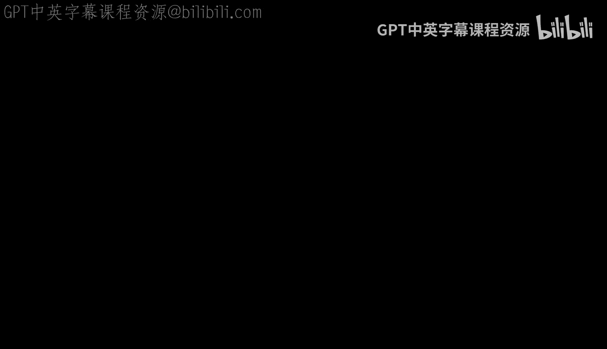
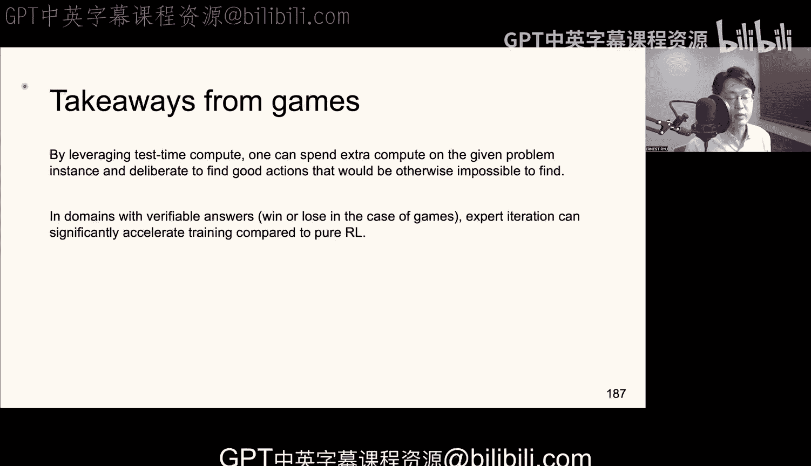

# UCLA《大语言模型的强化学习｜Reinforcement Learning of Large Language Models 2025》中英字幕 - P6：-06--UCLA RL-LLM- Chapter 1.5_ AlphaGo, test-time compute, and expert iteration. - GPT中英字幕课程资源 - BV1yGzGBgErC

Okay， so for the final section of this chapter on reinforcement learning。

 I'd like to talk about alphaphago， test time compute and expert iteration。

Although the reinforcement learning on large language models does not directly utilize these ideas。

 there are close important conceptual connections。To talk about alphaphago。

 let's start with the two players zero sum games。 So in a two players zero sum game。

 two players compete against each other， and one player's reward is precisely the loss of other player。

 So if one player wins well， then the other player loses。In a simultaneous move game。

 the two players make their move simultaneously， so in a game of rock paper scissors as an example。

 the two players offers their move simultaneously and the winner is determined。On the other hand。

 in a sequential move game also referred to as a turn base game。

 the two players make their moves in turns， So the game of chess and in the game of go。

 two players make their moves in an alternating fashion。However。

 we will think of these sequential move games as simultaneous move games where the two players each offer their individual policies pi1 and pi2 at the start of the game。

Now if you think about it， this is not that unrealistic because in a real life competition of games two humans show up to the board and they offer their brain。

 they offer themselves as the agent that plays the game so the humans themselves are the policies pi1 and pi2 these policies they can strategize they can adapt to the opponent opponents moves etc。

 and they can also make randomized decisions if that is considered if the policy considers that to be a good choice。

In mini max optimization as opposed to， let's say minim or maxim optimization。

 we minimize with respect to one variable and maximize with respect to another variable。

 So here in this mini optimization problem Age1 aims to maximize this reward and then agent2 aims to minimize this reward the interpretation in a zero sum game is that R one represents the reward of player1 So player one wants to maximize the reward and player2 wants to minimize the reward of player one because that's the same thing as maximizing its own reward。

We say a configuration for these two players is a solution to the minimax problem if it is a na equilibrium。

 so this is the definition of the naash equilibrium。

 so to give an interpretation if we are at the configuration theta1 star， theta 2 star。

If player 1 unilaterally changes its move and deviates from theta1 star。

 then that only serves to reduce the reward， which is undesirable because player 1 aims to maximize its reward。

On the other hand， if player  two unilaterally changes its configuration to theta 2， well。

 then that only serves to increase the reward， which is undesirable because player  two wishes to decrease the value of R。

The standard reinforcement learning is posed as a maximization problem。

 we want to maximize the expected cumulative discounted return。However。

 when you have more than one agents， when you have an adversarial training and two players zero sum games。

 these are posed as mini Max optimization problems。As an example。

 let's look at the game of rock paper scissors So in a game of rock paper scissors。

 the players employ randomized strategies of a probability theta 1。

 a P theta 1 P theta 2 and there is an expected payoff So there's no need to look at sort of this in detail。

 but the point is that player2 offers as its strategy。

 a distribution on rock paper and scissors and the same is done for player1 player1 offers a distribution on rock paper and scissors and rock beats scissors。

 scissors beat paper and paper beats rock right and rock and rock results in a tie。

 scissors and scissors results in a tie so that's what this payoff matrix is representing。Of course。

 this is a toy example， but we want to relate this to deep learning with multiple agents。

 so let's consider P theta to be a parameterized distribution where is parameterized by parameter theta 1 theta 2 and the theta 3 and it is fed through a softmax normalization layer so that P1 ends up representing a probability distribution and the same with P2 so P2 is parameterized by theta that these theta 2 values but it's fed through softmax distribution to become a bonaf fide probability distribution。

Now we know that the Nash equilibrium for rock paper scissors occurs when the player offers rock paper and scissors with equal one third probability。

 if a player has a bias towards any of the three moves。

 then that can be exploited by the other player and that would not be a Nash equilibrium。

So then how do you solve minim optimization problems Well in deep learning。

 we solve everything with first order of methods using stochastic gradients。

 So things like atom and SGD， these are the things that we use to perform any kind of optimization problem。

 not minim optimization， maxim optimization and also minim optimization as well。😊。

But if you want to analyze the convergence of minimax optimization or if you don't care about the analysis。

 but you just want the or minimax optimization to empirically converge。

 this is something that's quite tricky， the convergence of minimax optimization should not be taken for granted and in practice a lot of delicate care is needed compared to solving minim optimization。

The training of GNs， for example， so the GAN is the abbreviation of generative adversarial networks。

 This involves a minimax optimization formulation so and the training of GNs is famously tricky to stabilize and in the following slides。

 I'll show some plots indicating that even the minimax training of rock paper precision seizures game this really simple toy example is actually can be a highly unstable process。

😊，Reinforcement learning training is already more unstable than supervised learning people say that supervised learning is stable。

 reinforcement learning is much more harder to stabilize and often people have the idea that you want to convert as much of reinforcement learning as much of the components of reinforcement learning into a manner that resembles supervised learning in order to stabilize things。

When you do multi agent RL， so two agent RL in the case of two player0 sum game games。

 the training and the stability becomes even more delicate than non reinforcement learning minimax training。

 So two player minimax reinforcement learning is something that can be very tricky to pull off。

So what are the algorithms that we can use for to solve mini max optimization？ Well。

 a very simple algorithm 1 might try is simultaneous gradient descent as or gradient as descent。

 So heres the specification of the algorithm。 So for theta 1。

 we want to do a gradient ascent with respect to the lost function。

 So we take the derivative with respect to the first variable， we perform gradient ascent。

 And then for the second variable for the second agent， we want to perform gradient descent。

 So we we differentiate with respect to the second variable and we perform gradient descent。

This is referred to as simultaneous gradient ascent to descent because the ascent step and the descent step are performed in parallel。

 So that's why it' is referred to as simultaneous。 This is one of the simplest minim optimization algorithms。

 but this can fail to converge on even very simple example。

 So even on this rock paper scissors example， we can observe that the dynamics doesn't converge。

 So here I implemented and ran this simultaneous gradient gradient descent ascent on this toy example。

 And we initialize the the probability distributions for player 1 and player 2 to be nonun。

 So as you can see， the probabilities are not all uniformly one third。

 They're not uniformly all one third at the beginning。

 And we would hope through training that player 1 and player 2 will converge to the nash equilibrium。

 namely having one thirdd probability for all three moves。 but that's not the case。

 We see that the probabilities oscillate for both player1 and player2 and the amplitude of oscillation grows as the iterations progress。

😊，Now， why does this happen， Well， minimax optimization can fail。

 So one failure mode of mini maxax optimization is is these cycling dynamics。 So。

 and the cycling that dynamics happen manifest in this example。

 as player countering the other player。 So let's say player has a large probability of playing rock。

 Play 2 counters that by playing paper。 and then observing this player  one counters this by playing scissors and then observing this。

 player 2 counters this by playing rock。 And this process just goes on and goes on and it amplifies。

 And when there's no mechanism to dampen this this cycling behavior。

 it just grows and the training becomes unstable as shown in these plots。😊，Okay。

 so how do we fix this。 Well， one approach is called the extra gradient method。

 So for the extra gradient method， imagine you and your opponent make regular one step step updates。

 then you evaluate the gradient from there， and then you use that gradient to commit to the update。

Actually， there's a sign error。 there should be plus， this should be。

Minus this should be plus and this should be。Minus。Okay， so let's read through the algorithm。

 So player 1 wants to maximize its reward。 So itll perform grade in ascent and then player 2 will perform grade in descent because player 2 wants to reduce the reward。

 But actually， player 1 and player 2 is are not going to commit to this update。

 They're going to imagine themselves and the opponent making this update。 And then from there。

 the player will evaluate the gradient in from there。😊。

And then by evaluating the gradient from there， player1 performs gradient as from this point。

 so not from theta110， it will go back to original point。

 but but it will use the gradient evaluated at this updated point and perform the gradient as for player  two as well。

 player two will perform the update from theta2， but it will evaluate the gradient at the single step update points and then perform gradient descent。

So this is roughly speaking the agents looking ahead， so imagining what I would do。

 what imagining what the opponent would do and then performing updates based on that one step sort of look ahead argument and this is closely related to the idea of learning with opponent level awareness referred to as a Lola。

If you look at these convergence plots for this extra gradient method。

 the extra gradient method does converge for these two player zero7 games。

 so we initialize the player one and player two strategies in some way。

 and they do still see this oscillations， but we can observe that the distributions they converge to the uniform  one third probabilities。

 which is the na equilibrium。Another remedy of this unstable mechanism is the so called use of the anchoring or the weight decay。

So if we read through the algorithm， this is basically the same as simultaneous gradient and as and descent。

 but we have this weight decay mechanism。 and with this weight decay mechanism。

 as you can see in these plots， the convergence is very stable and is also quite efficient。😊。

A generalized version of this anchoring mechanism where you perform weight to decay not necessarily towards0。

 but to any arbitrary point that's referred to as anchoring and it is something that I've done research on in some of my prior work。

Okay， so the takeaway is that to solve these two players zero sum games。

 you should not use simultaneous grade and ascent decent。

 but you can do something like the extra grade method like Lola。

 or you can do way to decay to stabilize the training dynamics。

 But there's one more crucial structure in the game of chess and go。

 And that is that the game is symmetric or antisymmetric。😊。

So we say that a two players Euroum game has an antisymmetric payoff if when you change the moves of player 2 and player1。

 that results in the equal but opposite reward when the two player Euroum game has this kind of symmetry or antiymmetry then the national equilibrium is attained at some input where the two players play the same move and the reward is equal to zero and there's a typohers I should remove these subscript so that the inputs are the same。

So when the reward has this antisymmetric structure。

 then the gradient with respect to the first input is the same and the gradient with respect to the second input provided that the two inputs are the same。

So therefore， if you initialize the two players moves。

 theta1 and theta 2 to be equal at the beginning， then the algorithm Sim GdaA。

 simultaneous gradient gradient descent ascent， actually simplifies in this way because of the symmetry。

 there's no need to keep track of the two different positions。

 the moves or the actions of agents1 and 2， you can just combine them into one。

 but I just said that a simultaneous gradient as descent is maybe divergent。

 so you want to do the version of this with weight decay and that simplifies in this manner。

So the interpretation of this is that when you have a symmetric or an antisymmetric payoff game。

 something like go or chess， then you don't have to learn two agents。

 you can just learn one agent and you can think of the agent player one playing against itself。

So this algorithm can be interpreted as great an as done on player 1 with player 1 playing itself。

 so player 2 is a copy of player 1。Allright， so then let's talk about chess and go。

 So chess and go are two player zero sum perfectf information games with antisymmetric payoffs。

 So if you're not familiar with go， but you're familiar with chess or vice versa。 conceptually。

 you can just think of them as basically the same type of games。 There are two player games。

 It's zero sum。 there's zero sum because the loss of one player means the victory of the other player。

 It's perfect information because there's no hidden information is different from card games where the information is hidden from your opponent。

 everything is on the board。 So there there's all the information is out there in the public。

 and you have the antisymmetric payoff， meaning the rules are symmetric between the two players。😊。

Now， technically， these games are not perfectly anti symmetric or symmetric because one player makes the first move now。

If we want to be further technical， we can make the game symmetric if the first move is given to one of the players randomly。

 So if you randomize the first move， then the game does become symmetric in that regard。

But because the game is mostly symmetric， we will train one agent to play both players。

 So we will only have one policy to play both black and white。Now， this contrast。

 like so there are some board games where you have two players and the actions that the rules for the two players are highly asymmetric。

 If you have such a game， then it makes sense to train two policies for separately for the different players。

 But for chess and go， the strategies for white and black are sufficiently similar。

 So it makes sense to train them as one single policy。So the board games are chess， Shohogi and Go。

 these are again， two player perfect information zero sum turn base games for chess。

 the top human chess player was defeated in 1997 by the algorithm Deep Blue。

 the top humanhogi player was defeated in 2017 by the algorithm Elno and the top human go player was defeated in2016 by the algorithm Alpha Go。

So in this lecture， I'll talk about Alphago and Alphago0。 So these two algorithms。

 they combine search and learning to achieve superhuman play initially in the game of go。

 And later these algorithms were extended to the other board games， chess and Shohogi as well。

These methods， alphaphago and alpha0， they represent landmark scientific accomplishments in artificial intelligence research。

 and they contain insights that are generalizable beyond the domain of games。But namely。

 Alphago and Alphago0 utilize crucially utilize this technique called MCTS。 Now。

 the exact technique of MCTS， which I'll explain soon。

 this has not been successfully adapted to the setup of LLM reasoning or the reinforcement learning of large language models。

 but I think the algorithm MCTS has a lot of interesting and generalizable takeaways。

 So let's take a look at it。Okay， so next let's go through the alphago training pipeline。

 so for the first step of training alphago， we perform imitation learning。

 we instantiate a policy network pi theta and this is a neural network which we refer to as the policy network。

 it takes it as input the state of the go board and then it produces a probability distribution on the next actions that we should take。

And this is trained from expert play record。 So Go is a game with a lot of history and a lot of professional matches。

 and these professional matches are documented。 So you have a record of which moves were played in the precise order in which they were played。

😊，So from that we can construct a data set， the data set has a board position S。

 and then it also comes with the next move that the professional go player。

 the expert has played in the past。So we train the policy network to predict the expert player's next move using some sort of cross entropy loss。

The specific architecture that was used in the alphago paper is something like a。

 a 13 layer convolutional neural network。This step by is already pretty good。

 so if you train the policy network with as a neural network based on the expert play record。

 this can beat many human players， but it's still not yet powerful enough to beat the expert human players。

Okay， so then in step two of the alphago training， we perform reinforcement learning through self play。

So as as the first step of this stage， we initialize a reinforcement learning agent to be equal to the imitation learning agent。

 So in step one， we did imitation learning and we use that this as the starting point of the of our now selfplay reinforcement learning。

😊，And then in the next step， we have the current policy， a play against itself。

 but actually it has to play not against not its current self。

 but a slightly earlier version of the parameter of the agent and this is done for stability reasons so by having sort of this delay mechanism where the opponent is a slightly weaker version。

 an earlier version of your current policy， this has the effect of stabilizing training。

For the sake of notation， let's write Z to indicate whether the first player has one。

 So if z is plus one， the first player has one， if z is minus-1， then the first player has lost。

 then we have the agent play against itself or an earlier version of itself and we perform an undiscounted policy gradient update because the game has an antisymmetric payoff。

 we don't keep track of two agent， we keep track of one agent， but to be precise。

 we keep track of one agent and an earlier version。

 but we can still think of it as a single agent and we perform gradient accent on the first player playing against itself。

 and that leads to a policy gradient type update。So this reinforcement learning trained policy network has the same neural network architecture as the imitation learning network。

 Now， this improves the agent。 The agent is improved considerably。

 so the reinforcement learning agent beats the imitation learning agent by 80% chance。

 So this is a significant improvement， but not a crushing improvement。

 The win rate is not something 99%， but it is an improvement。 Nevertheless。

 this reinforcement learning agent just plain trained using selfplay。

 as this still cannot defeat human experts。Now， in principle。

 if the neural network is very large and selfplay is done for very long。

 so if you expend a huge amount of compute， then we can expect the reinforcement learning agent to at some point converge to perfection and also beat all expert human players。

But under these practical compute constraints， the reinforcement learning agent was not able to defeat the top human experts。

 so we need something more to be able to do that。Okay。

 so this leads to the third stage of the alphago training， so what we do is we train a value network。

 The value network is meant to approximate the value function of the current RL policy。

 which we kind of hope is sufficiently close to the optimal value function。And to do this。

 we use the standard Monte Carlo policy evaluation method。

 So what we do is we have selfplay with the strongest policy that we have so far to collect S comma Z pairs。

 where S is the current board state and Z is whether play whether the current player goes on to eventually win or lose。

 Now， given a current state current state。 If the player1 eventually goes on to win the game。

 then that probably means this current state。 The current board state is an advantageous state。

 If there's a current state and the first player eventually goes on to lose the game。

 then that probably means that the current board state is a this advantageous a board state。😊。

With this data， we perform stochastic gradient in ascent in the usual Monte Carlo policy evaluation manner。

So we we learn the V value function。 But what about the Q value function， Well。

 the Q value function is also useful。 It's actually needed in later in the MCTs stage。

 But in this game， the dynamics is deterministic if from the current state。

 if I choose to place a move somewhere。 theres there's no randomness in the outcome。

 If I choose to place a move somewhere， that's where the move will be placed。

 So because the dynamics in this environment is deterministic。

 the Q function is actually equal to the V function in terms of the information it contains。

 So it's enough for us to just learn the V function。😊。

So there is a minor technicality when it comes to the sign here。

 So if I'm player one and I observe a current board state and I make a move。

 then the turn goes to player 2。 Now， when player 2 observes the strength of the board。

Player 2 has the equal but opposite consideration， as I do。 So if the board is advantageous to me。

 that's disadvantageous to player 2 and vice versa。

So when you relate the Q function and the V function。

 you need to take into account this sine difference because the moves are going back and forth between player1 and player2。

Another minor component of the alphaphaGo training is in the step4。

 we need to train a fast rollout policy to do fast rollouts， I'll explain what rollouts are。

 but this fast rollout policy is trained via also imitation learning。

So this is a much more lightweight architecture。 It has much fewer parameters。

 much fewer computation is required to evaluate this fast policy compared to the imitation learning policy or the reinforcement learning policy in comparison in the alphago paper。

 they report that the fast policy required two microseconds to evaluate。

 whereas the reinforcement learning policy required 3 milliseconds to evaluate。

 So that's a 1000 x difference in terms of compute time evaluate in evaluating these policies。Now。

 this fast policy trained via imation learning， is's not a good policy。

 It It cannot beat reasonably good human beings。 It's much weaker than the imitation learning or reinforcement learning policies。

 but it does understand the most basic principles of the game。 So the most obvious things。

 this fast policy does understand。Okay， so at this point。

 we have two options for a neural network only play Option one is to simply use the reinforcement learning trained policy。

 optiontion two is since we have trained the V value network。

 which equivalently gives us access to an approximation of the Q function。

 we can play a agreedy policy with respect to our learned Q function。And in principle。

 either of these approaches should work， so the use of these raw neural networks could beat a human。

 could beat the expert human players if we had an exorbitant amount of compute。

 and it's also actually possible to estimate how much compute this would actually require。 however。

 under practical compute constraints， this pure neural network play is not enough to beat the expert human players。

 so we need one more component。And the component that we need is a tree search mechanism。

Let's start with the a pure research mechanism。 So in a pure pure research we consider all possible future board states that could possibly be played。

 This approach is also called minim research since I try to maximize my reward while my opponent tries to minimize my reward because of course it's a zero sum a two player game。

😊，At every board state， the optimal action is chosen by maximizing the optimal Q function。

Now a priority， this might not seem like a useful formula because without any learning。

 I won't know the optimal v values function for most states or the Q value function for that matter。

 But it turns out that， well， if we're at a terminal state。

 if we're at a state where the game is1 then we actually do know the optimal v value function because I won so the reward is one or I lost so the reward is minus-1 So at the end of the game。

 the v value function value is known， if you just know the rules the merely merely the know the rules of the game。

So what you can do is once you expand this tree， this imaginary tree of enormous size。

 you expand it to all possible game scenarios and you reach the end game states Well。

 once the game ends， you know what the V value function is。

 then you can recursively backtrackre using an idea while using like a dynamic programming mechanism to find moves that take you to a winning board state。

This pure researchbased method does not require any learning。

 It just requires knowledge of the game rules。 The problem。

 however is that this just this is not implementable because this strategy is infeasible because for moderately sized board games。

 the size of the tree and therefore the computation size just exponentially blows up and it's just not possible even with an advanced computer with all these GPUs。

 it's not possible to consider all possible chess scenarios。At this point。

 let's think about how humans play these kind of games because that's going to be instructive Human players have intuition on a set of reasonable moves and how advantageous a board state is。

And if we think if we use the language of system one a system two reasoning。

 now this intuition corresponds to system one thinking and。

And we can think of this as analogous to what a neural network learns。However。

 if you reflect on how you play these board games， you you see a board state and then you don't and you get a sense of what might be good moves。

 but you do not immediately act on these instincts。

 instead what you do is you sit there and deliver it through the future ramifications of the moves you make。

 So let's say you have five candidate moves that you think might be good。

You sit there and you think of move number one， and then you think， okay， if I make this move。

 the opponent will make that move， and then I do this， the opponent does that。

 you think through the consequences and see where this takes you。

 You do this for all of your candidate moves and you choose the move that you think will lead to the best outcome based on this careful deliberation and this deliberation corresponds to system to thinking and it's analogous to something like a tree search。

But if you， again， think about how humans do this a deliberation。

 especially at the start of this chess game or the start of the go game。

 Thelib deliberation is not exhaustive。 If I， let's say I want to assess the quality。

 the strength of this one move。 Well， I imagine I make this move。

 But what move will the opponent make。 Well， do you know exactly what move your opponent will make sometimes。

 but sometimes not。 So there are some several possible actions that your opponent can take。

 So you take those into consideration。 But you cannot possibly consider all possible actions。

 So this is this corresponds to be limited with search。

 And then you go back and forth between the moves that you would make the opponent would make。

 the opponent might make several moves。 you go think through this。And when you do this。

 you can maybe simulate 10 moves， 30 moves， or many moves。

 but you will not be able to simulate this until the end of the game。

Because that would just take too much thinking。 And we humans don't have the brain power to simulate from the start of a chess or go game until the end of the game。

 What you actually do is you actually sit there and think about several moves think several moves ahead and you will conclude that if you make this move。

 you'll arrive at roughly this kind of board position。

 And at that if and you will think if I arrive at this kind of board position。

 that's going to be good or bad for me。 So you don't simulate until the end of the game。

 you do a limited depth search， you deliberate and think that you will get somewhere and you will make an assessment as as to whether that somewhere is a good position or not。

😊，Alphago performs a neural guided search through what's called Monte Carlo treese MCTS MCTS uses neural networks to guide and focus a search on the relevant regions of the game space in the same way that human search human deliberation works。

 Human deliberation has a limited width it also has a limited depth and the same is true for Monte Carlo tree search。

 So MCTS is the abbreviation of Monte Carlo tree search。

 It performs a neural guided search selectively exploring parts of the tree based on the guidance of neural networks。

 and the first principle is that we gradually build up the tree making a wider and deeper until we exhaust the given computational budget。

😊，A second principle of MC T S is that we control the width of the tree but owns only considering good actions。

 And this is exactly what we humans do when we think about these board games。

 you sit down at a position。 you're given a position。

 You consider a handful of actions that you think may be good。

 You don't consider all actions exhaustively， you consider a handful of exact actions。

 And when you imagine you make a move， you imagine， while the opponent making a move in response。

 and you might think you might consider only one of the possible responses。

 or you might consider a handful of responses from your opponent。

 but you cannot possibly consider all possible actions as responses for the opponent。

 But which actions should you consider， which for which actions should you focus your computational or your deliberative effort in playing these in planning these games。

 Well you should only consider the good actions。 So what how are the good actions defined。😊。

Well the good actions are defined in the MCTS for alphago as actions that have a high probability on the imitation learning or reinforcement learning policies。

 also these are actions that score high on the Q function and also these are actions that we have not yet deliberated on。

Okay， and here's the third principle of MCTS。 so starting at your current board position。

 you consider a sequence of states based on the actions selected as previously described。

And because we are doing a depth limited search， we're going to arrive at what's called leaf notes。

 these are board positions that are take you somewhere。

 but that this does not necessarily reach the end of the game。So in alphaphago。

 the look ahead is about 30 moves or 60 p deep。 and this might be sufficient to take you to the end of the game if you're if you're very close to the end of the game。

 but if you're in the beginning of or the middle of the game。

 this will not take you to the end of the game。 So after these 30 moves of look ahead or 60 p look ahead。

 you arrive at a certain board state， which we denote as S tta L。

 and we need to evaluate how good this board state is。 Well， this is evaluate in two ways。

 The first approach is to evaluate this imagine the board state。

 this look ahead board state using the value network。

 which we hope is sufficiently close to the true value function。😊，We also do rollouts。

 So starting at this intermediate board state， Imagine board state。

 we do rollouts where we use the fast policy and we play out the game until the end。 So we we this。

 this fast policy is not a good policy， but it， it understands the basic。

 the very basic principles of the game。 So we have this just play out the game until the end and see who wins。

😊，And as a third approach， you do a combination of this first and second approach。

So through this Montecollo tree research， we can get an understanding of how good this eventual look at board state as Tilda L is。

And if this is a good board state， then what we should do is we should commit to this next move。

 So currently the board state that we're given is S and we have several options of actions。

 moves that we can make。 And if S til the L is a very good board state。

 then maybe we should choose the action to take us to the state S tilda T plus1。

 So here is the high level summary of MCTS。 So we should consider moves based on intuition encoded in the policy networks or the Q function and we use this to construct a look ahead tree。

😊，We assess the strength of these leaf node positions by evaluating the value network on these imagined looked positions or by quickly playing out the game until the end using the fast policy。

And based on the estimate of the value function at these leaf node positions。

 we backtrack and assign strengths to each actions at the root to node。

 and we should commit to the best action A after the deliberation。 by the way。

 in this MCTS algorithm， a common principle of planning in control is in action。

 and this common principle is to plan for many steps ahead。

 you should plan your planning should take take into account many steps into the future a future。

 but you only commit to a single step， and that's what you do in board games right So you only make one single move each turn。

 but you think ahead as many steps as possible when you think ahead， but you commit to one move。

 and then something happens in the next step， the opponent does something you're given a new board state and then you do the planning again。

 and again in the subsequent turn， you will make one move。

 but you still plan ahead for multiple steps。 This is a common principle in general for planning and control。

And it's also in action in the MCTS algorithm as well。Also。

 here's a quick slide on the biography of MC TS。 So MCTS was successfully utilized in the alphago paper。

 It was made quite prominent by the alphago paper， but the MCTS of alphago and a lot of the other components of Algo is due to much of a lot of other prior work。

 which I outlined here in the slide。Okay， so is this MC T S thing good， I mean。

 it's certainly a bit complicated， so。Is this really necessary。 I mean why not just use pure R。

 So here's a justification of this entire training pipeline。 So first。

 if you don't do imitation learning， if you just do pure R L。

 then the reinforcement learning policy makes no progress。 because at the very beginning。

 if you randomly initialize your neural network to serve as a policy。

 the neural network network will just make random moves。

 and those random moves will be very bad and the reinforcement learning really doesn't make that much progress。

And this is a common occurrence in reinforcement learning in general。

 sometimes in order to make reinforcement learning。

 you really need a good initial policy and the initial policy must be provided in some way in the case of go the initial policy is obtained by imitation learning based on the existing expert play record。

Here is a figure that is taken from the alphago paper and it represents the ablation studies。

 So the ablation studies considers a the subset of all the proposed components。

 and this study shows that in order to beat professional go human player level。

 the rollout mechanism， the value network， the policy network。

 the entirety of this MCTS pipeline is needed。 And if you remove any of them。

 then the performance significantly degrades。 So this figure provides the answer to the question of whether this MCTS is needed。

 Yes， although the components of the MCTS was needed in order to beat the top human player。

So AlphaGo happened， the paper was published and the algorithm was pitted against one of the top human players。

 and it defeated the top human player in a spectacular fashion。

 and it made an indelible impression on a lot of researchers' minds and also on the minds of the general public。

But alphaphago had some room for improvement。 So one issue that people。

 the researchers of Alphago wanted to resolve is can we eliminate the reliance on imitation learning on expert play data because yes。

 I mean， for the game of go， the imation learning data， the expert play data is present。

 So there's not a problem for using it， but maybe in other domains。

 there might be domains where expert data is not available or would be very expensive to acquire the victory of AI over humans feels a little bit imperfect if the AI was trained on the human data。

 There were also some obvious technical improvements that could be applied。

 So the neural network architecture of alphago relied on design principles that were a little bit outdated by the time the alphago paper was published in particular。

 the original alphago architecture did not use any residual connections but by the time Algo was published the ressonnet paper was was out it was。

And people came to realize that residual connections were crucial in training image classifiers so maybe we could use those kind of components and also batchche normalization as well in the training of these RL agents another improvement that could be made is that alphaphago the original alphaphago training does not use search so the MCTS search algorithm is employed at inference time only to produce a stronger agent but what if we can use this stronger agent during training。

So these improvements led to the development of the subsequent work alphaphago0。

So the original alphago paper used a 13 layer convolutional neural network to construct the policy and value networks。

 The alphago0 paper used a 40 layer convolutional neural network with batch norm and residual connections。

 Also， the policy and the value functions are were two were two heads of the shared base。

And since the policy network and the value network perform related functions。

 you would expect them to utilize similar features。

 So sharing the base makes a lot of sense when you're training these two neural networks。

So a quick takeaway from this is that the way you construct these neural network architecture。

 it actually does matter a lot。So here's the training pipeline of alphago 0。

 and this one is much more simpler compared to the original alphago。

So what you do is you perform Monte Carlo tree research using your current policy and your current value network。

 recall that the Monte Carlo T treese required a policy and a value of value function。

 and then we perform selfplay to improve this neural network。

And this is a much simpler pipeline what， for one reason rollouts were not used。

 so the fast policy is not needed。So the algorithm that resulting algorithm is referred to as expert iteration。

 So in step one， what you do is you take the policy， you take the value function。

But you don't play directly with this policy， you use Monte Carlo Tse to get this enhanced policy。

 the actions from the Monte Carlo treese are stronger than this raw neural network policy。

So you have this Monte Carlar research enhance policy， play many games against itself。

 and that generates an action data set。 So given a current state， what action should you take， Well。

 the good， strong Monte Carlar research policy takes a certain action。

 So that's considered a good action。 And then we also have these win loss dataset sets。

 So using this action data set， we train the policy pi and we are using the win loss data we train the value function。

So let's articulate the key insight of this expert iteration， so given a neural network。

 you want to improve the policy with neural network plus search and then train the neural network to mimic this improved policy。

So again， this raw neural network policy， you want this to be good。

 but if you apply MCTS on this policy， you get an even stronger policy。

So you have a policy and there's a way to enhance it。 the enhancement is called Monte Carlo tree。

 and then you go back and then you ask， well， this policy is weaker than the MCTS enhanced policy。

 Let me train this policy to match this MCTS enhanced policy。

And that improves the raw neural network policy， and that in turn improves the MCTS enhanced policy。

So this expert iteration can be thought of as extensions of imitation learning and policy iteration。

 and this expert iteration learning turns out to be much。

 much faster compared to learning via pure reinforcement learning。😊。

In terms of performance within the game of go， the expert iteration of alphago0 significantly simplifies the approach of alphago and the result is much stronger policy trained with no human expert data and without and without any handcrafted human knowledge so not only is the resulting policy stronger also the training pipeline is more effective。

 more efficient so the expert play data is no longer needed when training alphago0 and here we can observe this training plot so as the training days progress。

 Alphago0 get improved and to continues to improve it surpasses an version of alphago and another earlier version of alphago effectively and these earlier versions of alphago did use expert play data while alphago zero started from scratch without any expert play data。

And in comparison here， the alphago0 has this much ELO。

 so ELO is roughly speaking the sort of strength of the agent。

 and if you compare that with the raw neural network。

 the raw neural network only achieves about 3000 ELO。

 but if you combine this raw neural network with MCTS。

 then you get this much stronger agent and the way the expert iteration works is you have the raw neural network try to mimic this much stronger agent as much as possible and as the raw neural network improves。

 so does the MCTS enhanced agent。So Alphago and Alphago Ze dominated the professional human go players in a spectacular manner。

 the game of go was a domain in which people thought that computer agents and AI would never surpass the human experts。

 but well， Alphago did。And a similar tale of AI beating expert players happened in the domain of poker as well。

So here's a sequence of computer poker algorithms。 So Cphus Libbraus and Pluribu is a sequence of computer poker agents that beat the top human players in different settings。

 and here's some testimony from the expert poker players。 So Jason Les says it's very hopeless。

 you don't feel like there's anything you can do to win to beat the computer poker agent Chris Ferguson says pluribuus is a very hard opponent it to play against。

 it's really hard to pin him down on any kind of hand Jimmy Chow says whenever you're playing the bot。

 I feel like I pick up something new to incorporate into my game So he's even saying that there's something to learn from the computer poker agent Okay。

 so then how did these computer poker bots come to beat the top human players。 Well。

 I won't go into the details as much as I did with alphaphago。

 but I'll just say that these poker bots。 they do utilize learning。

 but the capability is primarily due to search。The search methodology that is used for these computer poker bots is quite different from how it's done with the game of Go It's quite different from MCTS。

 and in general， how to carry out a search is often a domain specific。However， by leveraging search。

 which is nowadays often referred to as test time compute。

 one can often achieve capabilities that would otherwise require an exorbitant amount of training time computation So here is a plot taken from anome Browns a talk given at the Simons Institute and on the X axis it's basically a number of parameters for these poke poker bots and the y axis corresponds to something like a loss and as you can see that if you use these a trained models and incorporate search then you achieve a much better performance now without search。

 if you were to use a pure training based model or a pure neural network without any search。

 then it goes down and you can kind of extrapolate from here and imagine okay。

 if the buckets notice that the X axis is in log scale。

 but if you increase the number of buckets and correspondingly increase the number of compute time training compute time you could extend this plot and it would probably go down and it would probably go below the level。

10d or so。 But you can see that if you utilize search。

 then your plot is at a much lower position and the amount of extrapolation that you would have to do for this blue line to cross。

 let's say this 100 a position is going to be exorbitant。

 So by utilizing some amount of search at inference time at test time。

 you're able to dramatically improve the performance and reach a level of performance that probably cannot be reached with any reasonable amount of practical amount of computation power that's expended at training time。

😊，And in fact， we can go back to the game of go and make an estimation of how much scaling we would need in order to have the raw neural network without any MCT search to surpass human performance。

So this is again a screen capture due to Noome Brown's talk given at the Simon Institute。

 here is the performance of the full Alphago Ze algorithm utilizing Monte Carlo tree search and this is just the raw neural network that doesn't utilize any search and the human top human performance is somewhere over here。

Now people from people's experience， people sort of know that increasing an ELO by ELO rating by 120 points requires either 2 x doubling the model size and training or doubling the amount of test time search So if we' are not going to do test time search and just rely on model size and training the increase of that then we can you look at the difference of discrepancy here and perform an estimation of back of the envelope calculation to conclude that about 1000 extra training time compute would be needed。

 and that's。Perhaps possible。So compared to the year 2017 when the Alphago paper was published。

 the amount of compute power that these companies have have grown exponentially。

 so maybe if one of these major IT big tech corporations invested all of its compute power on training this go agent。

 then maybe the raw neural network might surpass the top human performance。

 but that would be a mind bogglingly expensive cost。

 and also if you want the raw neural network to surpass the full alphago0 the MCTS enhance the go agent。

 then you would need to scale the training time compute by 100。

000 x and that would just be simply impossible。So in this domain of go。

 the best performance is obtained by expanding a lot of training time compute and also a lot of test time compute。

I want to make a quick remark on why mathematically a test time compute helps。

So if you have a pretrain policy， this is something that must handle all possible game states。

 It's something that should be able to respond to anything that opponent might do。

 So finding a perfect policy in training， this amounts to solving the entire game upfront。

 no matter what happens， your policy needs to know what the good action is。In contrast。

 if you're playing the game and within the game condition on the current game state。

 if you do a tree search， that tree search only needs to consider game states that can occur given the current state。

 So some possible configurations that can no longer happen because that's already in the past or certain pieces have been removed so that cannot happen。

 those can all be excluded from the consideration。 So in other words。

 test time computes compute solve a much smaller subset of the overall game。

 and and it does so only when it becomes necessary。

 So you you look at the current state and you will only need to solve the subset of the overall game that is relevant to the current board state。

 and that's why test time compute can be much more effective compared compared to training time compute。

😊，Alright， so let's conclude so here the takeaway from the games by leveraging test time compute。

 one can spend extra compute on the given problem instance and deliberate to find good actions that would be otherwise impossible to find using only a training time compute。

In domains where you have verifiable answers。 so in the case of games。

 you have wins or losses and these are verifiable in the sense that the rules of the games are explicit。

 these are you can just write a simple program that can determine whether you've learned one or lost once you're at the end of the game。

 So the outcome is verifiable。 So in the domains where you have a verifiable outcomes。

 expert iteration can significantly accelerate training compared to pure RL。😊，Okay。

 so that concludes chapter one， deep reinforcement learning。

