# UCLA《大语言模型的强化学习｜Reinforcement Learning of Large Language Models 2025》中英字幕 - P7：-07--UCLA RL-LLM- Chapter 2.1_ NLP foundations, language modeling, RNNs.zh_en - GPT中英字幕课程资源 - BV1yGzGBgErC

Okay， Chapt 2， large language models。 This chapter is designed as a quick and minimal introduction to this subject。

 and it should not be considered a comprehensive treatment on the subjects of natural language processing or language modeling。

In terms of prerequisites， I will not assume any a prior background on natural language processing or language modeling。

 although I will assume some familiarity with basic deep learning concepts such as familiarity with back propagation and the use of let's say the atom optimizer。

Natural language processing abbreviated as NLP is concerned with computationally processing natural human languages。

 The goal is to design and or train systems that can understand process information written in documents。

 written in text。To clarify the terminology， the terminology。

 natural language or ordinary language is any language that has evolved naturally in humans through the use and repetition without any conscious planning or premeditation。

 Ex of natural language would include something like English or the language Korean Natural languages are distinguished from a formal and constructed languages such as C and Python。

 which are programming languages and Lo band and Esperanto， which are designed as human languages。

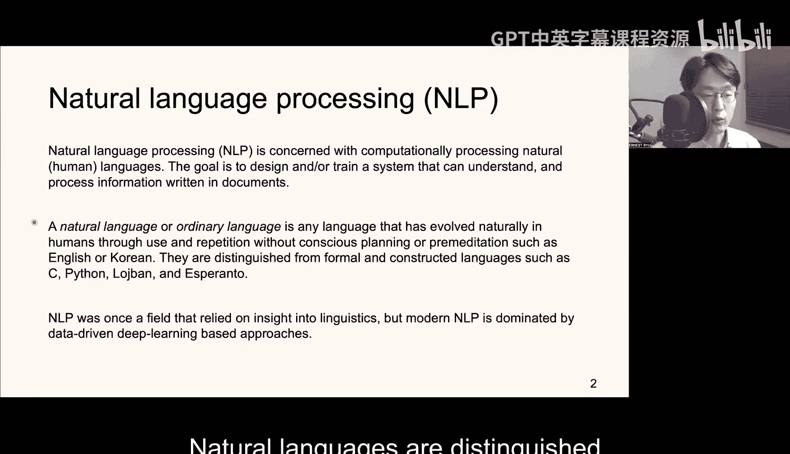

The field of NLP was once a field that relied on insights into linguistics。

 but modern NLP is now dominated by data driven deep learning based approaches。

Here' is an example task within the realm of natural language processing。

 and this is referred to as sentiment analysis。 So in this task， given a text review written on a。

 let's say， a reviewing website will denote that review as X。

 and the task is to determine whether the sentiment contained within this textual description is a negative neutral or positive。

 So heres a simple example。 So if somebody writes I do not like this movie。

 this review is clearly expressing a negative sentiment。 If somebody says I love this movie。

 then that's clearly representing a positive sentiment。

One thing that's noteworthy about this task is that the input that we need to process namely the paragraph X。

 this is of variable length。 although in this case， the output is of fixedes， fixed size。

's a it's a classification of negative， neutral or positive。So one simple way。

 one classical way to do solve this task is through a bag of words， a B O W Bo model。

 a bag of word model makes the prediction with a linear combination of tokenized words。

 This is an extremely simple baseline， and roughly this is how it would work。For each word。

 we have we have the word assigned to a particular one hot vector。

 A one hot vector is a vector that contains all zeros。

 except for a single coordinate that has a value 1。

 And this single coordinate value of  one is referred to as the one hot element。

So each word based maybe based on its dictionary order is assign a position， a one hott vector。

 and then for the back of words model， you combine all of these words into their corresponding1 hot vectors。

 you add these vectors and then you multiply that added vector with you take an inner product of that added vector with a certain weight vector。

 So the one hott vectors will have a certain dimension dimension which well write as dimension n。

 the weight vector will have dimension n， and then will'll also add a bias and the output becomes a score。

 So maybe if the score is sufficiently positive， then that corresponds to a positive sentiment。

 if the score is sufficiently negative， then that corresponds to a negative sentiment and if the score is sufficiently close to0。

 then maybe that refers to a neutral sentiment。😊，In this bowel model， the weights。

 the n coefficients within the weights and the bias scalar。

 these n plus1 parameters would be the trainable parameters。More generally。

 the notion of bag of wars refers to models that view a sentence as an unordered collection of words。

 So the metaphor is that you have a bag you have a bunch of words in them。 and if you mix up the bag。

 well， you still have the collection of wars， but you are not concerned with the order in which the wordss appear。

Now， this is a problem because this is a nice and simple way to do things。

 but the issue is that completely disregarding the word order in natural language is a significant drawback。

 A lot of meaning in our natural language is given is determined by the precise order in which the words appear。

 So when you ignore the order of the words。 Well， there's a lot of information that gets lost。

Let's define some basic notation for these lecture。

 so we'll define this sequence notation sequence the word sequence will often be abbreviated as seek。

So let u be any set。 Then a K tuple of the set U is a set that looks something like this。

 So you have a bunch of u you want up to UK， and you put them together as an ordered list。

 So that is the set of K twoups。 So for the sake of specificity， you can think of u as the set of。

 let's say a letters within the alphabet or words within a dictionary。

 So if you have a K tuupple of letters， then you have a sequence of letters of length K。

 And then if you have a K tuple of words， then you have a sequence of words where you have a K words。

 the clean star notation looks like this。 So this is a U star and this is defined as well。

 this union and this union notation might seem unnecessarily sort of mathematically sophisticated。

 But what this just really means that this is denotes the set of views of arbitrary finite length。

 for the sake of specificity。 If you were to let the set U be the set of alphabets。

 then the set U star。😊，Would denote a sequence of letters。Elements of U star can be length 0。

 So the empty sequence is an element of this U star clean star set。

 and there is the requirement that the sequence length be finite and in the context of natural language processing and language modeling。

 we don't want to deal with infinite sequences。 So the requirement that the sequence length is finite is exactly what we want。

We will denote the sequence of characters with this calligraph C。 So this set C can be the set of。

 let's say， English characters， space and some punctuation， right。

 So only containing the English letters is obviously not enough。

 You need at least some you need to at least express a space at the bare minimum。😊。

But in a more expanded set of characters， the set C could be the set of all Uniicode characters。

So x is equal to C star， this will be the set of finite length sequences of characters。

 And while if you think about what text is， this set x equals to C star。

 that is the set of text that we will be processing in language modeling。

I will just quickly point out that the definition and scope of a character is actually not obvious。

 and different choices represent different trade offs。

So the modern approach is to view each byte within a unitcode encoding to be the indivisible basic unit。

 and I'll come back to this point again when we talk about by pair encodings。

In modern natural language processing， we process text with neural networks。

 and neural networks perform arithmetic on vectors and numbers。 So at some point within the pipeline。

 the text has to be converted to a set of vectors And that's what what a tokenizer does。

 the tokens convert text into a sequence of vectors for the neural network to then go in and process。

So given a text X in this case expressed as a sequence of characters。

 a tokenizer is a function that takes in a sequence of characters。

 a text and produces a set of vectors of length n。So the tokens will that we will consider will output a sequence of vectors of uniform length。

 So that's what this notation mean R n star。 So given the input text in this notation。

 the output will be a vector u1， U1 will be of length n。

 and then the subsequent vector u2 will also be of length n。

 and the final output U L will also be of length n。 So all of these vectors will be of equal length。

 they will all be of length n。Now， the input characters， in this case。

 the input text consists of big T characters， and then the output after the tokenization。

 the output vectors will have length L。 So in total。

 there is going to be n times L numbers represented in the output， but in the tokenization process。

 There is no requirement that T， the input character length and L， the output vector length。

 theres no requirement that they be the same。 the input character length T also does not have to be equal to n times L。

 It's usually the case that the number， the number of output vectors is smaller。

 there's the sequence length gets smaller compared to the input character length。

Sometimes the tokenizer tau， which we doote as tau is fixed。 sometimes it is a trainables。

 For example， the word to v tokenizer is an example of a trainable tokenizer。

 and for text generation， we will want the tokenizer to be invertible。

 I'll come back to this point when we talk about text generation。Okay。

 so let's think about some basic options for tokenization。

 Let's first consider a character level tokenizer。 And for the sake of simplicity。

 let's assume that the character set consists of all the English lowercase letters， no uppercase。

 just space， period question mark and exclamation mark。

 so the bare minimum punctuation and only the lowercase letters。😊。

And let's think of the tokenizer that takes it as in pert textex， which is a sequence of characters。

 and we tokenize each characters individually， where each tokenizer。

 when the tokenizer applied to each character， outputs well if AA goes to 1。

 B goes to 2 and the Z goes to 26， and the remaining special characters take on numbers like 27， 28。

 29， etc。😊，So if we do this， then the output of the tokenizer is a scalar。

 so we should regard that as a vector of length1， and then the output sequence length L is the same as the input and character sequence length T。

 So this is a simple idea。 And I would say this is not a bad attempt。

 but it turns out that this doesn't work very well。

 So it turns out what we actually want is we want the distinct tokens to be mapped to vectors of distinct directions。

 And that is because it turns out neural networks are better at distinguishing directions rather than distinguishing different magnitudes。

So here's a better version of a character level tokenizer。

 so we have the same character set and what we do is what we tokenize the individual characters individually。

 but now all of the letters in all the punctuation marks， they get mapped to a one hot factor。😊，Now。

 this character set has 30 possible characters。 So in order to map them all to distinct 10 vectors。

 we would need the output to be 10 vectors of length 30。 So the output vector is now length 30。

 In this case， the output sequence length is the same as the input of character sequence length。

 Another option is to consider a word level tokenizer。 So for the example。

 for the sake of simplicity， let's say the character set is just only the lowercase English letters and only the space。

 So no other punctuation marks。😊，And then our set， let's define W to be the set of words。

 as let's say given by the English dictionary， and let's assume for the sake of simplicity that within our text。

 there are never any misspelled words。So then the way the tokenizer works is it takes in as inputs a sequence of characters。

 but we can reinterpret that as a sequence of words separated by spaces。

 then the tokenizers the tokenizer acts on these words individually and each word is mapped to a distinct one hot vector。

So in this case， n， the output length of the tokenizer。

 it has to be equal to the number excuse to be the cardinality of the set W。

 which is the size of the dictionary。 So the number of words contained in your dictionary that's going to be equal to the output one hot vector size。

In this case， for this kind of tokenizer， the output sequence length L is going to be much shorter than the input character sequence length T because well most words consist of more than one character。

 So if when we do a word level tokenizer， the output sequence length does get shortened quite a bit。

Again， with the clean Star notation in all， we will be considering sequences of finite length and to terminate a text sequence。

 we're going to use the so called end of string token。So given a sequence a sequence of characters x。

 which has length t that is assumed to be finite， we will equivalently consider a special end of string token。

 which we will write as EOS to be the final T plus1 element。 So in other words。

 if x is a sequence of length T considering of normal tokens C1 up to C T。 Well。

 that's going to be the same as the sequence containing C1 up to Ct and then a special end of string terminal token。

😊，And for any element within the set UA， we're going to use a similar kind of nottation。

So here's a quick discussion on these kind of tokens question what is it the advantage of a word level tokenizer over a character level tokenizer So the advantage is that you get a shorter tokenized sequence and another advantage of the word level tokenizer is that it actually utilizes the dictionary。

 So that means the model does not need to learn all the words from scratch by grouping characters together into words and using that information a word level tokenizer can allow the model to learn things much more quickly compared to a character level tokenizer。

😊，What's an advantage of a character level level tokenizer over a word level tokenizer Well a character level tokenizer can learn to handle misspellings and inflections。

 it's also much better for multi languagegu models because the the size of the dictionary for just the English language is actually quite manageable in the modern era with our large amount of compute powers。

 but if you are considering 30 or 100 distinct languages and you want to them put the dictionaries all together。

 the collection of all dictionary entries in all of these multiple languages。

's that number turns out to be a bit too large。😊，Next question。

 are there other tokenizers that we have not yet talked about The answer is yes。

 So word2 Vec is a trainable word level tokenizer。 I'll talk about that later。

 and then there are what's called subword tokenizers such as by pairing codingding。

 These are also train tokenizers， but this is doing tokenization at a level smaller than a word。

 hence the terminology subward， but it is larger than a single character。

 I'll talk about the by pairingcod tokenizer later。😊，So let's revisit the BO implementation。

 the bag of word implementation， so let tau be a word level tokenizer with our dictionary W。

 then we can write an input sequence x as a sequence of words and what the BO model does is it takes the input sequence the input text X decompose it into a sequence of words apply the tokenizer on the individual words take take the inner product with a and then add the bias term B。

 and this is the same architecture descriptionscript that we had few slides ago and the set of trainable parameters is the vector A and the bias term B。

 so there are n plus one trainable parameters。As I said。

 the BO model is a very simple model and modern the modern state of the art NLP methods。

 they are based on deep neural networks。 So really what's going to happen is the sequence of words along with the end of string token is going to be input into some complicated neural network and the classifier is going to do something with that。

 so let me introduce the next task language modeling。 So a language model。

 which is abbreviated as Lm of course when a language model is large。

 then we refer to that as a large language model， but let's we'll get their one step at a time。

 So a language model achieves one or two of the following goals。

 the goal number one of a language model is to assign probabilities and likelihoods to sentences。

 a goal number two generate likely and coherent sentences So this is goal number one So we have some complicated neural network text goes in and the language model is to output a probability as to how likely how probable this sentence is。

In goal number two， we have this neural network， we input the text。

 and then it goes on to generate a coherent sentence。

 coherent text that completes the given input partial character sequence。

 So the best things I have ever done one traveling to different countries， yada， yada ya。

So these are the two goals of a language model， and I would argue that the question of why a language model is useful was not at all an obvious question prior to the error of Chat GPT。

I mean， if you have a language model， you can assign likelihood two sentences。

 but like how would you what would you do with that， you can generate text。

 but if the thing just talks to itself， it just generates like words。

 why would that be useful as a quick remark this definition of a language model。

 it excludes encoder only transformer model such as a Bt。

 but let's not be overly concerned with these a precise definitions。So actually。

 one very nice use of a language model is in constructing a voice to text system。

 So in a voice to text system， you can have multiple interpretations that can be auditorly ambiguous。

 but semantically not at all ambiguous and a language model can determine which interpretation is more likely。

😊，Okay， let me read these two sentences sentence number one， the parcel was secured by gray tape。

 The sentence number two， The parcel was secured by gray tape。Now。

 I would argue that that is auditorily ambiguous， but if you were to hear that kind of sentence。

 you would， as a human， you would always pick out the first interpretation。 because obviously。

 the second interpretation doesn't make any sense。 So without any conscious thought。

 you're going to hear the voice as this first sentence。 Let me read these two sentences。 sentence。

 number one， he was a lighthousekeeper， He was a lighthousekeeper。 I mean， again。

 if if you really accentuate where the space is supposed to be。

 you can try to distinguish these two sentences。 But really， this is ambiguous。

 But under normal circumstances， you would hear the first sentence。And nowadays。

 a lot of the smartphones have some sort of voice to text system and all of these voice to text systems will have some sort of language modeling component because a voice to text system has to resolve this kind of auditory ambiguity between two different interpretations and the only way to do it is to feed these two interpretations into a language model and to ask which one is more probable。

You also have a similar kind of application when it comes to spelling correction。

Another application of language models is autocomplete。

 so an autocomplete system can assist writing by suggesting likely completions of a sentence。

 So in your email client， I'm sure you've seen something like this。 And well。

 how does your email client know what kind of completion is more likely， Well。

 it's relying on a language model。Another application of language model is SSL pretraining and a universal interface。

 So training a neural network to be a language model is a useful pretext task for transfer learning in the sense of selfsupvised learning SS L。

 So what you do is you pretrain a language model on a large corpus subt。

 and the resulting model is referred to as a foundation model。 And then you take that pretrain model。

 and then you fine tune it on some sort of downstream task。

 Maybe maybe you fine tune it on sentiment analysis。

 Maybe you fine tune that model to be a translation machine。

 Theres some downstream task to accomplish it do you use the pretrained foundation model。

 This approach is something I'll talk about further in detail when we get to the Elmo Bt and GT1 models。

😊，However， yet another application is if you have a sufficiently powerful language model。

 this can serve as a universal languagebased interface to the capabilities that the language model has learned。

 So actually， when you're communicating with other humans。

 let's say you hire a human assistant and there are a wide range of tasks。

 you want your human assistant to accomplish。 and the interface between you and the human assistant is through natural language if there's something you want your human assistant to do。

 you communicate that in natural language， there's no special computer API to do that there's no form that you need to fill in。

 you can just talk to the other person and they will understand what it is that you want and the same can be said for the sufficiently powerful modern。

 large language model based chatbots。 So we'll talk about this more when we talk about the T5 and GT3 models。

 but the idea is that if you have a sufficiently powerful language model。

 you can just say what it is that you want and it will do it for you。😊，Next。

 let's talk about assigning probabilities to sequences。

 So let's assume we have a sequence of U's U1 U2 up to u big L。

 And and if we assume that the sequence is generated randomly， Well。

 that means we're going to assign a probability on the generation of the sequence。

 So the probability of the sequence being generated should be a number between0 and1。

 when considering these random sequences， the sequence length big L itself should also be considered a random variable。

 Imagine the sequence U1 U2 dot dot dot being generated sequentially。 If we have a partial sequence。

 U1 U2 up to u little L， then the next token that is being generated U L plus1 could be the end of string token。

 If it is the end of string token， then the sequence terminates。 If it's not the end of string token。

 if the subsequent token is something else， then the generation continues。

 and then we would the generation would continue on the subsequent token U L plus 2。😊。

And here's a minor but necessary clarification of notation to make。

 So let's say a big L is our sequence length。 then the probability of this sequence。

 if I'm denoting it this way， what I what I'm referring to is the probability of this sequence U1 up to u big L being generated and also the sequence terminating right then and there。

 So this is the probability of the random sequence。

 having values u1 U2 up to u big L for the first L elements and then terminating then On the other hand。

 if I were to write u1 U2 up to u big L and use this notation without the double parentheses。

 then with this I'm denoting the probability of the random sequence， having values u1 up to u big L。

 but we are not talking about whether the U L plus1 token is the end of string or not。

 So this event that we're assign the probability to is not determining whether the sequence is terminating right there then and there。

 So to clarify a P1 up to u big L would be split into two events，1。😊。

Is where UL+1 is the end of string token， and then UL plus1 is not the end of string token。

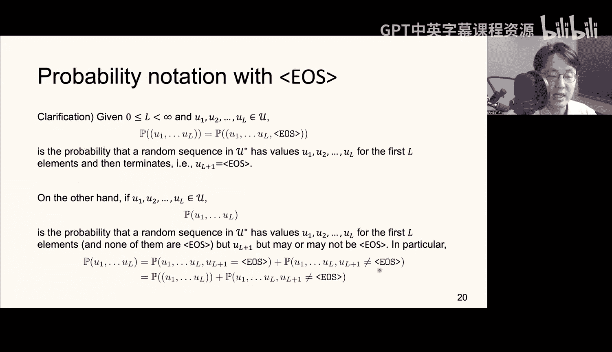

When you have the generation of a random sequence， you can decompose the probabilities of the chain rule。

 the conditional probability， you can decompose it into the generation of each individual token。

 So here we have the probability of the sequence U1 up to U， including the event that at UL plus1。

 the sequence terminates This can be decompposed。 we can first of all pull out the probability of UL plus1 being equal to the end up stringuring token conditioned on the past。

 and then we can write the probability of the first L token values。

Then these token values can all further be decomposed and if we do this recursively。

 then we have a product of these probabilities， these probabilities individually quantify the probability at token position 1。

 token position 2， token position 3 up to the terminal token token position big L plus 1。😊。

To clarify in this decomposition， where we decompose the probability of the entire sequence into a product of the of the individual token generations here。

 we have made no assumptions， absolutelyutely zero assumptions on the distribution of the sequence probabilities。

 So we have not made made anything like a mark of assumption。

 we have not assumed anything is independent。 This a conditional probability decomposition。

 it holds always。Here's a minor comment with conditional probabilities on continuous sequences。

 So if the sequence elements that we consider in our random sequence。

 if these are continuous random variables， then we need density functions instead instead of discrete probability mass functions。

 However， things are basically the same。 So if you want to work with sequences with continuous values。

 then just basically all the calculations go through essentially in the same way。

 But you just need to replace mass functions with density functions。😊。

When you're working in the domain of natural language processing。

 the vocabulary tends to be finite so we can consider sequences with discrete elements。

For some reinforcement learning problems， the state spaces and rewards， those can be continuous。

 and if that's the case， then you may want to consider sequences with continuous values。

 to clarify what I'm talking about here is the notion of time or the notion of sequence position that is still discrete。

 but what I'm rather talking about is whether the sequence values can take on the continuum of con possibilities。

 or rather a set of discrete possibilities。😊，We will later see that in vision transformers。

 images are processed， are converted into sequences of patches。

 and they are processed with sequence to sequence models for these vision transformers。

 the image patches are better understood as vectors that take continuous values。

 So when you analyze vision transformers， you would want to consider them to be sequence to sequence models with continuous sequence values。

 on autoregressive A model of a sequence learns to predict the subsequent element U。

 given the past observations U1 up to U little L -1。😊。

The goal is to learn a model F sub theta that approximates this full conditional distribution。

 So here is the exact full conditional distribution。

 given the earlier sequence elements you want up to U little L， there is a probability。

 There is a conditional probability on U little L。 and we want our neural network F theta。

 our model F theta to approximate that。😊，And let's say we were somehow able to train an autoregressive model well。

 so f theta now is a good approximation of this conditional distribution， then using this model。

 we can approximately compute the likelihood of a given sequence， so given a random sequence。

 the probability of its generation is exactly equal to this product of conditional probabilities and we can approximate that as a product of these function model f theta evaluations。

😊，And if we have a trained autoregressive model F theta。

 and if we have an unterminated partial sequence， so if we have elements u1 up to U little -1。

 then we can continue the generation， we can perform text generation using this autoregressive model。

 namely we can generate the subsequent values u sequence elements u1 up to U big L by sampling performing sampling in accordance to this model F theta namely we plug in the earlier elements u1 up to U minus-1。

 and then that defines a probability distribution on the subsequent token。

 and then we perform the generation in accordance to this probability distribution。

Now this autoregressive generation is justified by this product of conditional probabilities again。

 condition on the given input a partial sequence u1 up to UL minus-1。

 the distribution of the subsequent tokens can be decomposed as a product of these conditional probabilities and that can be approximate as a product of these f theta evaluations。

 so if we perform the generation in accordance to this distribution。

 namely if we generate one token at a time going forward starting at UL minus-1 according to this rule。

 then that would approximate generating from the actual probability distribution of the sequence。

In modern natural language processing， a wide range of natural language tasks。

 including language modeling， is solved using deep neural networks。 To do this。

 We need a general approach to process sequences， which are of variable length。

 both as inputs and outputs。 We will start by considering R NNs。

 And then we will move on to the transformer architecture。Now， why should we still learn about RNNs。

 so you may be aware that modern language models are all built using transformers and RNNs are really no longer used。

 at least not in the mainstream。Indeed， that's the case。

 Transformers have been replacing R N Ns and CNN N Ns in recent years， But nevertheless。

 much of the architectural design of transformers are inspired by practices inherited from the R N N era。

 So in my view， you still need to know R N Ns to fully understand the motivation behind a lot of the components within a modern transformer。

😊，Okay， so let's talk about learning with variable sized inputs。

For comparison in image classification， the neural network takes in as input a color image。

 And so that would be a 3 by n by M tensor。 This is an input of fixed size。 And traditionally。

 such an input is processed by a deep convolutional neural network。In contrast。

 in natural language processing， we want to process a variable sized input using a neural network。

So here's one simple idea。 If you have various inputs。 So let's say you have input X1， x to an x3。

 these are tokenized to be sequence of length 4，3 and 5。

 So so the tokenized sequence length is not uniformly the same。

 If you have these different sequence length。 you can pad them up， pad up the shorter ones。

 so that so that they all reach the length of the longest sequence。 So， for example。

 for the second sequence， which which is of length3。

 we perform zero padding at the end to make it length of length 5。Now。

 this is perhaps not a terrible idea， and this can certainly work as a quick and temporary solution。

 However， the simple approach has some downsides。 So one downside is that this does not scale well for long sequences。

 If we are using fully connected layers。 So this padded input sequence will have a certain length。

 if we process that with， let's say， a fully connected layer。

 We would have to process the very long sequence with a fully connected layer。

 That's a lot of computation。 That's also a lot of trainable parameters。

 So that would be inefficient。Another problem is that this approach requires the specification of the maximum length。

 So if we have an input sequence that is longer， then that set maximum length。

 then this approach just wouldn't work。

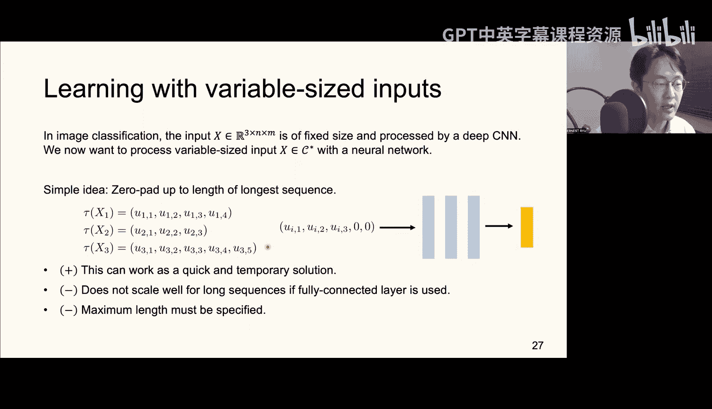

So then as our next idea， we can process one input per layer。 So again。

 consider this example where we have three input texts。 So x1， x2 and x3。

 these are tokenized into a sequences of length 4，3 and 5。 So for the first sequence。

 we provide as input the first sequence element。 And we also provide the initial hidden state。

 which is usually initial to be 0。 and the single layer processes that information。

 This produces the subequ hidden state， which is passed on to the next layer。

 The next layer also takes it as input the next sequence element。

 So this layer processes that that produces the next hidden state， hidden state。

 This next hidden state， and the next sequence element is process by this next layer。

 This again produces a hidden state。 the next layer processes that together with the next sequence element。

 and then that produces the result。 If you have a sequence of length 3。

 then you have three steps of processing。 If you have a sequence of length 5。

 then you have five steps of processing。😊，We can express this idea in functional form。

 So at every layer， we have the previous hidden state and the current sequence element。

 and that's concatenated into a longer vector。 We pass that through a linear layer。

 So the linear layer at sequence position L has the linear term A subbel and the bias term B subbel。

 Then we pass that through a nonlinear activation function to get the subsequent hidden state。

 So this is a nice idea。 and it has some advantages。

 One advantage is that shorter sequences require fewer layers to evaluate。

 So shorter input sequences require a smaller amount of computation。

 And it only when you have a longer sequence that you have to pay the larger compute cost to process the longer sequence。

😊，Another advantage is that each layer is much smaller than a single giant layer that you would need to process the whole sequence at once。

 So at every sequence position， we have this linear layer that processes the previous hidden state and the current sequence element。

 And this is a much smaller vector compared to the entire U sequence。However。

 theres still some downsides。 So one is that the total number weights and biases increase with the maximum sequence length。

 So a sub L， B sub L。 So these are the trainable parameters at sequence position L。

 And if we have many sequence positions， then we will have many of these trainable parameters。

Another issue is that we have exploding and vanished ingredients with this approach。

 I'll explain this point further soon。 So then let's try to resolve this issue of having too many trainable parameters proportional to the maximum sequence length。

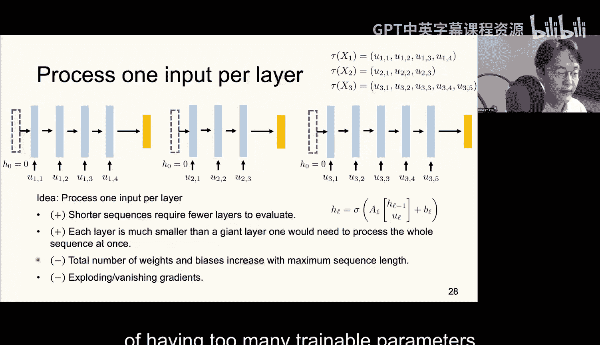

The idea is to use weight sharing。 And that means we're going to share the same parameter for all of the layers。

 So in functional form， what we do is each layer processes the previous hidden state and the current sequence element。

 We cancatenate that and pass that through a linear layer。 But note that in this linear layer。

 This is a without a subscript。 and this is B without a subscript。In the previous slide。

 we had almost the same equation， but there used to be a subscript。 So this used to be a sub L。

 this used to be B sub L。 So we simply deleted the subscripts。 And if you look at the diagram。

 the meaning of this is that at every step of processing。

 we use the same a matrix and B by a vector for all of the layers。So this is a nice idea。

 We've reduced the number of trainable parameters， And now we are also able to process an arbitrary number of inputs。

 no matter how long the input U sequence is， this equation is going to be well defined find。

 We still have the problem of exploding and vanishing gradients， but I'll get to that soon。😊。

So this overall approach is referred to as a recurrent neural network， an RMN。More generally。

 a recurrent neural network， an RNN has this form where we have this initial hidden state usually initialized at0。

 and the subsequent hidden state is obtained by applying the recurrent function Q sub theta tilde to the previous hidden state and thecurrent input vector U sub L。

 And then after all of this processing for the final output。

 we denote the final output as F sub theta applied to the input sequence X。

 we compute that by applying a linear layer to the final hidden state h sub l。

 So h sub big L that's the final hidden state， we multiply it by the matrix A and then at add of bias vector B。

 and then we denote theta for the set of a trainable parameters。

 the matrix A and the bias B used at the final output and the parameter theta tilde that goes into the recurrent function。

So this is a general form of an RNA and the exploding and vanishing gradient problem still needs to be resolved。

 and in fact， an R can work only if the recurrent function Q sub theta tilde is chosen to mitigate this exploding and vanishing gradient problem。

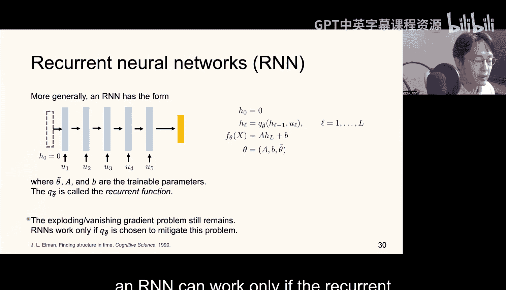

So then what is this exploding and gradient problem， Well。

 the problem arises because R NN are extremely deep networks in natural language processing。

 processing sequence length of hundreds or thousands is quite common。 So that is to say。

 you should think of this sequence length capital L， as a number， let's say。

 on the order of thousands。Now， to perform training of this R andN。

 you need to perform back propagation。 And if you work out the back propagation calculation by hand with respect to this parameter theta tilde for the recurrent function。

 it comes out to be this。And this red term， D， L， DH little L， based on the chain rule。

 it can be expressed as D L， DH， big L， DH， L， DHL minus-1 dot dot dot。

 So we have a product of these terms。Now， to be precise about what this means。

 H is a hidden state vector。 So DHL， DHL-1， this is a Jacobian matrix。

 So this product is a product of Jacobian matrices。

 But for the sake of simplicity for the moment being。

 let's think of this as a product of scalars rather than matrices。 Now。

 if you multiply a lot of scals。 And again， think of big L as something on the order of thousands。

 and let's say little L is half of that。 So this is a product of， let's say 500 numbers。

 when you're multiplying a lot of numbers， that tends to be quite unstable because if most of the numbers that you're multiplying are larger than one in magnitude。

 then the product quickly blows up to plus infinity。 And in this case。

 you would get the exploding gradient phenomenon， where you get gradients of huge magnitudes。

 Sometimes this can be dealt with the gradient clipping mechanism。

 which I'll talk about in the next slide。😊，On the other hand。

 if most of the numbers that you' are multiplying have magnitude less than one。

 then the product very quickly converges to 0。 When this happens。

 you have the vanishing gradient phenomenon。 And when this happens。

 you really don't have a good gradient and signal， because not only is the magnitude of the gradient is small。

 the direction of that gradient tends to be unusable。

So if we want this large product to result in a reasonably sized result。

 the numbers must all have magnitude close to one。Now going back to the actual meaning of this。

 again， this is a product of Jacobian matrices， not scals， but if you consider a product of matrices。

 a similar kind of reasoning holds if you replace the notion of magnitude for scals with eigenvalues or singular values of the Jacobian matrices。

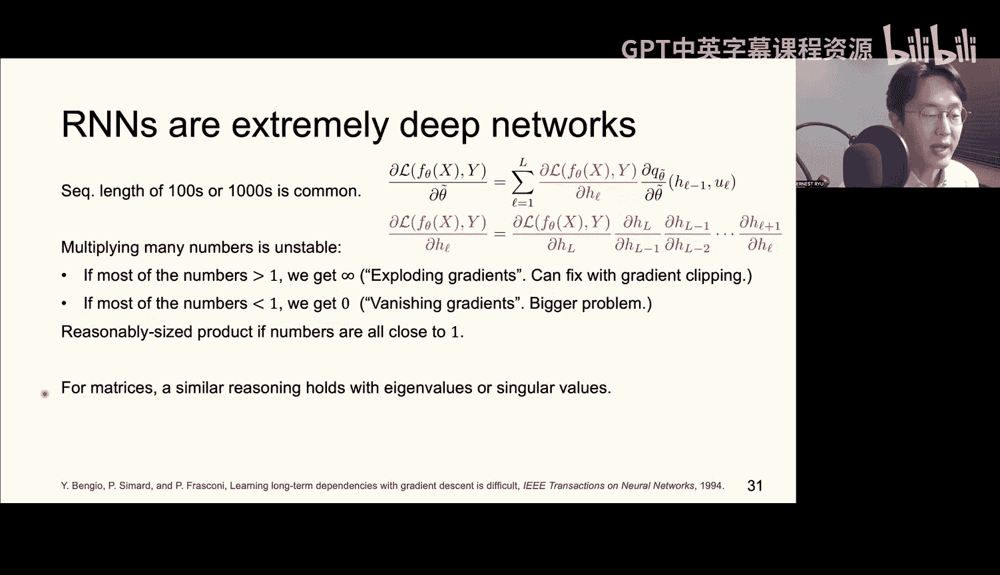

So again， you have the exploding gradient problem when the gradient magnitude becomes very。

 very large。When you have an explod gradient， that implies that the output is very sensitive to small changes of the parameters in a certain direction。

 and sometimes these kind of gradients are unworkable。

 and the only way to fix things is to use a different neural network architecture。

And to further comment on the second point in machine learning， in deep learning。

 the optimization problem at hand is usually not fixed， usually the optimization problem。

 the optimization landscape that you're dealing with is a function of the choice of the neural network architecture。

 So in machine learning， if you have a difficult optimization problem。

 often a good way to resolve this issue is to change the neural network architecture in the context of RnNs。

 this might mean using something like an LSTM cell， which we'll talk about suit。

 or maybe a ditching RnN altogether and using a transformer architecture。In any case。

 going back to the exploding gradient problem， sometimes when you have exploding gradients。

 the magnitude is too large， but the direction of the gradient might still give you useful information。

 So if this is the case， then we can use gradient clipping and use the clipped gradient in the optimization。

The functional form of gradient clipping looks like this。

 And the interpretation is that we will compare the magnitude of the gradient with a certain threshold。

 Now， if the magnitude of the gradient is smaller， then the pre specifiedified threshold。

 then we don't have exploding gradient。 So we will just use the gradient as is。

 But if the magnitude of the gradient exceeds this threshold。 Then we keep the gradient direction。

 But we shrink the gradient magnitude to be equal to this threshold V。

 So that's what we mean by clipping the magnitude。😊，So we are keeping the gradient direction。

 but we are clipping the gradient magnitude。So here's an illustration of a problem that can happen when you don't use gradient clipping。

 So here we're performing the optimization and we go downhill。

 and then at this point we take a little step， but this takes us way uphill。 And then on this hill。

 the optimization experiences a very large gradient magnitude。

 So the update flings the parameters to way far away and then the optimization is kind of ruined。😊。

With gradient and clipping， this doesn't happen。 So the optimization would proceed more steadily。

 And even if we were to climb up this hill and experience the large gradient in magnitude。

 we would gracefully come back down。😊。

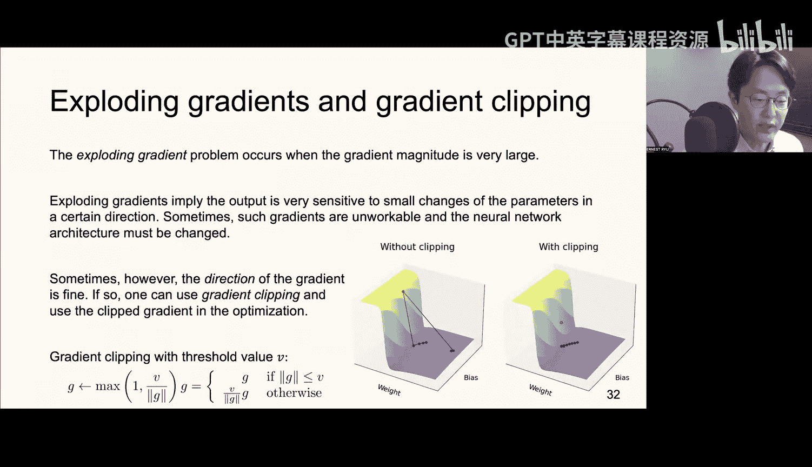

The vanishing gradient problem， on the other hand， occurs when the magnitude of the gradient is very small。

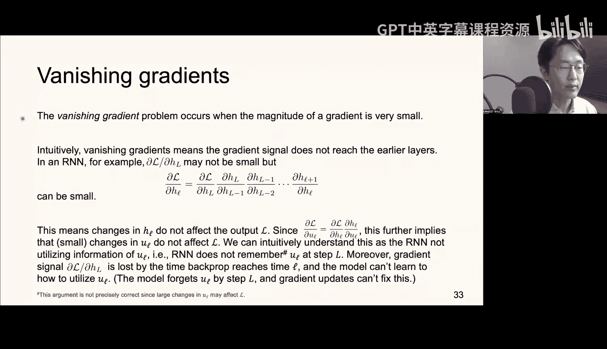

So intuitively， vanishing ingredients gradients mean that the gradient signal does not reach the earlier layers。

So in an R N， for example， D L， DHL， D L DH big L may not be small。

 but D L DH little L could be small。 So again， based on the chain rule， D L DH little L is D L。

 DH big L times DH big L， DHL minus-1， So we have a product of these Jacobian matrices and even when D L。

 DH big L is not small if these other terms were small， then D L DH little L， this can be small。

Now， if we go back to this diagram， the interpretation of that scenario is that this output would change if this final hidden vector would change。

 but if this earlier hidden vector changes， that doesn't really affect the final output。

This means small changes in H little L， an earlier hidden state vector does not affect the final loss。

And since D， L， D， U little L is D， L， DHL， DHL， D U L。

 This further implies that small changes in U little L does not affect the output loss。 So again。

 going back to this diagram， if the final loss it isn't really affected by the value H little L in this case。

 let's say H2， Well， U2， the sequence element U2 affects the output only through this hidden vector H2。

 So if the output is not really affected by changes in H2。 Well， if we change u2。

 U2 is going to change H2， but that change is not going to really propagate to the n to affect the final output。

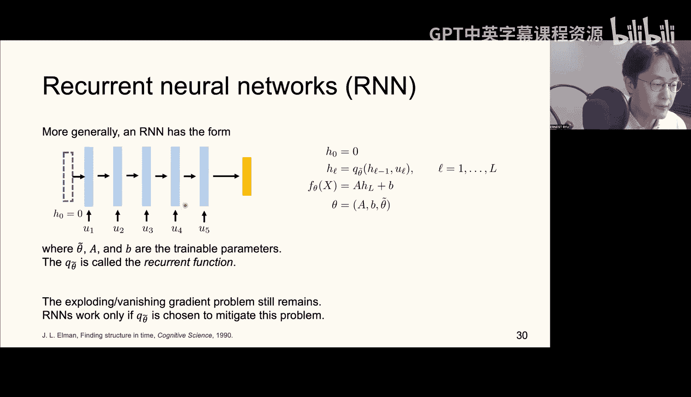

So we can intuitively understand this phenomenon as the R and N not really utilizing the information U sub L。

 In other words， the RnN does not remember U sub L by the time it reaches the final processing stage big L。

Moreover， the gradient signal D L， D H big L is lost by the time back prop reaches the time step。

 the sequence position little L， and the model can't learn to utilize U sub L。

 So the model forgets U sub L by the time it reaches the terminal step big L。 And furthermore。

 the gradient updates will not be able to fix this。

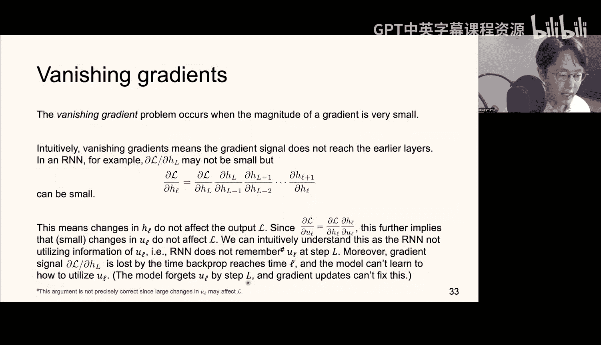

So we need to promote better grade and flow。 So again， let's look at this Cha formula。 D L。

 DH little L is D L， DHL plus 1， DHL plus1 DHL。 We say that if this Jacobbian matrix is close to identity。

 So DHL plus1 DHL， this is equal to the derivative of the recurrent function with respect to the hidden input H。

 If this Jacobian matrix is close to the identity matrix。

 then we say that the gradient and flows through this layer well。Conversely。

 if this Jacobian is close to 0， well， then this product will be close to 0。 And in that case。

 we say that the gradient does not flow well through the layer HL plus 1。

 because any gradient information contained in this term is going to be lost because whatever this is。

 well we multiply by0。 So the gradient D L DHL is going to be close to 0。

 So then do we always want to have good gradient flow。

 do we always want DHL plus 1 DHL to be close to the identity matrix。 Well。

 the answer is actually no， So we want this Jacobian matrix to be close to the identity only when we want to remember information。

 And we are not trying to build a machine that remembers everything。

 We're trying to build a machine that processes information。

 And the act of processing information is not merely remember information。

 Sometimes you need to forget information that you deem unnecessary。

 So we want the Jacobbian matrix to be close to 0 when we want to forget。

So the solution is to design a sort of neural circuit that explicitly controls when to remember information and when to forget information。

 So shown here is an example of such a circuit。 So as input。

 we have this cell state C-1 and in the end will produce the subsequent cell state C。

 we're going to take this cell state and multiply it by this socalled forget gate。

 So F is a value between 0 and1 and we'll perform element wise multiplication。 And after that。

 we will add this G a term to add a new information。

 So the functional form of this is a C is equal to C -1 element wise product F plus G And if we compute the derivative of d D C-1。

 this comes out to be F。 So depending on what the value of F is。

 we can make the Jacobia matrix equal to the identity matrix if the values of f are all equal to1。

 or we can make the Jacobcoia matrix exactly equal to 0 if the values of f are all equal to0。

 So this idea at leads to the design of LSTM cell。😊。

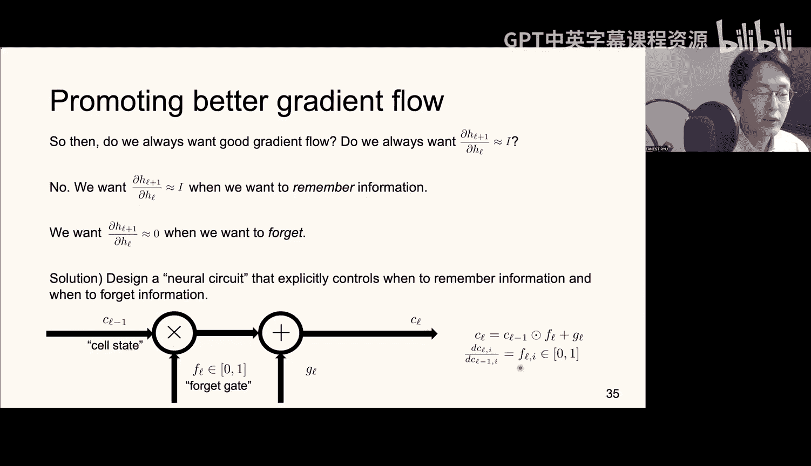

LSTM is the abbreviation of long， short term memory。

 and it has a somewhat intricate structure and parts of it feel admittedly a little bit arbitrary。

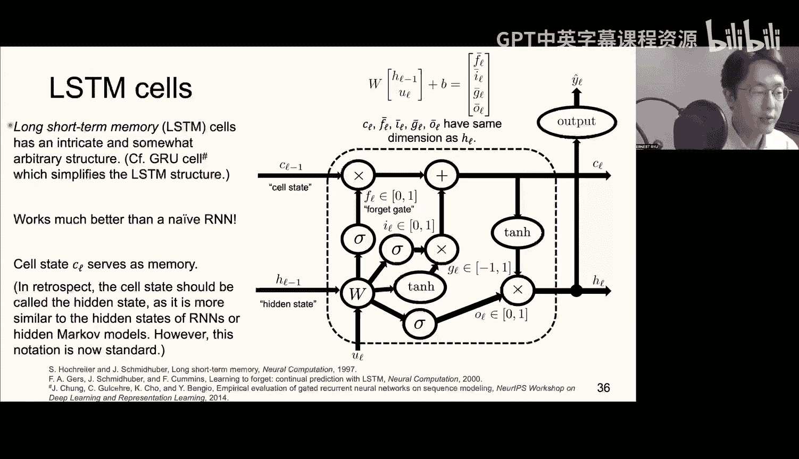

So the LSTM cell was originally published by Horiter and Schmt Huuber in 1997， and then in 2014。

 Chung etal presented the G RU cell， which simplifies the LSTM structure。

 and the success and effectiveness of the G RU cell implies that indeed。

 some of the components of the LSTM cell are arbitrary and redundant。 Nevertheless。

 the LSTM cell has historical significance。 So let's go through its design one component at a time。

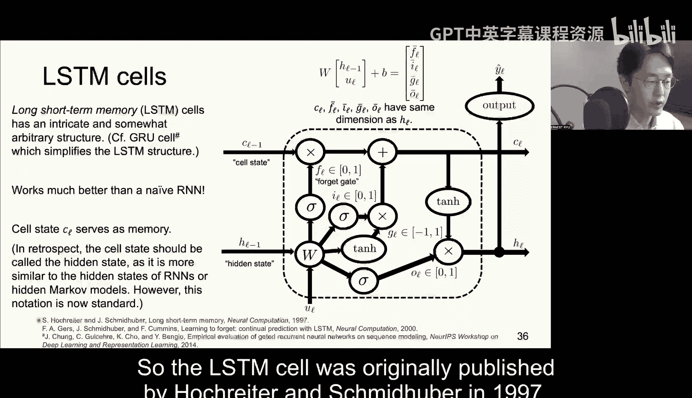

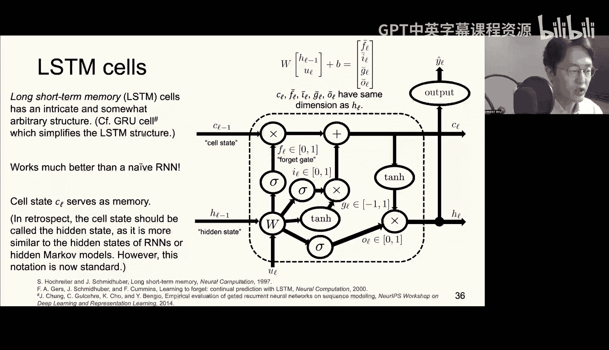

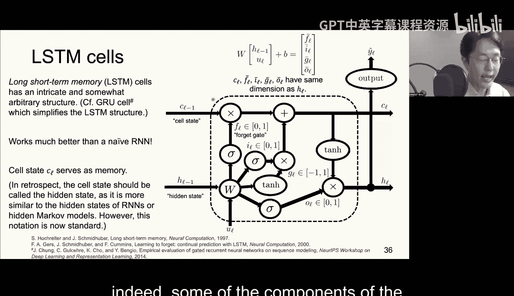

The LSTM cell takes in as input the previous cell state， C L -1 and the previous hidden state H L-1。

 It also takes it as input to the current sequence element U。

 So the current hidden state and the current sequence element are concatenated。

 And then that is passed through a linear layer defined by the weight matrix W and the biasfactor B。

 That produces an output， And we chunk that into four equally sized components。

 And we refer to those four components as F bar I bar G bar and O bar。😊。

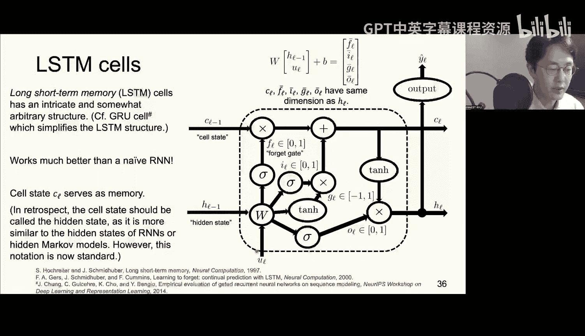

So here is the path that F bar goes through F bar that goes through an activation function。

 the sigmoid activation function， and that results in the F vector。

 the F vector is referred to as the forget gate， and this being an output of the sigmoid activation function has values between 0 and1。

 and the forget gate is used to modulate the previous cell state。

 So we have this previous cell state。 We multiplied element wise to this forget gate。

 And then later we add on new information to get the subsequent cell state。

 Next here is the path for the I bar vector。 it goes through the sigmoid activation function。

 and that results in the I vector。 Again， the I vector being an output of the sigmoid activation function has values between0 and1 and the I vector is used to modulate this G vector。

 Next， this is the path for the G bar vector。 this G bar vector is passed through a10 H activation function。

 and that results in the G vector。 The G vector being an output of the10 H activation function has values between -1 and plus1。

 It is elementwise multiplied to this I vector。😊。

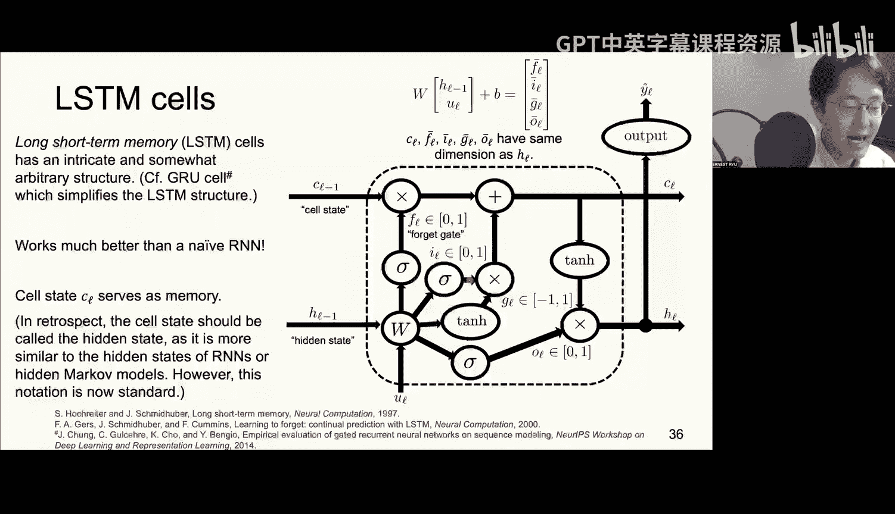

So the I vector serves as modulating this G vector information。

 And then that is added to here to produce the subsequent cell state。

 This is the path for the O bar vector。 It is passed through the sigmoid activation function。

 and that results in the O vector。 O vector again， being an output of the sigmoid activation function has values between 0 and1。

 and then we take the output cell state， we feed that through the10h activation function。

 and then we have that output B modulated by this O vector。

 and that results in the subsequent hidden state H sub L。

 The LSTM cell is designed to promote better gradient flow。 And because of this。

 this works much better than a naively designed RnN。

Within LSTM， it is the cell state that really serves as the memory unit。 Now， in retrospect。

 the cell state C should probably should have been called the hidden state because it is more the cell state is more similar to the hidden state of an R or the hidden state of a Markov models。

 But nevertheless， referring to this the cell state as the cell state。

 The hidden state as the hidden state in this way is now standard terminology。

 So that's what I'm going with。

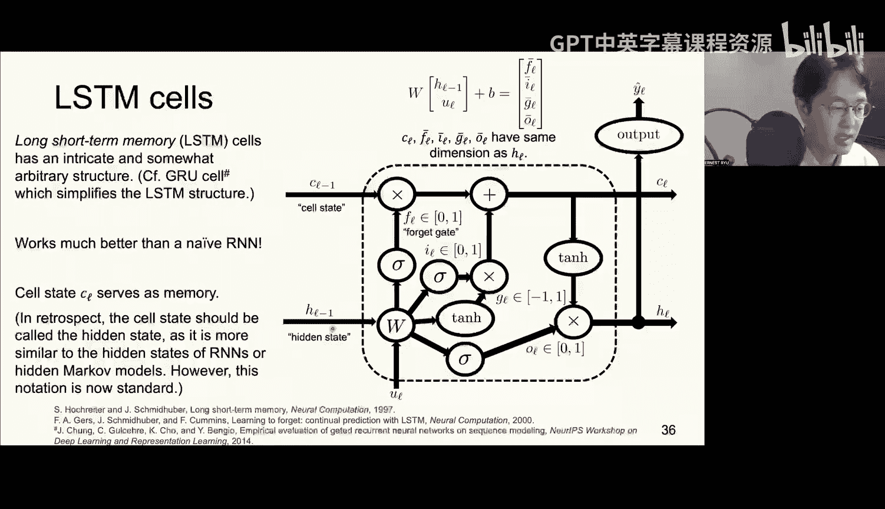

Sometimes you want to use the LSTM to output a large hidden state while maintaining a reasonably sized internal computation。

 You would want to do this in language moing， where the output size can be equal to the vocabulary size or the number of tokens with when used by pairing coding。

 And this is a relatively large number。

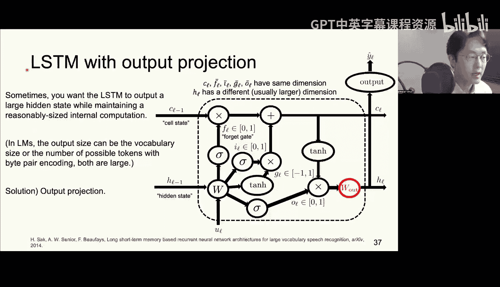

So the solution is to use LSTM with output projection。

 So the LSTM cell with output projection looks very much similar to the LSTM cell without output projection。

 but we have this additional output projection operation。 So in the vanilla LSTM。

 this output served as the hidden state H subbel。 But in this version of LSTM。

 we'd feed that through a linear layer that produces a hidden state H subbel with a larger dimension。

 Now， by design， the C vector， the F F vector， the I vector， the G vector， the O vector。

 these must have the same dimension。 So these will have a smaller dimension。

 So the internal computation that goes on in here， that has a much smaller dimension。

 while the hidden state H has a larger dimension as needed。

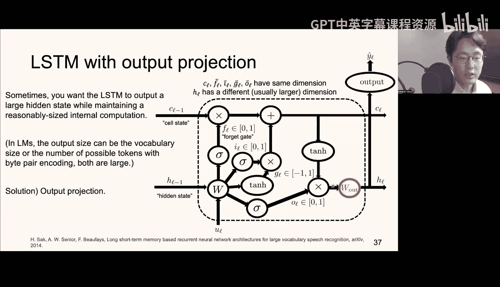

To clarify the name long， short term memory is not referring to long term memory and short term memory。

 Rather， it means that the cell states serve as a longer short term memory。

 So note that there's hyphen here and there's no hyphen here。 So it's a longer short term memory。

And in contrast， the naive RnN that would use an MP rather than an LSTM cell as a recurrent function。

 a poorly designed RnN would have a much shorter long term memory。

 So the claim made by the name LSTM is that this LSTM cell is going to work better than the naively designed one because the short term memory mechanism of LSTM is better。

 The short term memory mechanism will last longer， and therefore， this should work better。

 A true long term memory would correspond to using some sort of external storage。

 And this is something an LSTM R N doesn't have。😊，But now in the year 2025。

 proprietary LLMs do have long term memory。Here's an announcement tweet by open AI announcing this feature。

 And here's the research scientist Noam Brown， providing commentary on this new long term memory feature。

 He says memory isn't just another product feature。 It signals a shift from episodic interactions。

 Think a call centre to evolving ones more like a colleague or friend。 Still。

 a lot of research to do， but it's a step forward fundamentally changing how we interact with large language models。

😊，As an aside， the exploding and vanishing gradientding problem is something that arises in deep neural networks。

 not just RNANNs。For comparison， if we go back to the year 2012。

 the Alex Ne architecture was published， and this great success was followed up with a lot of effort to train deeper and deeper neural networks。

 The VG G architecture and the Google net or the Google net architecture were presented as deeper neural networks with greater success。

 but efforts to train further deeper versions of these architectures failed because precisely of the exploding and vanishing gradient and problem。

😊，And then the resonant architecture was presented。

 showing that the use of residual connections is a way to mitigate the exploding and vanishing gradient problem。

 Another key technique was the use of normalization layers such as batch norm。 Now。

 with residual connections and batch normalization。

 people are able to train much deeper neural networks for image classification with depth， let's say。

 hundreds or even thousands。😊，RnNs have the exploding and vanishing graing problem along a slightly different dimension。

 RnNs have this problem along the sequence length dimension。 And one might ask。

 can we use normalization layers to resolve this issue， And indeed。

 there has been in some effort some research trying to use， let's say。

 batchchnp to resolve this problem， but it seems to not have worked well enough to become common practice。

So let's talk about some tasks。 we can perform with RnNs。 So first we have the sentiment analysis。

 So here we have the sentence the hamburger was good。

 and the task at hand is to determine whether the sentence is representing a positive or negative sentiment We can do this with an LSTM RnN。

 So the words are tokenized one at a time and these tokenized words or fed into this into the RnN cells。

 and at the end， we extract this hidden state and pass it through another linear layer to determine to produce the scalar prediction as to whether the sentiment is positive or negative in performing this classification。

 it makes sense to extract this final hidden state because this hidden state depends on the entire sentence。

 and you would think that determining the sentiment of the sentence would require seeing the entirety of the sentence。

 but it turns out that you can improve the performance by using not just the final hidden state。

 but actually all of the hidden states。 So the way you do it is you extract all of the hidden states at every sequence position。

 and then you pass them through a pullinging layer either an average pool or a max pulling。

And then you pass it through a linear layer to perform the scalar classification。

A consistent observation in deep learning is that deep neural networks outperform shallow neural networks。

 Now， arguably， RnNs already have an element of depth depth along the sequence direction。

 but we can stack RnNs along the depth direction， and that will allow R NN to learn more complex representations。

So let's look through the diagram。 at the beginning。 We have the same RnN as before。

 This RnN produces a sequence of hidden states， and we take these hidden states。

 and we use them in the next stack of the RN layer as the sequence elements。 So this hidden state。

 this hidden state， those are fed into the next stack of the RN processing。 So then this layer again。

 produces a sequence of hidden states。 We use those as the sequence inputs for the subequ RnN stack。

 Finally， this produce a sequence of hidden states。 we take those。

 we pull that and then use that for the classification。 In image classification。

 it's customary to train a deep convolutional neural networks with depth hundreds and even thousands。

 And for modern transformer large language models， a depth count of 100 is customary。

 But stacked RNs tend to work best with much modest depth count。

 So a rule of thumb is to use two to8 stacked LSTM layers。

 So it's usually the case that using two layers is better than using one layer。

 but using three layers is not always better than。😊。

So what you would want to do is you would want to try two layers and then try to increase the layer count one at a time and tune the depth as a hyperparameter。

And when you're looking at this kind of stacked Rn N。

 you should view each layer of this R N as a transformation of a sequence to another sequence。

 So in this example， we have this input U sequence that gets transformed to a sequence of hidden vectors。

And then that a sequence of hidden vectors。 They get transformed to another sequence of hidden vectors。

 Yet， again， that gets transformed to another sequence of hidden vectors over here。

 And then these head hidden vectors are pulled and then used for the classification。

 So every layer of the stacked Rn N performs a sequence to a sequence transformation where the input sequence gets transformed into another input sequence while the sequence length of big L being preserved。

😊。

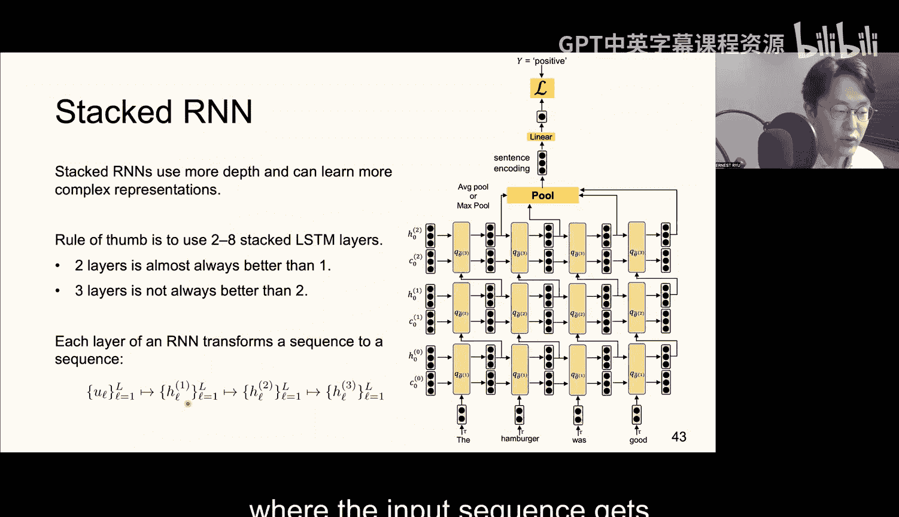

Another NLP task that we can solve with LSTM RnN is parts of speech tagging In this example。

 that we have the input sentence he saw to birds， and we have the corresponding labels of pronoun verb。

 number and noun。 and the goal of parts of speech tagging is to train an RnN such that at every sequence position we provide an output of making the prediction。

 what kind of parts of speech each word corresponds to。So in this task。

 the R and N is to provide an output at every sequence position。

 and the output at every sequence position incurs a loss based on its accuracy。

 So the final scalar training loss should be constructed as the sum of all the individual losses incurred at each sequence position。

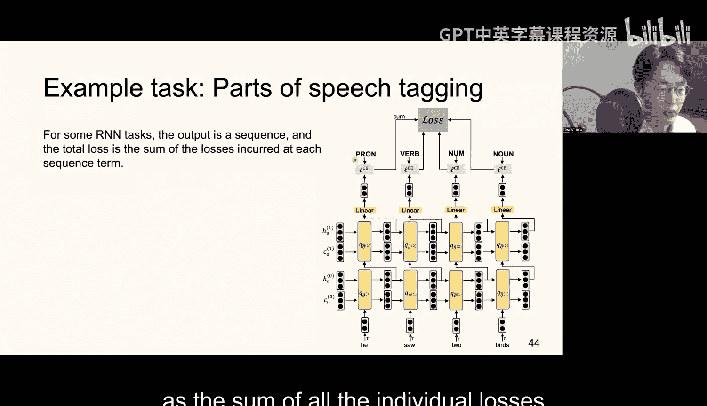

So far， we've talked about undirectional R Ns that process information for in time。 However。

 in language， it's common for later words to provide the necessary context for understanding a previous word。

 So this kind of unidirectional processing is perhaps suboptimal。

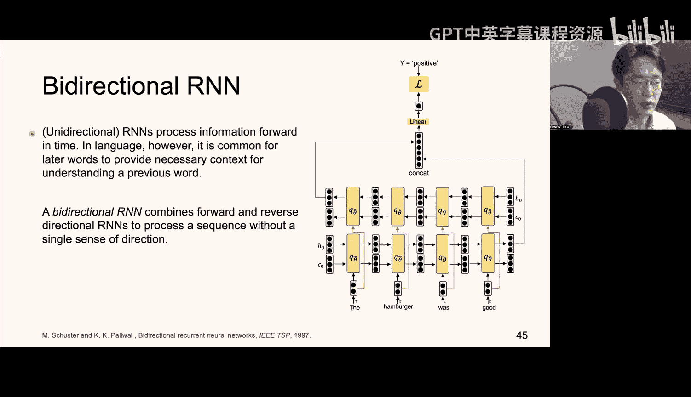

So a bidirectional R combines a forward and reverse directionional R to process a sequence without a single sense of direction。

 So in this example， here， this is not a stacked R。 This is a unstacked bidirectional RNA。

 So this bottom component of this R。 This is simply a normal forward unidirectional R。

 And then this top component which doest not interact with this bottom component。

 is a reverse unidirectional RNA。 So this top component processes the words in reverse order。

 So good was hamburger。 that's the order in which the top R component processes the input。😊。

The Ford unitdirectional Rn N and the backward unitidirectional R N these two perform their processing independently。

 they produce a final hidden state each。 and that's concatenated。 And then finally。

 we pass the through linear layer to perform the sentiment classification。And finally。

 stacking and bidirectality can be combined。 So really， if you're going to use an LSTM RN。

 you should be using a stacked bidirectional RN， and you should start out with a stack。

 a depth count of two， and then you should increase the depth count one at a time to tune the depth as a hyperparameter。

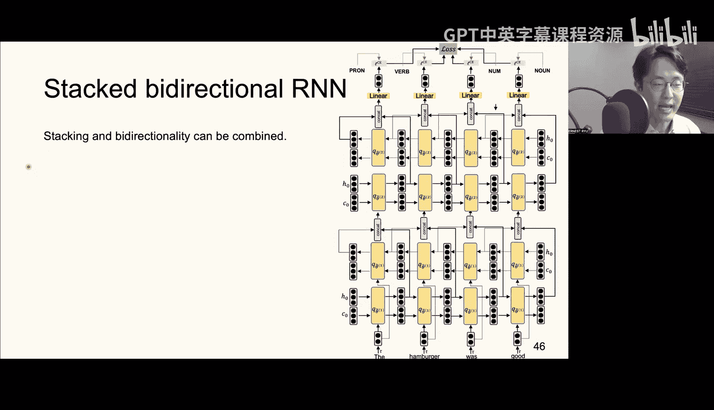

Language modeling is another task that can be done with RNNs。

 An R&N language model is trained as an autoregressive model with this following structure。

 The RNN takes an as input one word at a time， and then the hidden state is used to make a prediction on what the next word is going to be For this time step。

 cat is the subsequent word so that is fed into the cross entropy loss and the cross entropy loss measures how close the prediction is to the ground truth Next word。

Then at the next time step， the subsequent word cat is provided as input。

 and the hidden state is then used to make a prediction of what the next word is going to be。

 The next word is set， and the cross entropy loss measures the accuracy of that prediction。

 The next word SAT is provided as input to the LSTM。

 Then the hidden state is used to make a prediction of what the next word is going to be。

 The next word is on。 that is fed into the cross entropy loss and the cross entropy loss measures。

 the prediction against the ground truth label。 So when training the language model。

 the LSTM outputs a prediction at every sequence position。 So at every sequence position。

 a cross entropy loss is incurred。 and those cross entropy losses for all the sequence position are added up to form the final scalar training loss。

😊，So in functional form， this is what the training loss looks like。

 It's a sum of the cross entropy losses at all the time steps。 So for the training。

 we are given a sequence of tokens U1 up to U L。 There is also the end of string token at position L plus 1。

 and then the RnN is trained to predict the next token， given the earlier tokens。

 So given tokens U1 up to U little L， the RnN produces the final hidden state。 In this case。

 the hidden state at position little L。 and that is used to predict the next token U L plus 1。

 The accuracy and inaccuracy of this prediction is measured by the cross entropy loss at all the positions。

😊。

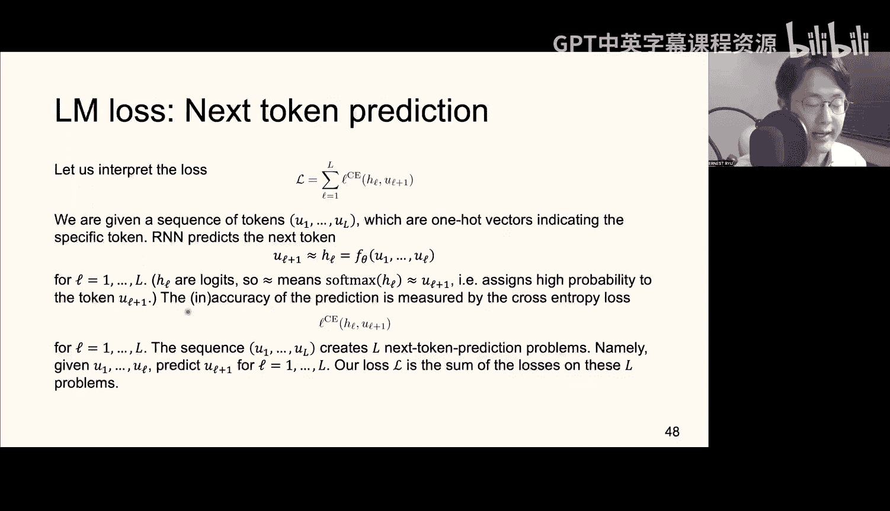

The sequence of length L U1 up to U， also with the end of string token at position L plus1。

 This creates L next token prediction problems。 Naly。

 you use u1 up to UL to predict predict the next token U L plus1 for values of L1 up to big L。

 Now let's play very close attention to the indexing。

 It doesn't really make sense to have the language model predict what the first token U1 is going to be because what information would the language model have to be able to predict the first token。

 there's nothing。 So the task of predicting u1 is not something that the language model is trained for。

 the language model is trained on predicting token U2。

 U3 U4 up to u big L of the final nonterminal token and then also predicting the final end of string token at U L plus1。

 So from position2 to position L plus1 those constitute big L next token prediction problems in total。

 And the final scalar training loss is defined as a sum of these L cross entropy losses。

For language models， the training and the inference considers two materially different tasks。

 and it is instructive to view the distinction from an RL perspective。

When you are training a language model， you are assigning probabilities and likelihoodli to give sequence via next to prediction。

 and you can think of next toome prediction as being analogous to imitation learning and training is done on real sentences written by human beings。

 so that defines the in distributionri data， the in distributionri data is sentences written by humans rather than via AI or language models。

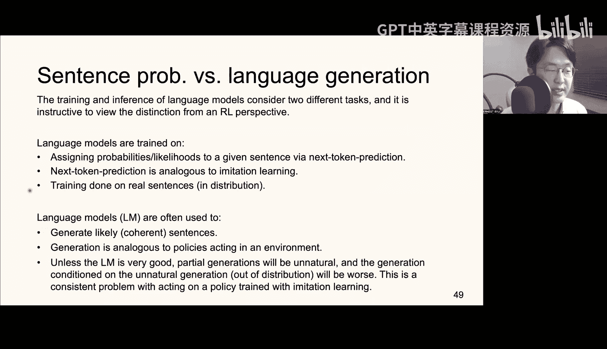

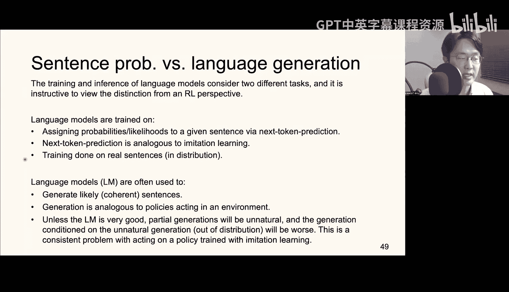

However， during inference， language models are often used to generate likely sentences and coherent sentences。

 And you can think of the generation as analogous to having a policy acting in the environment。 Now。

 unless the language model is very good。 The partial generations will have a slightly unnatural feel。

 and the generation conditioned on this kind of unnatural generation will be out of distribution because those kind of unnatural sentences。

 sentence sentences that don't sound like they were written by human beings were not part of the training distribution。

 And therefore， the subsequent generation conditioned on this kind of unnatural generation will become worse。

This is a consistent problem with acting on a policy trained solely on imitation learning。

In the context of NLP， teacher forcing is the practice of feeding ground truth sequence values back into the RNN after each step。

 even though the RNN would not be able to generate such a natural sentence。

 and this is exactly like imitation learning。And teacher forcing forces the R N to stay in the training distribution。

 However， as we've discussed in the previous slide， once a model makes a mistake。

 generates one bad token， the model really does not know how to recover because the model was only trained on the good text through a teacher forcing or imitation learning。

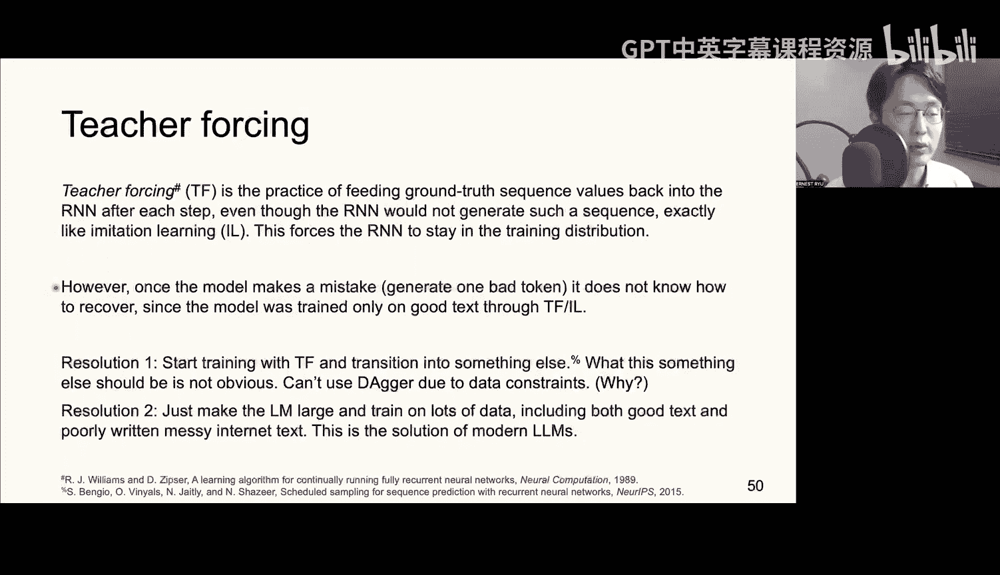

There are two ways to solve this， One is to start the training of the RNN with teacher forcing because initially a randomly initialized RNN is just going to generate a gibberish。

 so you have to use teacher forcing so you start with teacher forcing and then as the training progresses as the RNN becomes better。

 you transition into something else。

If you want to read more about what this something else is。

 you can read this paper by Benjiio at all published in 2015。

 And this other thing is called schedule sampling。 I won't get into the details of it。

 but I also mentioned that in the context of language modeling。

 you can't really do something like dagger to improve upon imitation learning In the context of language modeling。

 if you were to do dagger。 What that would mean is you would have the language model generate a partial completion。

 and then you would have a human being come in and continue the language generation from thereon。

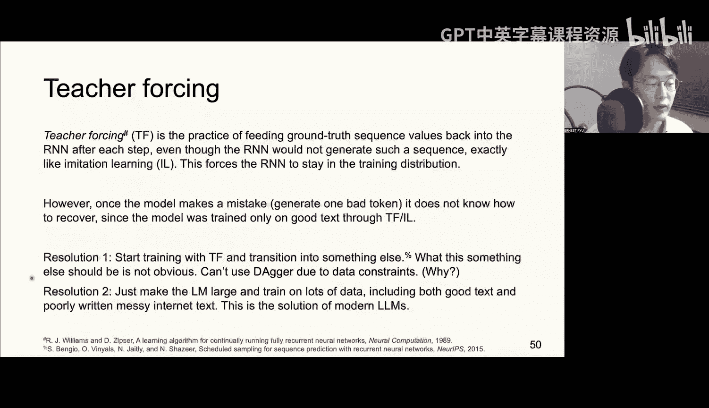

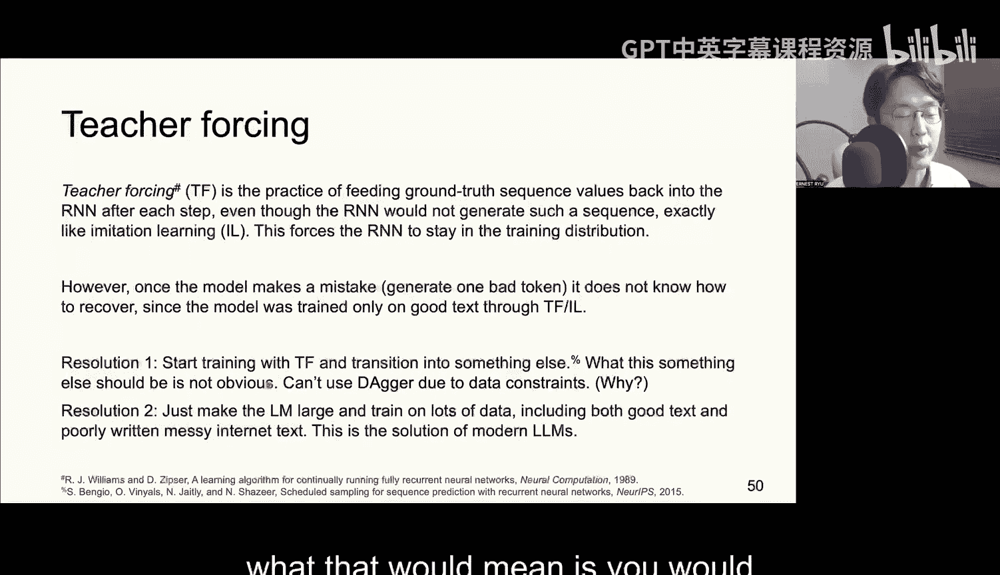

Now， there are two problems with this， One is that giving a partially generated paragraph to a human and having the human continue the generation is a very unnatural task for the human。

 but more importantly， the bigger issues that even if you can find people that are willing and able to continue generation from a partially written paragraph。

 you have to hire these people and the hourly ways that you have to pay the humans to do this on demand would be prohibitively expensive。

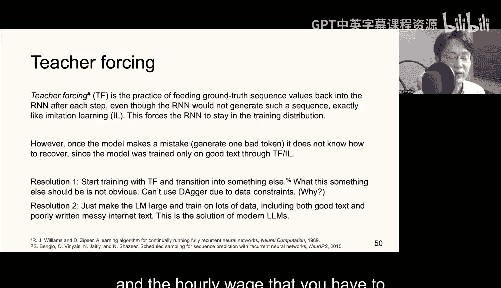

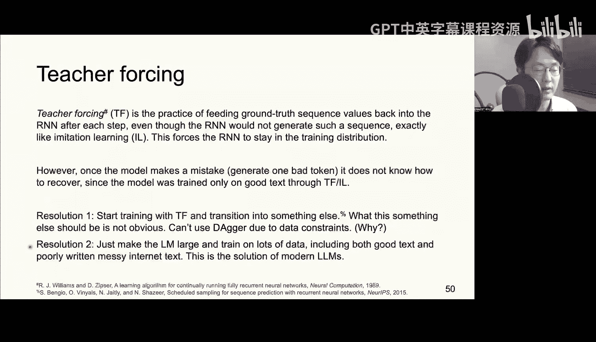

So the other approach is to just make the language model large and train on lots of data。

 And this lots of data should include both a very good and polished text and also poorly written and messy internet text with nonscuadors。

 grammatical errors， misspellings， etc cea。 So because the language model is trained on lots of data。

 The generation just becomes better。 The language model just becomes better。

 And also because the language model has seen a lot of poor text。

 the language model acquires a certain robustness， and it is able to continue the generation even when the language model generation makes a mistake and generates a slightly unnatural or poorly written partial completion。

 So this is the solution that we have for modern large language models in terms of overcoming the limitations of imitation learning。

😊。

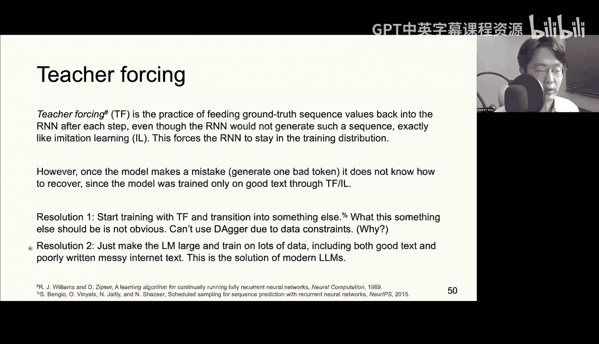

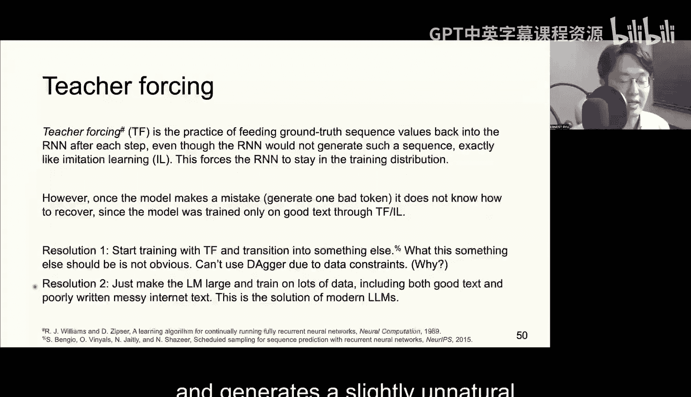

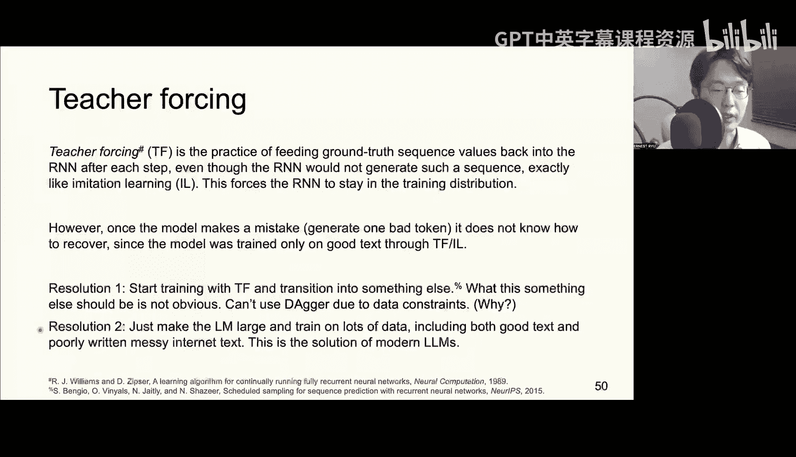

The tokenizer is the first contact between language and our algorithm。

 You should think of your R N and later your transformer as not interacting directly with the input language of the input text。

 But rather， it's interacting with the sequence of vectors produced by the tokenizer。

 So it's important that your tokenizer is good。 Your language model can work well only if the tokenizer is providing a good sequence of workable vectors。

Now， one option is to have do a word level tokenizer so you could use a one hot encoding with a fixed dictionary。

 but it's usually better to have some sort of trainable component in the tokenizer。Now， currently。

 bite pairingcoding has become the standard choice， and we'll talk about that later。 But for now。

 let's consider the historical context。So let's go back and think about what does a word mean， Well。

 what do you mean， what a word means， right？ you have a dictionary， right。

 and that idea corresponds to denotational semantics。

 So a word is the collection of the objects it describes a cat iss not exactly obvious how you would write down a definition of what a cat is。

 but a cat means refers to the collection of things that we refer to as cats。

 A chair is a collection of objects that we refer to as chairs and you love is a collection of emotions that we feel。

 And this is the intuitive and straightforward view of the meaning of words。

 But the problem of this is that it's not a very actionable definition， especially computationally。

 However， an alternate dual view is the notion of distributional semantics。

 So a word is characterized by the company It keeps。

 So a word's meaning is given by the words that frequently appear close by。

 So you should think of a word has having。relationships with other words。

 the relationship between the word cat and dog will be different between the relationship between cat and tree。

 and the idea that a word is something that does something to another word， and therefore。

 different words cooc with different distributions。

 and the coocrence of these words is what really defines， gives meaning to these words。

 This is the idea of distribution semantics， and it's a much more actionable notion in the realm of computational linguistics。

So this is the idea that leads to word to V。 So we train a model such that a word predicts the neighboring word。

 So in this example， we have the center word into。 and then a cooccurs with the word turning problems。

 banking crisis。 disregarding the word ordering。 We're just considering a context size window size of2。

 So these are the context words that occur within the vicinity of the center word into。

 And then for each word， we assign two vectors， we assign the V vector and the U vector。

 and this v vector for this word and this U vector for this word。

 these are trainable parameters of our model。 And then for a center word Wt and a context word W T plus K。

 K would be within the window size。 Then the probability of a certain word occurring is given by the inner product between the center words V vector and the neighboring words U vector expd and normalized in the soft max manner。

😊，Specifically in Word2 V， this is the loss function that is minimized。

 so for every single center where WK， we have a window size of n。

 and then we a plug in the neighboring words and we maximize the predicted log likelihood of the neighboring words where the V vectors and the U vectors。

 those are the trainable parameters。So the insight is that we have two words W and W tilde。

 and we consider these two words to be similar if the distribution of neighboring words of this W vector is similar to the distribution of neighboring words of this W tilde vector。

 so two words are similar if they have similar distributions of neighboring words and under this construction of the model this will happen if the V vectors are similar。

And if you think about it， well， the word cat and feline are similar words。

 They're actually synonyms， and the distribution of neighboring words of cat and feline should be not the same。

 They're not the same word。 but you can imagine those that distribution being quite similar compared to。

 let's say， between cat and truck。 cat and truck are very dissimilar words。

 You would expect that the distribution of neighboring words to be quite dissimilar between cat and truck。

 And it will turn out that the V vectors between cat and fe line will be similar。

 And then V vectors between cat and truck would be quite dissimilar。

The goal of words to V is to obtain a train word level tokenizer。

 So given an input sequence of words words。 So x is chunked into words what w1 of to W。

 And if we have the trained tokenizer tau， which will call theta。

 Now we will write talitheta because now is trainable。

 it will output the sequence of corresponding V vectors。

 So this is a data driven away to map similar words to similar vectors。

 And now let's compare two options。 Option number one is we don't do words to V， given an input text。

 we chunk it into words based on the dictionary， and then we assign a one hot vector for all of those words。

 we feed those one hot vectors into our R and N， and we do our sentiment analysis parts of speech tagging or other NLP task。

 that has a certain performance。 And that certainly does work。

 But if you replace the tokenizer with a word to V。

 So instead of assigning a one hot vector to all the words。

 If we assign the V vectors that was obtained through the training of words to V as the output of the tokens。

😊，And if we feed those V vectors into the RNNs， that significantly improves performance。Now。

 why would that be the case， Well， you see， if you use a one hot tokenizer， then the word feline。

 the word cat and the word truck， these are all just distinct words。

 They are mapped to just completely separate one hot vectors。

 So the tokenization process does not provide any information as about as to which the words are similar or in which words are dissimilar。

 whereas if you use words to Vec。 Again， if you use word to V。

 the words cat and feline will map to similar words in the word truck will will be mapped to a completely different vector。

 When you use this trained word level tokenizer， namely words to Vec as the input。

 the input that the R N S starts out with already has this rich information in terms of the similarity and dissimity of certain words。

 Now， this word to Vec idea was a groundbreaking idea。

 And it would go on to win the test of time award in the 2023 Nip's conference。 But it's still。

 I mean， there are improvements to be made。 and there's a downside。 So the downside of this。

Idea is that well， if you do this word level tokenizer。

 then it does not consider the context in which the word W is used in。

 So you you can have issues with polysemi。 a word can mean multiple things。

 The word bank can mean different things depending on what kind of context it is used within。

 And if you use a word level tokenizer the tokenizer cannot possibly consider the context in which the word is used。

 So these kind of ambiguities cannot be resolved。 So we're going to fix this problem in the next model that we're going to talk about。

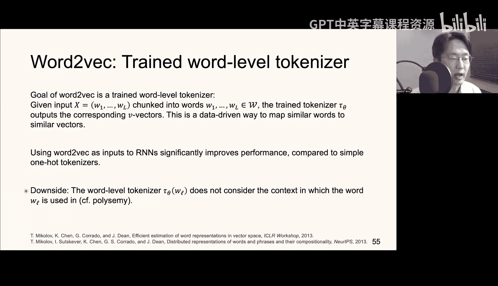

But before we talk about the next model， let me quickly make a commentary about selfupvised learning。

 So in self supervised learning， abbreviated as SSL。

 a model learns useful representations from unlabeled data by solving pretext tasks that automatically generate generate supervisory signals。

 The pretext task is not by itself useful by itself。 it's not useful。

 but it is related to downstream tasks of interest。

 the pretrain model is subsequently trained on downstream task。

 usually with a smaller labeled data set。 So it's instructive to look at this task from computer vision。

 So the pretext task that is being considered here is predicting the random rotation。

 So these images are scraped from the Internet。 and it is presumed it is assumed that these images are come in the correct orientation。

 Now， that's not always going to be the case。 Some pictures on the Internet will have the incorrect orientation。

 but most of them will have the correct orientation。 So we will go off of that。

 We take this image from the Internet， and we regard。😊。

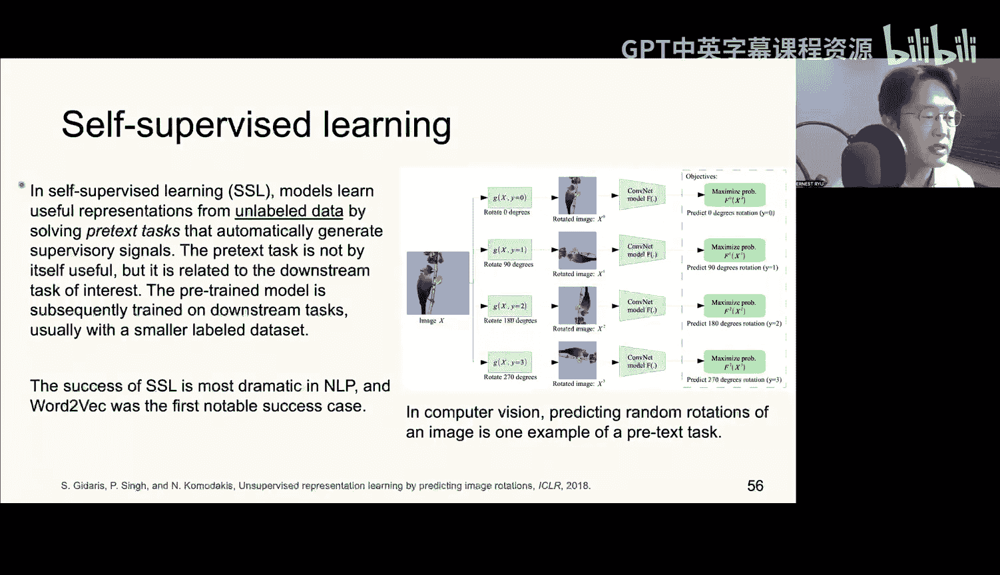

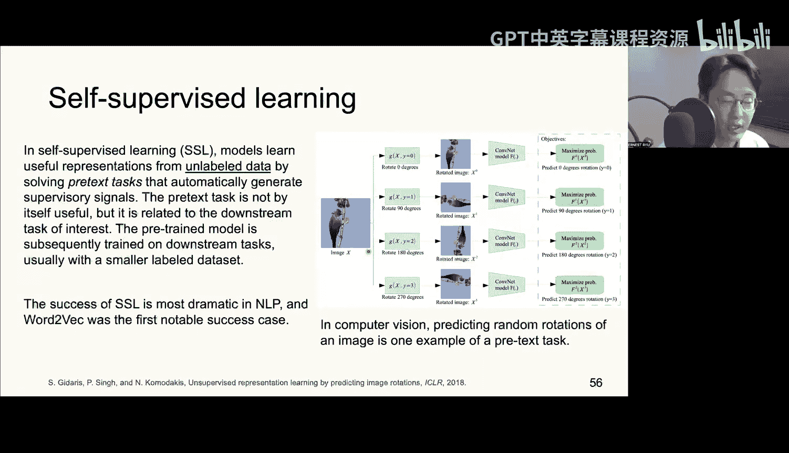

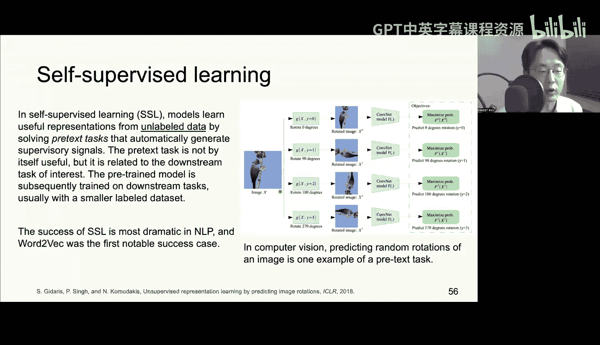

Regardless as the correct ground truth， correct orientation， then we randomly rotate these images。

 so 90 degrees，180 degrees，270 degrees and also0 degrees。 So there are four possible choices。

 and then a combvolutional network is trained to predict the correct orientation。Again。

 this is a pretext task and as far as I can tell this task by itself is not very useful。

 but to be able to carry out this task with high accuracy。

 the model needs to eventually learn a lot of knowledge about what these objects are and through this self-svised learning。

 the model is able to use a lot of useful features。

 and then when you take this model and then fine tuneed or further trend on a small label data set。

 the classification performance， for example， if you consider classification as the downstreamstream task。

 the classification performance is significantly improved compared to not doing this kind of self-supvised learning。

😊，The success of self supervised learning has been observed in computer vision。

 but it is most dramatic in natural language processing。

 and word to Vec was the first notable success case of self supervised learning in NLP。😊。

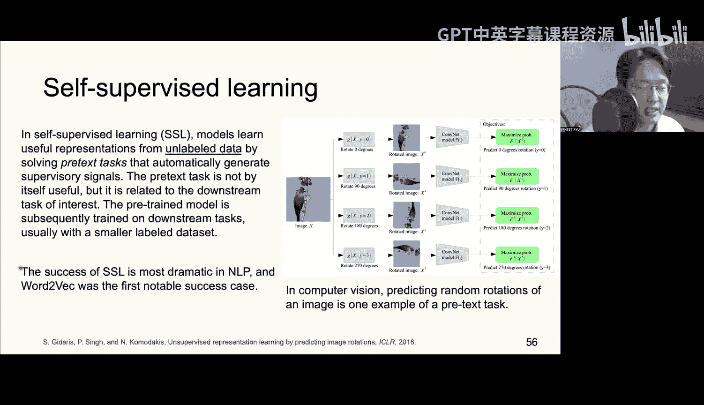

So ElLMmo is a work that follows a word to Vec and it produces an in context tokenizer。

 So ElLMmo is the abbreviation of embeddings from language models， and again。

 it's meant to produce an in context tokenizer by tokenizing words to vectors while taking into account the neighboring context。

Elmo uses a bidirectional LSTM structure， so here we have a sequence of1 hot vectors and that's fed through a stacked RNN。

 a forward stacked RN， and then a reverse stacked RN。

 and these two forward and reverse directional processing is combined to produce the tokenized vectors。

So ElLmo is trained through selfsvised learning for that， it needs training data and a pretext task。

 The training data for ElLmo is just unlabeled text。

 just text written by human beings without any external labels。

ELMmo is then trained using the bidirectional language modeling loss for the four directionional RNA ElLMmo perform uses this next token prediction loss so given the first L tokens and predict the subsequent token and then for the reverse directional RNA。

 it performs a reverse directional language model so given the later words。

 then predict the current word。So Elmo is trained with this bidirectional language modeling loss。

 and that makes it a noncausal language model。 So a causal language model takes an as input the earlier tokens and predicts the next token。

 So a causal language model learns to predict the next token from left to right。

 the usual direction of our language。 whereas for Elmo and soon go see with the model Bt as well。

 these are noncas language models。 Now， we can say that half ofelmo is a causal language model。

 in that's certainly the case。 but as a whole is's not a causal language model。

 So the reason this distinction between causal and noncasal language models is worth pointing out。

 is that Elmo and Bt certainly can understand language。 So this language modeling loss causal or not。

 is a useful pretext task in the selfsupervised learning sense。 So these do serve。

 despite being noncasal language models， they understand language and Elmo and Bert can solve many NLP tasks。

 But it cannot generate text。In contrast， GPT is a causal language model。

 and because it is a causal language model， it can generate text。

 So if you want to have a model generating text， then you need the model to be a causal language model。

So once this Lmo model is trained on this bidirectional language modeling loss as a pretext task。

 it is then fine tuned for the downstream tasks。 So given a prior NLP method。

 which can be very specialized can be very much tailored to the specific task。

 And if this prior NLP method takes in as input put this x sequence。

 we replace the x of this prior NLP method with this x tilde where this x tilda is the concatetnation of this x sequence and also the hidden states of this LSTM RN。

 the Lmo LSTM Rn N。 then now the entire pipeline is trained。

 So this means training the trainable parameters of this prior NLP method and also the weights within this Lmo model。

So this worked remarkably well。 Elma achieved a state of the art performance on a wide range of NLP tasks。

 such as question answering textual entailment， which is determining whether a hypothesis is true。

 given a certain premise， semantic role labeling， which basically means answering who did what to whom coreference resolution。

 which involves clustering mentions in text that refer to the same underlying real world entities named entity extraction。

 So this involves finding four types of named entities， Per location。

 person location organization miscellaneous in news articles， and sentiment analysis。

 I want to emphasize that this was highly， highly unusual at the time。

 because usually a good NLP paper would make advancements in one of these NLP tasks。

 But what Elma showed is that through this general rubric。

 you can get improvements on all of these NLP tasks， not just one。😊。

And this is the kind of paper that shakes up an entire field。

 It tells people within NLP that the old way of doing things are now outdated。

 You have to do something like this to achieve the state of the yard performance。

I'll mention that the idea of selfupvised learning through large scale pre training and then fine tuning。

 This is not new。 Indeed， work tove is a predecessor of Elmo and also the paper Di and law 2015。

 This proposed an idea very similar to Elmo。 But Elmo executed it very well and in advanced the state of the art substantially。

 Elmo made it clear that self supervised pre training is an indispensable paradigm in natural language processing。

However， the LSTM RnN is not the best architecture。 The left and right directional RNs。

 it only process information unidirectally， Yes， the two combined you get a bidirectional RN。

 but those two components individually they process things unitdirectally so since the components are all unitdirectional processors well with the model needs to examine the entire sequence to make inference and and kind of go back and forth between the different words。

 the RnNs are fundamentally computationally inefficient at doing that。

 Also the overall approach of ElLMmo is still not universal each task requires an existing NLP method that we attach the LLMmo to so the LLMmo really only serves to provide a better tokenization。

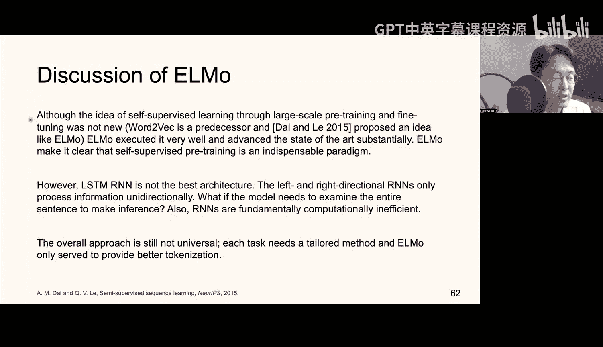