# UCLA《大语言模型的强化学习｜Reinforcement Learning of Large Language Models 2025》中英字幕 - P8：-08--UCLA RL-LLM- Chapter 2.2_ Transformers I (BERT, GPT-1).zh_en - GPT中英字幕课程资源 - BV1yGzGBgErC

So this leads to Bert Bt is the abbreviation of bidirectional encoder representations from transformers。

 Bt replaces the LSTMs of Elma with what's called the encoder only transformer layers。

 Bert also proposes a more universal approach that unifies the approach for various NLP tasks。

 and Bert set a new state of the art on almost every single NLP benchmark。

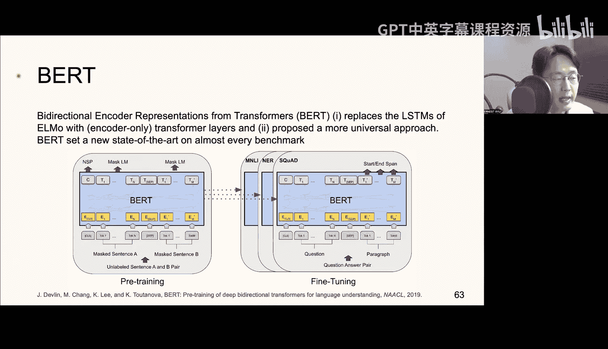

Okay， so Bert uses the transformer architecture。 The transformer architecture is a sequence to sequence model。

 They are named transformers because they transform a sequence to another sequence in each layer。

There are three types of transformers there and I'm listing them here in the order of complexity。

 simple to more complex， so the encoder only transformer that's the Bt architecture。

 then there's the decoder only transformer that's used in GPT。

 and then there's the encoder decoder transformer， which is the original transformer of vsmani at all。

 We will take kind of a reverse chronological order。

 and we'll first discuss the encoder only transformer because that one's the simplest among these three variants。

Alright， so let's talk about the encoder only transformer。

 So the encoder only transformer relies on these following components， the token embeddings。

 the multihead self attention， residual connections， layer normalization。

 position wise fFNs and positional encodings。 As we talk about these。

 we will get into all the nity degree details。 But given the importance of transformers。

 the transformers really power the entirety of language modeling。 And also nowadays。

 a vision computer vision as well through the use of vision transformers。

 So given the importance of transformers is going to be worthwhile to understand to try to understand every single moving part within the transformer architecture。

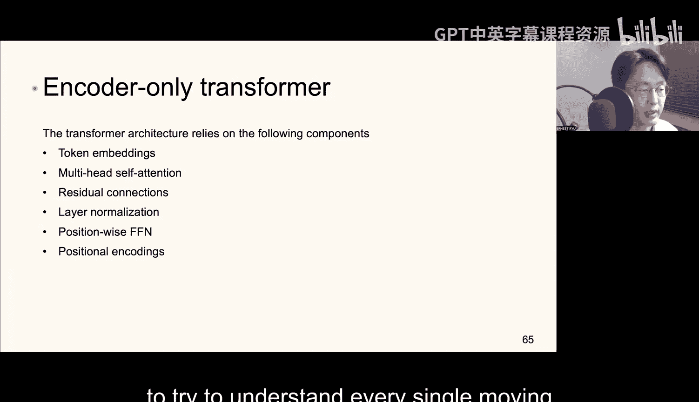

We start with token embeddingies， so let tao be a tokenizer that takes in as input a text X and then produces tokens U1 up to UL。

Now， for the tokenizers use for transformers， we can think of these u's as either one hot vectors。

 So there are n possible choices of these tokens and at the I position。

 the u vector takes on the one hot vector with the one hot position at position K。

 or we can equivalently think of this u this tokenized u value to be equal to the integer K。

 We're going to go back and forth between this notation where U I is equal to the integer K and U is equal to the one hot vector E K。

 Again， n is a number of distinct tokens。

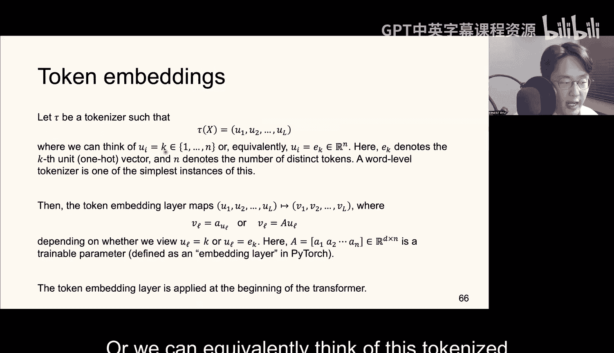

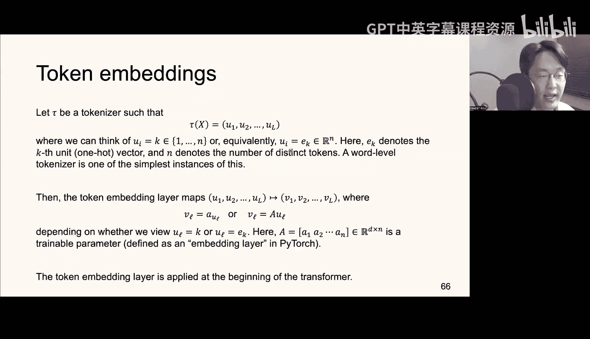

A word level tokenizer is one of the simplest instances of this。

 although soon we will talk about the by pair encoding being used in this way。

The token embedding layer acts after the tokenizer。

 So the tokenizer and the token embedding layer are separate things。

 The token embedding layer takes as input these U values， and then they map them to these V values。

 and there are two equivalent ways you can think about it。

 numberumb one is U L is an intesger value between0 and N again。

 n is the number of possible distinct token values。 So there are vectors， A1 up to A。

 So there are vector A1 up to an。 And then if U L is is a certain integer value。

 then we go to that a vector。 we take that a vector and that becomes our V vector。Alternatively。

 we can form this matrix A， So this would be a D by N matrix。 So all of these a vectors， A1 up to an。

 These are length D vectors。 and there are N of them。 So if we stack them this way。

 the a matrix will be a D by N matrix。 And then if we interpret this U L to be a。😊。

One hot vector with the k column K component containing the one vector。

 Then we can write this as a times the one hot vector U。

 And that will the the effect of this will be extracting the k column。 If U L is equal to E K。

 So the k column will be extracted and then V L will be equal to a K。

 So if U L is equal to the integer K， then that would be a K。

 So these two are equivalent expressions。This a matrix， this D by N A matrix， or do the N vectors。

 A1 up to an N each of length D。 These are the trainable parameters of the token embedding layer。

 And and in Ptor， this layer would be defined as an embedding layer。 So again。

 the token embedding layer is applied at the beginning of the transforms。

 The very first step is the tokenizer tau。 And then after the tokenizer tau。

 Then the token embedding layer is applied。

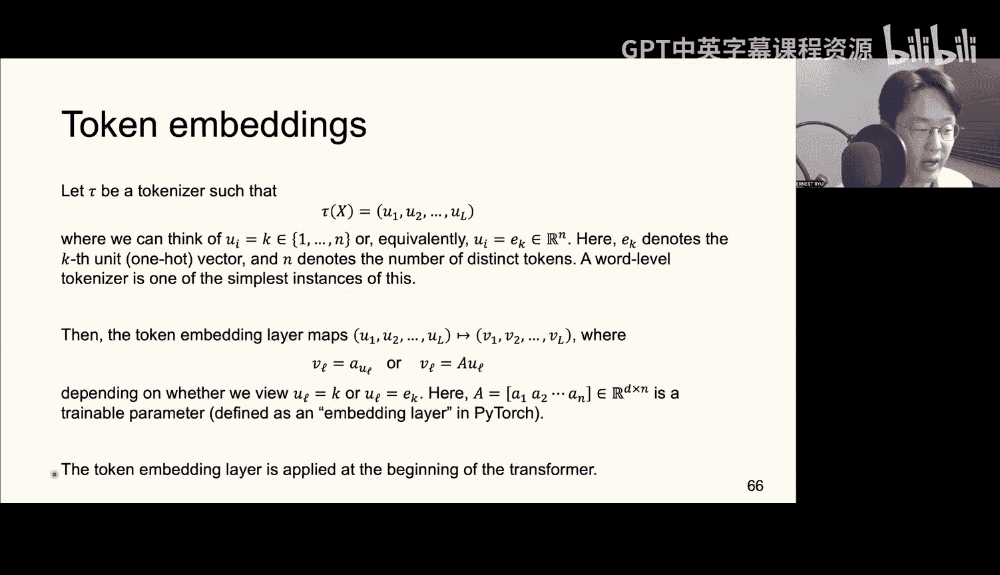

next， we have the single head self attention layer。 Let's get into all the all of the details。

 So as the input of the self attention layer， let's assume that we have the x sequence X1 up to X L。

 So X1 up to X L L is the sequence length。 and then D X is the dimension of these x vectors。

 So we are assuming that all of the x vectors have the same dimension。😊。

And we're going to denote the output of this layer as these y vectors。 So y1 up to Y L。

 the output and these vectors y1 to Yl will be of dimension Dv。 So Dv and Dx。

 they don't necessarily have to be the same。 but we are assuming that the y。

 So we are assuming that the y sequence vectors， they all have the same length。

 All of them all y 1 y2 y through， these all have the same length。 They're all Dv。

 And we're also assuming that the sequence length is the same。 So the input sequence length is big L。

 The output sequence length is big L。 So an attention layer does not alter the sequence length。

Given these input vectors， x1 up to Xl， we can stack them and write it as this big X matrix。

 So this big x matrix has L rows and then dx columns。 So the way big X is structured is you have x 1。

 X 2 x 3 and up to X L。 So the first row， the first row of x is L X1 transpose。

 The second row of x is L to transposed。 and the last row of L is x big L transpose。

 So you collect all these x vectors and formula into this big X matrix。😊，Then we form this Q。

 K and V matrices as x times W， K times W and V times W。

 These W matrices are all separate for the Q K V values。 So the result of x times W Q is L times D K。

 So that means W Q is a D X by D K matrix。 The Q and K have the same dimensions。

 So the W K is also of the same size。 And then x times W V results in L times D V dimensions。

 So this W V matrix has dimension D X by D V。

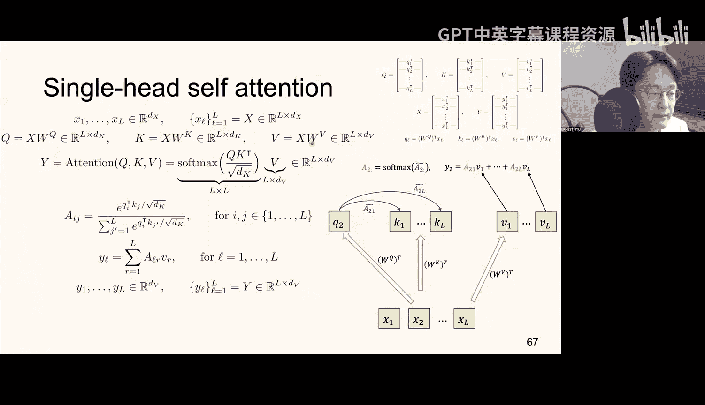

So for example， let's take this matrix K and denote each row as little K1。

 little K2 up to little K L。 So K1 up to Kl， those are the rows of this K matrix。

 The way you obtain these K vectors is you take these x vectors， you take this x vector， little x1。

 you multiply by w K transpose that gives you K1。 You take x2。 you multiply by W K transpose。

 you get K2 little Xl Xl multiply by W K transpose that gives you K big L。

If you want to get the second Q vector， so this Q matrix is again L by d， it has L rows。

 so for each row we can define we will refer to the first row of  Q as Q1。

 the second row as Q2 and it goes down up to Q little Q big L。

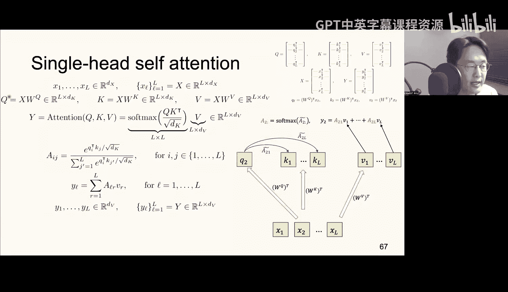

Q2 is the second row of this Q matrix， And that is obtained by taking x2 and multiplying W Q transpose。

 And the same holds for the the little V vectors。 So big V has the first row。

 big V is referred to as little V1。 The second row is little V2。 The final row is little V big L。

 So these V vectors， those get stacked into this big V matrix。

 And the way we get these V vectors is we take little X1， multiply by W V transpose to get V1。

 little X2， multiply by W V transpose to get little V2。

 little Xl multipied by little V W V transpose to get little V big L。 Again。

 the output of the selfat layer is referred to as y 1 up to Y L。

 We will again stack these little Y is into this big Y。 So the first row of big Y is little Y 1。

 The second row of big Y is little Y 2。 And the final row of big Y is。

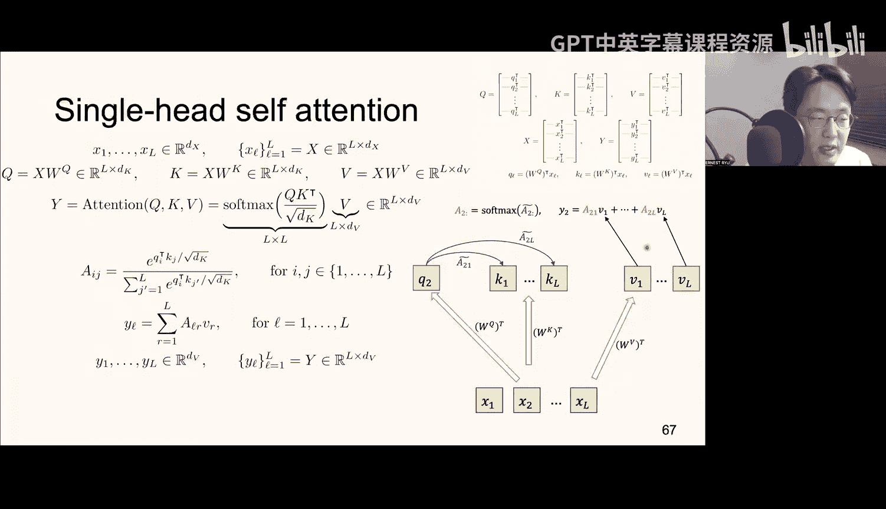

Little Y L。And this big y， the output can be written more compactly in this way。

 So we have Q times k transpose divided by root decay soft max times the V matrix。

 So what this means mechanically is  Q and K transpose。

 we multiply  Q and K transpose as matrixrices， if you multiply Q and K transpose。

 you get an L by L matrix。 you divide by root d for scaling purposes。

 And then you apply a row y soft max。 So that results in an L by L matrix。 V is an L by Dv matrix。

 So you perform this matrix matrix product and then you get an L by dv matrix as the output Y。

 But it is instructive to undo this matrix notation and and consider things sort of index by index。

 So let's do that。 So Q times K transpose as a matrix。

 But if we consider the I j component of Q times k transpose， the I comm j component of that matrix。

😊。

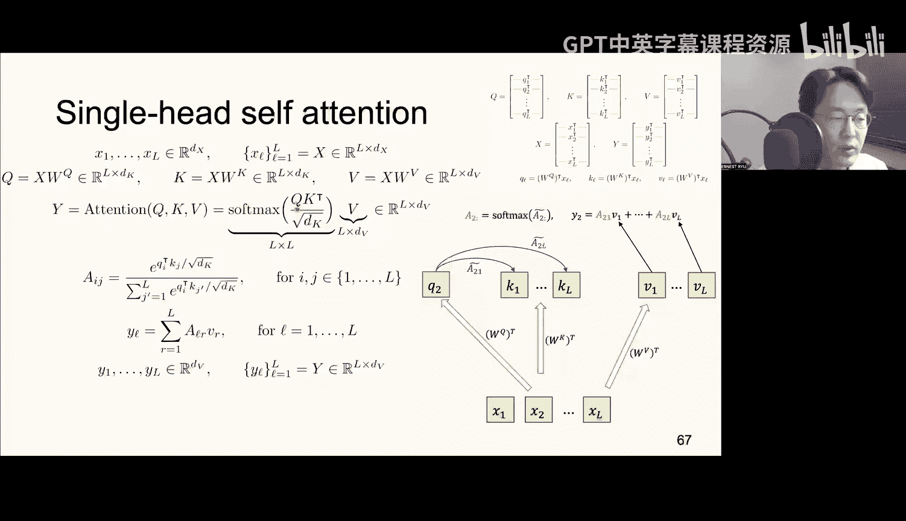

I comma J can range from1 to L individually because this Q times k transpose。

 that's an L by L matrix。That corresponds to little Q and K J， little Q。

 I and K J being multiplied in an inner product。 So Q， I， K J， inner product。 you take that。

Then you divide by square root of decay for normalization purposes， you exponentiate that。

 and then you have this exponential term， and then you normalize this across the row。

 So what I mean by row Y soft max is so you fixed the row index I。

 And then you sum over the column index J。 So here we have a summation over this J prime。

 the column index J prime while keeping the row index I fixed。 and this serves as a normalization。

 this is a soft max normalization。 And now we have this AI J component。

 This L by L matrix is the a matrix。 And here， this AI J is the I J component of this L by L a matrix。

 and AI J by nature of it being constructed as softm applying applied row Y。

 all of the AI J components are positive And if you sum for any given it row index I。

 If you sum over J， it will sum to be1。 So given a fixed I， the AI J。😊，Values。

 it forms the coefficients that can be used in a weighted average。

And that's exactly what we're going to do for the output for the output。

 So the e output Yl is formed as a linear combination， a weighted average of all of the v vectors。

 So there is we have V1 V2 up to VL。 There are L possible V vectors。

 and the output is formed as a weighted average of all the V vectors。

 and it's a weighted average with the coefficients。

 the weighing coefficients determined by the coefficients of this a matrix， namely for the L output。

 we fix the row index to be L。 and then sum over the column index R in this a matrix。😊。

Let's look at this a diagram for a specific illustration。 So as input， we have the x vectors。

 and let's consider how the output Y2 is constructed。

 So y2 is constructed by first taking this x2 vector and getting this Q2， what's called query vector。

 And then we get all the x vectors and we get all the K vectors。

 which are referred to as the key vectors。 and then from the x vectors we get all the v vectors。

 which are referred to as the value vectors。 The terminology query key and vector is used as a metaphor to databases where you query a key to extract a value here。

 the query vectorqueries all the keys。 and the way the query is done is through taking an inner product So Q2 and Q1 are considered a similar。

 this key is considered relevant to this query， if the two vectors are aligned in a linear algebra sense。

 aligned， meaning the inner product is large。 Q2， let's sayqueries this Kl vector。

 and if the inner product comes out to V。Small， then this key is less relevant to this query。

 If the inner product comes out to be large， then this key vector is relevant to this query vector。

 So we have all these query scores。 this a tilde values。 we feed that through the soft max。

 And now since we've fixed the row of this a matrix to be2。 This is just a vector。

 So we are performing a soft max on the vector。 And then we get these a coefficients。

 which can be which are all positive and they can be used to form a weighted average。😊，And finally。

 the output Y2 is formed as a weighted average with the weights given by these a coefficients and recall that the key vector is considered relevant to this qua vector if the inner product is large。

 So if the inner product between the query vector and the key vector is large。

 that would make this coefficient large。 So the y vector is formed as a linear combination。

 a weighted average of all the value vectors。 but a certain value vector enters this weighted average more prominently。

 this coefficient is larger。 if the inner product between this co vector and the corresponding key vector。

 if it's large， then it is featured more prominently。 So if Q2 and K1 has a large inner product。

 then a21 becomes a large coefficient。 So then in the output Y2。

 the value vector 1 is then featured more prominently。 if the inner product is small。

 then the contribution of the value vector 1 would be suppressed。😊。

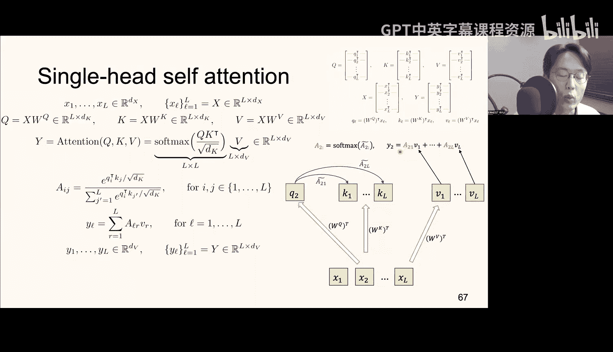

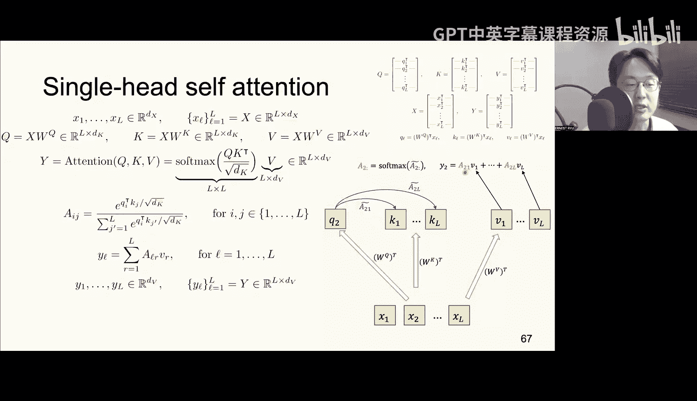

So again， there's a lot going on here， but the transformer architecture is so important。

 So I really encourage you to spend the time to fully internalize every single nitty gritty component that's shown in this slide。

 It's going to be worth it。 Understanding the transformer architecture in full detail is going to be worth it。

😊。

I want to quickly point out that attention is a pseudolinear operation。

 So a function F that map from Rn to RM， If the function is of this form。

 where the function f of x is a x times x， where a is an n by M matrix。

 So the output F of x can be written as a matrix vector product。

 but the matrix A depends on the input X， a function of this form is set to be pseudolinear。

 It's not linear because the matrix Ax depends on x。 If the matrix did not depend on x。

 then this would be a linear function， but if the matrix A depends on x。

 then is a pseudoline function。The attention mechanism that I've described in the previous slide。

 This is a pseudoline mapping， mapping the value vectors to the output y vectors and pseudoline operations。

 they occur quite commonly in signal processing and kernel methods。

 I think this is an interesting observation。 I also think the fact that attention is a pseudolinear mapping mapping from the value vectors to the output Y pointing this out。

 It helps you understand the mechanics of the attention mechanism。

 So I don't really have a specific use of this observation。

 So I don't know if this observation is useful。 but it's a nice and simple observation。

 So I quickly point out。 So do with this information what you will。😊。

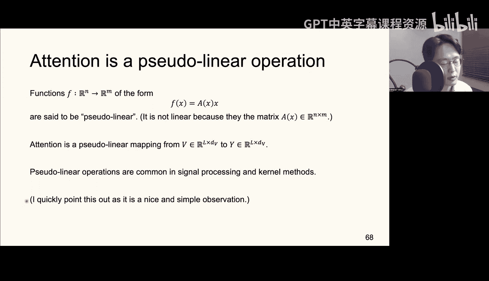

Next， we have multied self attention often abbreviated as MHA。

So if you think about a convolutional neural network at every layer。

 you don't have one convolution operation， you have multiple convolutional channels。

 so each channel will have its own convolutional filter， it does its own separate convolution。

 and then all of those channels are passed as input into the next layer。

So just as one uses multiple CNN channels in a transformer， you use multiple attention heads。

 So what I described two slides ago， that's a single head selfatten。

 And then you use many of them leading to a multi head selfat。 So given an input sequence X。

 you have capital H separate attention heads， each leading to distinct y outputs Each output y sequence will be of length L。

 Remember， nothing in the transformer ever changes the sequence length。

 So the sequence length big L is always preserved。 So each output sequence will be length big L。

 and at each position， you will have a length D V vector。

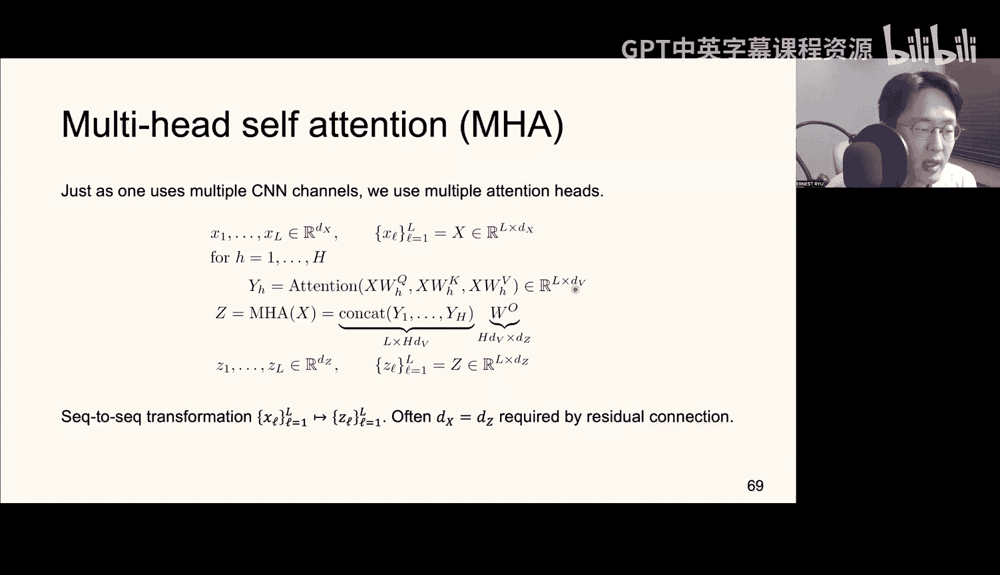

Since you have capital H big H number of single head tensions。

 what we do is we concatenate these outputs。 So this will lead to the same sequence length big L。

 but at each sequence position， we have capital H separate vectors， each of length Dv。

 So we concatenate that to get a longer vector。 So at each sequence position。

 we have a longer vector of length H times Dv。

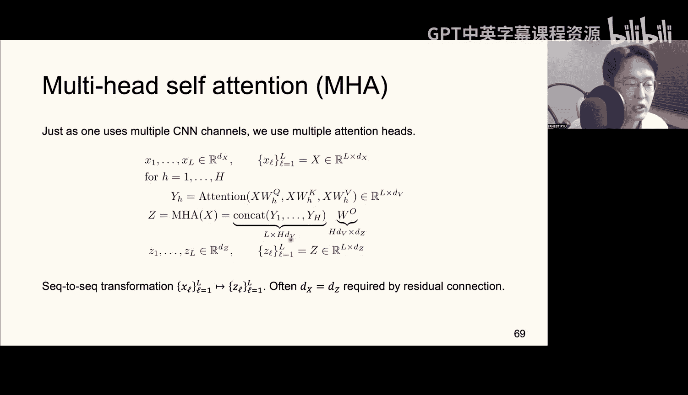

Then we multiply that by an output projection matrix to reduce the length H DV to length D Z。

 So the result of that is these sequence of Z vectors， again， preserving the sequence length big L。

 But now each Z vector is of length D Z。So this multihead self attention operation is a sequence to sequence transformation。

 mapping from X to Z。Often it is the case that this Dx dimension and this Dz dimension are often the same because this would be required if we want to use a residual connection。

 which we'll talk about soon。

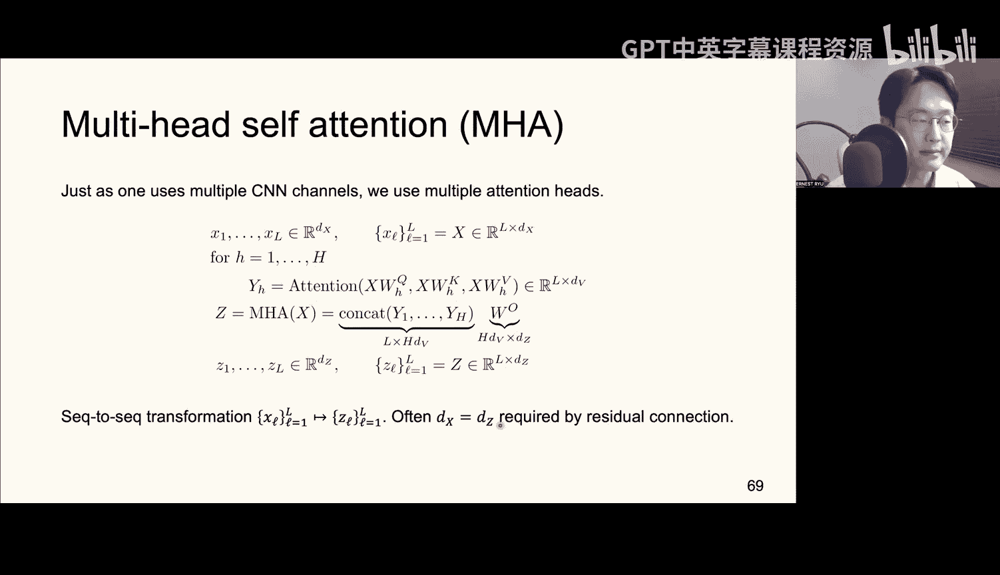

So the encoder only transformer architecture is constructed by stacking multiple transformer layers。

 and each transformer layer looks like this。 So each transformer layer maps an x sequence to another x sequence and we do this multiple times and we stack this multiple times and we get the transformer architecture。

 if we look at this diagram， the input x sequence gets fed into a layer norm operation。

 which I'll talk about soon， it gets fed into the multied attention。

 and then we do this addition operation， So here this represents a residual connection So this addition block this represents a residual connection where we have these two branches。

 this branch takes the input x unaffected。 this branch takes the input through the layer norm and multi-ed attention。

 and then we add it。 So this is the residual connection that helps with the optimization it helps control the exploding and vanishing gradient problem across along the depth of this transformer architecture and then we have another another split operation where we do this residual connection and then we have。

😊，Layer norm then being fed into the FFN layer， which we'll talk about soon。

 and then we have the residual connection and that concludes a single transformer layer within the transformer architecture。

😊。

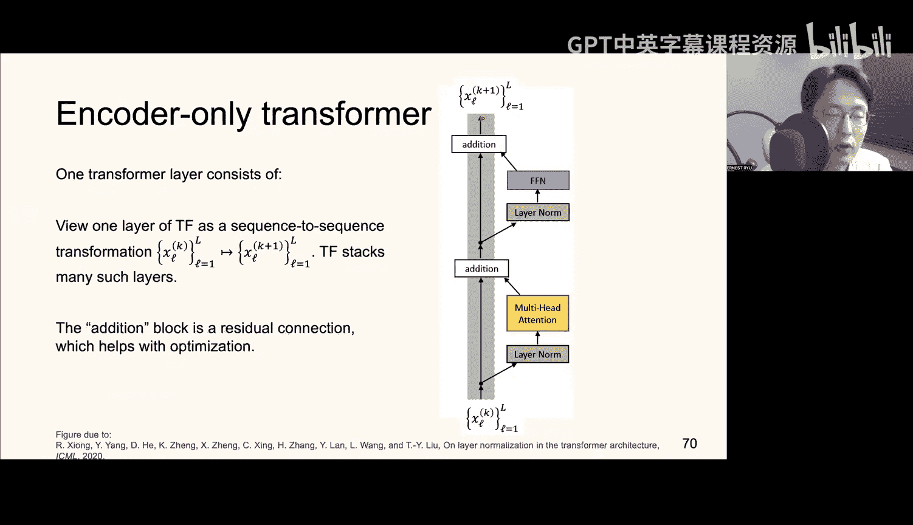

Layer normalization is a normalization operation that stabilizes training by normalizing the features and thereby avoiding exploding and vanishing gradients。

 So in addition to the residual connections layer normalization helps control the exploding and vanishing gradient problems along the depth of the transformer Layer normalization normalizes across the features。

 It does not normalize over the sequence length or the batch elements。

Let's assume an input sequence x is a three dimensional tensor indexed as batch。

 sequence length and channel or feature， then the normalization basically is normalizing across the channel feature dimension and not along the batch and not along the sequence length dimension。

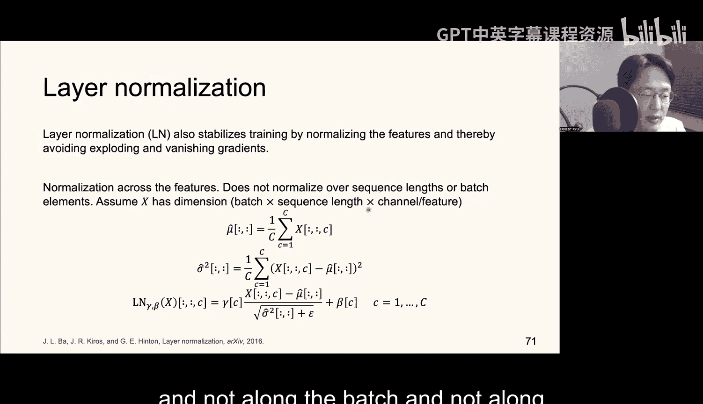

In this slide， I want to clarify some misconceptions about exactly along which dimensions。

 batch norm and layer norms are doing its normalizations。

 So there are actually two different variants of layer norms。

 Theres a layer norm used for a convolutional neural networks。

 and then there's a layer norm used for transformers， including vision transformers。

 and those two are slightly different。😊，For convolutional neural networks。

 the layer norm normalizes over the channels and also the spatial dimensions for transformers。

 the layer norm only normalizes over the channels and not over the spatial dimensions。

 Now the spatial dimension in a transformer would correspond to the sequence length it indeed does for the vision transformer for language transformers you could argue that sequence length in sequence length means you're going forward and backward in time so you could argue that that's a spatial dimension。

 Now in language transformers， the sequence length is a variable length parameter so normalizing along the sequence length would probably be an unstable operation So that's why layer norm for transformers。

 especially for language transformers do not normalize across the sequence length。

 but for batch norm So for batch normalization because of the name people often have the misconception that batch norm normalizes across the batch elements but that's actually。

😊。

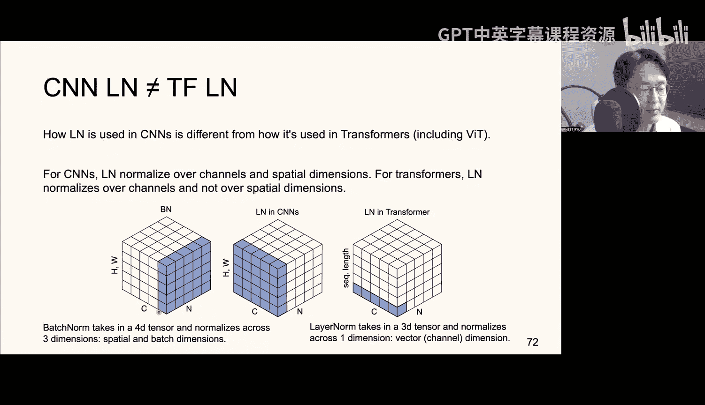

Not the complete answer。 batch norm takes in as input of 40 tensor because it' it's in the image dimension。

 You have the batch dimension。 you have the channel dimension。

 you have the and the spatial dimension， the height and the width and batch norm normalizes actually across three dimensions。

 the horizontal， the vertical dimensions， the two spatial dimensions。

 and also the batch dimension as well。 So batch norm for CNNns normalizes across three dimensions out of the four layer norm for CNs but normalizes across three dimensions out of the four。

 But these are different normalization dimensions between batch norm and layer norm for Cs。

 and then for the transformer architecture， layer norm normalizes across one dimension out of the three possible dimensions。

 In a transformer layer， theres the multi self attention。 There's the residual connection。

 theres the layer norm， and then there's the position wise FFN。

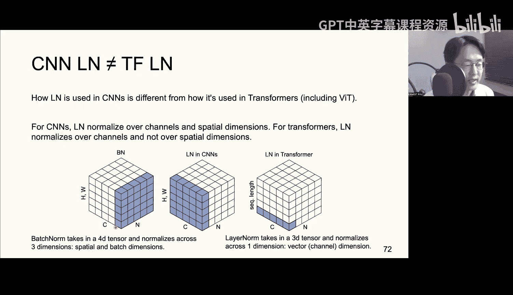

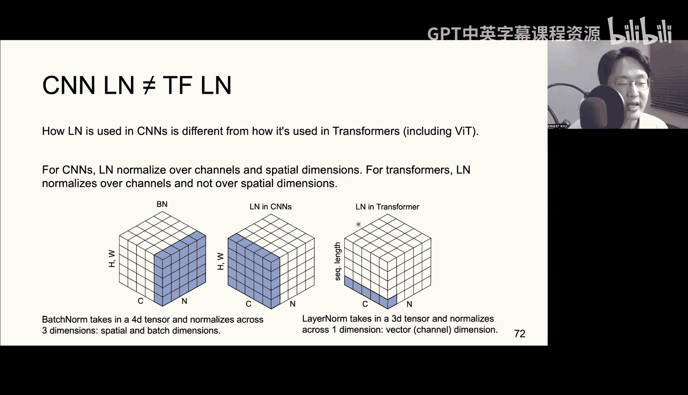

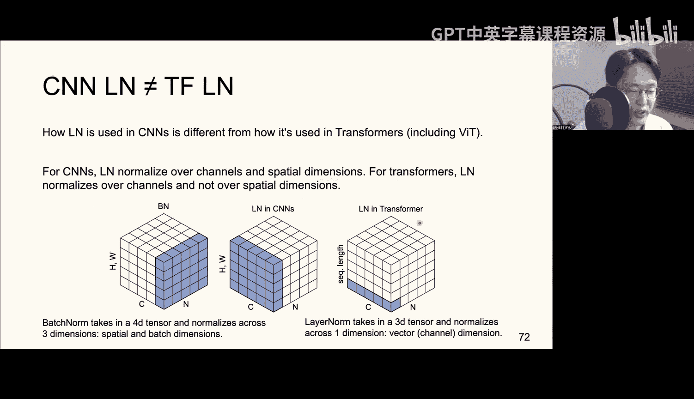

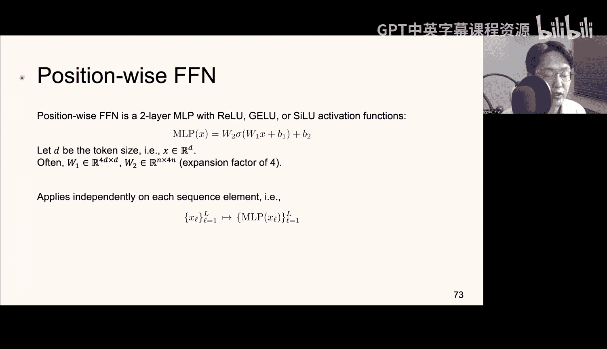

So a position wise FFn is a two layer is usually a two layer MP with a raylu Galu or silu activation function。

 I'll talk about these activation functions in just a moment。 So the MP looks like this。

 So you have a linear layer， a nonlinearity and then a linear layer in terms of the dimensions of things。

 So if at each token position you have a d dimensional vector。

 then the first linear layer expands the dimension by a factor of 4。

 so w1 will be a matrix of dimension 4 d by 4， such that the output of this linear layer becomes has dimension 4 times D。

 you apply the nonlinearity。 Then the second linear layer will reduce the dimension back down by a factor of 4 So that we return to the same dimension D after the MP。

 the FFn is applied。😊，The position wise FFn is applied independently on each sequence element。

 So if we have a sequence of x vectors x1 up to x big L and each x is of length D。

 then we apply the MLP on each sequence element individually in transformers。

 the Galu and silu activation functions are commonly used。

 So Galu is the abbreviation of Gaussian error linear unit silu is the abbreviation of sigmoid weighted linear unit and the Sww activation function。

 I think the naming is in reference to the Nike logo。 So these are smooth defiable。

 a nonmontone activation functions。 the three activation functions are qualitatively quite similar。

 So for negative inputs， these activation functions have value close to0。

 And then as the inputs approach 0 the activation values decrease and then they come back and increase in a way that is almost linear。

😊。

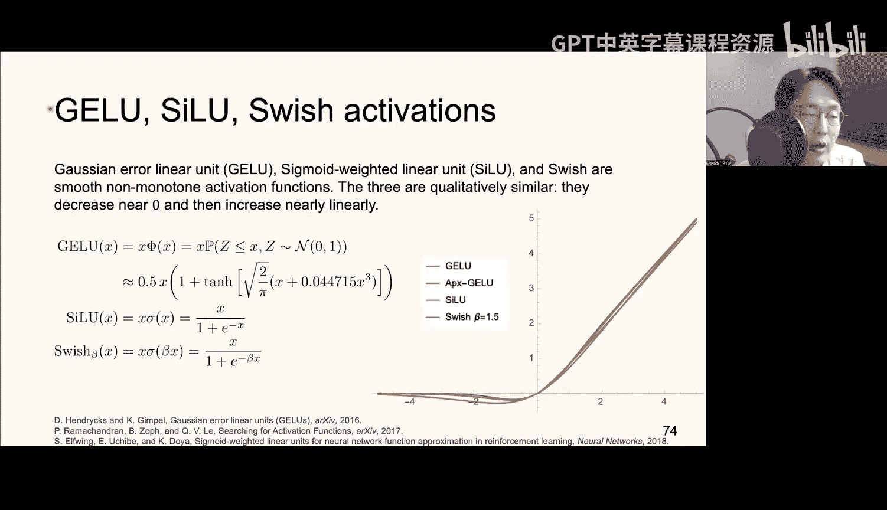

The precise functional forms of these three activation functions look like this。

 so the Galu activation function involves the Gaussian air function， the Gaussian CDF function。

 but this special function is inconvenient to implement sometimes so people often use this approximation so this approximation as you can tell from this plot basically all four activation functions basically look the same but the Galu and the approximate Galu activation function they are essentially indistinguishable。

 This Swis activation function was first presented in this paper by Ramaandran etal published in 2017。

 This paper is titled searching for activation functions if this is a pretty interesting paper because they use these authors which had the computing power of Google they use reinforcement learning techniques to optimize for the best activation function and they arrived at the activation function that looks like this again the qualitative behavior is that the activation function kind of goes down dips down and then goes up you have this non-montonic behavior。

😊，My guess is that the authors looked at the shape of this function and decided that it looks like the Nike logo。

 So they named the activation function Swish， but they don't mention the branded Nike or their reasoning behind naming this activation function。

 Swwish， I think perhaps for copyright reasons。

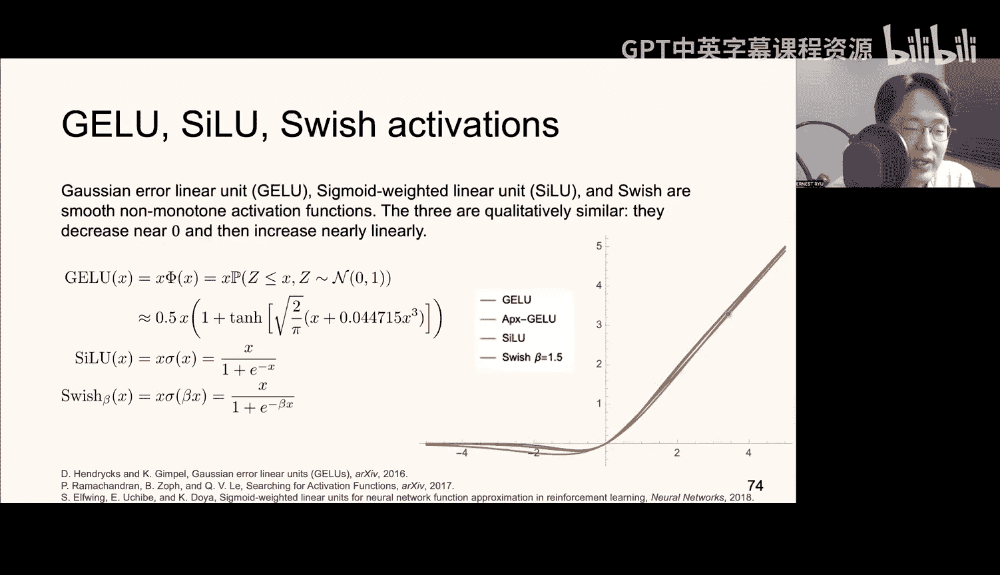

So next we have the positional encoding layer also referred to as the positional embedding layer。

 So a problem with the encoder only transformer is that the architecture is permutation equi variantant。

 meaning it does not know the position information of tokens。 if you were to take the input sequence。

 and if you have the transformer without positional encodings。

 and if you permed to swap the order of words， then the output would be exactly the same with the order is just swapped in the same way。

 and this is a problem because the relative position of tokens， meaning the ordering of words。

 it obviously carries important meaning in language。

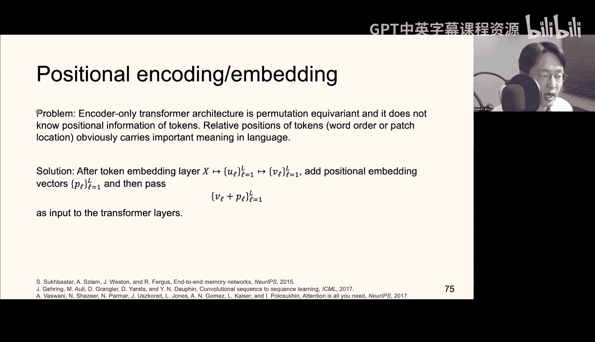

So we have to inject some kind of positional information into the transformer in order for the transformer to understand that some words are coming before the other words。

 So the solution is after the token embedding layer。

 So we have the x input text that gets mapped to the U vectors after the tokenization。

 and then we undergo the token embedding layer that maps the one hot vectors into these v vectors。

 we add positional embedding vectors P。 So we form v plus P。

 and then we pass these vectors into the subsequent transformer layers。

 So the order of operation of a transformer is we have an input。 we feed it through the tokenizer。

 we feed it through the token embedding layer， we add the positional encoding。

 and then we do multiple iterations of transformer layers。 Okay， so then what are these P vectors。

 We have these P vectors P1 up to P big L big L again being the length of our input。😊。

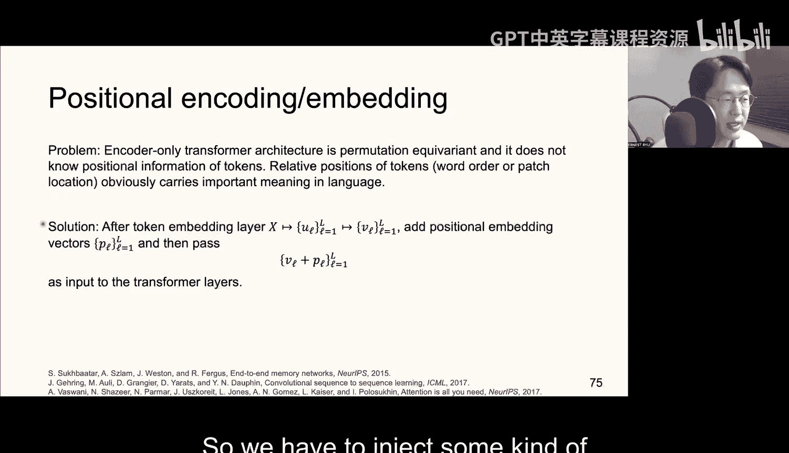

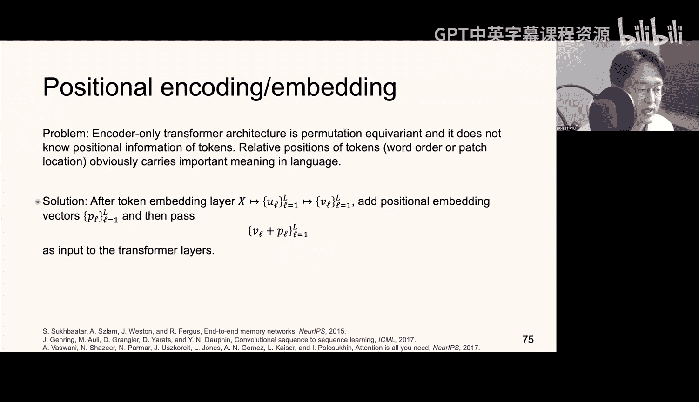

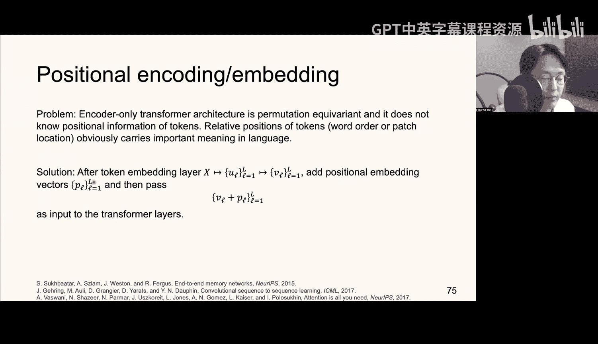

ence？So the NLP transformers often use these sinusoidal positional encodings defined in this way。

So this looks like a very arbitrary design。 And this number 10000 And that is actually quite important。

 is tune and quite fine。 So if you change this number 1000 to， let's say something like 10。

 it just doesn't work。 So this feels like a very arbitrary design。 But it turns out for some reason。

 this is very， this works pretty well。 And it actually quite hard to beat。

 So one nice thing about this positional encoding mechanism is that because you have this analytical formula。

 It can accommodate an arbitrary sequence length of big L。

 And that's nice in the context of natural language processing where you where the sequence length。

 big L is not predetermined。😊。

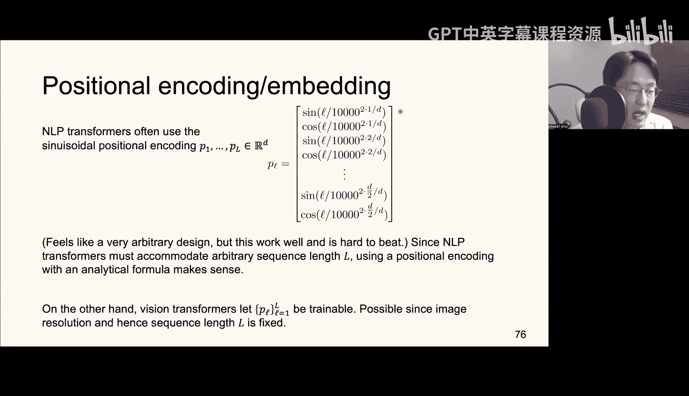

On the other hand， for vision transformers， it makes more sense to let these positional encodings be trainable。

 and this is possible because the image resolution is fixed or kind of fixed。

 And therefore the sequence length Big L becomes fixed。

 The idea of positional encodings is often attributed to the paper Vaswani etal 2017。

 but there are earlier papers that did publish the idea of positional encoding techniques。

 but the sinusoidal encoding that you just saw with that weird formula in the previous slide。

 that one is due to Vaswani etal 2017。😊。

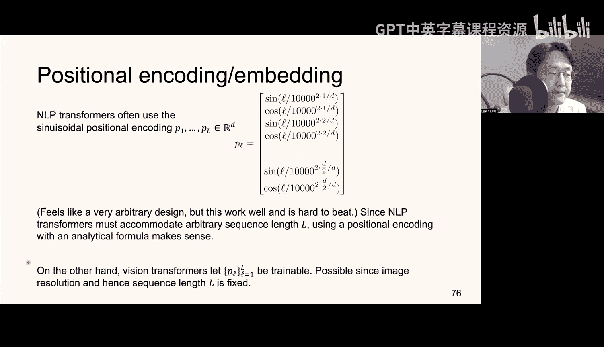

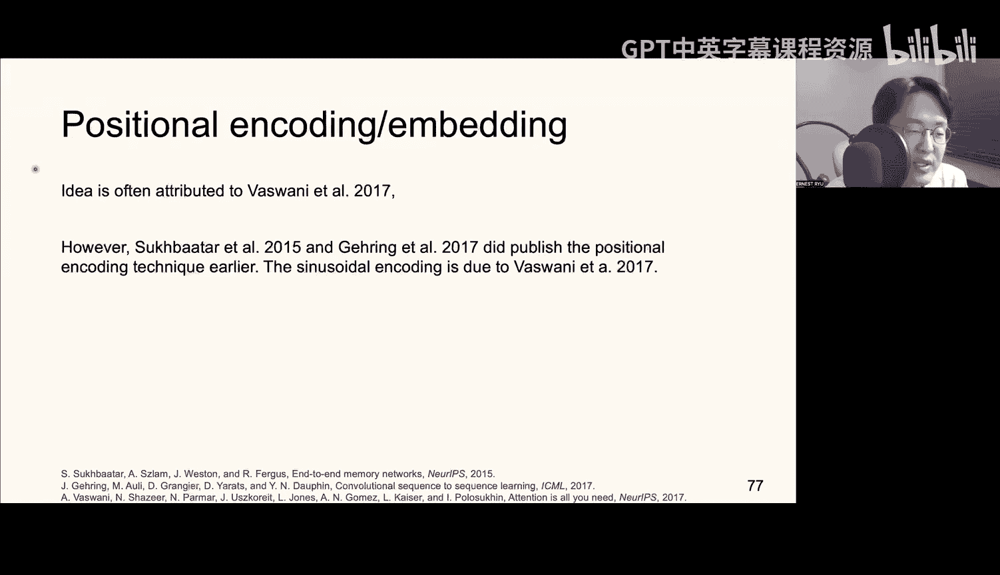

There are actually two different variants of the transformer layer based on the position of the layer norm operation。

So the transformer architecture was originally proposed in the paper Vaswani Atal 2017。

 and we'll talk about that version of the transformer。

 when we talk about encodeder decoder transformers。 But if you look at that paper。

 the paper doesn't detail exactly where all the operations go。

 But the paper does come with an illustration。 and there's this famous figure。

 which I'll show you in later slides。 It illustrates this post L N transformer architecture。

 The post Ln transformer architecture places the layer norm here， and here。

 and that's a slightly different location compared to what we saw in the previous slide。

 This variant is referred to as the post Ln architecture。

 But after the publication of the vswani 2017 paper。

 they later updated the official code base and in their official code base later updated。

 they actually use this pre Ln transformer。 This is the version of the transformer that we saw in the previous slide。

 and in future research， people eventually。Rived at the consensus that the pre L N transformer is more stable。

 So this is the transformer architecture that you should use and consider Pre L N is the better transformer compared to post L N。

 But even though most people in the know agree that post L N transformer is worse compared to pre L N and therefore should not be used。

 The original figure from the vwani Atal 2017 paper does illustrate this version of the transformer。

 and that figure is still all over the place。 So I'm warning you， don't be confused by that figure。

 That figure shows the old outdated version of the transformer， use the pre L N transformer。

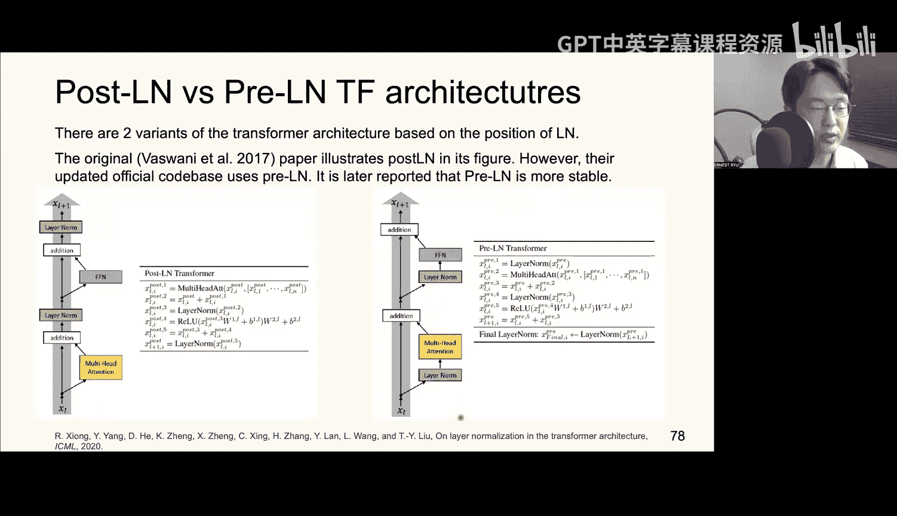

Transformers can go much deeper than RNs。 So thanks to the residual connections and layer norm。

 Transformers can be much deeper than stacked R NNs。 For example， Elmo had two layers。 Bert had 27。

24 layers and modern large language models have something like 100 layers。 to clarify。

 the layer norm and the residual connection are used to mitigate the exploding and vanishing gradient problem across the transform in depth rather than the sequence of length。

 In contrast， the R N LST himself cell is designed to promote better gradient and flow along the sequence length。

 but the transformer does not have this problem。 The transformer does not have the exploding and vanishing problem across the sequence length due to its attention mechanism。

The difference is that R NNs have these repeated operations along the sequence length。 So this。

 in effect， creates an element of depth along the sequence length。 And indeed。

 when we were considering the design of the LSTM cell。

 we have this idea that while certain information should be remembered。

 certain information should be forgotten。 And this these kind of considerations contribute to the exploding and vanishing gradient problem。

 However， for transformformers， Transers don't have this recurrent operation along the sequence length。

 Basically， the transformer makes no effort to summarize anything along the sequence sequence length。

 all the information along the sequence length is preserved。 And therefore。

 there is no exploding or vanishing gradient problem that arises along the sequence length。😊。

So why do transformers outperform RNs。 Well， point number one is something we've already talked about when handling long sequence length。

 RNs struggle because it has a fixed memory size。 So the cell state， the hidden state。

 It has a fixed fixed dimension。 and maybe that dimension is not enough to remember and summarize all the relevant context within the language。

 So R NNs can run into the problem of not having enough capacity to remember the necessary information to make the necessary inference。

 It also has the vanishing and gradient problems。 LSTms are designed to mitigate this。

 but transformformers really solve this problem。 Transformers allow the full input sequence to be considered without having to compress the information into a hidden state factor。

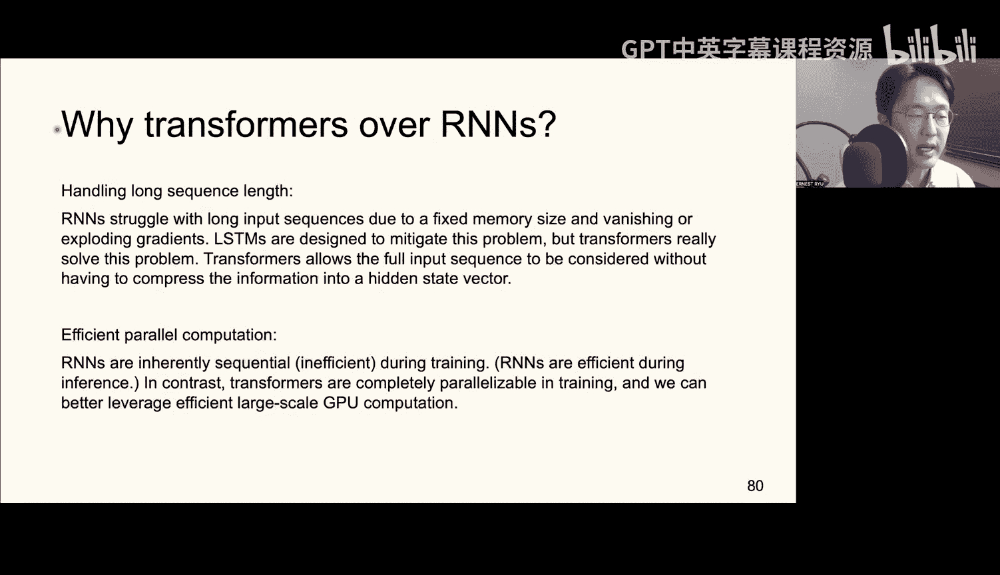

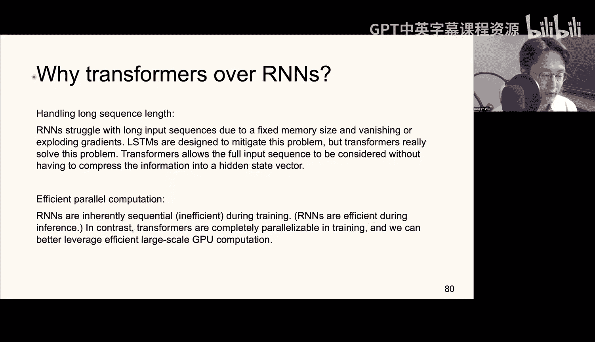

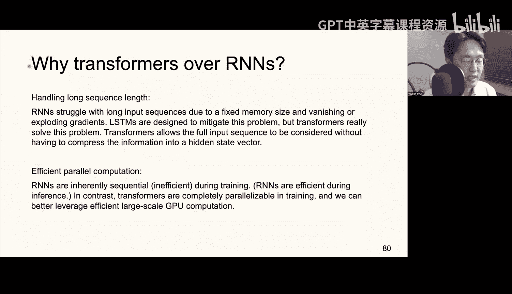

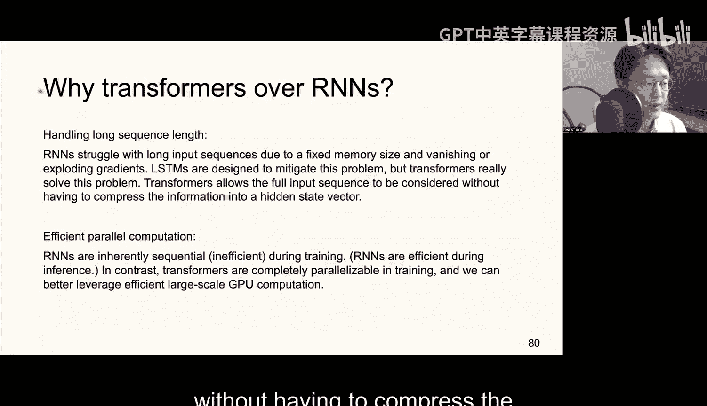

Transformers are also much more efficient when in utilizing parallel computation。

 So RNNs are inherently sequential during training。 Now。

 I want to clarify RNNs have no problem in terms of efficiency during inference。

 It's the what I'm talking about here is the efficiency during training。 In contrast。

 transformers are completely parallelizzable in training and we can better leverage the efficient large scale GPU computation when training transformers。

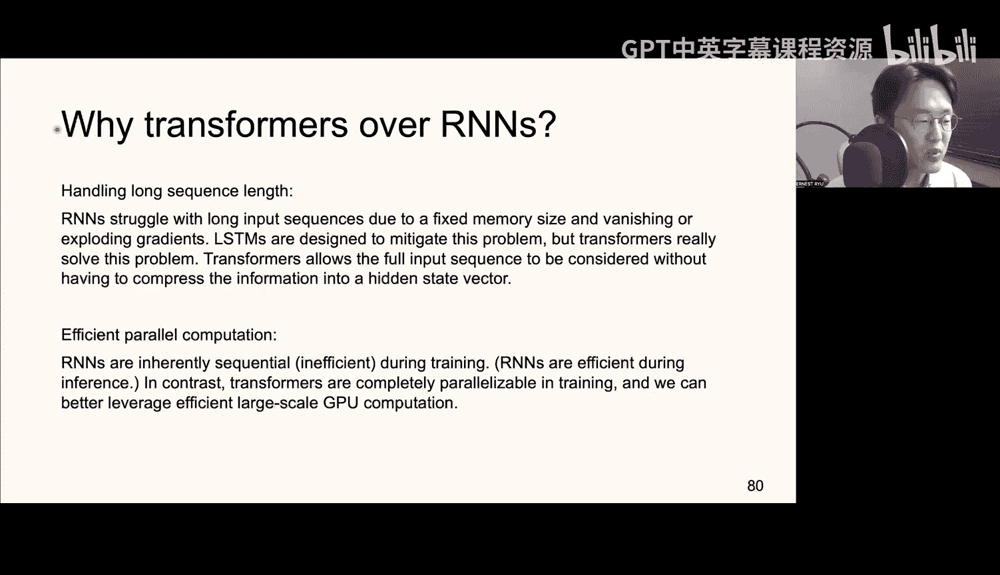

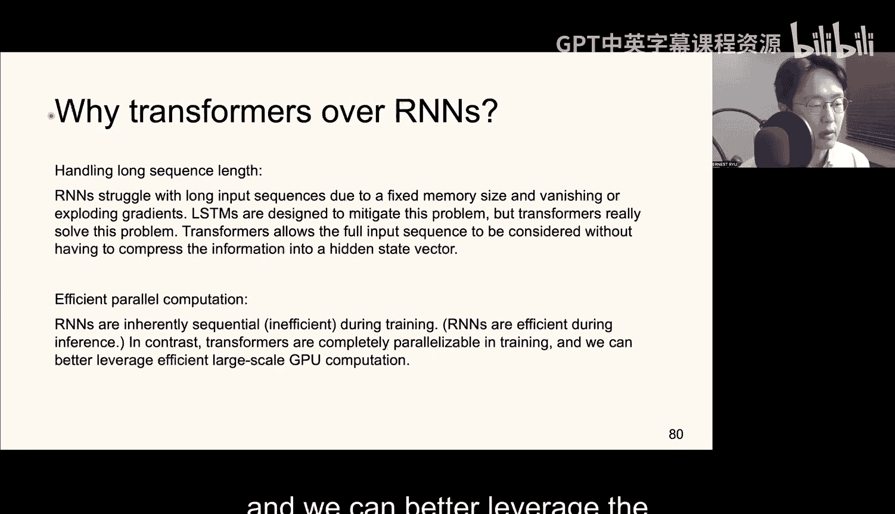

Okay， so now that we've talked about all the necessary components of the transformer architecture。

 let's talk about how the birdt pretraining is done。

 So the Bt pretraining is also an instance of selfsupervised learning。

 and it considers two losses to pretext tasks。 One is the masked language model， the M LM loss。

 So what it does is you randomly mask out 15% of the words。 and you let the Bt predicted。

 and this is not a causal language model because the birdt can use the words before and after the mass words to make the prediction。

 but nevertheless to be able to make this kind of prediction。 the language model。

 the Bt model needs to acquire some understanding of language。😊。

The other pretext task is next sentence prediction。

 So the way this is done is you take natural language text。

 And after some sentence within a paragraph， you chop the paragraph in half。

 So the first part is sentence A， the second part is sentence B， and then with 50% probability。

 you swap the order。 So with 50% probability， the two sentence sentences are in correct order。

 and then with 50% probability， the two sentences are out of order。

 Then Bert is asked to predict whether the two sentences are in order or out of order。

 Now to talk about the mechanics of this a little bit further。 for the massed language modeling。

 you have these input sentences， you mask certain words。 Then again。

 the Bt model is constructed as a transformer architecture， it does its thing。 and at the end。

 it produces a bunch of tokens。 for the mass language model。

 you attach a crossenttropy loss at the output tokens here to make the prediction。

 and then for the next sentence prediction。 In addition to the main text， we have special。Tokens。

 so we have this so-called separator token， which is a token distinct from any other word token and and it is inserted between the two sentences to denote that。

 well， that's where the separation is。 And then we also have the class token， the CS token。

 which is another token that is distinguish from any of the other words and it's placed at one end of the B transformer input sequence。

 And the next sentence prediction loss is attached at this position。

 So the next sentence prediction is a binary prediction is either correct or correct order or incorrect order and that's and that loss is placed at the location where the CS token is provided as input。

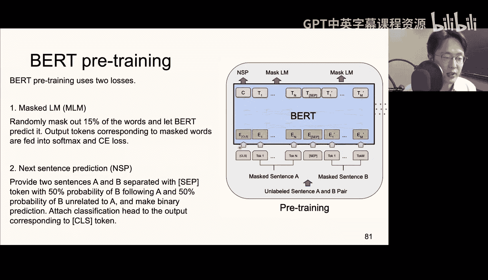

So after the self supervised pre training of the BERT model， Bert is fine tuned for downstream tasks。

 and a lot of the NLP tasks they roughly fit the MLLM or NSP shape。So for example。

 here we have a single sentence classification task。

 so for this the as input we provide a single sentence into the BRT model。

 but we also provide the CLS token at the very beginning。

 and then we attach the classification head at the location of the CLS token。

For single sentence tagging tasks we provide the input sentence。

 and then we attach the tagging classification heads at all the token locations for fine tuning。

 you just make minimal modifications to the Bt baseline model and you fine tune the entire model。

 So fine and the fine tuning is computationally pretty cheap。

 So self-supvised pretraining is computationally heavy。

 But when you take the pretrain model and fine tunening on the downstream tasks。

 then each fine tuning as the author's report took less than one hour on a single Google TpU。

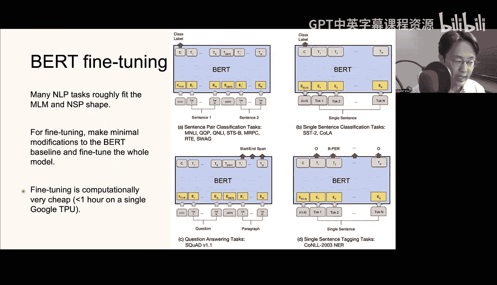

But since we're talking about encoded only transformers。

 let's have a quick aside and talk about the vision transformer。

So the vision transformer is also an encoder only transformer architecture。 So vision transformers。

 obviously they process vision data， namely image data。 So given an image， well。

 an image is is not naturally a sequence data。 So you need and in order to process things with transformers you need to convert the input data into sequence data So given an image you form 16 by 16 image patches So like this and each patch then corresponds into a token and the patches are then placed into a linear sequence。

 So the 16 by 16 patches are provided as input to the encoder only transformer as input token and then we have basically the equivalent of a Cs token and the vision transformer is then trained on image classification。

 So you attach the MP head and a classification head at the CS token position and the vision transformer is trained large scale on image classification tasks。

 and aside from this patching operation and this linear projection at the very。😊。

Beginning the vision transformer architecture and the Bt transformer architecture are basically the same。

 The authors of the vision transformer paper， they experimented with supervised pre traininging on image classification。

 So for image classification， you do need label so it's not selfsvised。

 They found that this supervised pretraining had better for performance compared to self supervised pretraining with masked patch prediction。

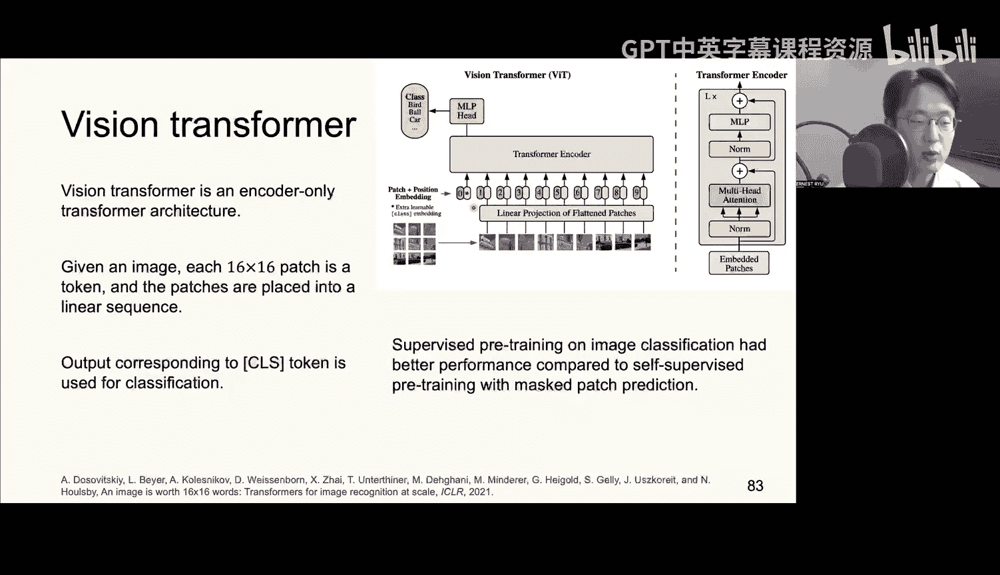

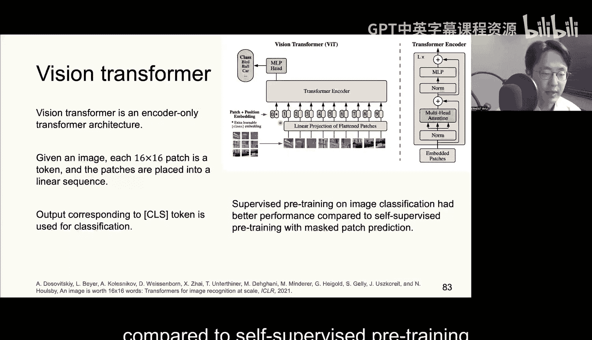

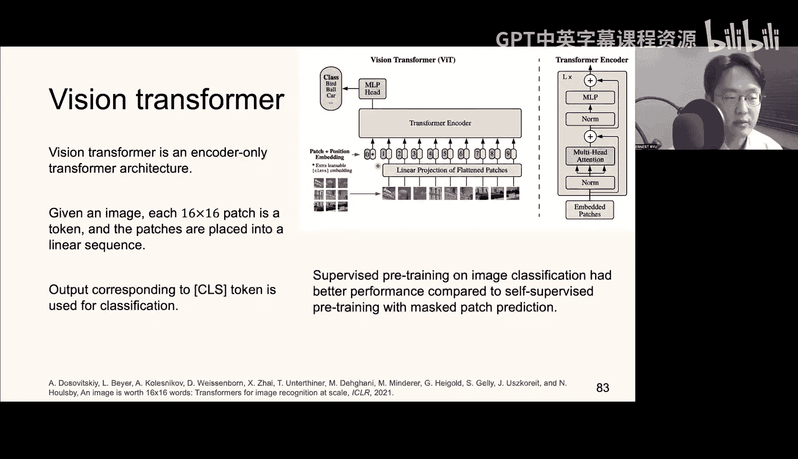

So that's the difference between the vision transformer and the BRT transformer。

 the BRT model is trained with self supervised pre training。

 whereas the vision transformer works better when you train it in with supervised pre training on image classification。

 and then you fine tuned on other downstream tasks that are not necessarily about image classification。

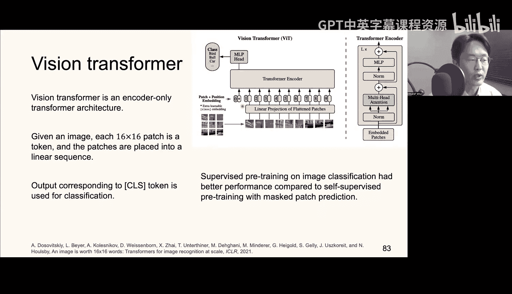

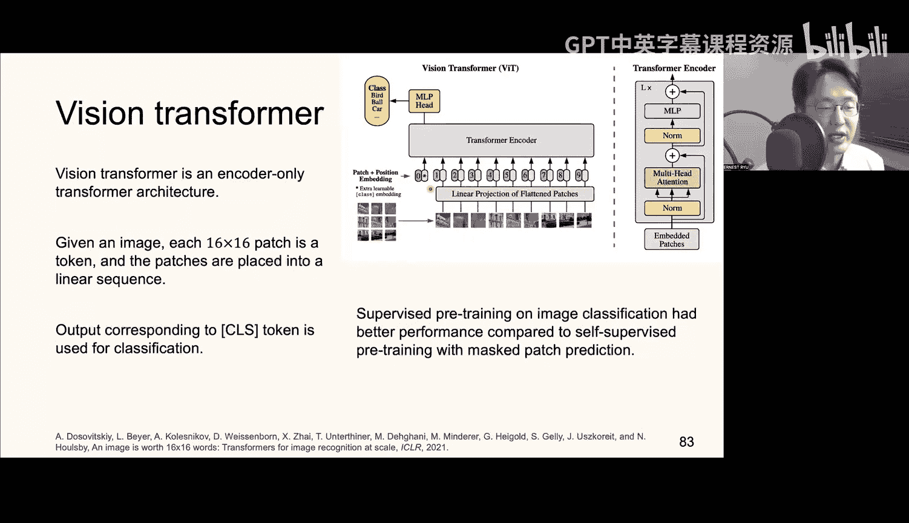

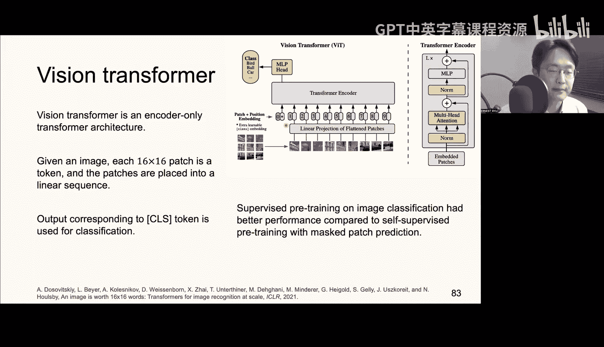

Next， let's talk about the G1 model， which was simply referred to as the G model at the time of publication。

 GT is the abbreviation of generative pre training。

 and this model uses the causal language modeling loss。

 where the model is trained to predict the next token， given the previous tokens。Initially。

 the GPT model was trained to be a self supervised pre trained model in the vein of Bt。

 something that would be fine tuned for downstream tasks。

 And the text generation for GBPT 1 model was actually not that strong。

 It was only with the subsequent model G 2 that the focus shifted to text generation。

Compared to Bt's encoder only transformer， a GPT1's decoder only transformer additionally utilizes the mass attention mechanism and output projection layers。

 So let's talk about these additional architectural components。

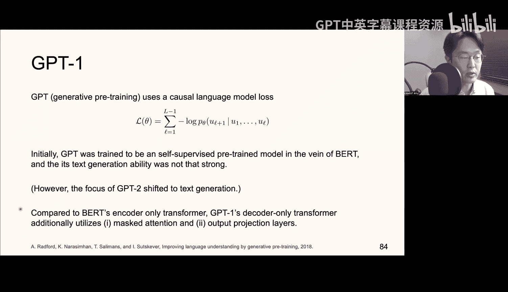

First， we have masked attention in R Ns， information is naturally processed in a sequential matter。

 but there is a problem when youre using an encoder only bird style transformer for a causal language model。

 by design of the transformer architecture， the model can see the entire sequence。

 both past and future。

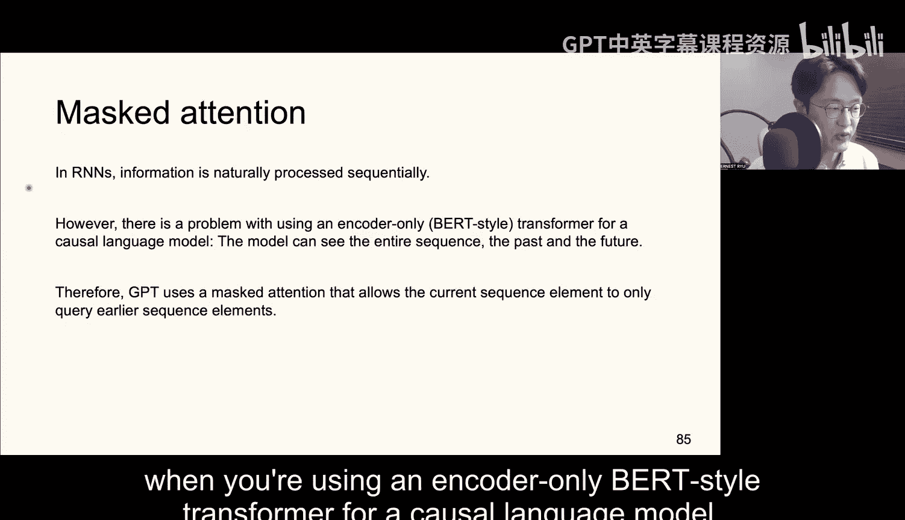

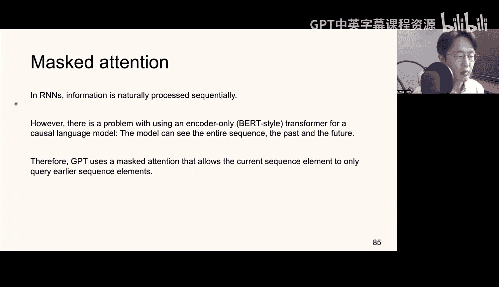

Therefore， GPT uses a masked version of the attention mechanism that allows the current sequence element to only query the earlier sequence elements。

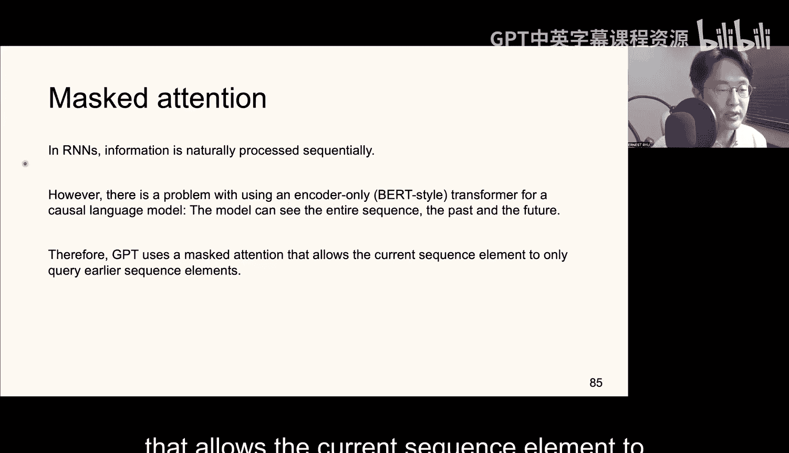

Here is how the masked single head self attention mechanism works。 So overall， the mechanism is。

 of course， very similar to the unmasked single head self attention mechanism。

 The only difference is the mask。😊。

The input sequence， as before， is denoted as with these x's and these x1 up to Xl vectors。

 they can be stacked into this big X matrix。 and the Q， the K。

 the V matrices are formed in exactly the same way。 But then we form this a tilde matrix。

 the a tilde matrix the I j component is given by the inner product between Q I and Kj as was the case for the unmasked single head self attention。

 But a tilde has this lower triangular structure。 The lower triangular components of a tilde is the same as before。

 It's given by the inner products。 But for all the elements above the diagonal。

 those are all set to be negative infinity。😊，And then the output Y computed as the causal attention with the Q KV vectors。

 This can be understood as the soft max operation applied to a tilde multiplied by the V matrix。Now。

 this is the same exact softm of operation as before。 But here we have E to the a till the Ij。

 and we're going to use the convention that the exponent of minus infinity is equal to 0。

 So it's no longer the case that the a AIj entries are all strictly positive for the mass single head selfat for the upper triangular components of AIj for the strictly upper triangular components of AIj。

 those will be those will have value 0， because we'll have the exponent of minus infinity in the numerator。

 So the matrix a with components AI Js。 The matrix a becomes a lower triangular matrix。

 only the lower triangular components of a can be nonze， actually。

 the lower triangular components of a are all strictly positive。

 and the elements above the diagonals of the matrix A， those are all equal to 0。😊，Now。

 because of that， when we form the output Y， Y L， Y L can be written as a summation， this summation。

 which looks like the same thing as before。 but the summation index runs runs from R equals 1 up to little L。

 Now， in the previous unmasked single head self attention， the upper summation index ended at big L。

 But if we were to write big L over here。 The difference would be that a L R would be equal to0 for when the value R is strictly larger than this row index L。

 So it actually makes no difference whether we we write little L or big L in the summation。

 but I think it's better to write the upper summation index as little L so as to emphasize the causal dependence structure。

😊。

So the effect of setting a tilde Ij to be negative infinity for the upper diagonal components is that essentially the Qi vector is allowed to query only the previous key vector。

 So K1 K2 up to K you're allowed to query the current key vector。

 but you're not allowed to query the future key vectors。

 and also the yl output becomes a linear combination of the previous and current value vectors。

 but the future value vectors do not contribute to the output Yl。

 So that's what I mean by the causal dependency for each yl Yl only depends on the input sequence。

 the partial input sequence X1 up to Xl， and this holds for all values of little L。

 So y1 can only depend on x1 Y2 can only depend on x1 and x2 Y3 can only depend on x1 x to an x3 and that is what I mean by the causal dependency。

 The mapping from x to the x sequence to the y。Sequence has this causal dependency thanks to this particular masking mechanism。

 So as before， the transformer architecture uses a multi head self attention。

 So when you're using masking， you have a mask multi head self attention。

Again， the sequence to sequence transformation has this causal dependence。

 So the mass multi self attention mass from x to z。

 And this has the causal dependence in the sense that Z L only depends on x1 x to up to X L。Now。

 in the transformer architecture， all other components， they act position wise， So layer norm。

 position wise， FFN， the residual connections， these all act position wise。

 So the transformer with causal multit self attention becomes a sequence to sequence transformation and to end。

 the transformer becomes a sequence to sequence transformer with a causal dependence。

And because our goal is to train a causal language model。

 it's essential that this causal dependent structure is baked into the neural network architecture。

The next component in a decoder only transformer is the output projection layer。

 So here is a rough illustration of the decoder only transformer as input。

 we get a text X that is fed through the tokenizer producing this U sequence。

 The U sequence has length n because N is the number of possible tokens。

 And then this U sequence is fed through the token embedding。

 and it is transformed into a sequence of vectors of length D this dimension D is basically the operating dimension throughout the transformer layers。

 So the transformer has multiple many layers here， for reference。

 these are the numbers for the Lama 3。1 and Gp3 large language models。

 So these models have 126 and 96 as the depth count。 So throughout the transformer operations。

 The dimension D doesn't change。 It cannot actually possibly change because we have the residual connections。

 So the dimension D is preserved throughout all the operations。😊。

But then at the end， because we're training a causal language model that needs to assign probabilities to all possible n tokens。

 we need to enlarge the vector size， the vector size to be dimension D。 Now， for reference。

 for the Lama model and for the G models， the hidden dimension D is usually smaller than the number of tokens。

 And that's because in order for the language model to be multilingual。

 it's beneficial to have a large token count。 but in order to make the internal computation more efficient。

 you want the internal hidden dimension to not be too large。

 So usually the hidden dimension D is smaller than the number of possible tokens。 So at this stage。

 we need some mechanism to enlarge the vector size。

 And once we enlarge the vector size to number and the number of possible tokens。

 then we feed these vectors individually into a soft max function。

 and that gives us a probability distribution on all the possible tokens。

So this final operation， enlarging the dimension D vector into a dimension N vector that's done by an output projection layer。

 The output projection layer usually doesn't have a bias term， and it's just a single linear layer。

 which so a single matrix。 So this B would be an N by D matrix。

 We take each V vector multiplied by the B matrix to get the enlarged a W vector。

 which we then pass into the softm function to get the token probabilities。

For the output projection layer matrix B， it's actually customary to do weight time and set B to be equal to a transpose。

 where a is the matrix that was used for the token embedding layer。 empiricalpirly。

 this works well And this is standard practice。 So let's try to understand why this might be a good idea。

In modern signal processing， specifically in the area of dictionary learning and compressed sensing。

 the transpose of a matrix is often used as an approximate inverse。 Indeed。

 if we look at the purposes of these matrices， the purpose of a matrix A。

 is to take a token index and return an embedding vector， whereas for the matrix B。

 we have an embedding vector， and we want to turn that into a token index that we can sample from or a distribution of token indices。

So Lucy speaking， we can feel that A and B are sort of inverse operations。Now。

 the matrix A and the matrix B are not even square matrices。 so of course。

 the exact inverse of these matrices will not exist。 but interestingly。

 it turns out that if you have a rectangular matrix A。

 And if the entries are randomly initialized at initialization， the matrix A transpose。

 does act like an approximate inverse of a。 more precisely。

 if the matrix A is initialized Iid0 Gaussian with variance sigma squared。

 which is the case with language models， which is the case with a embedding layer。

 which is the case with the embedding layer matrix。

 then a transpose times a is approximately equal to the identity matrix。😊。

So this can be this can be observed with a simple experiment。

 So that we initialize A as I I D Gaussians。 We form a transposese and perform appropriate normalization。

 The result of that is not exactly equal to the identity matrix。

 but is roughly equal to the identity matrix。 And there are certainly ways to rigorously quantify how close this approximation is。

😊，I will point out that there's no reason to expect that this identity a transpose a approximately equal to identity。

 There's no reason to expect this identity to continue to hold once training begins。

 But the point is that the matrix B is conceptually performing the inverse operation of a。

 A transpose is an approximate inverse of a at initialization。 So therefore。

 it is sensible to do to do weight tying and assign B to be equal to a transpose and then proceed with the training。

Okay， so here's how the self-supervised pretraining works。

 Let X be the input text and we have this tokenized to produce this U sequence。

 the sequence of tokens of length L。 then we apply the transformer architecture to this U sequence to get this W sequence。

 the W sequence is a sequence of vectors of length n。

 and then we model the probability of the next token Ul plus 1， given the past tokens U1 up to U。

 as the softm applied to this Wl vector and we have this for L1 up to big L。

 So our training loss is a sum of these negative log probabilities。

 which is the sum of the crossenttropy loss between the Wl vector and the actual next token within the text data。

So after the selfsupvised pretraining supervised fine tuning is done。

 So first you transform the relevant text into sequence with appropriate delimiter tokens。

 so for example here we have classification we have a start token text token extract token and then we have a classification entailment so whether the premise follows from the hypothesis so we have a start token premise delimiter token hypothesis and then the extract token。

 So the exact way you transform the training data into input sequences that depends on task to taps。

 but there is a relatively uniform structure。And at the end of the transformer。

 you have this token named extract and the token corresponding to this extract token position is extracted and fed to a linear layer。

 and then the full GPT1 model and the final layer is fine tuned。

Let me be a little bit further specific as to how this is done。 So for classification as an example。

 we have an input text X， and let's say we have a tokenizer tau。

 The transformer takes in as input these sequence of token。

 So there's a start token distinct from any other word token。 We have the tokenr tokenized tokens。

 and then we have the extract token。 So these input tokens will be these U tokens。

 and that will be mapped to these W tokens by the transformer。 Now。

 the final token of this output W sequence is by a notation W big L。

 This will be corresponding to the extract token。 So we take this particular vector at the very end。

 we we extracted。 and then we feed it through linear layer and then apply the loss to it。

 So the transformer architecture outputs W1 up to W big L。 So within this loss。

 we only use the final W token and all the other W tokens， W1 up to W L-1。

 those are not used in constructing the final loss。😊。

Now， if you recall the BRT model， the Bt model had a CS token at the start of the input。

 and this is basically the same as the extract token used for G。 But different from Bt。

 G is a causal language model。 So the extract token must be at the end。

 if we want the WL token to encode information about the full sentence。

 So this whole pipeline would not work at all if the extract token was placed at the very beginning。

 as was the case with the Bt model。

So the full GP1 model， the pretrain transformer， the final linear layer。

 and the vector embeddings correspond to start extracting de limititer。

 These are trained in the supervised fine tuning process。 by the way。

 LLM fine tuning is no longer done this way， as we will further discuss when we get to the more modern models。

In the domain of a machine translation， the earlier approaches that relied on RnNs would have an encoder RnN read the original text。

 and then it would produce a context vector。 that context vector would be passed to a decoder RnN and the decoder RN would then produce the translated text。

 The problem of this approach is that the hidden state pass from the encodeder RnN to the decoder Rn。

 it acts as a bottleneck。 as the hidden state may not be able to retain all the necessary information。

 So the solution to this is instead of having the encodeder RnN summarize everything into the small context vector。

 we should instead allow the decoder RnN to access the hidden states from the encodeder RnN。

 And if you think about how humans do translation work， This is a very natural thing to try。

 because if you are translating a paragraph in English to let's say a paragraph in French。

 What you would not do is read the English paragraph first， remember what you have to remember。

 discard the English paragraph so that you can never look at it again。😊，And then from memory。

 reconstruct the paragraph in French。 That's something you would never do。

 What you would actually do is you would read the English paragraph first。

 and then you would start writing the French paragraph。

 but you would refer back to the original English paragraph as you are doing the translation work。

 That's how a human would do translation。 So indeed。

 perhaps machines should also do a translation in that way。

 Maybe the machine should also be able to refer back to the original input paragraph in the original language when it's doing the translation。

So we allow the decoder RnN to have this key vectors that can query the hidden states of the encoder RN。

 and this attention mechanism is now referred to as crossat。 Well。

 because the attention is attending across the different paragraphs。 and nowadays。

 cross attention is commonly used to attend across different modalities。

 So a text encoder can attend to image patches， for example， So in 2015， a bottle now etal。

 published this attention mechanism， which is now referred to as the bottlene attention。

 and this was a groundbreaking idea that received the I 2025 test of time runner up award。

 But crucially， this idea was proposed as an enhancement to the RN encodeder decoder translation method。

 the idea is to allow the decoder Rn to refer back to the encodeder or RN's hidden states through this attention mechanism。

 But then Vaswani etal question whether the R mechanism was necessary at all。

 and what they found and what they publish in the。

Paper titled attention is all you need is that while you don't need the RN mechanism。

 you only need the attention mechanism。 At is all you need is what they concluded。

 So here is this iconic famous figure depicting the transformer architecture。 and indeed。

 it incorrectly depicts the post Eln architecture where you should really be using the pre Eln architecture。

 So in this cross attention mechanism， the the query vectors are derived from the previous layers of inputs。

 But the key and value vectors can be derived from the encoder layers。

So I would say that the transformer is a pretty complex architecture。

 and some of the components do feel somewhat arbitrary。

 but we can understand the designer's intent through the historical context。

 As far as we presently know in the year 2025。 There' is no mathematical or first principles reason that things must be the way they are。

 And the standard architecture will likely change in the future。

 That is to say a much better architecture that is completely different from the current transformer architecture may be proposed in the future。

But the historical context does inform us of the intended purpose of the components of the transformer。

 and it gives us a rough guideline of what things will certainly not work and what new components may work。

 So even though R NNs are now considered outdated。 and most large language models are constructed with transformers。

 I believe it is still worth while to start one's studies from R N Ns and then work your way up to the modern practice。

