# UCLA《大语言模型的强化学习｜Reinforcement Learning of Large Language Models 2025》中英字幕 - P9：-09--UCLA RL-LLM- Chapter 2.3_ Transformers II (modern transformers updates and - GPT中英字幕课程资源 - BV1yGzGBgErC

Next， let me talk about the B pair encoding tokenizer。

 so by pair encoding often abbreviated as BE is a subword tokenizer。

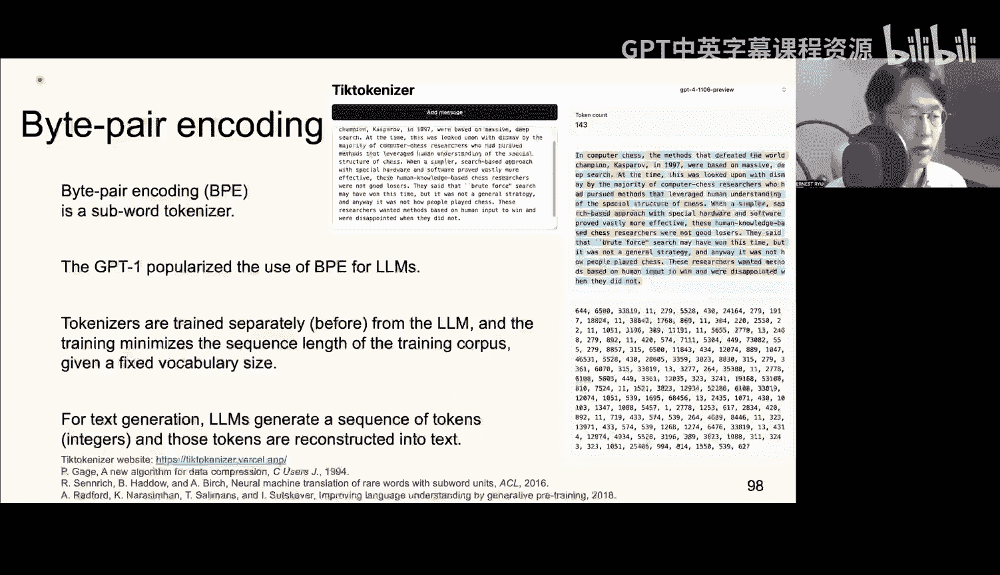

On the right， you see a screen capture from the T tokenizer website。

 And this is an excellent interactive web app that allows you to interactively experience how the tokenization works。

 So here I chose the Gp4 tokenizer。 And I entered an excerpt from Richard Sutton's essay。 here。

 the colored highlights indicate how the text is chunked up into different pieces that are individually converted into a token。

 So， for example， here I N in。 that is converted into token number 644。 space computer。 that's 6500。

 By the way， this chunking up。 This is not computer。 This is space computer。

 And then the next token is space ches。 That's 33819 comma is token number 11。

 space the that's 279 space methods。 That's 5528。 So this is how the tokenization works。

 at this point， you might think that， okay， this is doing the tokenization word by word。 Well， not。😊。

So here we have comma。 the comma was token 11。 Here we have the comma。 again， that's again， token 11。

 And then the name Casperrov is chunked up into subwords。 Indeed。

 bi pair encoding is a subword tokenizer。 So although a lot of standard， commonly used。

 English words are tokenized individually into one token。

 Sometimes you have a word that gets chunked up into multiple tokens。

 The name Casperrov is chunked up into three tokens。 K A S， P A R and O V。

 Those are the three subword chunks that are tokenized into three separate tokens。 namely this。

 this is Cas， This is P A R， this is O V。😊，After Casperra， we have a comm。

 and then the next token is space in space。 That's 5655。 And then we have 999。 That's 27778。

 and then 7， the single 7， that's token number 13。 So 1997 is chunked up into two tokens is chunked up into 1。

9，9 and 7。 If we go forward。 The word chess is chunked up into the sub wordss。 C， H and E， S S。😊。

And going forward， we can see some funky things going on。 So here， a space human， that's a one chunk。

 And then dash K， that's another chunk。 and then knowledge without the K， that's another chunk。 Here。

 the word brute is chunked up into the subword， B R and U TE。😊。

By pair encoding was originally proposed in the 1994 paper by gauge。

 And then in the 2016 paper by Srich， B P was used for a more substantive NLP task。

 And then the G T1 paper published in 2018。 That's what really popularized the B use of B P in large language models。

 The B P tokenizer is actually a trained tokenizer。

 The B P tokens are trained separately before you do the LM training。

 And the training minimizes the sequence length for on the training corpus。

 given a fixed vocabulary size。When your language model does text generation to be precise。

 the language model is not directly generating text。

 It is perhaps more accurate to say that the language model is generating a sequence of tokens。

 a sequence of integers that look something like this。 And once these sequence of integers。

 tokens have been generated， they are then reconstructed into text using the one to one mapping between the integer value and the token characters。

If you look at this example here we have some misspellings。 So time is an ocean misspellt。

 but it's at the shore。 So here we have some misspellings。

 And the nice thing about Bp is that it can gracefully deal with misspellings。

 So the way that this misspelling of ocean is tokenized。

 results in a different sequence of tokens compared to what you would have if you had the correct spelling。

 So the misspelling does have an effect， it will produce something different。

 But at least you have something that's tokenized。 And if you train a large language model that contains sufficiently many misspellings。

 then the language model learns to understand things despite these kind of misspellings。

 Here are some subtleties of the Bp tokenizer。 So a prepending space to a word。

 it changes the tokenization。 So here we have machine。 that's this token。

 And then we have space machine。 So that's a different token。

 And then capital space machine that's also different。 And then here we have learning and learning。

 actually， both of these are space learning and space learning。

 And those to result in the same tokenization。 So the fact that a base word。😊。

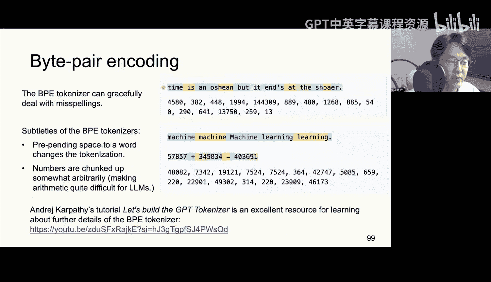

Sp prepen to that base where results in a different token might feel a little bit unsettling。

 but it is what it is。 And maybe there's a better way to do things。 But this approach works。 Also。

 when you have numbers， numbers are chunked up in a somewhat arbitrary manner。

 And this kind of weird chunking behavior of numbers。

 It contributes to the phenomenon of L L M's really struggling to perform a basic arithmetic。

 Theres a lot of complexity and subtlety to the topic of tokenization that you really cannot should not ignore。

 if you want to be serious with LLM research。 The renowned machine learning scientist。

 Andrej Carpathy put out a tutorial， let's build the GP tokenizer on YouTube。

 This is an excellent resource。 So I really strongly recommend taking a look at this resource for a more solid and comprehensive coverage on the topic of tokenization。

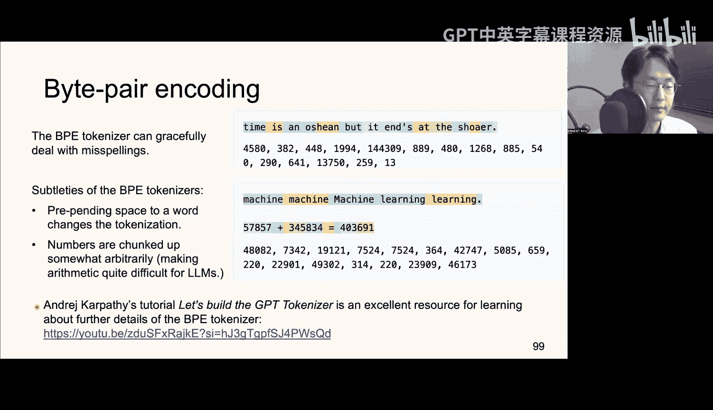

The original transformer architecture proposed by Vaswani Atal in 2017 has remained surprisingly stable。

 Only a handful of modifications to the original architecture have been proposed and have been confirmed to be effective。

 Let me tell you about the few modern updates to the transformer architecture。

 recall that the layer norm operation has this form。

 So we have an operation where we subtract the mean， and we divide by the standard deviation。

 Rm norm is a simplification of layer norm。 It stands for root mean square layer normalization。

 and it looks like this。 So we have the input sequence X， we do not subtract out the mean。

 And instead of dividing by the standard deviation， we just divide by the norm of the vector X。

 for the trainable parameters。 Rm norm retains the gamma trainable parameter。

 but the bias term is removed in R M S norm。😊。

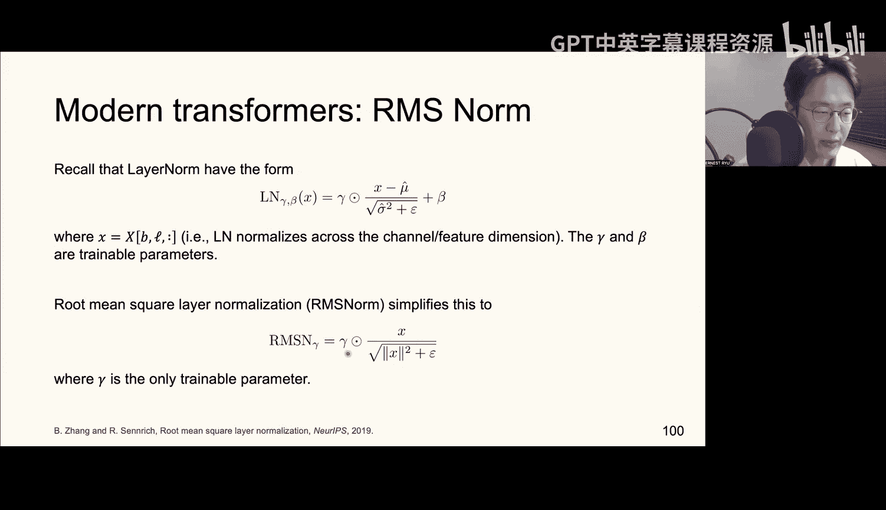

If we compare Rm S norm with layerorm， it's clear that R M S norm is slightly simpler than layeror。

 but does this difference really matter。 Well， it turns out that Rm S norm performs It generalizes similarly to layer normm。

 and Rm S norm actually turns out to be meaningfully faster than layerorm。

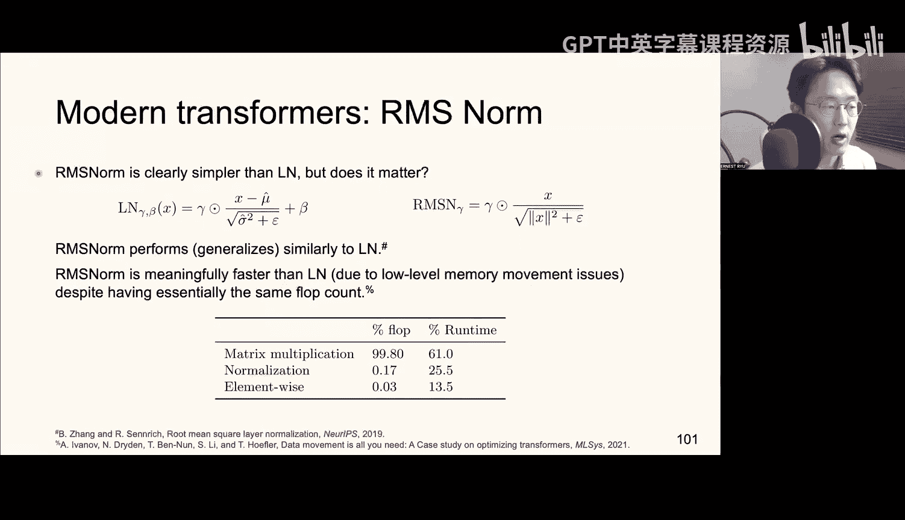

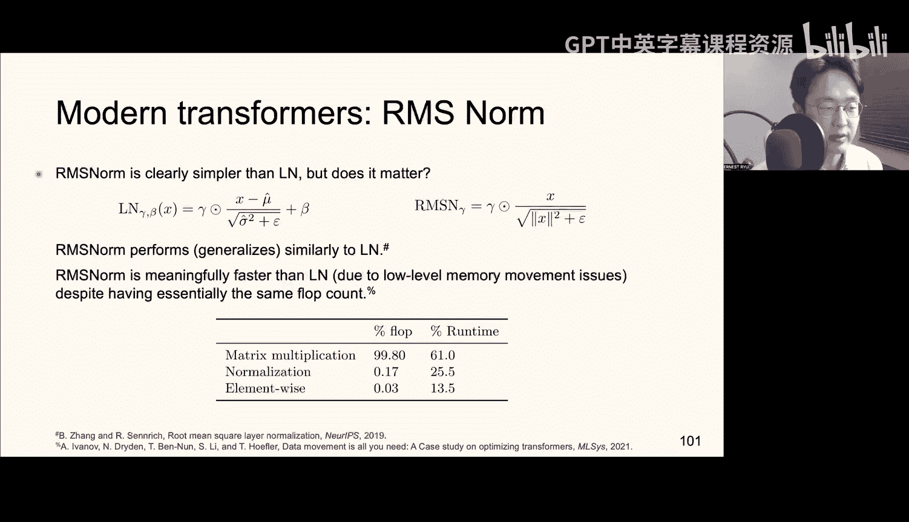

And the difference in the compute cost between RMS S norm and layer norm is not due to the flop count。

 Essentially， RMS S norm and layer norm have the same flop count。

 but the difference in their speed is due due to the low level memory movement issues。

So this lowle memory issue pertains to the faster cache memory versus the slower HBM memory within the GPU architecture。

 and the details of this is frankly beyond my personal expertise。

 so I'll show you this table taken from the paper Ivanov at all published in 2021。

 it shows that in terms of the number of floating point operations in terms of the number of arithmetic operations。

 the normalization layers such as layer normm。Consists of 0。

17% of very small portion of the total number of floating input operations。

 But because of these memory issues， it actually occupies 25。5% of the total runtime。

 So the efficiency gain of Rms norm over layer norm would reduce the run time of this 25。5% portion。

 and that can be a meaningfully faster。

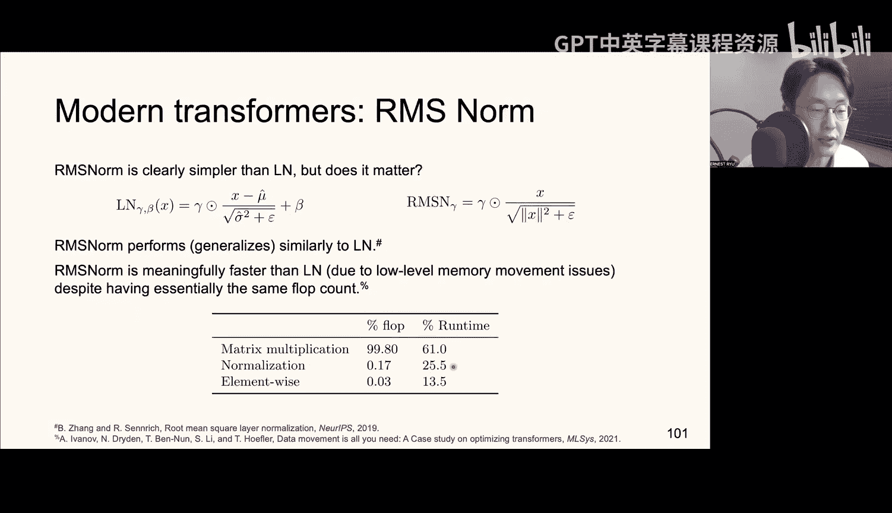

Actually， it's not just the RMS layers。 Most modern transformers avoid bias terms altogether。

 So the token embedding layers and the output projection layers。

 these are designed to have no biases。 The attention layers are also designed without bias terms。

 So the linear layers for the Q KV vectors these do not use bias terms。

 The original transformer did use bias terms for the position wise FFN layer。

 but modern implementations do not。 So when you have a non gated FFN layer usually has this form without the bias terms。

 And then we have the gated linear units， the G L units， these slightly improve the FFN layers。

 So the G L U FFN has this form where we have the input vector X。

 the input vector X is processed by a linear layer defined by W1。

 Another linear layer defined by the matrix V the bias terms are not used。

 W1 times x is passed through the nonlinear activation Sigma。 and then those two outputs are multi。😊。

Eleement Y。 So this denotes element wise multiplication。

 And then that result is then passed through the linear layer defined by W2。

When the sigma activation function is the raylu activation function。

 then this fFn is referred to as reglu。 If sigma is the Galu activation function。

 then this is referred to as geglu。 If sigma Sw， then this is referred to as this is referred to as siglu。

 Here's a table taken from the paper by Schzir published in 2020。

 and it shows that indeed Geglu and sig siglu slightly outperforms the non gated FFns。

But you might ask， doesn't this increase the compute costs。 Well。

 not really the gated fFns are sized， such that the compute cost roughly remains the same。

 So for the nongd fFns， usually an expansion factor of 4 is used。

 So that means for the given input x of dimension D W1 is4 d by D matrix。

 So the output of the first linear layer is larger by factor of 4。

 and then W2 reduces the dimension back down to D for the gated FFn。

 the w1 and v1 matrices are sized to be8 over three times d divided by d and W2 reduces the size back down to dimension D。

 It turns out that this specific value 8 over3 is chosen precisely such that the flop count is on the order of 16 times d squared for both architectures。

 So the performance results shown in this previous slide。 This was a fair comparison in this sense。

 So when the matrices are sized in this way， the gated and non gateated。

FFNs basically have the same compute cost。 and under that fair comparison。

 the gated FFN tends to work slightly better。 Next， we have the rope positional embedding。

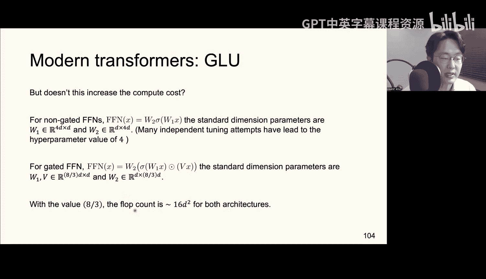

Recall the classical position embedding mechanism。 So after the token embedding layer。

 So after the tokenization， after the token embedding layer， we get these V vectors。

 and we add the positional vectors P to these token embedding V vectors。

 And then we pass these vectors to the transformer layers。 Here， the positional encoding vectors。

 They're defined in this way。 So it's a bunch of signss and cosines with the frequencies。

 the theta F frequencies defined in this way。😊。

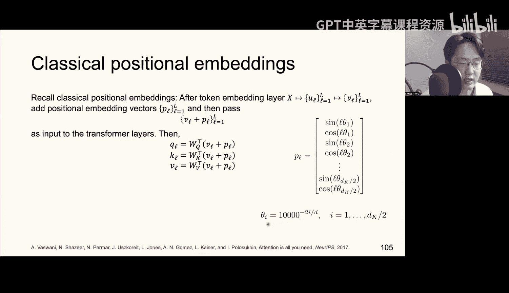

A lot of modern transformers have moved away from this classical sinusoidal positional embedding in N2 using this newer rope embedding。

 this rope embedding， which is the abbreviation of rotary positional embedding。

 It instead considers the the Q vectors and the K vectors， which are dimension D。

 It identifies these vectors as vectors of complex numbers of dimension D over 2。

 mechanically speaking， this key vector and this query vector， it's a sequence of D numbers。

 If we group these numbers as pairs， then we can reinterpret these numbers。

 these D numbers as D over two half as many， complex numbers。

 And then what we do is for the key vector and the qua vector。

 we multiply these complex exponentials element Y。 So this is element wise multiplication。

 multiplication between complex numbers。😊，The frequencies of these thetas are given in this way。

 and these are exactly the same frequencies as were used in the sinusoidal embeddings。

 So then after this operation， the key vectors and the query vectors。

 these are complex numbers of dimension D divided by 2。 Then rope feeds the rotated Q and K vectors。

 they' are rotated in the complex plane。 into the attention function。

 So here' is an alternate way of describing the same operation without the use of complex numbers。

 So instead of reinterpreting things as complex numbers and multiplying by complex exponentials。

 we multiply by this R matrix， which is block diagonal。 Each block is 2 by 2。

 and this block corresponds to rotation by angle L times theta 1。 And here。

 this block corresponds to rotation by L times theta 2。 We apply the rotation to the vector。

 the K vectors， but we don't apply rotation to the V vectors。

 and then these  Q Kv vectors are just then used in the attention mechanism。😊。

Here are some properties of rope。 So the rotation operation。

 It ensures that only relative positional information influences the attention mechanism。

 So the AI J tilde。 So this is the pre normalorization At scores this is the interpro between Q and K。

 Well， this depends on the vector at the I position， it depends on the vector on the j position。

 It also depends on the relative separation between the I and j coordinate。

 But otherwise there's no explicit dependence on the absolute position I and the absolute position J。

 The position information I and J enters this calculation only through the difference I minus J。

 So only the relative position influences the attention mechanism。 Also。

 rope has this longterm decay mechanism in the sense that the attention map A tilde I J that it converges to 0 as the relative difference I minus J in the position converges to plus or minus infinity。

 this is desirable since we expect tokens interactions to weaken as they get farther and。😊。

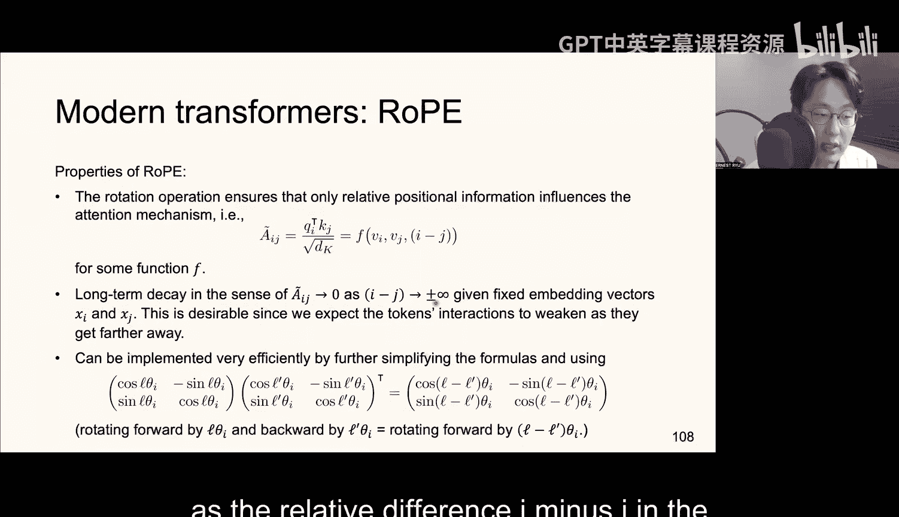

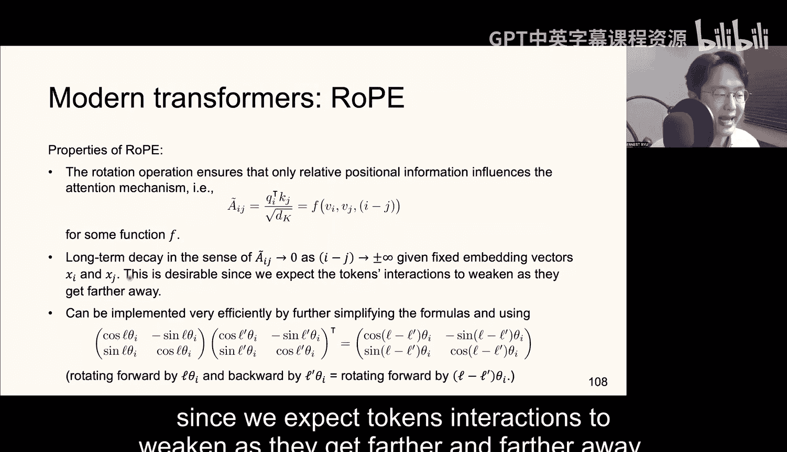

Farther away。Another nice property is that this can be implemented in an efficient way by these simplifying formulas。

 So this two by two block represents rotation by angle L times theta I。

 This is the transpose of rotation by L prime times theta I， which is rotation in the other way。

 So using the fact that these matrices represent rotations。

 there are simplifications that can be made。 So the implementation of rope can be very efficient。

 And indeed， rope works very well。 So here's a tweet by Stella Bierman。

 And she's basically saying that， well， if you look at rope rope just works so much better。

 at least in her experiments。😊。

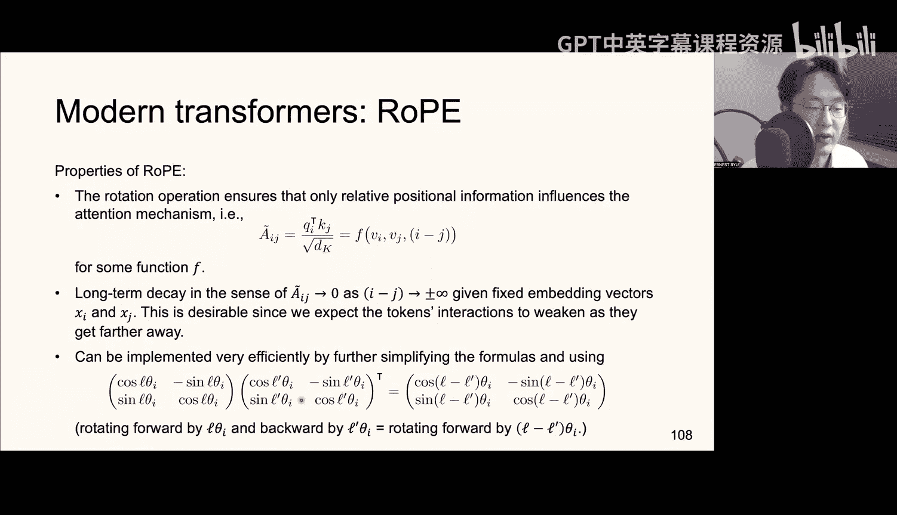

NowFinally， when you use rope you should apply it to all layers。 So in contrast。

 when you use the classical sinusoidal positional embedding。

 the classical sinusoidal embedding is added to the embedding vectors。

 the these only once at the very beginning of the transformer。

 and that's because applying the positional embeddings to all of the layers is arguably unnecessary because the residual connections provide the positional encoding information to all of the layers。

😊。

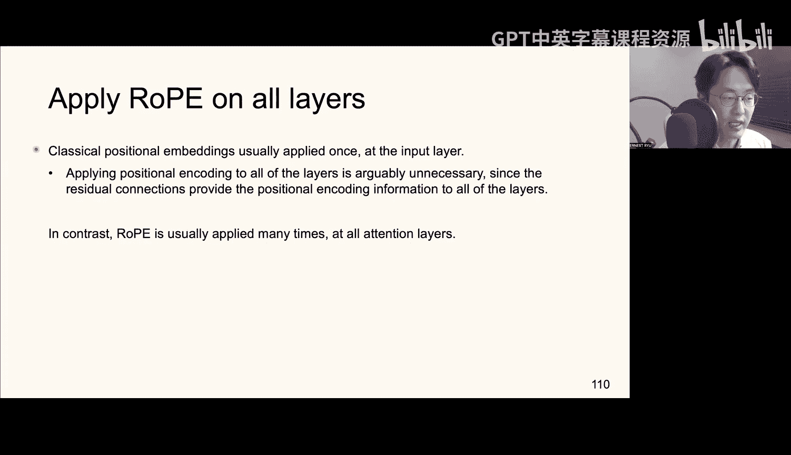

But in contrast， rope is usually applied many times at all attention layers。But actually。

 are positional encodings needed at all， it turns out that positional encodings aren't required for decoder only attention layers。

So for unmasked encodeder only transformers like Bt and VT vision transformer。

 you do need position encodings。 can it really doesn't make any sense to exclude positional encods for Bt and VT。

 And if you remove the positional encodings in these architectures。

 you can immediately see the performance degrade significantly。

 But when you're working with decoder only transformers that have the masking mechanism。

 Transers without positional encodings may work just fine。

 So transformers without with no positional encodings that is' referred to as nope。

 And actually if we go back to this plot。 You see that rotary positional embedding。

 that's the claim in this plot is that it works very well。 here' is sinusoidal embedding。

 But there's also this red line none。 none means is corresponding to nope。

 So this is the use of no positional embedding。 at least in this plot。

 it's not working as well as rotary positional embedding。 but at least it's working pretty well。

 actually better than the use of sinusoidal positional embedding。😊。

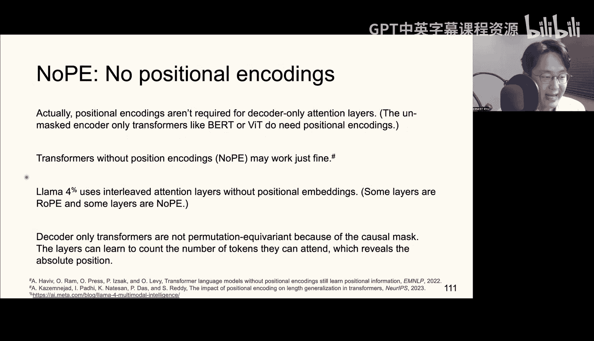

So how is that possible， Well， it turns out that decoder only transformers are actually not permutation equivariant because of the causal mask and what the masked attention layer can do。

 the layer can learn to count the number of tokens that they can attend to。

 And this actually reveals the absolute position。 So it turns out that these explicit positional encodings are not needed for masked attention layers because they can figure out their absolute position。

 although it does seem to be the case that using rope as an explicit position positional encoding mechanism does help。

 even though it's not strictly speaking necessary as this slide is claiming。😊。

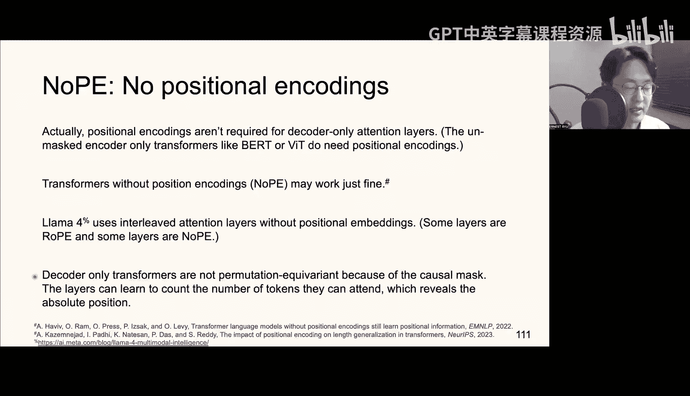

KV caching is a technique that modern transformers use to improve the inference efficiency。

 So during inference， the Lars language model generates tokens y1。

 y2 dot dot dot up to Y L in a sequential order。 Now to compute Y L that we only need the current query vector。

 but all the previous key vectors。And all the previous value vectors， these are all needed。Now。

 what KV caching does is KV caching is an optimization that stores it cachees the previously computed key and value vectors。

 So only the current key vector and only the current value vector。

 these are newly computed at the current step。KV caching is a mechanism that trades off memory usage with compute。

 so you store these previous key and value vectors so that requires memory usage。

 but in return you don't have to recompute them so you can reduce the amount of compute。

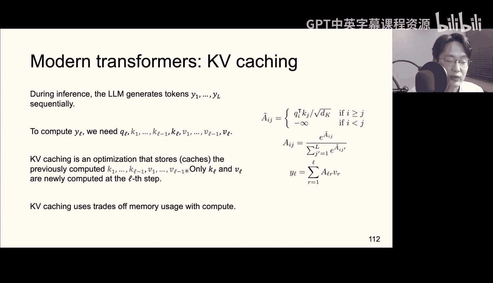

So this slide is showing an excellent GF illustration of this process image credit due to Joahua Las。

 specifically the image is taken from this medium article。 And on the top。

 you see the computation process without any caching。 So when we compute。

 let's say the second output or the third output or the fourth output。

 all the previous K and V vectors， all the previous key and value vectors need to be recomputed。

 But when you do use kv caching， then these purple components。

 these purple key vectors and value vectors they don't need to be recomputed they are stored。

 they are cached and they are reused。 but even this Kv caching has an inefficiency that we can potentially improve upon。

 So a lot of modern transformers now use a multi queryry attention M QA and here's the motivation。

 when you use Kv caching with the usual multihead attention M H layer。

 Then the attention layer has H heads。 So we need to compute Y1 up to Yl separately at the L step。

 and this requires computing。

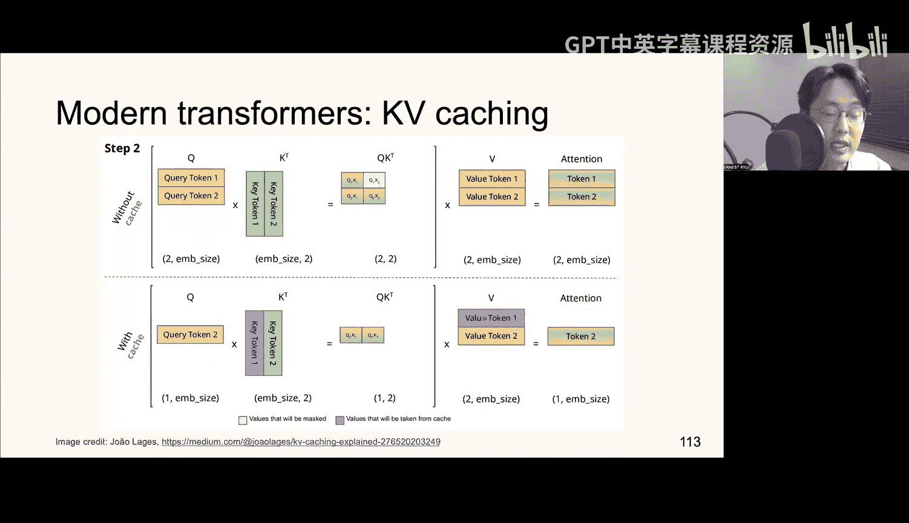

The Q vector， the K vector and V vector for all of the heads。 And that's fine。 that's efficient。

 And that's fine。 The problem is that this requires loading all the previous key and value vectors from memory。

 And this is slow because loading things from the HM memory on a GPU is slow。

 especially when the volume is large。 And this has a large volume because we need to load all of the previous keys。

 All the previous value vectors。 but we need to also do that for all of the heads separately。

 So that's quite a lot of volume。 So generally speaking， GPUus are very， very hypereff with compute。

 but they are less efficient with memory IO。 So multicorre attention and QA tries to better utilize the compute efficiency of GPus while avoiding memory IO。

 So this does so by sharing the keys and values across the heads。

 So in order to compute the Y vectors Y1 up to Y H at position L。

 Then what we do is we first compute the Q K V vectors for the current position。 and that's fine。

 That's not allowed。😊，Comp computation and compute is fast anyway。 So this is not a problem。

 And then what we load from GPU memory is the previous key vectors and the previous value vectors。

 And this memory Io is still a cost that we need to pay。 but the volume is now much less。

 because as you can see， there's no longer any superscripts in these K and V vectors because these key and value vectors are shared across all the different heads。

 And therefore， the volume of the slow Io has been reduced by a factor of capital age。

 So the I O is slow， but the volume is smaller。 So this is now much more efficient。

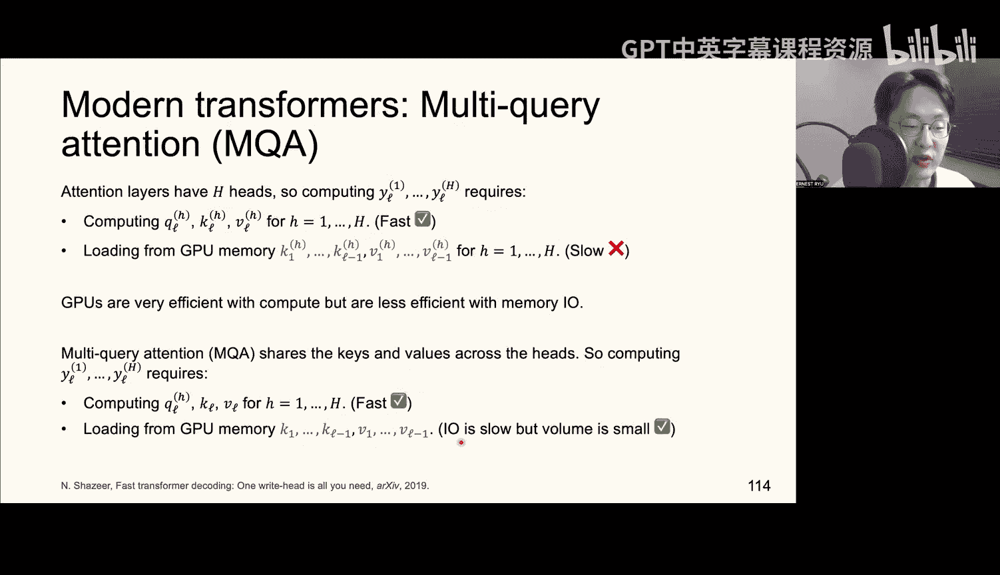

So M QA significantly reduces the inference costs， although there is a slight degradation of performance。

 So grouped query attention。 G QA， it offers a compromise by sharing keys and value vectors within groups。

 G QA nearly matches the performance of plain multi head attention。

 So here's an illustration taking from the Ily etal paper published in 2023。

 So in this illustration there are8 heads， the queries for each heads。

 they don't share any keys and value vectors。 So all these value vectors and all these key vectors。

 they are just separate and they must all be loaded from memory for a multique attention and Q all the different heads。

 the different queries， they share the same key and the same value vectors。

 So you have much smaller volume of information to load from GPU memory。

 Grouped query attention is a compromise。 So there are different groups。

 The different groups ofqueries they share key and value vectors。

 So you have a smaller volume of key and value vectors， but it's much more than this。😊。

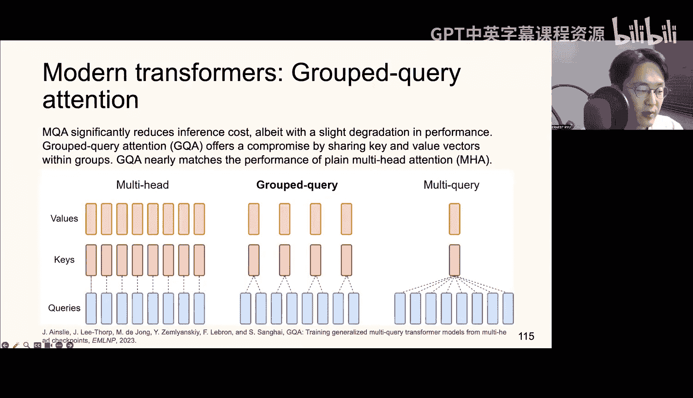

MQA and the the performance of G QA tends to match the performance of MHA while being much more efficient。

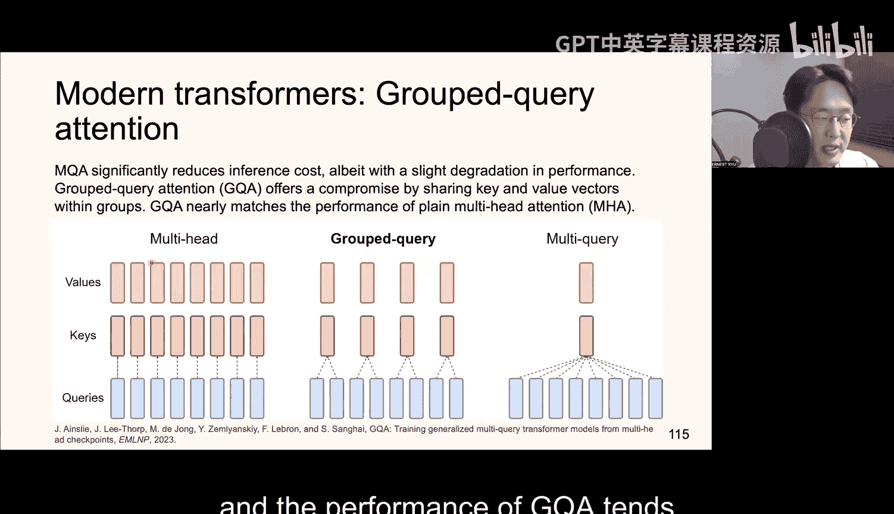

Now， let's assume a causal language model P Theta has been trained。 Now。

 I need to tell you how to use a causal language model to generate to sample text。

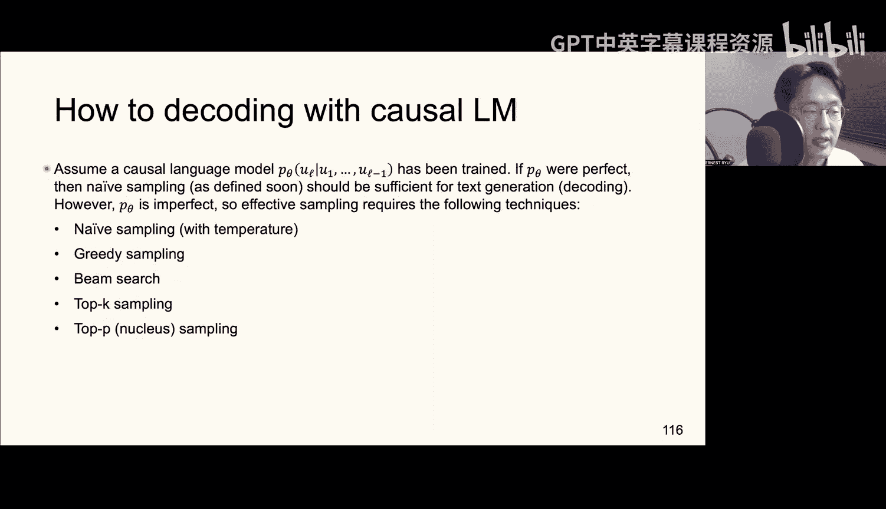

Now， if it's the case that the language model P theta is perfect， then the naive sampling。

 the straightforward4 sampling， which I'll define precisely precisely in just a moment。

 This should be sufficient for a good text generation。

 And this text generation is also referred to as decoding。 However。

 the trained language model P theta is imperfect。 So effective sampling requires these following techniques。

 And these techniques include naive sampling with temperature greedy sampling beam searched top K and top P。

So let's start with naive sampling。 Let f theta be the final e output token of the decoder only transformer architecture。

 So this gives us the vector for the next token prediction。 We take this output F theta。

 we feed that through the soft max。 and that gives us the probability distribution on the next token。

 So the probability that the next token is equal to a certain value I that's the if component of the output of this softm output。

 when you have such a trained language model， then naive sampling continues the generation。

 So given the text given that set of tokens u1 up to US-1。

 the next token the US token is generated it accordance to this probability distribution。

 Now this has a problem when the language model is imperfect。

 The problem is that the low probability words are sampled with low probability。

 but low probability is not zero probability。 And when these low probability words are sampled。

 they tend to be bad。 So the high probability words of the language model of the trained。😊。

W modelel tend to be reasonable completions， but the low probability words are often quite poor。

 So really， the imperfection of the language model， they manifest in these low probability words。

 So naive sampling with a temperature parameter beta。

 it adjusts the temperature parameter in the soft max。

 So instead of applying the softm directly on the output of the transformer f theta。

 we take that output， we divide that by beta， and then we apply the softm to get the probabilities。

 So beta is a positive parameter。 And when beta is equal to1， this is just regular naive sampling。

 And then when beta is less than one， the magnitude of f theta divided by beta is bumped up and this has the effect of suppressing the likelihood likelihood of low probability words。

 So in modern large language models， Beta equals to 0。7 or beta equals 1 are common default choices。

 So beta equals 1 is often considered a high temperature leading to variations。

 Diver in the text generation， but potentially suffering from。😊。

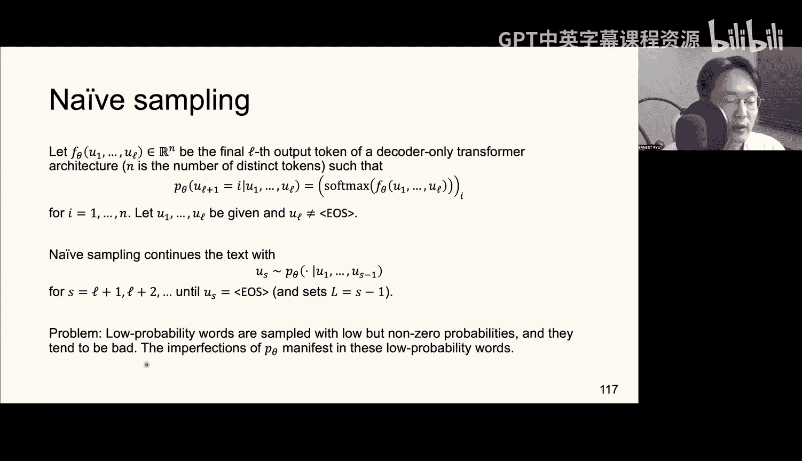

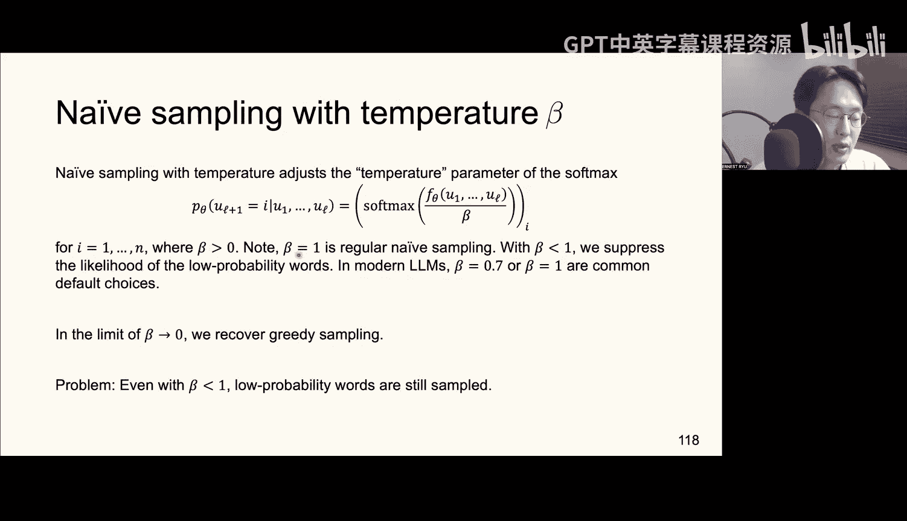

Choosing bad completions， whereas beta equals 0。7 results in a less diverse set of generations。

 but it is a more safer choice。 By the way， in the limit of beta going to zero。

 we recover greedy sampling。So naive sampling with temperature beta is fine。

 but there's still a problem。 So even when beta is less than one。

 the word the low probability words become further lower probability， but still not0 probability。

 So these low probability words are still sampled。 So if the low probability words are bad。

 then why not just sample the most likely word。 So that's what greedy sampling does。

 So greedy sampling considers this probability distribution samples the most likely word and generate text based off of that。

Now， there are some problems with greedy。 So problem number one。

 greedy sampling does not generate the most likely sequence of tokens。

 I'll get back to this point in just a moment。 A problem number two。

 the most likely text is not always the best kind of completion。

 I'll also come back to this point later。 So to generate the most likely generation。

 Instead of greedy。 what you would have to do is called the exact MA exact maximum a posteriori decoding。

 and this would sample the globally optimal， most likely generation。

So given a partial completion from U1 up to UL， then the remaining completion is generated by taking the R max of all possible completions。

The problem with this is that the search over all possible completions is something that's not implementable。

 so there are exponentially many candidate sequences and computing the exact MA decoding is known to be unintractable problem。

 and in the language of complexity theory， exact M decoding in the worst case。

 it's an MP hard problem class。Another problem problem number two is that， again。

 likely text is not always good。 More on this later。So why is greedy not equal to MA， Well， MA。

 it maximizes the product of all of the probabilities。

 which is equal to the sum of all the log probabilities。

 whereas greedy commits to the most likely individual word one at a time。

Let's consider this example where we need to translate this French phrase into English。

 So let's say the transformer decides that， well， okay， the word one is the most likely first word。

 and then it chooses， well， puppy as a second most likely word。 And the third word well。

 then there's really nothing you can choose to make things work。 So one puppy is。

 And then is's just the translation just kind of breaks down。

What you really want is you you want to choose the less likely word first， the word up。

 which is slightly less likely you want to choose this。

 And then a cute puppy becomes a high probability and reasonable completion that actually makes sense in this context。

So the problem with greedy is that you commit to the most likely token early on without considering the ramifications of that choice。

 Sometimes you want to see how the completion pans out before committing to a word。

 And by committing to a bad choice early on， you might be eliminating better completion paths。 Okay。

 so then what do we do， Well， greedy is not perfect。 M is in principle perfect， but it's intractable。

 So beam search decoding is a compromise。 Bea search is a tractable。

 Heuristic approximation to exact M decoding that produces sequences with higher likelihood compared to greedy search。

😊，The intuition is that while choosing the highest probability word on the first step may not be optimal。

 choosinging a very low probability word is very unlikely to lead to a good result。

 So we don't We shouldn't be fully greedy， but we can be somewhat greedy。 That's the idea。

 So on each step of the decoder， we keep track of K， most probable partial generations。

 K is also referred to as the beam size and something like K equals 5 or K equals 10 are common values。

So here's a beam search of decoding example。 So we here we have a beam size of K equals a3。

 and the blue numbers are refer to the score so far。

 the score so far is the sum of the log probabilities， which we want to make as large as possible。

 as less negative as possible。 because all these probabilities are numbers strictly less than one。

 So the log probability is always negative。 So the sum is going to be negative。

 but we want the sum to be less negative。So we start with the phrase once upon a time。

 And for the next completion， imagine these are the top most likely words。

 They are certainly there possible choices， but every these are the top three best choices。 Next。

 we expand this choice to three additional choices。

 And then what we have once upon a time a little a small kind， there are three possible choices。

 and with from from this branch， once upon time the small， the young， the wise， once upon a time。

 every kind， every living， every young， we expanded the three beams into nine beams And then among these choices。

 we're going to pick the three choices， this one this one and this one that has the highest score。

 the least negative ones。 So minus 1。2，-1。5-1。3， these are the top scores that we have so far。😊。

And then from each of these beams， we expand to three possible choices， three possible choices。

 three possible choices， and we pick the completion， the three completions with the highest scores。

 and we continue on， so here we expand to three， expand to three。

 expand to three and this continues on until the beams reach completion。

So here is a beam search decoding algorithm described in pseudocode for each sequence step L for all of the partial completions that we're tracking。

 we find the top k next tokens， this results in k squared sequences each of a length L plus1。

 we sort them by the total log probability， if the generation ever encounters an end upstream token then while we end the loop and we return this completed generation。

 otherwise we keep the top k choices among the k squared and then we continue on So again a value of k equals 5 or k equals 1 are commonly used default choices and when k is equal to one beam search does reduced to greedy search。

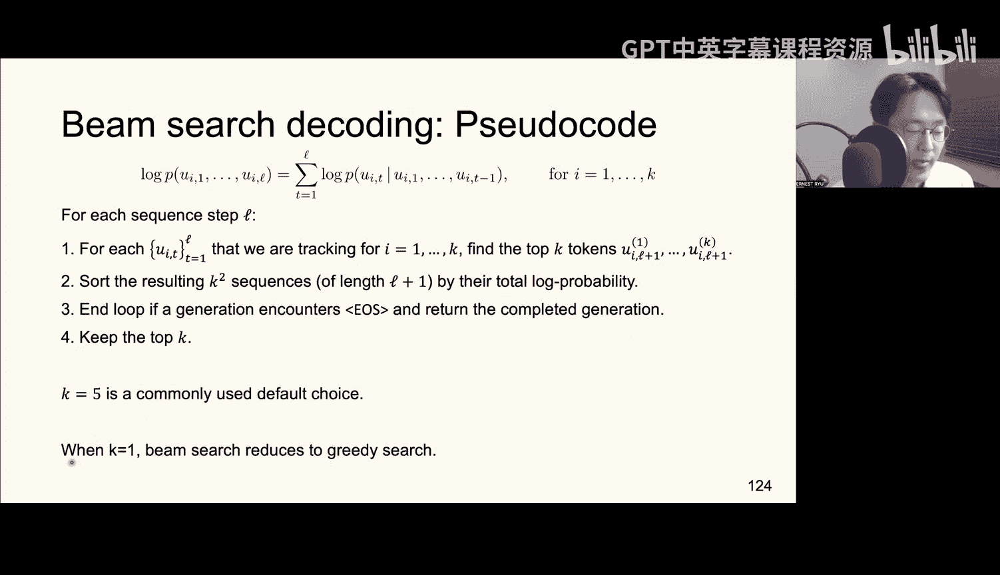

Okay， so if we use a greedy search or beam search better yet。

 we will be avoiding low probability words。 Now， is this the best way to sample text。 Well， actually。

 no， because human text turns out to be not too predictable。

 high quality human text does not follow a distribution of high probability， next words。

 here is a plot taken from the paper Holtzman at all published in 2020。

 And the blue line measures the probabilitybabilities of the next token。

 when the text is generated with beam search。 and by design， text generated。

 but with beam search selects high probability words。 But if you have a human right to text。

 And if you measure the probability of the next tokens。 Well。

 the human text actually has a huge variation of likely and unlikely tokens being generated for the next token。

 So what beam search does is beam search avoids generations with any elements of surprise。

 And the result is text that suffers from repetitive and uninteresting content。😊。

Imagine having a conversation with another person。 And， and in that conversation。

 you can predict exactly what the next word is going to be with certainty。 How uninteresting。

 How boring would that conversation be。 That conversation would essentially carry no information。

 Really useful and interesting text would contain surprising information information that you cannot infer from the previous tokens。

 And indeed， that's how humans actually speak。 That's how humans actually write。😊，So because of this。

 beam search is no longer used in mainstream LLMs， and also because as models become better。

 the lower probability tokens become better as well。

 So the extreme length at which beam search would go to try to avoid the lower probability words。

 that measure becomes unnecessary as the language models have become better。

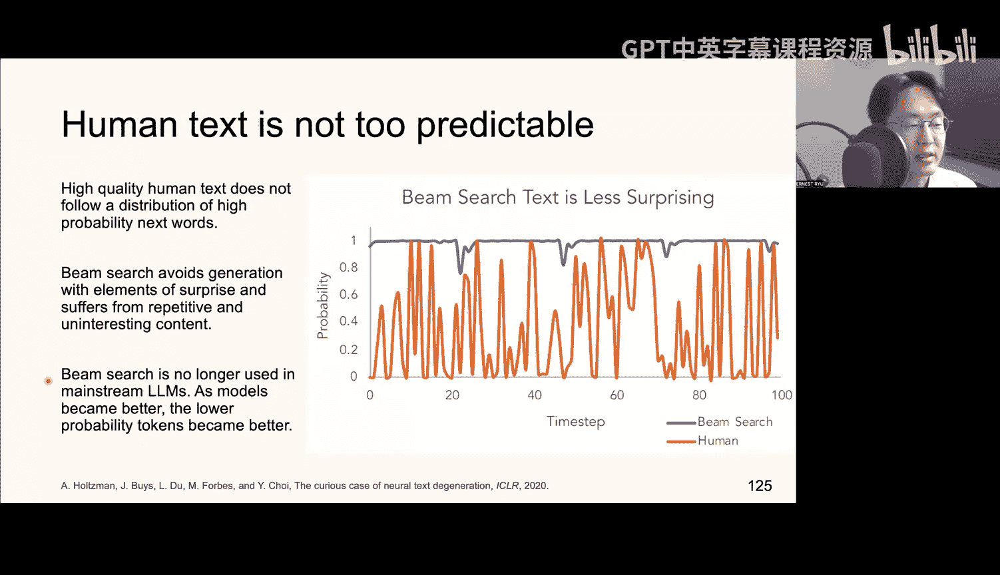

Top K sampling is a sampling method that is used with modern large language models。

 and it samples among the K most likely words with probabilities determined by the softm applied to just the top K words with a certain temperature parameter of beta。

 So here in this example， we've sorted a bunch of words by their probabilities。

 we select the top in this case， K equals6 possible choices and we sample from them。 Now。

 if you take these probabilities and add them they're not going to add up to one。

 So you need to take these top K， and then do a softm with just those words to have a probability distribution on these six words that add up to1。

 So this generation looks fine。 And K being approximately 50 is a common default choice in a modern large language models。

 K equals infinity can be used。 This means a top K is not being used。😊。

But if you look at this example， this example might look a little bit problematic because in this case。

 the top six words， some of them have high enough probability。

 but some of the words actually have very low probability。So still with top K sampling。

 extremely low probability words still can be sampled。

So top P sampling also referred to as nuus sampling。

 This is a slightly different mechanism that samples among the fewest， most likely words。

 such that their probabilities exceed probability P。 So let's consider this example。

 So here again we have sample all the words based off of their likelihood。

 and we consider the minimum number of words such that when we add the probabilities of those words。

 we exceed a certain threshold。 So in this example， P equals 0。9 is being used。

 So if we add the probability of all these words， this will result in 0。94。

 So we sample among these words that lead to an added probability exceeding 0。9。

In this particular example， we just need to add these three and that will result in probability 0。97。

 So then the sampling proceeds with by considering just these three words。

Using a value of P approximately equal to 0。9 is a common default choice。

 and if you let P to be equal to 1。0， that means you're not using top P sampling。So finally。

 most modern LLMs， they perform sampling by combining the temperature parameter beta。

 the top K mechanism， and the top P mechanism。Precisely what it means to combine these three mechanisms that slightly differs from model to model。

 but the point is that these three mechanisms which perform related， but different mechanisms。

 they are all combined to perform sampling in these modern language models。

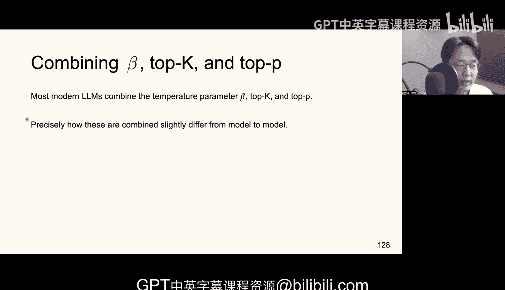