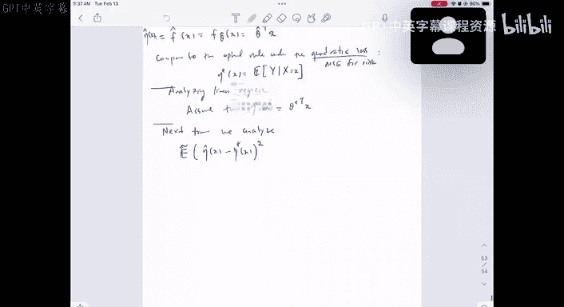
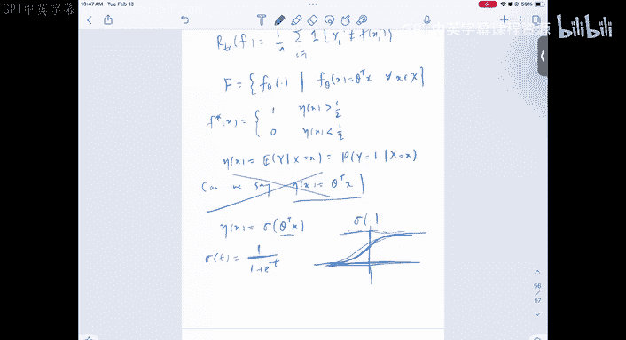

# UCLA《模式识别和机器学习｜Introduction to Pattern Recognition and ML Winter 2024》中英字幕 - P10：[10]Introduction to Pattern Recognition and ML -- Lecture 11 - Winter 2024.zh_en - GPT中英字幕课程资源 - BV167BfB8ETK

So， last time。嗯。So last time we。Analyzed linear regression and then。Obtained a bound。

For this quantity， right？And。诶。So， if you recall。Under the linear。Regation model have so we assume。

 for example that。Regression function is linear and then you made another assumption which was。

This conditional variance。Of y given x is equal to x。嗯。Sigma squared。Okay， and so。

Given these assumptions， we showed that this is。诶。Basically， sigma squared。嗯。Ex transpose。

X transpose x inverse x。Okay and。We wrote it like you。Yes。U。And I call this quantity sigma at n。诶。嗯。

And the interpretation was that this。Can be written as。1 over N sumation I from one to n。X I。

 X transpose。And。So we call X was。X1 transpose up to Xn transpose。And so by a law of large numbers。

 this converges to。And。Sigma。Which is just the covari like。

It would be like the expectation of one of them， X x transpose and if exercise are。Yes be系家。

The margins there seem to be IID， but if the marginal service has0 or me。And so。If。Let's say P of x。

 the marginal distribution of x is zero mean。Then this。And this quantity。Is the。

Glarious matrixlarious。Mattrix。啊。The distribution of P ofX。Okay。

 so the assumption is that this is going to converge。诶。Or this part is going to converge。

 so this is sigma at end。Okay， and。嗯。So what I'm going to do is I'm going to write。嗯。

So for large and approximately sigma squared over n。X transpose sigma universeverse x。

So that's how it behaves。掌柜。So。嗯。If you。Let's say assume。

So the sigma squared is the variance of the noise。This conditional variance is some sort of a noise。

Let's say if you assume in a very simple case。嗯。It's a simple example。That for example。

 the sigma is identity。Okay。Hello。So thequeest sigma is at there。

Where this recording it sort it's like the。Or the stages of the teachers shirt。If that's identity。

 let's say each coordinate it is。Independently otherwise。

They have all the same guidance so that we' to。So this quantity。

 maybe let me call it m of x in the notes。So this is like minus squared error。

Of sort that we calculate it's going to be approximately sigma squared。Sigmaversepos of x。

 so you get x transpose x。Or rather a sigma squared over n， the norm of x squared to the al norm。

And for example if。X is negative infinite like negative one to one。To me， so this is saying that。

Each coordinate of is 15 minus one and one。诶。Then we can upper bound this。So if each coordinates。

 so this is same basically， if I have a single X like this。Xi is less than equal to one for alli。嗯。

From one to D。So if I have a assumption like that。Is there a number with slide？对。

This is the sum of the squares of excise，What is the the largest H B。Great。Yeah。嗯的系。

This is sort of motion。Oh one。Yeah， but this is like multiple them， so this is like sigma。

X I squared iPhone 1 to D。Okay， so good upper bound is D。So what we get is sigma squared D。Okay。

 so you can see how appears you can sequence be over if we do the partitioning estimator。

 so let's say this is for the linear estimator if we do our partitioning estimator。

We argued if you go back that this would look like sigma squared over n。To divided by。U。2 plus B。

Okay， so。没。😊，Is a manifestation of。不这个有什么。This is sort of fine。Of Paris。Yes。

There let' the appears in the power。And so the rate changes， so I sort of like one over again。If。

 for example， was， let's say zero， this would be in this one over N。But it he， I mean。

 the zeroism make sense。If it's like very large， you get two or something is just very large。

 this is going to be clean close to。There， they get one over some fractional power。

 which is very small。 and so this goes down very slowly。There is the rate here。

 so if you be for equal 10， this is't select sequence for over n times 10， but this is going to be。

 for example。If嗯。B is 10。Then this guy is gonna be。

Approximately upper bounded by sigma squared 10 over n， so the rate is sub goes down at1 over n。

So you a faster， which is problematic doesnt but I don't get large you don't worry too much。

 but this guy is going to be。Sigma scoredd over n to the two。后边。12， right， which is one over six。

Okay， this is really bad。Now嗯。你诶。So， in order to。Like yet something like that and end the power six。

诶。現願です。So the sample size here， the amount that it can go down a given an hand。

In order to have the same amount here， I have to enter the power six， to call that his sink。对 here。

This is my we sick very。You get the same thing that raised this to the power。

And I mean that whole channel。And。That is okay。So。The investigatorators are good， but it's actual。

Fction in linear， this is going to come very very slowly。We're not going to use this guidance。诶。

就你矮样 think实就好 point。Be side was huge。Convince you that if you a similar parentic model。

 then parent model is correct。or good approximation which then you can learn it much faster if you don't assume anything。

 you have an  estimateimator which it works， let's say for a original class being ensure this religious is class。

诶 if you告睇。诶。But。诶。The price that you pay is the story。对。And yeah。

 and you can maybe go back this was like an upper bound as Paul pointed out so we did an upper bound on the。

😊，And。On the bias part so as thought this is a good thing， but bias we had an upper bound。

 but in the linear case you can go back and check that that upper bound is quite bias is actually so we did something like that if you remember there was like L squared h squared was the bias plus sigma squared over end HD。

 I didn't do that high dimensional case but size so this an upper bound but in this case you can go change。

😊，Yeah。This is actually the。嗯，拍照是吧这其他的什么另外还行。Okay much price。

 but always is going to be the norm of data star。So you can say， okay， this is the。That's three。嗯。

If you pay。So a similar thing extends to some of the other， for example， like。

Gating their neighbors for the kernels like the smooth kernels， things and little bit twist。Yeah。

This is just the and then initially the variance and law of the variance yes。

We don't get enough points in each part。喂。😊，Inpress。

Maybe show you later what it looks like the partition is。In the things。Pa friends comment。Okay。

 so let's go back， maybe。So what we did was。就。Sort of popular about the they work with the got a similar vision。

 I replace the。Expectation in the with empirical expectation。诶。So this was the risk。

And we replace it with the empirical expectation， it would be this quantity。喂嗯好。Then I would have。嗯。

Okay。An optimization problem and then we restrict our class functions to certain。It's all like that。

And。And in the regression case， what we did was。So the last is sp。

I get that and then the function class is linear so I get this。And that I want to optimize talent。

this is a position problem I to find the function here。

 and it's basically what you turn finding this data。Because you like us enter that formula。And。嗯。

You get you get this。Problem right and in this case because what red loss is pretty simple。

 you can actually solve for the solution so take the gradient equal to zero and by the general。

Analysis argument that this is a function， you can also verify this with actually executive solution。

 and these are usually the。And you said the gradient equal to zero know guarantee that the solution can minimize good maximize points。

But in this case， there is no such thing as 90 south point， so you just have a minimum。

again otherwise hear the second quarter if there be verifying that's positive sayingdefinite。我清楚。对对没。

Thank， so that that's what we here。 And then we can use this。

Those for formula to do the analysis and that's what we did。

 what I want to do is like introduce some more general idea。Which you may have already know。

you may already know or may already have seen。can solve a this problems like this。

 learn you don't have a close for， okay and then well show the classification version of this for which you don't have a close for。

So what is the general approach to solve an optimizationization problem like this？

It's a function more complicated because it's whether it's area and more complicated get a function of payment。

Okayな。they're like a numerical approach that you know。

 reading that any other people have heard about reading the？我的水也不在。Yes。It's essentially。

Taking the negative of the gradient to go c the entry point to reach the bottom of the function right。

Right， so the idea is that at each step they start from an initial gift。😊。

Look at the gradient of the function at that point。

 the gradient points to a direction and I'm going to go to the opposite direction I'm going take one step in the opposite direction I then at the new point compute the gradient points of the linear direction with a move in the opposite direction。

 so why are we moving in the opposite direction of the gradient？

Because the gradients pointing to the house right， the gradient points to the direction of maximal cent in a sense。

 so you want the opposite is actually in the direction of the most descent。Okay， so。

So these are't like ideas from。I'll calculus if you review。嗯。It's a gradient。Deent。Okay。

 so we can do it in oney， buts let's do that more general， so if I want to sort of minimize。

 let's say。F theta， let's say theta in RD。This is a not nonlinear function。嗯。

So the gradientaving the does something like this， so you have。An estimate atee。

And then you have the gradient。How the function at T。And there's a step size。

 so I'm going to multiply it by some。No。你这个 small number。And then this is the negative direction。

 so I added to data。This is going to be new data point or new yeah new estimates。

So different ways of motivating this。Approachs。One way of motivating it。

 which I kind of like is if you do the tail expansion of the function， let's say。

Roround point F theta， so theta8。Does anyone knows what the first orinal expansion function would be？

Hter series。So it looks like this， the inner product of the gradients。ディと minus。That so。

Bine other words。So the idea is roughly that we are trying to。Minimize this media or approximately。

If you look at this part。This is really a linear or a fine function。So this is a constant because。

It that。We are looking at a specific theta of T and this is a constant。

 the only variable is theta and so if you look at this disease of the form。And。Let's say， B plus。

A theta minus。Take a not， take a lot。 Okay， so this function as a function。

So if I try minimizem minimizing the final budget， it's easy to see that I moving in the direction there。

InSo by sort ofy shorts， let's say this thing is going to be between。Negative norm of the gradient。嗯。

Okay， let's not do that， but yeah， if you do caution shorts， you realize that。This quantity is。

Copperman the maximum happens when this is in the direction of that or this it in the opposite direction。

The really question are we make。嗯。And so this is very。In so once you do this。

 you realize that we our product makes it minimize it。This is negative interaction of this。

It's an in order to are the direction， the direction of minimize this the same difference。

As you can think of the gradients that thats sort of minimizing。At first。

 we're an approximation of the funds。He all of this is comparedide but kind federal to minimize that。

would be like differents approach but this idea is just linear approximation I MI is it least to decide grade so of course。

 I can MI is this perfectly because。What happens if I try to minimize this function。Or all party。

So imagineine like in a un case you would have。So have a function like that。This is a pointta T。This。

 this。Leaner approximation is just a line。对对对。Okay。

 and here in the generic case there're just two directions。

 either in the direction of the gradient end or the opposite。

 so this is direction the gradient end points in this way。呃。

And because that's if I move in this direction the function goes up。

 if I move in the other direction， it point goes down。

So I can I can move in the opposite direction so theyta move if I move in this direction。

's the gradient you can think of it as。Operating in the States。可以的。

But what if you try to minimize the sum what we have。我睇。

The you got negative same so I can't really minimize even one's quite addict actually can minimize the right rank。

Because let's say the quadratic approximation would look like this maybe so there's a minimum one but but this linear function doesn't have bound but you don't want to move all the way because if you also like move can unbound if you move all the way you an approximation very bad so you're going to take just a very tiny step。

Now at this point， my reading is going to be。So if I move a little bit。

 my gradient here is going to be different right so now as I move just a little bit， now my gradient。

It's like that still points in this direction so 18。In rare case。

 it just the direction I' to say that but but not much。 So you stumble in this direction。

 and eventually you here reaches。嗯。In this case it the gradient is zero。

 so as you approach this location of the gradient in the norm is smaller swas。

 youd take smaller s set and sub convert and then all which is in this case of zero。Okay。

 so it's built in naturally this convergence is built into it if it is a small sense。So， thanks。

Ill try to prove it， but。Under the general condition， you conversege to a point where gradient is0。系。

Yeah， so you find essential point of that。And if if the same happens to be。

At a minimum then you wait。And in the conve case， when the function similar example in this function。

 there's going to be this familiar。Thats great。Okay， so that's where you get great。 So。

 and you can do this to many complicated。F% that long is getting grade。

 It's gonna have to be able do。嗯。So， but this is effectively solving this equation like tries to solve。

啊。Poratato was gradient 0。So the effective thing is that you can see as if this converges ata T is going to be equal to ata T plus one。

 so these are be integrated to do if it converges converges for point。And sort of that's。

It's a whole approach to solving。P多。Does that makes sense， people。Right， so I can。Do this。

Optimization， but just calculateulating the gradient， you actually did the gradient here。

So that's my gradient， right？So what would happen here is that。If I ran。我是 let's say啊。Oror。

Regression problem。The gradient of f of theta is so f of theta is 1 over n。

Soation an I from one to end。Y I minus。Exite transpose theta squared， which is also1 over n。

Y minus x theta squared。So I do the gradient。Again， what you want to an X transpose。

X x theta minus y。And。Migrrating the sun would be  lacta T plus1。I's equal to theta t minus mu times。

Dqu， X T。你得听。W isly， something like that。你知一你生。And this actually solved this。Those normal equation。

 so you don't have to do the inverse of the matrix X trans axis or United case。

It's another way of like。It can be campaign that errors of making。诶这轮态。呃 cost state operate。

I will take green。嗯。Sounds good。So， I just want to。Show you how you can do this， please。Yeah。

So there's this。Aets called highcorns ina。嗯。It's a very popular package for people that do。

E turning AI sort of what they call AI machine learning so the main advantage is that if you。

Compose this function in a certain way。You don't have to calculate the screen by hand because if it's like a composition of functions that you already know and you know how to take the gradient。

 then the computer can automatically take the gradient for you。啊 so that is very很 convenientient。

So you build up a lot of， think there are a lot of building lots already。

Like implemented so for example， you have a called loss and then you have the function so all of this the is known。

Soge about your loss function。And with fact。What kind of function of data it is。

 and then it how to take the grade。They just do a simple command and。我这是看自己。

Mlly but that you can calculate the gradient nanopoematics。So the one that I was trying to show was。

So let's say my F data or the loss is data。I'm already theta 1 squared plus theta 2 is squared so 500 case。

 so start at zero， but so theta is two dimensional。So the contours are。Or level sets， so level sets。

Or contours。Of F R。嗯。So for any like the level set， like it's it's there's a parameter。

 so that same level。Equals C if you want is a set。I they will see。As a set in the theta domain。

 so theta 1 theta2 is such that。F theta is equal to C。The gates， so for example， level。Let's say 1。5。

Is the set of alt theta 1 and theta 2。Such that theta 1 is squared plus theta 2 is squared。

And they do four。Or is going to be four okay？So it's the location of all points such that。

Theta1 squared plus theta 2 squared is equal to4。诶。The weathers。是。Ccle yes。

 the so a certain like centered at。Zero， and then you have。Like a circle of radius2。They can play it。

Maybe if I wanted it would be sick， yeah。Good。So that's what you get。It。嗯。Something like that。嗯。问题。嗯。

嗯。Right。That's sick of8ius2。So what happens if I do。Like I was one。

But we're still in a state by of different circular flight so we would be。嗯。诶。我就病。Haaste。

And then maybe I'm going to color it to be。And。Like blue because smaller and then the radius is going to be smaller。

 so it would be。Something like that。Okay， and so you do it in the different level sets and you get a different。

Circle every time in this case。Data 1， datata 2。actually should said I on square。

 let's say would do square。So and then I get these concentric signals right and you color on those parts that I had you color the base under for example。

 the smaller levels would be like blue and then the larger would be。Right。So they are visualizing。嗯。

啊啊。Sort of high the function value is。So as you the you smaller analysis and then the gradient will be recall to these it's not hard to see in this case because the gradient is in general you can like。

诶。I can be proved that the gradient is。嗯。我看了。Is there any to prove that the gradientings are tile and welllessness？

诶。Is it possible。The mis case gradient of that is。Two times theta1 theta two。

 and you can see that in terms of the direction，'s it's pointing this way so along there。

45 degrees everywhere that you are and massive duration。

I think the one way of proving it is if I look at this function。诶。Right。So can I say。

 I think the gradient of this？This is zero right okay it's going to be a little tricky it's nottworth about it。

 but you can track clearlying。Because because lot of basically intervention。边费诶。

If there is a component of bringing in the lot all so if I move along that direction I really change the function and so I can't this basket it that can happen because the function is constant so when I move along the。

Nmal a little bit between that has be zero like the the the amount of the gradient among that direction。

 the direction of the has to be zero so if you can have a direction， take the gradient and。

It's a great in of。嗯。Data like inner product with the direction a gives you like the directional there along a and allowing a to things engines。

It is， this would be here。Because otherwise we to change about muches that can'。

It's's it's like that。That's proven and you can try to like do argue the argument。It's all this food。

Right， so now we have a machinery which is pretty powerful and I can now like。

Not worrying about the complexity of the model or the last slide genders。

Still have to worry but much less worrisome I can just。Think about a more complicated model or more。

Say not to say close formtract models。And just plug into the machine area。Greing this end end。

Do the empirical so impairedization rate procedure that rate in the settlement like open up a lot of possibly。

 So what I want to do next is is tell you like the equivalent。 So what is the equivalent of。

The equivalent or counterpart。Dal regressiongress。For classification。

And there are different versions of this。But we saw that if you assume that the function is being here。

诶。And。If either function is actually linear， then then approximate by linear function much better than trying to see these more。

General I think so we want to do that for let's say classification the issue with classification is that。

They're twofold， so if I for example， start from the empirical loss loss or like training loss。

 imagine I have。One over in sumation i 1 to n here， it would be the zero one thus。

So have something like that。I want to assume that if I， let's say。There are multiple issues。

 so I can naively assume that。I'm going to look at all the Fs。Such that F。Or like f thes basically。

Of the four。F theta equaled。Data transpose X。嗯。So this immediately causes some issues。And。

For some data。Anyone that can see that in the immediate issue with this。I want F to be like01 value。

 so this is not zero1 value and it's actually unbound。对。啊。

So if you remember like our like optimal solution was。Like FS star was something like。嗯。One。

 if a out of x to good than1 half， zero if a out of x let that's than12。And at the boundary。

 it doesn't matter if you did the exercise， you can define it whatever you want at the boundary。嗯。

So what happens is。U。But these functions can be linear， I the machine function。

 so maybe I can look at data and try to work out something about data， maybe A can。

An very official doing为个 model a就可。Regression function in this case。啊。

It still expectation of Y given X。But it would be the probability y equal 1 given x。对，这是。

Not the faith，But there's also a problem tend to say this thing is。That's of the for。But can we say？

Beta x is off four。Tta transpose x like the lady did in the regression case。在做工。It is reasonable。

be wouldn be a that it could be negative so this。But you know that this is not necessarily good because you can try it。

 but you know more about data you know that it's called using want like。你后 that你在 follow啊你。

So you want it to be sort of linear but。It can't be a linear functional x。

 so no linear functional x behaves like the probability because it has essentially that one the linear zone already。

Maybe so what is the solution？So this is not good。The simplest solution is。

A you seen the simple solution。It is with a function thatYeah。

 so you can I'm trying to build logistics so what you can do is like you can apply a function whatever function you want。

Write the maps。The real value， so this is real valued problematic。

 I want something to01 so I can map it to01 by a function that maps the real value to zero one something like that。

😊，Any function can do actually。What people usually work with is something which is smooth and want maybe zero so it's guaranteed and you can take this to be anything like this or actually you can define it more complicated。

 but if you take it this particular function。Eta let's say key is1 over one plus e to the negative T。

They call it the the modeling yeah the modeling and function like this that。

Or it's called the just fish。So there's a simple solution that we can do。

And it's sort of equivalent here。

We have okay。一。