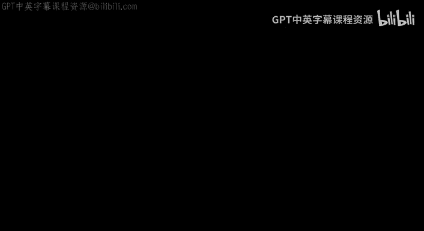
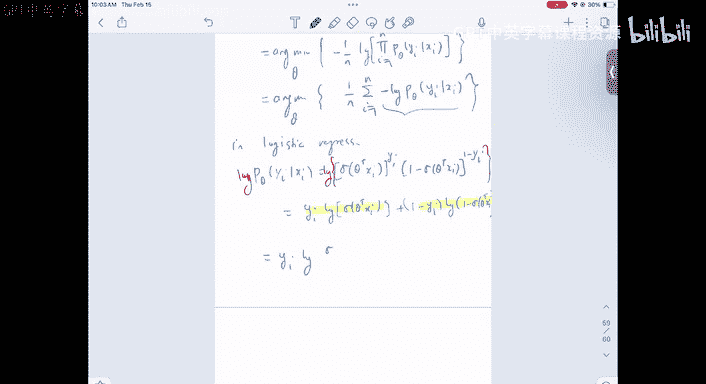
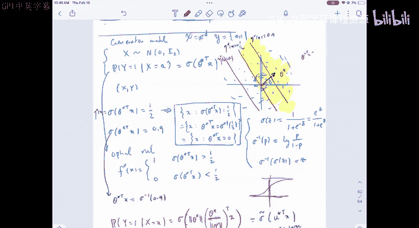

# UCLA《模式识别和机器学习｜Introduction to Pattern Recognition and ML Winter 2024》中英字幕 - P11：[11]Introduction to Pattern Recognition and ML -- Lecture 12 - Winter 2024.zh_en - GPT中英字幕课程资源 - BV167BfB8ETK

Time。

We started talking about how and these idea of the risk minimization or MP for minimization to the classification problem。

And。The idea is there are a couple of difficulties。 One is this。Los function in the case of。

Pasification， our the usual loss function is。Not the smooth。

 like the qua glass and the other problem。Is that the function that we are looking at is also discrete so it's。

是。So the optimal model is like that so this part is pretty simple to look around so we want we want to have a parametric model something like the linear model the specification。

And so the idea is that we can model this8 out of x。诶。First。

 we thought we think of it as a linear function and we realized that the linear function is different to you。

Founded in to 01， the simple solution is to apply function that math r201 we start from some linear function of x。

And then you apply a math， the sigma。And。Which could be any math of not zero like it like R to0 to one。

 but like a particular choice is this sigmoid function which is。Very common， and。

Why it's coming because it's easy to work with， perhaps。

And so if I model a de regressionig function as sigma of the theta x。

 then I'm effectively modeling what I'm saying is probability of y。Equal 1 given x is equal to x。

Its sigma theta transpoic， so this is a model for the conditional problems of Y given x。And。

This is sort of enough for us to。嗯。要 basically。Connecting back to your own as also。

So another way of thinking about this is like here， if you go back to the very beginning。

 so we have another way of thinking about this。So we have X Y。Which is from an unknown。

And we get a training data IID from things distribution use and we want to figure out。And。

This unknown distribution or as we have seen， the conditional distribution argument so this distribution can be described as the marginal of x。

And then the conditional distribution of y given x so if I have。

Let's say the marginal distribution of x。And then the conditional distribution of y given x。

These two pieces of information para me。So in this disation and also in the packaging balance as we'll look at。

 we're going to assume the model course。This quantity， you can also assume single model here。

And we'll do that when we want to generate the data， but for building the model。

 writing down the particularization problem， if you only need to specify that in order to specify this joint distribution in the case classification can enough to just specify the probability of y is equal to one。

Given x is equal to x。Because。I question Mike。Why is it enough to？Just specify that。

The thing is that this completely satifies kind of on evolution of Y in。

so it's only y equals0 given x equal grade is one minus。

 so' not taking these as five the third during distribution。If the problem becomes more complicated。

 let's say if I do multiclass classification， which we'll do next。It's not enough to div this。

But would say treat classes。I have like at least two independent。

All these are have to specific I have C classes that have C minus one numbers that have to specified but the last one is going to add up to you。

Like forget the add if you want。And the binaryaries are the for binary classification。Bary。

Mification is enough。It is enough to。嗯嗯。Mylo。Just the P of equal1。这边你数据关对吗？In order to specify。Yeah。

OK这。嗯。This is definitely our approach。I'm trying to。

specify this using parent family that simple than nothing orshire and in this case。

 this is equivalent to specifying this or specifying basically the Eta。In this case。

 the regression function is enough to specify the regression。

 but it's specific to the class of binary classification。

All of these things are basically boil down to a specify this one maybe a specified and so I have this。

Now， how can I connect it back to that？Here are， and I want fit this to the training data。And。Yeah。

I want to basically rewrite a version， right so I want to have some sort of it。So， we want to。

We want to。Arrive。At a form an ERM。For this model。So I want to have something like one over n summation I from one to end。

Some loss of some sort apply to Y IN。Let's say Eta theta if you want of Xi。

And then arguing over this data。So there is a parameter tato that we need this way and I want to like。

Be able to provide something like that synago to ir。

 So you have a loss function because of Y I to the。This is going to be our。Okay。

Estimate or you could have。A different thing so you can， for example， why had I。Which is。

Let's say one if。And。This is bigger than one half。And I compared it why had I。

 but we'll say like these things are sort of in a sense。Equivalent。But I want something like that。

 The question is how do I get。There。And before getting there， what is a good approach， so suppose？

So suppose。是。I have。Training later。X1， y1。Pix NYN。小翻没 smile了。So I know， for example， the probability。

 I'm going to write it like this， so the probability of。嗯。Let me write it as。Tf。And。

We'll do that later okay， so let's do this so I just know that the probability of Y I equal one given。

ThatSo small values X1。Why am I not to accent？So I know they's probably a Y I equal one given。嗯。

X I is sort of。嗯。Sigma， theta transpose， X， so like according to my model， these are IA。

They so the district names excellence。なるほど。So I know these are ID and this holds so how can I estimate this parameter data or give us the era and let's say you're a statistician。

You're given this parametric model。And you want to estimate data。What is a general process？

Thelic decisions。M yes okay so that gives me a very nice recipe for arriving at the ERR like a rigorous mineralization for these paraic models。

 how do I write？Mim likely。So a good approach。Is the MLE so if you think of the MLE let me really say that a little bit so what do you usually do here in your specifying these conditional distribution so in the end i'm not having joint conditional。

诶。Let's say probability mass function or distribution that this is probability mass function of Y I is given X up to XN。

So everything is in any condition on the X similar what we have during the cor。

They're not specifying the marginal excgregation， Actually。

 we' just specify the initial excgregation。 So I'm going to add a added。看你上次分6似的。

The bank why all of the access。Okay， and this is。ACondal probability mass function。

So what is something that I think to put like zero ones here for each of them。

 and then this evening to probability they have that particular sequence of zero1s。We might always。

 because we have a model for this。So what is the model？So graphical model is that。X1。

Sort of gives me y one next to give me。Why to。So they're independent so there's no connection。

 for example， between these two guys so once I condition on the X YIs are still independent。你人你下。

Itino， so how can I write this。Or的错。Okay， good forex iPhone one to end。

 I'm going to use the same notation it's a little bit。嗯。Not too close there from thing。

 but think this is marginal。Marginal exc are marginal PM by human exc sites。

 they have these marginal reens。I I qualify that I get words and re factorization is because of this I。

So we factor this。Because of the IID or because of the independence assumptionine。

They're actually not IAD， so why are see learn。The x's are not IID。

 they're not identical so but theyre independent。so even you things different you can see that probability equal equal y i equals one depends on the。

I we change this for different。They're independent。Yeah prior。Additionally， sorry the ID。

 but one I condition on the excess。Things are so independent， but not idea is。对。

So now how can I write this？In post for。One more step， yeah。

The thing is this is the probability mass function。

 so y can take log0 to one there is so another way of stating this。I want to be like a statistician。

 I would write it as why I given X I is apparently newly。Niceです。Okay。

 so it's a very new and there is like a compact way representing the problem actually have a very least so a so。

嗯。手地拖儿。Imagine that why。As distribution ver beP。I'm going to write a PMF or why compact。被包发翻。Yes。

 p to the y times 1 minus p21 minus y。Okay。Why is this good because？Y takes value 0 to one or 0 one。

 say y is 0。This is actually not correct。Is this correct Yes， it's correct， so y is one。

One minus y is zero， so dispose of a。Why is there dis on this。It's a compact available。Okay。

 how many you have seen this？I see， okay， maybe this is a useful one。So given this now。

 how can I write this？We have a product here。Someone tell me how to。我上。Okay。Yeah， maybe someone else。

 so you already know。那就谁。Given in this compact form。你停进播开。We'll take a lock shortly。

 but at this point， how can I write just。ThisThis quantity。

 they want to write it compact me like this。So that's that's what we have there right so the model thing。

 why I don an exercise brain with certain。嗯。Does someone tell me what these think？

Subsidute subsidy对 that subsidy。Walk me through it。外对对。我到你发嘅食区。Okay， what is that those。Sigma， right。

 theta transpose Xi。To the power of Y I。Ps。1 minus sigma theta Xi to the power1 minus Yi。对。Okay。

this is far not the key mean that sit。And then I just layer。

So that's a nice way of writing the like like that so this is the piano。

 so what is the likelihood now， let's see how many statisticians。

So what would we be a solicit something by like here？

I right here we did the same thing as really as a function that data that。对。

When you assume that you observe a sequence。So you might not basically measure how likely it is under different parameters。

 So you view this formula that has a function data and the functional data or the big sequence sum observation the to so your training data is the big sequence。

Okay。Review it as home。So， when viewed。As a function of。Pta or。The fixed。Observation。No。Next one。

1 one。And I say my aye。M from one to end。This is this is the likelihood。So the likelihood is。

Very close to either the pra or density density， but it's not the density。

 so density that it fixs data and used as a function of why。

And that tells me what the probability is that I could have multiple YIs。

So do Y ends any values and I can tell which like what is the probability of these nations？

Like here the like statistician's view， which is like the inverse or the opposite so I observed this y1 up to Yn now I want to see which parameter would make this。

More likely so I'm going to look at the different parameters you fix why I went to my end in the exit text and I very changes this as a fact of think this one to talk about。

There's a subtle distinction， but it's very important to figure out， okay。

So the statistician doesn't see multiple YIs， they just see the observation is one observation。

 but I have many different models when I vary data each each one of the things that if I change the data I get pair different different probability marks。

Again， so the probability with the model gender， I want to marry data under each one of the thinners to value probably。

啊で你基本事。And then I decide which of the datatas for each of these models would。

Give me the highest probability if heard this observed so that's the maximum I。对。

Yeah because likelihood would be only when we talk about a single observation and it' speaking about other different things yes。

 yes， yes， yes， yes， so you observe it might have you fix the single observation should be top and then you marry your parameter you see each one what what does each fund the models telling you about what is the problem certainly in short it's just the。

New this data that would be like。Please say that use as function of why I probably。

So if you understand what the likelihood is maximum likelihood this maximizes the likelihood。本先。

That function maintain if you agree as a fraction data time you maximize the one that will be given。

And actually' finding the theta aka the model under each probability gives maximum。

 so you find a model which maximizes the probability。Some maximum likelihood。

parametermeter or estimator。嗯。The parameter。Re model。嗯。That maximizes the likelihood。

This is that function of data。So I'm just looking at the function today and you can see in the optimization problem。

So that's where the ERM idea comes in so in general， let me do more generally。

So the maximum likelihood idea。 So this， this part is gonna。Work out for us in general。

Let's see what I called this here。嗯。I want to call this。L n of theta。

 so when you view this as a functional theta， would like you。Okay。

 and the maximum likelihood is saying minimum maximize。LNF theta or your primary。

And that would be the MLE so。View it as a function of data， maximizing it。你ello video。M别么。Yeah。Okay。

 and this is equivalent to。A呃。Max， let's say I can say one over N。Log L N of the。

So this is the same thing。So if I take the line and divide by one over N。Why？冇络搞点开。

So I'm not looking at the maximum value of looking at the bar max so the value of data maximum so the value of data that a maximizing doesn't change because this is modify transformation。

And this is also equal to argument， so this is called the live likelihood。😊。

so I can maximize the log likelihood。Instead of the likelihood， which is fine。

 and I can also minimize the。Negative one over N log。Oh， and theta。喂喂。嗯。

Because this just splits the direction， so if this is decreasing。

 this is going to decrease so if I I increases it's has been try to。Dクンです。

You think about this that negative sign just puts the back to me it's like they might that if you look at this you can see this the interpred loss to trying to minimize。

Okay， so this is called the negative black likelihood and it's a form of a loss negative block liking。

And if I plug in that。Product rule right or product form。

 which is going to be true for many of these prametric models that we have。I get something like this。

 okay？So just plug in this product。Version。嗯。And if I。Have lot or product in in the play okay。

My product is。Someone the luck。This is really going to be argument。

Taketa minus1 over n summation i from one to end。I want to put the minus inside。Log P theta。

 Y I do an X。Okay， now this is very much alongside N are， so if you think of this as。And。

So this is one over n like it's an occasional habit of these funny so this is really a loss so it's like why I and。

😊，I can I can call it data or whatever you want it's a loss between my parameter image。

It's actually unique like。It's hard to write it。嗯。Let me not write。

 but it has this interpretation of a law。你家 training你发。

And also it like when you write on the formula。This exactly means your loss like in loss。

 but this is the general formula that。 and I just want to point out that all these parent models that we'll see。

嗯。While within the category or anything you look at a negative log likelihood or trying to minimize the negative log likelihood。

 you should play out the ME this easy of like a recipe for if people corrupt risk minimization procedure。

So you write down a priority models， you do the MLE， you get there you are。Let's see what happens。

 any questions？It becomes a little bit clear if I plug in what that is。So in classification。

 for example。In logistic regression， so the one that we're looking at is logistic regression。😊。

So maybe I forgot to mention， so this particular form we assume this is called logistic regression。

Saing logistic regression。We have Sigma， we have P theta of Y I given Xi。Is that quantity。

 sigma theta transpos X to the power of Yi。And then one minus sigma theta transpos X to the power。

1 minus I so if I take a look。I put a log here， I put a log there。So what would happen here？嗯。

The lot breaks up the products and then the。Exponents come down outside right。

Maybe someone can tell me what will happened here。这个。在。So yet why I like Sigma theta transpose X。二。

1 minus Y I log one minus sigma theta transpose X side。Okay。And then I can click。

The terms that contain Yi。I would get why I。Theres a log of something blindness log or something else so if you look at these this term。

And this there， right？So log of something minus log of something in log of the ratio。So we get like。

Sigma theta transpose Xi divided by。

啊想。

One minus sigma theta transpose X。Plus log1 minus sigma theta transpose X。Okay。So at this point。

 if I plug that in， so there are different versions， so even if I just plug it at this point。

So let's say I plug it at this point。Before， before doing that simplification。

 what I would get is pay hat。Is our command。Ter。嗯。Let me define something here。

 so I can say I can write it as I from one to end。LBC。嗯。Y I。And then。G T W X。

 that's one version where LBCE is。Takes a why。It takes a P。And just outputs。

Minus y log P plus1 minus y。嗯。Another minus here。Blog 1 minus D so forget about the simplification first。

 so if I define this is called binary cr entropy。嗯。Findining cr and troping。

I define a loss like this。This takes a y and a P and I puts this one it in which you can see the negative button I of the very new。

Then I can just write because I get negative of this when I plug it in here。

 so I get one over n summation i one to n， something like that where G datata is。嗯。Xi is just sigma。

 theta transpose Xi， we could have called this at time。He， everyone。There should poll data data。嗯。

A better。嗯。Right， so。女儿。We had managed to write。That in a form of N I sitting get the why。

And this is evaluate， this is like your are。Reverted function。

 but this is very similar to what we did in regression where we had。

So youd have like Yi minus eta theta of Xi。The squared or f theta of x5 squared。嗯。Again。

If you go back to the regression， it' the regression like linear regression。UST had arguing。

Sation I from one to n。I was like， y I'm minus ata theta of Xi。Squared where Eda theta was。

Tta transpose x， we call this F theta。So that was linear irrigation and quadratic loss。

Logistic regression weight。The last that comes out of the end。Okay。So they look very similar。嗯。

你完是这个我的话。This takess an interesting view is's just a。You're doing the same we preceded。

 but we are changing the loss。RightAnd this part of your also changing。Okay。

 the entire thinking is that like absorbly might do that I get different loss and it would very similar to this。

So this is Mike。嗯。I would perhaps okay maybe call this。It's called this F data。

 but I just want to make sure。This might be better so this is f theta is the regression function here were going to call this G theta because it's not exactly like F theta average。

call this street。There so missing。对啊。嗯，意思。Okay， questions。Back to the splification。嗯。

Is this sort so far clear？So I wrote this as。Basically negative。L BCCE for Y I and。四igma。Transpo is。

 let's say， sigma of。Data transpose exact。Then I could simplify my life a little bit。All right。

 let's say if I do negative here， let's do negative。And。Negative would be negative here。

And then me get it here。This would be equal too。Okay。

 this is very useful and you'll see like we here do five words。

This allows is to and you can justuse it。And so I said last between y， which is binary and P。

 which is in01， so it it measures。嗯。It's not a loss between when binary binary any rate。

s binary end it probability。I guess we can have the kind of last it doesn't have to be the last doesn't have to date the vow that don't have to be in the same state but this is and this says about need to respond that naturally。

The。快。呃这个家。How do you did there， so stuff from the end， it gives you a blueprint。

You have a parent model right on the ME and oftentimes it pay to an optimization problem。

 which is in the form of an AI if you have this independent subject that that。

L of the f which in the sun， and think it just average。This this is the that here can have shoulders。

So this is going to converge to the expectations quite a lot larger。And告。呃。O。

And you can see that if you take the annual opportunity invers to the expectation。

 you're not solving the originals。You one last problem but you're solving the mean problem。

 so the original problem you replace the loss with something else this。

And sos sorry good thought that's the case。Um。What else can I do？

 So I'm not going to simplify this and instead of doing。That at this level。

It's easier to just work with this。So simplification。クです。So instead of working with。诶。

So I don't have to worry， I'm just going to look at。You know， B C E F Y。And then sigma of some。

It's called ay actually。Yeah。So。These terms you can see it's if this's form or z replace replace y with Yi and z with Z theta。

 so let's see if this simplifies so if you have this then this is negative。

Y log sigma Z plus1 minus y。Lug1 minus sigma z。And so it would be equal to negative。Why log。

 I'm going to collect the y terms。1 minus sigma Z。Plus log1 minus sigma Z。

And you can see out y this form is useful， so sigma z is 1 plus e to the negative t or z。

Which is also equal to E divided by1 plus E and Z。In particular。

 one minus sigma Z from the second expression。Is one plus E Z。对。So then log1 minus sigma z is just。

这不买。Minus log 1 plus easy Z。And then sigma Z divided by this this quantity。

 what is this one minus sigma Z。He problem。EPoIn into the power， yes。

So just thanks the expression the divide and so I the log。This becomes very simple。Right。

 so this is perhaps the reason why the sigmoid function very useful will all these simplify。

And if I plug that into。This quantity。I get negative y z。

 and then I have a negative sign that plus log。1 plus。Easy。Okay。

So you can see I absorb this sigma into the loss， I get a new loss so I can call。

 I'm going to call this。Now log。Log loss of Y and Z。thanks why。

And the second argument is no voluntary。A probability， but。W that very Thursday。没问题。

We can see it here saying it is。Yeah。对。So sig Z is the data s Z is the problem。Proble we wanted。

So this is large called1 divided whatever problem is zero this is odd and this is R okay so Z had a lot odd meaning anything it can be negative infffinity between2 Okay。

 so instead of measuring the loss from y probably it can vary with log odd or something called large the。

Yes。Log it。A lot odds。And in fact， if you go back up， you can see that this。Logistic regression。

In logistic segregation log， it's basically。Is what you found is this is going to be。

Just tato transposexii。So this this modeling is equally relevant saying there's a lot of that。

these long the。Ex rather so log odds can be anything negative in plain2 so that's the male formulation in any case so we have model the largest so this is the loss between。

Why and the largest， so in terms of these， I can write。So data ahead with the argument。

One over an summation iPhone from one to hand。This loss Yi and then ZI here mutator transpose X and no longer have the sigma。

Now， this is very close to the linear address， because。

When I face this live last year before Ive't asked for step mevis with this line last was kid。

I responsibility nation， although。Yeah， so if you just it quadratic parts。

 this binary doesn't make much sense， but you can actually do it。

 you can replace it and specific with quadized parts。And it's not a stated that that。

But this mouse is kind of a dis model us is connected to。那个 logisticis。

So logistic just the regression。a note。In the ERM4。The above is also in the our version。嗯。I not the。

Similarity。To the narrative good。Okay， thinking don' being the the similar that we want on place。

那个什样。那就是应该尝是。对。对。There's a different log loss， which is is's a homework problem so you can see if you。

Its incident saying why I had zero and one placing the negative one I want。

 sometimes might less you people do negative one on one。

Then in a different form which is even simpler and that's also in the exercise and exercise that the essayI that would just take just the logic which no longer why I just work them so a lot of us to that。

 but we call it different things but we see this both in the literature it's sometimes confused right。

嗯。Just， just be， depending on how you。He code my eye。你在 formsか。

And some people might not call even college podcasts， this version， maybe the other。Okay。

 that was good。So once you are arrive here， you cannot do。The estimation。Wesmon。

How do we do the S we just solve this optimization problem is。But it con。

 it doesn't have those form solution， but it con。诶。

So you have to look at as fun so it's linear here combined with Li。

 so you can argue that as long as this loss is con。

 then this is kind to be index because the composition of linear quickly so if that log less can。你先。

喂。So I have to differentiate。First derivative is negative。Why。Yes。RightAnd then secondary native。

So actually ignore this part because the first term mean actually can enjoy the secondary matters。

 but you can see it goes away the second derivative。嗯。You can also write it as。

1 plus e to the negative z。Right， and the secondary everybody would be。

1 plus e to the negative z squared。There are two negatives negative negative in the end this is positive strictly positive。

 so it's actually strictly convey。Over our real。So because its can。嗯。嗯。

They hopefully have like little trouble。Optim mind this if really understand the I'm hoping that I'm going to be sent quote to the global mail。

Its stress that this has potentially a very flat part because you can see as z becomes most negative thinking。

呃。就呢个是飞电。呃，一个 dominates。诶。呃，应该。嗯。The second term would be very similar to a linear there。

But as you approach negative infinity。Oh， actually， okay， there is also。诶。There's also going be。嗯对对对。

But it three so mostly' say， I mean， this is not like quite like that。So。

Sometimes it takes a long time to con。The没 and。Our case have been the minimum care is of infinity。

 so you might not be converse so you go through is a left with flat and out all the。嗯。你 does死。

But this is Ken Ra I can。Even if it wasn't con I could do gradients it's a smooth loss intentional and so it has a gradient hand I can remove the gradient hand if you learn about pytor you don't even have to worry about ca in the gradient end。

We can calculateulate so that the loss is easy and that this is mean there's a composition on the loss that we have various of hydrogenose。

う。系。I'm going you some examples shortly， but any questions about this？对。

would the secondary derivativeI wanted to show that this is kind and function like eventual functions that if only in the secondary。

Conity is。So something that looks like this is convey。So if I take two points。

 the function nicely low。This license性系啲粉。And if things are differentiable。

So this is equivalent to for differential functions to for the tangent to。Andline to be increasing。

Ba if you we at depend on the slowly be。The saw painting in the secondary the project。Okay。嗯。In fact。

 it is not convictx is something like that。I'll take two points connect them。The graph is not very知的。

And you say you can see that there are multiple or。If I did meeting design， for example。

So if my function is like that。So I might have something like this。

This is not convex if I start waiting an descent。Let's say the point here。

I start here derivative were points to this point and I'm going to hear achieve like a。😊，Okay。

 so youre going to like at a mini thing that I even worth horizon mentions because there are no points at risk Leo。

 but it's neither。A minimum or a maximum because you good like。

It could be a side point decrease in one direction， increase in another direction， but almost that。

さんそ you might canverse toです。So if the loss is not kind of， I have to worry about that。

Although people on machine many don't worry too much about that。

But here you don't have to avoid about it assured that the losses come next and once you write down so this will going to be a bunch of data in the high dimension。

 but it's like power shape。It might done me exactly like quite quite read it。

 so most likely would like。Be something like this or usually it goes to infinity or like maybe like the slope would be different。

 but。嗯。I'll show you the come back lunch。lot of the complicated anything because of this body。

 we can't have。Different things。然。一十三大嘅。ok。😊，嗯。So important doing that。 so if you have our SD。

 so this can be apply to any training date that you don't have to have actually。

The model doesn't have to be true， so the practice you don't know the model is true。

 but you have to know that this came out and there's some assumptions on there that very specific assumption on the regression function which may or may not be true and that's the law cause is linear。

But the radiation by is signaloid than the functions。I just want to。In practice。

 you can like generate data from the same mode and then value。Or run it on unreal data。

So there are these different approaches， so I just want to。A generative model。So I can purple this。

Re gett that the logistic with with some distribution and X then I have a full generating model I can generate from the logistic agreement So for example。

 if I。It seems quite too late。呃。Yeah， for example， suppose I generate X。Normal with mean zero and。

Some variance matrix like we are in two dimensions， let's see。X is in RD， so x is RD。Y is NA01？

So it can generate the standard abnormal normal random vector。And then say， okay， P of Y。啊，你好啊。

Given x is equal to。X is。Sigma theta transpo x。So that defines a full joint distribution at X and Y。

 okay， then I can then explain the permits。And let's say there is a true theta star saying not to Ri this could be like theta star。

Transpose it so the status star is what I like and in the model and then I can do the end and as if my data the SMA is going to approach the star related it consistency。

And that's the hope that eventually。Once you get more and more samples， this this would happen。

But this is like the。Best states and right so this is directly taken from the model that actually follows my assumptions it's very similar to if you have regression linear regression just generated from the linear regression model then right。

And so I don't have to worry about the bias basically that my model cannot capture its relation to this relation。

There is some parent there like true parameter there actually。Would satisfy。

 so I could get the true proud elbow for finance and I'm not going to get it。Okay。

 so that's this I just want to give you a picture of what this would looks like to have an idea of the level sets of there so。

What would happen is。I'm going to generate excess， right？Next is going to be。

Like Gaoian more here less outside so it's like circular so you know what I like like。

But that then what happens is that this state start finds a direction。

RightAnd so so the normal sense of this。诶。We we be the locations in which I have。嗯。

More probability of。Or nest or the same problem behavior。Why mean one， so for example， if I said。

Sigma theta star transpose x equal to12。All the excess for which。

And this equation holds that people probably being zero1， so these are very difficult cases。

Versus if I have like sigma of theta star transpose x is like 0。9， these are very much。

In class one occasionally with there， so but all the ex when is just happens。嗯。

Have have a high chance of being the best one。 So what happens if I do something like that， so。

What is the location so if I look at？The set of all x such that sigma theta star transpose x is equal to12。

How does it look back？So this is affect the decision found。

 you imagine this is their probability team。诶。This is the regression function。

 So the optimal rule yes， so there's an optimal rule。嗯， optimalptim。Ca this FS star of x。

If I knew the Tta star， the optimal thing would be to detect this。If。Bigger than one hole。

 zero of sigma theta star trans plus axis。Less than one half and at one half there would be。

The decision boundaries， it doesn't matter what anything but it's like the heart thing。

So lets really unified the decision button。Okay so what is the said。不能。So okay， so sigma。Is。

One plus E2 day negative。This they call it Z。Sigma Z is is that。Or e to the z1 plus e to the z。

 and then their sigma inverse， we actually implicitly figure it out。😊，Is going to be。

I'm going to apply to P because it has the interpretation so Sigma maps logs to probability keys and sigma inverse pull them back from probability into logs。

 so this is going to be log。😊，P1 minus B。 So this is the inverse of that function。

 So basically sigma inverse sigma Z is going to be Z so this you can easily。

vent so the sigmoid has the logic a lot art as distinguished so what the easy thing to do here is this set is going to be exactly equal to apply sigma English to both sides。

we apply S inverse。I get theta star transpose x is equal to a sigma inverse。One hand。

So what does sigma inverse1 have？There， so this is going to be just next。

It is not transpoposed a equal to zero， so this is the decision boundary。So what does it look like？

Tta star transpose x is equal to0。系。It's that hyperplan， yeah。

 playing hyperplane or anything R too whatever movie。The plane like the entire thing is the plane。

Is it the entire States or no， no， but it's aligned with a line， Yeah。

 so it's a hyperplane three dimensional hyperplanes is just a line Okay， a fancy hyperplane。

Would be like。Like really insane like in our two it's just going to be。

So it's going to be a line it passes through let's say could be something it doesn't have to be at 45 degrees it passes through the origin。

 as you can see because x equals zero。Okay， so what is the direction。

But what does the direction has to do with Ta a star？And the star is going to be orthogonal to it。

 okay？So， let's say this is。If that's the decision mandate， that could a salary at the opposite page。

spec data上。Thisiv the decision bank。Okay。So very side determine which side is one which side is here so you you can easily see that if I do something like that can。

So this is equivalent two theta star transpose x being sigma inverse of 0。9。Right sigma mes the 0。

9 is。诶。So this is going to do。Is it bigger or is smaller？So they monotes， so if this is higher。

 I going higher than one。So this set is going to be somewhere here。Okay。

So this is this corresponds to。嗯。Shall we call it like Ada， okay， Ada， sorry。

This is a as star x is equal to1 half， this is a as star x is equal to0。

9 and so on Okay and and if we go in the other direction。This， for example， could be。

AS star x is equal to 0。1。Okay。So when you generate the data。

 the things that are here on this or above have like 99% chance of getting equal one the things that are here have that like。

Poin one chance of getting label one it's mostly zero。

 I think in those there things here are more random so get more suit so that's that's how so better in the data you can see that these like they're this rating。

没。啊。And so what the data has started or what the optimal rule does is that it's going an assign。One。

 everything of the line and zero to everything can do。

And it's not going to be in practice true because some of these at this point they have like a chance of 0。

5 of getting a angle one here it's not like 100% you need so there is a chance to get them more zero。

So the the optimal rule is going to do。Like assign one here and the fraction of error is that you get the fraction of zero is the above next basically being served the minute of the problem。

😊，Because you can't do better than that。And that the of the level of noise that have been disturb。

Because there there is the fundamental limit in this problem。Which is。

The basically to the points that are。0 on this sign。 because the optimal rule is gonna sign monitor。

 So in like geometrymetric， you can see what it's like what that would be。

 And and then you can figure out how you can control the level of the。Anyone knows how I can I end。

D it down it up。I had a primary in my head。你个 start。

So what would happen if I want to increase the noise that this well， make the fundamental little。So。

对。decision tune the level the around。Tum easy or two sharp as the one。

These are some some pain I don limit yourself the k see。Decision bound the same。

 but two and the level of the north。I'm。The that mag vision but the magnitude the magnitude， Yeah。

 so the reaction keep it range the same， but by varying magnitudes。

So you can see the direction so the magnitude doesn't change the decision boundary here。

 because I multiply theta by something， but the direction is the same that multiply by something is going cancel the。

 So this direction is going be made the same。 I think' the direction of datata is the same。

 I increase the magnitude the datata， at this point， it's going to happen faster。

 So like if I move a little bit it from the boundary like suddenly a 90% of the time。

 So you can see it's like。Because of the nature of the sigmoid。呃。

Goes from so at this point at zero is one half and then goes to one。

 So if I have a very large magnitude theta star， if I move a little bit of electron from boundary theta star times x would be very large so end up like landing quickly here so I can basically control So another way of seeing it is。

And。I get the P of y01 given x is equal to x。The sigma。

Of the norm of theta star and then theta star divided by the norm of theta star。Transpose times x。

Okay， so I divide and multi by the norm of theta star。

 so the norm of theta star is just the L2 norm the magnitude3 theta star divided norm the unique orbit vector is quite evaluation and this controls beam。

Difficulty， so if I call this evil will star， for example， and then let's say define。Asigma听da。

Of let's say Z to be sigma of。Tta star。Z， then this is like sigma tilda。嗯。US star transpose x， Okay。

 and this function I can plus。And this function is not going to， the slope is going to change。

 so if that north theta starts very large， it's going to sharply。Switch from0 to one， if it's。嗯。

It's like the norm is very small， it's going to like do this。Okay， so you can see this is sigma T。

So normal the star。Small。啊。Noural status there。Lge。So effectively。

 I'm having the spark and tune slow of。The thing and so this define the direction and this new thing sort of you can see that when it's sharp moving a little bit away from bottom it's just。

呃，会对应的呃。Poins you towards kind like a sigma tillde museum。Get 51。

I guess I tune the level of the noise in the problem by。就 then啊。

The side of this that's what I wanted to mention。Because some people would generate from。

Like like do this and then flip the labels randomly。

W by flipping the labels they want entry you like generate from a logistic regression question problem with some level of noise。

 people what what you do to do this and then split the labels wide if you like some problem。Okay。

 so that would help help tell someone know that you really didn't understand much about。

The second this already has a built in noise and you can just marry display changing with bed。嗯。

The size of the stuff。So there is noise built into the model that's not added in the audio website site controlled by outline of famous artists。

The direction inside it we find Sa there like the。Shape of the boundary or direction of the boundary。

 but the side determines how nois the problem。Okay。😊，Thatsbe。So for that reason。

 it's a little trickygu so estimating case of start。

It's not like in regression but you have a paid the star parameter and then you have like edit notes。

 so you have two different parameters that control D。One control the regression function。

 the e sigma squared that the noise control of the noise， this single parameter that controls both。

Like the shape of the function and also the no so that that makes it tricky。Okay， any questions。

 so that's affect the general picture of what the logistic looks like you can see that the boundaries are sort of linear。

And that's where the linear everything can sort of essentially is the equivalent the linear area。

 So you have decision values that are linear So if you have a problem in its the decision boundary website。

So you plot your data point。Your data points and you see one classes， for example， here。

The other class envelopes this like that。Right， this is like it suggests that the decision boundaries maybe be something like that this is not a good candidate but for vanilla。

I just cigarette case against the litigation we going to try to find the best linear。

Separation and this is not like， so you have to do something else there。

 But lets take a breast cancer it we look at it looks like there is a linear separation in a war。

 if you have linear separation and this this。So leg segregation is nice。おします。Okay。

 so next time we come back and do some。Ex simulationulations codes and show you how you can do it。嗯。

This probably mean P basically means you just have to modify our last subject， just change one9。

If didn didn't let cigarette。啊对。あい。

Thank you guys， See me next time。