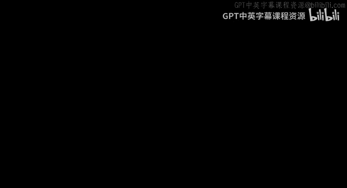
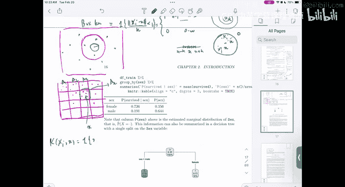
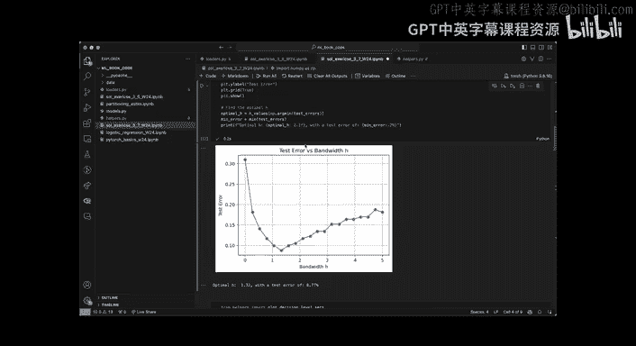
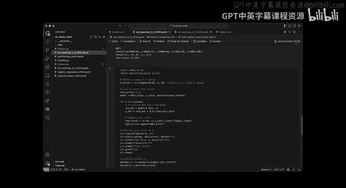
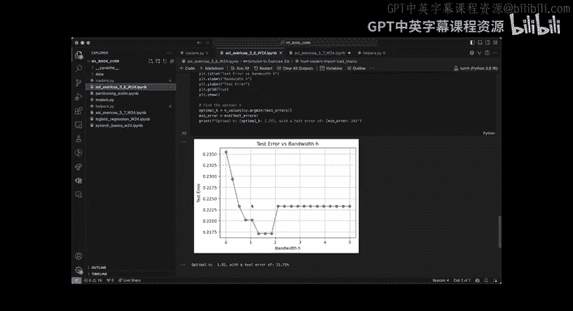

# UCLA《模式识别和机器学习｜Introduction to Pattern Recognition and ML Winter 2024》中英字幕 - P12：[12]Introduction to Pattern Recognition and ML -- Lecture 13 - Winter 2024.zh_en - GPT中英字幕课程资源 - BV167BfB8ETK

So。And。So if you think this follow creation。problemblem and then。We look at the very simple case。

When you have a binaryry。So。in the case where you had just。

And by the name of the Y we predict that's the classification problem and we also looked at the very simple case where you have x's in some discrete。

Featureiously， so the actually is also。Bary， for example。

A done a couple of pictures talking about the situation and how to find the optimal classifier。

Which is a time cent X。To why basically or well let's say this is the space of why。

This is the space of x， right， so you want a function that goes from the space of x to the space of y。

And predicts the why makes the next。 So we can use how we measure the performance， which is why。

loss function， so you introduce a loss function。Which measures how well you。Prety。

 so this function of x。It's going to be why hat。每听 the last就那报告。

We critic why by measuring in the south space so there are different many different loss functions in general。

 but we consider a specific one we part of it， but then you have a risk which is associated with classifier。

 which is going to be the expectation。Of this。Loss， okay。

 and so the specific loss function was if you had a01 loss， you would have。

A of why and Y hat is just indicatorof。Why not equal why hat， in which case occasionally be。

The probabilityability。Of why not equal y hat so under the one and the measure performance is measuring how。

How often you is classified or is probably idea of disclassification。So以这。P of Y equal F of X。

 I'm going to go over the。details。 but then the question that what is。

What is the optimal classifier at this point？And they break up this。So that's called the race。

 I believe or broke this up by commissioning even an X。And then very up more role。诶。

Which in this case would be。然上给个我的。But then this is all under the assumption that I know the joint distribution of the x Y here。

 so the assumption is that x and y are coming from a joint distribution。

 we should find little likely compute this optimal rule or the base rule， well we don't know it。

 so we might estimate this called we by average from the training data。

 and then this body optimal rule，And then we just have the types of error。呃Great。

Include the test error， the training errors， generalization errors which is the same with the test error and the validation errors is very similar to the test error for some reason to be separated。

嗯 then。So this is the structure of chapter one。And。

So the main idea is you start from this problem with the predictive problem reduce pathplication to y is01 and in further reduce to where x is displayed and you saw that this is it's not a problem if you have like two discrete features basically you would have。

诶。Combination， so you had like this P class， which was。嗯。So you had like sex and a pleasant class。

 which。Gives you all these combinations of。6 and55 plus discrete feature with six with。

 So basically all the things that we discussed for binary feature extends to。

Pedorical more and more than one pedagoical things there once even consider combinations。系。

对即个关所你一 ok企啊。Okay， so I think more generally， you need to how to。

They general shows how to find the optimal role， get the eligible solution in this simple case。

 they managed to actually get a public estimation of the。嗯。

Well is inaggu as an situation the off the so don let me that to remind you what the setting was so。

So。So the oracle problem is very assumed and you order tojo the distribution et so we decided what happens was the optimal rule is in this oracle situation okay so there was a majority pacifier which is here we just creates based on just what with knowing the possible portions of Y ignoring X so we should know about this majority pacifier we added one feature and binary feature we introduced this。

嗯。Chris， thanks on the last question if could be0 one and what we did is if you go through this part。

う。So we sort of。诶。Did this condition I think when you first said in this propose。Yeah。

 I think we proposed。Then we should， we should， we should test based on initial property by X without any justification and then we。

嗯Calculating。诶。There's breast， by condition in the hands。And then we realize that， okay。

 if I do this condition in the text。Then I can actually figure out the optimal rule。

 I don't have to guess。 So what happens is when when condition。An earth。There is this。Pes。

 which is which which so this clear's this piece which I can't control。

And then there's this piece which I can control okay。

 so this piece data can control in the probability， for example。

 that y is not equal to a particular decision given X so if X is for example email I can try and control this because let's sorry this is。

We have to do it the other way， let's go down。Yeah， so。I to write the risk like this。

Now I don't know if and what I do is I do commission listeninging on X and now if I have。 case。

 here I'm deciding have female as I can minimize this probability find true the decision asO and minimize is probability so your choice is like zero or one year for FOF。

And you collect both can and you get to many in find the one to do the same goes toward。This guy。

 so you're going to choose half of M， for example。Equal zero one and then if like once and then equal one once。

 and this gives you two different probabilities here and ensure ensure the decision on which one of them based on which problem you will solve。

Can you do this reasoning， you arrive at this。That the rule is the same and they're both like female and male and every minimize decision minimizes this conditional probability and this would gives you this optimal rule。

 okay？A the y is not equal to be x so that's the a size and if you go a little bit further。

 you realize that the same argument applies not for the zero loss。

 but for the general loss and not only for the speed x but for general x。

 so you would get this very general decomposition of the risk。

Based on this is the marginal distributionion of x。And then the minimizer would be。嗯So very。

Somemer down here。 So that's the。嗯，你在那。嗯。O the model。

 So I even decide to take the size but you try to do it we get subjects from。

Let's say from thisposition。From this decomposition of the risk。By conditioning on X。

 you realize that we need to minimize this， so in general， if you have。The expectation。

Loss of why and。F of x， this is the most general case。

 this would have the decomposition expectation of loss of y。And F of x。Yes。Conditional on x equal x。

 and then this Dnu x is you can think of it as just Px dx if you want。First。

 this is the marginal acid of x。Okay， so this part I can't control this one I can minimize do you find。

From this， it follows that the optimal rule。There's an argument。I can control this。

 so argument expectation， L， Y and D， I put a D here condition on x。And then D is on。

Let's say in this case would'd be in the space of why， so whatever why is。好的。So was creation。

In range of one so that would mean to start if you plug in the zero1 last， this would give you back。

This rule， okay， in the case of classification and here is a good like。

Point later we came back to this some replacements loss a driving bus and then in the context of regressionggress。

Sayme regression。L of y and F of x would be。Y minus f of x squared。

 so the optimal rule from the above would be a min。In this case， D would be in reals， let's say。

Because that's the space of why and then the expectation of why。Minus D squared conditional an x。

And talk unit number what this slide。What he said。Yeah。

 so this would be the expectation of initially term I given X。

Which is what we call the regression function so in the context regression it would be the regression function in the zero one last case。

 which is I mean here it would be。Even the role what said。So this is gonna be。Z is 01 function。

hir好 on。So if you do know sort of math， you would be equivalent to doing this Eda x the 915。

8 x less than one half where 8 x is again the。Regression function in this case。

 the same regression function， but in this case it would be the same as the probability of ypo1 given x is equal to x。

Hopefully you remember it because why is binary。嗯。They可 dominate this。 essentially I communicate a。

That's a binary class of the HIV thresholdhold in that one path that's say one less in the case of regression that it's just the solution in each tradition。

Okay， so that's sort的。The general piece。Okay risk minimization the big picture okay so that's sort of everything that you need to know at the population of the community distribution these are the optimal things to do the problem is we don't know this joint distribution so we have assume that we have a paying data with the higher example that are trying to estimate。

Most of our time we spend estimating this financial affected。

So I think this was a problem for the homeowner go recently do to show that to the why mindset that' square that you end up getting the reverse consumption。

Is the way to do that multiply out the Y modesty character term and like what's the。

What's the solution when you say it it sounds very good you can on that and you got the answer but I written out what other lines that solution right。

 so from this to this， so what do you guys think？阿 you。嗯。

Youd expand it and you take the deal you sign it and get a core advantage so you'd get like you。

Expectation O y minus。对对对对。Separate page here。嗯。So I want to minimize。This as a function。

 let's call this， I don't know。GFD， so it's a function of D。Y minus D。Squared。Imission on S。

 so the actual thing is to expand to expand you get the expectation of。Y squared minus2 YD。

That be squared， given x is equal to x。喂。再系。We said。Yeah。你 started in the。You know， ass the dignity。

It excellent。ExpectIf I didn't know some solid expectations it still multiplication come now so this is linear near expectation so if I have expectation of。

Alpha， let's say x plus beta y。I get alpha expectation of x plus beta expectation of y。

 so it's called being years your expectation one of the important properties。Liity or expectation。

那先得老烦厉害。And this conditional expectation stands up called our expectations。

 it has the same properties so I get expectation of y squared given x。😊，Minus 2 d again。

 is constant expectation of y given x。Plus g squared is constant so what。Okay， that's my expectation。

 so what is the next step？Ex。 so this is the like a function the sign is c it's a numbers。

So function E you did actually put functions， you either don't know it by heart or the minimal size like or very function they go trend five。

 so how the minimum is less。Or if you don't remember this there you know that this is a。

 so this looks something like。Like this， Okay， so quadratic function where the coefficient of the。

I is positive in that case， it's maximum it has a maximum here has a minimum。

 so I'm going to take the derivative B2。Yeah that's my not。

 so let's say partial respectively D okay of this quantity。Sa equal to0。 So if you think there。晚安嗯。

This is constant goes of it right， so this is linear I did negative two。Expectation of Y given X。

Plus TD equals0。You saw the idea expectation of argument。Okay。

So if you do the same without conditioning， what anything you do。没种不行。A expectation of why。

 So that would that would sense I was say that the best constant prediction of why。

The mutation of Y and then sleep does the best like conditional aspect， the best conditional。

 So this is saying， if I know X， what is the best approximation。Why any end up the initial。remember。

 at the end of the day， you have proven that actually like the best the best predictor of X given。😊。

So once you plug in so what this content content is saying is that if I minimize， so arguing。

Expectation of y minus f of x over all possible functions。

 so the best function of x that approximate y inC is the very function so best will be proved the argument is expectation of y given x。

😊，How did we prove this and two steps very found that the solution landscape of this part this comes from the general consideration of this condition idea。

 so this has extract and then this part in this case would be that open so we prove that the death。

Ands in approximation。Because so how y they I don't， I don't see y， they see X。

 they want to predict Y is an x the best function。And this is definition of the with approximation in the N sense。

 the quadratic law sense。Is there。I goes， okay。Everyone happyapp with that。Okay。

 so there's things in this chapter that are more than a little hard to get in so we suddenly the case。

 but then this part is made general not the。Well， and then you came back into。嗯。

Because in the general case， you can figure out that an approximation of this this star and exists spontaneous versus is that axis screen。

 So when we came back to that。嗯。This great case for approximation。

 so again I mean this is these all should be familiar at this point。

 so we go back to this optimal rule for a while。And。Oh， maybe even before before mentioning that。

There are a couple of exercises here that going through。

Sort of models that kind of a particular conditional model X and y。Or y given x and x so for example。

 this ex is giving you implicitly what the joint distributional y of x is once they specify intention distributional y sorry the marginal y and intention y of x given y given you the joint the。

 so you can， for example， calculateulate this optimal the world。Yeah。

 okay so guess a five times can do by A。And。对。Things come out the same goes。

 for example for these problems both are these problems different ways of satisfyifying the the and Y。

 which we call passing initials and。是。the same principle in the same applied。

 so I subsequently even y and also the marginal solution visual light。

 you can convert this but case through get condition that can probably your y one or threeorgan。

Which probably Y equal1 given x enough in this case。

 and that will give you the regression function you， in this case， you have to comparative one half。

嗯。问清。Let we did the general case here。You can see like if you have。

This is the structure of the optimal rule when I didn' a density for example in this example the。

 this is a general density， this is done or so we compared the lack of gras in the threshold class conditional densities we compared to threshold which is related to the those marginal probability marginal probability y or0 and1。

At the same this would be one to compare this one another way to compare to。 So this this。

 this is like the IP of ratio calling the IP ratio password this is a very specific application of those ideas in this setting where you get the。

and so this example， if you go through if these two problems are basically just。

Exle that and this particular when a classical approach。是 number the。

It mean this is different kind sigma is it not， and if you find the structure at the optimal low。

 it would be little new。function compared to C。 So this is again everything So so so you classifiedify to one side of height。

别 so的今。Thisis kind and analysis picture because of the decision value。

And they don't know the Sig new you actually estimate the data because we have a parametricic model in this case。

 it's easy to extend to when you don't know the joint distribution you assume the parametric model。

 you only need to estimate the parameters and you can do it so those with class one。

Training data you take average you get the mean so you get new for freedom one and new zero the estimate of them。

 and you also get this and the livari can pull all the data together and you can get an estimate of thevariance matches you plug in has here and so this double and see if you have done so you W is here C if they are So based on sequence here so you get has of these。

So you can fill this practice So it so this parametric models are easy to sort of do sort of。

Once again ingredient system the estimation of the parameters， which we can subject to。

咁 a快 so a be咧快到啲咧。Okay， so。This discussion was also like an off share。

Opal classified and optimal all。Yes， so questions。Okay。

 so then we went back to class Okay so one more before so we also talked about the sensitive learning images。

Work remembering， so this is once you understand what is going on with the。

And actually you didn't talk about it much， but you did it in an exercise so once you understand this general framework。

So any us that I give you， we can optimize it you kind of model by this。By this formula。

 which is you can think of that minimize positive risk。 So if the loss was 01， it would be symmetric。

 so。The way of penalizing the earth so much whether you move up y here equal one and you pass a 0 or you have a zero class with one you pay the same price of one to the loss of semicate。

 but you can have a different loss， for example， in general， the loss has like four。

Possible choices the L00， L01， L10 L11 mid Saor。You should better write it like this。I have。L00， L01。

呃。L10 L11， so if I if you specify the square， you specify the loss in the primary divification because y and y hat are。

So this is a big LYY hat。Okay， so let's say this is why， this is why he。

I have to put my four numbers in the。0ero1 last， this is specified like this。

0011 so you can see insymmetric or two errors， but it can be asymmetric， for example。

 can it can have an asymmetric loss or it can have like four different numbers like one， two， five。

 six。I could penalize being bred。おはい。Prevent you can find what the optimal rule would be if you don't want to be correct。

 let's say it want to be。It's very bad if I'm like doingre good if you can find an example of that。

 but oftentimes these are zero。So being correct means we have no cost。

 but we mean that these two numbers are different。Based on that。

 you go through this calculation and you find out that the optimal rule again looks like。

Something like that， but this this one half is not going to be one half anymore。

 so if you go through the details of this。Exercise。You get that the optimal。

The still factor is like comparing the radiation point threshold。

 but that threshold depends on the way you discussed by the last。As it's it's it's sort of。

Give you what the optimal rule is in this cost sensitive thing someone what's called cost sensitive learning。

嗯，然的。And到。But once you understand the general idea， this is just special case， okay？

They're happy to say， so this looks like one of the questions that people ask I hope people know how to do it。

this power would dependent on L0 so in this case， L01 10 or gen of and so this would depend on least deno number if I hitting like two and5 on least de number I think now it comes out of the point。

嗯。Wes all connected with passing ballots， so some people use this to handle passing ballots。对。

Let's not worry about thatine。Okay， so far so， so that's whats all about like optimal letting you know。

The joint service then came back to the case so we don't know in the screen case。

 so in general we get a fair example。嗯。Your true distribution and then the idea was to approximate。

Or this form of vaccination of the jointation， which I can do in the state case by this formula4。

This is just algorithm Okay， so you look at all the possible combinations of why next。嗯等下来。

How many of those are in the data divided by the total number and its proportions of those and that's estimates of the joint problem distribution。

 which is like a matrix in ready below this week， and it becomes in a valid probability distribution and followed all the rules。

 so it can be like， for example， conditional distribution。

 which is like the joint distribution that divided by the marginal distribution is all depth and also marginalizedserv there are marginal distribution takes with proportion。

I'm learning the teachers at a big level and then think that， and so this big must be approximation。

R诶。嗯。Because guess like they kind of shock out me like next and so I hit write down in and talking。

Well they stopty in up tomorrow， that sound but this approach is stopty in because youty in。

Into some estimateator that you know， so I need a this actually I plug in my little Peter class。

 so that's the data hand here。It's just this， right？Or P1 ata hat x is again。

 probability hat of y equal 1 given x is equal to x。

 which turns out to be the probability i from1 to n indicator Y I equal 1 and X I equal x。

Divided by the same tank。I from one， too。And indicate theirre X equal x， but Y I equal one。

And the same as just Yi， so your Y is like either zero or one， so just indicate there。

A Y I for one is really Y I。ok。Think of it when Y I is in zero1。

So this has this alternative form that they can write as Yi。Yi times the indicator of X。

And then divide by the indicator of Xi equal to x。And this further has the structure of India。

Summation iPhone one to N， W I X。Y I or this is WIX。Okay， so it's like invade made it。All right。O。

So the way could be associated eye training X。Based on current so you have。Pest X， like little X。

 one critic。In order to the page of this particular x。

 this is some zinc then train was for that particular x。

This simple idea is extendable so when I don't have if you have let's plug it in here and you can 100 plus。

And this idea is extendable to the case where thex either are not discrete。

 if you look at thispar unit perhaps perhaps this is a form of seniorarity sort measuring how those exerciseise your eggs。

Buting if they're the same。They're perfectly similar， they're not， they're just perfectly similar。

 but they can relax as assumption instead of the indicator I could have something like。

A kernelel here， right X。I forgot how I think probably like this XX。

So that indicator if I replace with the kernel。These are sometimes called carnels。So indicate what。

 it's not exactly actually the channel that glitter similarity to side X。 Okay。

 so this similarity is I'm writing it very generally doesn be very general。

 but generally if X is similar to excited is high。 it takes this seminar this is low。

 So this acts like a relaxed emotional。 So once we realize that we can do this。

 then this channelizes to。那个。The screen created multi initialal project， and so on。

 because I I just need to define the best part we call these local aggregate because。

So this is all aver because， so sometimes this this scenario area based on distance。

 So let's say again， if I be funny for example， Okay， so let'。Go down here。

So this is like chapter two basically so one way of defining the similarity。

Is why this notion of a translation invariant kernel or like not translation。

 but this is one like essential case where I have。A base kernel and an next slide to exileal insects divided by edge in the case of the Gaussian。

 it would be like the Gaussian terminal， it would be something like that。

Either two hs squared or H squared， so if my base kernelnal。

Is E to the negative u is squared over two。I get something like that and you can see this carel。

So if little x is close to x exactly equal to X， this is going to be0 it going1。

 If they're very far apart， this norm is going to be big。 And so this is going to be very small。

 Okay， so if you plug in this area there， you can call this local aver and because。

It's been happened why I been a exposed too。A x and it's actually embaraging over everything but it puts debates on the things that are close to so if I have X here the contours of this function would look like so they go down like that so it's very large here so I can visualize status this。

对埋嘅来嘅猫。So the pain is here an x and the goes down as move away okay so these are this these are the counters of this function。

 and so if the data point is here。It gets a smaller weight and then the depth the x。

 so the x is here。So this is the x domain。So this is XI， for example， this might be Xj。

 so this Xj just gets a million long base。😊，This XI gets a very small way people so yourre average corresponding wise it's according to how how far you are connected and when you can think of it and think that the local person in is a small way。

is the kernel sir is the box panel just pops up， so for example， my kernel is so the Gaussian kernel。

It could be indicator。Right， it could be one if。Xi minus x squared divided by。

 let's say h squared is less than1。Zero otherwise， and so this one you can write it as。不可。嗯。

So box care not。There would be indicator， basically。嗯。X I minus x divided by。

Hch less than equal equal to one。Okay， which is similar to saying。That it's going to be won。Or zero。

 depending on whether。So whether。Ps I suppose today。

 So it makes I suppose to thanks like thoses are an attached。

 then you put a price like you say the purpose if not， it's going to be。嗯。0。

 so there is a box of length。Okay， this is actually not a box so。

This is this is going to be actually a circle so it would box if this is a infinity okay if it's a infinity it would look like infinity。

😊，Okay， check out anything anything you are the maximum absolute if there't anything you know。

This would look like a boss， it it's a soonerar， which is essentially。

Perhapsb we shouldn they call it it will be box kernel in one dimensions because in one dimensions would be interval。

 but here it would be actually like a circle。Because the L2 norm。

 so this is a circle centered or like a steerir goal。Thing centered at X， which。Raddius edge。

 so any X that lies here。Get a make one， anything that's outside get zero but it is a sharp。Canada每次。

嗯。No race they sharp be。this work I call bike and that usually a。

It would be the same saying like in one dimension， it would be just an interval。嗯。So it gets。

An interval of side length。呃。92 edge， the express edge minus。嗯。Now if you change the norm。

 there are different norms， I can change this norm， this is ultra norm norm， for example。

 and very I norm with diet。Okay。最高单内。不好意思，走。对的。嗯。Okay， so that's the idea。

Local avenue and so this particular version where we do this we have a abandoned family Sal Wason but this more general for。

 for example， includes things like nearest K nearest neighbor so the similarity could be a similar excited。

X I think that case's nearest neighbor is the little X in the family。

You look at a training data we sort to X accordingly X is are according from the distance to X。

And the data points that are within the cage mirror。Get rate one。

 there rest at zero and so if you think about just only in K and instead up and also here sum of the K errors say already over K of the Wifi involved so that doesn't look like this not very want business its not translation。

not transating， it's like it's not translation like this is anway translation on a single channel。

 that's not like that， but the same for the principle at the report。

And so we started analyzing like something like and mean don't mind something that makes it even simpler and also lying the hand of class。

 but it's not know the partition needs get for the box kernel so like if we use the box kernel。

 is it possible to get a denominator as zero。It is。

 it is possible in that way like what do you do for？对个。So what do you guys think which。It's a very。

 very small number exactly denomin zero then deminYeah。

A little longer here to avoid the inclusion by zero but then maybe an exact way of doing it the answer is that if you have a Moscow what will happen in let's say I have my data points。

And you're predicting at a point。Where this this like circle does not contain so I would say call it on the fine。

So that that estimate will be under final purpose。Okay， and。You you have to deal with it somehow。

 but this bandwidth is too small and maybe it can increase your bandwidth and hopefully within the range of the exit that you consider at least one of the data points inside of it in the bandwidth selection process。

 you can sort of rule out those cases because。But that would be like a better choice。

 so I'm going to at least make it big enough。So that hopefully for the range of xs that I necessarily I want to predict in this box。

 for all the Xes in this box， when I vary and circle it around you capture one the。I agree agree。

You can also move it unde that。Do something else， but but that's like a deficiency of this。

 So that doesn't happen， for example， where the Ya。You imagine can positive you so yet。

 like everything is available but very small，But yeah， in practice。

 it happening like where you if the x is suitable， the doesn't compute the ones too far。

 the points are too far from your x， even though you're using a Gaussian kernel。

You know so did this is going to be new yeah， yeah。

 so that's in our maybe yeah you right if that's very large and just up to zero true so there's like issues with numerical precision but in theory this is dynamic this is very zero in fact。

 this system here。😊，自有 deal with that。Okay， so that's the general idea right the partitioning estimator is similar。

 but it does。嗯道。What it does is just it partitions， right， let's say it partition the space。嗯。Okay。

Yeah。所有个。Sa how many into points。Or which data points lie within a particular？

Cll and you also determine your little x is in one cell so the cell of the partition that contains x we call so these are like like A1。

 for example， a2， these are different cells， okay a3 and so on。

 the cell of the partition that contains x we call this Ax for analysis right。

And so this partitioning eimator is the same as this local averaging idea here with this kernel being so it will be similar to this。

 or like within that general pass。You can call it similarity averaging if you want。

 where x k x and x is just indicator of x in。

So Xi is an x。嗯。嗯。One， if Xi is in the x。Zero everybody please。Okay。

 and we analyzed this particular e leading the biospherical composition， which he。

And你 have I thought about。呃。But depending on what。 so my client is mainly to go through the call at this point。

 I had a false sound because some people had typically being implementing these。

And it might be strategic go it's fine I thought when it。In the age of tax AP you can do the not。

 hopefully。Pargeing related partially develop know that。And见 clarify。So let me show you how。

One way of implementing these ideas。我的。嗯。It's good practice to like。嗯。

So this is not perfect software engineering， but you can like collect functions or like things that are。

You can use later， so you put things in little functions or classes and then collect them in。

Fs that increasingly modules in impact on it。And then called so I have this helper got helper the pie contains some of the。

Things that are useful so for example， this taught contours。Pt the contours， there's this plot。

Decision level sex that。I we' talking about the hidden meta and model high model which essentially function and evaluates it。

And but it's assuming all of this things that like theres a pretty issue the' two research because otherwise it can't。

So this contains a bunch of those and the models this file contains。The modelss and。

你你 not so so this is like another over。嗯。Engineer， let's say。

 but I wanted to introduce this is because you get miss for team。F force kind of。你没。So this is。

 for example。My version of implementing the net Okay， so what is this this is。

How people on Pytorch implement。Models， so you have so you're doing the import to Nm so anyway you do up。

嗯但 and then so now have the say end。Module basically or like n a Python module and then there's an n and do module。

 which is like a base class or these。F find myself like another want got it in one the is。

Usually it starts like the class names to start with upper case。嗯。对。

like not you okay it's just an object to you class and this is going implement im version when I essentially this pass I get an object which is it is another once a month Okay for example。

 my idea is that I'm going to apply through this and say I looking make very one object fly that so it's going to be a different object that they have the same functionality so this is taking acid in that。

So the first thing is so it inhers from this NN module。

 which has a lot of interesting functionality so all those functional are there when we need it in this part we don't mean it against convention。

This is a construct of the class， so it's initialized this everything and if you haven't seen Python。

 you pass this。The first argument usually call itself you pass to this and when you associate this is going to contain the option okay so for example in this aspect I like。

Set some fields or like properties or felt that exchange is never the exchange。

 So when I like accent this model， I get。Again obviously that contains the training data in this field contains the wire training data in this field and a lot of like software things that you have to worry about。

 so this is changed of ensuring that the type of the y chain is the same as the。

Exchan and one is not ex to the 64 and9 beach。 So there do think that。

Hopefully be able to you can figure it out and then I also like had a kernel which is this is getting a bunch so you can pass functions along by also in art so the all did this' got Yasing channel。

 which are in the bike area。And so if you want to change the camera the positive deter own function。

 you might it here and you will not realizing that。Okay。

 so today I sort of wrote it there many different ways。

 but I define this these channelss within an excellent exchange， okay so what it does is。我。不。嗯。

水以要不要看一下。Major is X and it's changed。T。So this could be like。

And rows but this side E features and then you have n and again E features and what it gives you is like this M by n meetings okay contains contains Kx。

 let's say。It should basically that X， that's the little X and big X one。 so little X。

You' the eyebrow of this。And it is two companies but。你这么嘢。

But hopefully the same distinctions to mutual skills， definitely， but it is like capital next size。

I drove this。Well like I I  that0% this is the I this is the J。G there， so this leads me yeah。

没问题就这个什意。我成这个。嗯，没个。嗯。系自己哎。So thank you， let's continue this is see。So the eyebrow， the jas row。

 these are the dimensional data there's a kernel value for that， so this gives me that。

 so this gives me a kernel matrix which is M。Okay。And it like measures the s of the eyetro。

 so isn for us is going to mut it as I'm calling the in capital x as the ex chain。Okay。

 or mean you can call it a this that you want to get so it's a row to row comparison is that it compares every row of this to every row of this so there are M rows here Ms like n times n pair。

All like possible comparison with。Oh， I see， I see in't it。

So this gives you an M by10H and what what in the story you do that So that so I。One。

 these function carriesmount to doing that so x is the first matrix， this is the second matrix。

 and this has been a that that made so this seamless sense or seeing sense computes the para distance。

 so it give you x and exchange this torch。Seeです。This get neuro parazed distances。

It gives you the matrix， the I element is basically the C matrix。

Thanks so that from kernel function returns a whole matrix that whole link exists。不。

Are you saying that I。So you will have a similarity for each testifying。For each test fine。

 so this would be actually one test fine。Right and yeah。

 similarities with end of your training data you have10 numbers so then that would be like the my of this yeah。

 right how similar this test is to all the ends。And how similar as part is to all the ends is the other group so you need this so if you just testing at what point setting in our discussion all you usually have just a single X you have just past like single X。

I can do this kernel now for a single text， we would just see just the wrong matrix。

So this key exc e。Into the vector there I come on then I did that so this this can do also the code you can just pass it。

 I'll say later on you can pass any number rows， but it can mentioned it often that you want to calculate on multiple testaments so usually your test is like multiple and so you want to write function or models such as they can operate on multiple samples at a time。

Again， this is useful in the case because this operation is fast you to forward we saw that technology we code and also it R。

 it can characterizeize it so this actually so it score that is gradient C for example so you don't have to do before them so this just computes the pair distance of all the roosevet and all the roosevet and gives you that then my yausing channel just h this and it's something like minus this matrix squared point lines which is that。

And then divided by here have divide by each squared， which is a finite like this。

And then more read I can leave it here or drop it in this case because of the division my if I put it here because for something reason thats if I want to later add like。

Construct cameras from Samsza。The ation channel is something else， this might be useful。

 but if you just just do it and then another there want some use to canceled that so that's the actiontion。

好的。If you want to want to show you another example， your own custom panel。

 if you want to do this use this， love if you write something that needs you to paraize similar。

 whatever a practitioneritioning or like1 years anywhere you can find on there or something else。

So once you have it， this is actually like more gentle than very lotsson。The they advantage。 So okay。

 so this is how you visual device and then there are these classes always have a forward method that you overlook and redeine it your own bit。

 So there's they're expected to have a forward method。

 So these are different So I have the visualization this is the construct and I have a forward minute what it does is I going to call when I apply the model to data。

 this is going to get called so this is where the action。So。What happens， for example， think。

Sort of creating a model。哦。当 want initialization for example嘅。嗯。Ex's train。Yeah。

It's Y tree and a caram it's a Gaussian caram so now this is an object so when I'm applying this object so this is going to need a solve thinking after visualization whatever so this called gets run self refer to this law so when I apply it for some from x and given it for example 3。

0 this is going to call。This one， so this is the quick one it's the same like format。冇。

And so let's just translate to that。I guess so environmental one something like that I' notified on。

 but isn' it good to saying that else that forward。

Take this method of the past finding with the model X century， so this is like。

You apply these models like functions okay， so it's like an object， but it nice like a functions。

 I can drop a second usually you just apply to next， but I can pass any number of the。

P is that they want， it taste space。And evaluate。And。嗯。Ting eggs into the same path as snake explain。

 compute the channels of these so thats the em body。

M my N matrix this matrix right the kernel matrix and then this is the implementation of the another one。

 so why is that implementation because。So you imagine。

 I'm trying to calculate at the gap of the same as theI。For all the eyes， Okay。

 and this is going to be one of our。You don't actually be one end so like sumation， K， Z I， x J。

 and then it's going Y J。Theyt want to end the by by。系すか。嗯，这。Yeah that's so if you look at this。

 this is I think of it as a matrix multialification， so this is。诶。So if I draw up that kernel matrix。

 which is K。then I。Dot Im going to be dark here。 So and X vary， this is going to be one row。

 and then I multipied by。So let's make the why this。

This is like y thing but the elements are y J y two y Okay。

 so each row this this multi that produces this。 Okay， so I have multiple rows。

 if if I lu multiplication， each row gets multiplied。Okay。

 so when I do this matrix it as an matrix molecule case ways that the kernel matrix multi type self by train now produce these for all DisneyI。

 so it gives me a vector N by one so this is N by N。This is an n by one a very result M by one。

 which is the new rate。And if I'm multiplied by by the better all once， it gives me the economic。

 just sum everywhere row。The that that， of course， ones like that。

 one of like that is like creates a vector of ones。That's the same shape as large chain。

So first I multi my wide train and then also multi my elector ones of shame why and then divide that's a very quite by division so this app is major qualification on everything else is that white or so this just implemented like in one。

that localhy yes to the numerator andnominator matrices are columns of at this point their columns number of rows equal to X that you feed model like yes。

 yes， technically they're not。Coollum vector's not vector， yes， so yeah。

 so they were like they they're like math theyre column vector， but in five or。

 the difference between it like the column vector color vector has shape M and one the vector has shape M and nothing。

I guess it's just a minor distinction。 Okay， so this is like two dimensional。

 This is one dimensional。But you can pass between them yeah and so you define your model。

 you call and know you and then when you're using your model。

 you feed it like the test the validation data， you don't have to actually pass it the training anymore right right so once so the so this is one design it could be different design but the way I designed it just this version I pass like explain why can and the can of once so then I accentiateated the model Now this is the Nadoya Wason with these these so I can now apply the different data。

Right and I sort of designed it again and so the previous version that the bandage was also here。

 so bad date through the model not just passinging it in the core of our past because this would simplify that I want to subject to that effect I don't have to read initialize this so let say training data white this big isn't done once。

And then， for example， I went outside the model with different band I came make impressive。

Thats good。So if you like play with this a little bit。

 you can do it like with four loop and everything that this is not necessarily not very this is the best thing。

 but this is being hopefully fast and it's like。Sort of maybe mismus up Pytor because Py is like designed to do like training or but it's good way this way because now you can compare it with like neural networks so there's zero k going on like it's just initialization application。

Then minor training is an edge and it do separate。So let me maybe show you。One example。

So that this is used in both this solution， which is a little bit more tricky。

I'm not sure if you have time。This defines a cost and maybe let me tell you about this first。

And this is the breast cancer data。And there's okay and these load there there's this load breast cancer which you can go it just does a lot of。

嗯。Clean up， like loads of data， cleans it up so that we are in。Start position for。Yes， if I run this。

 for example。C个传s。Yeah。Yes。To。Okay， it ran and you can see like X train， for example is。Yeah。

It towards tensor and you can see the shade that's like。9A and then there's the X test， which is。嗯。

One next single one so that's like and you you wrote a function and alert the data yes the other part is this so' with loaders and it's there so from loaders import this okay so now I can use this function and if you go this this is the loaders。

没。It looks like the。This data just like there are a lot of messy things to deal with like you load it as a upons or data frame like art。

 but then you translate I'm doing a bit of things here so I'm dropping the Ns which may or not be a good idea but。

Hopefully that you can figure that out so that's the thing so that I have the X test and then the train。

😊，So here， for example， I'm calculating that。You can see the kernel matrix applied the excess and and the boundary of the changed and if I run this and print the shape you can see it。

This rate is 171 and39 these mean that and by N matrixx， and you can plot it there also like。

And nice like okay， this is anything you to go through。Right right click。

 this is in the helpers as you can read like this is a chat GP's suggestion how to get like like a working link。

没。Nice color start by this so。嗯。But在 can。It gives you。啊。吔见要。

You can see the civil by changing the bandwidth。If I make it smaller。So if I make it larger。

If I make it very small， you can see what happens。Thank you。There。

So very small everything is close to zero so they're very like few things that are similar if I make it large you can see like a lot of things are similar everything is basically similar so this bandwidth measured how similar and if you think about how the Gaussian kernel is working that makes sense okay so claim with this and then。

Here's when we apply it， so I take a bunch of。嗯。H values and I initialize the model。

 so let's see if the model is Na what's an x train。

 Y train capacity kernel this initialize in the model。

Going to a4 I apply model of excess and the current and I compare it with one half。

 so that's my a hat I compare one hat half type like this is like technical part so you get my hat like zero one and then I compare with。

The white test trying me this is a ten that my item with the number so let's give you a test error so I just as the and thenend it to the test errors if should like it and give inside did a list of test errors for the good and here I'm going to plot them right so here you plot them and。

So you can see that's how the plot looks like， and then there's a spa way you compute for the optimal the minimum argument。

 because there's the argument。Not I already apply in this area and invest but independent。

 that's the ultimate dynamic。不好です。啊，可以。Okay， and then there are other times so you can go through this other file。

 which is this does the Titanic with that。

嗯。M Karen this so brother Karen that you have the and a。

I think it's prepared to hear you this design so there's this imputation because some of the data is missing。

 so here we。😊，Icused by replacing aid with their media。

We can do it in different ways but' that's something that you have to figure out to do what to do and this goes through the logic of how this kernel is cache so there is the kernel so you really find the kernel this are the different things I just pretty into the paint and by to throw through this and the way that we do it is like apply the actually kernel to behave and here you apply this is on the screen this like fancy layers three。

Paraise comparison。So the top bullet here are of the systems statement。哎，对。

But this's this computing the kernel and makes kernel and then you apply this is a kernel and then you apply the same procedure and then you get。

啊多大。Okay。😊。

嗯，可以。