# UCLA《模式识别和机器学习｜Introduction to Pattern Recognition and ML Winter 2024》中英字幕 - P13：[13]Introduction to Pattern Recognition and ML -- Lecture 14 - Winter 2024.zh_en - GPT中英字幕课程资源 - BV167BfB8ETK

Parentic my。So， the idea is。You're going to assume right assume function as para before。

And I can quality but I see my for case。And so this。は。Simplified the problem a lot because。

AmAmong all the possible regression functions we're just looking at。

Preation functions that like this。诶。呃。So you know it it the。Moel is like this， then。诶。

The optimal rule， right， the base rule is the one for further classification for the base0 one last。

 so threshold these are one half。And so one half here is zero。ItSo you。

It is an value which is payta France was x equal to zero。Right， and see we have it here。

And so youll get a decision certain boundary。like this。And then。As a very。系啊好。嗯。就就今天刚才 decision当里千万你。

Where all the eggs with by。とこはた。And then on all the other level sense this function。

 so level sense in word this is equal to all the excess for each system equal to a particular right for example。

All basis for is0。9 both have the same。While here y many what to one and so all those levels as are these lines are in general0 things in and then you can see the direction right so you have the direction which is。

spec by ourar。And he mind or hyperplaned or thought that and as you move along。

 how kind of take that start。呃。And apparently the get larger so you know it's like increasing that duration and so you can see。

To this side。And Bob。That decision value where take start point is where。诶。有一个是他就这个的话他其他对。

And that's one assignment by the usual。And below it。嗯你就 question less than that。0。一世该で。After all。

 right so。And then I talked a little bit about that the actual label。

The point so that's what you generate from a model like this。

 so if you want to generate from the model it's not enough to specify just。And this parametric form。

Because you also need a mark variable for x， so that will depend。

What do you want to do with say models like that normal gives a grants identity。这。This is a。我贝家你都关晒。

嗯。So the standards we are too playing everywhere， but closer to。Yeah。三点时对不是真肯的。

Equally spaced around the Or， et cea。这知な你す。And so that's the marginal。

 this is the additional and then the point is a lot of the points that are near the boundary。

Do we not have so example the points that above the boundary and not necessarily， for example。

 here the two two angles or the they like。You observe when you finish by the formula that that you want。

 although the al will assign force and anything below here is not zero as you move right from the boundary because it's called weak it's very。

Those either one reserve zero， you get even more certain so there the points that are maybe below the decision boundary that were pretty much almost surely assign zero and the wanted to depend around there almost assign on linear value。

Again there's some noise in the problem。Which is just the difference between the label。

 the assigned like the visual and the included label。

So if you think about this is sort of on the same。So the difficulty of the problem。

 there is this fundamental limit， which is the base error and normally you can。There there you go。

 no I to say what item。Pation and so classifying the design and that's because of this impact this is the best you can do and the best we can do just have this and then look that。

Price of the size of the behavior。And so we also talked about that basically made on the problem of this if you think about。

ノも stateバ noは。So you can divide a multi the storms at the start。

 but then you that wind direction is going to define the hyper plane。

 so the hyper plane gets the defined the decision boundary。If you look at it it's data。

 it doesn't change very you。Because if I divide data style this ignore， for example， by the number。

 this type of them doesn't change。 so the decision values from variant to the stain of they slack so this is still defined the same decision around me what the normal data sign does。

And control of the signalbil。Okay， this is very large。 So you looked at a different way。

 so you can define a new。Savewide function which is like that and I apply this students this normalizing to when sub transfers X so this when you find swide function you can see if you plot。

When came the sun no the sun large and has way sharp end。

They're not take exactly saw every very gradual transition and transition here sort of tell how fast do you make。

Sage from the past one， zero to one as you think across that is an unknown。

And so you get more noisy data。It it been so is small。

And very like showing family paper start and one paper start as large。Okay嗯。Any questions。

 this is like a reach out。Yeah， yeah， there is some inherent life and that yes you is that so can anyone tell me like to say some of these because why they're para noise anything as well。

So the noise is roughly the difference between。The true label and the label sign that the base is specify that doesn't because it's a hypo quantum article no。

 no， no， no， it doesn't matter if it's a carever or adequate way。

It it as this probability is not going to be。ゼ one。It's like1 between is0 one。

 So the points are points here。That is sign probability105。Their point would get sign probably 8。6。

 their point would is sign probably 0。99。The points of so this model allows me。

 So this this thing the gra is not like a sub function。So this means that for some excess。

This is not exactly zero， exactly one。And so when you generate from this model。If I fix that X。

 sometimes I get。They are some I get one。So as far as I。系啊咁。You can' do it like in code。

 and want to show you some code。But let's say a fixed X。Right， thanks thanks。

And then theta star transpose x is 0。The sigma zero is like that。Okay。

 so if I now have that x as I condition on that x when I generate the label。

 there's like 50% chance of coming up one and 52% chance of coming up zero and I can't know ahead of the time。

 but every time I generate。I get a random them。Choice， and this is not avoided。

 but so you can't tell it。 So all I can see is next。你听系听你听。M perfect based on it。

 so that's the inherent way we thought。嗯。So if you think of the image class initiative， for example。

 for example， this is this is like something worth thinking about so sometimes。

And machine learning is like one another called application of this vision。最原该嘅。

Other than the classicalal problem vision and it's like classification of image so you have you show me an image I'll tell you if a cat or a dog or horse is't bit simple escape and in some cases if you should show me an image I mean you can imagine that。

This image is going to be a horse for sure， its like it's not going to be like a cat or the dog。

 but there are some images that。It could't be a cat， It could be a dog okay and。

Someund situation by theH it's harder to argue like that。

 but in the vision is like to find so like it seems like for example， the vision problem。

 there is a very sharp like the cases in which there is a uncertainty in the label true name the image is as low。

 but you can imagine there are some cases like for example， blood pressure cancer， etc ce et ce。

 it could be like all the teachers like all the diagnostic or two person are the same one gets sense。

This outcome， you other think is that helpful and it's not to。有没有。呃。

Sometimes you might imagine that there is some late and valuable perhaps that you are not including。

But得呢来我 drive。Maybe she knew all the。呢来我 then就是咗的。呃。对。For the businessesic have learned about this。

So the reason about quantum mechanics and stuff like that are the local vi he didn't value want it。

You don't see that the。Pauses the random phenomenon causes right see that this this land for example。

 whether I the the random label that that' on this boundary。 So the point is on this boundary。

 I get the random label because theres another random I don't see。 if I see that then。

Whether you know it or not I don't so that's a different question right but one course you have this X and your models like that。

诶。对 they有点黑。What the sources？So you're not saying modeling， so you're modeling into the eating there。

In case， too much too much。Offf topic。But is it not fair yes。

 and you' said that we can increase miles by increase in the magnitude of the yes， yes， yes。Yes。

 and that's another point which is often。I would say overlooked。The people， for example。

 look at notice just to go there they want to make model， simulate data。Pacification。

 they generate from this， for example， and then they they want to increase the oil。

 which is add they flip some of the nis that trying。

That you can do but there is an a international way of doing in this that。いはい。So the last point。

 then is if I let's。我他是本来就是电听。The normal data在最全。We got all yeah。

 from stuff like that means that like。Perfectly separate。

 and so if you reason backward for in the cases where you have actual data。

Suppose you have actual data and you try to fit this model and there is perfect separate so you can linearly separate everything so these are called。

Being nearly separable cases。So I have one class。It is here。Another class。

Which is there in the real data and there is a perfectly。诶。And there's a perfect classification。

 so I can pass the line here for example。Se brings the two。

 then you can imagine that when you try to。嗯。You when they did this the the star my co pain。

Soねと nothing。of the maximum maximum so we went through the maximum likelihood that look and that leads to this vast minimization that you want to do but if you're dealing with case like that。

 when you start to optimize your parental research。That's fine。

 so as long as the direction is right so you care about the direction。

 maybe don't care too much about that。So after a lot direction state like。

 it slow then continue to in the long direction so you did de using the precision boundary。

ectAll would be good。It。That's没问题。So and I want to go through the code a little bit try tempo so the other thing that we did。

 which was a while ago is how to fit this model and。We started with this general framework。

 if by the character model， I can look at the maxonicical estimator。

 which would be maximizing the likelihood and the nice of this model the be the observed water experiment like sand。

Ha a function of data， so this is kind data and because of the I assumption thecyclizing marginal conditional distribution。

Our identities are this problem in mass functions。And so this。Re modeled as a。Right right， so Bi。

 it's a potato transfer that's the not a way of saying the problem because why five people want to exc that so they bring went into the bei。

Characterization or like the statement， so these two statements are the same。

For a random variable well， it takes just value01。So we have。This is。

Factorization by independence and then we have this short interpretation you cycle remember and then you take the log or the negative log and then you tries to minimize you take log negative log tries to minimize the problem reduces to。

And。This is the general form。Dely might like a estimator in the empirical minimization4。

 so this is essentially minimizing a particular empirical risk。And in the particular case of。あです。

The model that we have a native lens hit looks like that。

 and you can write it down and this particular formally called this ECE。

Findining President and she named people by。And it's really to your best central。嗯。Between two。你个系。

And that's the final that sort the loss of between illegal。

And all 80 so zero1 here and thens something equal0 and1 here is something to zero1 and given that I might it in the simple fashion where G theta of X is this6 point theta trans X and I'm meizing multi that you can see this positive in the framework of integral synization。

 it not a loss measuring with this sense of a loss between the true label and the predictive label。

But this is how the label is just the quality that the loss of the binding。

The true label and the prediction like the print probability are predicted probability which is fine。

诶。All and。This is a para family so it's like a function。

 so as the values is these functions the project last data。

And so we're really doing some very corresponding of more restrict。And if I absorbed this D Santata。

 so sorry the streetta has the sigma in it， so this is。呃。住地噶。So if I absorb the sigma into the loss。

 you do some calculations and there is a simpler form so I can write everything like that。

 where now instead of that Gtata， the linear function appears there。And this loss is not this loss。

 if you call this v loss。SoThe two problems are equally。And you can see there is a bit of the。嗯。

Part of the。Function that you were trying to use as the pre is not inside the loss。

 so if you imagine。This happens so I absorbed it into the loss function so my prediction for example。

 if you want to do like。嗯。I'm going to introduce some like not or like diagrams thats useful in neural networks。

 so you have your input。Which is x， right it passes through a linear function。

I'm going to do it like that， Okay， so this goes to like。Since it takes。嗯。

An input just produces an output， so this is like。It's a little hard to do。

 so let's see if I want to。嗯。Yeah， maybe I'm not okay。

 so that's let's not do it so just linear math okay linear。

This goes in and something comes out and then there is this nonlinear map， which is sigma。Okay。

 so that's our model， so the stage that produces theta transpose x。And so that's the linear map。

X goes in and then this is this previous sigma theta transpose x。So that could' be our model。

And then our losses that you see or I can cut the model at this point。

And then absorb this into the loss。hich which is often needs be like because that's what we're going to do most of the time like this is constant like this there's nothing optimize here and they just push it through the loss。

So all this are the last。And then so the output here would be。

The meaning of the output is that probably the meaning at this point is anyone remembers。

The output here is。These are the log odds or logics Okay。

 so our model can produce some logics or can produce proities depending level it's not。

 but the end result is the same。So most often we work with this kind of。Vers。Its意见。你几。All is good。对。

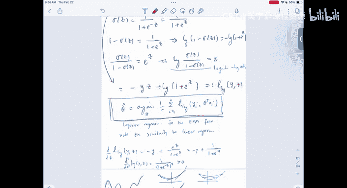

So。This is the logistic traditional city， right？And。What I'm going to do is I'm going to generate。

Data from the model that I mentioned。And it's worth remembering that I can write。嗯。Yes。

is important so I can rank。Yes are。And this is。Next one transfer。Ex those sides made aside。

So this gives me X。One dress was it the sorrow to the。And so the eye office this。哎。

So this matrix or this this。Contract of care really near just law of citizens。

So I can put the data points training access in a matrix which we call a design matrix。

 but I mean the x are the matrix， and if I'm multiplly by a PS I can。

Basically produce the output as this linear map or linear layer if you want at every datata one so really we'll see like a linear。

哇。It just。Something that takes let's say X。And outputs datata todipos x。And this can be。嗯。

Moodeelled as like x times。It is sorry if I had a bunch of input， so usually you can remember。

We want to calculate the。Output on these blocks for multiple inputs because of multiple training or multiple tests。

 and so I give them as a matrix decision and by。P要是不逼。In this case and my。Okay。

 so that's the awkward notice this。啊连人啊练人听嘅。And okay。

 so that that's good to remember now werem generating and doing 500 samples。

呃This is this the known by。Normal random and is normal， so we create a normal random variable。

500 by two Okay， so these are the rows are chain examples and everything is too international I'm going to set SNR equal to one。

This is not say20 major's that。Bs are than the most true bike， so the the true is。

Like I think theyre tree and tree， so it's 45 degrees。But representing the 45 degree line。

 the existing matter can be followedically。The45 to9 plan。And then I define it for。That's a problem。

ObservingSo this if you look at this closely， this is the sigma basically。This calculates the sigma。

啊。Data， let's say true， data star transfer goes exc for all I because。These operations are。

Pored mind so。This x pi add a to number at is an interesting application so I give a new damage matrix complications it produces that an international lake there。

啊。嗯。The output of these linear mass。 and then I apply the signal the signal in one。

Find one plus into the negative。我 this dream。Okay。One more one。

They can start transpoing Xi and I'm generating this all eye in a block then。

 but then putting them in the matrix so it in this case of beta n by one。And then系嘅譬诶不咗样。

And variable with one observation which we be very good essentially and it probably is probably very。

 so it produces an observation so this is flipping point with probably。

So that's how we generate the model， and then I'm going to apply it。St good flats。

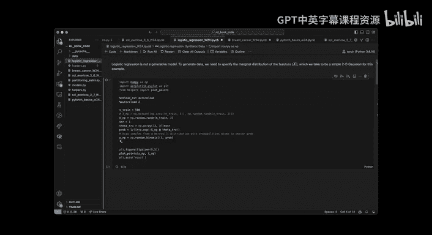

So， that's a。OkayOkay so you can see there Gaassian， so if he's northern Nas。

 this is a pre dimension Gasian with identical polarvarious matrix。

And one thing that we can see here is theno， so we can also。

are power in that direction so what would happen for example if I change this SNR so let's say if I。

Changey 2。1， what do you think will happen？对。So let's see which way it goes。你是啊。Be worse。

So you can see it's worse。Okay， there is still logistic regressiongress。

 but now because that transition function is very。呃， smoothmth。So everything is mixed up。

All the points are like。So if we may here30， like maybe may here 31， cinema around is still there。

 but then like the area around that things are on3。Wider， so if I turn it into 10。

So you can see that very big shocker。thanks。嗯。I think we can't see much more sharper than this。

 but say sharp。呃人家这他那个。So that's the effective size of。Data， Okay， so this is looks like a。いなまです。And。

That was good， but that's the setting。诶。Okay can see this just。

Tsforms these nuized areas to fight for sensors。This might not be the best thing from the pipe it just。

I searched， it just keeps the data fairly to keep the data。

And the non binary doesn't calculate itlect technical details you don't have to worry about。

Another way painting is just as you push the tenor on past the and this plot is。

It's going to be like a lot of frustration is going to be caused by this because there are different data types。

There's low 32， there's flow 64 and sometimes when you create and don't specify the types。

 some some floorpen might be flow 32。might have health look do that some might have look at 64 and then you get an error of try to multiply or operate。

So the airflow is for， it's good too。Make sure everything is。That's the shave， this is de type。

 theta types。So it's little 32 and hopefully we're going to be okay。

So there's a default type that by which these are created。

I want everything in there so this is this is the this is the labels and this is the data right so these are not course tenss。

And I can， for example， look at the first。By。嗯。And the labels as well。Okay， now we want to do。

Lets segregation， and we're going to do this version in the log。

 so that's a log loss and this is my empirical problem。

Risk and I just have to implement this loss or we should call it risk probably and this is what is doing there so I give this function and data the calculate kind data。

呃。Mattrix X data thats mean volumes and so。Mus y times z z now is this so this this operation is。

 so this is a vector。 Y is the vector z also a vector， So this would be 05。I will calculate why。

I to and are for all eyes。Elen why the invasion of Blue As。And this't just what this is for July。

 one and， just the saw first part once。所一线等于等的幂。So that pre was average I think so that's our loss。诶。

So here I' like started， this is the。Let's sorry。嗯。3 minus3。And then I written the function。

 creating certain momentum。I granted my loss。Data rate this is actually much better so we haven't talked about this so in with this。

 this is the basic gradient。So basically anything similar is no to go loss data。

 learning go into that and remind you what this is， but isn't basically essentially9。嗯。

The bank that abstracts that invest。So who wrote the gradient fifth and entire procedures the saying the only thing to change is the loss so that I was going to function and pass the loss and it just says the agreement an algorithm。

Thank。Some people call gradient and send like a meta algorithms。嗯。So whatever your problem is？

You set it up and the grain new sensor of results。Se optimization out of assembly is met learning，s。

嗯好好直己 or该身 or。So I'll dig into that， but you can see the trajectory so the small plot plus trajectory is started from。

Three and minus three， so that's the starting point。And then we make descend send along。Yeah。

The law process that we when talk about green hormones are perpendicular。It the set is slow for。嗯。

No okay， so where the moves here and you can see it's like very slow， really slow。

 that's where this momentum idea comes in。You can see if I do this， which we'll talk about later。

That does it much faster。嗯。Oh， so the same learning learning point so it this through learning。

Let me use the same learning rate， this is the step size which machine learning called learning rate so this is like stepside one gradient de。

You can see you guys here。And new gradient becomes very small so areas still takes a long time very。

 very very like many steps to move this momentum the idea is that okay I've been moving I'm going to push myself no matter what the gradient is。

 so it's going to use the previous gradient basically you can see much better to the same learning it pushes around and that's the。

😊，Switch and come back。

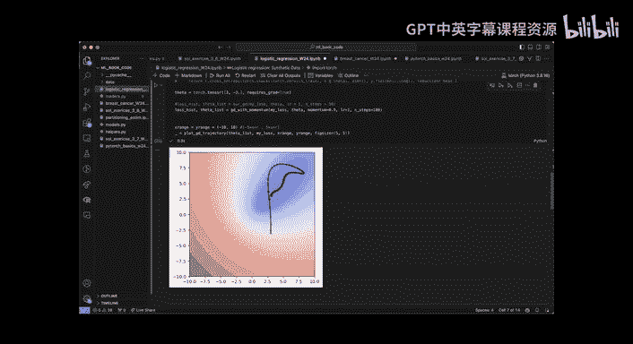

And。Let's see what the end result is。So we' are pretty good so basically see like this is be last so take a list there he's going to give me so this this gives me a。

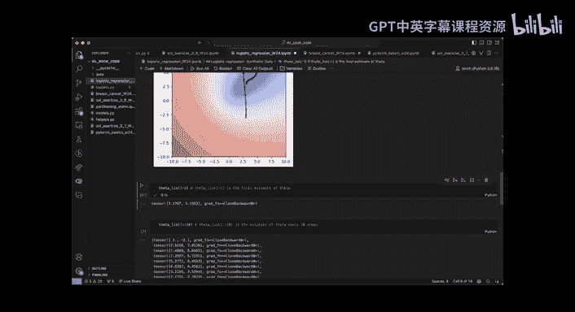

The author that this is going to be a list the last lunches along the way and a list of caence that they are。

And so this a。

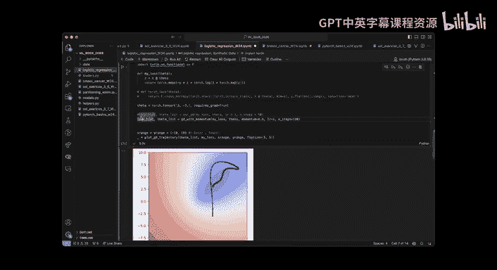

The minus1 just takes the last element of that list。AndIf you look at data。List。

Well I think it gives me okay， it's a list of tensors right， so each each one is。

So you can see it's like bracket is this。So start from p minus J and then this moves on and then。

Let' me show you maybe the last five under the last five。I mean last time。这是。The other way， Yeah。

 right， right， right， right， last tree， good， good job。So this is like minus52。对，对。

One two basically like the moves are really slow， right， but we're settling around the array。Right对。

对。This is a difficulty re， actually with logistic segreg to let see if I can plot the loss as well。

Not the loss。

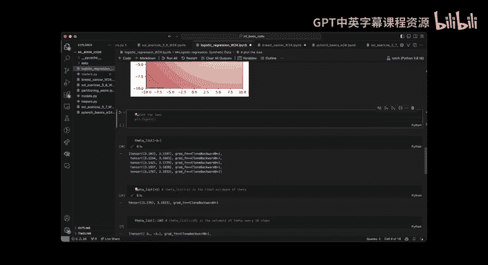

Okay。So that's how about done if we do。Agree and descent。That there's the less。

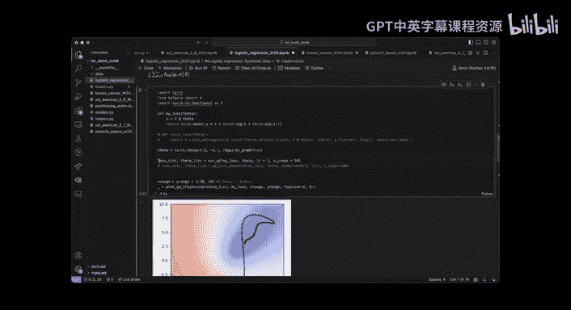

Okay。诶。But bad， but we'll see。So you can see it's like we're still like。嗯对那个。连对 so。

So it gets very slow， very liquid here and gradient and very small。

And so you can also see that the loss has this factor。

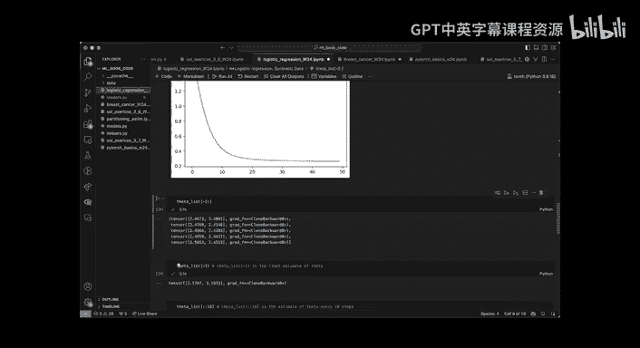

The very speak饭。As opposed to linear regression where things are power shape。

 so when you come down to like a small region so。Okay。Regetta doesn't have this problem， so。

LikeWith quadratic loss， if you start coming through the area where things are。嗯。

Close to being a gradient close to zero usually like you have enough carvaature so you're not going to have this could also be hard if it's like like that。

 but in this classification things like might be like this again so。In a certain generation。

 it goes to zero。我 then你搞。現実呃。It's like very snowy。One back up。 So you haven't very large。

Flay and then moving through this packageage inside time。And。

That's where the momentumal idea comes in。

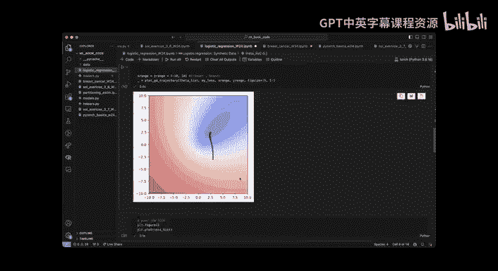

So I'm going to go through the details of these two any questions about that。

Is there any easy way of solving？

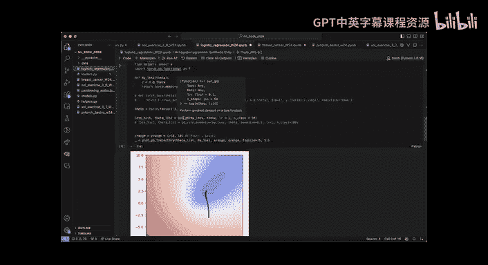

呃。就年。regression that's the are the that is takes a loss。

 which is going to be function called be to data as the initial character， a learning rate。

 which is basically the sub on the number of steps。I'm creating a nuphi area a nu clicker。

To hold the loss， I could have used the list and then also this to hold the。嗯。Pata or pays， Okay。

 so this initialize with the original data and this phone is important， So if you drop it。

Any knows what will happen。So this kind of initialize it with beta and that data changes later。

This is going to change， so this is going to be a reference to the initial beta。So。

When you clone it to copy is a version of data and make them change data。

 which is going to remain an and so if you don't know this is fun to be back if you haven't done it and it's going to take you very long and figure out why everything is the same。

So remember if you want to copy because things are more efficient you pass in later they filed this in the reference to things that are in memory。

So for each of steps ID you calculate the current loss， supply dysfunction to beta。

 report the loss so the current loss would be answer。Size one。

 because is this I can experiment that but Ill like the value。And any view it currently bus up back。

What does this do。This is the like the magic。Anyone remember what this said？

So when I calculate this current loss， this is a function of beta and beta by default has。

We are hoping that has。That requiress properly said the truth。Okay， because it's true。

When port parts calculateals this function， it also keeps track of the nature of the function and when I plot so this intermediate really function of the itself not in value。

 but the whole mechanics of how generated to the sort of the gradient function so it calculates the gradient function and so when I do this it evaluates the gradient of the velocity to every vector。

 in this case own data but we could have。

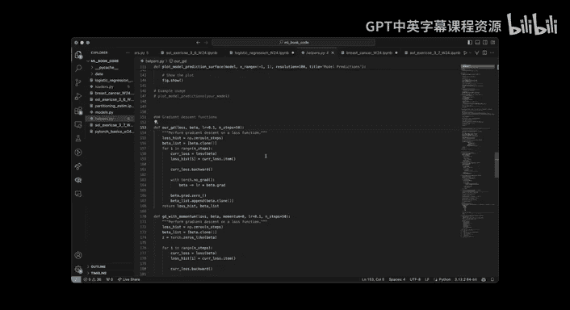

Impliced other vectors in when created last if there other。So this is how its made。

It's interesting the screen it inside a different function。

 but because these things are past size of the preference。

 this is a little bit tricky thing to understand。very past。呃，推 here。To this data is。

Poining to the sensor and this data we gets renamed beta， it's called beta in that function。

 but still the same thing。And then then I call the loss。

 it's going to call the loss that's going to be the same sort of object all line and it these operations of and so by coachch knows。

But when I do the loss backward it has to come and update the gradient of the sky sorry the gradient property to the sky。

 it takes the gradient of the loss so just to the vector that is bent the building so if you have lift that requires spread and it moves through some operations to give me the loss once I apply that backward to the loss it computefuses the gradient。

Pfect everything backward and then populate the green。ok 嗯。It not the gradient is。

 it's a gradient is a loss which is sacred painting， so pay out the red would painting the gradient。

And we talked about this this wasn't clear sort of。😊，You should go through。This other notebook。

 this is the basic gradient send me about bunch as you can at least study you can verify。

In the loop is going to be difficult， but this is the idea that we did so。Like the basic idea。

 so basic ideas here so if you have a function and you call the backboard you get the gradient where this is there。

You have to advantage。Remind you。So here， for example， I have a data which is。Wch is that。

And one and two， right？Alit requires graph shoes and there's another data too which doesn't require gra to require gra assault and I create a loss based on this gloves based on these two data when I call the backboard。

And the assumption is how de gradientd with respect to all the vectors went into constructing it and requires a required ratings。

And so that would be kta。 So he a gradient would be 2 kta 0，2 kta1。

 and evaluate it thats one and two which be24， so get two and one。Okay， so that procedure is flow on。

Yeah， is that a question yeah。Okay， that procedure is going on here。

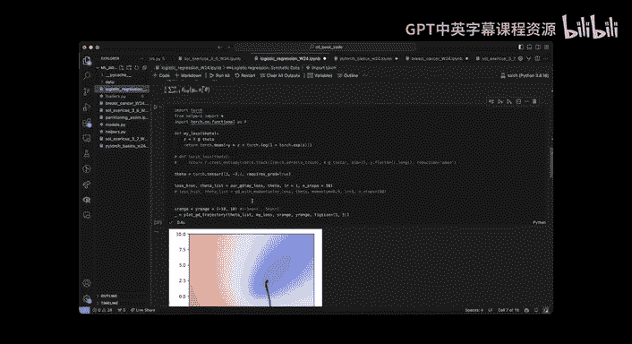

Inside this， Okay， so when I do this。The grand property of beta is of payta。

 which is also the same as payta， because they all point the same thing。

In any case don I don't need to worry on， but it's a beta gravity bring。

And so here we're going move in the direction of the gradient， so there's completely gradient。

 they call it backward path forward backward now basically。

That' further forward and backward very names some yeah。

 so backward is' basically taking the meaning。And then take the set so beta minus equal is that beta minus the beta is equal to beta minus this okay learning rate is a step size which pass and times the gradient so that's the basic gradient is and then we zero the gradient also important depends on the fact that。

The gradients are not zero up to makes extent called the back if I have zero up the gradient it just adds what spread accumulate so this is do because we don't want that to happen。

And at the end it saw on the data again I and then through the list so that they had it so this is basic gradient descent in fighters okay。

Sounds good。So what is the momentum version， the momentum in variable is very similar。

So I just had another extra momentum kind there。So this there's this extra z。

 so you reports zeros like a beta this another nice one to create a vector of zeros the same shape as beta right and so this extra z only we can do。

Is there？Like it you said so are previous grade so you're going to introduce a little bit of my and we have let's see what it says so all right compute the loss and this is the same the agree yet and this is the key So when Im going I calculate I'm going to do。

反。啊。fine is going to be equal to this moment and apparently。但你记。诶Let's great。

So this is going to be the gradient of function for the log if you want to add so current reading is。

gets added to this alpha height the key， and then I take it in this direction。

 I'm going to do let say I do beta equal one is beta t minus this memory rate which that's not number。

ch the。So that's a simple thing。 So instead of taking the step the direction of the gradient and taking the step in the direction of this。

 which is almost the gradient， but also like alpha times the。嗯。Previous value of itself。 Okay。

 so when the initial I user I a zero。Right so the first the teeth was zero。There's nothing here。

 so it be de gradient。Okay， the next step， so this would start a gradient time one and the next step step two。

 this would be gradient step one then be gradientding the step two。

 so I'm going to move a little bit in the direction of the previous gradient so I format linear combination of the current gradient and a bit of previous gradient。

Okay， so this alpha is going to be depends depends on how a unit if it's zero。

 it's just the new gradient in the sense things is not there every time they just。

Move the direction of the gradient， if it's very large I'm mostly moving the previous direction。

 but a little bit in the direction of the type gradient。

The reason if previous gradient is probably slightly bigger。

 so this push pushes us faster as the momentumal idea， so you keep going。

 even if you don't have to go that the current gradient tells you you don't have to go as fast but previous gradient tells you to move faster so this pushes go faster。

m it was a very simple idea。Has that dramatic consequence when you see okay。

 so that's the gradient incentive of momentum and they're all the bills and whistles that people try to like improve gradient incentive that just simple idea is very easy to implement。

And。呢件事嘅と冇咩单。If a zero is gradient in the sun， if it's like equal one， it just never moved。

呃再 remove remove grade guys you you just move along the duration of the gradient or the initial gradient to improve。

So it's like 。9 that I put， it's like almost always movement， but。

Because it's not exactly when you start。不思没。Because of its audit term。啊，对。

You can' understand what greenness and the moment is。嗯。So that's see the effect again。1ian%。

Doess that。So you can see you thank。Moving pretty nicely。Ging the same momentum， like momentum。

 let's say， for example，501。Still like close to be in the sand at this point five。Okay。

 it pushes a little bit， but not too much。99。It goes off right， so you don't really want to。

So there's a limit。This is interesting actually。喂喂喂。So you can see like the interesting like。

Pretty complicated behavior that these algorithms perform even if the loss is un so there is some。

Combination of these， so suppose for example， can change the learning rate。And。See if I do 99。

 is it going to convertver nine is going to converge definitely。Still not controversy。Yeah。

 so it's not going to help if I。Yeah， so there is a certain range of parameters。

Where was this converge？And that range of prayer with her became complicated model this way。Tricky。

 96 smoking verges。98 doesn't converge。97 so three equal。嗯。Interesting。

 we can't go over this but there's an recent paper， for example that。3 is like。

So let's say affect plot for example， momentum and learning ways will have like little practice momentum and access learning rate and point is going to be like let's say red if the model was learn or trainable maybe blue if it's not so be diverse so if you con one color to diverse another color and it could use this for example the neural network and we would look like a practical so as like the like。

Very complicated boundaries and if you zoom in a within that and complicated boundaries and then within that complicated boundary so it was very hard to so very hard to in general figure out what exactly what air development is the in this case all we can figure out because the loss is like simple。

嗯。Ring the overcome you'll see， for example， just without the momentum， this is the learning rate。

 there is no the limit， so if I have learning rate。

So let's just move this back to the way where it was reasonable。

And so the learning rate is also true， so if you do like 10。this is gonna to be good。Yeah。

 it's about off the day， so there is a there a ranch。Which。And simple cases is easy in general cases。

A more complicated model， a complicated loss as what do people do practice， they often。

Do with a great search Okay， so you have a validation set。Then we can。First。

 they convert the student to detect and without evaluation。

 so when you change the learning rates and other parameters that they have in the learning of momentum have a real great search you can create。

Or we create a abundance of momentum。Learning range is。050。

1 and I this like 129 and then see I check all the values。

 see a very little also evaluate the valuation loss so validate risk。And take the best。Thatunds good。

So optimizing more complicated function becomes a real change but we'll stick with this gradient with greatness and momentum。

 they're adding more advanced optimizers。That we'll talk about， I'm just going to。

Once you understand this， the more advanced wants to do the same thing。

 but they add more bills on this so pay the set and maybe like three banks。

 all of the coordinates differently there are different ideas that people have developed over the years and。

It's to help into this second。Set of ideas that board grade off let's say neuro when makes seem to do a good stable job us。

Reasonable gradient。对。Okay。在那。If you understand this then。Basically。

 like a few steps then you can just change。In neural networks。The only difference is。

You just redefine the model， redefine the loss。And you're going to be good。

 So let me do an example here。 So this is the real example。

 This is that breast cancer data that we have be listening that。All my problems。

 let's do this equation And this。 So this is real data。

 And I thought I didn't can say there is like it seems to be a natural linear boundary。

And there's definitely noise but let's see if this works so we don't need these so we load the data so we talked about the way that this works so you have like this can take it is off with the chain and thiss so it had an exchange watching access quite this。

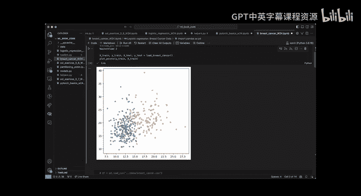

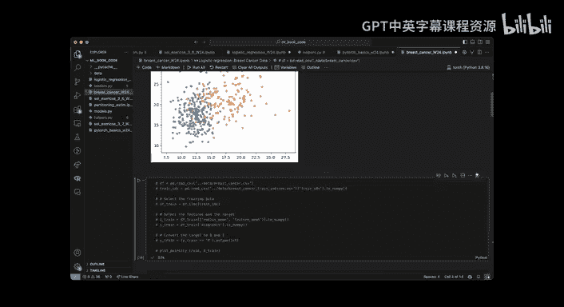

elloAnd。

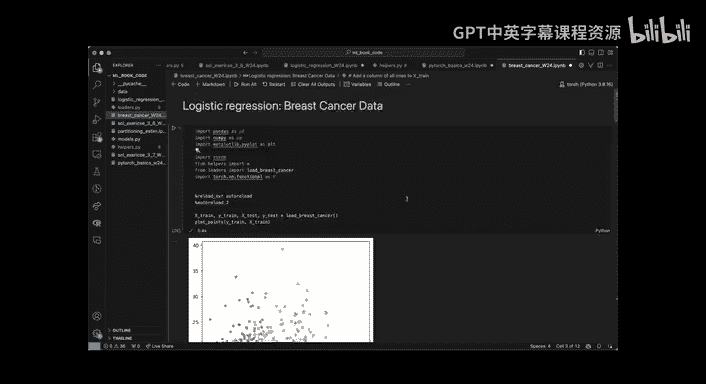

Okay， so this is the tricky part， so I'm going to exactly。😊。

So what this says is I created a window once。Oh， so shade is the frequency， the size basically。

Size of strain sort of shape zero， zero in next the first one。

 so that's n based samples samples and one so that's the column of all once and I concatenate that column to exchange along dimension one。

 which is the second dimension which is the columns so it just adds the columns of all one。Okay。

 so why do we do this？Any thank himself yeah， so we ought have been ignoring himself。

For sities when I write this here。So there is no inter but as we know as staisticians。

 this is sufficiently general， so I just have to augment my。

Thanks I with a column like with a bit vi of what， so in that。系了嗯。嗯。

The patient that you have and X is with robotic adding one and so what happens is and I like things I get one here。

😊，Okay I'm going to multiply this by here is that you take this stop you say the sun and this is going to be my B or intercept and the shame or anything is called W so W is the base associated with the real features。

 B is the intercept， which is associated with this one feature。

So they can take up off for the whole thing and。It it is very common a regression。

 hopefully you know， and in practice you really do want to have this often types。Extra bias。

Because otherwise， if you don't。What would happen if you go with this year？Read through past。Yeah。

 so disalityality would be passing through the origins so the dis is going to be happen to a solid other point。

So if you don't do it， it's going to be some crazy thing or maybe it's not even。

It's worth trying to do that but this is really important so when I do this。

 now the decision don needs change that。Andransport x equal0， which is w of n plus x but d equals0。

Okay， so this takes to allows to have a shift。So this is all think shapeだけ。Okay。

 so now we have a three dimensional。Like n by3 type low 32， which is good to have taste。

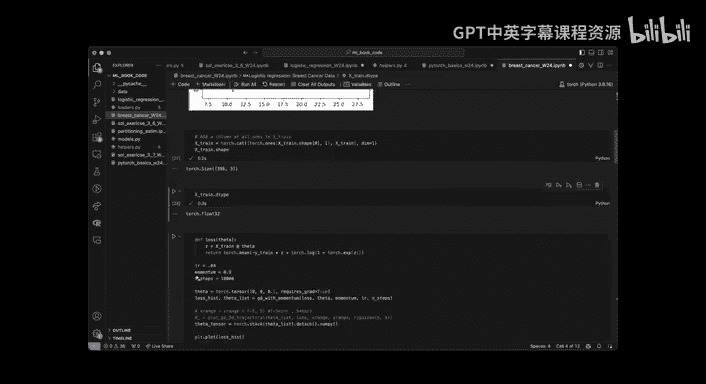

So that we don't get computer， the rest is the same exact a loss sales before right here。

 you have to have to tell a little bit the because was different data。5。

 so learning that moment that hasn set。S the origin3 random as as because my keep pressure gradient we incentive momentum pest loss。

 data momentum learning rates are assessed and at the end I have this list。And this is like the。

Apparently， this is what we can do is we can stack that this produce the portionments the sites all the sensorsors。

And it add because we don't want。Degrion machine want converted to non by Harry so you have to detect that gradient to the machinery and then not apply three years of dollars。

And then I plot， I don't know why I could use an umpre， but that's what we did here。

 so that's the last section let just saving but。Thanks so I have to do lots of that。

So the first loss point is when we have the data it's just zero， yes， yes。

 which is saying it's equal to the answer。诶。Tta is not before the inter， it's just， yeah。

 so you're valid the model at the in person。And the intercept is。Actually intercept is zero as well。

 so intercept is。

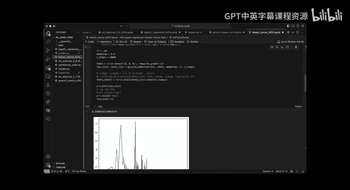

The first one， so if you imagine。I added。I added one here and the next train。

 so the intercept is different first so I'm setting the intercept to zero。

 that's the first coordinateordin。

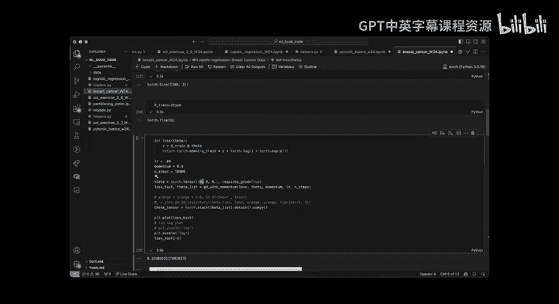

And the two other coefficients of x has zero as well。Okay， so what would happen is。If I plot this。

 you can see the trajectory。It started somewhere at zero， very zero。Yeah， zero is here。I believe。嗯。T。

Yeah， zero here and here。And Ill be。Here。So initial point is somewhere here。Proably here。

But then you can see that doesn are very crazy。move。

 so this is the here and then passes through like a region。

 which is like alsoci Lake I just shoot up。嗯。The last point and this is the。

You can see that that's the interesting。诶。It seems to me conversion version something。

And you can check it with with Mike。Sendator packages。

It is like it learn package。So I'm doing down there to verify it， but you can do it for yourself。

 but yeah we started from if you do。

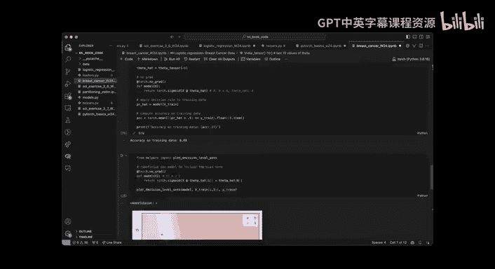

The first， how do you plot the first？I the first 10。Ill be the firsthand。Yeah， okay， so zero search0。

 you can see move and then。啊。We have to do a lot of moves to get to that point。

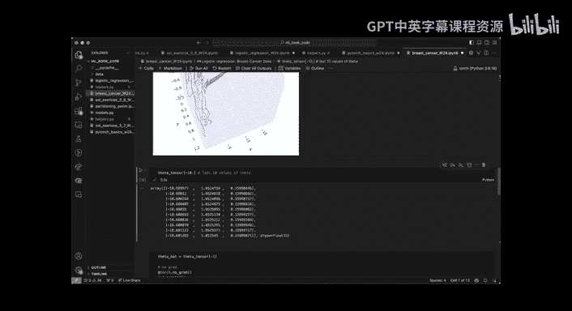

What ifWhat if I do the gradient in of sense so I can see？What would happen if I do grain and scent？

And。Is this going to work？Yeah。有个点不。I think it's my。

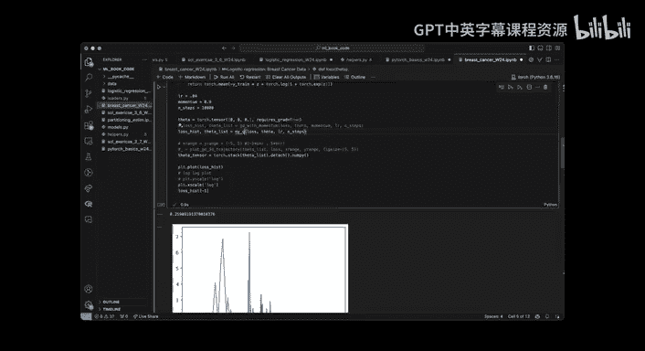

To our our our gradients。Great。

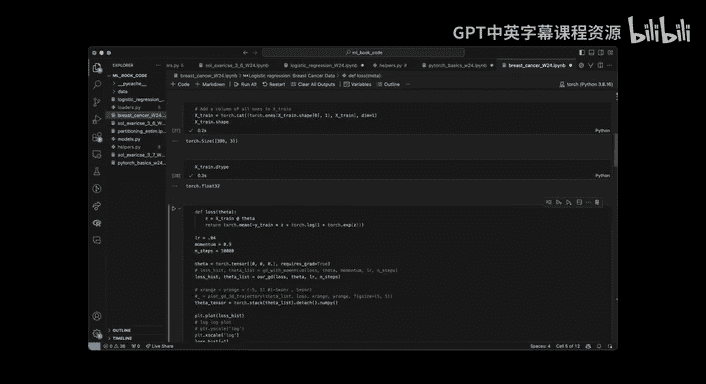

Okay， that's what is unique。And it doesn't really converge at all。So。

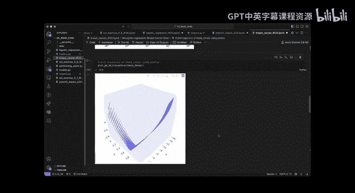

Is the learning rate to large smaller？

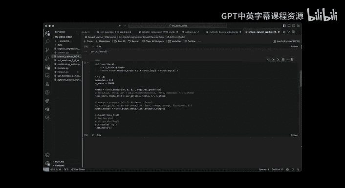

This looks a little bit better but the still not converging that well。Okay， what we get is。

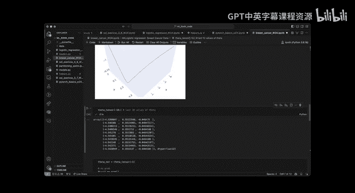

So the question is whether like the best performance is good or not。

 but you can see the loss is not going down as。

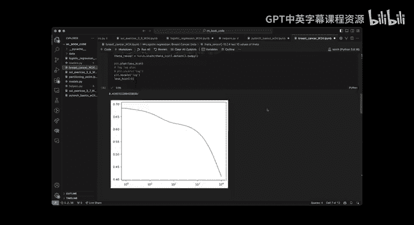

As much as you hoped。Fantasticly。

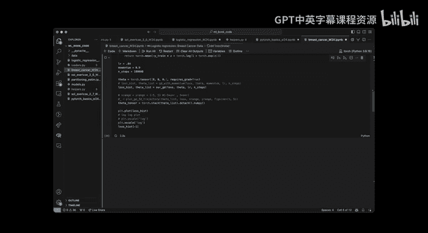

It depends。Okay， now you can see the effect of the momentum。

 so it seems that they conversion just a lot。

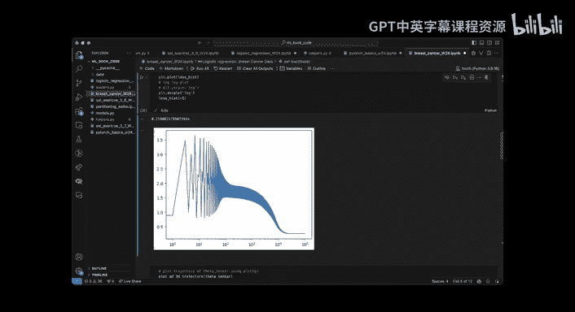

And so。I end up like create much difficulty getting there。So yeah。

 so you can see like this simple idea of the momentum。

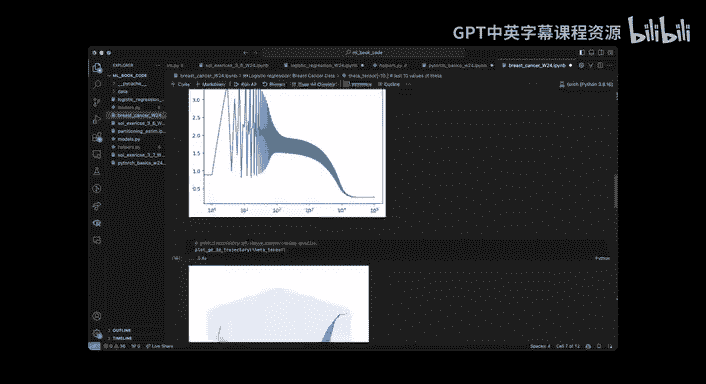

As we conge， it tends to make it 00000 stepss versus 10，000。

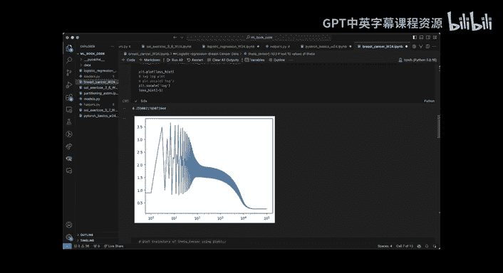

系好。没有。I of thats great idea that。Cost effective。

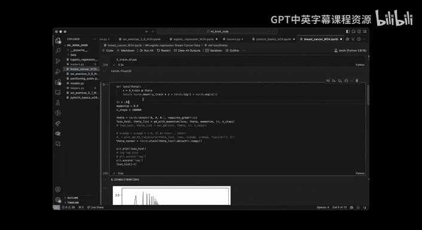

说有点问。对100 and0 research。And there is this more complicated in itself so which I'll show you。

Well Adams and I'll show it here sure， maybe later， but okay， that's about this like。

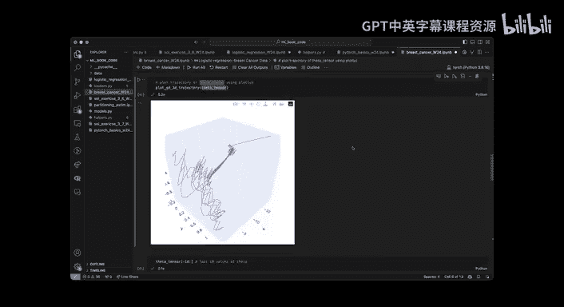

嗯。Race the move specifically。Okay， and now let's see， Okay， I want to know。嗯。

Do the prediction on the mean plant level set， so this is our model basically everything you need to make。

This is a simple modelle， if I'm taking that forward the class and then module le if that angle do that matrix。

But I'm just have the basic model X X， the whatever the data points that you want to value tomorrow have and calculate the sigmoid makes sense。

So that's the probability as I apply the model to the training data。And then it says confusing。嗯。对。

那个这个。So very trained and then take the mean so that the accuracy。And get accuracy8。

9 on the train data， and if I do it on the test。I can do them to test as well。诶。

I think hear something。What do we do wrong here？Thanks。嗯。连外 train。So tell me what is wrong Karen。

This problem。OhAnd do you know what's the problem so the problem is？嗯。

I haven't done the proper Java augmenting， so this is taking X when the argument is one this is not so let's not worry about that so you have to augment this with there。

With a one， so this is not the proper way of。So you have to add a color the one if it it' expected to be change。

 right？So you include that quickly。嗯，喂。Next this， let's see if it understands to do that。Okay。

It's smarter than me so。嗯。Okay。Yes sir。我呢呢。Okay。对。So very close training with justers。

Apply decision boundaries。Okay， so that's the same function that we had。嗯水啊那什么地方的。

Doing it a different way so this is another way of' going to good done is so you take the first two elements okay。

That the last座 the last座对。0 like one up to end。 and then that plus don't have to add out one。

 so I really buy it because the case pretty is to。And then it has the painting to。

do that yes can say this is point so hearings are more71 here are like38。5。呢啊啊你都俾啲会咗。

And we've got this classification accuracy up the lot。Poin88 almost as nine。

They're going to be a more complicated than lot information for this。AndSo in fact。

 believe that this has been almost the level of like performance that the foresee。

Sounds good and then the rest you can check， I think this is just。Do那个 side kids啊。

Package and it produces similar results to this。If the estimated data a lot about 1 and 0。16。

 let's join to see what we did。Yeah， so this is the same， but we managed to do this ourselves。

 they have a lot of effect we can check that factors。Similarum。

 I think that you're doing the near term sort of like I least sorry that the class story of doing let address。

 you're not doing that you're doing your very basic。First order method is that pretty well。

Sounds good。Great， so next time I'm going to come back and extend this to multi class classification and maybe a little bit more beyond but very wide longer。

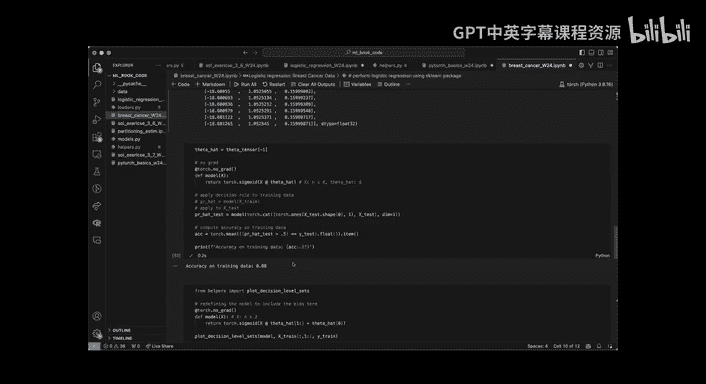