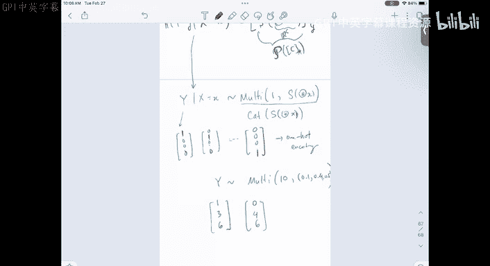
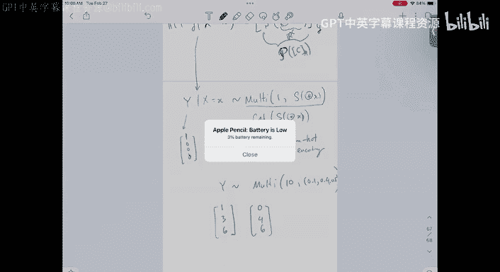
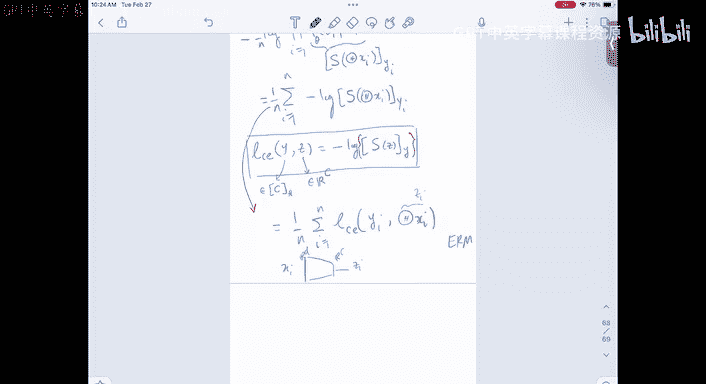
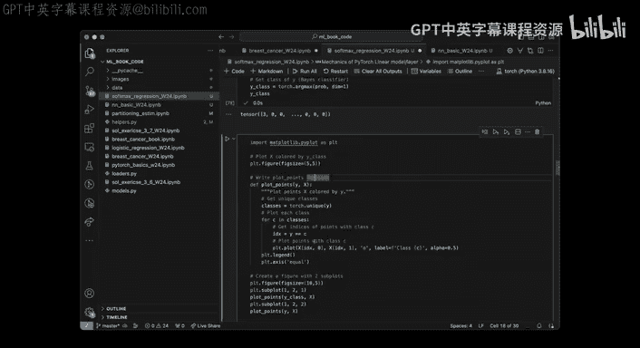
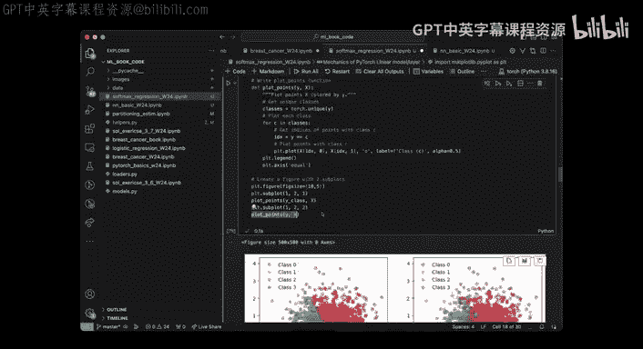
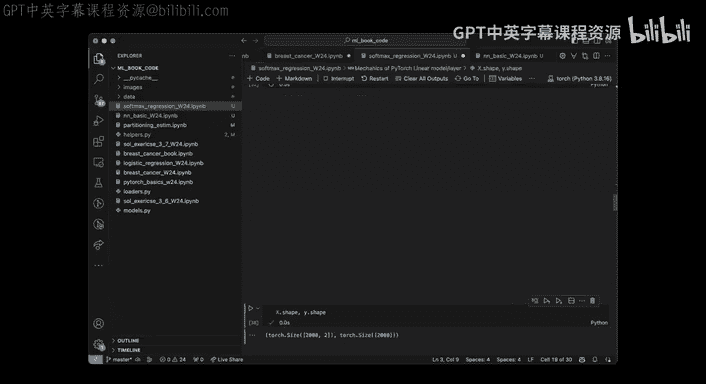
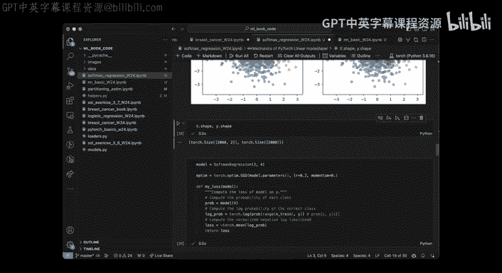
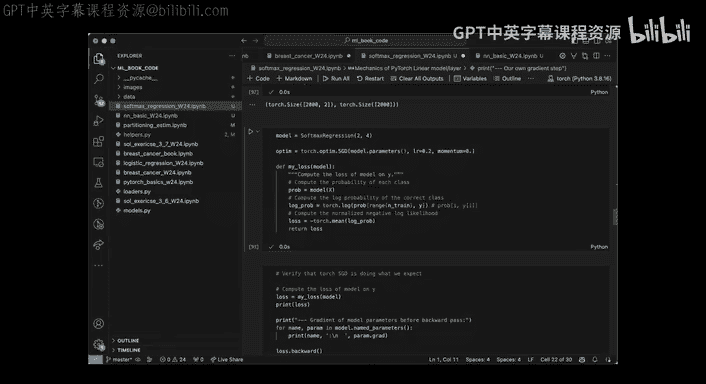

# UCLA《模式识别和机器学习｜Introduction to Pattern Recognition and ML Winter 2024》中英字幕 - P14：[14]Introduction to Pattern Recognition and ML -- Lecture 15 - Winter 2024.zh_en - GPT中英字幕课程资源 - BV167BfB8ETK

We were discussing。Mg justtic address。And in particular。How to fit the model。

 how to do it in Pyth we went over。And we also introduced the idea of creating the sun momentum。

So the loss aification problem is con。Treier than the loss like the quadratic loss。

 so there's this exponential， there's this log loss which you you recall。

So because of this log business。Things are not as。呃。Stay forward。

 so please other momentum idea helps。Seed up the convergence a lot and then we also saw issues that like potential divergence so if you don't put the step size and the momentum right then you could diverge but。

Very good， thanks。Range of the sub size， also known as the learning rate and the momentum parameters I converge。

They're going to explore these ideas more， so what I want to do is extend this to multi class classification a little bit。

This is basically what most of the current machine learning sort algorithms try to do。

 try to do multiclass specific。And in particular， large language well。

 which most of you have heard like chatd GBT。嗯。They don't the words。

So they're basically doing multi class classification。

And hopefully we'll talk about that at some point。So in order to be able to do that also like traditionally。

 let's say。My two classes is good if you trying to， for example， detect a disease or not。

 like this an email is a spam or not。But you want to have more passes thats if you do vision youre want to categorize different objects and not just two objects and。

But once you do like multift classification， things become more interesting。诶。Okay。

 so the plan is to extend to multi class classifications first。Yes one possible extension。

The other extension is to go away from like the linear models to a more complicated model。

So we are from like the more complex possible models like the local average and negotiate shape。

 anything。But then we restricted ourselves to a class of Indian functions or in subt。

Maybe at some point I'll ask you why we did that， but it's unfair to know why we did that。

 but then you also now on extend further。So aside from very general。

 restricted to a very restricted path， now we want to extend to。ItMore general。

 but still para still like control。So that's the other extension that we want to do and that needs see that you have neural networks and stuff like this。

Okay， so now the path class if you on nonlinear pilot models。

 these are the things that we want to do。We write it down。Yeah。Extension。M台ga。Exification。Until。那里你。

I ran tricky modelss。And then that thatt thatts at CBD， okay？They like few steps for the guys speak。

This one is。Yeah。Moivate， the case。So。上s good。So what is multi class certification。

What is binary classification？So binary classification。The idea is that you have X。😊，Right。

 and then you have why。You know， I learned a mapping from XO Y。Where this y is binary。

 excluding general， so multiclass classification。It's very similar。 So we go from x to y。

 but now y is。Like I'm going to do like zero， one up to c minus one， so they's C class。Okay。

Let' me going to introduce this attention， so this is so for like an integer。It's a c。This is like。

 one to see。This is very standing。If you see like seeing bracket。

Papers and statistics machine learning optimization being individual one up to c。

 but I'm going to use this notation which is my own so take it to the grain of salt this is not standard I'm going to use it for zero one up to c minus one to avoid。

W this every time， okay？So the reason why we do this because pie torch。

The zero base junior to work is neural language， and it also naturally is essentially like binary classification with the h equal to two indicator you to rather than one。

 so so class names are0 one up see minus。But that's the only。Difference， basically。你有冇 name。O嗯。

So you still at the banking data so you're still like the assumption is that we have like x and y pair generic pairs from a distribution。

Not the distribution if you joint the distribution of the parent is the X from that phase Y。

 and then observe a training data and so on。But I want to basically impose a parametric model which needs to sort of lean your decision boundaries。

Okay， and。So。Binary classification。They lean your boundaries。So that was like an example was the。

Logistic regressionation， I just have to specify this conditional distribution， right？

Sigma theta transpose x， so that was。嗯。Spification of。诶。By your classification will。

Re city boundaries can change state mind we't be legislative condition。

 but anything in this fallpar of this forum was it's going to give you a linear decision boundaries。

So how do I extend this？So in model getting not enough to just specify the probability video Y01 given x。

So the reason why we can do this is。Because you just have two probability for y and it sub two okay。

 in this case， you have C probability so probably the a y takes value01 the c minus one。

And they all have to something one， so there is one contrain。

 but at least I have this specific I minus1。把这种办起。And。So if you think of this。I can write it as。你食器。

Y 1 given x is equal to x。嗯。Let's say do this。So this is the general for。嗯。So it's like a parametric。

Function of x， So G of G theta of x。And the binary classification would be。Sigma theta transpose x。

And one minus sigma theta transpose x。And this y in this case takes value 0 to one。

So my vector is part zero。In big data on zero， so when I put y equal zero。嗯。Okay， so。Basically。

G theta of x， the zero coordinate would give me。Sigma theta transpose x。And G datata of。

X1 gives me the second coordinate。Right。So the first is this， right？The second coordinate is。有的 guy。

诶所以 this咧系看到。Logistic regression。你哋咩消细。呃我 example。so you don't have to say I just this by one。

 this is by four and you can see they sum to one so the trainings important up to sum to one and so just to mapping from X。

To。Basically， a vector there01 to the two。So even don't all we organize。 So this very much extend to。

Multticlass classification， so if I write it， is this clear？Yeah I'm just trying， what's the zero？

coordinateordinate was the first because like the way we really p P capitalappa Y equals lowercase y。

Is G theta of x。We little w so like in the two class case。

So this yeah so this GC I makes is make there let's move forward this andm just I follow that I'm just trying to understand why like the first coordinate。

 which gives us the probability why is the one that's up top。That was not correct， actually。

To be right， should you the other way。1 there。Good。You have to do the other way。Okay。

 so you seem to understand much better than me， so。So one minus sigma theta transfers x。Okay， okay。

 now worth。Yeah， so zero should be like the probability zero。ok had reckon why why not one well。は。对。

啊，也对。嗯。So so this very much extends to。Well the class does okay， I just can write this formula。

 right？Just assume pologicgic four。There's just some paraic form here。And then why。

 but now y is in that C is star， okay， so。You value and this G is going to be。Just some。Functions。

 so G theta X。They are。G theta x。Once so the coordinates tell me the conditional probabilitybil is of。

嗯。Different classes， so we haven't done much here， right？

But this gives me the general form of a parent multi class。

Clasification probably just have to specify this conditional distribution and you know that once we have this initialal distribution we have the optimal rule for the small the optimal rule is going to take the third firm staation so they this and minimizes or maximizes the past probability2 x。

😊，And why it maximizes。These coordinates so among the coordinates。

 the why is I gives maximum value is going to be optimal decision。

So then I have the decision on this， so。The main thing is suspect gene data。

And I want a function that solves the one。诶。Ba they put you to the event that it always sounds to work。

Otherwise I' thing。So。If you think about it or。嗯。There are many functions。

 but if you want to extend this right？So what this is doing is。If you remember what Sigma was。

 this is like。😊，I can do。And。Basically， E to the theta X。

Divide is by 1 plus each of the the trans to x。And then。

1 plus  one e to the theta transpose x okay so that's。The form waspoliistic。呃。

So if I发发现 cinemama啊 let we be like天 do that。He by one pass to the team and so I can接呢这么样。Yes。

 so you can see最。嗯。You can think of this as equal to the zero。Oh。对。嗯。

So much I'm basically taking the。Flying B pointwise to this stick there。Right。

 this gives me a to to the。And so thanks a know。までさん。So。

The punchline is that this can be extended so you can think of a function that takes a vi。

Now let's say you。And maps it to。Let's see。E you 0。Divided by the Psal E U1 divided by。

The sum of the U I， let's say。It's a little bit difficult to write that okay。

 so let me let me write the function this way， so this function is called the soft max。No。

There's this function that。Okay， this function takes， let's say RD。And matchs it to RC。

And so it takes a vector。诶。诶。It's actually not steep。Picks a Victor in our seat。

It access it to RC and the main visit is。Let's say the white coordinate here。

It's going to be so this takes a break there。It's going to be E to the U。Soub why。

Divided by the sum of all the Ui aside from。Z， let see with this one。Okay， so very helpful。If C is3。

What it does is。So we are applying it to something like。You one， you two， you three。

And it creates a vector。E you1 divided by。E1 plus E2 plus E3。And then the same thing。The same thing。

But now here we have you too。And here you have your three。Okay。

So it raises the nectar to the key to that。嗯 coordinateord。で前やっぱそり。啊，所呢会佢就。C equals to two。I get S。

Let's say apply to zero。And you won， for example。This would give me。E to the zero， right。

 which is one plus。1 plus E to the U1 and excuse me E to。You want by it by。啊，行行是的对。

Be consistent zero，1，2。0。1，2。0，1，2。0 and2。There are不。Okay， okay， so get E1。诶。

So soft makeup like to zero， and this is give me one minus sigma year one。Sigma you one， okay， so。

这最近呢。你看下。But there any further situations。And so this gives me a general blueprint to map any vector that's actually maps from。

诶。I would say the states of probabilitybil is on。C so from a general victory not to the sea to the space of probilities un sea。

 which is the space of all possible vis。E0 P1 or2 PC minus1 such that。

Let's say P is bigger than equal to zero and they sum to one。

So it's a general function that the nay2 my make there in RC， it's probably make there RC。

Is better be。It's P P0 up to PC minus-1。Such that Pi is bigger than equal to0 and summation i from0 to c minus1。

 Pi is one。Space of probability to make there on scene。Yes。

 so we're just taking like you sub wide over。Does F be E to the U because we're trying to map to a zero probability space so like what would it map to should all do between zero and one but right so this name is positive right so you want to give potentially negative so you want something which is positive enough as you would so E to the that take there positive next。

And then divided by the arm。对这些。Right。没得。😊，So I don't have any exactly cool cool thing I don't have any restrictions here。

So another general make them there with passage all leaving。If you think about this。

 but it has to be like from use like see to see。😊，Right its it's not they want to。

I don't know so it's like on' the same thanks so you。Yeah。

Is there anything special with raising it to E power。

 like if we only want to make a project to become also square it？Yeah， you're right， Okay， yeah。

 I can swear I， yeah， you could have。U y squared divided by the。诶That would never work嘅 so。

This is not the only reason， so it's India to work with because of all the nice things about the logs and interactions with。

For the same reason why this was useful。That's actually a good point there's no specific。

Reason why we need like sigma here so anything that matters， for example。

 mono from negative affinity to infinity would have worked here。

It will give you linear decision boundaries。The increasing C C the function the from negative infinity the negative in zero the infinity there one。

Any want that case， and know we have to say kind of visible about it。

People are not like the CEO or the normal distribution here that code。呃，也是。

But this is very easy like the differentiation is easy and in I say it not take the dog blanket。😊。

Yeah， so this is not the only reason， but it would be fun to try let's let's say okay。

 so its like a suggestion。啊。So you were like your name was Mar so marrying sort of as theaterator or like。

They can coin the name so and then a queuee of you。That's true。UI squared divided by sum。对呀。没是没です吧。

You can write a paper probably obviously。On。If it turns out that it works well。

But the the cool thing is we can just implement this in P it are from。

 but this needs a satisfy condition right so it has。

It produces some problem mediated will non negative and。There is another interesting feature。

 which is， I don't know， so we have to think about。😊，没す。家了可。

Wch there's another nice feature this is how facts on。Shis， which is。

So the thing to notice is because I'm enussing this constraint， there there is no one to one method。

 so this mapping is not one to one， so those are potential inators that go to the same page。

And but because of this normal language， and if you think about this， it becomes clear if I add。

 for example， a constant shift。So for example add two to every recording。

I get E through that because I'm using or plus two because we do factor E to the two。

 this would have a factor E to the two， this would have a factor E to the two and all of the。

The parent is been honor with everything with that。Be the two and this that。

It I add a constant vector or like comfort value every that doesn't have a。

So it's sort of shit in that this one doesn't have that property， right？

And so Disney have to be it because there is a constrain on the output， which is not under the input。

 so one degrees of less scared。And input that they have to sort of the map has to be。

Not what you want， but much know that， you regard that it's almost what you want。

 if you identify right there the each other then。Or that space it's。

Mapping at bed class the distinct to distinct of。Those access to this system。ok。😊。

So the how is this to define a model so my original x is， let's say RD。I will have to put it in。

RRC so that they can apply this soft mix， Okay， so the input。诶 to my model。Is an RD， right， x。

I have a softm operation。嗯。It's called the soft mix block。That takes something in RC。

And produces a probability the there。Which would be the end result。Yeah。Okay。

 how do I deal with this？Thank you welcome from Mar Barcy。I the linear map， so。这的是。

This is what people age。Each are in a rural networks discover and if you want to like change dynamics the easiest thing is that we the linear mathematicians also know matters。

So if you want to like pass information from one space to another， then is it different。

 the simplest thing you can do is like。How a linear air from that states to others and the linear air mask often。

嗯の。How do you specify a media， man？在看4。对。T transfer so he is a lean route from Har to RC。

 not getting back prison。IllHow can it compact represent like any a large sure。

The easiest way to do is like your matrix which I'm going to do is theta capital theta。

 so this matrix has to take vectors from RD。So this site has to be RD。诶。系。This site has to be RD。

Because it gets multiplied by。这个猜SBD的对面吃吗？So rows get multiplied by。And。Saing is bigger。

But this is D， gets's multiplied by a vector X。In RD。RightAnd this side has to be seen。So zeros。嗯，一个。

The multi C by we link to exp E by one C by。Yeah。So that's how you easily transform so if I have this data basically theta transpose x would do that。

And then I apply Somatic。A good way probably， okay。So this would be solved my x regression y equal y。

 given x is equal to x。Is equal to。The like coordinate。Okay， so this is N RD。This is in RC or like。

RRC or better， like probability vectors on C。Sar。And so the output is， sorry， sorry。

 this is this is large sea really。This is an RC。And this one is in。Probably if he makes their。A fine。

So。Yes， so at the beginning of class you're saying today we're going to extend logistic regression to multi class classification but stay in the ametric world and'm just this is not multimly obistic regression right it is I mean staians are called multinomiology agreg。

I think out too。Maybe like if you council I there some issues but this Oh good， yeah。

 also called soft nice。The same thing。So it's prametric and it's also sort of linear it's both pmetric and linear。

 right？It there a dis for that。Yeah， so if you know this。

 this is an example of a generalized linear model， so statistic is with。

I know calledial' knowial orial regression I forgot do they callial it's just what I'm familiar with okay either it's a multimial regression or logistic regression so maybe logistic regression would be I forgot what the name is good。

Yeah。Stop like。So multinoial because so this is like a multinolia。

 but it's like a mononoial with one observation。Basically categorical。Right。

If you call the first one， very newly logistic regression and this is。

M to all know everything think解。The this a ser involving in only one？so you can say this is。

So in the logistic regression we had like this is equal to like a very newly right blah， blah。

 blah here we have this is equal to like the distribution is a multinomial。1， and。This quantity。嗯。

Yeah。Y given x is equal to x。I's multinomial with one observation， this is probably too。Okay。

All right， if you want， I would write it as categorical。ThatS to。Just one observation。

 multiov will usually。It interesting in a long发算什么。It was they could be avic there。So what你关 done is。

every sample that you give me。诶。So this was started the including time。

I should be a little bit more careful。嗯。So个是在 should的。嗯。Yeah， this is fine。嗯。Is it fine or not。

 I'm sorry to distract no， no， no， this is include because the thing is。So here。

 why is just a label like？And0 to。C minus one right like this youre thinking of y a vector it is so called one hard encoding Okay so。

I think okay， yeah， so I have。😊，This is all like notation and convention。

 how you treat the street is okay of this on the label or you can think of it as。😊，嗯。

Like it Victor there。So it's going to be10，0，0 or like0，1，0，0 or。嗯。All then up to zero，0， zero。One。

 okay。So at least and the way I think of this as multinomial usually the way。And it just。

 for example， this can， each row each each other we how many。Of each class they option。

 so for example。Do like multinomial。P and sorry N and P P would be a vector there。

So mononomial like 10 and p， then if I draw for example， y from this。

 then I would get something like for example， three。Maybe P wouldP thank。0int1。4。

5 three classes I may get， for example， I don't know。About one here， maybe four here， five here。Okay。

 so it's correspondinging how like I'm going to see you know10 observations。

W in class one for invest。这 us。呃。Three， maybe next time I get， this is random right three here。

 six here。Okay， maybe sometimes we get like zero here， four here。嗯。S here yeah。

 something like all this possible combinations so everybody do this I'm thinking up physical just one observation and it's just going to be one here。

They have to the number of observations and so this gives me the same information as if I by label but this is all not deployment and it's often useful。

诶。O encoding in applications， okay。是。These are all good questions today， but the model is the same。

 so whether encoded like this or encoded as a label。

It has the same information so you can encode the same。Piggo on for different rate。

The fighting you kind right is categorical， I still think of it as a big。This a distinction thing。

Said clear。Yes。那他们说にです就那个话所就拿理本で。Lays of encode so if you have seen like sad export and regression。

When they think one of the see though this this is end is years the other important as well it either sometimes called the only value so if you are to encode categorical value or for regression。

 that's one way。不可以。嗯。基本上出来关于。诶。Yeah， so that so that。

But can you for not want to do that and over like five groups。You can write in a regression we。

Aular reasons。Okay， that was good。Okay， so and this is the model， right？

So how do I any questions about tomorrow model， So this nice thing general like this。嗯。

We it this more problem but we can kind figure out what the decision boundaries are。

 what is the optimal base。Theyre awful amazing linger areas。For the optimal rule or the days will。

 once we have the small optimal pacifier does what it often does， which is。Takeig arg max right。

 so you have a star， for example， of x。It's gonna be。Argmax。EF y equals y given then x is equal to x。

I know will belong to do this class？Okay， so priority X， I'm going to go。

Take all the elements of this make there。And big big coordinate the index。

Which it gives it a maximum value， and that will be my prediction。系。

It becomes a little more complicated， but I'm going to show you an thought。

ote but you can verify what exactly are the decision bound the same boundaries are still linear here。

 but there's no one there's not one decision bound okay because they have you have multiple lies or he planes and they intersect。

And so the intersection define themselves。They define your whole class。对。

But the issue is a deliberate amount so making two classes and maybe。

 so it's still like one type of thing one line separates two classes。

 but now you have multiple classes so you separate these two classes by one line。

 these other two classes but one line you have two classes by one line and yeah。

One pass is different from all the other neighbor watch。喂。Multiple hydrogenss。

 but things become complicated， the shades would be more complicated。Thank very。对。

The visual is and then there's the same notion of idea of noise， so if I increase the size data。嗯。

It's so if I ship data basically so okay， so there are a couple more things do remember what issue is the so called identified so this parameter change is not identified。

😊，What do I mean by that？诶。Anyone knows what identifying means？的。

There are different values of paper that give me the same exact model， okay。

 and the reason hint that soft Max is invari constant that shift。

And maybe this would be a whole problem， I I believe but。What happens if I do something the take。

 such an effect is just adding constant shape the data。Thatastic as a result。And if that's the case。

 then。嗯。For example， let say add something to each。So let's say I add the vector。喂，嗯听定是啊。

That they later be edit the intro。So when I multi， the previous row times x is doing something。

Plus D transpos b transs s x right and the same goes here， the same goes there。

 so the e transs signs x in that to every coordinate。And because that's the constant of shift。

 that's going to vanish and the software。The rows are I final up to the concept。这。Yeah。

 and that's a limited problem so anybody have。So this problem is that the exact vector to Europe。

 this will give you a good our model。 So I can't identify from data。

 I can't even identify the lower population give。In the whole population infinite samples basically can distinguished。

 so that's the issue of identifying。 So the is that you need example model。

 so we have to be condensed with that。If your goal is to recover you actually satisfy a particular condition of the in zero so this is very similar to what we did。

 for example in。And。Now just segregation， I'm taking the first photo into zero。

I can allow the coordinates to vary in things would。TheI think would and be I infi， so I just need。

Spec， so for example I'm like I say， I'm going to。Force this to。嗯。First row or like last row。

 right the way， zero or something。Then the rest of I fine。

But if you don't care about the parameter itself， and in this fourth so you't care about the parameter that。

 you can estimate it， if you don't care about parameter。

 you just care about the adding this functional form。

 you care about the value of the reading because that gives you the prediction for prediction and reading it's fine because you get a different parameter but it gives you the exact same prediction。

So for that reason we're not going to worry about that。

 but this comes up when you try to do optimization as well。

 learning called learning try to do like inference on nonpri if your such have a little about that better。

Right。So that's that's I get enough point， so everyone out here。

 but it's an important issue that but are you right a priority model？嗯。

And if you care about recovering the parameter then you have to make sure the parent is byfi。

 otherwise you have to impose constraints enough。So that you hang down a particular one that then you can this one I can。

嗯哎，反正问题。That one。Issue。What。We talked about like linear decision boundaries。Optimmal rule。

 and these arent known。你对呢。诶。对。So the issue noise， okay， so a little noise。Again。

 the same kind of idea happens here。啊应该直听明。Control the level noise by the saving data and that's what they。

那我这边。嗯。Skill。And the last one is like how to fit with how to。Praing。

Slash bit smash there in the model。So how do we do that？Good对。

What I need to do is like have a training data I need to learn things。And I've specified them all。

Have个对改。不嗯。 maximum likelihood， so we can do maximum likelihood， right？That's one approach。Mmi Lee。

Natal， the natural approach。So I have to write down the MLE so this is， again， I can do like log。

Likelihood， we all have the product here again， Pf。

Why I pay to given an X the same sort of factorization happens。We're working like initial and access。

And。In makes is independent and have this and this particular quantity in our case is just S。系的。Now。

 X I。And then the Y eye coordinate。And that's just what it is。对。

So you send X through data and S this giving me the all probabilitydirect。

 so they I just observed the height1， so that's the probability middle3 y either things。

So I want to minimize the negative log likelihood， so this gives me。诶。Soation I from one to end。

Negative log。Yes。得的。Xi。系系。So to minimize this over。And。Let me you this aze。

And can see the log interacts nicely with the softm。You are into something， anything can do。

You don't need to do the， I mean， right， you know， this is really a love loss but。Again。

 because people in machine learning call it cross entropy。

 I'm going to write it as cross entropy loss cross entropy。嗯。Y and Z， let's write it as。Negative log。

呃S。Z， Y， so let's define this loss。This is defined between a vector which is in which you see like a label and something which is in R。

C so it takes something our seat which in our case interpret as logics。

 so the equivalentvals of logics。Let just say。Regression and then this is the label and then it this forms this loss so it takes the soft maximum z with a probability。

 looks at the y coordinate and then takes a negative block okay so this defines a particular loss between a label in a log。

Okay， and in this lot， I can rewrite this as。嗯。Okay。

 I can do like maybe usually the one over in doesn't change the minimizer。

So one over end summation i from one to end。LCE plus Centraltropy， Y I and X I。I'm sorry， data X。

So we essentially absorb again， the soft nice lots。So now I haven a idea now asked。

 but I'm trying to buy something linear here。 So this very much looks like you。

This ist like you are like。Looking formula。Okay， so back into empirical loss minis。

A shape for risk minimization， very minimal difference。

Being irrigation for loss for logistic gas so being irrigation。But that last was live last。

And's what the data transports X and this is just generalization。

This't if you call it volume less it would have less， but maybe people call it press Central。对不对。

So there was a fine constantcentropy but it was between。嗯。And what the layers and probabilities。嗯。

做一个等单的做一给他位。Would be a negative log of P breakdown。嗯。

But if you go back you this but and the unfortunate thing is the names are not consistent。

So we're going to work with SH。Yeah， they call it like multivari version of the log glass or。

Chrisent， Okay， so I can minimize this。 How do I minimize this。系。Good great machine waiting board。

Orgra into momentum， this life could also in makes so。And。Even if it wasn't con。

 you would still do it， right？This the same machine aid was changed the loss。

 so the model now here is with the linear model。So my model is gets I goes in。

There's this linear model that maps R D to Rrc。And then here the awkward is I can call this let's say ZI if you want。

 these are the largest I pass it to the loss。The model j o吧。Racism taking care the us。Thank。长 good。

So what we do is。In foreign parts in foreign parts。And add can end。

 so that's somewhere on the report。At this one， we're have any question on， of course。

 but we're going to use N module at the things that you have to remember。

I talked you little about that。moreAnd then of course and then you also import functional as if so this is a different way of importing things so it's like storage stuff and stuck functional but I call me that so this will have an example of the soft mix。

We could have implemented our， right。I just want to show you so here creating the toch sensors。

 right？And。The double bracket there is the scenes that I create。But is it that new I information？

Yeah， so it's like。The other one is saying the row。

 so I have a list of rows and then making that list is specified。Different rows。

 so just one row and that row is one want one and this is also a trick。So I'm putting one dot。

 so this is like a flow input， so I don't have to specify the flow type because one of them is like float。

And kind of treasureish his book。嗯。So this dot is important here。

 otherwise would be an inteigent as complexity。Specified the type， right？In type， so here to do。

 this is like more explicit。It is always good to be more explicit when you do programming this is a tricky key thing。

Whi is not'm amazing so I'm going to do that and then x plus zero will see like I'm I'm not adding anything to it。

So if you do this， we can see。In I， it's a pencil， shape is one and three， okay， so is it one row。

And then I apply a solve max if that's off by x along dimension one。

 the dimension 0 is the row dimension one is the column。 So applies along the columns。

 which is what I want。 I want to apply on this。So this is9 one by three matrix。 So three column。

 So apply basically have three column。 and this says this is going to do。

E to the1 plus e to the zero plus e to negative one and then。Reied by the sun。

And you both you're good， you both can do it in I can but man， and this is this should be higher。

 this should be lower and this should be reasonable and so。This something want and gives you about。

系ello。The key is like。Add like five to everything， right？嗯。But this change is。

 but the soft next doesn't change。Make it's value inter shift。Right。Okay。

You could have done something which is， so for example I do zero， zero， what I would get is。

Did I get correct， okay。YeahSo10，0， so。So I have to do the negative infinity if I want to like today。

And for any case， not can work。Just towards having anything。Yeah I forgot， so any case。

It it's hard to come up with the numbers that you can need。

 but you have to embrace it through the power， but okay thats that's that and then。嗯。So this here。

 so if that's salt likes， it can operate in different language。Now how do I create a linear model。

 so that's where this anon comes in then。Moaginnal has like a luar layer or luar math defined but the I think but like pre defined。

 So it's like8 two inputs output trees。Like the input is freedom with Australia so really I mean some。

They operated from artists to our tree。That's really a matrix if you think of。呃。Which is。嗯。

Has three rows and two column and it's a little more than that it's not just than maybe to see ra in a P math but so people who design this we didn't care much about the mathematical。

嗯。Besides me， so it's not the Indian market， it's a fine man。We one that it kind of this。She。不能事。对对对。

's like。Pass enters that。 Okay， so it would be like W。Times x plus B。

 so B would be the in person so that would be they called biases， weights and biases。First。

 I created it' a linear layer in features to out features street bias bias means that concept。

So make their add and then you can see so there is the So we end that way。

This would be a pipe parameter and that data would be in just the data and then then that bias the data。

 and you can see that。Different things。 So it's like this is achieved by and we expect there's like W find X plus then。

跟啲。T呃那'是 three years所谓就 three也 three年所谓。So it's a tree by two matrix and a achieved dimension length。

 so this is multipied by something which is two dimensional。

 but use a three dimension like that has added the way you express to。I mean this is the basic idea。

So if I do that， like bias false， for example。And。Oh you can do it。Yes。哦。Then。

Probably there's no bias。Which is that okay。Doesn't even have a bias anymore。Okay。Or have the bias。

So if I do。Just lean that way， as you can see。It's a private distance。Not data extra expensive。

 so this is a class parameters and parameters have interesting features， Okay， so it's like。

Ragant requires that that is true and fighter keeps track when you create parameters inside the model keep tracks of the parameters。

 so when you say private after the parameters of the model， anything that's off parameters。嗯。

AndIt's going to get it back to you so。It's good to know the distinction between this and so I can sort of on in the essay。

 but I can reallyeffin the the current I want to， so this is random between1 one of these and the senior in random population。

W I forgot exactly how， but some variant of a random distribution and you get to check the documentation and see what they is。

Initialization these and this is a huge different different initialization economic of different things of planet。

But this seems to me like something that potentially。

I hate upon by enjoying the people since of before。

And now I want to change this on act have to specify the tree light。

W may takes the time of doing like1，334， five6 and a they've bias and I can look at these two and then you see。

They have been。电 to我。Okay， so this is really implementing Wx+ B。Okay， so now how do I apply？

I'm just treating it as a function， so limb okay so limb is my linear layer， remember。

So this is an instance。Well what I created is an instance of that。

And linear class so now this is an object of itself so I can apply to to vectors and when I apply it it just does the。

And all， right， so this is really a。This's going to be one by two。

there and the main and the module apply is they apply role life okay。

 so it's kind of applied to each row。Right separately applies the function C separately。And。

So for example， I do。If I do what， if I do。1， zero。You can see if here's another one which up with。

On a this。 so this is going to be a。two by two。give another one to see make it more clear。

310 so it's going to be 3 by2 it operates on vitro and it me separately as input so each row will be two dimensional。

This name is still multi by that vector so for example。

 let's say the second and then we ensure this the output that we signing roads。So for example。

 this one， one0， then you apply it here， it's going to pick the first column so it age qualification this is time 10 would be the first column one through5 and then add one。

 two3 okay I get two。Street less through five and then。啊。Okay。The last one is your。

 the second color pad is to the tree sink。嗯对。Yeah， I heard about interview probably well。

 so you get one minus two so you have to get one， its called minus two guys that above best list that we do。

The hanging that need operates on ropes on the first damage or is zero damage。

And then the idea is that the zero dimension representss the samples， okay？

So I collect all the samples， I just sort them in ropes right so this is like a design matrix。

 what they call batch or their samples。And so you operate that is sample separate。

 they can just input the entire sample as a matrix。

 sometimes with cancer so the first language and the zero dimension should always。

There is that for the batch or the sun。Is this clear？So for example， I would get an error， I think。

 if I do。I was when get there。If I just do this， we didn't work。I just do。你死王者啊。Oh。

 this is the issue with that， but this would work。They can still pass like they a bake there。

And that would George。And it can yes， this is also going to work。So it gives you。

 I if you pass it amic there。It gives you a vi there， right？今生です。Single bracket。

 if you pass it bit like the matrix and will give your matrix。Okay。

 so the mechanics are sort of clear。so this happens for all of this possible like anything that you drive from the same module thats they operate and the actual the debate is implemented is including that forward method that we saw before and we'll see later so the age works is。

So this is the same idea， so you apply it too。Multiple rows and it gives you like。系好。

Multiple outputs and it's equivalent to doing the forward， the land forward52。In this case。

 for example， that would the same bind the main J switch has row0 row1 row2。

X2 is just say case the second roll you know， the terror rollies。

So this is also something which is great。Yeah。Interesting， so it picks the raw of the matrix。嗯。Okay。

 so it would be that。And。Okay， so these are all like different ways that you can apply。

And it's also equivalent to what it does is really。The transs of the way on this side of X。

 So when you're applying it。The growth role， you can think of it as transpos of。The access。

So the way that you apply so each。So I want like W x plus B by transpose。

 it's like x transpose W transpose。And if I store the x transpoers along the rows。

 I can just small plug that matrix my building transport。

So the operator A x times name main trans that plane box as this is going to do。The same thing， okay。

 so this is the same as this one。Yes， I can verify that doing what you expect so Act is always a role。

 right？Ex is either a robot vector or just a vector which has dimension one when it's neither liberal or cu。

But you cannot multiply it after the image matrix like w times I can do it but the way it needs work I didnt lay that。

 and this would also work。IfSo here x is a matrix， right so this wouldn't work。😊。

But if it's like a vector， you can do。Anything that's worth mathematically is sign。

 but this mean your experience if you want' apply in。嗯。He do want to do this。

 which is what you want to do in next。This has to be like1 by the dimension and input or just a vector of dimension。

It's excellent。And this also verifies that this is equal。这个 case。Okay。

So soft nexts and now'll then back and defined my softn or this is a class that I'm defining here inherits from this hidden module so it has all the functionalities and then it has again often like an initialization and a forward pass so initialization initializes so it takes cell which is going to be always。

😊，The first eli test is going to be opt。没你为你 call了三。

And an updatectic is going to in the updatectic itself。And then input dimension， output dimension。

 I'm going to create a linear layer。With input dimension， output dimension and the in but meaning。

Okay， so this staff will have this one and this would be a layer contains with a bunch parent like domains and biases。

But this mean year self that and certainity might basically store that theta x or w not theta x。

 W and B。Concapsulated into thisline。And the forward class， if I didn't give an X。

 what I'm going to do I'm going to cell as linear multi by x。And then do the off next。

And so this statement out。U the south edge。A line dimension one。

So it's going to be pass takes on but maybe the Southwe going to get doing to longer with the causes。

And the second second day to Mexico。诶。So let's do this， I'm going to create。怎么。Go from2 to4， so。诶。

明 the student initial core is。Obviously five four passes。Right。

 so the output dimension here is going to be sea number passes。Soms like four classes。And。

So I'm going to list the parameters so two model is parameters parameters gives me a generator but maybe list yes then print it and you can see。

The parameters that they have thepar is and that is the parameters of the mean law Okay， so whatever。

Layers you create here， so this has two parameters， just the the rigid of parameter。

Your object okay so you have more of these things， all of those parameters are registered so when you do they can say true model that parameters outputs all those parameters。

I can also do this， I can look through。So if you just do it give you a letter rate it's not going to give you some other nice things about Python。

So if you do like true model。That's parameters。嗯。嗯。It's like a generate object。

 which is something that we can like move through and extract parameters of。

If you make it into a list， they would produce all the list。

 but usually you have these generators and you pick blue through the early brands there in true model。

 I'm going to welcome data by 10 for。That has do you think the cost that pay like can would increase that like apply the noise so I started this from。

Like these parameters， you can see I'm creating it before the loop and I'm printing it after the loop。

 you can see like we're all sorry by that。And neither the parent pay very long that。

Current that very most1， this would allow me to control the noise。And so。啊。

Now I'm generating from the model so how do I generate from the model they generate excess 2000 points generate the randomn normal 200 by two upside through model okay so this using the probabil for every row so the probil would be 2000 by two and you can see probably 200 by2 and these are the probabilities probably be vector there for every week。

A samplele is a four image and then a sample using in multicannoal radiation are categorical really。

So the is very very local like passive all。An example， okay， so samples for need Y。

 and this would be 2000。Okay， so。对不。No， okay， so let's look at the。诶。Okay， so what is this like that。

 but we are next of the problem we are like first things， so these are the。Oても経済 two name。

そ distinction is。Apttimal labels， true labels theno， these are the actual label that you see。

 these are the labels that optimal rule things based on the probability， so if I do the plot。

嗯。So this is plot the Y class， which is。诶。The base base labels and this is the true labels。

 you can see you can see the base labels。They're the pi and they show you the boundaries。

' the boundaries of that exactly。嗯。So this is like the value of these two person。

 This is the valley of these two persons。 This is the value in the the。 and this is the value the。

these are the two and you can see noise Okay， so if I don't do that。

Mulultipplicationation by 10， the original level。So what do I get？随便说个声。

好 all but this is the twoで you can see the level of noise。DifferentAs I could do。

Somewhere in between， let's say if I do five。

有时还 noise意思啊。That see so you can see you can control the law by scale。Okay， we're almost out of time。

嗯。Let me do it quickly， and then。It might thought actually would work， so I define a loss。And。Yeah。

 it's going to take me a while to do it， but the idea is that now I have a true model now I generate I a new model。

 which I'm going to change and I'm going to define。😊。

The loss and then due brain intent on the loss and hopefully the outcome of the the。T us in the few。

 okay。

