# UCLA《模式识别和机器学习｜Introduction to Pattern Recognition and ML Winter 2024》中英字幕 - P15：[15]Introduction to Pattern Recognition and ML -- Lecture 16 - Winter 2024.zh_en - GPT中英字幕课程资源 - BV167BfB8ETK

就。So we trying to implement the software。And so we went through some。So我啲 ideas啲哋 soft咩。

你ers少娱 of new。Machine learning， let's say。And so the idea is that the state of like and views is。

Raise us each entry today。系い。ItRas E to each entry and then normalize it so they pretty it probably you think theyre out of a。

So it should in very answer in the sense that if I。嗯。Had a constant shift。

It's not going to change the output you could change the class。Yeah， because thatt change verify。

So the building block was the senior kind of a layer。

 a linear model and size for neural networks and。Like a sub moduleule of this pytorch so Pytorch and import it and now I can use and that。

The classes would have define in there so the senior is a like pre class influence。A linear function。

 were actually in a fine function， which we said that。

W England so the same two features then the features so the matrix would be32。So the with that's a。

We be a different number of colors in the upper dimension and the grow。

 So this multi by input the three dimensional and and three shown。 And then this they that yeah。

 its a bias that the best bias it's。U。Yeah， so we went through and mechanic can of this a little bit。

And so the way that you' apply to right there just this functions of the object that I created is now like an object that they can treat as a function treat。

Yeah， so this is really a function。系。I mean， it's an object。

 but it behaves like a function so it applied to a。It does。Thankss and allow to that function。嗯。

Over Israel row， so as the beginning dimension mentioned， I heard said。Barrow or the first dimension。

 which is the leot dimension is always。And representingpresenting the south。Okay， so each sample。

Here it have nice。I think there which is one minus two， one zero。There's zero one。

So it operates separately and each。Okay， circleulating intro。So you get。嗯。Hey， I can' treat by one。

In this sense， it would be。Yeah three by this is a three by。2。See how would would be P by one。

 which is the function applied and let's spell this L， so if this is next1， this is this extreme。

And you get X1 getX。看到去。Okay， so that's the output。They mentioned it's three by one。好，嗯嗯。

Why is metric1， so this takes two， two， three。So would be actually， each one is having。这有问题。

Can you register。All right， so mass two dimensions between images and the size。系。That's good。

Does that make sense， everyone understand how this works？

This is basically the building blocks the simplest model is like the linear your model for you are a mathematical a fine model the by means this。

And a think person so。So why is this pretty my grade？诶。So to。Two the teachers。

And so when you apply to each each of the rows， you get pay initial to put in the roads。

So input it' like achieved by two。Then I gives only like three rows because the with tree each each of the rows would be three dimensions。

What would you go from R2 to A three why would I go it's just an example。I can go to R4， for example。

 let's say if I do four。As I do five。So input dimension to upper dimension by I that the channel。

Populate waste and random so you can check the documentation most likely。Genates for debate。

No So you can see now like5 by2 because the other fine and the bias occurs on five。

And then if we apply it to。So let's not do this because here I'm a assumingi。

So what would happen if I not apply it here？我哋点个大分之。So this is， again。

 three my moving there as I mentioned。My madness to you fight。都比家大。没 wfi。Okay。

So each tried on their own they offer the family near that。三万的す。对。诶 yes稣 conventionで。

They can add a complicated model， but they can apply to multiple the samples of parallel。大装嘅啲。会给你发复。

え要诶。So when we are from the examples we have seen so far， we will try to go from our higher to。系诶。

So we'll see making more complicated models。你佢后。嗯。系。Yeah， it all depends， though。So for example。

 that an example that we saw。系。Like the soft aggressivegress。

So the idea that input is needed dimension。嗯。In this case it's two dimension slow。

 but here the output will be the number of classes。So we are for the sea。对，所以哎 have。

Dividing classification would be too， but if I found the class like five facets， they would need。

在这里超十饭。对。得呢点咧。'm excited， so it's like the model one is S。はX。诶。Ws for the next what I look why given。

这个手机。嗯。先 by。嗯。The weights on the internship are random yeah。

 both of them are random so both the intercept is what called bias and the way right。一。

Why should it useful for them to be random？W do you think it's useful。

So because we essentially need model and want to hit them so this aspect of the inization so can you raising the same is your angel gas。

If I have a good guess， usually need a random。In this particular case。

 because I want to have a real model， so I actually generated it。And then I populated the。

They can see said the data these。What I want， I have a linear model with these。

I could kill that so you can't assign and scholarship them be like to go because there's a best environment there。

But the data portion is the。And sense that's what I do。对对对。Okay。So。This is three by three。

This is going to be three by four， right？And。Okay， another way of doing it is they can apply forward and also this notation is good so when you apply with one index x is a better one index just takes。

没个。It looks like that。系个千位。for five by five三 cents。So this is like zero。 the index012 so two1。

The second， the last throw here， but you would need it one by four by five。

Actually actually I think it would be just forward by。Let's check。So's x to that shape。Yeah。

 it just extracts。In this case it would be just it and it would be like two dimensional make there。

It just lose it today。嗯。They treaty out dimension， which would be one。

So apply this so you apply then to x is the same as thing that forward。それです。

Does that function and served？And this also verifies that this is exactly the same thing that we expect。

What happened。So that' my my a monolock， but it's fast。

The the price from the edit module so that's all the property in there usually initialization and then this so。

That's so essentially the sets of the model the object gets property in here。

A lean rapid the or not the specify the lean back forward。

In this forward we calculate the value of much the value of much in this case is by linear。

To eggs and then slice off the nice on the。And they said why， they think along the things。个那嘅。没有。

This matrix， which is going to be。It will do so this would give me in again。

So you have example n by the example then this goes to this。你个 end by事。So each one is like， so this。

 for example， is like x transs， this is like x transs theta transs。And then apply software。Okay。

 because everything is like。On the row， like the other way youre up。

 so this is the column orient that this is storage but like2 weeks you pullinium after this and then you apply softmax to get the quality。

So that's how this flourish。So if I apply for example。

Let's say I going to have to create the model first。

So we create a softmax model with two inputs for outputs。点噶啊。比嘅。Take it forward by specification。

And anything lists the parameters。That's how you do it and also multiplying by five。

I can loop to the parent。This are my my two on side。

So they all patient by five come on a nice way with does。我不会听。不个。Yeah。

 so this will control the low noise and problems。Make said boundaries sharp for。

Lets so that with the higher the value you can see that the soft push to。exactly。嗯。

Binary classification maybe push towards these area as where get saturated their labels become more deerous and so if things are at large and more it's likely and they're here let say that more。

They could probably those specific classes more Chris。And so this is the is day。

The actual the observed is its smaller， so the noise is lower。So that's my true model。And yes。

 I can apply。You can see it can apply。诶。I generally mix as a random。

Program get like a basically gation the x that make I entry so the hydro is normal into the when is identical so now I have an matrix of1 by2。

if there been a fine true model， I see true and what is new probably because when you plot in or created is any first size of 2004 and then each row here。

You can see。Sub to one， and it's a problem the observed。

Different classes for that input okay so there's a 088 here。嗯。These two classes are high risk。

So I can probably。Maybe it works。So。他。嗯。She。别说了。Yeah round works now。I don know有です。

So don't want to do that。On fifth sense round。2。The small points。Okay。嗯。No I just want to print it。

So there's no idiots。nice to okay，你知咩。嗯。Roughly one is like 87。我哋话咧就。

During this one will a easier to see。有。point six point1 by three point point seven。Yeah so okay。

 so you throw the problem。诶。So that's the the。So what do I do I want find the angel like this is model。

So what read the be classifier in this case so I God， what would have you find？でですそれで。

Expert first respond to this road and this。S main。That sign。Armatics， the arguments along this line。

 that can be sacrificeifying。注意来错来 best。去ze one进去。两年。What。SoOkay， so if I do a max basically。啊。

Lorch Ar next。Well80 dimension one。哦。I should vote。Think this。谁是啊。The first on in key。

 we the more at understand you that。Fst zero， past zero， past2。Yeah。

That you two of included like November 13。5。5。嗯。那。Okay， so these are the bays。诶。lavo。

I think the difference between these optimal labels and the actual label。So what is the actual label。

 the actual label is when I generate so I'm not generating yet from the label。

 but what I would want into is once I have these call videos I'm going to generate from。

Be take a category right， so that's what we here。So these are the。

True labels so sample from the categories of the distribution these are probilities。

 then you get the labels so every time you do it do different labels。

 but that's the noise process so the fact that the label this is the probability but every time you generate a get different set of labels so I generate one like against of of true labels either are not mistake a match there。

Byase able or mouth the differences is the addict the noise captures the noise。

So that's the true why。And this is。嗯。The base base sort of classifier y， so these are the optimal。

 my optimal rule， these are the an sort of actually in this case because there's less noise。

And then I'm going applaud these。

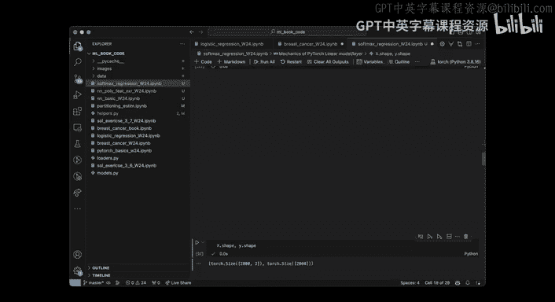

第er呢。嗯。The wifi and the bedroom。嗯，肯觉在这里。

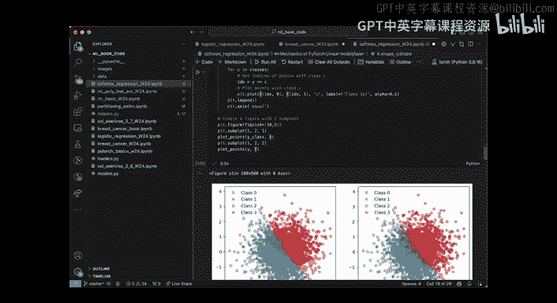

See the decision boundaries are made clear。And you do that。对です对。都 far so good。Okay， and then。

So fitting， so we didn't do this last time so a little more machinery we wrote our but we can also do it with this fee package。

SGD from the optimization one， So towards that often that we had a bunch of options and SG number one。

And science for s reading。I'll talk a little bit about stochastic。

 but I think create and as gradient decent。So you advise to all the projects。对。

And then a learning rate and can pass voice。8 zero。And。是你的铁。Actually。

 I don't need the optimization at this point。Maybe later， Okay。

 so so let's let's have that mind by loss， when is。Oh my last I get the model。

 I'm going to allow you the model whatever the model is currently currently the Smith。

It call miigated according the box。A lot of it's all easy。So what this is doing is。

What are we doing here。嗯。What I'm doing here is。And faculty name ist they responded。です。

So how do I do it， Im just basically gonna。Say I so this is going to for us the。Probably the matrix。

So for the I entry， I'm going think Y I。Okay， because so that's like that。Okay。

So I'm going have this。All I want to calculate that so for each row I have X and then I have Yi so this is going to be that probability matrix so probability。

Mar the I。诶。喂先。A个。So these are going to be my different。R， it's basically the one。嗯。

And so what I'm going to do is for each row for the I， I'm going to take the Y I。Okay。

 so that gives me the problem here observing my part enable。

the your and train is like one out towards zero up to then minus one， so that's the index I。

And then corresponding to that that have the y which like basically It the formulaomes I and Y I。

 so I have a matrix which had this form。Okay， so let's see if that's maybe。嗯。It it kind of work。

 you're not easy to do， but。Not sure this is gonna。Yeah。This is not the1 century。有です。Right。7 sorry。嗯。

Okay， so this gives you the idea。It's the other these are the the the eye and the leader the why。

So I'm going to index like this into。Into the probability so that give me the。so the lecture is。

 what is the probability there' is a particular why under this model that selects the probability that the model creates。

On for sale and so it's a really live and it's a negative negative live average so it's like one our in sum thats sort of。

Risk idea right， so that's my loss。And。Okay， so this feels like just in remind what so is any question that last？

I makes it reccalculating this bond。What is like month。啊，那个。系。That a Xアイ。

Right so that's basically probability。まふに挨つだって。The vi of size。See。

 tells me which problem that probably of different classes for this X under the all。

 but I don't have to take that Y and。W is the holiday here。Iknow that。嗯。

The way it is is that faculty and loss， my current models， so I have a school model。

And I instant like a new model。 this is going to be。

This is not the one I'm generating the data so there's this true model that generates the data。

 so this is the generated process that I design right so。Remember， there's this。

True model that we initiated， okay， and this true model has a certain set of ways actually random in its States。

But they set the see so you can do manual seed。So this patient is a a particular random C so that this follows in。

Having said set of vase， although it's random。So that's my true model from the true model that I generate the X and then sample the ys from the true model。

Right， so these wise。呃，不送这个情况。So it's just this model here that I created。This is just again。

 creates and soft match tradition models we random way so this is then we can be the original like true model but I'm going to try to fit it try to fit the data see because the data is range from the same model I'm hoping that it。

I fit the same model then I get a good result Okay so this model is going to be our。

Like working model or estimation model or estimated action model。

But the one that you want to estimate， initialize at random。

 should hopefully understand that there are parameters there。

 but I instantiate the model parameters random。And if I just predict now it's going to be bad so maybe maybe we can predict so let's I want to show you。

 but so maybe do this。So let's see if I do Model X。啊，所以说这个re啊这个。哦变 a呢个方面。

And so roughly all the us get equal probably。I is not that financial case。

 initially we don't have any specific。Notions of brand and James often the。啊我。Okay。

 so that's the initial prediction of the model， the true model is not like this again right so it's true if youll be the true model。

嗯。主发的 very亏对。Because of the data。Abstracted， so that's the one。佢哋上日猫咯。诶。So I'm going to fix this。

 so let's do。First we don't even mean like evaluate the loss of I have the loss of the model。

 this loss again to measure which pretty extent why and then。

You are repeat that the parameters is the only name parameters and the name of the parameters and the grade in the product。

So。I loop through there。Great like the parameters and the gradient and then I do this loss backwardboard and then I print the parameters and the gradient with parameters so the point here is to remind what this so this is in do。

Lo的 backward so last。嗯。What I create from applying this function to the and so that's my loss。嗯。嗯。

And then I value is just loss。But passing them all talk backward what we have。

A lot of things happens in the background。ToCon the right because like once I create measurement once。

 then I create the loss in this function it's a bunch of like fiber operations on。

Vs that you don't even see because they're inside the s。

 So the model has bunch parameterss So these linear layer and the linear layer mean has and viruses。

 So those are parameters damage。And those strategies have the gradient property requires them set to true by default。

It maybe not obviously。So that means that Pt is going to affect the great fact。系。

As soon that you want rating to describe and thenling this， it's kind of like。

Qu they calculated like the non and mapping or whatever mapping from the bill parameters。

And then I do this that all the methods work off through this and all the way to help do this。

 So this is a topic function or dysfunction function。

But there's data and actually this in date like something like L your X。B。

 So that this loss would be a function of the ending。

And so there has this notion of this functional form， so when I say， so this will be a loss。

So then I argued the boss and I do this fact where I calculates the gradient to speak to that they sort of get the gradient。

F， we just take W。Andandley ladies understand with deep and all the other parameters that they asked to keep the track rate it in the state their disease hopefully。

Because all this happens in the background you might be obvious so this is the idea guess so when I calculate or like run this first just output the value of the loss which one。

N， and then face gradient Or there is all gradient so the gradient parameter。

 so if the graph property of each parameter is not。Once I do this。

 you can see I'm feeling the same rather terms as when red government the property is populated。So。

 the ways。This is the gradient is the loss of state the age we have the same shape。

And the gradientn would be of the same shape of the product and this is a gradientn of the loss percentage virus。

So that's the mechanics of big， so you have the novel。You may have to model for a loss。

 so this is like complicated。F that computes the loss of the models and the training data。

 and then I do this loss that backward in this propag so they call it backward propagation back propagation。

Where is an message。We don't where it was but this great and translation self backrification。

 traditional。There's a bullet that goes backward from the loss to the inputs and it's basically the application of the chain rule。

 the chain rule of create that you know the chain right so if I like a couple of different functions。

I want to calculate let's take the derivative of expected W。

What is what is going to be like this things that of scaled， or it's going to be de。Like z Chinese。

 right， like。Something like a D prime of this and then F prime of DW。

so this operation happens inside so for example this is the composition， it wants to be the gradient。

 it goes in so the gradient test this and you know know how to take the gradient of the block so you the derivative of this times the derivative of the logic which is like all over so you knows how to do this and how to do this so just the application chain rule of differentiation and the fact that the individual operation is know how to be the gradient there this。

Is this this backward operation？So back propagation here just calculating the gradient in this。系。

You don't have to worry how much about it， it's just cats。Thank exactly。

Sometimes called automatic grade differentiate auto gridd。

 it's a nice way of automatically differentiating。Functional forms that we generate。So far so good。

Yes， you create the loss。 you do the backward part。 This basically gives you the gradient。

 I have the gradient I can best take the gradient so my initial character minus learning things is very gradient gives a new character identified in the loss。

We the lost that the new gradient。So that's， for example， simple reasons。

So modeling your age minus 22， that's the learn rate and modeling your age that。

I can move back to it was like a bare bones gradient percent， it's one7% and。We're showing you here。

So that's how now I remember the reason why I did this， so this is SD correct learning in。2。

So I want to show you what exactly that does。So this is our own way in。s minus 03 times of the graph。

 so I having the video I take the step in the direction of negative gradient subine 。2 the same here。

 the same goes if I opt does the stem so magically what it does is。

It taste it does this and updatess the parent the model so I trained the parent in the model but after I do this I did the same the same neighbor so you can see this in our own gradient decent。

On the parameters， and this is what this Opda has said us。

How does it know what parameters to update it knows because you have。Given the parameters。

Of the model here。 Okay， so when we initialize this talking。Object。

 we give it the parameter that we wanted to。Update。And。

So this often optimize does not compute the gradient you do the gradient So the gradient that populated this does something with the in the case of the simple gain zero momentum and learning point2 it just moves in the direction of gradient that this looks like So this operation。

 as you can see。Taling that instead is exactly the same as doing as some practice well except that here I'm not updating parent。

It was creating and this one a Facebook garden there is on creating internet and see that they're just saying。

所以你个电事。See here understand any questions？This's just introduce system。I found machinery image。

我 hopefully悔 I simplify your life if you understand understand what you're doing。

If you don't like understand this， it's very magical because you love like we opt those step and depth。

 but it's not clear when it's going on or you lot going on behind the scene。Okay。

 so this opposition center does not be great speculationulation。

It just takes one step in a company effect if I have momentum I do something else， for example。

 if I have any more like fancier optimization， it does something more de so the assumption is that by this point ingredients have been calculated it and they're in grand property of there。

There's an interest。And this just takes one to step in there。And this's because SD is simple。

It takes one to step in the direction to。Okay。Thatund was good yes have to clear to after that no。

 it doesn't clear yeah， so if I do it again it tries to add so this doesn't。

Change the degree the backward does the gradient So if you don't hear many of the lost backward person in this case you're going to be an erroration because you have an in office so you try to reallythink run the machinery backward at the same position that youin and error and trying to see like。

In this case， it's fortunately good to you。Yeah， some error that。

So trying to back forth two the graphs for a second time。Or directly accessing。So this is。

 this is not sort of。lot for。Hopefully good reason。

 but in fact what you want to do is that you update the parameters and then you do calculate the loss you do the backward it does not clear your grade so it's just a so you have to do clear in yourself you eithert go to all the parameters that the gradient zero by hand or this optimization has this problem zero gra often the zero gra is zeros out gradient all the parameters right。

So that's what we introduce。So if you go here， this is this is big keep mine。

Short reading in the language so we often initialize optimization innovation you know at as more than zero number of the sense and this just keeps track the loss since it just keeps track of the loss and then I have a main loop which is。

For each iteration， I'm going move like zero up to number of slip minus one， I calculate the loss。

I in the back， so this is my current model。Paastic this check is the loss of the model。

 thats the loss It populate the greens all the parameters give the optimization extent we move in the direction of that。

嗯。B and， so at this point， the parameters of the model had been updated， so I had a new model。Okay。

 and then I do obtaining the zero gra。 so this zero degraded of the parameters it's being correct。

 next time the loop Im cap the loss， I do the back， it didn't begraded。And check。Yes， little。

So zero guys zero is not grade。So we have a current list， right？Remember this part？

So what does this loss backward do originally there are no grant like grants now？A you管。

So I get the grad property， you can see the parameters have the grad property。For example。

 the means that。Rightrad， so that has a great gradient property that is helpful so if I don't zero out this way again next time in the capital it's going to just add up to it。

I just like is not what I know I want the gradient at the current location that did some of the gradients of all the best things。

So this is the design the design。what the gradient of momentum， that momentum going to one。诶。

That would be a like that， yes。We basically don't want to do。诶。Yeah， that would be a exactly来。

ItI think it's designed for a different reason so example you might want to。嗯。

Just add up the gradient across samples this sample。And the gradient of this loss just like to。

Different samples is added。As I can do a large model on different samples， right？

And every time I calculate the grain I can add up the gradient so that I would be make the gradient。

三月。There's designed for a different feature。But yes， you're right I think so you don't want。

That would be like得 very难。No not interestinging video。

诶 doing moment if they get on get so you you want all all in really that。你个得使话。

You want to do your steps your own There's also dog forward on。Dot forward， This a dart forward is。

So what does that， yeah， so there back the backward is tack green that forward is what does the green。

哎，你好。This evaluation function， so for example， if this model and have the model。再说个 here。系。Yeah。

 so this is。 I had a model。So has these models have a forward pass。

 so this is very implic when I then apply to something that's defined just like anything basically value in that forward function。

Or I just calculates the function。So this is like you that personalityin I'll talk about it。

 so forward like moving things from the input beyond。So input。

 you get the input value function is like passing it through the function you get something at at the output gradient calculation is that backward you start from this。

 you move back from propagation through the， but like the mechanics are not that important。

 it's just functionalization gradient calculation。I don actually let。

Thatunds good former backward algorithm。They used to call this one backward whatever fact verificationation。

 basically green thecent was called this in there。Your historical reasons or like traumamatic reasons can go forward backward。

But if you don't want to。Don't worry too much， it's just math。Okay。soundss good。

So this is implementing our。So let me initialize。Merry around because I run it multiple times。你话你招系。

Yeah， from here。怎说到S。妈。嗯。Okay， now when I run this。

 this is gradient and the same without momentum and you can see the last like next see down。

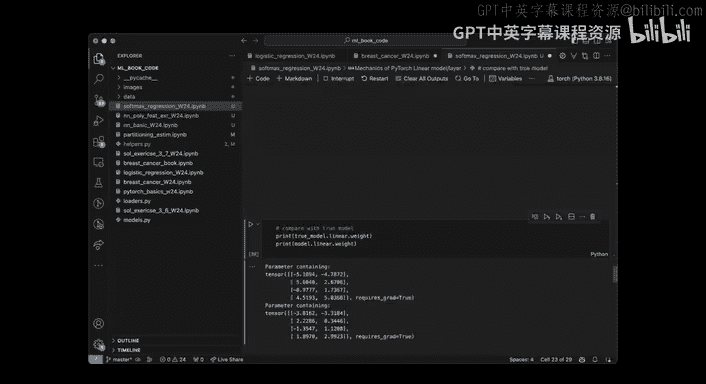

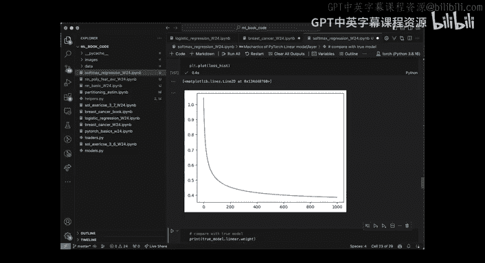

And what I'm having here， I'm going to like print the like the race。你个出嚟。

Is a prediction prediction means。けせてレしてる感じじ。诶。But surprisingly， if we calculate。

So this is character the。啊。Bas predictions on。第个。The the like， the actual。

Pa so this is really are the base labels。 So these are the true labels。啊 and对唔你你嘅绍你先见。

Bing on the base labels and the。Observized point in play。 and the ones took to a for entry。

 this is the true model。This is this is my this this is my estimated problem making human the very actually there。

Ded model is doing better than it date。Thats。我，就么意思啊。带好。电营诶。这什么。唔使路先。你看。Okay。Yeah我仔。Yes。

 by very human the data market。So there are issue is a data thought that the one issue is like it's not identifiable。

 so even if you perfectly recall the model you could say the thing that would be different remember I think it's not idfiable but。

the same exact a in this case by end like a constant vector each row so if we could be like all the rows are shipped so when you compare it's not obvious to any for example。

 show you these two it's not obvious if prior this is that because potentially can shift。

So for example I can do。我感觉那个人。Of this。 and it's the difference of this。

Is difference basically road is taught or basically I want to add a person every role to get close to this。

Let's say， look at the difference of theses and it add thats to。The other roads。诶咩你会嘢耐。그有かです。

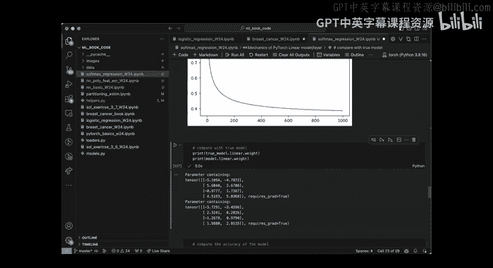

你就我资。呃。Buts啊。Let's see another example liquid momentum， I'm going to do momentum 。9。

You can see it's much sharper。亦即系。By museum。

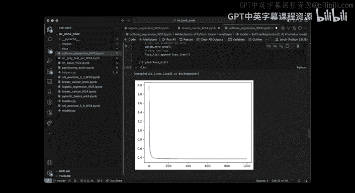

And so fine。There is noise， yes， there two things。Why there's a norm from the problem and there's like a finiter sample size。

So there is the fundamental limit of the problem if you have infinite amount of。系啊。呃。

Imfinite sample size， there， there' is inherent noise。

But there is also like this is a financing sample of the picture， so we have 2000 samples。Okay。

 so let me show you this， maybe I'll show you later here that。

So this is the predictions you actually look similar。

Momentum is zero right so you think can see the weights are actually better。

Now think the person in this one that。我啊。嗯。When the prediction他这个 prediction is。

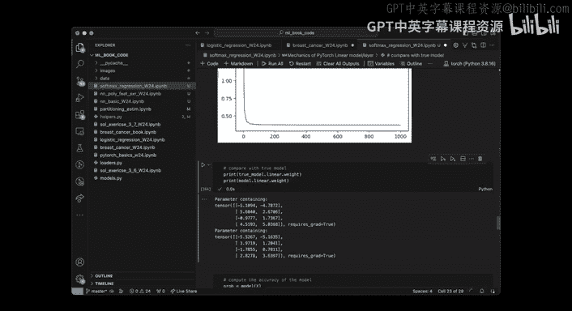

Good， to the pretty hand。Matches sort of that。What you'd expect from the Truult？

Sorry for on the past。Yeah， so why doesn't it go to zero？

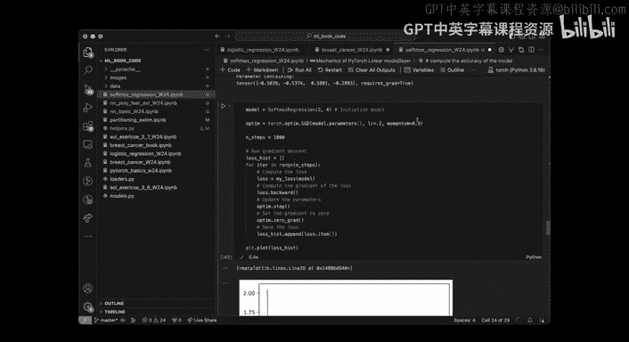

诶。I guess that's 2。9。So this is roughly s print。Final value。

So I the final value allows to fine two things the initial value is somewhere you can see。

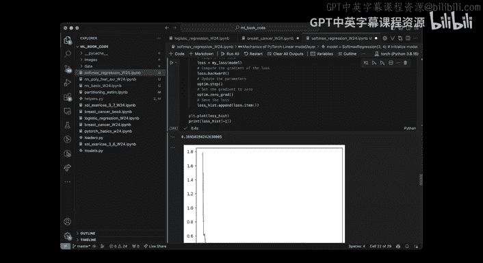

1 point。8 or something。So for example， if I do。200 samples， right。

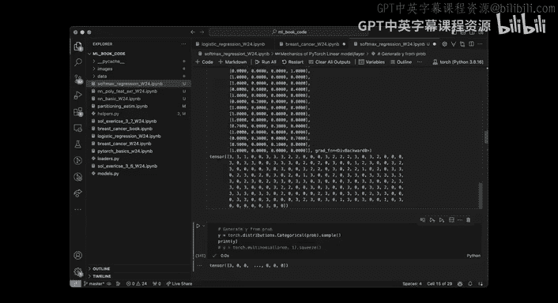

诶。我 do意见。

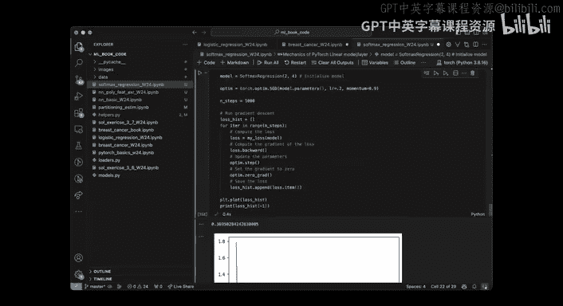

没关。It is lots better。Counter intuitivetu。So。Is this a baby actually。I think I'm normalizing the law。

 so it shouldn't be a problem with that。嗯。我攞啊。200 samples。I there the label。These are the dayss。你。

Countering to you。

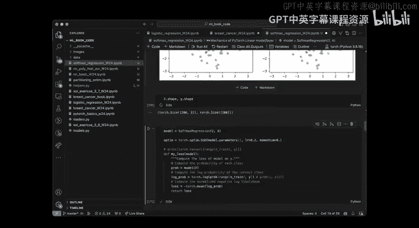

Okay。

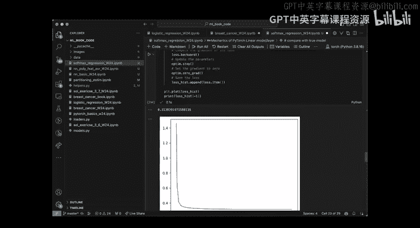

I fair words。They doing better。Let me reduce it further。20 samples。Okay。

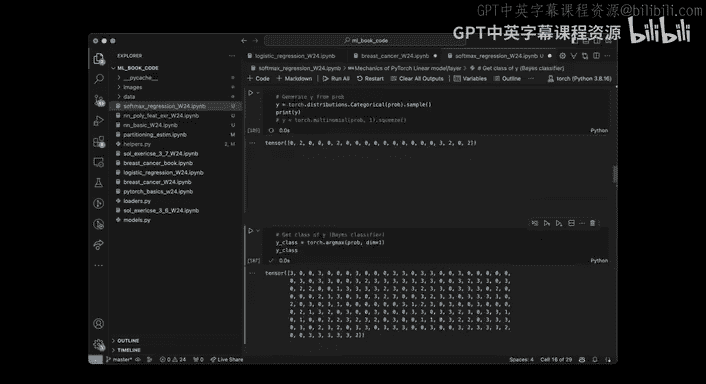

死你家。Here live。

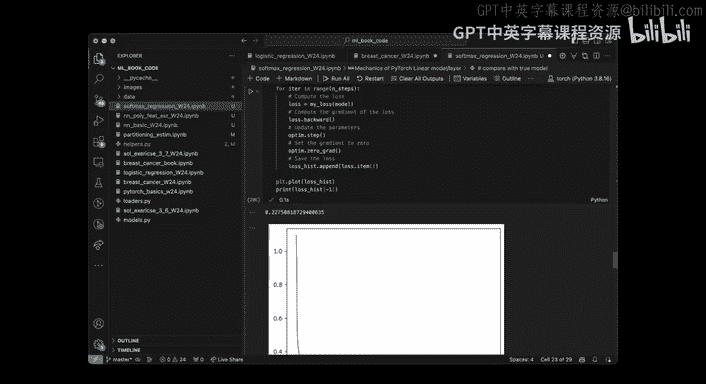

啊行 okay。So I'll post this you guys figure out， I think it's also very separate Okay， so yeah。

 the boundary points are not large。Okay。So maybe okay， let's do another experiment。

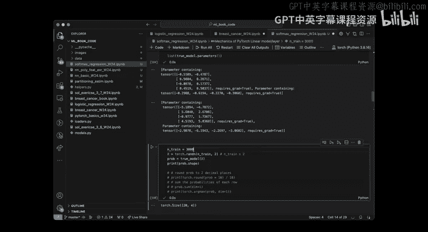

推谈。Is it kind of divorce？So this is always like surprising things happen to these like classification problems。

 so everyone analyzes the regression problem。😊。

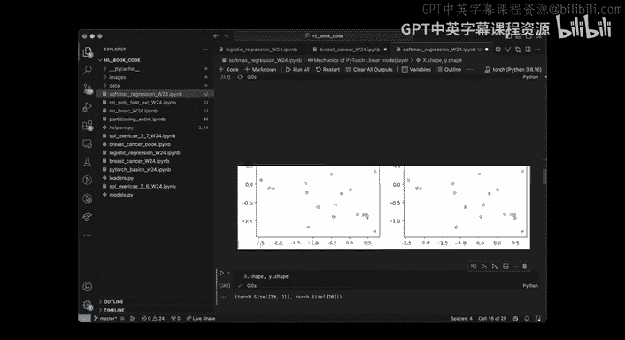

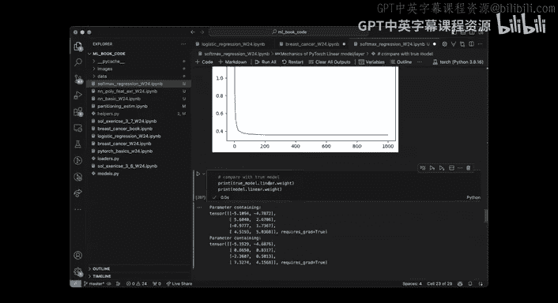

Yeah， so it's like， here's a limit here。

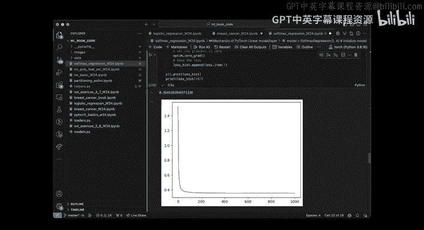

But I'll let you figure out why。You can do better。Sort of but roughly is speaking。

 if you have smaller smaller sample size it really harder to be because like one by and signal。这班上。

So there is noise in it。 So compared to the。Population level， Okay。

 so you would expect to be able to。Generally when you have fine examples you if you don't see enough of the model。

 that's the problem in this case I don't it's an interesting question why you can do better。But。

Maybe if for example， I don't know。This is a like a good as we mentioned separation。

 so maybe if I do increase that like decrease the noise so's。So this is very nois。

 so let's see what we get。

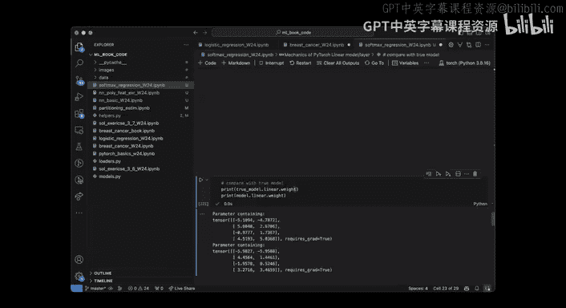

Okay， so that's like the limit is like 1。2。

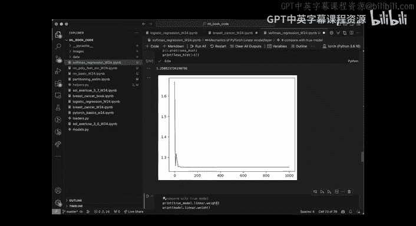

嗯。

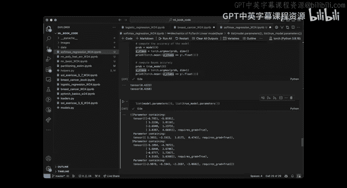

Again， 42 is the best I can do accuracy wise， so let's not be reduced two。

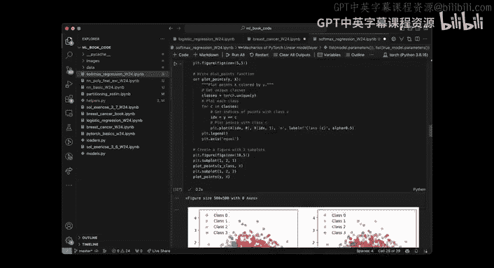

系啊。See like 100。冇。

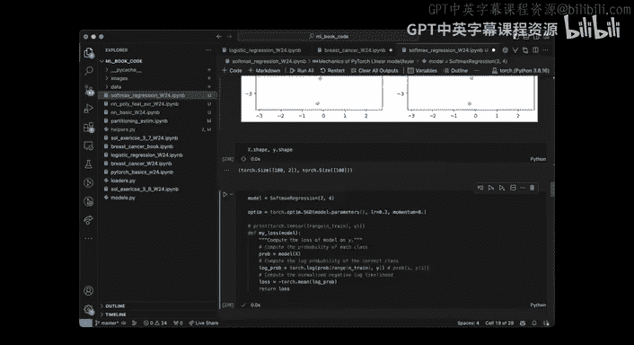

嗯。So one point2。

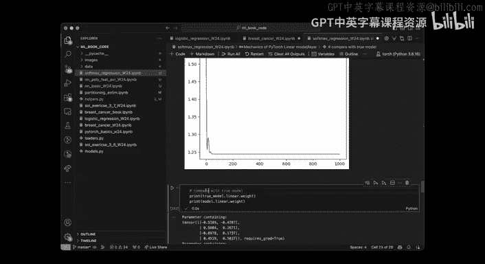

对不せ。P samples。It should fail at some point， otherwise。Okay， it's even better。Okay。

 this is a very interesting counter so it's like prediction。😊，So this is， this is better because the。

对。Why is it better。大 no位。Anyone knows why this is bitter。

I think you would do that1 samples many times and then you take the average threshold。No， no。

 the issue I know I'm doing home with the training data。

 So what I'm doing here is I'm talking the training lot。 it's pretty of。And if you have few samples。

 you're going to overflow so your license going to go down so if you do the do a post it as homework problem。

 generate an independent sample， like test sample。And in them test that for， hopefully this disorder。

 so you you're doing better for you're playing it so accidentally I didn never just like you couldt change us list。

 but because you have the generating model so you have the generation model here。

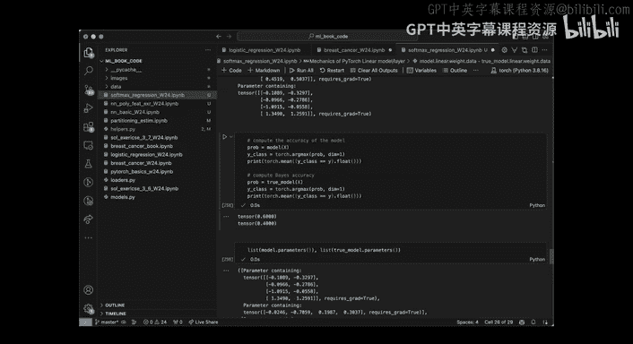

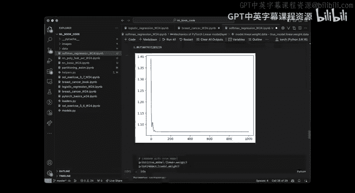

It is。

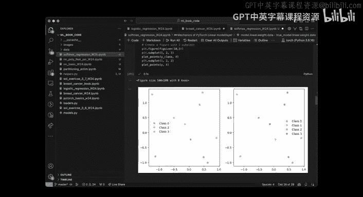

So we are like generating from the model or so you can generate access and you have the true model。

 just generate an independent cycle。系你拉 andさあ。So this is a very good like like exercising over feeling so your loss is knowledge you're have to maintain storage play。

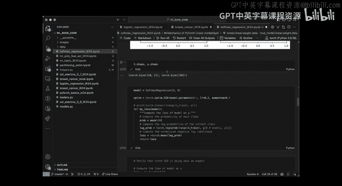

Potentially， my guess is that if you just awful acknowledge。If you do that the best。

 then you rely on the best will show you problems。

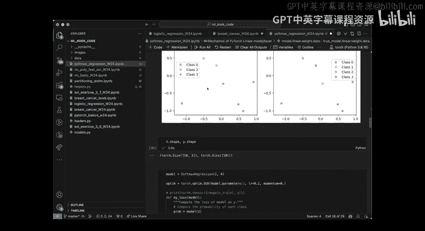

Okay， but generally speaking， yes， so there is noise and there is a limit which you can go beyond。

Basically， theres a fundamental limit in the problem and also there issue the sample。

 but this isn't a very nice sort of。Illustration of what why。

You have to worry about everything feeling。啊这个。O。Very great exercise here and。ri啊。Machine learning。

What else， okay， so now maybe let's go back in。So always嗯。

You verify and test data so that this doesn't happen。So let's do。Okay， so the noise is too high。

 so let's go off。嗯紧啦。我呢个这个。好，我拜过你听唔听。I love to你 with surprise。

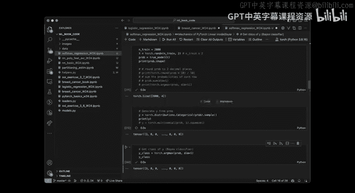

嗯。Okay， we have this。

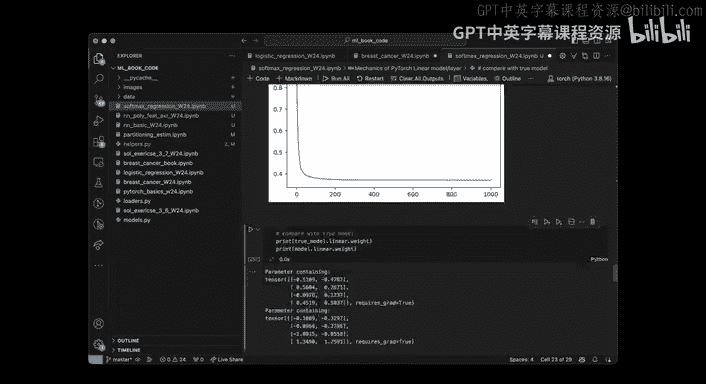

Goes down to that。Thanks。Okay， now I just want to maybe mention something about that。SDD park。

 so SD the idea is that they don't have to because this empirical called risk。

This is an empirical risk and if you go back to the original discussion empirical risk。

 the general framework， youre just averaging approximating the expectation with average with by the law of large number convers。

The true and also the expectation is the same， so it's unbiased an unbiased estimate of the true risk。

And so if I just average over a smaller sample， it gives me the same kind of unbiasedness。

 it will have more variances。But it's still an unbiased estimate of that。

R and because I just want to take a step in in the direction of that great here i'm not trying to like maybe optimize it perfectly Maybe I get a slightly noisy green it's still fine so maybe it still points in the right direction but the idea of SD is that。

I can graph like that， I don't have to divide this on a whole sample because there will be costly let say you have 50。

000 images。And maybe I'm going to pick a batch of size 64 and I'm just evaluating this average in the 64 next time I can't complete the gradient I take a random sample again。

So every time I calculate the gradient and find the value it is slots on a different batch of data。

And so hopefully as I move along， I'll see all the data。

 but each time it's a different subset and I get a more noisy movement and it might help like the way like hitting them。

That local minimum stuff， because I'm moving noise so I I be able to。

So the properties are very interesting a lot of people are born data in China too。

I guess we stochastic part is basically this storcchastic nature it's like the same thing but doing it on a smaller subset of the data and it's like the SD origin I think that。

The original to is when you just take one off。Instead that this average just pick one sample that would be unbiased。

 but it's like a very high high value。 So just evaluate on one sample next time another sample。

 So that's the s gradient。The one that I mentioned something called really bags。

ReadWe don't have to worry too much about that naming。

Just that the idea like the extreme case is traditionally associated probably with it。Who came up it？

Buts。Thanks sastic stochastic。 so if I want to do that， I didn only say rough and loss。

 So I changed my loss sometimes I do rough loss。 So what this is doing is that。Ps and random。

Integer between zero and entry。 so it's just fixed。

 so then these are the indices of training data and I'm completing a vector of batch size so batch size is 100 here so I random people come with。

Other samples， and this potentially can also like take。Looks like at samples。

 which you can try to avoid。But this is very样。The a decision are located there。Yeah。

 very about idea who。 It's okay。就是这个。But if you want， taking a sample without your place。

This is potentially the example we place 100 data points around under the select this is the patient remember with one graph of the select cell they select all those samples in X and all the samples in Y。

 those are now my new X and Y， and then apply the model to this new X。And I calculate the loss。And。

That' itSo this's just tackles the loss order like the substance。这原。我 don佢。So S and then I。

Where the S， the size of S is the batch side batch site which is。Okay。

So now if I do the the same thing here， you can see。

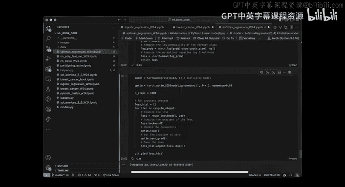

All happened so this is of very noiseance。R this go down Okay it go down but there's this extra variance that you see these also can maybe use to quantify the uncertainty address maybe Okay。

 so there's this。Final loss， which is。

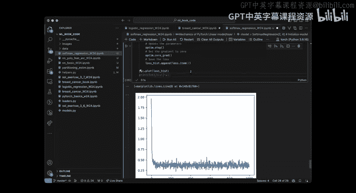

I think it's the same， but the same。

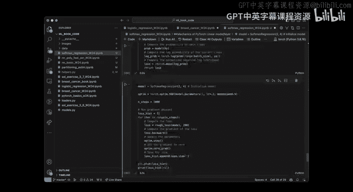

Yeah， it within the tolerance， but you can see it's much no easier and just lecture。

Because I'm keeping the different decision I'm doing with different grade basic gradient and different samples。

 iss not going to like converge。To it's that a problem， right。你边该系三。

But this is SC and you can say it works sort of。And it's much easier to implement because I'm evaluatinging this it' much faster。

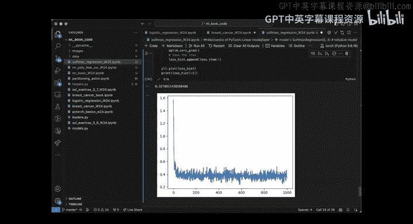

This is say你啲。So let's do maybe a thousand， I can't see how much it pays。Maybe there towel and stuff。

Okay， so this is the that。I do a0 stuff here。

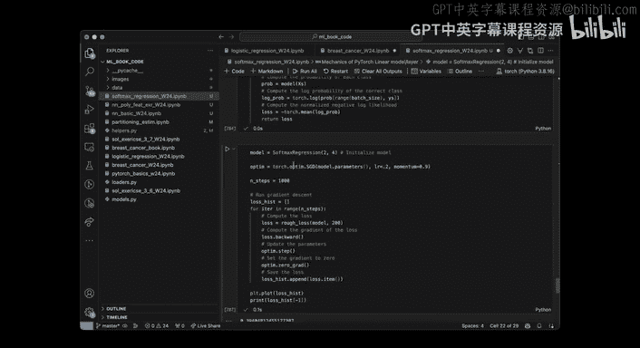

See you can make it calculate it much faster。嗯。I like roughly the same kind of。

Or I don't think I'm evaluating it， but you can just go and。

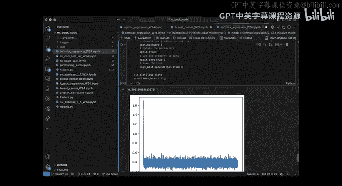

You you evaluate this performance。What is performance。嗯。Yeah， perform stuff thing。嗯。Thank you。ok。

So that's the idea。 So， for example， I just maybe。诶。My rough lots， so I okay。

 I'm doing with 200 by pass， for example，2 any。

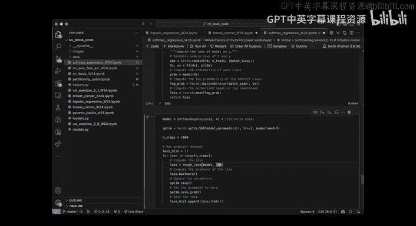

I see it much more。Much more。Problematic or like noisy， but。Like the prediction， like this is。

 this is the error the train。Be more variable。然的。真的是哪里的这。大験セ。We an invest。But you can see the effect。

 right？

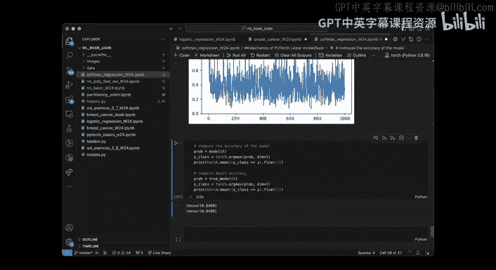

诶。100。This where it is。200。Whats this one answer 500。

Even this and has this is at this point is very close to the number of samples that we have。Right。

Okay。So now you know about ST， minibank STD， batchside。

 batch makes size of the sample that it takes to with lots of it rating。你方面你现在。

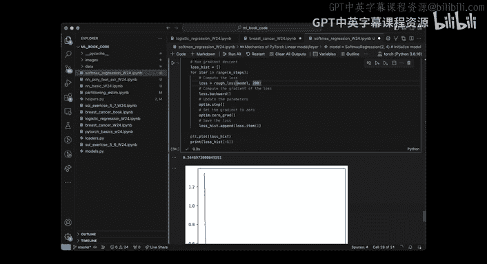

喂。So you've seen like in logistic regression， the decision boundary is basically a line or a hyperplane unless it's the soft max would be like the intersection of a bunch of lines。

 so these will define that。嗯。Potential。嗯。That theにポ or or states。The time。

But what if I have them more？啊。Interesting， like decision boundary that looks like this。

 you have seen this something like that in the breast cancer。

P at the limit sense that's been a very well wrist cancer and becomes。Sure， and in that case。

 the media boundary also does good it， but maybe even no nonlinear boundary that fit。

And I think the case， the more interesting case， for example。

 is like if the one class is inside this circle， the other class is outside。

 this is very far from linear classification classified。This is my being here。好的。

There's even boundaries you're going to take。对。So what is the solution。

 there are different ways to deal with this one is to naturally in the linear models to。

These casess by moving to higher states， so this idea。Feature maps。Or like basis。Functions。

 et cetera about the feature maps， basically your map is data into a bigger space in the bigger space the classes with like linear in group。

It's a very powerful idea and these leads to the idea of the kernel methods and things like that the other idea is to just introduce Eler this。

So theOr only by just changing this function of linear mean so it's like a parametric function data I just just design and new。

And。Functions are replace。The place let's say theta x wetano mean here。嗯系系 my law。For example。

 neural networks， Okay， so neural networks are natural extension of this idea。

 we add a bunch of like。L cost nonlinear and then lowities and you can introduce complicated nonlinear so next time we' to come back and talk to talk about this so this this idea is like composing。

Composing a linear。Functions啊 with。我死你死啊。Scalar learning narratives。

So it's a composition of functions， composition of no nonlinear functions in or no nonlinear。

And this is a course probably much name the new life。All I can see that we call AI。

 they are basically all variants of this。Work and you can also talk about this if you have time with how I should do this。

And so I'm going to start with things sign this。And if we managed to go far。

 I'm going to talk you about language models a little bit because。

You're naturally tied to this and soft my。And it's a good example we can to talk about things longer。

Right， okay， that was good。Thank you guys。たさん？哦，对。

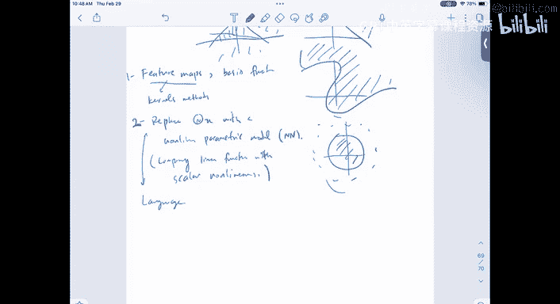

不以。Thank。

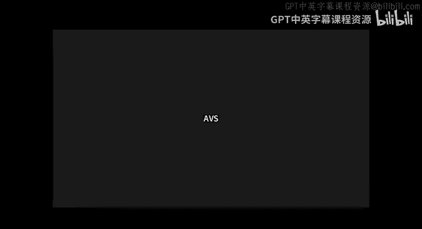

嗯。