# UCLA《模式识别和机器学习｜Introduction to Pattern Recognition and ML Winter 2024》中英字幕 - P16：[16]Introduction to Pattern Recognition and ML -- Lecture 17 - Winter 2024.zh_en - GPT中英字幕课程资源 - BV167BfB8ETK

That we were talking about the linear classification model。

Like logistic regression start next regression。And we saw that these are examples of。嗯。Okay。

 for risk minis with。ACertain loss function and effectively a linear function。嗯。

We're deny the things that they will。And so these would need to。Vnior classification boundaries。

 so in the case of。嗯。Logistic regression， binary classification is really simple to see in the case of。

嗯。South nice because and they're going to do it in a homework problem。

If it start from this nextversion model， multinoial logistic in。You can find out that。Optimmod and。

They separate the。这事情。Reasons that are the classes of the optimal rule or optimal day rule would be lines or I playing in general and then intersection will be。

Theses polyedral sets， so you would get。Like one class is here。

 the other class is here and so on and so if the situation is more complicated。

 basically the classification values are。😊，Some the mean so value can classes is。Me呃。你。

So if you havet on here， classification boundary like this。

Or even worse like you have things like motorcycle cycle and the other plastic outside then these models as they are。

 they're not going to be。Performing well because let's see if I do a logistic regression in this case。

I start like dividing the space into。These type of regions， no matter what they do。

 I'm not going to have a goodness specification。Great。Okay， so the extension that we can easily。

Make one is via feature map that I'm going to talk about hopefully later。

 it's very simple on the other one。😊，wish is very popular he why in。So they'll move on this for。嗯。

And rural all this works a non nonlinear climate model。You for example， basically replace。

This function here。Which is a media function。So H XI。

 Vao linear and output replace it with a paraing model that's not needed。诶。

And the idea in all networks is we just introduce very simple nonlinearities。

And then compose so the idea is。So let's just。So look at the second idea。嗯。Seconding idea。

Neural networks。So introduce。Introduce。Sa component bias。是。No nonlinearities。And。Iose。

 so that's the basic idea。ok。So what do I mean， So if you think of a simple。Function。

 linear function。We thought they can be written like that。嗯。

Or if you want to be in the language of machine learning would be。Like W。You related it like that。

 so x is。1 an exder。 So that's the features。So they're the late major not planned。

the actual I mean there is a bias or inter I usually like you're saying this is this is a particular feature man okay。

 so math next to different states。In this case， I had a like a quick feature of what really work with ease if you recall so let's stick with that。

So this is linear year math the way people make it my linear is they apply only years to each coordinate。

 so let's say if I had。For example， my。So a sigma function that we have the sigma is a particular line here。

嗯。But if I。Like let Sigma B a general non nonlinearity， so it's like a map from。R to R。Okay。

 so this could be， for example。Usually you want something that's。Okay。

 so so it could be anact sigmoid， for example， it could be our own original sigmoid。Okay。

 that's a math from R actually zero one。Its a good heaven on inhi that maps from。嗯。Like this。

 so map is zero to negative to zero and then positive to。发てる。Like basically identity， so this map。

This is very common， this is called Relu。Rified linear units。So it's almost like a linear function。

 So linear in overall linear。There are other examples， so there's the1ch。

And just系 publicic啊 there is。Baky and general and leaky and stuff like that， that for us。

 it just some sort of learning very much。So what what do we do with that So you take the this function。

 Okay， so this produces， so suppose the input is。So x belongs to RD。Okay。

 and then we want to map it to， so in this case， theta x maps and thanks to， let's say R。In our case。

 it was RC in the number of classes。What I'm going to do is that I'm going to quite on beach1 of this way。

Okay I guess。Sigma let's say。X one sigma datata。Next to。得得得食啦记得。P。嗯。四。😊，Okay。

 so this is a newvic there。Okay now I'm going to call this my function， okay。

 so this belonging this depends on the parameter。And then。IHow if they start out here。Okay。

So you apply this to each element of function， if you want to be simple。

 I might write something like sigma。Heta x。So this is understood to be applied to each component of the it。

Because it's a un variant。Okay。So now this is going to be sort of not here。 It's not the in story。

 So what you do then is you most likely have more， so I have this now access it to function that looks very similar。

I want to have this version。And then I have another one。Which is F theta2。This looks very similar。

 so it takes an input。Tta1， lets called this name Z， for example。

I guess it could be in a different domain。And theta2 takes it and then apply linear then' compose these two functions so let's say Z in this case。

 so this belongs to let's say RC。Then the input to this would be an RC。The output could be in Rrc。

 for example， some of it。so I'm going to compose them now， so I do if theta2。F stayed one。Okay， okay。

 so I have a new function， which。We can call like G if you want， depends on these two parameters。嗯。

And this really used to lean out all the marriage there。嗯。And the no marriage is here。

 when I propose I feel something interesting。Not represented， so this is really。ex sigma。Data 2。

And then sigma times theta1。Thanks。I has two parameters。And this是。你到的水。Yes。

 but you also might because it's a smooth right this is not a smooth So this whether you want to use the smooth or another a smooth this that something that you're going to worry about both work。

This was very popular。The smooth ones are also useful。

 the smooth ones are useful because he's theoreticalically the derivative is。

think everywhere defensive。And we hope that the smoothness we help optimization。But。I mean。

There's no reason why necessary because is prepared over there。So this是ね发一是啊。

One reason why the bucket it very easy to add。So I undertake the sign， either you or that or passing。

For this， what we define the derivative that zero？诶 and five。So this matter if you end up there， but。

嗯。I actually don't know what they do thought， so you shouldnt check it。

 but they but arbitrarybit just define arbitrarybit。

There's a left there weird the right there is one。You're hoping that you're not going to get started there so you're hoping you either them here or here。

嗯。If you have that like optimization or L1 utilization， L and penalty looks like this。

So you know that this not this this point of non differentiability matrix。

 so a lot action happens here。I think are here， usually。Good make the the coefficients are zero。

 So it allows me have none new budget and。There is a self differential here。

 There is something which small self differential and something differential can be anything with。嗯。

us1 and so they need factor on the self differentialible。And anything in this zero to one words。

And you really want to do some reading the sense， but people don't care about this so technical anything。

There there can make assumptions。And so differential and suffering and this in is a thing that the mix。

Thank you。If you want。Subgraient。Exist。At zero， but you don't care too much， so belongs to。0 to one。

 anything，0 to one。The sub gradientient is like the slope of any line that passes through this and below。

So anyway this' like extension of tang。 So theres no tang here。

But there's supporting supporting that and you can change the slope from zero to one and it's below the function that stood out to move in that direction。

Good point。Its we really interesting to see one things you change by with the gradient。然后。

And the other question， yes。Why aren we wanting to compose it to simple non nonlinear instead of introducing a direct withdrawal of non nonlinearer？

诶。So the sample not here is a apply or that life， but then there's this linear。

And then I applied for input so generating like a general non nonlinear function is hard okay you can do that。

 but then you move away from neural Orleans。It's possible to have in general。No nonlinear function。

 but proposing a class of general multivari nonlinear functions is not easy。

So none your function and high dimensions are。嗯。诶，等 the same they哋。Okay。

 so you want to have some sort of a restriction。On the class of no nonlinearities that you're going to generate。

And this produce a nice。诶。Restriction so here we just have components like introduce to matrices that's the number of parents that you introduce and introduce on。

Okay， so if you， for example， you can have。诶。Like I can have like potatoto one。Thanks。嗯。

And I pass it through a general an function and just belongs the some function box。This also worked。

Assuming， for example， like let's say that， I mean， it would make sense if you have。For example。

this is C by D Okay， let's say me is much larger than C， and might be possible So I say Cs train in。

Okay， might be possible to come out and for two dimensional non year mile for0， but here for example。

 this is 50 because is 20 it's only like in 20。And our nonlinear function defined on three dimensional states。

And。So we cant defined these things， it's fine。But controlling complexity would beard。Traditionally。

 you will go there。 but at some point， you just。Say okay， so why do I need Pta1。

 I'm just going to go G of X。Jie love to some general classified。

So the more perspective introduce here。The more restricted classes and hopefully hopefully can then control hopefully the actual question looks like this。

And三份で就对。这没。Tactability and and。Pro sense so perspective thank。It is a simple task。

This is simpler that may be like in all religious functions。系系。

And data applied to all the ors of Yes， yes， so the way that people。Usually。By the way。

 this is usually called multi index。Smile。And it is popular like asco statistics Reg more general but okay。

 so what this looks like usually what the people do is you have the input X。

And they write it like this。If you see like some of these diagrams to traditional diagrams。

 they have one x2 up to Xv。That's the input like and then you have it's called the Z。In this case。

 for example， let's say there are three。You get Z1 z2 V3 these are hidden units so these are input units and then they you'd see like people。

呃嗯。So this A1 takes all these in。This guy takes all these in。And this guy takes all this time。Okay。

 so youd see things like that So this is saying， for example。

 Z1 is like a linear combination of all the other ones Okay so theta。😊，One， let's say dot dot。

Times X， okay， and this is。Hta1。t dot。2。mg。And this is Taylor。Next， or if you add the sigma。

 this would be I can actually the sigma of this because so these are the hidden units。😊。

And so this is how about who we connected later， when you connected the C connected。

 you can introduce inspire some input。This is afternoon the loan I part radio and King。

Potentially yes。对。And so there is one layer it's a different layer， and then you have。

The next stage in this case would have like the same because I took the Cs here the same。

 so we would have。Like this is the output layer， so every one of these would be connected to。

Every one of these guys。嗯。And I realized that I made a mistake， so this is theta let's okay。

 let's call this theta one maybe。I'm going to call this theta1。Like this。And then there's a theta2。

 so there's a theta 2 that follows these。H到。Thanks， so these are all like this game。

 you're like weights each one of these in a certain way。fect。

 so each one of them is called the neuron。You want to blow it up。So he has Z1， Z2。你吹。

Now the other reason why people do this is just like inspired by。The neural network of the brain。

 so these are called artificial neural networks。And apparently， you have one in your head this。

It' your brain and so they looked at the neurons and neurons apparently do this。

 so they take the linear combination of the input so each neuron is connected to a bunch of other neurons。

So this is I then to call the Z tilde one。The state simply on these and makes them in it in a way so。

So it takes for example， and then let's call this if you want to be like in the data domain it would be。

Okay， there's a bias so ignore the bias， so it would be like the。One， one。This is second layer， Z1。

First data 1，2。嗯。Me2 plus。8，1，3，3，3。Again， there just some lake and every neuron can do this and then we apply it on the area so that's the job of a neuron。

没意思啊。This was the understanding of what neurons do at the time that these were invented。

 maybe like numerousci of， I don't know I say that。Understanding of who is， but this was。

And they they had like electrical potential and say this's like basically electrical signal so that's I get the game。

So it like that is the the mean like coming airports and then gate So gate video threshold pass through。

And that's why my for example very to say comment。I mean I'm ignoring the intercept here。

 but if you imagine the intercept and if you have the Redoo， this intercept allowss you here。

They shift the location， so it' value bigger and let's take this as minus for example。2。

And if Sigma was the Reddo。嗯。And this is bigger than two it would pass through。

With the next layer z otherwise shut up。嗯。So just for your own。

Say just remember that there is reading my not for something。It's like some be here。E，2， one。那那个你较。

that's that even better right。Wates， okay。And then the combination of W and B is。that where you be。

So there is history very like inspiration of nature。 There is theory that he's like maybe two layer。

Well that course can represent。Any reasonable function that's not degree of accuracy in the number of。

It's a too may all that forest section。没。So called universal App。B个。本呢前备是。你我知道 here。佢。Yes。

 what is the two included in the parameterses so that's the second layer putting the two for the date and vices of the second。

So this one will be90。Pta1 as I written so it's like。Pto1 here。And take the two here。Okay。

 so you can think of this as like including weights and biases。Weights and biases。

And there's a website called rates of biases collect rates of biases very。Make a startup。

To help you like。St your rate of buy you like say that and have the ways of buy is on like die effort you can make money。

It can me like a company。Yes generous。So people train these and then we have。

 if can have an architecture， we have debate， then we havet function。佢点到哪你。诶。Oh。嚟嘅个。

And don for this very sought， so if you have a good model and if you if I know the architecture I can pass through the weights and biases and you know' have the function in this。

Do whatever。You an input that you can have your own chat。So these are like aesthetic model that like。

Just a function just the function from put to output and then the kind by science and a particular architecture so there's this architecture in this case the architecture is very simple so you have these linear。

Layers and。嗯。In my case， like I have two linear layers。

And usually there's an only nonlinearity which you don't represent。

 but let's say there's an only nonlinearity here。Solinium。not linearity， let's say。

 even I actually write it， but not linearity and then linear layer。No nonlinearity yeah。

 so this is the architecture of my model and I just have to give you the dimensions so the input。

 for example， is being。In our case， this was C， this was C， and I think this was C as well。

They're not or prison。So this can replace。Whateverever we have， for example。

 before we had just a Tta linear model。From D to C。And this was。嗯。Here。

 so it would like used to be like F theta of Xi。Was just theta of Xci。I can just play so listen。

Molly lodges。The general isなです。A classificationification。And then I just say it my new neuro other。

Any thanks Central friend。嗯。RD to RC can be interpreted as producing logic and so these are the things that after I apply softm we can probably assess so if you want to have the full model the full model is for multiclass classification。

 there's a softm layer as well。At the end。It takes a softmatic and we user it related。

But do you probably and absorb the into the box。So my new like now nonlinear model is now this， okay？

The is architecture， it the and。So this this part of I think it is saw multi for thatron。Later。

multiul layer。嗯。There。Sup problem。Hello。3 is。I these are trying either。嗯。

But this is too negative to add more layers， okay。这备样的。Input layers， in layers and。

But generally speaking， there are multiple genome。Layers。That's。

That process the data and then there is the output using the output authentic is deco by the soft max is like a number of path。

Itが largestす。The launch in this case， whatever goes into the soft mix you probably。And send anything。

对。There are no restrictions to the new one。你个你嘅系。Sounds good。

These are also called fees forward neural networks。In contrast to。They can return。

So there's no information filling backward。Just you process and looking forward and that。

So what are neural landmarks？And one word。对，但是。There are period media models。Okay。

 if you add one a few more words， there are primary models that are constructed by composing。

Lanar functions with like component wise not linear。Okay， that's how I sorry， sorry sorry。

And they have been very successful like this combined this。The I framework。

And the fact that he can use gradient in descent， so gradientd in decent would be very easy in these models because I just need to calculate get the gradientging。

😊，And because it's a composition function we have the， if I know how to go back to your。

Just the channel and calculus， right just as like。Unnivariates。

If I want to take the derivative of something like that。This doesn't get very very like this。

Can we just S prime T， G prime。F okay， so I need to feel calculate the individual and then sort of and。

And the thing was multivari then you go to multivari when you compose。

 it easy to calculate the gradient you know the gradient that things visual otherwise。

 and individual elements are really simple。 So linear combined with。Hes no。

 I think extremely easy different。from here then， they the narrative way these fact is essentially symbolically。

And then so you're combined。You have a loss， he has a vehicle loss。

 replacing this para followed you initialize， you can really for the same。诶。And then three。

 they change the number of layers， the dimensions of the hidden units。

 so there's no reason why this should be C。This could be， for example。H1， and this has to be H1。

And then the output is C， if I ask one of these is the continue。你考你呢啲咧咁啊嚟湾诶。I think could go next。

From big to a small to back to big， or I can like do different things I can they like。

They go like that and then that。And that they come back。So anything that you can imagine。

So you can play with and then figure out。What particular problem， what works？

You're not going to worry whats yes。So when we are increasing the dimension or decreasing the dimension。

 what exactly are we doing？TheEx doing you just like defining a new as function。Okay。

 so increasing the dimension or decreasing dimension just changes the nature of the device。

What exactly happens， I don't know。Okay， so what what happens when you contently almost together so for example。

 like go from dimension like60 to dimension and0 and introduce a lot of。

So you have usually that's not what people usually do， I mean I think it depends。

 you have to like check what actually worth。 So this is very like。诶。嗯。Take a combination of art and。

Like science but what you can predict at what what people have done and what work and can then sort of what。

They increase the number of parameters at 7， that I mentioned indeed the number of parameters。And so。

Whether this is good or bad。Is upward whether oftentimes people going feed and we back to please so when were existing dimension doesn't mean that we are extracting more information on the data。

诶。that's where I can say you just increase this so you have more hidden neurons that's as those far as。

 whether you extract more information or not， it's just a new digestive function pass and。

Potentially， the are work around this， the bunch classes the right there。But that's also not obvious。

 so if you add a lot of parameters， it's not clear how the housing complexitys and that soil is rich with the number。

SSo you did not like billions of parent things， but the function paths might like actually behave like。

Something inside had like a million current that independent problems because because all the no nonlinearities it would could potentially cancel out。

 okay so you can have like a lot of eating neurons could end up not detecting much because subsequent words let's say you have't removed。

It could be in the end， like when for example， you take a model。

 it could be that the regions are aligned such that thisgra river sort of gets angle the up。

Okay so it like falls within the the region， which is flat like0， zero， zero that the other。

So you going like like you remove the time。But this part is not really。嗯。Well understood。

 and it's hard to understand， but increasingly。Apparently leads to easier optimization。

So you overparize make it very big the middle and it hits the data better so you can optimize data。

Then the question is that， okay Im okay maybe I'm overfitting。

 but then overfitting if not as senior as you would have imagined you haven't talked much about overfitting。

 you saw a glimpse on it last time。If you have just a soft wax model and sample size is very small。嗯。

The sample played is very small。This could be a lot of practice and over your training losses going down much faster than。

You would expect， for example， with00 staff for example。

But that does not necessarily mean that you're doing better classification for usually so there is this this this issue of the balance between overfitting and。

いいぞ but it seems that veryた。These lower factor that hes like you you have the giant。比克斯。

And if you overpriitize， they can like degraing the sentence optimize me insert an application。

The investigation that you successful in the division language。第三关被告。So。

And that's why I like to help。Yeah in the multi layer for such on the diagram。

 what is the meaning of like the field square that。

qua the square I'm just this is not the standard notation I'm just putting this here to emphasize that there's an an nonlinear。

So you can you can think of it as it should be perhaps like better to write it like this。

 so there's there is this non nonlinear layer。So everything that passes through quarters surprise。

要不思你。Thank thanks so much。嗯。Sigma。See all the singles here。But without this， if I remove this。

人 just kind to the opposition to应该ま。And a composition to the and another million years。Okay。

 so we passes me well so this。Simple addition of being point by linearities were previously the。嗯。

If you remove these。我都有会电影 here。The parentitization would be different so that's someone who would be specific say P checks。

 for example， if I go。If I do this， so this happens a lot in neural networks without people much realizing if I remove the a8s and I have like gone from like a higher dimension to a lower dimension。

Let's say edge， that's my linear model here， known on linearity， and I go back from edge for example。

 to see。This is again of linear model because we would like the product of two matrices。

 let's say theta 1。Theta 2。So x goes to output， the output would be theta 1。Or datata yeah。

 datata theta2。Times state 01， timest。Okay， so is which is a new thing。

Just a product of two matrices， but the idea is okay， so let's just A and B。So this is a， this is B。

 I fair supply A， and then I apply B。So my function is really。BAX。

 which is some other rate if you want or theta。But the thing is。

 I priorit this in your model as a product。Two other matrices。

And so this in particular restrict the right of that。An so the rank of B， for example。嗯对。Yes。

啲 is like see。By H and this is edge by D。So what is the maximum amount of this as it inchess much smaller than being safely？

你系个点。ItH age， yeah， so when you have a product like this， this inner dimension control of the rank。

 so the rank of this linear transformation age。So if you have a general linear transformation called B to C。

 the rank could be at most the minimum of the two dimensions。

But by this proceeding in the district interactive。Okay， so this is this would be know right。

So even without the no nonlineariaities， there is something interesting going on if you take image if you increase the dimension。

你家佢人再。So if you go from D to something bigger to something like C。

 that model will have we can model all the chlor right possibility all the possible images。

 but if you do something like that your student service would be a lower right model。

So what is the meaning of a Loan。啊。So there is a lot of interpretation and other context。

 but in this product in this setting it's just like the way of reducing the complexity there。

 so the space of more is smaller than the space of all being transform。

The new transformation from CPB that rank SR。Is it smaller， smaller。

There are a lot of interpretations maybe talk about but in this case。Okay， so you could， for example。

 right， its so maybe me so if we go from like D。嗯。What is the indation？If I have， for example。嗯。

Let's say a1 dot dot of 2 a。It's the dot。And then， I have。嗯。边 one大 two。系。你这里面。

So let's say it's just edges one， okay？So you have B。

 and then you have I'm going to write it as a transpose。So this would be one by D。

 this would be C by my， Okay， so this is the extreme case。M should a rank transformation。

 this is basically saying there is this HA so I'm multi there's a feature h transpoic so they construct and then all the classes are dependent on this feature the single feature。

So all the like the probabilities are just rescaled multiple of。Yes。Okay。

 but really one feature that' affecting all these class。And then in general life。

 there is this reduction in compion。诶诶。In general， you could have like different。

 probably in different classes could depend on different。Being a combinations of effect Okay。

 in this case， for example， this model。And this case the moment。Thank， but just just one feature。

 one transformation， one transformation of input， you just restate it gives all the company。

Okay think about this this is a very。Simple sort of model。That the full general behavior model firm。

电联师。The saying each of these potential depend on different linear economies。

 a more general law of the case。Basically。A1 transpose x up to AC transpose x so that's a more general。

Sorry we probably for the large at least one of these parts in the of the。With this vein。

 scan multiple for the scene。嗯。The more interpretation in the speech papers the late manual。你都你。

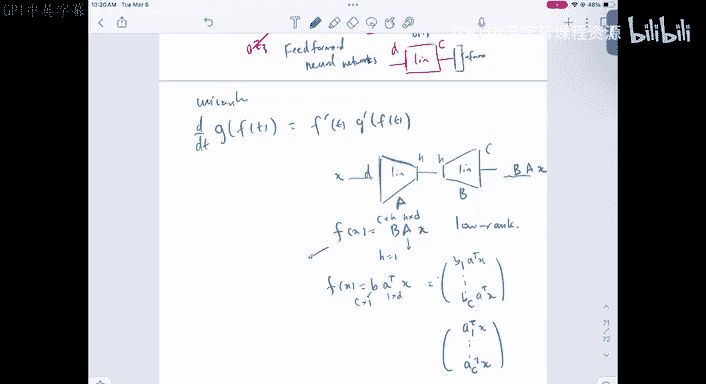

Okay， so this is a very simple。And the very simple。然有。If you remember again。

 I'm the you needs to get familiar leader with this first。5 which way of doing things so you。

A this again， NN module。Wch N and then course n functional and then this is a simple neuro work so we。

嗯。And Harry from the module， all the features of whether we didn't have like initialization from the constructor and then there's it forward。

The method the travel is the function。 So what does the。

Initialization do just create to input two two linear layers。

So solve that fully connected one and solve that fully connected2 these are the that your the basically map。

So if it pass input dimension output dimension the hidden dimension。

 so it goes from input dimension this case input dimension default is one。

 so it goes a1 to 10 and then from 10 to 1， it has that the two layer structure as I mentioned。

 and in the former class you actually willll find are applied it we connect layer to x。

And put it back next， a p then a loop to x so this point wise again like x。

 then apply the second layer， they get x， and then they go on the edge again just run negative by the soft next until the theno nonlinear x。

This is often denied。And like if I want to they candidate problems I have to buy up。嗯。

But this is the model。And。Does that sort of clear。可能工作上来说。

And it has like parameters and you linear it has some parameters。And example if I H。

Maybe a simple model here， you can see。I'm going to make a model simple and hidden number of hidden。

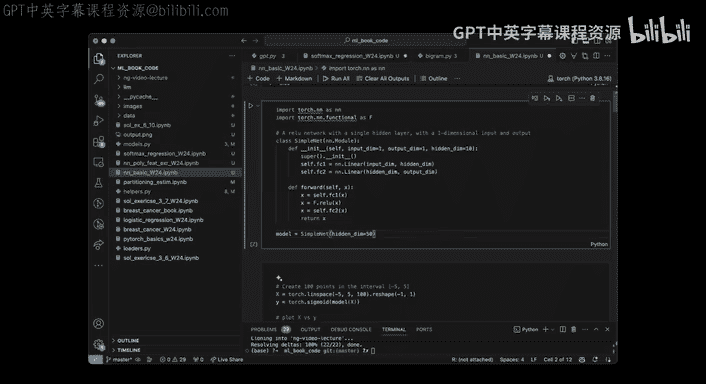

D mention， okay， I said it5， let's say do hand。

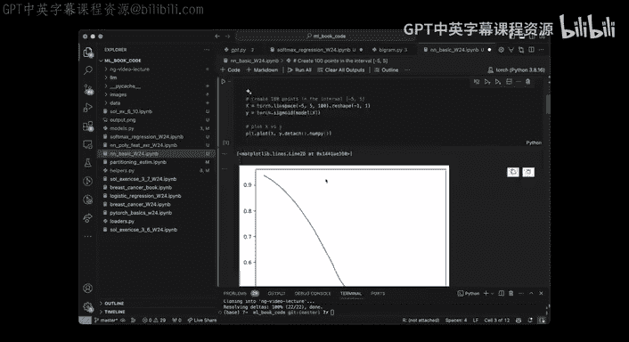

嗯。Moel parameters。So you can see诶。Use are the correct in all。

 so it goes from  one to 50 but wasn in10 because the other we mentioned is one。

They could do input dimension one， so you can see the default is one so input dimension is one output dimension is one hidden dimension1 so it goes from。

One to 10， so。This has been transformed of this is basically what' they applied， remember。

Theseify pencils啊。When you do these linear models， so have this first layer。

And then you have the second layer， so this is the weights and this is the bias says baates and bias it has a bunch of parameters initialized some weight and if I。

One applied this， I think， for example， because a lot this is function I'm generating some data。あの。

Or minus55， three minus1 and one。It's actually a bit view， maybe。

So it just it's going to be one dimension， you know。

Its basically 100 by one and then applying the sigmoid for the output of this is going to be my example。

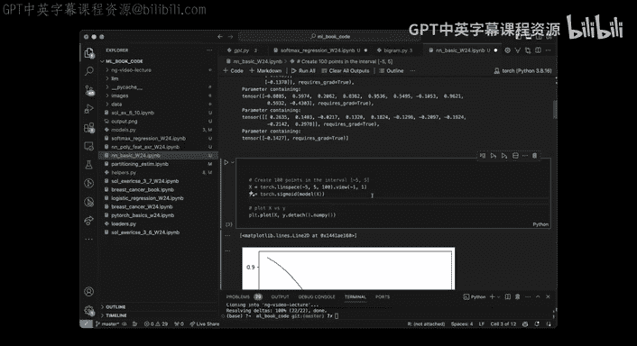

Probabilistic mark with another slide。So this is one example where we generated。嗯。

Like in analog nonlinear actually this is from the input to the output。

 this is how it looks like so this is one dimension function。You ran it multiple times different。

Pin of。So this is 10 hidden layers， again so you can see this is the basically how molly probability Y for example co genetic。

So that's like your places。嗯。And let's take a guess let's take a guess。Like that or like this。

 but this can go often and down。If I increase the number of hidden layers， you can see。

What would happened。So， pretty smooth。These are the kind ofqui。

Like can see like these are like different like these are random。

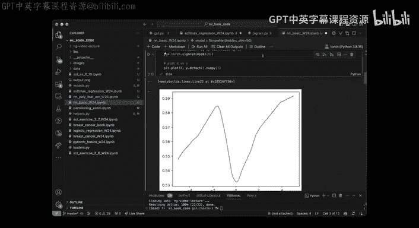

No nonlinear functions that you get because every time I generate one of these internationally randomly。

 so this is my initial sort of class of functions。

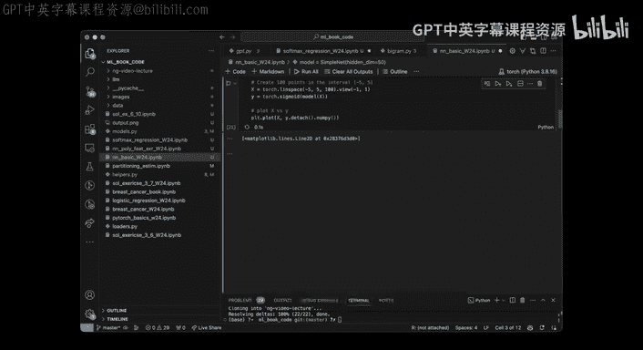

Okay。You can play with it。嗯。Go on again， but that's。

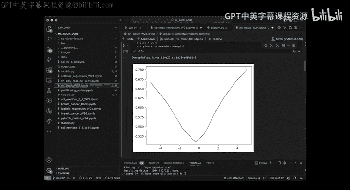

Yeah， the didn have to send it because they are interested。No no。

 the input is changing and also the model is changing so I can fix the input if you want。嗯。

I think the input is not changing because input is prepared。

Lines size minus by by the reason why Im standing it I generate the model again。

 every time I generate the model like create the model。

 the mates are randomly initial lines the bases of the layers。Okay， so these are debates。

So every time I run it， for example。App I create a model implicitly these linear layers are generated and these linear layers are these parameters that are automatically initialized。

But in reality， thats whole reassign based on the data。

Usually you you can either get whatever you want， but if you generate one。

 random and initialize you train， then we train move the ground， I usually。

Or see see this is the initial initial existing network and one random example from the past what the。

So I'm creating a function。That takes the input dimension one and output dimension one。

 so it's like function from r to R do have a single function。嗯。啊，'s not be a function。Okay。

That's part part。Okay， I'm giving it some values， and I'm looking at the output to see what kind of shape it is。

 Okay， so for example in the。Thanks啊。De like a。The disaggregation。

 the function that I'm looking at looks like sigma alpha x plus or a x plus B。It doesnt be。呃。

Let's justgreg function。In。With he said a dimension one。So this one is neural network。

 what it does is。Exactly， what does it do so。Mass it to。嗯。E dimension one max to 50 for the inices。

A Magedia in the 50 and Indonesiaia are so matrix of math case one dimension here in particular。嗯。

So basically， the linear bathrooms you think in this place would need。

Just the vector is buildinglving through 50 by1 and at plus a beam is just 50 dimensional。

And that in this case， I should transfer the place。All rightOkay。

 we don't have to worry about the very orientation them， but that's。嗯。嗯。The first layer。

 and then I apply a sigma。I that the red and then I apply because it's 5 dimensional。

 I on back go back to one dimension apply another a here is just 5 by one。你个是 the因为。Everyoneone。

This is be one。 This is W you。 This is B too。你咪死啊。So this operation is that linear so so。

That's three kind that one applied to an x produces this。明系见。

啊And then then go X and then find x equal。呃，代2是6。Is it applying this not nonlinear narrative？Okay。

 and then apply the second layer。So that。我解 two x。诶就面一块。

And then the art is I so listening as were looking。你 after人年的せ么。

Which I'm it's not part of the find the model。Im plug outside。Here。Okay。

 so you can put it inside the model if you want or single。putut in the form fast。

 then the model goes from x to something is zero1， the A defining I in this punchge。

hich gives me something in art， and I interpret it as the logics or thought box。Does that make sense？

So the axis is F X， Fx， yes， yes， all that is x， yes， yes， X， Fx。

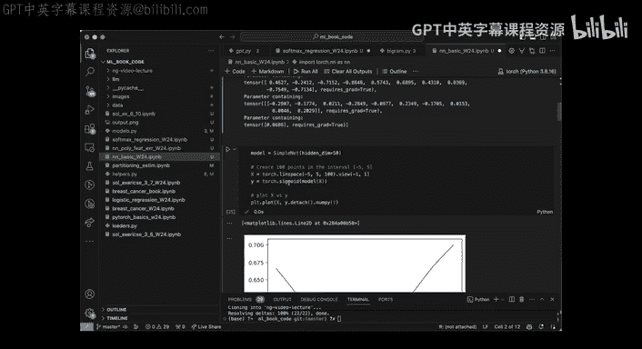

That will be in the easiest answer。Okay， sounds good。

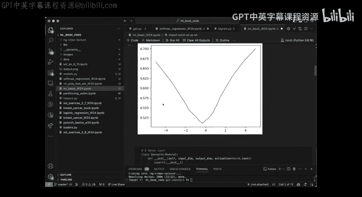

So you can see like although I have 50 hidden units。

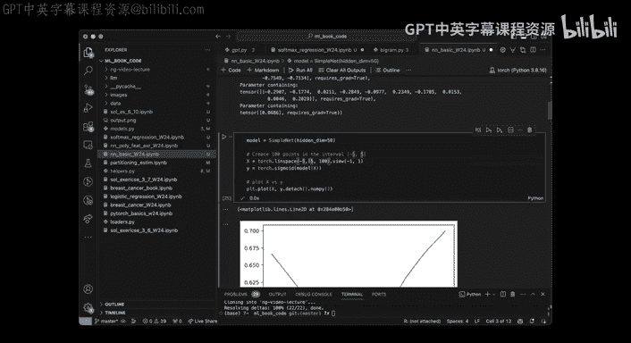

The shapes that are randomly get are not really crazy， there's a bit of okay。

 so I get a bit of craziness but。

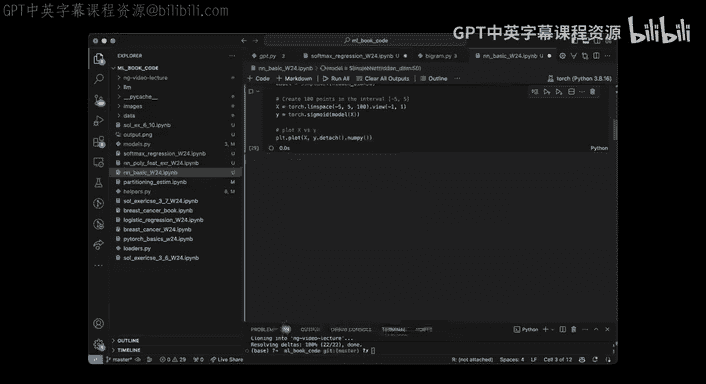

Now' getting get a little bit。But oftentimes there's not much complexity。

This is the interesting aspect there is like a little bit of complexity with。

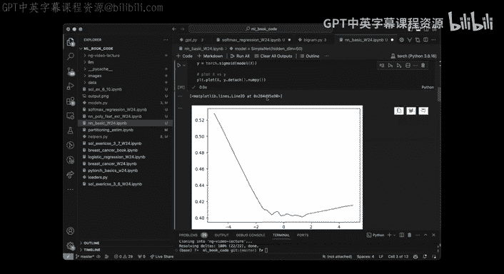

The shapes that you get are very simple。Okay。Good。😊，Okay。

 now we can extend it a little bit let let's define a layer and following the dense layer so input dimension alpha dimension and some activation so activation is the function so this let's see now nonlinear year to called activation。

It activationation functions。So activation is default by several course that to anything else so so fully connected with the linear layer input dimension output the dimension the activation with the activation and then what the other report has applied the fully connected layer is just a linear path and then apply the activation。

Okay，So this the general on。嗯。Neural network layers are important tests because some people call it tense tail shape。

 just fully benefit。诶。And then I just want to introduce this idea。

 which is a simple way of creating the composer， you can do this like that。

You can just this is one way of doing it， you can just define these your visualization and then do the operation in the forward pass because I have a very simple oftentime people do this they want to do complicated in this case I want to basically to compose these dense layers there's this N sequential。

嗯。不。Proably to pass。In any case， this MSC equation passive。And this like bunch。Mos okay。

 so that of the time module。They take the euro punch and they compose they compose I the dance one1。

 at least one one to10 one of these。 So they compose it and they basically what it does is that kind like a cascade and did it just a project composition。

 So my input is going to pass through this and then previous and this and then。我で系。

Thes the module version of sigma just the signal。Mo do it like this that。

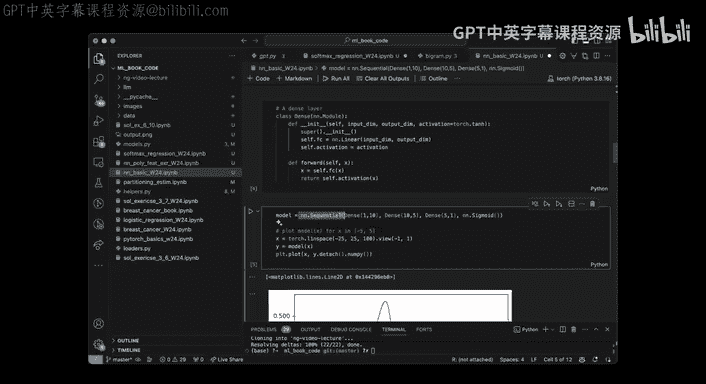

From their functional form or their module form。

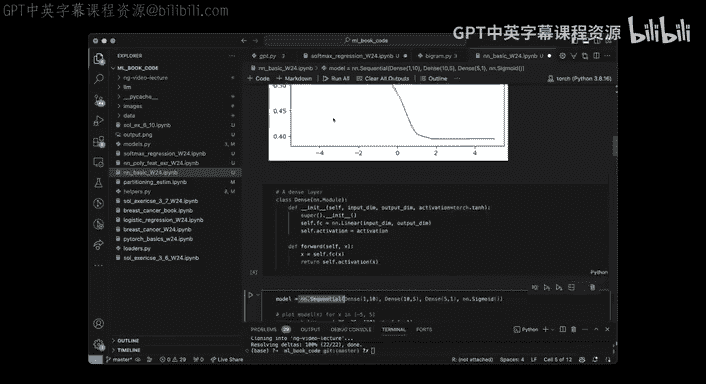

So in any case， this is a little right now Okay， so this would be a model of which。嗯。So in this case。

 it' would be more complicated。

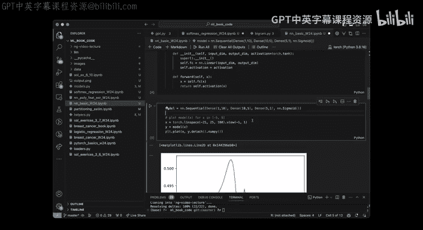

Dense is not different， so again goes from one， you can see from the one to one。

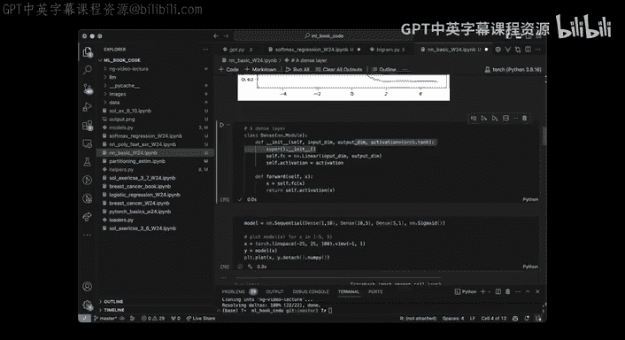

There's a one flash， but the inside is more complicated， like fascinating more of these layers。

And I do again， I can plot。And you can see like the kind of shapes that you get this is a10 edgech。

Okay， and I you know upload it and you can have fun just generating and this despite being like a lot of。

They go to Ven Angel 95。The functions you get lot pretty simple， they're now linear。

 occasionally you can see， but when the random ones at least are not too crazy。

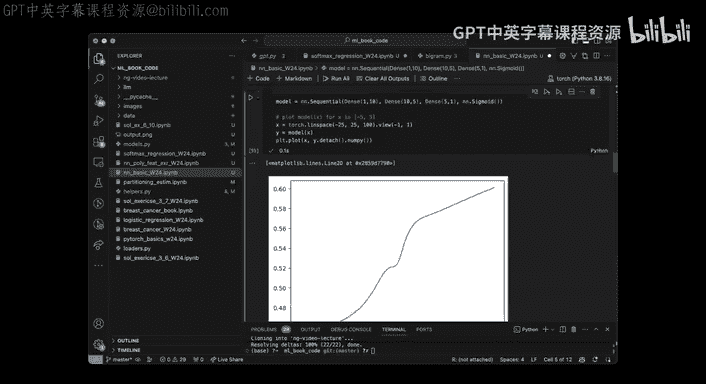

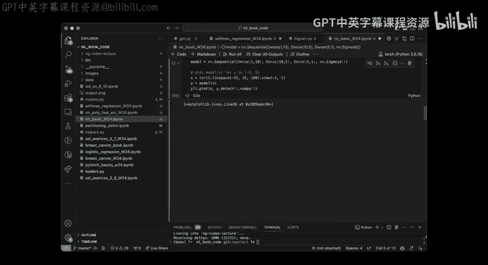

Okay so that's how you can relate that。

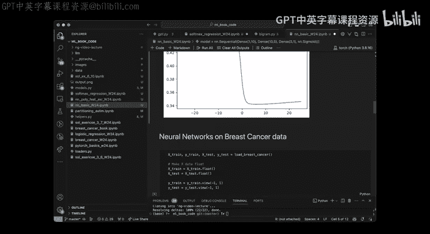

Introduce more layers。诶。So far so good it's two ways of doing it yeah with other decision boundaries at this point like in this problem the decision boundary would be very that this is a binary classification would be very touch。

不好意思啊。But， this is， so's thiss my class。I'm thinking of like classifying this one。

 at least on one feature。So if you want to look at the class the boundary。

 so where this takess the point5 in this stage？It doesn't mean。No， I need to do it。But more。

 so they're ready。It's strange looking。Yeah， so for example， here。谢谢。😊，You the 50。

1 anything is about the 50， which is this very tiny medium if you really like one there is the bathroom there。

So initially initialize and this class by the mass hanging in around zero to one， the rest is zero。

The visit value would be to two points。Thank。Yeah， here。

 like despite the complexity of you shouldn't have events。

One side will be point this complexity maybe that has actually a so like。that's awful。 thanks sir。

This part would you want you know in New Zealand， tiny of things wanted everywhere。对。

So these are initialization。This would be very simple。

 so this would be no different as the user logistic advantage。Okay， so this is similar in a sense。

 like at least the classification boundary wouldn't be different。Okay， good enough。

Any other questions？

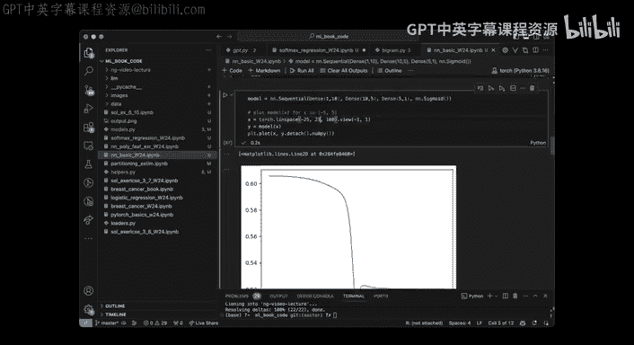

The mechanics of this so's let's now do little networks in great Sp think so again。

 I had this little great cancer。Those the data this is you remember， we just use two features。

 radius picture and best study。Ba the cancer or not。

And so you're carrying them before it's an exchange chain。And next test， so this view is very useful。

😊，航生啊 the new呃。Object as。The di that you do is the especially shape， but。Doesn't do anything。

 just the same data it as minus one here is。Anything that needs to be here so that the other dimension is one so I wanted to be that。

So for example， if I。嗯。So what happens is like why train would be。You can see the size they would be。

Like。398 by once and so just flats it into it maybe they could take there Monday additional。Okay。

Okay， so what I'm doing here， I'm creating a model of input would be too dimensional because the I'm to creating a for。

The phase2 initial line pass to 10 hidden layer， like 10 even units or like 8 layer 10 units。

 and that can' be one and of was sentence like。Binary classification， So we go to output one。呃。

Make one dimension input three dimension and then I have this function plus decision level set that you have seen before。

 so this is just plotting the decision。

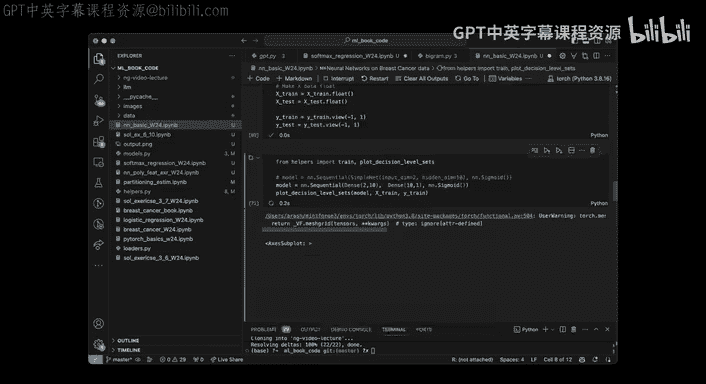

The all sense at this random initial model is's a random model number so when I pay it is randomly initialized and the boundaries are completely。

Oh， okay， so so everything here is。嗯。If probably fast fight at zero doesn't amount in the summer here。

 it an initial means it's not even fast fight。

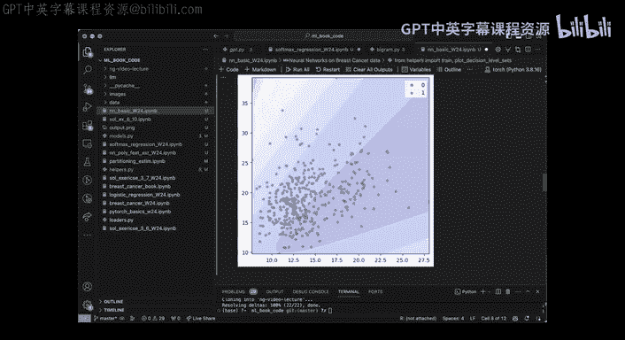

But there's no reason why it has to be good classifier because we didn't do anything with the data to generated the model and soon the model is going to eventually got involved initially what the decision back。

诶也即个个应该。And they're not only so there isn never of question。所以在那里。

If it was linear here so that the level this would be just slight， so here are the。

I mean you can do it multiple times if you want。

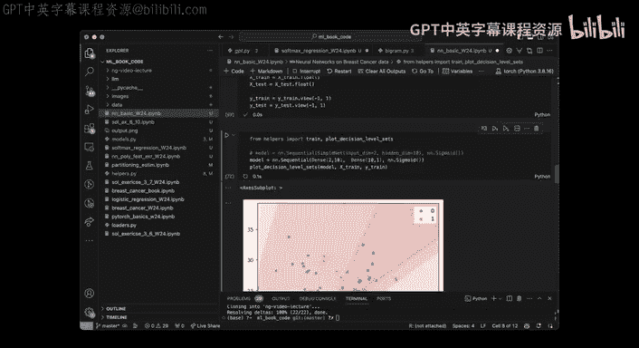

But this is a different kind you see。Now you can see that complexity even both of that。

Read do it multiple more times， see。So more complicated。

 but it is far as it is easier interesting learning initiatives。Okay。

 then okay we we go so that's the initialization i'm creating the same thing here。

 but I drop the sigmoid so here don't I don't want the sigmoid I want to go all the way to the logics。

😊，And then the S is going to be put into the loss and the sigma as like absorbed into the loss so they log that here。

So are we faving the model？I'm going to show them parameters and this is the law once if you remember。

如果你做个听呢嘅。系都使啦，你个 k啊。It basically between the labels， span and lung， the disease the lot。

There's a best y and the largest Z in this case。And then I have a train， which I'm going to show you。

I pass it， the model， the log loss， the number of steps， the learning rate， and an optimizer。

And in this case， I'm using this advanced sort of optimizer。

 so an advanced version that's unique need。哦然后准备收十点开啦。

's you can have your own version like or yourself， but we're going to do this and really compare with the SD if you want so what what does the train do？

So I pass it a model a loss function， number of steps learning rate momentum the optimizer so if there is no optimizer non default you pass it the model there's these optimization。

Optimizers， of course you give them parameters okay。

 and if you remember what it does is if take a step in the directions of the gradientd of the parameters every time you apply to study。

We even what off set case I such if I don't like this make this in light it would optimize。

 it nots past， it's can to be optimize。That think is important often that。Well very。

And我嚟 a look at嘅好得嘢。So in the different to the sets， I compute the loss on the model。

So you pass it the model if you remember。It。嗯。So it takes a model or just some level and it some of so I press it whatever model I want。

Calculate the loss， loss that backward， what does this？对对。

Ccs the gradient of gradients of all the parameters that you require a gradient to be calculated。

 but what are parameters in the model。VeryThe weights and the biases of the human layers。

 Okay so it's not obvious what they are but。How do we know so the model has a bunch of parameters。

 where are the parameters？诶。The parameters are。So when I create a dense layer for example。

 the dense layer has a initialization， if you remember。

 so this was the initialization so little initialization you you have a parameters parameters are inside this enemy you define these So when I just created this because it has parameters this register as parameters in the model this activation doesn't have parameters parameters are I just weights and biases of this length dense layer and then because we have the sequential you have two of these you have two sets of these parameters so these are all the parameters of the model when I printed you can see later that all these parameters created so you have these 10 by two or two by1 matrix by one nuric。

😊，And so that is known to。I or so when I do north backward because the model。

Is applied to the training they thought exactly in the loss so the loss just。

Andtain all the parameters and then from the background part updates a gradient answer and the optimization instead。

It moves it like the parameters in the direction the gradient。

 and then you zero out soft in the zero zeros out the gradient。 So if this wasnt。

 let me you go back to the previous salt next。不能。No sort of trying to dig into this。

So what exactly so for this other particular gradient so the facing set this fact gradient the still the set the same about the gradient and I mean it is so like。

Read before the like the loss history and by the end I don't have to pass like wait have parameters and the parameters are just updated in the model so the model is going to change as I did is at the end of model as。

The right charactersors。So let's see what it does get out of time。Just very quickly。Okay。

 so it did some nice optimization and let's do。

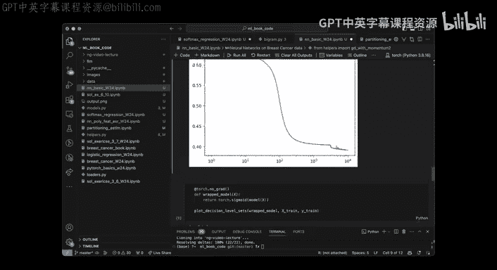

That this just slightly the awkward result。So you can see。

They found嗱 expanding the share你 to start on that way。

Actually we didn't have thought this is not the one， but I said scene such that。This would produce。

 but you start from a random model。And then the loss goes down。

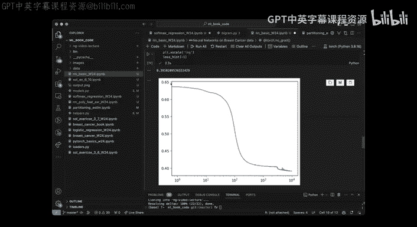

And by the end you get this so here I'm wrapping it because I'm hiding pretty much that I want to go from so this graph model is is and then fast take point and it。

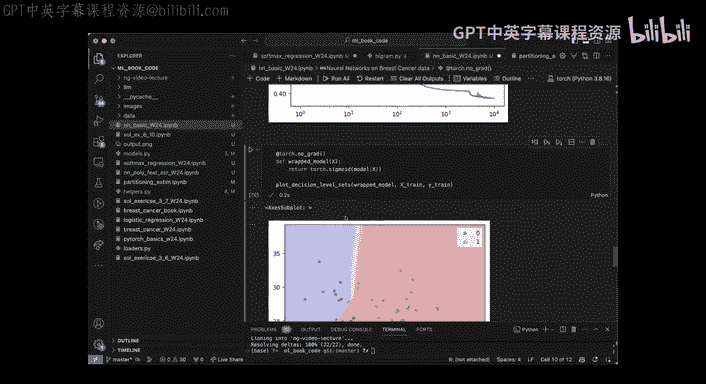

The second are good sort of。Okay。But very great on the rural。It a lot of。

Hit in units and you can play with this so you can add like more so you can for example， do this。

This adds a lot like another layer in between。We can do it with the calculation。And okay。

bad things happen at the end， we can see。对。Interestingly， the output is。

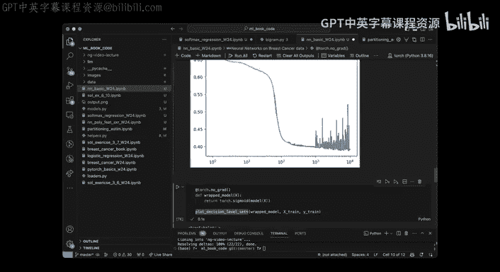

AndAnother day。原到です。And then you can like evaluate say you can evaluate which one you think。

 but it's sort of finding a different value every time you do it。

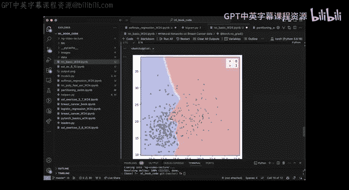

It's going to be a different thing and then for different models you get different。

So maybe next one will come back。Colaborate with little this and then。好的。Thank you， guys。

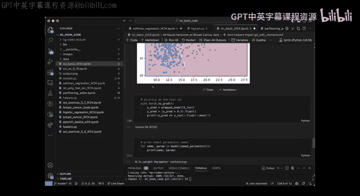

See you next time。