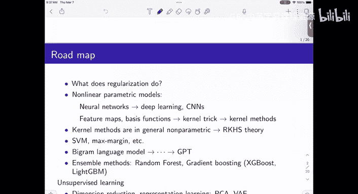
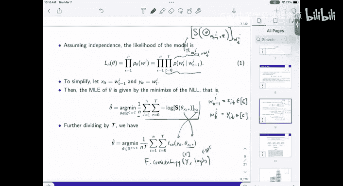
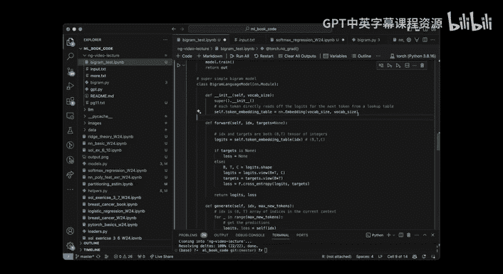
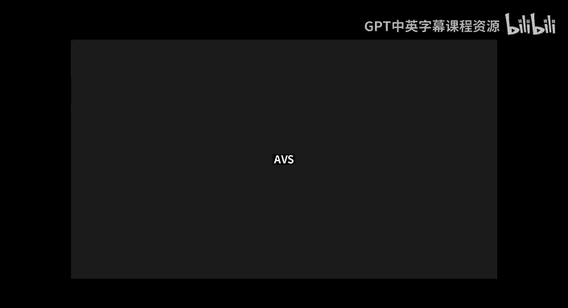

# UCLA《模式识别和机器学习｜Introduction to Pattern Recognition and ML Winter 2024》中英字幕 - P17：[17]Introduction to Pattern Recognition and ML -- Lecture 18 - Winter 2024.zh_en - GPT中英字幕课程资源 - BV167BfB8ETK

So last thing we talked about。So of one way of doing。No nonlinear para modeling。

 which was via neural networks so in this slide like summarizing possible things that we can do from here。

So this idea leads to more modern technologies， but often if you use neural networks at a larger scale。

 many layers。And a lot of faith。嗯。Then a scale， very large data sets。

These are the ones that produce with breakthrough。Performances complete be division or the language modeling etc cetera the other direction that we can go is another rather interesting way of modeling non nonlinearity and that's why feature maps or basis functions。

And then this also leads to radiocarnal tra and kernelnal methods。

From the kernel method we can talk about again interesting theory to involved with reducing kernel hidden spaces theory。

These are spaces of functions。That capture。The criminal idea gives do a lot of interest in general non character hearing spaces as and major。

Exting the whole grant。Or these ideas to。Non nonlinear spaces of functions。

 there are things like SVM max margin classification。

 they video deal different loss functions like if set up the log loss。

 they use a different loss called hand loss。And like there's a soften marginM。

 there is a hard model SDM and this max margin idea sort of is infinitely related。

 so you want to make a hyper planee that passes through the points。

 that's say they're separable and has the maximal margin。So。

 and then also the ideal of regularization， blood measuringary di。

 here you have seeing it in your homework problems。And we can do some theory in on of regression。

But the thing that I want to talk about is maybe this and if you have time talk about I these two like a little bit of feature math。

😊，And regularization， so depending how much we can do there are other things like ensemble methods that I don't talk about you should read but learn about that part like random forest。

It's like you they combining an averageveraging multiple decision fee。

 which we sort of talked about in the first few vectorctors。

 variant losing another variant you combining the multiple weeks。Pifiers and so on。

And then this is all areas and supervisor learning which we hadn has。Which you can keep on。

 observe a enable， so should observe X。Let's say one of do diia evaluation or another。

F way of saying representation learning and want I find the representation of data which smaller there you can use this for component analysis as a classical statistical tool it's like a linear version of the net editor there are more。

Recent approaches why neural networks。The it has I more general， values often quits。

Then you can talk to a classroom， which is how to like。

Label data points without actually supervision if you have classes that you don't know。

 you just get to see the data X and then you want to compress to。

He says a classical idea like cans the probilistic model like mixture models and other energy models。

 you can call it this estimation。嗯。T ci traditionally foroccanal nursing assessment which you pointed out at some point。

 along with the notvariarian la， if you remember。When I normal I on over edge。

 someone asked why you do this， we didn't need it for the number very lesson。

 but we can easily use it to do a density estimation。

 this is likeestimating probability density of just the axis。

But if I have a good model of of edge is， I can generate x and if x， for example was an image。

 I can generate images。And so ideas are new on that。

 combined with the technique called diffusion modeling。

To think but we also related to values model encoders。

 so this has meant to all the interesting inative techniques parallel stable diffusions like the open source and also building that the open AI and sorted their base on with this idea might this idea and the babies。

So this is a cool thing to talk about， but we don't unfortunately have backgrounds so I have to talk about bi authenticic encoders first。

😊，And that actually call the talk of variational inference， this is a technique for research。嗯。没意思。

In friends that you should learn about。Which we put have talked so this is like an approximate like calculation of the MLE and you have they value once。

And this can be used， for example， in the context of mixture models that are late variable models I I should add a them。

白龙。And they're sort of related to like Beijingian approaches。好的好的。

So there are there are a lot of things that we can talk about and of this is when they get home me course。

 what I want to do is I want to talk about this。Today， maybe another bit。In the next lecture。

And if you have time， talk about one。嗯。And tree， if you have that， Okay。

 the reason why I want to do this is to show you how surprisingly simple holds all of these interesting。

Like chatP is pretty simple as a model， like at least like conceptually not not quite as simple as。

So money on， but there's a huge steps。Compared to the capabilities。

 the modeling idea is pretty interesting then。Straightforward。Not that too simple。

We can talk about it at least， Okay， so that's what I want to do and the precursor is added by by ground language model。

And today I'm going to talk about regarding language one where I think get chance we'll all see a simple word of it sort of generated。

Preeen trained couple Chinese former。嗯。In change。Or which is sort of one of these say are。那个吗。

The negative what I want do it that's a good study like modern sophisticated machine learning algorithm。

You can't just go do into these and see what tricks to use or what we can learn。Okay。

 it sounds like a good plan。As follow guys if you have questions。问唔题。Question so far。

So what is the background language model， So let's say what the people wanted to do was to。

Model languages but like a E text run also sort I find the model， and then you can predict。

And the basic idea is。If you give me some text and I can predict the next word then I can predict the next word after that and then after that and I can generate text and so this is how all these current。

ItN not work， so you give them the crowns， some text。And then you create the next word。

And the answer so you can think up the question and the answer is the entire thing is just one chunk of text like。

Separated by some toolkiken like some separator， so you give it up to this point and he tries to predict the rest it would the as。

And so it's paying on a huge amount of。Picks， I very informed of the question answer or generally。

And so it both creating an export and then given end the exportboard and all the previous fund creatings the that next after that。

 youD creates an export that also generate the。And hopefully you've seen the capabilities。T to。

We free。There are many variations of it。No， it is but。So the basic idea。

 I'm going started on the basic idea， what is a basic language model that does this and is what is it at the first it doesn't seem like supervised。

Classification or supervised problem， but very a supervised problem if you think。So。

You're giving me a bunch of work。Basically， I have a text， right。I'm going to look at a chunk。

Of size。T。And in this chunk， each one is like award or。A more technical term is a token。

 it could be just one character， it could be a combinational character。

 but it just choppped the fix into these building blocks， which we can call Lord or token。

And so what I'm going to do is that， okay， I'm just start from zero。

Using zero base indexing and I have， let's say。And。I'm going to call this piece。

So it's going to be ward one， or zero， ward one， or t minus one。I'm going to call this piece X。

And I'm going to call this piece， why？Okay， because then the words belong to some dictionary。

Yeah so all these WIs。Belong to say0 one up to c minus one I can encode the words into in the dictionary so giving there some index so zero is the first word in the dictionary one is the second word so on so in the word map or map for ins。

And so。There are a lot of words in this， but if you look at the nu characters， for example。

 the words are characters， there are not that many characters。Like mean the English language。

 let's say attraction marks， spaces and stuff， make we all see below like 64 is a good。

So there are 26 letters times two。There are 52 lower and uppercase letters let's say+ 12 functions remarks if yet loud。

That's may that 64 is good， so let's say C is 64 I'm going to tokenize the little characters。

And then the first act all zero， it doesn't matter which。OrSo if he you it this way。

This would be a multiclass classification， so I give you x you going to predict the class of Y。

 what is the next character， so what is the next one？So all the things that you learned。

You can be applied here if I feel like I can train softm regression model。

 the only issue is this exit is。Not。嗯啊。对。I it's discrete， okay， it's a discrete issue。

So we have a dispute teacher， how many levels does it have？You know。

 I think how many the possible combinations of。嗯。Good products。使边帮咧。Sea power and T。Right。

 they're team more， do you have to minus one， so let's say you a context。

 so this is called the context often so the context let's say is eight。Look at eight fours at a time。

This would be 64 to the8。Which is two to the 60 points into the6， so2 to the 48 pretty large number。

So it's not a situation that we had in the early lectures where we just had the feature of the two levels or head feature or two levels another feature would maybe three levels。

Commun is6。Okay， then I could I could like do the optimal like plug in visual， I could like count。

So you you could summarize something like that in your like in the lecture one right next's chapter one。

 so I can go and compute the empirical during the distributional X andY。

But there are too many levels。Okay， and not all these combinations actually a occur name being the text and so for a lot of them I get zero。

Yeah， I can do that joint。The star us。Remember how we did it？

I can calculate the join this deviation by table and then。Hell be like this many times C。

Se so you have to write them that maybe cellss and calculate the material distribution by the chunks of text。

 but what you're actually doing for the text you're going to pick random pieces of the text of this size and treat them as I on the。

So I'm going we get one piece of the text of size effect。

It the eight plus one characters take it as one training example and then randomly pick another。

 please randomly another please and treat each one as an independent sample。

 if I have a lot of text then I have a lot of samples， with a soul isn very large。

How the and then they to it towards the So the coniv are dependent。

 but we're going to treat them as independent。 Okay。

 so that's what we're going to do as you will see and。

We don't want to model the entire joint distribution as I don't。So let's say for examples if I have。

A very large text， maybe something that's down here is not very deeply dependent on。

Sentus of the top， but maybe like the sentence defect after is quite dependent on the sentence below So the the solution that people had and like increase this context and then treat。

Otherwise， pieces of text is independent。Okay。Is that making you uncomfortable like if the first text of talking about status elastic would also talk check right。

 so you could try to model a very like complicated model of the entire text right it doesn't have to be talking about statistics so it could be like talk like the top is talking about statistics。

 the body is talking with something else now this is an approximation。No， let me try too。

arguegue a little bit further， but the thing is you're approximating the distribution and if here sufficient they are。

 you'd expect you be able to create maybe the next one during the rest pretty be accurate。

And if you check what the context is for。So the newer model is like 200 k tokens or something like that but the entire that you write is like inside this so but but the way that people are train it。

As we'll see， you feed independent kinds of text， so they have the text。嗯。そです。

So there's an important idea。It' wass related to an idea and thing is called pseudoah here。

So you pretend pieces to be independent。So you want to join the distribution for the entire text that is hard。

 I'm going to like pick pick one random。啊。Pce of text of size t here and I assume we have a model for this and then I'm going to assume that this is independent of another random piece that I pick here another piece here maybe there's even overlap here I just。

Like produce these random chunks of text out of this and assume。

That they follow the same model model the distribution and the same as the of this which intuitive needs marginally survey that should be similar in a sense。

But they're not independent， but we're going to treat them as independent。

 so this is sometimes it's called single leg so you have a very big joint distribution。

And I's say these are the sentences。If I approximate the joint distribution by the product。

 so individual ones are like these these are like。Composed award wordss。

 But if I do like approximately the joint factorizes like this， and then also like model them as。

Actuallyly这 these these could depend on eye。But we later assume that。They also like the first。

 the second approximation is that it's the same distribution。

So the first set is usually called Sdaki。So each one is a sentence， so S1。S2 street are。Suda。

 so you form a pseudo like you。嗯。Okay， and that the order doesn't matter very。

 the order doesn't matter until you would be similar independent and then IID right。

 so the exchange all。It doesn't matter which part。It looks fine neat， but for。

You've all seen how it works。You can try to make it more complicated。

 but this is a very powerful idea just simplify so you're thinking of the statistical behavior and this is an approximation of course there are things that are overlapping are going to have they're not going to be quite independent but we ignore the independence。

Things seem to work out pretty well。Okay。First order approximation so now I just have to like model yeah a generic piece here Okay。

 so what I want to do is like basically model the probability of。W0， W1 up to WT。

And then I'm going to treat。Basically all of these chunks as independent and identity so in order to do that。

 we can always decompose this distribution as。Like product。So you can do like。

The probability of the first times the probability of the second word given the first。

And the probability of the second word egg get the third word do the first two。

And so on up to probably the last word given。诶。Everything is before it。来。诶。So that's always true for。

Noserv this typeization hopefully people know so in a background language model。

 so I can can I can compact write it as like Pw0， let's say product。T from1 to T P of WT。

And then they'll you。T all the。All right， sorry， see。呃。T minus。ティーマイナス。嗯嗯嗯。这个。us1 all the way to。

要不就这啊。嗯。You can earn one and W1 given w0 or two weeks so this will be there。The way model。

In a background language model， so it's a very general idea， by language model assumes。

That basically this entire distributionion。Only depends on the previous board。

So condition on the previous word。The next word is independent previous so thiss sort of a Mark office function and what you were saying is。

The sequence is a Markov sequence。And so in order to predict the probability of observing this。

 given the previous one is independent of the past。

Okay so this is saying this sequence is the Markov sequence。U。Potentially， this could depend on T。

Okay， so at the position， for example， upon the remote middle。

 the probability of observing the next week even the previous one could be different from the start。

 but if you also assume。They're also like homogeneous， so basically homogeneous Markov chain。

MyJDious Markov chain。And disease properties also don't depend on。嗯。

The time or that you can say hi for a position in the。诶。

So that gives you the biogamma it's decent decentimplification you probably model and then how do I model this and so it's the same like the same for every tea。

It's just going to be an matrix so you can model it as a C by C matrix。Mage。实施力。

WT minus-1 indexes into this dimension and WT indexes into this dimension。

So what whatever so there's C columns here and C columns there so C row is that C so I look what word I'm having here at position t minus-1 I look at that row that row gives me the call abilities of observe zero。

The next piece of。Like for example， WT1。Is for example， like I zero。

 then I'm going to go look at the first row here and then I have a bunch of problems and you point01 point。

I then women that that that there's a 0。9。9。7 at the end so and I sort of。Sample from this。

 the highest problem we most likely。The you said do I you get every time you produce somebody know。

The situation， okay， so this gives you a probably neck there。So we have an matrix。Each row。

Is a probability matrix？嗯。And。I'm going you ignore this。As well。

 I'm going to assume let's say it's uniform I'm back in the model of probably the first or。

 so let's say this is uniform。そうだたら are you going sign timeみて。Do that。

 but the only parameter that I in Manhattan is just this。メです。Okay， so a matrix probability。

 So what's a youim。 this is very general。 I'm not values I not like this entire matrix。

Okay and then we can think of this as why it's called the bygram model because of the these pairs of tolkens or bigras so you have unigrams which are the skens bygrams or pairs of fancy tolkens and tree gras or trigrams handgrams like we have in pieces together get so this collects the statistics of bygrams so。

You're basically model during distribution of banks。嗯。Okay， yes。

 so if we've changed the prompt feed into the tax gene AI does it change like the source of sampling that we extract it from or what does it change to produce different text oh so okay so you change the prompt what changes so nothing changes it's just so there's this entire。

So theres this an entire function。Okay。嗯。So there is this entire function。

 the large language model in this case， like a background model， simple language model。

 so the text your prompt goes in。This language models fixed pray and then what it does is look at this font right。

Depending on its context， so for example， my context is eight in this case。

 so produced a lot of text， maybe like wrote the like essay。

 but its going to look at the last T words。Again， the last key words that you have。呃我 like诶。Yeah。

 in our case， because our context is key， these things that we have are like。0 up to T -1。

 And then the last that this one is。This is the one that you want to predict type zero。

U2 t minus one here and the last one is t so we're going to look at the t last word that you wrote for tokens and I'm going to create the next one。

Is in bushche that you have in this case， for example。

 we just output the proability so theres a maybe I should mention this so every row is a vector an easy way of modeling this is if I have a soft max on some data okay apply it to each row。

So I have a Tta matrix。So let's let me mention that。

So the way I'm going to model this is not going to do anything， so this is a probability matrix。

 I'm going to model each row as the soft maxs of some data which are now going to enlar it and this is in R to the C。

Okay， so the output of this is often just a。Logt are to the C and then you pass it through soft Max。

And it gives you probabilities and then you draw from that probability solution and gives you the next word。

Okay， once you have the next word， then you remove the context， now predictive， for example。

You say like， hello。For example。W， so。And I predict it like。Oh， and then move the context now。

Now the context is this is's going to predict the next word maybe R。Okay。

 and then it's going to move the next the context here that it's going to predict。你。😊。

That's how it generates， okay？It's a very simple procedure。Nothing in this model is going to change。

There is't， so I can do it the next time。I produce hello。W。

 the next time it might produce something else。Why because up this point is everything is fixed。

 but then I'm going to draw from these probabilities on case something else and if I do a differently nowm I change the context。

My input has changed som。Pty maybe something else here。

Okay so that's how it's like produces manual things。So it's a stochastic model。

 but the stochasticity the a is nice。对。Does that make sense， so that's that how all these work。

Despite their complexity， it doesn't seem like it。This would work。Repri， you find everyone works so。

The background now， I the background is not going to work as well。 so what you need to do is like to。

They actually what these GPs do is like they model it this more complicated complicated they model it later in the relation because of course this is not going to be only independent mandate。

 it's not going to be independent the press， various focus have a lot of thinking about each other。

But this is the basic building block， so if once you understand this。

 it can make it a little more complicated。Any questions about this？当队还两安徽算。So how do I fit it。

 I turn everything into this parameter data。Nowice of this pe。I have this matrix， datada。

 which is conveniently not a probability anymore。嗯。And it's going to be C by C。

 it's also something kind of referred to as。An emdding table or totally an embeddeddding table。

 you can think of these as a representation of a word so each。

Is going to be seaal reallect and it represents that particular world in our state。

 so this idea is also very powerful。So you can map from wordss to real vectors and then you can operate on it so you can for example add and sub so you can add and sub tokens so you can usually don't do this in like I can't add like T and L for example。

 but if I'm mapping them to vectors I can maybe add them。

Maybe the addition would have more information or they subtract them or the custom them through mean the transformation。

 So this， this gives you a very basic and。It idea， I。我用 man。You can see already here。

 in this case the embedding has a meaning， what is the embedding of at work it's just a probability。

I there the logics of the next board， so embedding them with this meaning。

 so this board embedding on the board means with the logics of the next portion。

It that gives you something but you can have different meanings for the management。This is。

Also something you understand， so now once you set it up。

 I can just write down the like you I can like write under the likelihood and made not like minimize so。

Come back through this but this is all talked about。So that that。

P is not what I call pi but this is this is not probability either。 so what I'm going to do now is。

Okay， so in practice you observe many times so I have。

Award basically vector there and I'm doing an index I the icon so these are different chunks of X and each one is model I。

And so the model independently and I can distribute it， so once I want to write the like to it。

 its just a product of P that the joint distribution WIs and each one of them is the product of this form。

So each one of these is really。If you use my previous notation， pi of WT minus1i and WTI。Okay。

 so this indexes into that。啊。Oh we the we can say this。Sorry。We can say it's reading soft Maxs。Offf。

Heter。The row， which is specified by this word， and then I'm going to take the。Colin。

 after I apply the soft match to this， I'm going to put a star here。

 So this is like saying I'm looking at the rule of theta indexed by。

W and the entire row I pass it through soft Macs and willly WTI。It this eventss when patient。

 so if you plug this in and then take the log。Negative log you would get this expression So here I'm calling WT minus1。

I as X I T。And WT I。Yhy IT， okay， so this is a victory。C dimensional。To the Q。

 this is a this is something like that。 This is just a reading。So XIT is really。WTI and then Y I use。

但是见。And then I divide it by1 over in which doesn't change the a max。

 so I'm maximizing order state that my way。parameterameter and if you look at this very carefully。

 this is very much similar to the lung that we had in the soft nitro and you can recognize that as the cross entropy so it's the cross entropy between these are the labels that I want to predict。

And these are the largest。Okay， so。The crossenttropy is a velocity between labels and the lines around it like this is very much similar to selfmetricification except that there you had like a real value in x you have to k multi x here just the x just indexes in two oh sorry this is not sequence this is just also C。

Because these are just simple words so both the X and y are just。Cos。

 so this is the previous orientation， this is the next one for each one to have it。Next floor。

 and this is just previous looking data and so we've had。啊喐你成过系诶。Loss。

 but we have the loss we had I also divided by T as well。

 so division they have the same parent divide of the same average， so mean press entropy loss。

So imp yours， this would be basically。So this entire that we have。Essential something like do。啊。嗯。

Like to why。The just this guy。哦，你的。So we have this and advising date also in function business spouse and V and data is just the parameter you just optimize over data。

And。Your dad， your figure by grandma using gradientcent sounds good。Okay。

 you would train your first line of。So why don't maybe go through the code and。Show you the poet。

Which is written。Like someone else， but it's good like that。

Someone from the the community wrote the code that I'm going to show you。

And so you can see all the traits that they use。And take it sample code for。

These educational purposes， but。Okay， so any questions about this？

Inversely in the code for best service。嗯。What portal pills function。嗯系喂。The function。

If I answer solve。so this takes a vector and takes the soft Mexico period probability。明。

So we model often the probabilities。In terms of the logic because they're easier。

 so there's no restrictions and this parents are into all re。In many。

 it's like e to the each component and the divide basis。

We'll say second argument of the course century survey。Logs logics。

 so this this thing is we'll see in the code so I have to pass it。

Basically they this entire thing in such。This is any to see。

This is N if you go back to the cross entropy loss。

 it takes a label and the largest the multivari largest pathway loss。

So I'm going to maybe post this this is there's a lecture video by this site posted by And and there's a lecture video's associated that we talked about the GT and there's the Gi with these there's the background and there's a GP which I never talked about and this one I created from so this is Python immerion so I created this。

Notebook so that it can be it's just mostly out。So I'm opposed it hopefully you can go and save it yourself so this is the basic you know like torch and import torch torch Nn and then torch N functional as F so that's something important I can we did it the same way and then okay so batchge size。

So these， and this is how many。Samples I'm going to use so what are the bad size， right？

So we can have like comparison that side and it。Yeah， and each time we can take like。

32 at a time I all train train this CD with 32 at a time you like you don't have to like use all sound。

And so that's a common approach that you take a small batch size and each time you take ingredient step。

 youre just calculate ingredient gradient based on that subset so that's the batch size is going to be E and his code at capital Z。

Block size is basic in context， so that's t integral P for us it also is a P the block size is a actually 3298101。

 So this is the tricky part as we'll see as the model becomes a bit bigger is's harder to converse so yes like。

no ordinary layering so that the seed and then。There is this。Shakespeare is a tiny Shakespeare。Hes。

 I like。Pieces of Shakespeare， so。一零三。嗯。系诶。And。So we read this。

While you downloaded it I also have like the Aliceison Wonderland my support my own experiment it's also there we can try it there so。

It's not going to produce legible text， but I'm going to run that and then you can print the first hundred0 wars to to the first00 wars or like character the first00 characters and then we tokenize so here we're going to tokenize at。

诶。And the little character， so I'm going to break it into all the characters or they're going to break it into all the characters。

 So this is a trick So you apply set to the text So this this tearness。Thanks， series。What is it。

 so it's a strength。So it's this type of type of strength。And so when you apply set。

 it just create a set of characters， so all the unique characters are depict picks。Come out so。

That's， that's a。嗯。Python construct that you can see was later said。

So there's no order and then what he does is turn it into a list。

Which is now going to be just the list。So different like common construct。

 so now we have the same thing as the list and then you sort it。Okay， so you can show the list。

And so this gives you all the characters sorted， Li syn。

 So this gives you all the character we you treat this as the vocabulary。

The class would be the length of the characters， so these are all the characters that appear in the text。

嗯。And then it would be in this case， I think。So I run it。嗯。Cap size at 65 very close to 6 feet。

 but that's going to be our C again how many。And middle into multiple transportation camp。So this is。

 again， a nice view of。Decoding and decoding。 So what we want to do is if we want to map。

Characters to in。 Okay， so this one， that to why。Masssses string indicator what it does is is thats the like this comprehension or diary comprehension。

 so for each to enumerate characters means。You go over all these character visible the list and it outputs an index and the character itself。

 so the first one would be zero and the first character one and the second character。

 and so you form dis， the character maps to the index。

And then the other one is the reverse so the index the tag so this is deco basis So S2 I would look like so clever。

Re， I think it makes a look update， so encode coder to code there they look update。

So if I want to equal all， I the outside， for example， this too O， right？

It produces 27 now when I want to encodecode it， I'm going to pass it to so I2 a S is the other way。

 I pass it to this， let's say 27。And it gives me all， okay， so type。En靠这个。嗯。Yeah。这这。

So if I like screen code and decode I don like code Okay。

 so this is a like tricky like simple way and here's these sort of。Doing it like that。

We have the encoder which actually operate on a screen。

 so for this lab is taken anonymousous function so that function takes input S。

 and then for every character in S， you're going to encode encode that character。

Okay so it give me a strength， I go and code each one one of the characters and it gives me a list so if I do。

 for example howo award， that's what it is， yes is。The don't can there会 thisす。Makers。

 and it's going to be our basic data。Okay， so for example。

 I have this part as my observation Im a predict puzzle， even like he not that I pre。Okay。

 and then if I ded it back。You can see it works。 so you give a list of these and then it produces the Okay。

 so this chunk of such short piece of code as the。T got encoding and the coding so yeah are talking nice that the first step。

 and then we have the encoder and the color。 So once they map into into this and you so they have like the three features。

Okay， so this part is this idea of the breaking into chunks so let's see what it is so we encode the text so if you encode the text it just produces the law and this stuff。

And。I was like I do this， it a huge。This of no kids。So it's a list of all tokens。

 basically encode the entireex。Okay， and then all we do is。So we go。

 this is like a state entertaining that that's 90%。For training。

 30% for10% for evaluation so that's also hopefully you know this is like it takes the first1 and as a training and then the last。

The rest as validate， so you still painting yes。And thenll create the legs。So in this case。

You can see there are a million tokens。Okay， in the training， they've had about 100000。嗯嗯。

Well there's a pretty sizable。T of base。So print data and now it's a tensor。

 so we also tend into a tensor of form as not， I no longer list but tensor of the immune unit。

Besidess a million。So I the size or shame。So you can see there this many。第仔。So far so good。Thank。

And then okay， so we have this which is doing that phrase forming the x and y so we want to I have this frame which is just like a huge chunk of text I want to break it into pieces which are going to be our samples and we don't like collect all the samples at the time we just collect the batchs because I have the text I can always like create like a batch of 32。

preend i a嚟。あ、三月。Thanks for glove。So what it does is is you give it a split whether you want the validation or training and it goes through that validation or trained data set and so this is the part so you either take the train data or you take the validation data and then here you have an index。

This is an integer。诶。这 you don't want to go pass the last。

So you want to have blocks so you go from zero up to length minus block size that's the start of the block and so batch size。

Many of these in this， so this produces the starting point of there。

As an index makes the started point。嗯。So I cannot take start what does it do？你你你嗯。

What are you doing with this suit？Length of datata minus power okay。啊。

Right so this is going to be a list of starting points and then for each i and i x which is the starting point which problem call the I。

 we take the data from I to I plus plus。As the x， and then I plus one up to black size plus one as y。

 so we really need one word but this is again an interesting trick。So I'm going to take， for example。

 the batch of the training data you get x and y， so the batch size is 32 and so I have 32 rows you can see so the separate printer shape x is 32 by a and the other one y is also 32 byte a。

And what it does is you can see if I'm looking at one row。

 so the first row of x and the first row of y， the first row of x is just be innocent。

 the first row of y in this all is shifted。So this is， for example， if you look at this position。诶，呃。

So 24 4358， so when I'm at this position， for example， the next board is 58， so this is 58。Okay。

 and if I'm at this position up to this point， the next four is 46， so y here is 46 so for each key。

This this anticipates like future models， I'm going to give it all of this and this one to predict okay and all of this and this one to predict Okay。

 so you just shifted the block by one。And so at each position。

 the y that's the lowest is just the next four here。Okay。

 so now it's easy for me to just use that and this why that is life。

Pret so a background would just look at if I give you this trinket up to this point it just looks at this。

 tried to predict5hi and then tried to look at fivehi。

 tried to predict 75 or 57 looks at this and do that more complicated models look at all of this。

And then try to predict why， which is basically the next word。这的是肯定的确是没有。Just creating x and Y。

 they're going to be have the same sides， but at each position。

 the y that we know that position is the next board in the first one。

Like I toch start the random the random so it produces a random integer。

It produce random indicator from zero of foods。In the range0 are to this by。

So that the starting position of this trend would be from zero up to。

A location where I can have like a block size of size eight。

 so like length things on it is black size。对。If you have it takes。

The last block possible is that let's say eight， so if I had like 10 like 10 to the six。

 it would be 10 to the six， roughly minus eight。A slide。嗯。Approximately okay。

 so I'm going to create an initiative from zero possibly up to this one。

So that would be like like 32 of these， the middle Street between random 32。

 so that would mark my startup by blacks。But I feel exhausted and architecture。No， no。

 Ix would be just 3 so it's like this is the size five size 32 that creates 32 random integers in this little。

Then he sh a treat as it start of abroad。So this would be， for example， IX0， this would be IX。

Loケアイネス。One， this location。The D I x example to add up to join。Yes。

 are the blocks going to have like overlapping values what are the blocks going to have like overlapping values potentially they could have you're not like guarding yes so we talked about this it's okay so we're going to treat them as independent even if they're overlap。

But because it's a very huge stack， so there are a million starting position up and we're taking 32 you can calculate the probability overlap it's very unlikely that you have to overlap P do 32。

So so this method wouldn't necessarily like， so it wouldn't necessarily like cover all of those values and the text it would be a very tiny connection actually this is just 32 out of so like 32。

Im a character out of him to the sixth characters。That's how much information in inspect thinks。

Right well we're't do it many times so in the mind that be turning each time you apply a batch and then go through all the so you can do it sequentially for example。

 I can break it sequentially and do one iteration like you get 32 so I can have an existing like that。

One batch another batch， another batch maybe batch it like 30321 million first batch and next time start from here not overlap blocks and then once you pass through all the batchgees essentially we have seen all the data that's called one epo and then they repeat okay so but this random selection is interesting。

Pars do don't have overlaps and。The randomness sort of is good， they speaking。

And you don't have to like， you're going to probably like maybe if you do it very， very many times。

 you're going to have maybe like。It's very hard to see the same block twice okay but it's better because you don't have like these boundaries so next time I might so in this case i'm going to always see these I won't ever see this part but if you're doing it randomly I can potentially see this so you could potentially scan the in car so that makes it more sense I。

Yes so in practice do people try to like maybe optimize the batch size and also the number of characters and they do all of that yes so so how like every piece of information here is going to be optimized in something yes i'm not an expert in trying to actually。

But there are there are many considerations okay so batch size is one big sorry the computational aspects and the performance and another other thing going to Okay do you have an idea of like how much like maybe the batch sizes for like tragedygBT or relevant for。

The information for GT3 is you can assignment it' a whole problem。

 you can go ahead and scan the paper， there's a paper for GT4。

 they didn't release the information because at that point it's very like valuable。还。

They closed down， but the information is they know a lot of these open source models。

 so one thing that you can do you can try to if you have a lot of time。

 a lot of resources you can try to optimize。Okay， so you can。

 so all of these are parameters that you can， so remember there is this hyperparameter that we tune。

So like the bandwidth。In other Wason here we have a lot like little learning rate for example。

 is this the best learning rate that I can use so the combination of。

 for example batch size and learning rate and the block size should I do age should I be 16 should I do you can do a research or all different so maybe I take an batch size 3216 or usually it's a multiple。

Two because to align with it like GP is。Nice structure So a bunch of these and an the name maybe one two one3 and so on。

 And here I have voice size8 maybe or more like2 so on。

 And then for each one I train the model and then I have a validation set they validate see which one does better So that's other three So that's you can see this hyperpar organization itself is become going gets very challenging。

 So if you go to a more complex model， very a lot more of these parameters and each。

But you're just doing it very simple。Someone has chosen this rest， we can do that。

 but you can change it that way。Yes， so you think those randomly generated a good chance。

I calculate the proper detail of the next given the previous grade。For each one， yes。

 you want to predict that actually in this case， this one contains the word already。

 so you're going to predict the。Probability of the next。

 given all the rest and also probability of each four given the rest basically。

 if you remember that by instrument I little told。Sorry， it a it's a。 Yeah。

 so you're going repeat the second， even the first and then the the third even the second and so on。

 And so that would be a probably still you think。All the way， yeah so。

We are not guaranteed to generate the entire c by C man。诶。

So there is a parameter C by C right and you're going to update some parts of it every time so so it's the same parameter。

 but every time you do the gradient de it does some update with this Okay and you would it those many times you create many times so you have the loss you have the lot and you have a parameter and every time you've be gradient to in the batch it does some improvement on this depending on how much of the data seems。

Right， so very gradually like update this eventually you see a lot a lot of these combinations there are not many so it's like 649 65 by 65 it's not a big matrix this is。

Okay， so it's like roughly2 the6。Thank about it actually。我系。equal was CC4 is like46s。

 but you have all text So you see all you can see all the what I'm not understand is that why is it cross 8 instead of。

So class something the。Then it a started of perfect， right？APitude class8 is a mild title of eight。

The number of these characters that we see， Yeah， but all we need is to by file eight important them。

All right okay so because this is designed to for more complicated models so we could have done the average in this case you can have five size of two that would have worked yes。

 you're right， so in this case because it doesn't care about I could have explained it into two pieces like pieces like this and this is in this case a more complicated watch so I'm going use this if we get to the chat GDP like GDP is going to use all the context but you're right because in this case we're just using two I could have taken the blocks side people that it would be be the same So it's like having sequenceequ shell blocks with overlaps and some random but I could do completely random blocks sub sizes because the environment maybe equal2 would work here。

Great great。Any other issues？But we want to use the machinery part of the machine that we developed here to do like a more complicated modelator。

诶。Okay嗯。Okay， so now okay， there is this part。 Let's hope we get to this。

 So this one is also interesting。 There is a get trick here。 So there's this estimate loss function。

 So unfortunate bread turns this gradient calculations off because here we want to calculate the loss and so this will。

😊，So it's interesting so you uses a model which you have to defined。

 but it seems to be later on we defined the model this is not a good practice。

 but this was in a Python file。 the model is is defined you know default folder because a global variable but assuming that the time that you uses the model is defined it set the model evolve。

 So this is another thing that the title worship they can be turning。

 So there's a model not do that and the model that train So it's a flag that the turn on or off So here I turn the evolved like on and at the I can train flag So by default the train is on So the train is on and they e。

When the thing is on or off or the device is on the rock， the behavior is different。

 some of the module or some of the layers behave differently。

If you're evaluating or if you're training。The particular one is to drop up。

Wwhichch we're not using here so in this particular model I just think it's going to change so this model behaves the same if you're training or evaluating。

 but sometimes when a more complicated model there are some layers that people engineer use which is called like one of this name one that I know but can drop out that's active you're in train but shut up during in e okay we'll see that next time。

So this is the one tree and then doing this， so you look at the thread。

For both the train and you out and then calculate a the loss。Train us and Eba us。

 So what it does is it goes through。So email。 So this is also something that we defined later。

 So how many like。Allow you some taxes that you want to take。

We'll see the number you know and then it gets a batch either train or you got and then applies the model to x and y so this gives me x and y for these things okay。

And the training the trick here is that the model itself calculates both both the largest and the loss so this is an interesting design choice that the four of our passes the model of both calculateulates the largest which we need the prediction and also the loss of that particular parameter。

I don't have to specify a separate。Last question you'll see。 and so it's interesting。

Idea to apply apply to X and Y， this really basically。Sorry not finished。

 but so if you had like if you don't have a loss， you just apply X and will give you the largest prediction。

that's how we design the model so you give an x it gives you the logic or softm of it。

 but here I calculate the loss you also pass it what so it's like both things in what so calculates the loss and the logics。

诶。And restore the largest into this。Yeah， torch， torch ten。And then it takes the mean at the end。

 because it takes a mean， so essentially essentially the average average loss across all these informations。

で。So this is nice， so this is the entire background model， so let's try to dig into this。

So there is this initial idea and the parameter is usually go here you remember and so here we are passing in the vocabulary size which is going to be Rrc and this interestingly just there's this embedding module in five yearss which is really just a look up okay this is just the parameter just what side by what size so that's my。

And I put it in1 the table so that that so this is going to take the total so as I remember so you think of the data as each row is。

The line is of the next word for this one， but you can think of it as a word in me。

So the reason why this kind of embedding is interesting is rather than just define a porch that we can define in porch sensor because it behaves nicely when I apply a batch。

 so if I have like if I want to apply this to a batch， I want to go for every element in the batch。嗯。

Basically for every word in the matchsh， I'm going to want to put these properties together and this automatically does so if I apply it to a tensor。

 as you will see， for each word in a tensor is' going to go calculate this。

 corresponding to and put them together in the same image。

We just look I give you personal matrix of wordss， apply talking in minute。

 just then turns it into a tensor， each word becomes like a it adds the dimension。

 which is the logics of the next word。So this is a good way of doing it and then so here's the for pass which is very simple so if I'm calculating the just the function value I just apply this token admitting to the input and this is the index is just the input I guess this x。

Because an x for me would be like mean by t， so a batch size by t。For every one of those wars。

 it's going to go calculate this。Logic， and so I increasingly I mentioned PC see。

 So for every combination of batch and in the war， I'm going to get the the logic effect for the next work。

 So that's that's how the。啊 say我别那个你睇下。诶 you have a basically product five from one， two。嗯。

And the batch size the。From like one to0 or0 to T so for every month I need to calculate the logic and。

And so that that set does this rather in very short life。

 so that will give you a light if there is no last distance of the last underneath in the light。

And then if I apply the softm picture on that on the last dimension it's going to preuse the probability to the next word at least coefficient at least for this particular batch at this word what is the probability to the next word。

 so that's what you say do， if I want the loss pass the targets， these are y pass the wise。

 then it's going to go compute the loss， which in this case is done like this and me take the shape of the logics。

 which is E by T by C。And then the view just collapses that。

 so it collapses into a giant experiment e times t by c， and then the targets of y is are v times t。

 and so I'm going to compare this is comparing basically。As。嗯。He。呃，XIT star。So this is the largest。

So， this is largest。IT， which is a vector in Rrc and then I want apply it to Y I T and this is this is。

This is going to be my y。 So for each I and T， this is going to be my y for each I and T。

 this is going to be my x， So x would be a c initial shall make it is going to be took this has a value in0 to。

C minus1 and this is an rrc in the C vector and then I apply crossenttrophybiologist and factor so that calculates that this guy for me。

The log of this negative log of this， and it actually takes the average so one over empty。

Sation aye from one to hand。二是第 size size。And itがゼ的テ方です threeゼとテ方です。So that's this procedure。

 so you have to like take a little bit about this， but this is exactly what boy you wanted to so exactly the cross intropy between that the probabilityin connect there for each one of these tokens and the particular Y that and these position exactly at the same position they may be constructed so many flatten and things out there is still the same so at the same location I and T I have a probabilityin of the next work and actually the next four and so I can take the cross intropy。

So that's the entire thing of your other time and I'm going to talk about the generation。

 the generation is exactly what they talked about so you pass a bunch chunk of picks。

And then the calculate it probably be the next word and then move the context line so I'm going talk about this part and then we're going to run it that's the entire model you create it and then you train it this is the original one this is the training loop which is very simple and by the end you will have an I train manually so next time will come back and hopefully finish and we're going to post this you can play this for yourself。

And。Weop's see how to go to makes that， okay， sounds good。ISee you next time。Okay。

