# UCLA《模式识别和机器学习｜Introduction to Pattern Recognition and ML Winter 2024》中英字幕 - P18：[18]Introduction to Pattern Recognition and ML -- Lecture 19 - Winter 2024.zh_en - GPT中英字幕课程资源 - BV167BfB8ETK

So last time we started talking large language， there were three language models。

So they're not large， but the basic idea was you would model。你。诶。Thanks。As。The sequence of tokens。

And。In particular， we'm going on focus on。Certain chunk of text。

If you can call it either blocked or a context usually in the called thequas。Let's say this is。

Of 9 p plus one， so spoken in0 open1 openken P minus1。And then you have。Token T。

 the idea that we' going to predict the next token， so let's say this is my context。

this is the targets， so we want to give in the context of key tokens。

At first like from zero to2 minus132。And so。诶。We can model this as a sort of a Markov process。

There you have。嗯。You want ama to join the third New。

So I'm all Im talk about the idea that this is an example of a prediction problem with discrete features and discretes。

嗯。are basically multiclass classification， so I want to classify。嗯。

Or ph this because like let's say C classes。Sing the vocabulary size， so the examples that we had。

And have。嗯。T equals to8。The context is 8， C is 64， so let's seecokenizing in the middle letters in the alphabet。

So I think 226 on 26 lowercase and six uppercase and a bunch of puns six before we。这过写大一十。Size嗯。

Its for the English language。each one of these boards will have this 164 levels we call them wordss。

 but they're really tokens。And so。Could be like a punctuation mark here。

 could be like a space here his own。Spayace in particular and。嗯啊。Go ahead。呃。嗯没有你。

but the character that causes you to go to the next slide back slash and。

And so that's also part of the focus and it's important if you want to have it make health format it takes。

 yeah， we don't want to have to make it make it。呃。Just a bunch of characters string together you need to space with outtration marks。

 including。Going to the next slide， which is very important for things to look like language。嗯。

And okay， so what we do is we model this。All of them is a classification problem where you have。

These features and you want to predict this sport。诶跟你说的呢这 a是一多。Level and got T that they get 64。

呃 to the T possible combinations， to 64 to the T possible combinations。

And then I have six people for the response so we can go to chapter one and then try to model this by approximately unless debates optimal rule。

By calculating the frequencies of observations so we have like a joint distribution between these。

If we have it。Like in total would be like C to the T+ one possible combinations。

 but in each one I'm going to report the frequencies。嗯。

Of the particular string that observed in beta， and that would give me a joint problem for me and then I can calculate the cost problem in events given these。

From that， I have， so you you。Could use like the maximum。In past。

 so the probably that best given previous one to maximize it。For again。

 I there a sequence and done to the protein that access and probability the。

But this would be very costly。So in our case， we did some calculation， I believe， so 64 to the。呃。

8 would be2 to the 48 and missing plus one would be2 to the 49 and this is big okay。

Like that's calculating all the different with probabilities of all the various as that you can give here at zero one。

2 eight up to up to。Yes， actually it's eight plus one because right so this is calculating how many possible so this this part is eight。

Okay， so we really like this is the context and you have one more word we go further so if you want to join so this is like a marvel distribution of this。

对对对。Paでね sorry。This this part iss listening values okay and its want of dont you consider this plus like going back to chapter one that we had this tree not or male female like we have to do。

So yeah， so you have to do。So in chapter one， it was like， yeah。

 so let's say I had like this is actually B be bygram model， so let's say have t minus-1。

 I just want to predict based on this guy and this guy Okay so I want to predict based on。😊。

So let me go start in here。呃。你や。We're discussing。So I want to predict the next board。So this okay。

Let's say this based on。Let's let's say okay， let's say team is just。1， okay。

 so you have W0 up to W T minus-1， which is W0。 and then I have W1。 I want to predict this。

 So I' going to look at this join distribution And from this。

 I can get the probability of W1 given W 0。😊，Okay， so this would be like the probability ETF。

And we want given Ohm sorry to get the。W0， W1 divided by the probability of W0。Right， so yeah。

 So you said w0 number w1 the order matters well。呃。Yeah， its like this problem。

 this is the one that'm going predict， this is like x isnt y。 sorry。

 this ist the one that you've going be based on this is there。So when you might join distribution。

 the order matters， yes。Okay， so this is the first one in the sequence。This is the second word。

I want to predict the first word given like them， Okay， the first word given the zeros word， Okay。

 W1 given the W0。Yeah， so when write w 0 comm a w1， it is they sequence W 0， w1。

Not the property of W0 and W。诶。没说で大で嗯。Is no， I'm saying that W0 W1。

 the order matter order order not up there。呃，那点为什么要谁来做？对，就嗯。

So anyway you have to run away with the probability of x and y， this is when I write it， I mean。

 the joint distribution of x and Y。During this， X and y is not the same the same as y and x。Okay。

 so I know it's fairly exchangeable。What I'm saying is like， okay， so you have。The chunk of text。

 the first word is W0， the second word is W1， and if you look at this pair。

 there random variables they have a joint distribution。Like you said that the joint evaluation。

 there's a milestone evaluation if you can read from the statement and inform this pen volume。

And so I Cha one， so chapter one was like I had like binary words so。

AndThanks like the email male and this is just zero one。I。

 so if I want to pre the text I had like half and and the first word。

 then then the next one would be zero one， that would be binary classificationification with。

So here is a little more complicated， so here I have 64 here。😊，And 64 here。

 so if you really want to write down the decision for。

So the possibilities are more than so it wouldn't be binding sorry its a little things ready for the decision for this but。

And principle， you can calculate these our winner。so what practice are I'll observe。

 for example all the possible cases， so a for the first one and B for the second one。

 a for the first one and a for the second one， a for the first one and let's say this character for the second one。

SoWe have a table of 64 by 64 and then in fact how many cases you observed evaluated by the total number of。

呃。P is。So let's say you have the length of the text is N， so there are roughly in choose to。呃。

Possible。呃。Pairs of this form okay so we good it feeds so this idea is that we're good it feeds the distribution of this are the same as the distribution of any other hair so in to feeds this as。

So thiss the distribution of。This guy you're going to treat as the same as the。

So this would we talked about before， because the thanks it's not like。IID examples， but any pair。

 so let's say I want to predict。嘅。This one， I'm going to treat all possible pairs as equivalent sort of。

Even if they're overlap， okay I treat this as all having the same distributionion and independence。

大啲 changing嘅所。Even if they're not any actually at least there。Have the same kind of mis。

 then you can。Approximate might have so that's actually the background model so that that's where I wanted to go and we talked about last time so the more general here is that do factorization the probability the first word on the zeroth board and probably the first one given the zero board your second word given the first and the zeroth word and so on。

If you assume that all these proities。嗯。So this is the perfect factor distinction for the joint interview。

 if I dream means。系。Basically a markup like impose a markup conditions given the opinions for the rest of the worst are not matter so here。

Within this one， all the other ones are independent of this。

 so I can drop them and so this would be the probability of。

WP and minus this one and then I'm going to also treat so this problem because as I mentioned potentially depends on。

I want to be precise this potentially depends on T and the location in the context。So明个告W完0。

The different makes say different than what contribute on the New。

know so if you want to be precise if you want to be more general。

 even if you do the markov assumption this joint mark the conditional distribution would depend on T。

 but if I also assume that it doesn't depend on T。Then this is going to be like there。呃Just呃。

The constant probability。To make and for every team is going saying so this is really what is smart of change and what you is to this conditional or transition problems with transition problem。

If I have more。Ex minus1 waiting for chance reserve5。The next seconds。

So composing area for Markov assumption and homogeneity。

 I get this local binary model because this probably anything entirely from the earth and as the product that means。

I say buy around for all meetings。ですねのバイな感でしょ soバイナムリですあ。These joints。

So these are the frequencies would be maybe the joint but the joint the same。So basically。呃。

Proul ability of WT minus1 and WT is not going to depend on I。Okay。Thank you。

 so I hope this is clear so we talked about this before。That's so by list here。

Do you call this assumption。And。Once we seen this， so this electronical text is simplified Okay。

 so I just have a time I going do。And you can also tryest direct different data。

 but you have during the ambitious you go for every。诶。You know how to do this。

 right so go over every board。诶。嗯You see how many， how many times。Different words of here I。

So pretty predict I won estimate the probability of。WT equal a。Given that WUT or say this。

The next word， let's say。I'm going to put it down here， given that this is a。

I'm going I look at the data， every place that I have name， I after it。

And just report like the frequencies of the wordss that they see after A and that we be estimate。

They don't need the joint to directly estimate this。

So all of this we have done in chapter one if you remember。

So that would be the if I had any bigger estimates that I can most。 So once I have the estimates。

 you give me a chunk of text and to the。More and then I linked at look problem for this model the latter here and I have a make a problem distribution of the export and a sample from that probably。

So using that plugin and idea we can do this what we discussed last time was a little bit different anyone remembers how did it last time it wasn't using like these empirical probabilities directly。

How did we do it last night。嗯。So here's the our ERM framework。

 so maybe we send it out as an optimization problem rather than the accounting problem。

How did we do that？嗯嗯。Thank you。系 thank you。Yeah， so we recognize that this。

You can think of this as a parameter， Okay， so this imperativeing is。A probability。

So I matrix each row of it is a problem going to think of。あ a matrix。

And WT minus1 is going to index into this matrix as the index of the rows。I'm going t minus1。

 and look at that part I row， and I'm going to read the probability so usually really the probability be to give the next one。

Okay， so this conditional probability。呃。Yeah。Objects can be compact as somebody doesn make there is this。

Index which indexes the rows and this one which indexes the colors Okay。

 so there is a compact representation of this entire model as this single parameter。😊。

And then instead of modeling as a probability you make case model that it has a model being。

 so I'm going to have this parameter data。That I pass each row I pass through is the soft Mac。

And I get I get the probability vector there， so the advantage is。

So this is basically the thing that we didn in software a few so instead of working possibilities which that are not easy to work with so they have to supplement one and they're not negative and no work more you like they are real vector。

And。对。是。Any any real vector will mal vector RRC determine it。

So instead of modeling the probability matrix I'm going to model。

The parameter has a logic matrix and then apply soft okay。So once I have this， then I can write down。

A likelihood for them all Patrick。And。So as a generalization of the market。

So what the logic in this general sense is whatever method it was if you stop nicely you properties。

嗯。そのでニスビも。But it's not the imp it's not the。Probabilities that we were discussing before， no。

 it's a problem's a logic would be。诶。So remember that。And。

Binnet classification right so in binary classification， the logistic regression we have。嗯。

Something like。嗯。RightSo the probabilityta y is y equal1 given x is the sigma of theta x。

If I write it as a problem， with you Victor there， I would have。Also probability of y equals0。

 given x is equal to x， this is one minus sigma。Heta transpose X。Right。

 so this is the probability to live there。So that's called this maybe P0 and this P1。Okay。

 so what is the log odds or logicit in this case， it would be log， let's say P1 divided1 minus p1。

And just lot us。And I'm going to so this this in this case would be。Pata transnopoics。

If buy a lightitude that that's the in stuff there。即です啦。So sigma inverse T would be log。呃，这是一P。

So you have to review this。All right， so this is called live。

A lot of odds mentioned this is the same way。And so if I do that， I get that。Instead。

 I'm going to look at。Like诶。It's what I want to look at。Okay。

 so let's maybe look at this one as well。I think I have to look at this probably。

So this is this okay， this is what what usually people call logic so what what what you have here is like。

Something。Then I apply sigma to it with so in the more general case that we looked at。

 it's a little bit harder to write。But if you remember the soft mass regression， we write it as。我一个。

Let's say y given x is equal to x。We need soft Max， data X。

So we call this thing inside the softm logic it whatever goes in。

And then I apply soft knife give me these possibilities。It doesn't the name doesn't matter Okay。

 so the concept matters right so you have。And。I'll give you a ink there， let's say。And。

So this will be more confusing because we don't have an X here。

 So here let's say I give you a vector。😊，I give you a vector there alpha  zero to alpha。

Let's say T I want to make a probability matrix out of it or probability vector out of it。

 you form this divided by the sum of every element okay。Beta sum and then E to the alpha1 beta sum。

ok。So that's not probably right there。 So whatever is here， were going follow。Okay。

This is sort of clear。It's like the inverse on the softmax， but softmax is not invert。

So in the GP example， the vector of alphas you just wrote would this would be that came by star is like the eye。

 each control separating those two。So this statement is a linked face。One role is a vector。

I amm applying to soft next to， I had a problem with it。Yes。

 the entrance of that row is free to unile probability。Yes是。Yeah， yeah。

 what's it What's in there What's in there And real negative is we license。

 neither thought validity nor frequency。Can you construct one of the cells for us I think？

I can show you in the code it's just。So you have to understand， so let's say， for example。

 if you have a probability。

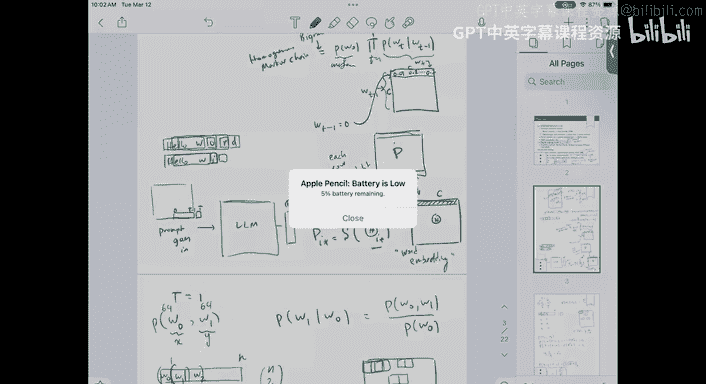

So you want to go back to the。Lecture that video did onsomatic regression。え。

So let's say I have like C is equal to three， Okay， so I want to create。😊，And probably de there。

Let's say I want to create like one half。1， half 0。Okay， so how do I create this， I can apply。

Softmax to any third that you like， which is， I don't know， let's say 5。1， 5。1。And negative infinity。

So you rise off max three this， you get8 this， into this into this0 and divided of the sum。

We get one half one happens zero。等个三个月。The sign it could also sorry it could be minus as well。

This also would give you the same thing it could be like 3。78。

So that's the issue with them softmax is。Not unique。

 but any sort of these sets of real numbers that once you do the soft next you probably this I totally call it I'm just trying to wonder like the 5。

15。1 infinity where those numbers come from in the context of this token word embedded better like don't this I'm trying to like I'm trying to para at this point Okay so in the end there is call so this model to the data this is going to probability instead I'm trying to model the probability the。

But then when I think the model， this is going to change so that the resulting in key matches don probably uncertain certain things。

It's the re parameterization of the model would you struck from the data what be the p matrix right。

 you won't see the the logic matrix， just the p matrix。那。点成咧。offset the logic matrix。

 just the P metrics。What do you mean you don't observe it。 just observe your words， right， Yeah。

 but I think extract information about the P but calculate。 Yeah， yeah， just about the P。

 not the but there is a process to get， right I don't observe the probability。

 I don't observe the tax。 Yeah， but you do the estimation with the count the words or stuff。

 Yeah get the the P to the not。はい。I don't want to answer yes。

 because there is a process we get to this， I make have a process we get to that。

That that's exactly the process that I'm going to like you。

 so I'm going to write on the likelihood based on I take time I'm do the gradient and descend on it。

 and I'm going to get paid。if any like these are all sort of inferences from data right and this means is a paradigming terms key and how you paradigming terms of so I have a model equivalently like this is equivalent to this so there's no loss of information here right instead of writing the model in terms you probably writing the terms of data why this theistic transformation。

Okay， so now everything is in terms of the data I can optimize or read data from the data by really is。

对。If you're thinking about like different like counting is one sort of computation。

 like differentiable optimization is another sort of procedure。

So you get to pay that using that type approach， you get toP as。

等 two thousand e c e technology like eight nineteen hundred dollars成一 percent。对。喂。Okay。That was good。

Everyone understands the data is not that complicated， so the requiredization is very common。

So it's much easier to work to take that because I don't have to put restrict like anything goes like negative positive infinity and make can big small so the soft effects normalize it and put it from zero to one。

那是这。And I are using the software。我要点晚随便去关这就死啦。Just just mention why because the frequencies have to like sum to at first and not。

That's the probabilities because they have to sum to one and they're not negative， right？

Right and then I'm not if I just wanted to estimate the P using the。嗯。And period averages。

Then I will be yes I would take threes， and I want to give them one the source first this is an interesting may calculating the frequencies without actually。

嗯。So let's say if I do a bunch of gradient steps， I get an estimate of P without necessarily having to go over recounting a repeat。

Does that make sense？It's a better， a better。So the main idea is modeling this is higher than the modeling paper。

But then I have to solve concentrate of the next， to make sure that if I'm trying to write down there like a optimization problem okay the past strength and the rows to something one and the number。

第二个问题。If they get an optimization trade， change。But the thing I mentioned about like frequencies versus this is also interesting。

 so this is。This gradually updatesates。To take that and。

So you can also do it like gradually update peace。 I would not have to see any attacks。诶呢个照。诶。

You can make a soft sample and then kind less in it and then get more samples of get there。

But it's a little more tricky if I want to gradually AP not seeing every pair， every possible pair。

 you have to think how to combine them。But grading design is interesting that we can do like。

 it like mini batch S。USF you get like a better estimate of theta no more and get a better estimate and at some point just things bad enough。

'sSo if you're without seeing the entire text， I guess the complications you talk about is that we may see new pairs and we may have1 help in which of course talk not seeing the entire text and then like updating if you remember the that I I should go back to intend to talk about it so what we do is so we break the text into chunks。

Right， see if I have it here。So you sample these chunk from the texts and actually in this case。

 the code is written ceation of GDPT so you actually sample the chance of like a。

 but for bygra just need pairs so you can sample pair that a key is able to do and then treat them as I and then you write on a likelihoodli and then you gradients and the gradient basically to ask about so that when you grow。

嗯。So that's all we did last time。So we have these。别了。

Chance so the super screen I tells we be looking at the chance I and the I chunk and I'm treating them as independent So when I don write down the likelihood。

Because of the independent assumption， this step is by assumption。

So I think that last that matter here。 So the first set is my assumption that is also called solar I if you remember。

 So you're treating this as a ni， but it theory really not come the I you vacxiating it。

And as these track my。 so this is my assumption。 and the next is the mode to each one of these。

Chs to problem factor is like the smart process， so once you write this scan you take a negative log like and normalized by the total number you get this。

TheNative blocks of by datata， and you look at it very closely compared to what South by8 across entropy blocks between the labels。

 Y I and these large vectors it's a lot in different R sea into the second I。

A label relying into take one to see that doesn't be the current argument。还是点不得俾来。

As a lot of like mice minimization， so this is the mechanical risk minimization approach。

Rather than count it and you can see like this is an entire sample that goes in。

 but I don't need an entire sample。 I didn't make have an idea idea1 chance。

T the thing is that they don't really optimize this entire last one instead I do the gradient actually right on the gradient extent and I was like。

Yes。Remember， you have like data hats？Keeps us one。This T is okay。

 this is different than the other T， so let's call this item K plus one。It's theta had K。

Minus mu like step size gradient。Of this entire loss， let's call this L。嗯。Thiss also Caultta。Have。

Let's say data and theta， okay。Data or data and data， together。That's the last approximation。

And data。So what happens in the Ba city that I equi like a subset of the data。And the gradient the。

 you can see the gradient is just。As is true， so instead of the average over all the samples I get marriage over a subset of the data and there that gives me a noisy gradient but you' have seen hopefully an overcrowd that that's not not a problem。

あ。你 just every time you knew。One said basically sub samplele like a bunch of data calculate the gradient and move in that direction next time it another batch of data and you calculate the gradient and move in that direction this is its idea of mini batch。

嗯。He was a subsample。This would be mini batch S GD。

If you do it it just one sample of the property it's just a utilize if that makes sense。

So we all't need the entire data to be able to run our algorithm like there is an oracle that gives you like some sub let's say a batch of size I forgot all these like 64 maybe 64 batches of these。

Context every time。Yeah in the NG video folder where can to find this like ERM style approach implemented Okay。

 so let's go to that maybe。Okay， just give a little back。Okay。

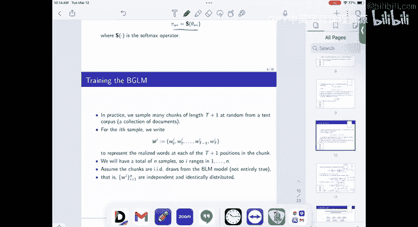

Okayny， let's go to。在。Right。Okay， so there is this so I haven't added a lot of things here。

 which you don't see there， but。So the MG video folder。

 so the the one so this is again my un package。I made a lot of so I'm going to modify these students so this is the his version of GPT which we'll talk about today this is his version of Bgra so that's the entire code for the byG model。

And so this implements that that idea Okay， so and then I have like a。

Bogram test by python that you can like walk through adapts the the same quote。

 but in like a notebook so they can like execute each chunk so this by test。

And this by ground python is very close okay， so that's the implementation so。

Maybe remind you how it's done so here you' finding。

Or like the input takes a bunch of like batch sizes you 32 block size， that's the T， the context。

And then we open the text。Read it。 Okay， so。This one I added myself this is Alice from the like Alice Adventures of Alice in Wonders like Wonderland you can you can try that as well I'm not going to do it so his basic text is from Shakespeare so tiny Shakespeare so it is like a chunk of text from Shakespeare。

😊，And then we train on this， so this part was not going to go for。

 but this is like encoding and encoding into tos。I guess if you remember we turned into。嗯。

Basically tokenized so we look at all the possible tokens in the text so that's this vocabulary size would be 1865 here and this encode decocode is like a nice thing so you learn lookout tables character to Okay I found this on the web for basically tokenized look but all the possible tokens in a text this is not very tele。

😊，嗯。So echo echo okay， so you can read this， this is not。

This part is not rocket science so called for example W just encode it into the inices after the vabular so this is a 21 vabular 47 one is like the states so sort of the blank is one。

And then here you。欢迎看到模。Okay。We display the data entertaining ands the validation。

 what what calls validation， so 90% of the data。诶。Okay they make a mistakes somewhere。Okay。

 90% for validation， it's a training， which gives you about a million。100 there's the get batch。

 which gets batch。The x and y x here with being。Again。

 because we talked about this I'm not going to go into detail you can figure it out yourself so you pass it whether you want from a training sample or from a validation sample you investigate this flag and it gives you an exam voice actually being。

😊，Basing 32 by8 y would be 32 by8 as well 32 is the batch size。

 so each rule would be one batch age of the context size of T and so each one like for x it would be a bunch of talkingken and y basically shift it to you know each token would see the next token the X okay so that's what I want to predict up to this part of an x that want predict those what is below。

To this far up one， I want to pretty4 you things in the character from that。

 So this is a nice day of aligning things， because now I can。Ne it is just stop at any point。

This is my targets， it target aligns with that。So these are like coding tricks。

 you don't have to do this。I'll talk about that， maybe。And there's some issues for boundaries。

 for example， here。It might have been better。So at this point， for example， I just see this much。

 but maybe I should have seen all the previous ones。So， this is the。嗯。

Packaging things has some drawback splits。It works for， right。And simple。

 and then you have the estimate of the。Lots which I'm not going to go through， so that in this case。

 he takes。Adssor data。Get back。And then apply the model to x and Y and the model so the both the minus and theta matrix and the loss doesn't have a separate loss so it tells you the loss on given the y。

 so you can pass the y， usually you don't pass the y to the model you don't see you just sort。

 but if you pass the y it also calculate the loss between。

What it predicts and the actual labels if you pass through it。

And so this was the entire sort of by model。So the question ask is。

 whether the model so you have a lot issues。Both an ining point this landing table is like construct p。

So here in the south， you initialize it。Right， look half size by what half size each row is going to be。

诶。The largest were that part particular vabulary war and that row after passing through the South Me to the province。

And the former message applies it to。Da data， so this index is。诶。The next of the。诶 basically的 the。

The X the bigger stars。And it would be B by key some byside by key once you passage for missing many only thing will be B by T by suit so for every。

Here are index indexdices， youre get to see I have some different studies Im I to go through I not showing so that's going over the color。

Youize it's easy， but this is the code okay that's the if you have the question and then the the so this's let me let me show you the output of this and then there's this generator it generates the data this is easy worry so what do you expect。

嗯。And just the like the last one。So this is applies。Self itself through good。你家就点机咧。

And Jasonson Lo just takess the last one because it is sort the last one and then applies the alline takes them off in Hoyall and then the pen award that it createates to their previous ones。

And then res， now you pass yourself the entire new index， the entire things。

And then redo it as our we the class words。lac， so this is the sequence IH。哎。I predict this。

 now I concate it。 and now the data is that Next time I'm going to basically look at this context and predict the next one。

 and then I concate it and I'm going move money。Contex one so this is not hard we can talk about it if you need it。

 but I just want to show you what it produces so this is the model initialized so initialize the model。

And this is the prediction， okay？Predicted this Okay this is what it predicts about in training。

8 days mad so you other question。Yeah， my question was when you contactcatenate it and then reiteratetrain it if there is another in the first。

 we don't we don't reframe it when you contact it just forpi。There's no retraining。

When you generate you。You predict this。And then given the predict this， given the predict。

 this for just the prediction yeah that much there's no estimation now in general。

 there's no estimation。It just applies the model。And if it predicts the wrong war so it goes wrong。

 that's fine， but you also see a bunch of context before it， right？The background is going to。

Make a mistake because once you're reading this one。R。

 then an next one only depends on the previous one， so it goes completely after the array。

But a more complicated model still see as part of the context before it。

But even if I predict was wrong， they still have this maybe he sound would correct this。

 and this wouldn't have that。 So if that's say the context is like 100 k tokens。再今给你把退翻嘅借多钱再。

P to some of the carbonwes。Then one whole thing is like that can to access too much。

Any other questions？So that's the the initial one and then this is the learning part。

 which is I added a bunch of things which are not on the。😊，To to actually collect the losses。

 but the actual part of。You can see the actual training happens here。So you just get the best。

Apply the model to this batch， you get the light and the loss。

 and then you said the optimizer the gradient to zero。

It actually sets it the none which is also fine and then lost backward and then a step so this is cabinet the gradient the loss of the through all the parameters which in this case of that in the red and and then one step of the grain percentcent and then back calculateulate the performance of the bottom largest。

So we mean don't need the light here， so hes just just put the dash here you meet with loss Sta。

This establish of us gives you all the information about the rating of the attends。

 so there' an entire training。Okay， so it this just loop through this multiple times because you have already these seen except where the set which is minor issue。

😊，You can just drop it and it should be fine。And then if I do this。So it's going to train。

You can see the first loss the loss of purse is very high and then this is after each 300 students just re redo the this this is another idea and a lot of tricks。

That are you so we don't evaluate。You don't calculate the validation loss every。InEvery it。

 but every 3001。To avoid an excessive computation and here it can estimate loss function that you will because that calculates both the training and the tests or the validation estimates。

And he uses more data because the batch size， so I have an estimate of the loss here。

 but we a small batch， so he uses a larger batch if you look at this。There's the evalitts。

So we have like patch size is。3 two but email。美be你翻这一个。Yeah。

 I don't know what where I define evolve all。Oh okay。

 so Eval in term sorry eval iterations is 200 so your average over 200 samples every time you evaluate the loss so it's a bit isn any so this is this is what it does。

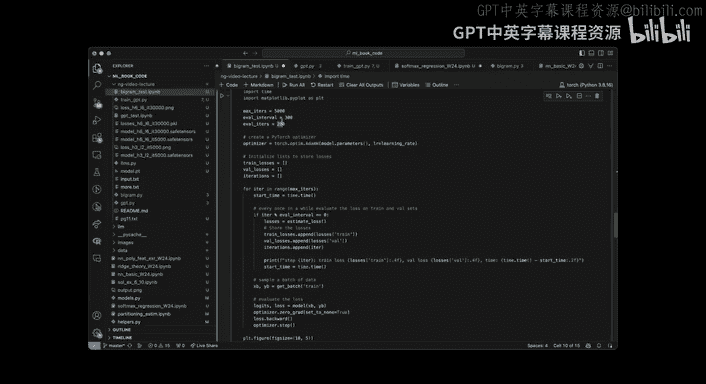

Goes from something big to something very small， not very small。

 but you can see like after 300 basically。Maybe like a child sort of this is the training error and this is the validation error which are very close。

 okay， training error validation error very close there's not much overfitting that can happen here。

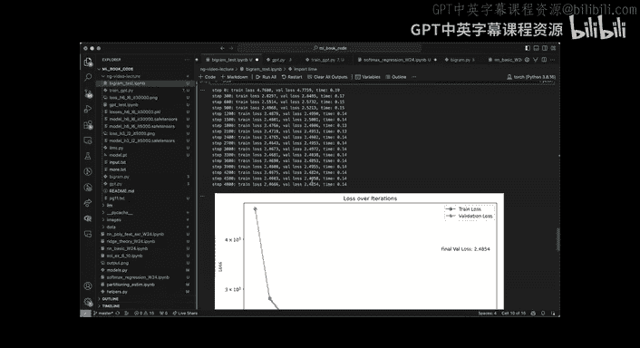

And you can see it here。诶。Okay， let's actually go to the GP because I wanted to talk about GP again。

Already makes most of the nature。 but this is， this is the result， and this is the output。

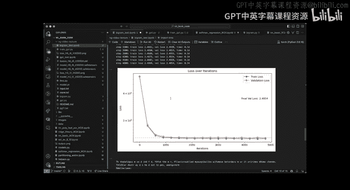

So you can see the output。That's the output。Okay， that's that's what it predicted。

 so it's a better approximation to the language than the libraries。😊，But it's not dober， okay I have。

This is another example okay， so you can regenerate from this and have another example I think I have the hello here。

 so I pass it hello。😊，And wants it too like。Confuse so。看到的那R的都在。You can renew this multiple times。

 you can see what do you get？But it's better than random。You can begin a good they' some sentences。

 there's some wordss，This is better。Then。And what then this？This is really not。

 this is initialization。This is after training。ok。😊，If you stand back as true。

And we pay you to types politics if they zoom in。There are some things so think they depend on。

 small words that depend on you。Why来来。W the accident was。Okay， so that vibrant。That was good。Okay。

 so let's go to actually GPT。As I was hoping to be able to talk about。

And that produce a much better output。嗯。Set up me。Share this again。

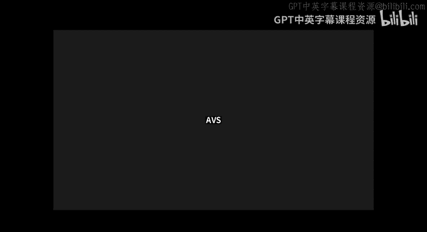

So let's see if we can understand。😔。

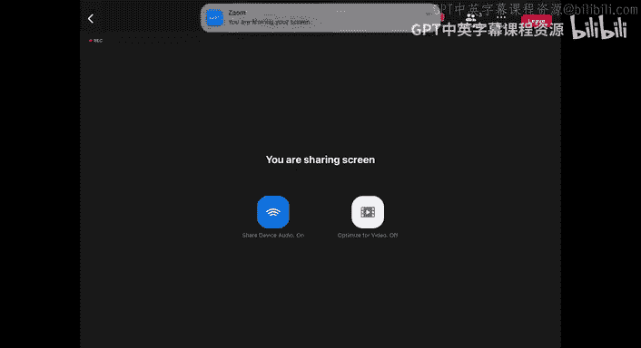

呃。我的明白。😔。

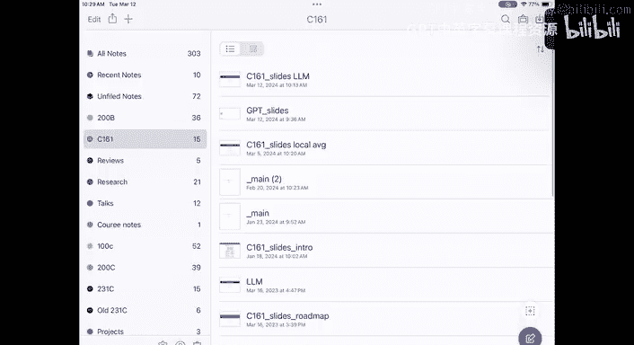

Okay， so these are my slides on GP。So I'm going to go over， so this is that GDPva。

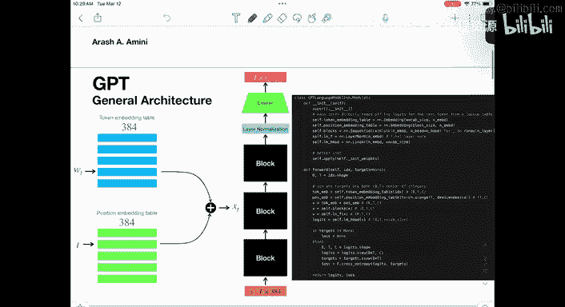

And I just want you to walk you through to see how it's like。不有。And additional in some performances。

 we can't train it in class because it's。It requires you when it takes a bit。

 but even this very simple model。

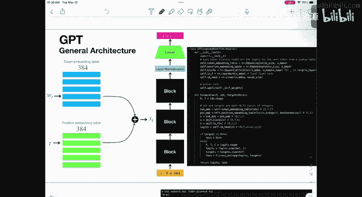

I's not simple， but like small small。 but you will see， so this is the。

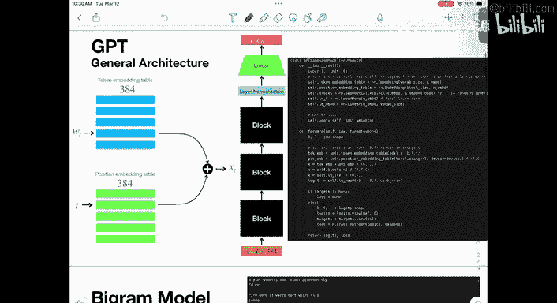

嗯Clas name class。And the rest if you compare the by fight in the GPE by。

 a lot of the things are the same， so batch setting and estimation of the loss。

 and there is a generation you can almost the same。

So I'm not showing you the only thing is like is this is big time on。

 so in initialization you can see there's the have the token embedding table again。But then loo here。

嗯。The meaning here is different。That I' going to talk about it。

 And then there's a position embedding table。 So there is a web cap size。

 is's still like a vocabulary goes in。 So each token goes in and you get it now in the embedding。

 this is not going to be。😊，Off dimension with class size because the meaning is not going to be probably the mod of the next one。

It's just so we talked about that the probability a larger you can think of it as an embedding of the war。

It's like a representation of the award in RD。This is a generic like representation or embedded that the model is going to learn and eventually you got to produce those probability that we want for the next floor so this happens inside so this is the core thing that the process is over。

So we'll capsize and emting and then you have this position emting table。

And you have a sequence of blocks， you can see and in sequentialequ， and then this is。😊。

A construct in Python so star applied to the list it just unpacks the list like it's like block block block block block you just pass it separate into the sequential so it's just a sequential sequence of blocks so this is this is this is my view here Okay so you get this we're talking about this embedding that passes through a sequence of blocks。

And then you have this what he calls L andF a layer norm。

 so a layer normalization layer and then a linearator。

 so layer normalization is we can talk about that it's just a minor issue like minor thing so normals the output of the layer and it would have better it wasn't there so absorb blocks。

But is it ignore a layer normalization， and then there's this lineage？

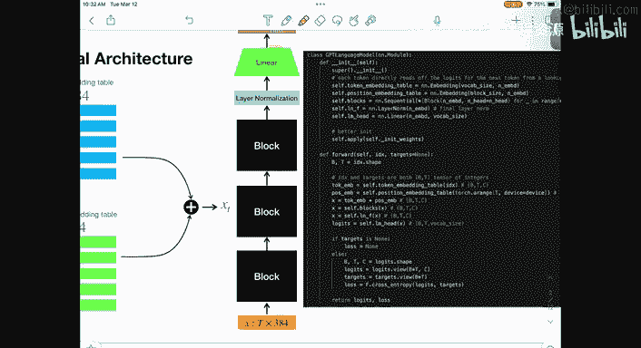

So the idea is that there's end embedding， so an embedding in our case。

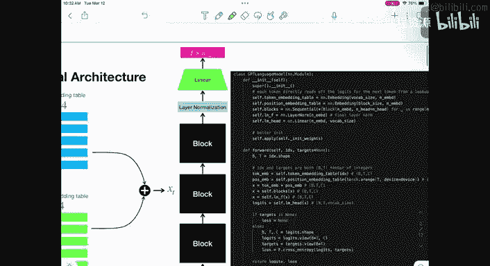

Or in his code， it's going to be 384。Okay it doesn't have anything to do with the ca sizes is about 65。

 but this is the embedding size for each each other token tokens and then so it passes through the blocks they process so this is。

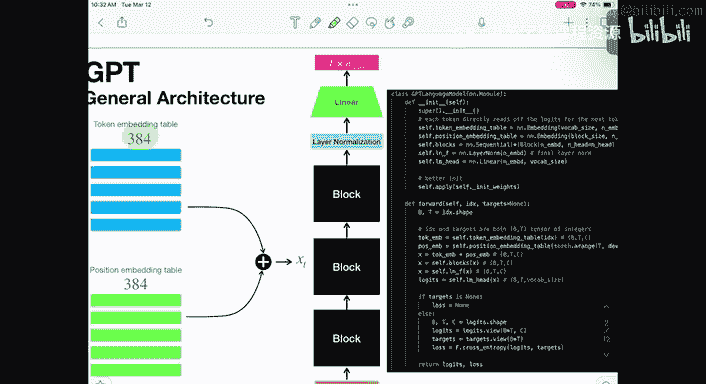

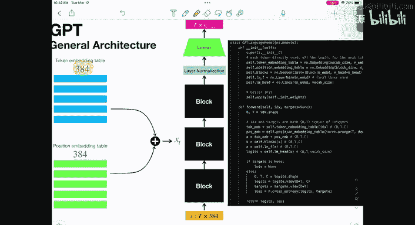

Each of our data would be key by。嗯ello。384 so each one of the rows you can think of as one token Okay。

 so I have the concept of P tokens。

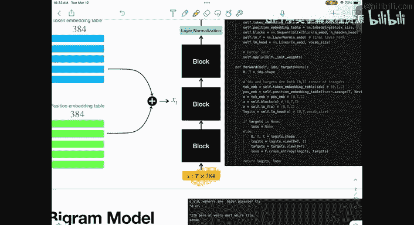

And。I'm going to make it like this because we'll see。So this is T。And this is N in bed。

I I'm going to also call D。In his code， he calls it C， unfortunately。

See without being better for the。嗯。Or the web have size， but each one is a vector of length 384。Okay。

 so this would be x1， x2 up to x or x0 x1 up to x t minus1。Okay， so I have this table。

And what happens is， in fact， what we do is like we have also a batch size here。This is going to be。

 I'm going to observe。One of these for every batch， but I'm going to ignore the batch， okay。

 so will'll observe tensors of size BT times。That dimension with call C。

So this is what the model operates。But the batch is like 6 important， I two。

 you're going ignore because it happens on the parallel for your batch。

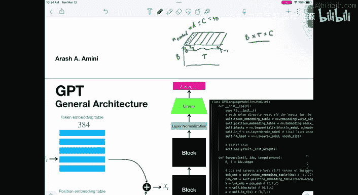

So we ignore the batch， so you're really what I are looking at them and we'll look at one of these matrices。

So， you have your。X0， x1 up to x。T minus1 and each one is a 384。Thank there， okay。

And so these are presenting the tokens so for example the actual token and its called like ID x0。

 these are the index into the vocabulary so this could be like for example a， this could be a C。

 this could be I don't know。😊，So each one gets em emetic。Which is going to be。

These vector their exit Okay so this matrix key by。

384 and this is what the model operates on you can see it here。

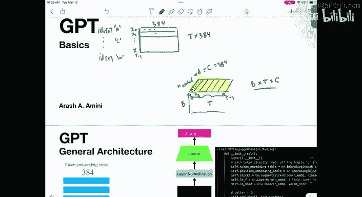

So this x I' talk about this so blocks are applied to this x and then the layer norm and then the LM head so Lm head is just this linear map so you have this x passes through these blocks a bunch of these blocks so these are the layers so that's where the deep learning comes in you just kind of calculate many of these。

😊，And then the layer normalization and then the linear。 So the linear part just is a linear map。

 The maps from 384 back to。

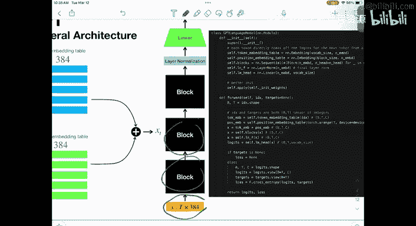

Let's say 65， which is our caps size， so this is the number of classes。

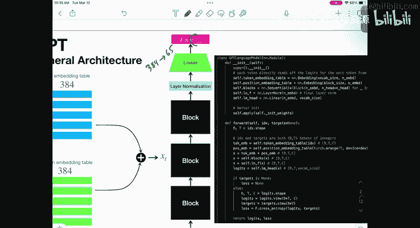

So each one of these vectors I'm going to。

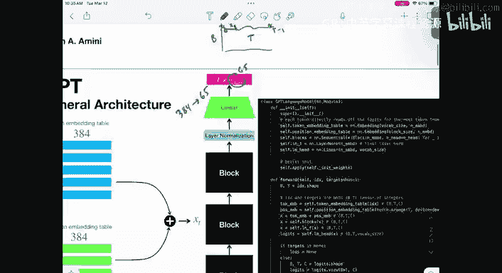

Translate back into the dimension， which is so this is this is now looks like our。

This looks like a data in the。再来个意。By my model， I apply softmax to each rows。

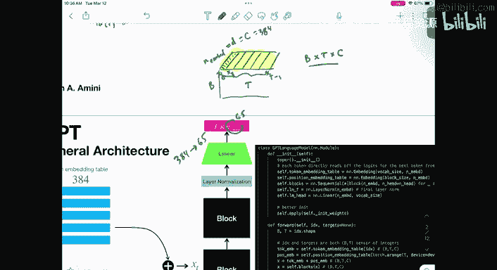

When I'm going to try to predict。呃。

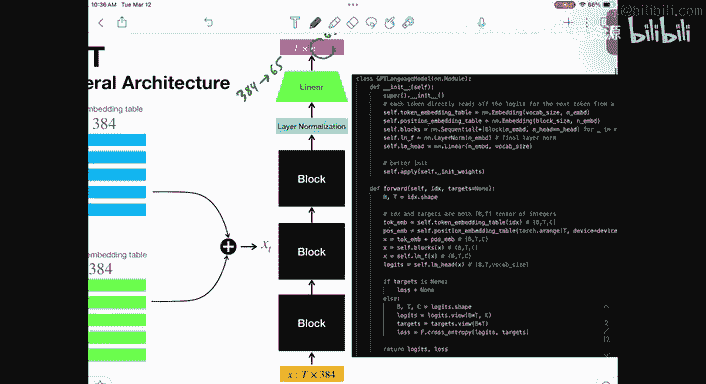

Wwhich is is not here， so it's in the generator part， but if we apply softms to each row。

 then you get the probabilitybil of the next board。😊，Sounds good， is that sort of clear？

This is not that then this is not that difficult， Okay， but the idea that it moves from。

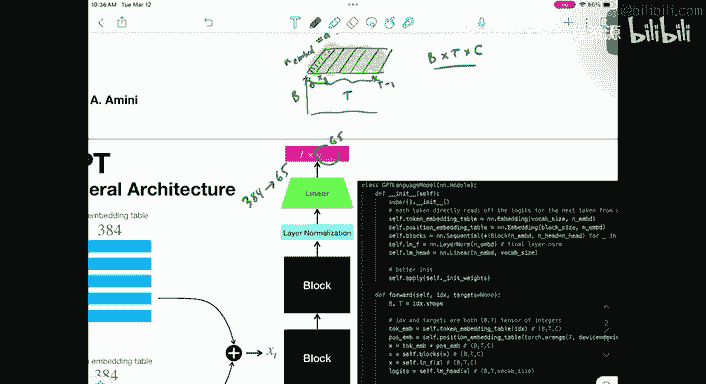

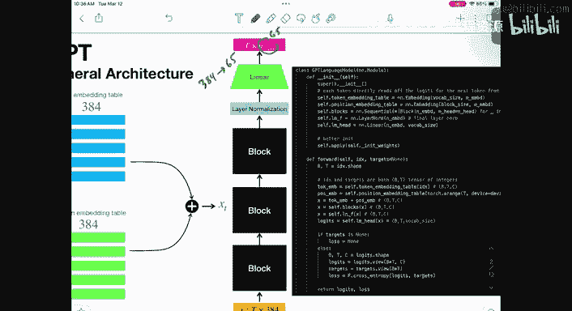

Have。So this embedding is now something abstract。 And the way it's constructed is is like this。

 So there's this token embedding。 So the words goes go in and picks。

The emtdding for the war and then the time or the position goes into this position emitttting。

And it takes another role and then they sound them it gives the X。

 it was embedding is like a superposition of the embedding for the board and the embedding for the position。

So this is a crazy idea because。This location I can just seem like encode just is whether' zero one or not。

 but they're just mapping it to with a high dimensional length。And so this high a represents。

 for example， if this is the bank， just represents an award that I'm seen as a position toing that sequence。

And so it's added here， so that information is inside AC。

 so AC contains bulk information about what more we are seeing and learn the award is。

Where they were with respect of。Within the context。Right， so whether it's like。So this P。

 for example， is like zero， the p minus one。Okay， so it is like a sequence sequence as a sequence to it toward word three is position three or zero solution zero。

That position is encode inular vector。And then add to their medic。或者头片。This is hard to understand。

But this is what they did and。And。You would assume that， okay。

 I could have done something that something simpler。Whether that would work。

 but this this is what GDD does。And to understand this takes a bit of。Thank you。

In the last paragraph for short the position was always the last1 no， no， so each one of these。

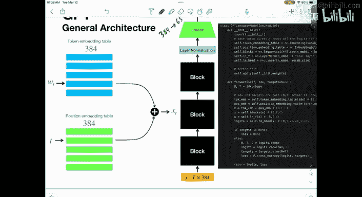

Okay， so。So let's say， okay， hello。So this is a particular world。Okay， so it's like Navy Ward。

 I don't know， apparently one。In the vocabulary and the position is zero。

Okay so this 31 goes into that token embedding table， row 31 picks up something。

 and this zero goes into the position embedding at location zero， picks something。

 and you add these two up。So this board is a position and maybe it's like L。

IsL after E or not maybe it's not ordered， so it's like maybe I don't know， 25。

 25th award in the vocabulary and the position is two。Okay， so this goes into。For this one。

 we're going to go into like position 25 here， pick the vector。😊。

And then two is going to be position two here， so the second row。We pick that。

So I'm going to add these two together。It's just a position is an index。 Okay。

 so every word has a content and a position T， so that T is going to go。😊。

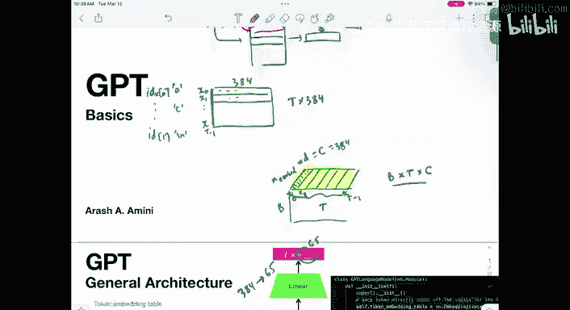

Into。です。呃你个 funding many。So we invented position and the work。

SoPeople like we're crazy with embedding， so everything。

 every information we want to embed in the same space。Even the position is a simple。

This information in this can be like encoded since like。By an index。But the same goes for。

 I can say I can impact in if you imagine this there are 65 levels。

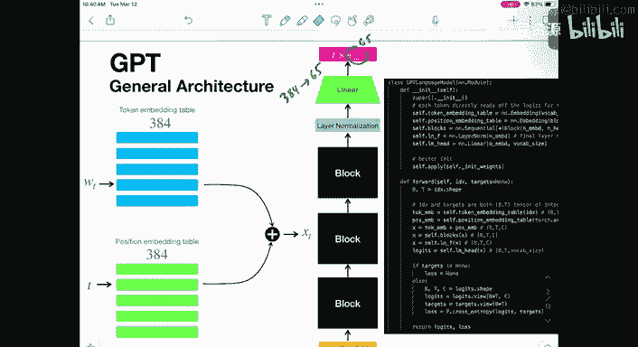

I could have encoded it as。As I mentioned， like just a pair of numbers。

So this has the same information as as these two vectors。

 but I map each one to a vector and then sum them up。

 that will be my representation of this tolken at this position。

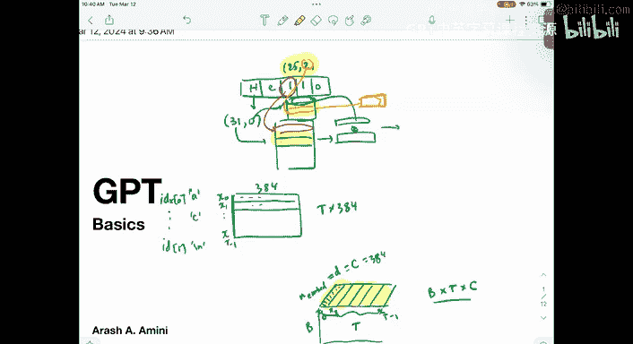

系い。It thanks a lot to。

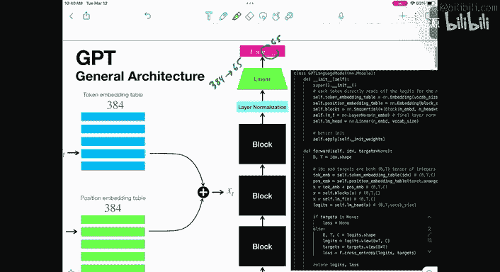

Yeah， you that's a very interesting idea so now I can process on this vectorar so this is a vectorar in the vector says I can add I can multiply and pass linear transformation I can basically operate on mores。

Inquis and objects that they。It's not easy to compute these to indices。But here I can， for example。

 add up two wordss so I can add word at position two to the board at position three and I get an E rate there that has some information。

To the fact that you can process。With this field objects using machinery of linear algebra。

Its a very powerful idea。 I would say This is， I think the most interesting part of the model。

 actually， and perhaps plus some other part。😊，And there's more like this part is more complicated a complicated the paper。

 but in this slide you can see so there's just token embidding applied to the index。

 this is the index， these are the wordss。😊。

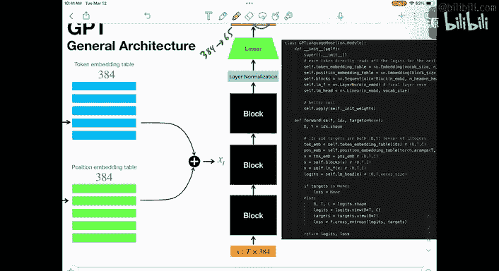

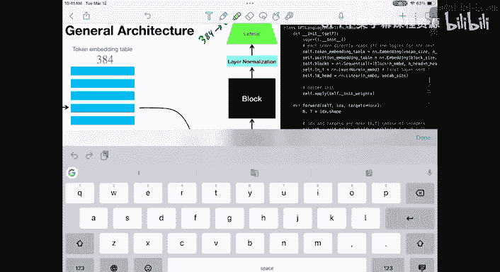

嗯。And then the position admitting is applying to this。Basically wanted to tea， so this is。

This is just for every work there。So let's dig into the details I can tell you about the details。

 but you can figure this out for yourself this is just exactly that's what I mentioned so。😊。

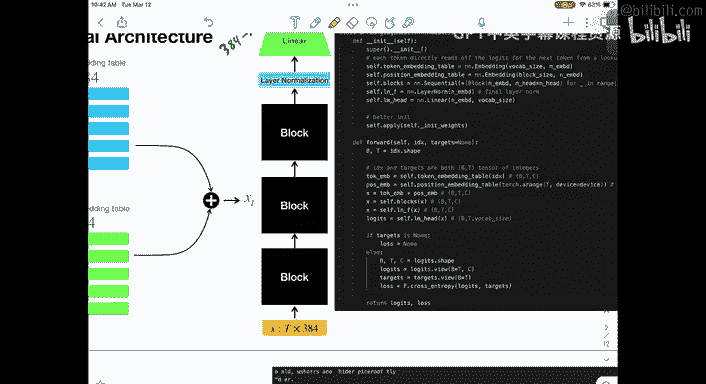

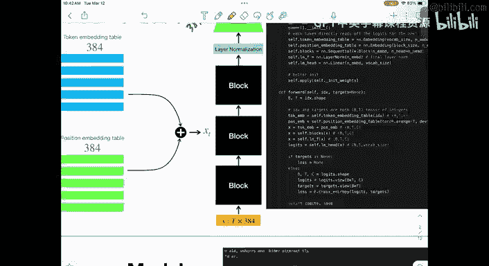

You pass each board of inquis through this totally in many on you select that flow， you select that。

Rwing this one， and then you add them up。 So this x is just the addition。You see that's the part。

 and yet that B by T by C， basically C here is that many dimension。

I guess for every to in every batch， you get money。And now we have done with pencil。嗯。

So this time they path through each block and at the end。

 the passage a linear transformation to map back through the number of classes。Sounds good so far。

They have a little bit more time so let's dig into one of these blocks so what is actually what what processing actually happens here okay so this is the output of the byground model okay so so this is one one of these blocks。

😊。

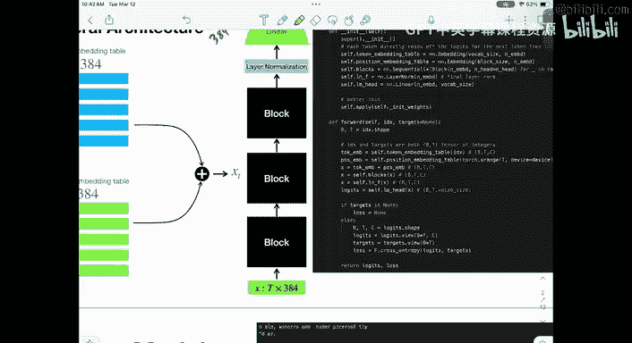

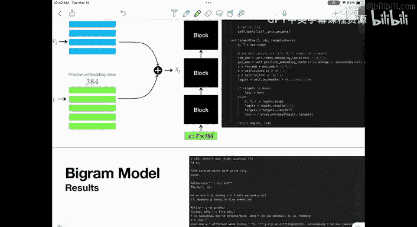

So you look at it second thing simple there is the。In its function， which initializes the。嗯。

Components， basically， in the forward pass， which calculates the output。

 So what exactly it does is what I presented here。 So this vector X T by。😊。

384 comes in and in fact is as I mentioned， B by t by 3084 or 384。

 but I'm going to ignore the D part this assume that theres one sample going。Not very simply。

So what it does is it passes through。And it passes along some calculation and it adds back to itself。

So this is what they call residual connection or residual。

Idea or as the third one introduce this idea， then we can organize it well here it's not really residual。

 but this is a very interesting idea to have this like main line so this passes through as it passes through every layer performs some operation on it and then adds it back to itself。

So this representation gradually carries more and more information。Okay。

 and because' it's a linear space thing that in superposition。

So information is not lost if I add two numbers， I'm going to distort the information。

 but if I add two vectors sort of things are still sort of if they're an orthogonal space。你家个。

I have something like this and I add something like this group I can aary before then its back。Okay。

 so the linear space has a very interesting。Property that that you can have things in superposition and they can extract information back So each layer extract information from that superposition that of information process it and read the write back to read it write back and so it just updates as a position sort of。

Id， so the first one is the main component bo， which is what they call well behave attention。Greats。

He might not have time to forward this is you can see it here。 So there okay。

 there's a layer normalization again， you can ignore this layer normalization applied to X selflf attention applied and then add it back to X So that's where here。

 and then a layer normalization is applied feet forward applied multi and then。Add it back to。

 okay so。

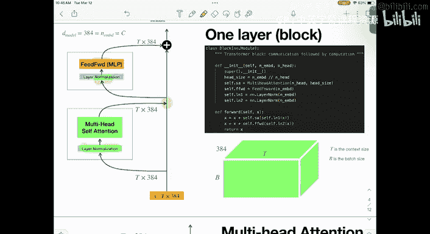

诶。That's what it is。 And then let me maybe me talk about the forward。

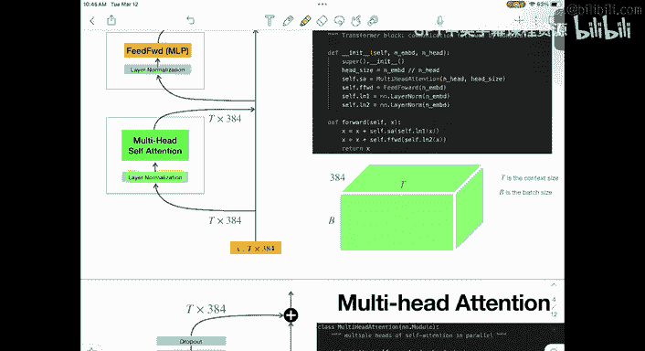

嗯。So the food provide is very simple。This is one of the things we've seen before this is this simple neural neural network。

 a linear layer。And a alude layer， which is its point byity， and another greenard layer。

 this crop in particularula to particularulate briefly。

 this is another thing like layer normalization for reization。

So maybe I that this is this is sort of minor and then so is the and then youll find right。

 So this is the something like the dense that the dense layer that we created before。

So goes from 382。So this operates separately on each one of these tolkens to。Four times that。

I don't know what four times it， but t times4 times 384， so increase the dimension。诶。

能 then你 give back就。So40 and 400 and。So this is one of these things that go like this and back this is Mar your perceptphy for we have seen this before。

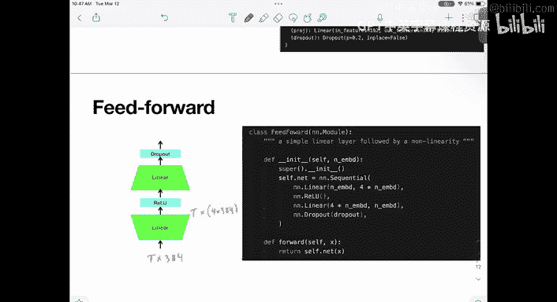

In one of the previous lecture， so this part is not。

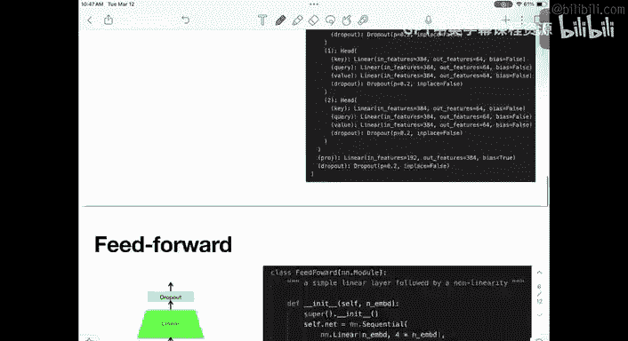

That's crazy。 What is interesting is this in the operation that happens here。

Which we ran out of time。I'm going to post these slides and next time we'll go over this。And。

Let's see how it goes。 Okay， so this is something interesting。 that shows that the goes beyond the。

 So the tokens have。嗯。Are going to have communication or like。

You' going them all data encounter basically going to call me the solution really they。

So rather than the bio model， this entire thing would have a complicated form implicitly。

 and so all these proteinss know about all the other totes all other positions。

And so the way that they do it is an interesting idea。

 which is very close to the local similarity averaging or like no what that's why I want thought。

So make time we're going to come back and pop the details and then that would be learn about GP and we'll see some of that launch。

 okay。Sound was good。Okay， questions。ISee you next time。Thank you。

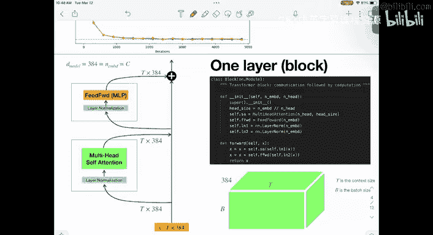