# UCLA《模式识别和机器学习｜Introduction to Pattern Recognition and ML Winter 2024》中英字幕 - P19：[19]Introduction to Pattern Recognition and ML -- Lecture 20 - Winter 2024.zh_en - GPT中英字幕课程资源 - BV167BfB8ETK

Today， I'm gonna try to cover。

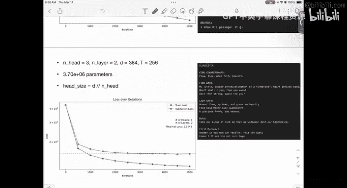

H lot， so。Let's see if we can。

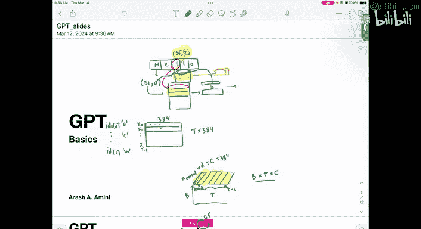

Do that so first I'm going to finish with。The discussion of hopefully G。

And then talk a little bit about。The other way of doing non years either。呃。

or non nonlinear classification or regression， and then it's a little bit about recognizing and this rich regression or a rich penalty that we're seeing in our problems multiple times。

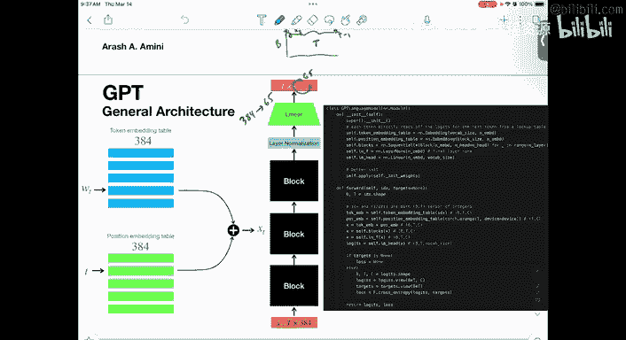

So I'm going to I can sketch it here if you don' that time to occupy。Too much of that。

There's exactly in the book， which I'm going to update。And。你是你没有发。Okay。

 so we were talking about a years of language model learning。The main point is that。

like the results also something。at the heart of these models is it this supervised learning problem。

 so you're trying to put it the next morning in context positive。

The settings that we have been discussed Okay， so it's very natural classification problem monthly by classification so for example。

 the context is large and。You wouldn't be able to like do a good prediction if you just try to。

Moodeed as like a discrete featurement。Sa。65 to the like8， no， so that's not going to work that well。

He saw a bygram language model。

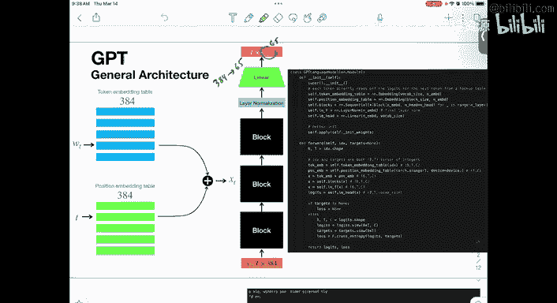

So you saw the results。So this is for good involvement。With。

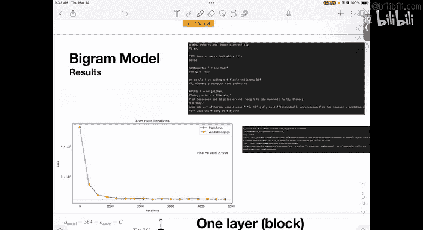

At the initialization， so this is the output that you produce。And。

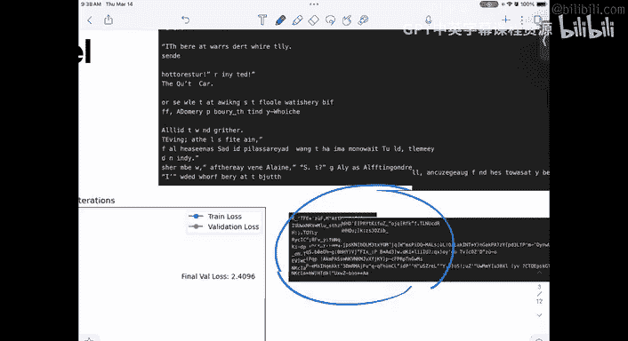

This is after we train。And it looks better， so， but it's still not quite。its far from。

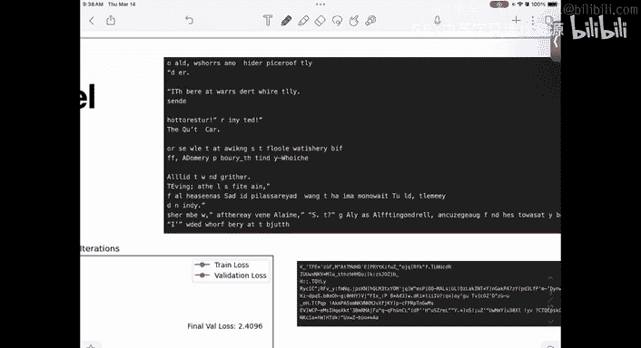

应该是。You get the sentences right sort of。

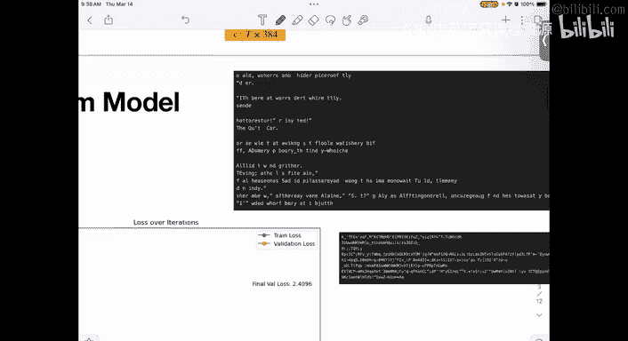

Line spaces are not the side effects， but。

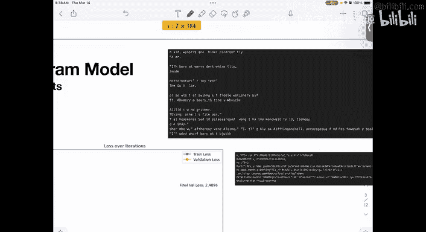

And classic inspection， there's not much。Going on and so this is a plan of the training loss versus the evaluationle loss of training if you on risk。

 and this is the training at risk， usually they call it loss。

 but detriing an average expectation and you can see that they pretty much match training and evaluation。

And you quickly en grow。And it's like a final reality of 2。4， so I there's a few first hydrs。

那就是你呃追 hundred。You have huge job in a great gra index better。And the fact that they match is sort of。

I that the model is not too complex so you're not overfitting。

 but we'll see an example of overfitting shortly。Which is understandable。

s similar to the thing that we saw in chapter one in。

The feing and tests very close so you could have used the feing as a proxy route like for pestal validation you use the same I hope you remember what the distinction was but。

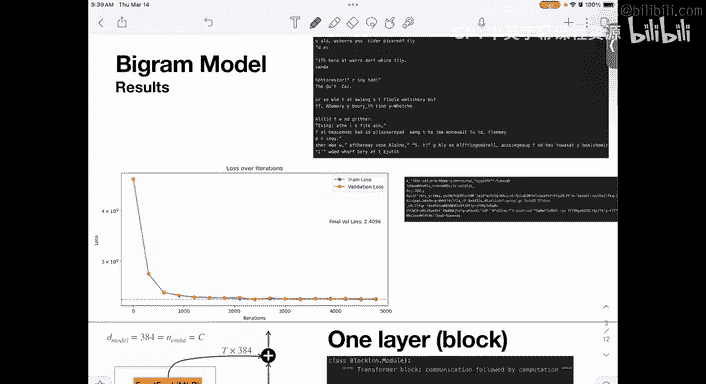

Okay， so。AndThis is in between。 So what is GDPs and GDP is trying to model and manufacture。呃。Inter。

Relations of world better and there are a couple of innovations that。The LED to this。

 so one innovation， I think， which is very interesting， is that you can。对个。

Then working so that we talked about so you had in the context stuff。

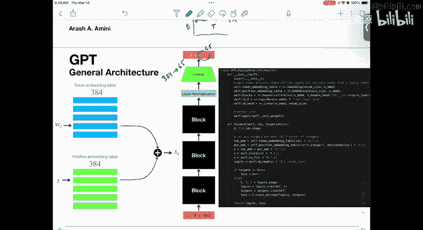

。

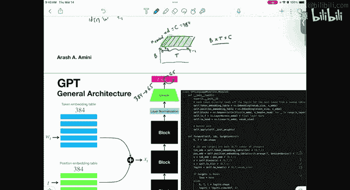

Bigger language model， you have a table。Which was， let's say theta and the row after you apply the so you can think of this theta as an embedding of award。

So this is the basically the largest。呃。That create a probability for the next word So the conditional probability。

 observing the next word。In England passes given the present board， so the basically。

You can think of the embedding as。嗯对咩 the。Wars into being the states line their logic on the next work。

But you just get rid of this idea that these are maybe logics。

 you can think of just embedding boards into the business space such that they encode some sort of information and the advantages that that I can add towards words so for example。

 or here we have tokens。But let's say if you're talking about the loan awards。

 this could be maybe cat。This could be dog。And because they have bacteria。

 you going to add them up to have a cat to dark。Or like two can。

 two times cant plus one dog so that's might be an mean。Oh。Animal， okay。

 and so there is interesting like operations and think they can pass them through new transformations or non new transformations so we can operate on。

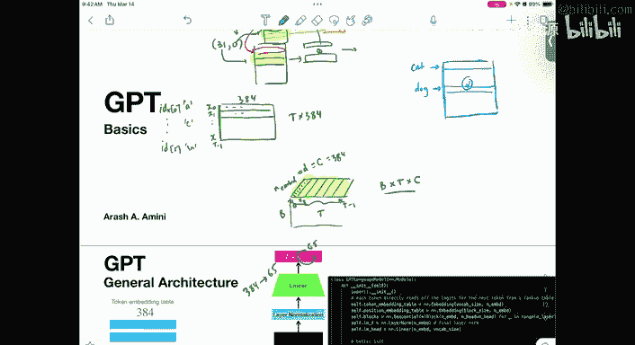

Wors like you operate on real vectors and this is a pretty interesting idea。

 the other idea is that similarly so these words are ind is into some dictionary similarly the position is also a discrete index okay so can I can also include the position the vector。

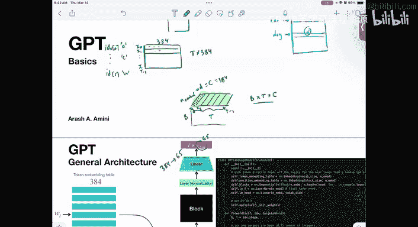

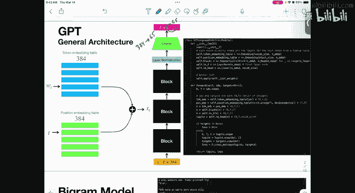

So。As I mentioned， for example， you have like hella here， in this case， tokens are。

Or it maybe the this can be encoded as like maybe11 and zero。

Everyone one is the location of it and the dictionary has to theoretical into the position。

This one maybe。That's saying that2 El is in 25， vacation 25 and the second position。

This would be maybe these are not ordered， maybe 11 and one。This would be again， 25 and3。

This would be0， for example， then 40 and4。So we come boy business。

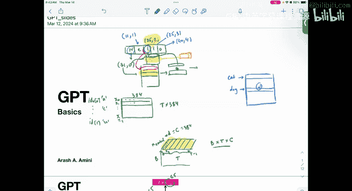

By indexing into the corresponding table and so you encode the position， so if you have word WT。

 the value of the word， you're going to index into this talking a bit。

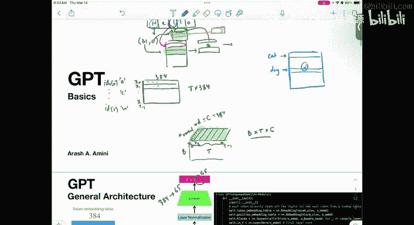

The position is going。index into this position in menu table and then we add them up this is another interesting idea and so I think they could have concatenulated them but they add them up so in a sense the position can also interact the meaning。

Okay， so for example， if later on I'll have one board， visual representation X T。

 the other one is X T， then their representation encode both the time。

 I think the location and the work so the location。

 the second one can interact with the meaning of the first one so both the location and。

Meaning can interact with location and meaning of these under defining。Combining the words together。

So again， in case any one of these board or tokens， in this case。

 tokens would even characters in our gay。But you can imagine if you have more resources that you can try to tokenize at the global at a higher level。

And so each one gets their representation or emitttting and this is emitttting is what the operator。

So you get basically T。

The size of the context times。你诶。诶。Dimension of the embedding， so basically you get H1。X2。Da thatt X。

Like， it would be x0 x1 up to x minus1， basically so this is t dimensional， this is 384。

 this is the many minutes。😊，And what really happened。to the back。Which often I ignore。好。

But we'll get to that so the start strategy you is like you past this through with a bunch of blocks or layers。

And the end， so this layer norm is。

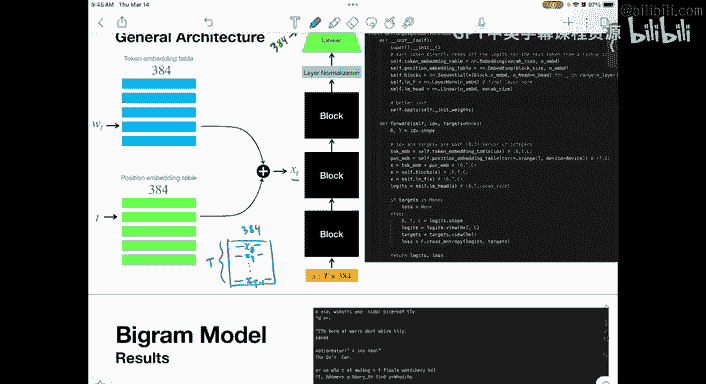

A form of normal activation basin。嗯。比上是这 box。And then at the end。

 theres a linear map that maps the 38384。We 65， which is like the dimension of our vabulary so get vector there for each one of these。

嗯。You get a rate 64 now you can paint the 6 65。 so at this point you get it。嗯。嗯。Like t by 65。

 this is the size or our dictionary and the last one basically so you can think of each one of basically logics for the next word and take the last one。

😊，And the problem apply softm clinic that probably use to export。

 these are basically giving me the logics of subsequent wordss， I want the word to comes after this。

So we can get the software part the last throw。And really。Thatunds good。

 So the thing is this embedding undergoes a very interesting transformation that in。

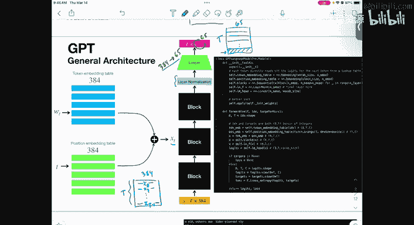

You just keep in code all the。

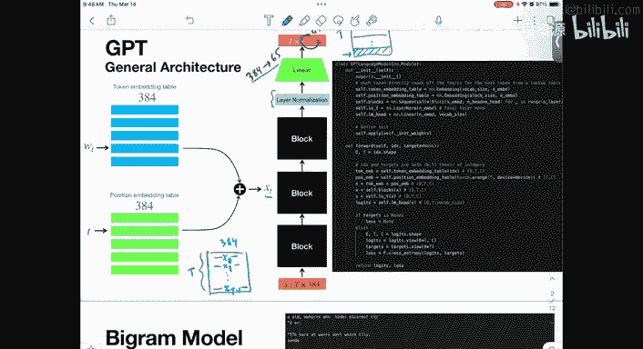

Information。So if you look at the code， you can see there's a token embedding table。The input code。

 you apply the inputs。And in the table。 so this goes， so index is batch size very key， so it's like。

If you ignore the batch， you can ignore the batch here。

 so it would be T by C C here is the embedding image。So you apply for each or you get this table。

Okay， and then you also find actually do this data bit and then you apply you have a position in many table。

You apply， this is basically zero to t。So for each of the awards， theres a good。

Procastesting was on here， so。呃。Yeah， so so this will be places。 So zero healthy mixes into。

The and here in the angle， you can basically the current table just zero basis to this or。

Yes and when them get again the item。Because of the broadcasting， sort that this is going to。

Repeat for the batch size， but I mean these these minor issues we can ignore to get the eggs。

And then the next passes through these blocks if you see where the blocks are。Defined care。

 so this is where the blocks are defined。And you can see it's。

A sequential application of this block object so this block， so we create a block。😊。

And you will see like it has two parameters。And had the number of heads。

So we'll see what the number of heads is and so you can make let's say。Sdes of have number head tree。

 it's a 384 by3， so you create bunch of these let's say tree of them。

S of the of the number of layers， and the more you have， the deeper， the deeper is。

We have that and then。Basically， this is at a sequence then I apply a sequence。

 Ill like so blocks would be a sequential object and then apply it to X just sequential just a composition of those。

And so what you get is。And。The here layer normalization， and then there's this LM head。

 which is really in nearma。Mats from the In dimension。Okay， so。That's basically the entire sort of。

GP teams implementation here。

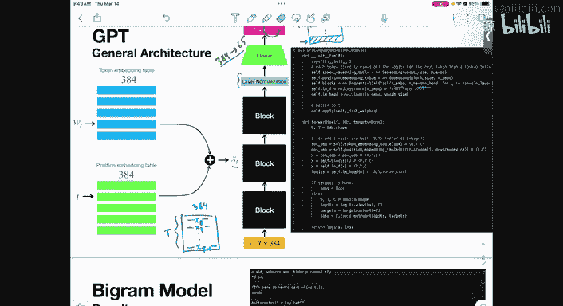

And then you can see。If I。If I don't calculate loss。

 I just report output the so the left just to go there， the loss calculation is very similar to me。😊。

系原来为什么。呃。Make a comment on。Later， the basically。You're halfway the cross entropy between the line。

This。At the and targets， which are。Nles of the word after。But this one is also。

Not very difficult to with。I there any question about the general architecture？

So we really at this point， the key form of product is this like you have reward in many。

And then need black box。other ways it pretty simple。てうためて。系大。Yes， did。啊。はてですは。呃。Okay， so in this。

 these things were defined， but and that this is not。And。

Potentially nice way of doing it but because it was educational also and head is defined elsewhere in the code。

So for example， I said N had to eat free， so this is a global variable。

RightBut when you dinner usually like pass these to the initializing or the construct。或他真身来I的那知不知道干什。

Thank youたは。What happens。So what what kind of answer do you want to get well I'll show you examples of tree blocks and six blocks so this is this is like the deep learning。

呃。It's like an engineer， so you play this is' in the privacy。But it should be three to 1010，000。

 so how many you need is not an easy answer。I service another primary the month， many。

 how many many blocks do you need this？And each system is exactly the same those the exactly the same computer data but has。

😊，A bunch of parametersators， and so these parameters are know really。

There's very similar to what we did with them。诶。呃。Like MLP multiai person probably had this lens layer and you can add like the those code that I showed you。

You have， I'll show you later。诶。You get a one block on layer or you definitely multiple blocks and it's a easier a different function。

And then in practice， you would do， for example。You have selected。

Number of layers that you optimize over， so it's a hypopar sectionclock。

RequiSo the one that there is no requirement。 So this is like a design of a particular。

Example and so this is。

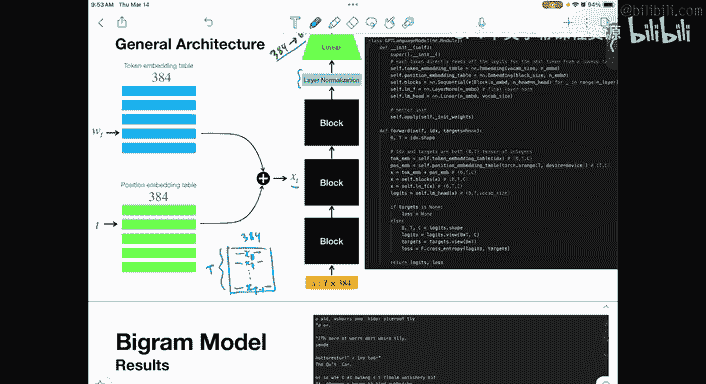

The DPT is like。Something that so the original paper that came up with this is called generative。

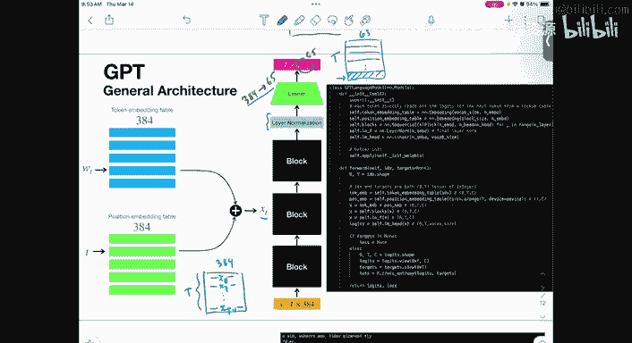

Grative。Tred。Transformer。Okay， so this transformer architecture is really what you're discussing here。

 and so the original paper is called the attention is all you need。😊。

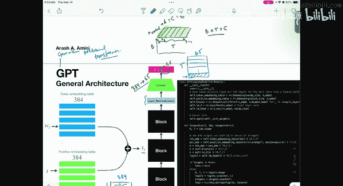

呃。And I encourage you to read it after。This lecture。Should be able to understand most of it。

So this this proposed this idea， Okay， so we have these layers and then you this。

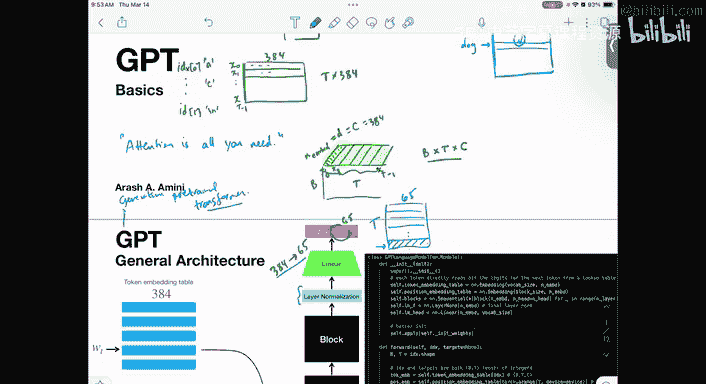

Repeat them a bunch of times okay， and it's very similar。There is there you have a bunch。

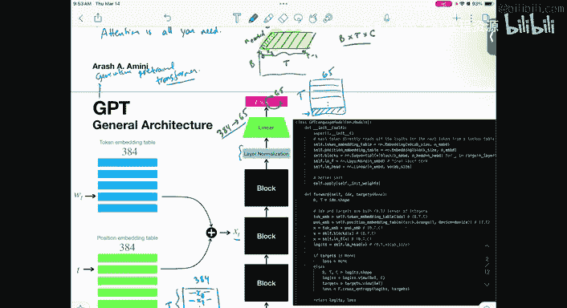

Building log， sometimes you like alternate a bunch of things。

 but but oftentimes there is an architecture， that means that architecture is like the design of the。

So you get be could very。If I could have a different kind to as say best possible。

But this is the difficult， which has worked and sort of。

site the building for the plot of communitys current language models。Okay， whether。你而嘅清。Yes。

 you possibly change it and write the paper about it if it works better。し。

You're just giving like one example， right？房子个。Any other questions？

So the question of why you do this， lot of things that there's no exact why， okay。

 so people like that by trial the error and things have worked out okay。And嗯。

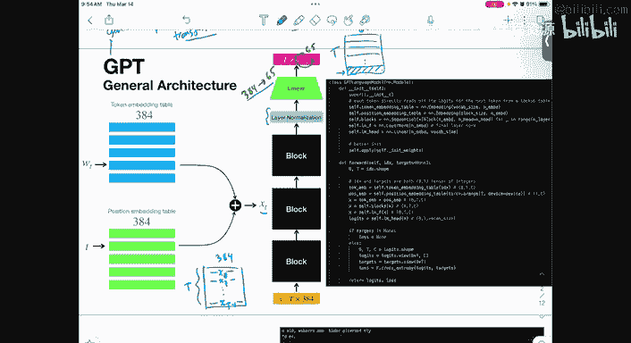

This is not the same the optimal thing to do it's like at this point you're doing more on engineering。

 but I just want to dig into this so that you can see there's there's not much。

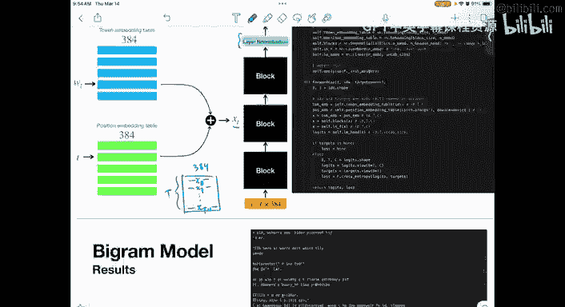

Difficultで sometimes things that。呃。Hardly difficult to understand so this is basically what it does it's a bunch of sequential operations and these are parameters and you learn to gradient。

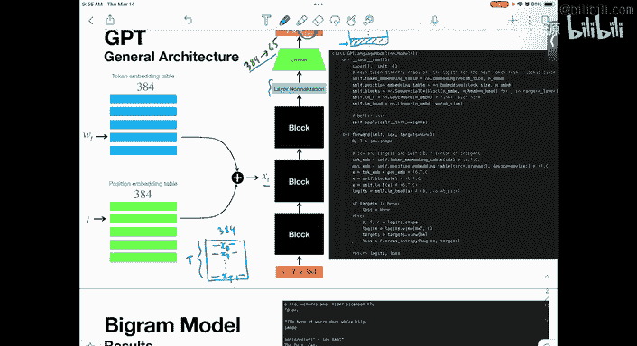

这别的还是。So what is these one these blocks， that's the structure of a blog。

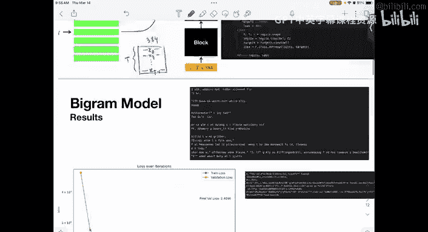

可 simple。U。So I have this here to remind us that the things that we often are essential。

Thank you forward than any best。Yes。It's just one， so you're just looking at the things two like maybe4。

不对。So this is the next interesting idea， so this is called residual。Residual connection。Yeah。

But you can call it residual channel or visual pack。So this it passes through if things are there。

 it just passes through un。Yeah， yeah， I then operate on it and then add it back。嗯。

TheOr idea was leading the subtract and so for example you have。And as in some model。

And then our phrase and then we look at the residual， which is like this minus what they did。

 and then I'm going model the residual example if you have。

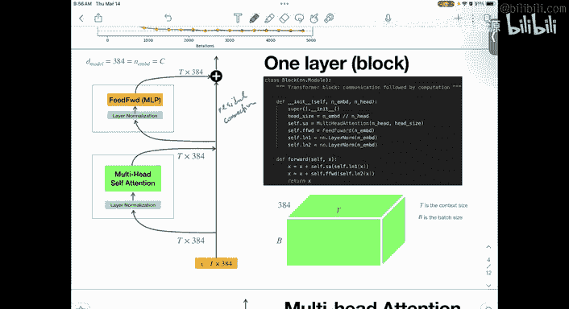

Your y and you try to predict it first， I predicted by a function of 1 x。This might not be as good。

So then I'm going to look at the residual， I'm going to model this using an another function F2x。😊。

And then if it's not as good， sorry any you can seen regression， this is very natural。

 So you re for them making a regression， you regress。

You're x un the covarius and you have a residual and they get the residual if there is some pattern in it。

 then you can take the residual and then take another model to it。

And so on so this this idea is natural and it's like it's a different but we just。

Pick up the differentials， not have to going about。

So maybe like this takes on a lot of the issues why。

 but there's some feature that remain that the next comes and takes up those features So that's the idea but。

Really at this point， minus and plus don't really matter this is plus or minus so you can think of it this way as just doing。

Just plus。知要你现系。Mus but you have being interact mappinging at the end， so。

The sign can be absorbed into that you。and from an information perspective。

 it's very interesting because you。These are not like anyvari functions。

These are a multivari of objects or like objects conditions。这PPI bag。

And potentially adding back in some states， so this thing is going to have a lot of information stored in difference of space。

😊，And each time that when we operate on it， it extracts some of that information that does some processing。

Right。So the next layer next plot comes in and uses that information， does some operation on it。

Rights。嗯。Okay， so what this is doing is again a layer node and then this multi attention is even even harder things which we'll talk about then it just writes the same kind back in and then the next operation in this block is the feed forward feed forward what we call dense layer。

😊，Or multilingguer person， this is the basic enrollment so you can see here。呃。

You have multi head attention， number of heads and head size， we'll talk about that。

And then if these four of our。Laterer he states embedding so it's like this three84。

So thats from Karine4384 who they are normalizing， which。

In a year or so you basically find a later normalization identify that this is called self attention。

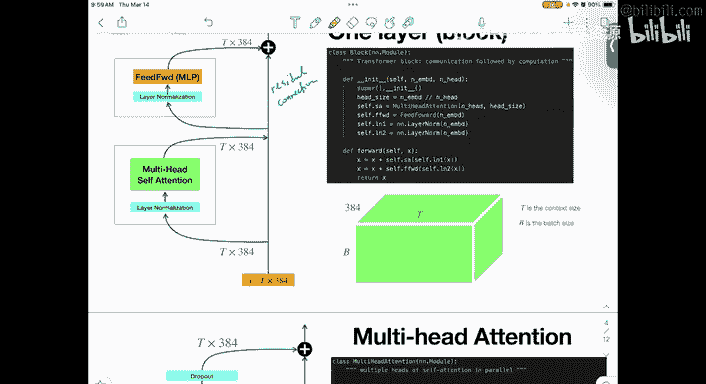

So SA your self attention and then you add it back to X you can see this residual idea。

But this is operating on it and then add back to X I get next year some at this point。And then apply。

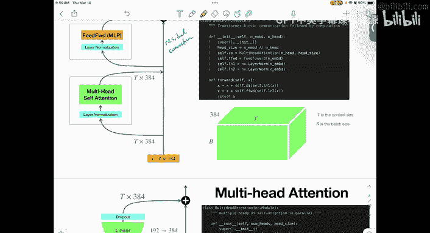

Layer norm and the feet forard and then add it。So， so this book feature and then done。Okay。

 so that's the。Each's one of these blocks。Okay。So now what is the feet forward。

 the feet forward one is we talked about last time it's one of these course they called multi layer receptorceptron it's just bunch of linear mass followed linear in this case。

 one this time should be four times that then just 990。

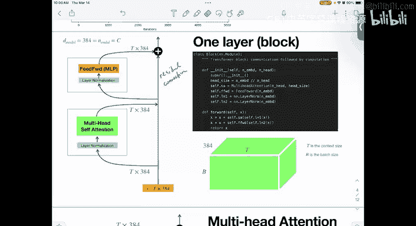

In the map back to 384。嗯。And then there's this dropout。

 which we can talk about is like a full of regularization drop out。😊，放这个人可呢。

And so this is your this would here I'm very involved by now。

A typical multi for some time is basically。嗯。One human layer。最以家咩。And mentioned important English。

Okay， so。

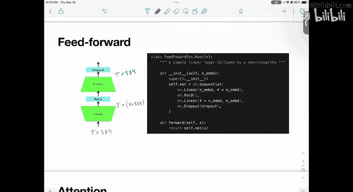

That's some nonlinear processing information。So what is this。 So that's the heart of the yeah。

Any questions？

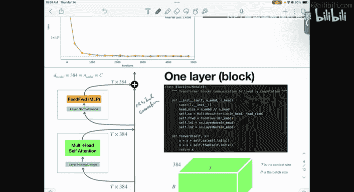

So let's dig into that that multi headeded attention so this is the。

So their innovation of so the idea is。So let's all at a patient that multiple heads you see here as when the x comes in。

 you pass this x in parallel into all of these heads and then you do do some processing what they do is that they magnet you to some lower dimension。

 each one and then I can calculate so let's say each one match it with 64 dimension and then I can calculate them。

And let's say this same maybe be 192 and then I got come back back to being four then I all'll usually do this by the me map so far I't want to like change my image。

应 yearsで应 yearsで。そできで。One for this revision。And then that's multi attention。

So nothing fancy said things。So this can also see it here simply。

 each so this head is a less moduluularness of a bunch of heads you can see and you give it the heads size head size here would be 64。

The。诶。And then there's a linear layer， which is this and a dropout layer。

 so here what you see the apply edge for every for every edge in the head so for every head basically apply edge to edge。

And then we can calculate the outputs along the last dimension。

So last dimension would be this dimension， okay。And they pass it through。嗯。

This projection is just leading a map，'s merely a projection。

The opposite of project but it's called project here， it's fine。嗯。

And then the drop path and then you did so I just want you to like realize how easy it is to。

I understand the cost of the cost in this。You go back and forth。Nothing too fancy。嗯And。So。

 oftentimes。This is designed。 so you divide this is divide also to before I can divide by3。

 So I get something such set that I can calculate to before that。 So this。

Forest in be 64 years so that you can see the potential。这个是你。Okay。

 so that's the multi effect so what you being trying do， so is this sort of clear？Why do you do this。

 I really don't know， but this seems to work why do you want without change so right going you have one head。

And I don't have do it this part， remove this button into。 So this is what often people do。

I the Appval study so you've moved parts， change the number of heads。诶诶诶。

嗯。Yeah， so let's see what happens here。

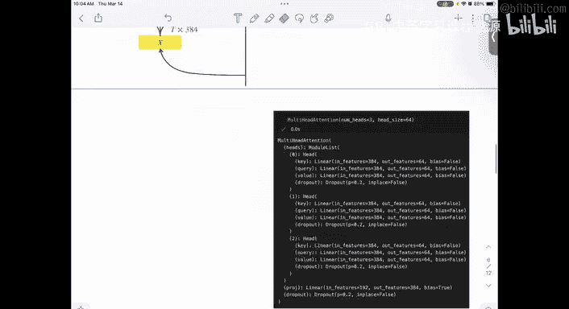

So let's not understand it， so this is the core。

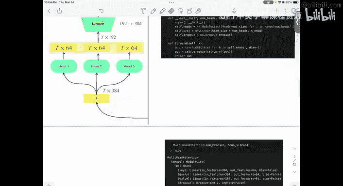

So you can see like nothing really strange going on， except maybe in the head。

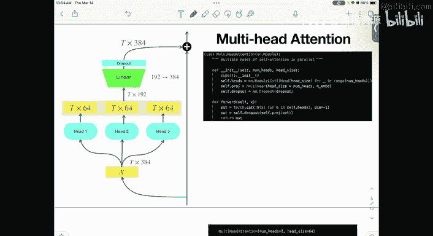

And what does this and do that allows you to do this interest in language modeling？

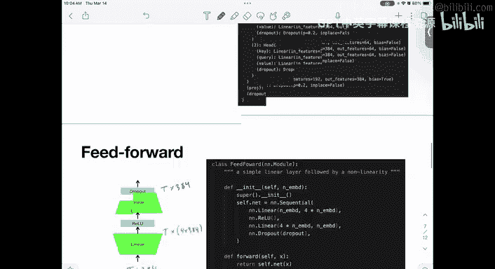

So here me I can jump back to something that is necessary。Ging on in chapter2， so if recall call。

 we have this idea of similarity average， okay。And what was the same average with in general not。所以这。

Redress and function where you had。Yhy I an exercises training and if you wanted to calculate the expectation。

Of y， given x equal writing a Z used to be little x but you want to approximate this regression function if I had a similar。

I can measure the same active all of my training mixx， then I inform the state average of my highest。

嗯嗯。Training access， they're similar， except the average or always theyre similar。

We don't remember this。So I mean Larry Wa in the coming if you used the translation wearing a journal。

 for example， if he used like a， that looks like。I forgot what they had， but like K0 X minus z。

 this K0 could be the Gausian I saw。Okay， so that's that's good a very simple idea is I didn a schedule like that。

This is a particular candle， it's not translated in variant。

 but it's very to X I this linear project and X I and Z。E to the design Z so H to Z is。呃。

seminarar from X in the same direction this product would be large as the same can be large。

And we're telling all this to be zero， could be executed。Okay often smaller。One。

 if they're phenomenagonal， it could be like less than one if they're in opposite directions。啊。And。

咁点应该就我几噶。And。I， okay， so it's a measure of seminar。对。So enterprise product measures similarity。

 so ease。If I have two rights。This is a form of similarity between the language。Okay， and。

E to the Hx and X prime is also a form of seminary。Did you find that thing。And if you look at this。

 remember there was a weight kind of weighted version of this we could write so you look at this。😊。

You can see that I'm forming this E index I transpose NA and divide by the sum of all of them。

 so that's read the Max operate。So this particular similarity averaging with this particular kernelnel can be easily written as this sort。

要边主咁 mean。这啲已经。So that might be solvematics。嗯。It is a simple form， so if I have X， right？Mattrix。

 written as x1 transpose up two。X n transpose times z。That would give me all these inner products。

 okay， so x1 transpose z all the way to x and transpose z。呃。Yeah。So it is me an then lifestyle mag。

Softms is a bigger upgrade softms would take。This and produces waste。Yeah。

So you get E to the X transpose z divided by the sum of all of them of to e and transpose z divided by sum of all of them。

 and so these are the main by these are then average。

The eyes and so you get to get this ved average of white eyes with this soft next。I， it's a form of。

This to be seen。嗯。And。What they can do， for example， I can add a parameter in between speed。

So for example， I can add a parameter。XI transpose， for example， I can have a theta parameter here。

And then this parameter period can learn。So it couldt be like a Marson marriage so another version of this would be。

I would say I would call it a parameterized attention， so it would be X theta z。呃。

So this defines a similarity， but also it allows me to have a parameter。Sa up to the family but。

It will make a here。です。我的这告。The this find。Particularly your。So this is the UV environment。

 this could make different directions even。So if you。

This gives you more flexibility and it's like a mixture of this non parametric idea and parametric aid。

😊。

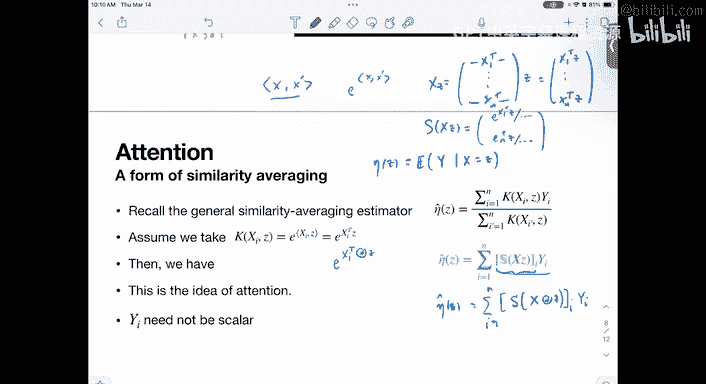

So if you remember， I don't know have seen it before， but there's this general。

So FAA is a positive semi definite matrix。This defines a general inner product。Okay miss。嗯。

Usually create product， but depending on the eigenic there's an a silicon。

Measures in might differently in different directions。嗯。Probably have seen this in the。

I think we talked about this。For linear regression， for example。

 the error that you got to something like that， and so this is an example of that。呃。

Basically all this in that time。We didn't talk too much about this， but okay。

 so it's a way changing name。And and so， potentially。That a more flexibility。Okay。

 so this idea what is at the heart of that。Business。

 although they rent potato into a different fashion。

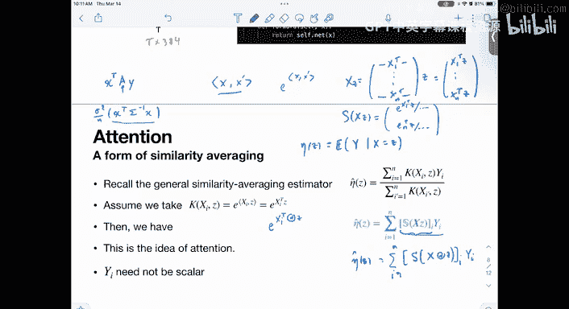

But the main idea is that we use this for skin around my eyes。

 but this is an non nonlinear operation。😊，And you can work doing big size on makes and I'm interested in noging your function of the big size。

And so that's what happens in Hindi。The head。So the idea is that for each。

So this why I can think of it as。Let you， is there any questions about this？

this idea people remember and this I'm just saying there's a particular way of defining external。

potentially demand private。

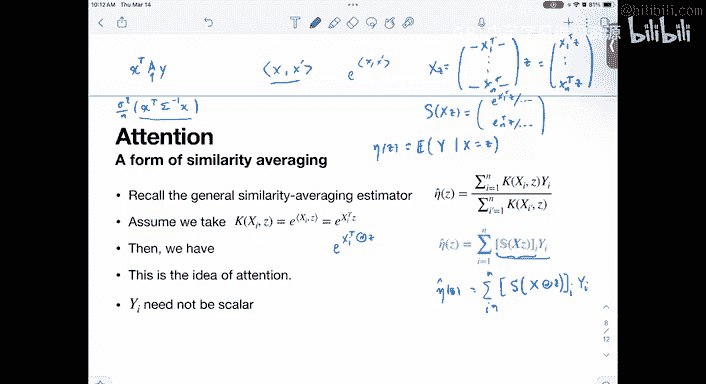

And learn that parameter as well。So this is like the heart of Ste。

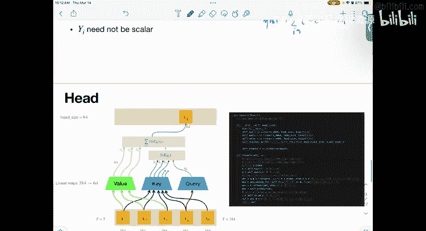

This transformer idea， so let's nodical for now so what happens is。

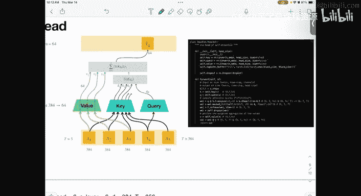

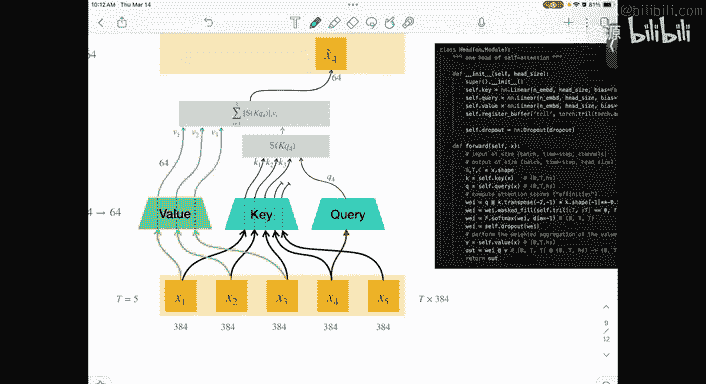

These vectors that gains your representation so these at more in depth。

 so let's say have five was the limiteding or one per t here5。

 and each one is the vector of established in the。And so I wanted to process this to sort of。Yeah。

 the more information， what happens their idea is， for example， let's say want to process this board。

And。Like X4。This is a word that's a location for。Combine token and position embeddeddding。

What this board is going to do is going to pass this presentation to a query。呃，这个是另一个吗？

It creates a linear。What they call LQ effects。So this is a parameter the produce uses a query。

 which is just a linear function position。

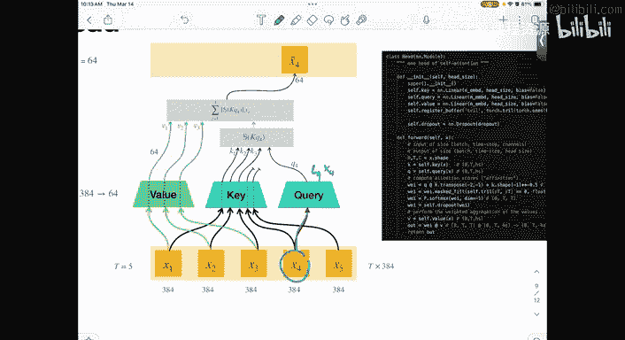

And every one of the wars also produce as a key。So all the wars passed。

 they're encoding through another linear。operatorperator is aum there。

And each one is translated into a key， so K1， K2， K3， that's also K4， K5。

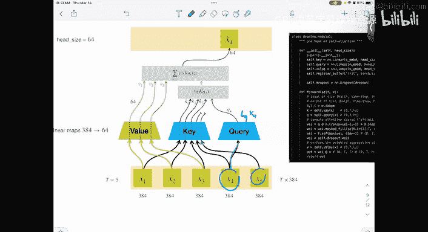

And then you compare this query。😊，呃。诶。呃。Qury。So you compare to query。This two these keys and this。

 this language transfer for me。 So basically， these are my text now。

They can think of this as the act。And averaging is a certain bunch of values they need the likewise and by there probably something queries。

Keys， so basically'm forming these， so this K matrix is like K1 transse。Up to let's say K5。

Apply to query， so this is like is。And so this measure the similar。Requiing to the keys。

 then this all effects the in readingbates。Which of these Im going to use？

And then the average values should mean rise， the value from the same position。interestinging。

 so each one of them passed is positioned through a linear map。

 which is what's called this L value if you want， so this VIs are L value。Xi。

 so each position produces basically a value there。咪仲关。And you compare the query to these keys。

 and this defines the base that you want to average these values。So this is the final。

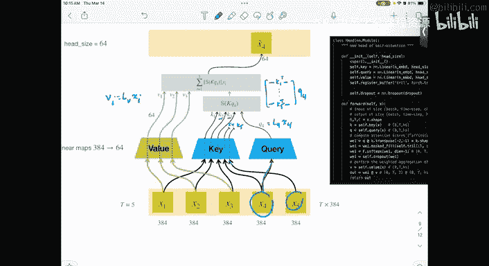

The final formula is this， and you can see it it's very similar to。

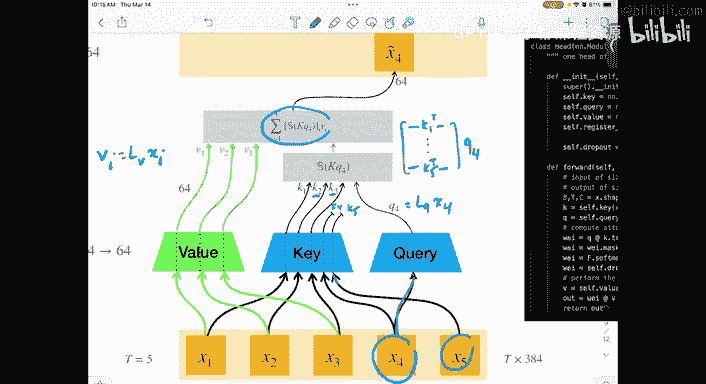

So exactly this， if you think of the Y eyes as。Bas。This would be a query。呃。啊。

I' like admit this is not the query， this is the value of I。

 this is the query of the particular one in and this is the K。😊，Okay， so K is the key。

 this is the gl， this is the obvious， I'm just painting all of these from the position。

这证明话得啊。

絶対になてた。嗯。即。

There is like the idea of attention is。They're in literature。

 but this particular form is what it's in that data attention is involving me but this idea so the attention is unique so this work。

Only to a of these rewards for which are high。Okay so that's the main the main idea you can think。

It's very old that there're megawas into something similar， but just I in our mega。

 this is called self attention because all of these are key from the same。So it's not like。这个也是。

Paker has some something process attention， but this is a very interesting idea in the sense that the positions or the headings produce the things that you want。

 so each position has all the information that needs create and for the key and form the valuesies and then。

有け。嗯。During the state and averaging。は当十くする企用であるすそで最。S engineeringグ databaseス。嗯。

But you can think about it， it makes sense in public stuff。嗯。

Dd averageig and ver similarities are formed so these are all identical agencies。

What would happen is that only the words that have the same。If this weren is great similar to this。你。

The main be higher， So I'm going to even higher。 So of main kind of average values this this morning。

So。Can。But more complicated things are happening as we visit this。

I if to multi them out you would see that。

they how that。For example， I have an LQ here。There's a linear mapping that maps x to this and the linear mapping that maps x to these and so if you maybe。

😊，Make the sort of substitution you get you get something like that there's a parameter here which is like LQ transfer is L key。

 something like that so there attention。And。

Moels。But that's the whole story， that this is the main。

I点。嗯。Yeah，啊。So here from County anything I said， this is a name extra。

Havelet a view embe each of these positions and showing you what happens when the completely explore。

So this procedure is done and you get yout for4。And these my guys now。

Let's see if we what to the stand size so this map let's say each one of these。

Embbedding passes to this value， the linear amount。And it's achieved 84 by 64。Meanor layer。

To trying to say from this thing that dimension。对。So anything with to me all？はい。

So this is the core processing that's happening and sort of mixes all every information so there's this piece here that you can see I made the dead ends here so when you process this you're going to ignore everything after it so you think that the。

This only will depend on the needs Act so you set the namess up。The words of properity。

0 and also itself say more one the track itself。 we going to say。嗯。

So what underboards have have to say about？呃。St。but theres no need necessarily future voice if you have future award here and you're running the problem at the end。

We need future credit the position。Because you've always seen the past of the future that's human honest。

So this is like everything I'm using plus this idea。可以可。

All this information from embe stem called fileolinium。你实有你嗰啲上你先啲。All the pieces of。

This by度很明那你 have看。So we mean Brown visit other。I think one kind of query today。Each toward me。

 what kind of key issues in there？で that。can imagine each of these blocks will have different for each value。

In your mapping so that they're extract different information。Does that sort make sense？

It takes a lot to。can like linear so these are the linear mapping。

 so any heading head size which is 64 there's another one which isque。

 there's another one which is value。😊。

And。You pass the x through the keys and query， all of them create their own keys and query each one7。

And then when you like key head size and then multi this key times gain transpose that basically this inner fiber。

Data is Q and then you mask out this part is doing the call masking so you missed everything that's happening there。

That ending like the soft racks to pretty uses these weights。And there's dropouts for good measure。

 and then you apply you apply mono and also this is the green part。

The get value this doesnt make you。happyapp they have it。

So that's what what is going on inside ahead。Okay。😊，Sounds good。And do we get as it。

So this operation happens for each one of these positions。

 so each position process has one theory and also like their key and their value to everyone else and everyone calculates their own representation。

印チ印で。Otain life as， so everyone shares information。

And they can think the war conquer of each other if you want。And deciding what are。

And then and then the key idea， I think is this this kind of。So there's in the original paper。

 if you look at so this is sometimes called decoder only。Architects as G。

 that you call their only architecture if you look at the original people， there's a class attention。

Which is some of the attention comes from to the attention package of it comes from the encoded。

 So something else also like these days。 but this is based on So this is easier to understand。

 once you understand is， if you look at the original paper you can see。Cross attention idea。

 but that has been replaced with this reasonable idea this works so it's a GP that be call their only。

The。So this is an entire business here。Originally it was developed for machine translation。

 so you had one time this year， one time this year。

 like one part of the world encoded the source that。

Ire you members。あ。But this kind not work that even for ceation。Yes so。

Okay， so that's that's it so the entire thing we went through so just going back each of these thoughts。

Does the same thing each each bike offers a solution of the protein position Linux so this is access and the key thing here is。

In each block， there is a small together sub region that of these positions for the mechanics。

And then theres a key and gentlemen。p冇好低啊俾出。And all of them have practice。

 so there's multi attention hands。嗯。So much parameters for those keep I the name parameters。

But this has a lot of primary。嗯。

And inside the engine， there's also a whether you need it or not。If you have different than。

关节五百条 percent。嗯嗯。谢谢。Meaning a space is a different dimension and can design so that at this image like 24。

 think I do like 138，13138 and 24。And so I don't mean the， but this is also there。

Yeah， is is that， this is what in the black box。😊。

This one isn't it black black。And过。What are the mightator the next slide。

怎么现在就这块。That's the next slide， yes。

呃。I should have added the layer norm if I'm just doing this so you can ignore large space and that's that's。

Do you want to cru？

The next time is this。没 should。

This entire operation， including。So I should add a layer norm here。That would be the entire。

Informities。

Okay。She。So later norm this is not hit of attention。

And then what moves it back so layer multi head self attention。

So the hair part is also an interesting idea， which is。I don't know if necessary any。

 but it works in comparison。You doing multiple times do one of these as well系。

Is there any some going out in parallel？And then then sequentially。

 so this entire thing being visible by sequential。 So both in parallel and sequentially apply。

昨天潘明白没做。And have means it grind back to them and people the stick process， but easier。

 that's their own priority。So it quickly adds up。If you imagine 384。呃。For example， like 64。

 this is how much。呃。So its 164984 is the definition of all of these linear maps。

So these are matrices and also biases。The clean for 160 for each person of existing。Yes。

And actually have them a multiple layers。There's also there looking for。不是。

So if you go through the code， you should be able to see all of this。

So the idea is just again a bunch of blocks that operate。

 there's a multi of the cell attention and the looking for each block and the multiian the cell attention has multiple hands each。

Which is essentially like you can think of the similar average which that can expect you what we discussed in chapter two。

嗯。But there are some innovations， so there's this parentization you thank you paraization。

 you're not just， you don't have the exit unless you not operating on the。点佢。

You're operating on these latents embedded。And you create your own。Basically。

 X and why so what do you want to ask and what you want to。Use as your features， access。

 they all generate it from your own representation， so this all like gets picked up by the model。

As you drink。Yeah， so this is the corresponding finding why。这 the Xで。Yes。

 but the eggs in the classification I should have called something else。 so this is the terms policy。

 and this is the lot response。The query and key are sort of playing the same role。And actually。

 I've been using the emission 64 here regard dimension mentioned here。嗰啲 o啲佢写。

The different their generally have the same ownership particularly products2 Americas。

 the 64 inside size the opposite side。so these are wise。So these are wise in classification。

These are accessing classifications。AndThey past access。嗯，O。

So in interest time listen one this result。嗯。Numb of had six， number of they six。

The many members are created before and the college students25， six。

The number of parameterss is 10 million if you calculate。まのね。And。The training milestones like this。

 theses are lots skillss like this provide happens and these are prior that original and。

Because has anything see out。这块系三三点我搞一下。嗯。In those world language。So that for example。

 you give me two来 like。175 billion pounds。Okay， and so。Go back to the code， you can check。嗯。

The number of tokens that we train on is like e to the one e to the six or1 to the six。

So this has much more parameters than the total number of tokens that we have。

And you can see a little bit of overfitting。Thatsche evaluation is coming up。

OkaySo training goes the validation passes up and starts to go on。This is like sort of communicating。

呃。哦对。

This is my own。The I on the context， it this now 2。7。はい大ですさポざね。

And it's seven na in our finalization error。

嗯。The quality you can judge for yourself so' still like。That's quite fair。我睇系就时。That。

All gracious lo heaven is。Okay。Yes。Yeah， so maybe this a little bit。

 so this is you can see like like doing。

Evaluation of these is hard， so it like the validation error is even like slightly ignore。😊。

Yeah， like next。Interesting and then。

🤧Sorry。

What will happen if I。Repeat this。gan run for a very long time。

 this6 by six10 million 1010 million parameter model， so that's what you get。

And you can see like your validation thanks training those。嗱，呢算我 one back。Like hey。

 this is even worse than the background the I model。But surprisingly， the avoid the based on that。

真 this is been那受发。It isn is bad。整以就是对。呃。And then finally out。So。She。

You run into a lot of interesting surprises。Okay， that's large those models for you。

And if you have a GPU， you can train it yourself。 So this takes a lot like strong GPU。

你发就 continue样嘅 best take问题。If is you strong enough， you can try to train。

And you can encode like add more text and try to do that。Change and so。I身。Okay。

 so not in language models so nowm。

The last remaining。10 minutes I'll try to talk about so this overfitting of visa， so that's an issue。

With all of these。

Large models right， so if you have them on primary first。And sample sizes are smaller。

 So it's not clear the modeling has this any free parameters because。function。

 the actual function would be。Not tendting much if you change some of the program。嗯。

So the actual dimension of the function space is not clear。嗯。嗯。

But it seemed like there is overfiing that happens。Or fitting is like a training。

 you fit very often training by the validation like on the test date that you're not the expert。

The imagining this is the same side。Where had so then do what they call hearing examination say and stop。

 take the validation and see if he sort not any stuff。So this model might be better。

Its debatable and in this case what the output of the final version is interesting。

 so one of the ways you can do with this is by regularization which seen have seen regularization idea。

And in particular so we does combine the two ideas of trying to have an nonlinear model。

 suppose I want do linear regression and usually linear regression， yes assume model YI。Wch is。

Sation theta I Xi I from12。Let's say D plus epsilon I' sorry this would be。Illusrate it like that。嗯。

X i+。Epsilon and I usually we assume that。Like f of x is theta transpose x。

 so this is a linear model here there。And so for example。

 when it comes regression mean line in classification would is just classification linear boundaries。

 what if I want to have classification of non nonlinear boundaries or a non nonlinear function and's in regression？

The idea is that I can map this eggs。To a new domain， so let's say x is one dimensional。X is in R。

But could be Jen also。I map it to， for example，1 x x to up to x k。Okay， so each one of my。

Orizal features， which is one dimensional is now k dimensional。And so if I now。

For a function like this， instead of x， I apply phi of x here。Right， so in the feature space。

 so the office is called the feature map， so in the feature space。😊，I still have a linear。

 so it function as linear。You can use features， but the the original states will be not linear。

 so this would give me a polynomial。We might have seen this before。And。呃。So I get Xi to there。

X to the K。呃。Okay。是。Sorry， weta I X I， iPhone zero to the cads。Okay。

 so this is a polynoial function to non nonlinear here。

 but I can finish it just like regression by just training it as now I have a new set of features。

SoWhen you give me data， training data。XI I'm going to pass it to phi of X and then call this X till then let's say I have a feature so it used to be R now increased the dimension to R K。

 but that's fine now I have just y Is and X's。s from my as an exc still die and why I not a regression artistic regression。

In this domain， and it would be as if I'm doing non nonlinear regression in the original domain。Okay。

 so you can do， for example。But you decision boundaries。And so on。

So this doesn't have to be like this， it could be like a general basis function。

 so it would be x size zero of x， psi 1 of x， so this could be like an autonable basis。

And so it gives you a very， so this could be， for example， size for your basis。😊。

This is different basis。Or other basins。The space。So okay。

 but this procedure has seem given dimension。And the something you can do is multis。

 it all of multivaris。诶。Forming polynomial create a lot of terms， so for example， if I have。X is。

 really。Excellent， x two， even a degree two polynomial feature map would be。

We would have how many like one x1， x2， x1， x2， x1 is squared x2 is squared Okay。

 and if I went on it like that tree。But okay the， it would be much more。

 can see if is where you want to。We have a lot of characters。

 so I increase the dimension of the feature the and then you run into issues because you have the same number of parameters here and then this overfaing can easily so impact maybe be for example I have 100 samples and xs。

The dimension of x' is two dimensions， but now I have 100 samples a dimension of this new xs。呃。

Like what six right， and if I do a point0 mean 25 I didn have more parameters than samples。这意。Okay。

 so then how do we deal with this？You can do their organization。

 so you can have the organization that tries to find within this huge function makes now a center parameters that that' fit the。

Well， so this this presentation。The problem with or is that you increase the variance of the estimate。

So you had theing in the NSE， you had to bias variance the composition variance would would increase if you had like more parameters fit to the training rate fit the noise being well and the noise has variance so you rise seriously goes out so the idea is that we add for number of。

in the context of regression， this would just be a regression so you get some sort of expression like that and then you can tune the so by choosing different manner primary data。

And I。I can sort of evaluate in practicing what you do when you look at the S or validation box。

 and then put it as a function that。And then you find the man that minimizes it。

So in this particular case for we can do analysis that all the details。

 but I'm going to sketch the idea so you can solve this。There close forward to this for。

And yesterday of the function that we have is going to be。Here， I'm treating the。

I'm ignoring the fact that。So let's say phi of x is going to be called mu x。Right， so。My thanks mean。

So that's the linear address。Estimate。prediction。So。And make these assumptions。

Why is that a start by the same？What什么位什么位。Conitional train you ranges。

So was what I identity I'm not pursuingifier。Doesces mean here。嗯。But I've had his lean。

And so what we can do is we can measure the performance in the so called。

In case of the name articles that happens the star。By looking at this is called the intake called tu。

So we get the use the functions on the chain data squared and。So if you think of this， this is。

Going to converge to some sort of an integral as the sample size grows。Of they random。呃。

Rand the banks。Well we wonder through this and then we can write it in this form。

 this is not quite correct because we're not assuming。That start moving here。

 but the next one is correct。诶。And so you do the biosci composition and expression like that for anxious and increases in terms of headache。

The side is。One of and evaluations of the the start Act。The traininging data。

And so there is this bias there。And there's a noise there， and then there's a cost of noise。

And so this man is可 out就。This is not very informative。

 but you can write things down more cleanly in the end。嗯。

If you do an iron composition of this matrix。 So this matrix is。So X is。X1 transpose to xn transpose。

if you look at one over in。Ex transfer it like。So the entries are X transpose Xj。Over hit。

So these are basically normalized similarities of the features。

 so this is called the kernel matrix random matrix， the kernel matrix。

So it turns out that the identity composition of this man。To form this general matrix。

 you look at eiggonvalue the eigenvalue is the same Ui， e Ui then the。This is the inner product UI。

This is the sampling operator， so the sample is the function。

So you can think of as an app of the function， so you basically take the inner product of the。嗯。

At the start make the functions UI。of this kind of matrix and then so you can write the and in this very nice format。

And you can easily see the trade so for example， landda is zero。

 the class goes of eight and you have all variants， but if you increase landda。The bias goes down。

 right， so the bias says。Decreasing that。This term was going to go down the term goes on so its very easy to function。

We have the咩 around。Please in general how fast the I9 is K and then how fast these。

Let's say alignment score the， so this can tell you how much the functions align with item makers of the channel。

啊。Amazly how much basically align the features so we don't have much time to go into it。

 but if the function align is well on a on noial basis。Then this will be high at on and。

The thingss have not and lot things it just0。You have an issue with the bias。

But studying this would give you a lot of information。

 especially that9 equal zero is not to say the best。So you can do this in an experiment。

 let's say have a true function which is quadra， so the original dimension is one。

 and they have a quadra function。So Mike， for example， true function is。I going alpha0。

Plus alpha1 x plus alpha 2 x2。But that that's sort of， it's online X if I hit a degree 25 polynomial。

呢个一个系就以说呢个想。Green care， any if I do， for example， evaluation。去召翻。I get this screen chair。

 it's a little imagination。Allows you to， although you're fitting at degree5。

 the 35 point can see're there。And getting the noise many off， not the state function。

 but literally that an organization。Allows you to do a good job and this is。

I think people and can see that in one。It's just based on the one sample that we did the one is sort of a or multiple runs of the experiments where you generate the function is the same but you generate different y so given the same x and on the same x so this is if you。

Average conditional under the training access。The obvious conditions on the training exists so。诶。

So this shows easily that like zero organizations I knew that they would optimal location you get this。

呃，没是一个。you can get position is in。Notmination very well。 but but this is showing。

you can see that how it and allows 15 items for models sorry too many parameter。

Effectively so you don't want this， but a little bit ofign wants you to do that and sort of in large language models et cetera。

 there is a regularization of this form going on， which is they call it weight decay so effectively if you do re regression。

😊，诶。You just add bit to the gradient so you can easily see and just shift the gradient component。

 you take the gradient and get smooth here。But what they call Lake decay is basic。

What loss like lambda hated Square。So rain the原 been出来。This in the fact。嗯，就那个意思就个。Theてくた。诶。

By controlling that， you can do it a little organization。stop here， Any questions。

Well's that was a little fast， I told。We can take the chapter seven。我呢有啊。The questions。

Thank you guys we teaching you and good' luck with the final minutes。

