# UCLA《模式识别和机器学习｜Introduction to Pattern Recognition and ML Winter 2024》中英字幕 - P1：[01]Introduction to Pattern Recognition and ML -- Lecture 1 - Winter 2024.zh_en - GPT中英字幕课程资源 - BV167BfB8ETK

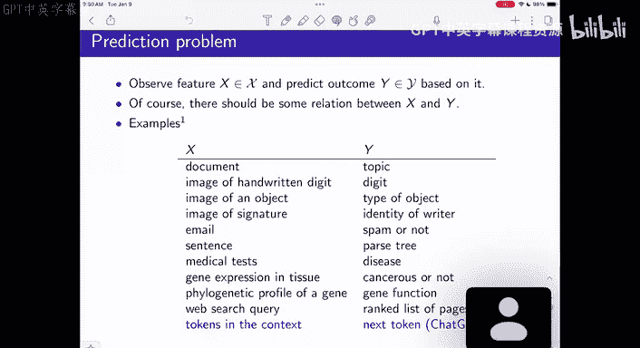

Okay， you have an image on an object you want to like detect the type of object。

 is it a cat is it a dog image of a signature identify the writer email spam or not and then you go like things become a little bit more complicated。

 let's say gene expression， whether it's cancerous or not like。😊。

Pylogenetic profile or tree of a gene and then gene function， etc cetera。

 these are from Peter Bartlet's slides and then there's this last one which is。😊。

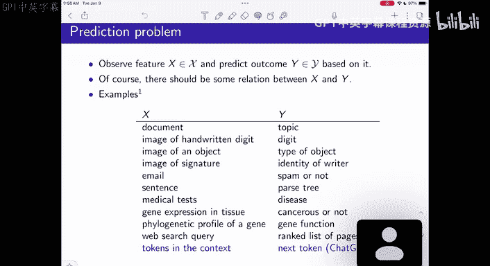

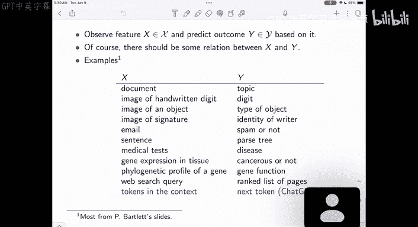

嗯。

Which is， let's say if I have a text。I look at the bunch of。Words right in sequence。

 they call it the context and try to predict the next word okay？嗯。

So for example here I see let's say if my context has two tokens like let's tokens or word。

 let's say I think a gene expression or let's say3 token gene expression is in and don'll predict the next word which would be a tissue okay and if I can do that then I can predict the next word given the previous ones and then it can generate ticks so that's for example the building blockups like these generative large language models is like child GPD so very simple idea of trying to predict the next token given the previous ones。

😊，So。嗯。Traditionally， this is called like supervised learning。

because I won't see why it's called supervised learning because we're going to get observations of both。

 but this is an example where like the line is blurred okay， so these are。😊。

Like train on large amount of text and then they generate text， okay。

 but you can think of the generation process that's to predict the next war。😊，Okay。

 so it's not that limited as you might peer， okay， so very complicated。😊。

A state of the art like machine learning。Systems are using some very simple at the core idea of prediction。

So any questions？So so far we have X and Y， sometimes you call this features if you're a CS person。

 if you're like guess the decision you call the covariate。😊，Why is the outcome target？

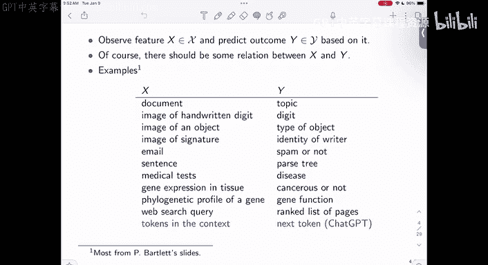

Response if you're a statistician， so the name doesn't matter as much。

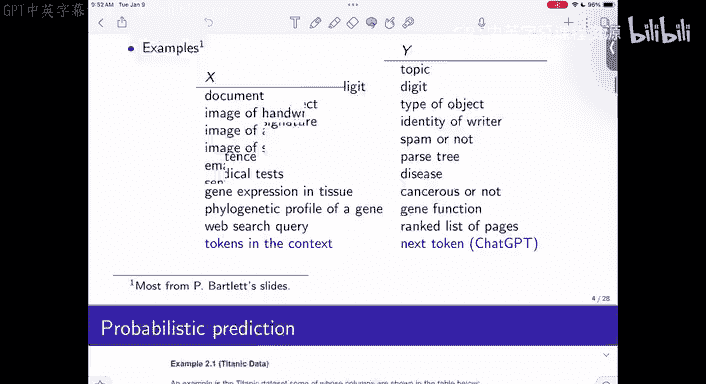

So let's start from it。An example， suppose we have。This table is from the Titanic。

Ship that sank in the ocean about 100 years ago。And so each row is one person。

 whether they survive six like the class。Like the passenger class， the age and so on。

And these are like sometimes called tabular data， these are the data that usually statisticians work with。

😊，UHere I have like showing you 10 rows out of 982。Let's say I want to predict。

Whether someone survives okay， so this would be our own。Why？Target， and then I have。

These other covariance or features to predict okay and I'm going to start with something very simple so we're going to focus on binary classification first that' that's the thing that we're going to focus on。

😊，And then I'm going to use this six， which is another， so this is going to be our x， Okay。

 so x is categorical it takes two values。😊，Why is categorical taste two values。

 okay can it get simpler than that？😊，So let's see what we can do here。

I want to like build up towards what is optimal here。So y takes these two values， okay。

 x takes these two values。嗯。So。Statistically that if you want to be a little bit more careful。

 these are going to be random variables and you can think of each row as a realization okay so we have repeated。

😊，Realizations of these random variables， so you can think of this as like a population level quantity。

So this is a random Y， this is random X and there's。Like a joint distribution， okay。

 so we assume that。There's this their P。And the pair is drawn from this disturb P。

And each draw of this is a draw from this distribution， okay IID draws from that。

 that's what we're going to assume。And what I want to learn is some sort of a function that maps x to y。

 so that function would map x to y hat， which is my prediction of Y I want this to be very close to Y。

😊，No matter like。What the data point is， so as long as I'm generating from this distribution I want to。

Be able to。Predict why basics so this distinction between population level or。😊，嗯。

Realization is subtle， so if you。We can go over it， but these are abstract objects。

These are realization so I'm going to maybe get to it at some point。

 but I hope people are comfortable with this okay so if you start we' from I'm going to assume that we have just a pair of random variables okay。

😊，And then later try to connect it to this table。😊，So far so good。Okay， so。So if you want to be like。

😊，Very general you're going to not assume anything about P okay so and then try to learn from data so。

😊，Okay， so this distribution in the language of statistics is the population of the quantity usually not directly observed。

 you observe samples so that's what I mentioned， but at first I'm going to assume there'd be no P okay so I'm going to give you the exact P。

😊，Let's see what is the optimal thing to do。Um。So let me ask you。

If I have a randommy what that takes about these two values and if I have another random it takes these two values。

😊，If I want to specify P the joint distribution， can you tell me what should they specify so what is like a？

😊，Concrete way of specifying。I want to give you P。ToSee if people are on board。

So were in the variable。X。I'm going to give you a hint。So x takes values F and y takes value0 y1。

How do I specify？They joined the third。Thank。Obvious answer is also acceptable。

How do you specify the joint distribution of two random variables that each take two values？

Just give a shot。Be the first person to talk in the class。So suppose I can give you one variable。

 how do you specify this like I have a binary variable x。😊，What is the distribution of eggs？

Me describe that。仔。可 ahead go ahead。Very newly， okay。

 so that's that's good so you can you can say okay in general。嗯。Rand variable X。

You can say the distribution is beully P， but what I'm looking at like not the name。

 but you just have to specify what these two values are， okay the probably the x is like okay， X。

 let's do Y。😊，Yhy takes value 0。Y takes value one okay。

 so two numbers that would exist with the distribution okay the distribution is really like a probability measure that tells you like the probability of all possible events。

 but this is enough in our case two numbers and in this case just one number is enough。😊，喂。Yeah。

They have to add up to one， so this would be like。One minus that so just one number if I specify that that's going to be enough so now let's say have two variables。

😊，How do you specify the join this series？Yes，Great。

 so I just have to specify the probabilities of these pair wise outcomes。😊。

What is the chance that x is F and y is0， so that's one probability。

And the other one is like probably that x and y is equal to。

M and zero and so on right so there are these four numbers usually you put it in table called contingency table something。

😊，Okay， so if I give you four numbers and not all of the four are needed。How many actually do I need？

Because they have to add up to one。Right if I give you the three。

 then the last one is specify so three numbers I give you three numbers and then but but bit。

Let's say a little bit of。Being inaccurate four numbers is enough okay so I just have to give you four numbers that default folder joint distribution is completely specified okay that's how you specify joint distribution that's that's what would mean for me to give you P in this case Okay so once I have these four numbers that I can answer a lot of questions okay。

😊，AndAs I can answer yes a lot of question is that clear so so that questions so this is my。😊。

Giving you these properties， suppose that。These probabilities are like that。

 so this is giving you the joint distribution。Okay。对。X。Well in practice， we don't get to see this。

 but you can imagine he can try to estimate this okay， so that's where we're going to go next。😊，Okay。

So far so good。So what is the marginal distribution of Y， let's say？

See if you understand the terminology。What is the like if I give you the this table。

 what is the marginal distribution of why？The is the joint distribution has two marginals。

 like the distribution of y and distribution of x。😊，嗯。嗯。I guess， okay。

 so good so the problem the marginal distribution is giving you。😊。

The distribution of y basically under this joint， I can one of information that I get is the distribution of y itself。

😊，Which is， if you recall like。I have to specify these two numbers。

 but probability that y is equal to zero， I just have to sum these two numbers Okay so it's going to be。

😊，62， they probability that y is equal to1， I just have to sum these two。😊，And。I get 38。

And you can double check that this sums to one as well， these four also have to sum to one。Okay。

 so that's the marginal distribution in the notes I might write something like that， why dot。😊。

Its like。62。38， you can think of the distribution as just a vector because it takes two values each coordinateorator tell you the probability of that particular like if the dot is here like。

😊，This thing as a victor。ok。So far， so good。嗯。Okay， so。

The next step is what is the simplest classifier， so let's say I want to predict why the simplest classifier just ignores any covariance。

😊，Okay， I'm just going to ignore X。And。The classifier always outputs a single like constant value。

 so if you think of the classifier as a function of x。😊。

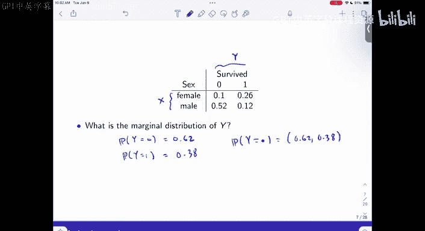

嗯。That predicts my hat。The functions that are constant identically， so no matter what value of x is。

 I'm going to always say one or I'm going to always say zero， survive or not survive。😊。

These are the simplest class bars。And。There's an optimal。Version in this case。

 so if I just want to ignore x， what is the optimal thing to do here？😊，How should I predict why？

P everything else so。Why。嗯。Because is more likely to be great yeah so it's very like intuitive because it's more likely to be zero here if I don't if I' going to ignore every like other information if you just ask me just stream to predict I'm going to predict that someone you give me is going to die right that that's going to be correct 60% like 62% of the time okay so the simplest classifier would be like they call it majority rule in this case so if I want to write it it's' going to be。

😊。

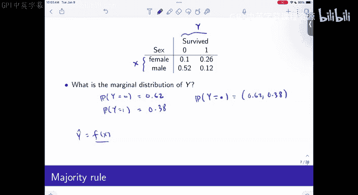

Yeah。Arc。In this case， it would be like。嗯。That's an argument。I can actually like what I mean。Okay。

 Ag Max。E in01。

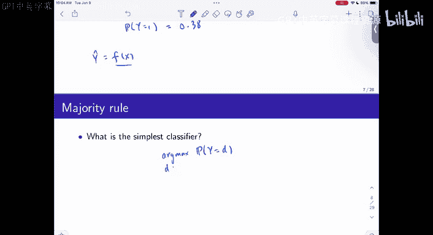

So I'm going to look at the。Probably that y is equal to D， and I vary D。Said the equal to0。

 said the equal to one。Ag max means the argument that maximizes this。

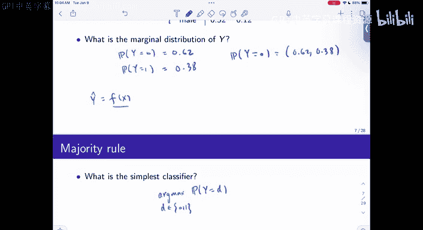

This would be my classifier， the simplest classifier， I think I'm calling it。嗯 see if I can。

See my notes。嗯。What do we call this。嗯。Okay， so let's call this MR majority you。Depends on x。

 but really doesn't depend on x， Okay， so it's going to be constant in this case it's going to turn out to be just。

0， because the constant function zero for x in。If and M， right？So that's our simplest classifier。

Sounds good。

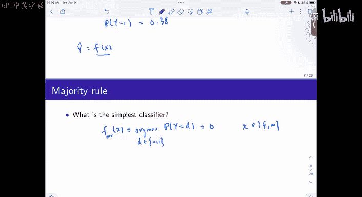

I don't know you're rating it is。😊，To be like can set the notation argument the probability that y is not equal to d。

So this is like the sort of probability of error in a sense。

So minimize because one is one minus the other。对。Maximizing that is similar to minimizing。

This because this quantity。Is one minus the other。

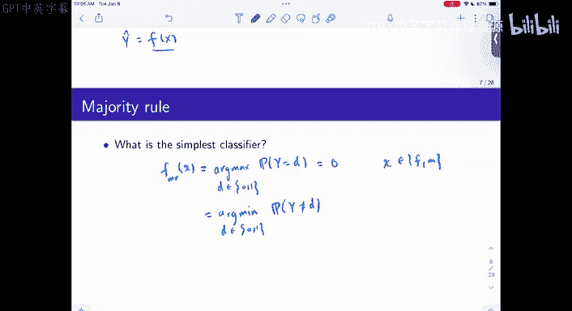

Okay， so far so good。嗯。

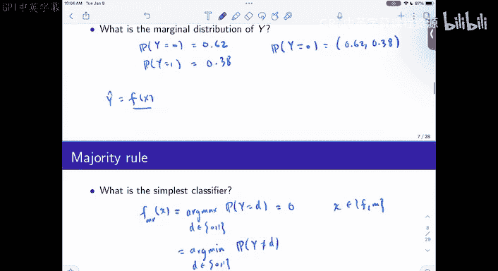

Questions。So now let's say I want to add x， okay， so it's good to start from this， okay。

 this gives you a baseline we'll see okay。😊，And。We we'll talk about measure performance。

 this is the simplest thing that you can do if you can beat this then good if you can't then you can go with this okay its always start to like good to sta some benchmark okay this is the simplest benchmark。

😊，So now let's say I want to use actually x to predict y。😊。

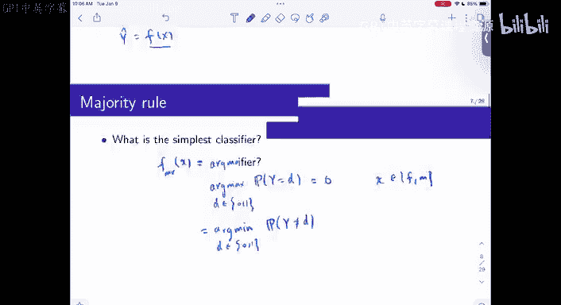

What is a good thing to do here？What is natural。I'm losing information here， so I'm just。

 this has more information。So I'm ignoring the X。The probability distribution collapses to this。

 I'm using this information。😊，And now I want to use all the information sort of。What do you think is？

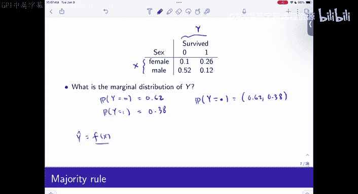

Great， okay， conditional probability so instead of doing this I can。😊，So。Can we do better？If。We know。

sn use X。So the idea then is to condition on。肯定是。😔，And x。

 so that's the idea of conditioning probability if I observe x。I condition an x。

 it changes the probability to everything else okay。

 so instead of computing the probability that y is equal to zero， for example。

 unconditionally I'm just now going to condition an x。😊。

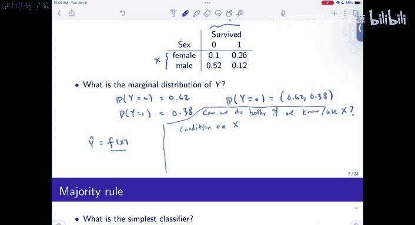

Okay， let's say condition on the x being a certain value。嗯。So I want to like compute this。

For x being equal to。And。F and x being equal to M。Right。So how do we calculate this， let's say？

The first one。就是这。Can you like maybe walk through？When you're at the tables okay。

Look at the other probability that y is equal to 0。X is equal to。嗯。Right。

 so this is not exactly from the table， so there's like。Right， so this。😊。

I's going to be the drawing probability little。I need to， not the condition probably。

 there's a bit of calculation that we have to do。喂。There's something else that I have to do here。结水喂。

Right， divide by。F， so that's the definition of。So plug f here。

 so the probability of y equal to zero condition on probability the a equal to F is that if you recall your basic probability right probability of a condition of B is probability a inters B divided by probability of B。

😊，Can someone compute this， so the top would be。嗯。You can read it from the table， it's just F0 with。

1。This one is from the marginal of x， so we have to。Song， right， so。I'm going to sum。These two。

 right？So the probability of x is equal to zero is。What？Sorry， x equal to f is 0。36， right？

And the other one is 0。1， so can someone compute this？See what this turns out to be。

this isn't like quit。

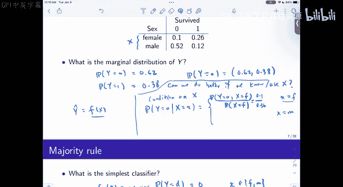

Okay， let's that's do one， actually， I just want to compute this a little bit better。One。

 given this is equal to so I'm going to change this to probability y equal to one given x is equal to x。

 so that would be。Point286。😔，Right0 26 divided by 0 36。So what is that？6 divided divided up by 36。

Yeah， okay， so this would be 72。Right。The other one is calculated similarly， right。

 so can anyone tell me to like。What this one would be like。

Probably y is equal to one given that x is equal to male or M。be 。12， right divided by。Divided by。嗯。

Marginal， which is。仔。Its。Okay， point， is this correct， so point 19 I suppose。Lets make sure。

My numbers， I。Right， right， I guess 64。Yeah， have the some these too。Right， okay， so but in the end。

That's the。嗯。Result。Okay， so 0 19， 。72。嗯。And then I also have the probability that y is equal to0 given x。

 but they really need to calculate that。No， because it's just one minusness。

 so I can just decide based on this because the other one is。One minus this， okay。So suppose。

 for example， that I observe X to be female， what would be my？Pasification， in this case。

 what should they predict why？To be。1， why？我 actually with。你关 ahead yeah。

MaIt's major yeah so it's like again the same idea like intuitively if I observe x to be F。

 the probability that they have survived is 0。72 the probability that they haven't survived is one minus this which I haven't shown right so 28% so it's more likely to have survived so we're going go with survive if I want to just cut off the decision it would be survived。

😊，And here， the probability of survival is like 019。The probability of not surviving is one minuses。

 so it's larger to not survive， so then we declare not survive。

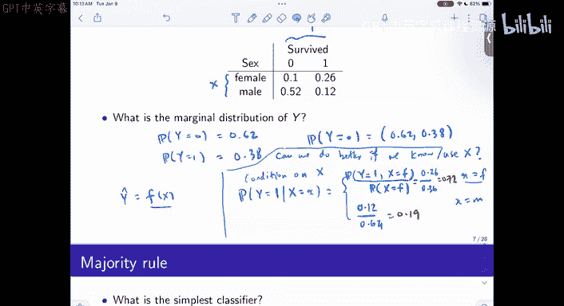

So this is a more non classification rule， so this one is going to be like。😊，Like using。

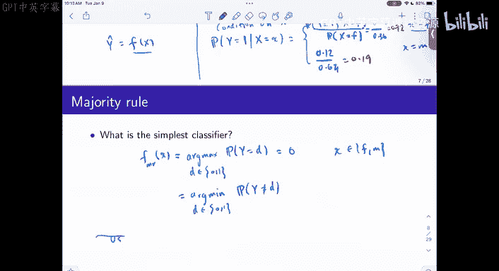

X， we get this classifier， which is。嗯。And。You can see if I think of it like it's going to be the probability that y is equal to one given that x is equal to。

 let's sorry y equal to。😊，D given equal to x。

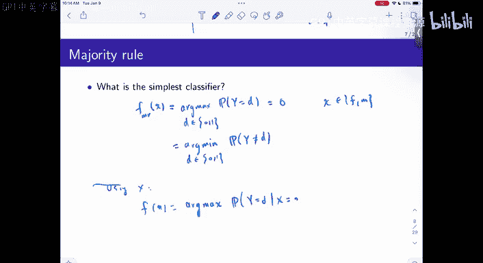

D in zero to1。 so if you think about what we just did， it's calculating this this quantity。😊。

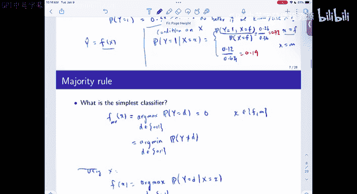

嗯。So what it does is you go plug n y here equal to1 for a given x， let's say f female。

 you plug in d equal 1 and d equals0， see which one is bigger。

And then that value would be the value that you use for the classifier。

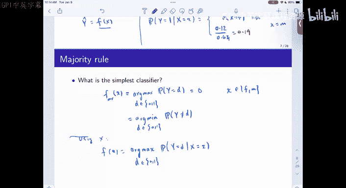

So in the case of for example， FF。

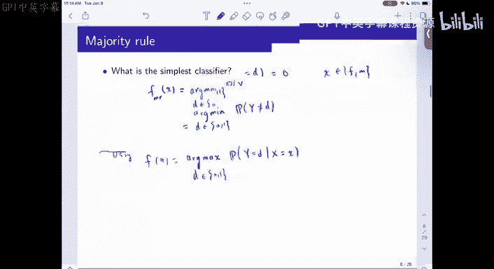

F， what we did is Arc Max。So that's the end because that's like。Probably that y is equal to D。

 given x is equal to M。D in0 to1， this is just saying。Thank you。And。

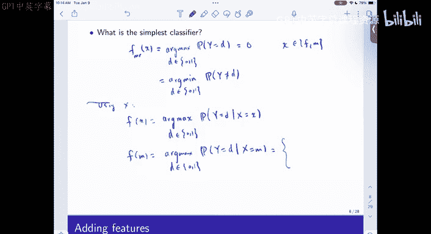

Look at like。Oh， which。Of probability of y equals0， given x is equal to m or。

Probablyative y equal1 given x is equal to m。Is bigger。And。And give。Back that decision。

Theci here is this guy。This this。So decide one or decide zero。It sort of。Look at。Nike。

Look at all possibilities and the decision that makes this bigger。We're going to return that back。

 so that's the idea of Arc banks， okay。So look at which value of D maximizes this quantum。Okay。

So this going from this to that， I did it a little bit quickly， but just think about it。

 this is just mathematical way of writing this simple rule。

 so you condition and next look at the probability that y is equal to one and also y equal to zero。😊。

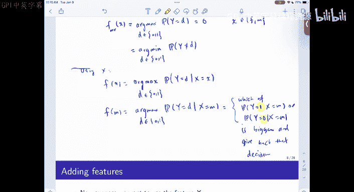

Which I'm not showing because it's easy to do it in your head and in each case。😊。

Out of these two properties， which one is bigger decides the decision that you make， okay。

 that's the idea。😊，This is the intuitive thing to do and you can see the classifier in this case is。

😊。

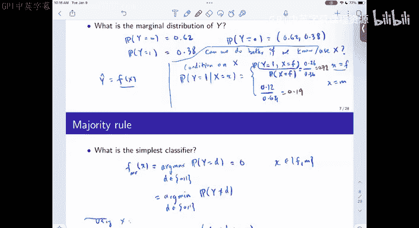

呃。More。Interesting because。It did indeed， depend on。The value of x， so if x is female。

 we're going to predict that they's survived。If X is male， we're going to predict that they。

Not so right， okay。More non classifier。Rather than predict everyone just survive Okay and then you can imagine as you add more and more features。

 it gets more。😊，Noons， okay， so I'd like more。Maybe if they're female and they were in the like certain class of passengers and they had a certain age。

 then something happens and if the age was below that， something else would happen。And so on， okay。

 so that that's how。More information is going to come in and change that。Okay， okay。

Sounds good so far questions。Okay。I'm going to pause a little bit see if there's any questions。

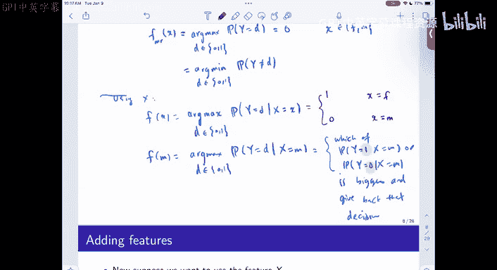

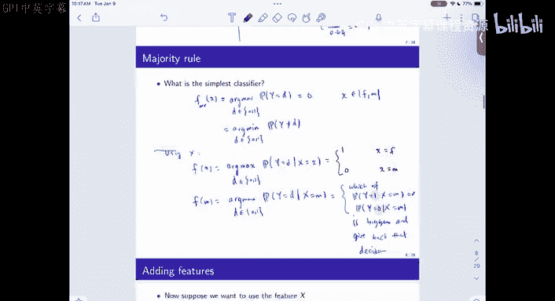

So。No questions。是。So how do we know？

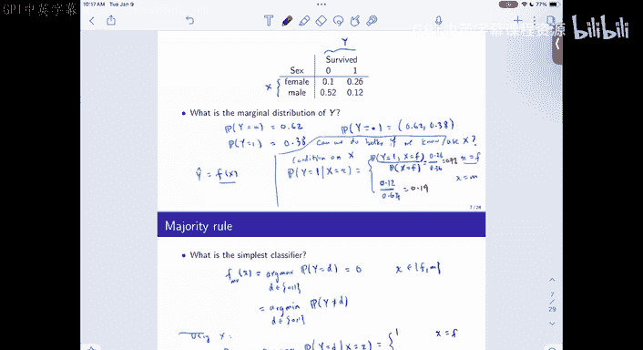

Actually， how do I know that this is better？

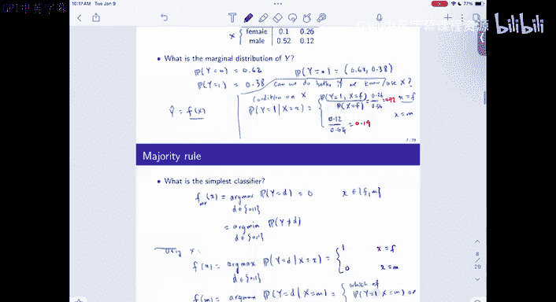

So like intuitively， this should be better， but how can I show that maybe this classifier is better than this classifier？

Any idea。Now I want to like evaluate the classifiers， okay， so this is intuitive。

What can I sort of prove that this is better than that？2。Classification accuracy， okay。

 so what is classification accuracy？Okay。嗯。The proportion of correct classification。

 so if I want to like exactly that， but if I want to like to do it at a population level it's just the probability of correct classification so proportion。

😊，嗯。Is like frequent this interpretation of probability， so if you repeat the experiment many。

 many times。😊，The fraction of times that you're correct。

Sort of approximate the probability of you quick。 So if I firm at the population level， Im to pick。😊。

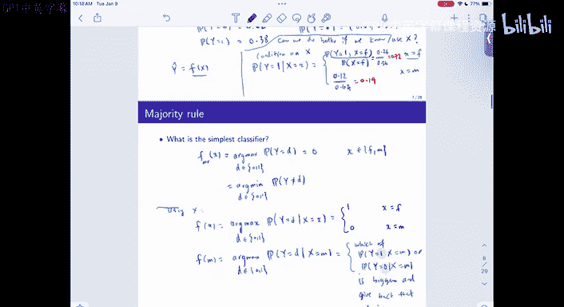

And。

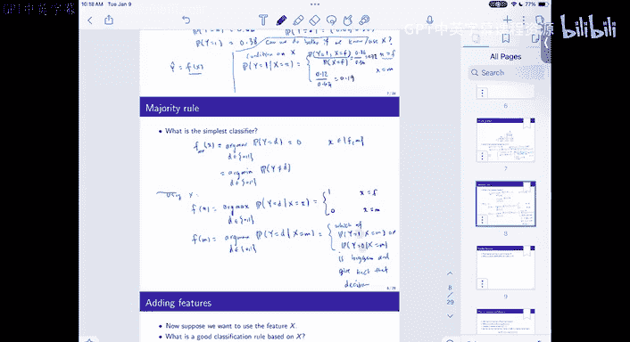

Okay， so I actually added the features here。This should go there， but。Okay， so let me。

So this goes there。How do we？Measure。Reformance。So an idea is。Is classification or accuracy。

Classification accuracy， so that's what what it was classification。Accuracy。😔。

And proportion of like pro。😔，Orend。F。Correct。Classifications， let's say。So at a population level。

That population。Population， this would be the probability of correct。Classification。

Or classification rate。So the way that like the population version works is I'm going to pick。

A like a random X and y from P。

I have my fixed classifier。And then I'm going， to apply my classifier。2 x。That would be my hat。Right。

 and then I decide。So what is the probability that y hat is equal to y that would be my accuracy。

 the chance that y is actually Y hat is equal to y。Or if you want。嗯。

So with this the probability that。Y is equal to F of x。So assuming x is fixed。

I draw a pair apply to X C matches this， so that's an event has a probability okay so this is the probability of correct classification。

😊，One might instead is the probability of misclassification or misclassification rate。Okay。

 usually we work with。😊。

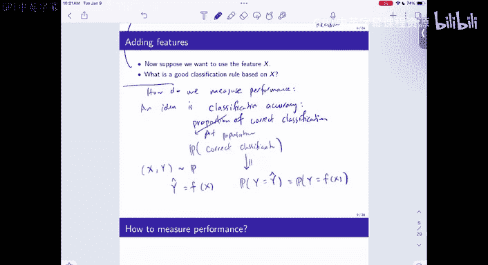

In machine learning， usually people look at the accuracy。

 but I'm going to look at the misclassification rate。😊，Rather than classification rate。Splication。

Great。Which is like one minus classification rate。Or one minus accuracy。So they' equivalent。

 so I'm going to look at。The probability of。Incorrect classification。Or misclassification。

Probably that。嗯。Y is not equal to y hat， or like probably the y is not equal to F。😔，Of X， okay？

So suppose I give you a particular F， how do I actually calculate this quantity？😊，Okay。

This is sort of equivalent once I have this， one minus this would be that。

That's for a reason that we'll see look at this。So suppose I give you。F majority， so let's say。嗯。

Suppose。F is F majority， give majority rule。So this was identically equal to。Zero for all X。

So what would be the。This， the probability that。Y not equal to FMRX？What would this be？

So this is going to be always zero simple， but probability that y is not equal to。0。So后。

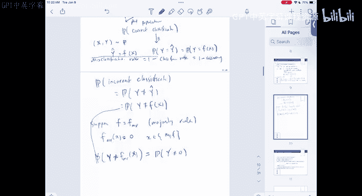

Do what， sorry。メスからすべけるもいいですか。Okay。The ones that survive， yes， so the probability， right。

 the probability that y is not equal to zero。😊。

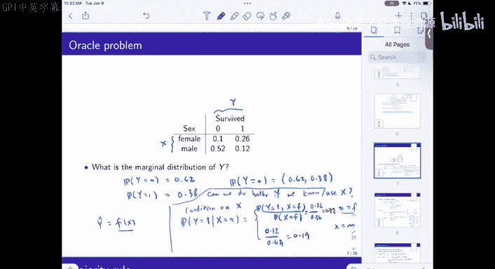

Is just the probability that y is equal to one。Right。

Takes two values and this is the probability of survival。

 which hopefully we have calculated somewhere。😊，So like 0。38 right sum the responding rows or cons。

 so this is going to be 0。38。Because you're deciding zero。

 so the ones that survive we make a mistake right， so it's sort of intuitivetued 38% of time we make a mistake。

😊，So probability is 0。38。😊，So that was easy sort of。So suppose now。What do I call this， okay。

 I think I call this F2。😔，To be。Let's call this F2。So that。Better classifier。

 suppose that F is equal to F2。So F2。If you recall。Is x is equal to n。Okay。The other way around F。

Survied。没有 that's survived。😔，嗯。Now how do we proceed in this case， the probability that？

Why not equal to？F two of x。So this is not so simple because this。Depends on X。

So how should I calculate this？Yes。这个。When x is equal to zero and when x is equal to sorry。

 can you say？If。Whatら0。Yes， that's this。So but how do I calculate this？啊对。

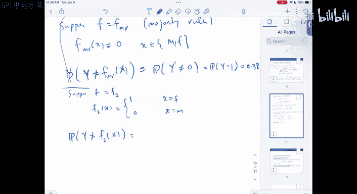

Oh， okay， so you want to do right， go and look at all the possible cases， is that？好。

Survive the southbust。Okay， so you're going to go。Can you say it again。

To all for females did not survive and survive。Okay， so the ones I mean， okay， that's clever。嗯。

X is female， X is male。This is one。This is zero， so when do we misclassify if x is female and it didn't survive？

Which has the probability， so this is going to be。The probability that。

That X Y pair is like x is female， Y did not survive or。X is。What male and this or， right？

And so that's like the event you want。嗯。In the language of probability。

 this is the or is like union union of these two events。Okay， so if this is like event A。

And this is event B or means like union。Okay and then they're just joined。

 so it's like probability of a plus probability of B。So there's a bit of like intuitive。

But probably like argument going on， so these two cases are destroying events that can't happen together so。

We have to make an error if this happens or this happens， which is the union。

 it's just the sum in this case because the intersection is zero， like empty the probability is zero。

 the probability of this is F0。😊，Point1。And then the other one is。What is that。0。12， right？ok。

So this was very clever， this is not how I intended to be done， but this is good。😊。

There are the different ways that calculate the following thank you， what was your name by the way？😊。

你。Ny， okay。Great。Sounds good， okay， so we calculated this 0。22。

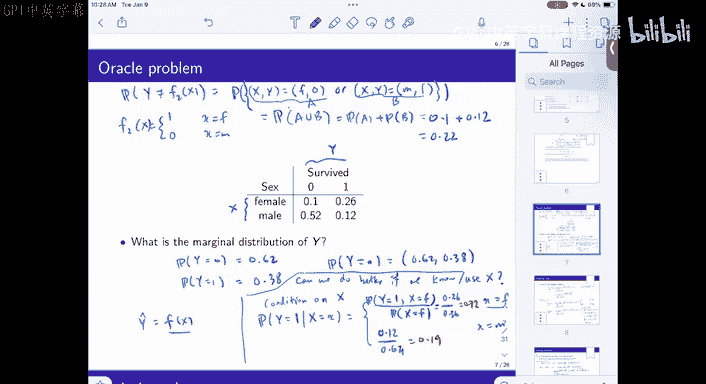

Any questions about this calculation？So this is where you get a little bit into probability， okay。

 so hopefully this argument makes sense， so this is an event。😊。

This can be written when I said it's enough to specify the joint distribution by giving these four numbers now I can like。

Calculate the probability of any possible events involving these two random values and this is one particular event by a specified classifier。

😊，What is the chance that I misclassify that's an event in terms of these two random variables and if I have the joint distribution which is enough to have these numbers then I can calculate all these probabilities and this is how I can do it one way of doing it。

😊，Okay。Questions。22。I'm going to stop here， safe。Any questions？There's 0。22 and there's 038。

So which one is better。If you run not。Reduce your。Clasification and error， then this is better。

If you want to do something else， maybe something else is better。

 so better is like a subject subject but it's like。😊，嗯。Depends， depends what you mean by better。

 so if your goal is to minimize miscalification error。

Then we calculated the misclassification error or the misclassification rate。😊。

Or equivalently accuracy， so the error here， the error rate or classification rate is higher。

 so this more non classifier is doing better， 20% of the time versus 38% of the time。😊，嘅。

So that's sort of the end of the like almost the end of the story here like so if you did a complete analysis。

So you picked up two guesses and then you evaluated them， okay？

And then you declared that this is good。Okay， and you can see there's like a significant sort of improvement。

So you reduce it by like a factor of two。Just including this covariion。So it's not like 0。

 38 versus 0。37 or 0。35？そ。Sounds great。There is another way of calculating this actually。

 any other idea of how to calculate this？😊，I can do a different thing。

Similar to the way I construct it。F2。Yes。Great， yes， that was what I intended。So。Use a joint。

Approach one。Use conditioning。Approach2。Condition on X。So can you walk me so what was your name？那是。

Nural natural， okay， can you walk me through how to condition so how do we conditioned？Given the X。

 it was。哎。Last就的。什关。Okay， so let me do this here。Equal to。Why not equal。Actually I can do this。好平。

Ace the same thing， but then I then change。Yeah， so there's something missing， right， probability of。

X is equal to F。Right。And then probably did that x is equal to M。This is if you recall。

 if this is going to be actually the joint probability。

 the probability that this holds and x is equal to F。

This probability of a given B times probability of B is probability given a in360。

So you're just praying is like。Just basic probability just recall。Probability of a， I want to do it。

 I'm going to do probability of a。Intersect B。Union be compliment。

Which is going to be probably the8th or 6。Union probably the haveA inter6 B complement。

Which is just that they're disjoined。Plus probability of a interect B complement。

 this would be probability of a given B。Divided by probability， sorry。Times， probably80th。B。

Because the definition is the other era， so this is this divided by that I can write this as that and so this would be this and the other one the councilman would be there right？

😊。

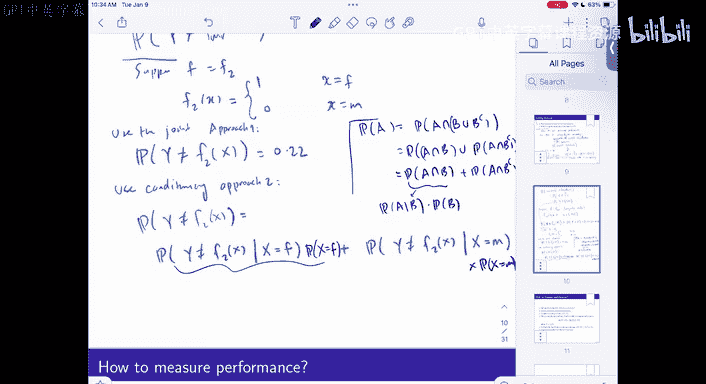

Okay以。Just a little bit of basic probability， well hopefully like once you do it a lot。

 this is sometimes called the law of total probability。😊。

You condition a random variable times the probability keyF。

There's sending some like all the possible outcomes。So now what is。

 I think we can calculate this from the table， right？And。

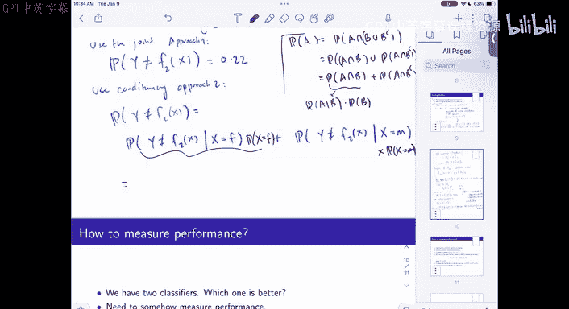

We did this before， I think somewhere here， x being F。

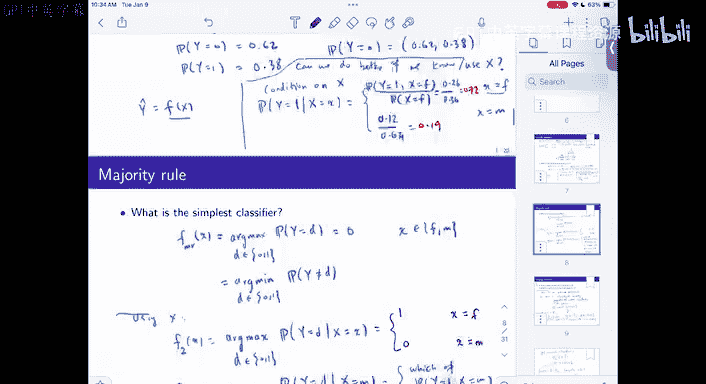

Is 0。36， the other one is。嗯。64， right？

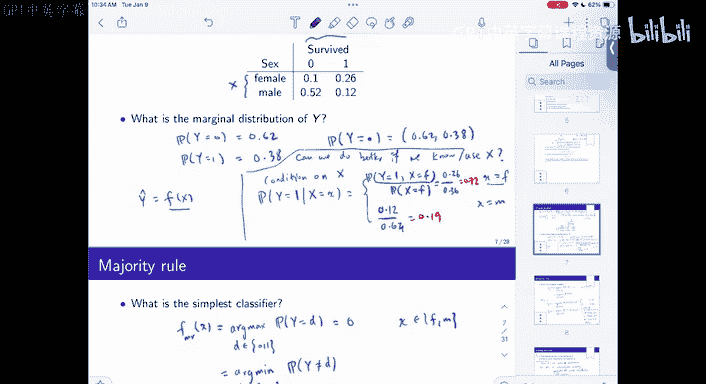

So。Point36， I believe。64。You're not。Yeah。So how do we calculate this？This piece。

Once I condition an F， what happens to this guy， sorry next？This is not known， right。

 because once I condition Xs， this is going to be like F2 of F。Okay。

 so this is really probability of y not equal to F2 of。If， which is in our case。嗯。

And then I can actually draw。W up this part because。Actually。I can't drop that。Sorry。

 so F2 of F is survive right so this is one。Right。So in this case。

 that's that's the idea of once you condition an X about the classifier is completely determined。

 then I can。😊，Do the conditioning and we actually evaluated the conditioning before。

 so this is probably the y is not equal to x， given x is equal to F。😊。

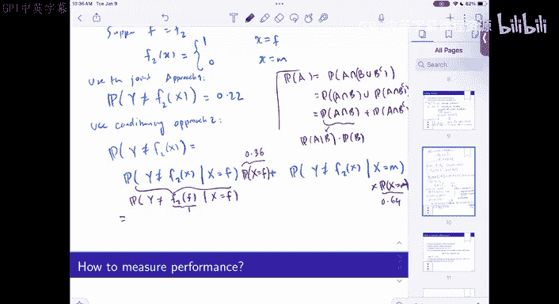

Times that probability of x is equal to F。So this is how we actually。Determine the rule。

 if you remember， so I chose specifically。Brex is equal to F I chose。嗯。

I chose the decision such that the probability of y is equal to one is maximize。any。

 so this is probability that y is equal to zero。😊，Y is equal to 0。And that is supposed to be 28。

So this whole thing is 0。28 if we calculate because the probability is equal to one is。嗯。

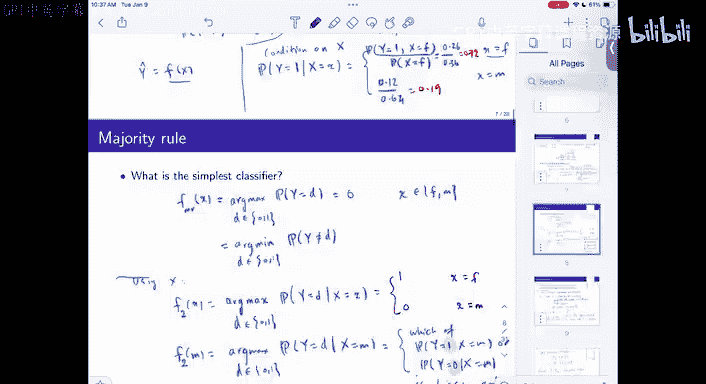

The probability that equals to one is point。72 it probably is equal to zero is0 it's not equal to1 is0 to any8。

 the other one is going to be the comp of this， right？😊，Which is going to be 81。Oh sorry， not anyone。

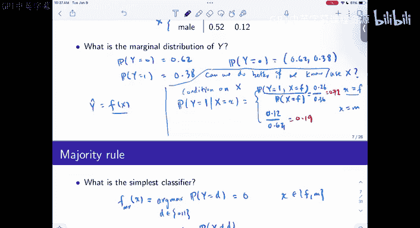

Our decision is， okay， that's problematic。There's going to 02 any8。

 this is going to be the probability。😊，That y is not equal to in this case， the decision is zero。

Okay。嗯。Times。Probably that x is equal to n。So this was 036， this is 064。

 this is the probability that y is not equal to0， which is the probability that y is equal to 1。

 that's actually what I calculated above， which is like 019。😊。

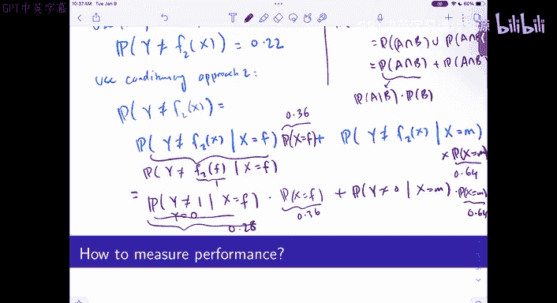

Okay， so this was the probability that y is equal equal to。

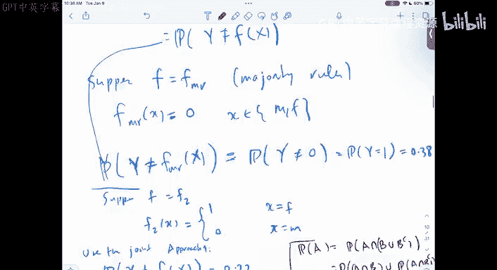

One given x' is equal term that's actually the probability of error because in this case we decided its zero because it was higher so this is really the probability of error in this case。

 so there's a conditional probability of error。😊。

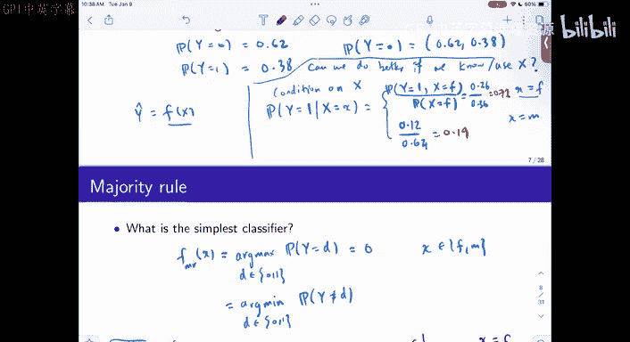

So that's what you get here and then if you hopefully multiply。😊。

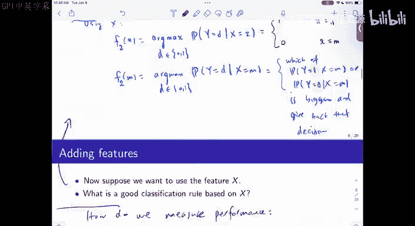

This turns out to be like 0220 and so it's not accurate because the other one is more accurate but it's almost the same answer right so it has to be the same answer。

😊，Up to round the earth。Okay， so this is another way of doing it。It should give you the same answer。

Prob the machinery sort of is consistent， okay？Sounds good， so you condition an x。

 once you condition an X， you know the classifier， what classifier does。😊。

And then then problem reduces the conditional probability of yges。Questions。So this has an advantage。

 this approach， which I want to like to discuss。We see the advantage。This one is。

To see the advantage。嗯。Anyone can guess what the advantage of this is？

This actually tells you how to find the best classifier。Right because if my goal is。To。Minimize this。

 let's say。Intuitively， we did。Condition and X， but the question is maybe something else is better so I have two classifier so far the second one is better maybe there's a third one that actually lowers the error more。

😊，So how do I know that if my？嗯。Metric is this。I'm going to search for all possible functions of a binary variable x。

And then pick the one that minimizes this， okay？And。I mean， one one way of doing it is。

How many possible functions are actually here？So I have a function F that maps x to y they take。

2 eyes。If I want to look at all possible classifiers in this case。

 how many functions do I have to look at？So far we have seen too， how many more there are。

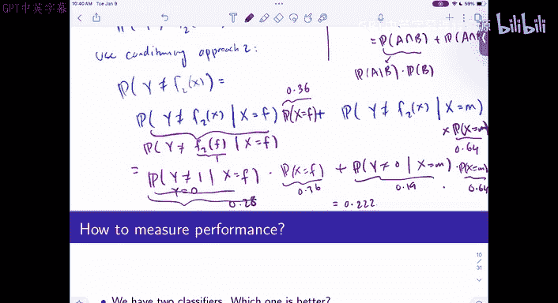

This is it with math， like you have to enumerate all the functions from。M and F to01。

How many possible functions？One is the constant function zero。There's an obvious one。

 which is the constant function one， always declare one。There's this guy。

And then there's a flip of this， which is like zero1， is there anything else？😊，So you think about it。

 there's nothing else， there's just four functions。Okay。

 the space of all possible classifiers in this case is four deterministic classifiers like。😊。

Randomized classifiers maybe don't care about that， like theteristic functions that map。😊，M and F2。

It's like two to the two。There are two options for the input。

 two options for the output is two to the two。If they are like。Tree here。

For here you can decide like it's either three to the four or four to the three I'll let you decide figure。

 okay， it's like exponential。😊，It's like blows up as a number of categories。

 but it's like two to the two， the total number functions。😊。

So one way to figure out if there's another better way is just to take compute the misclassalification error for all the possibilities。

 but we have two， I'm going to evaluate for the other two and see if the other two do any one of the other two do better。

😊，Right then I have the optimal classifier within the space of all functions I found the function that that's best。

 there is nothing that it's not possible to do more better。

 but this approach actually tells you how to find it without。😊。

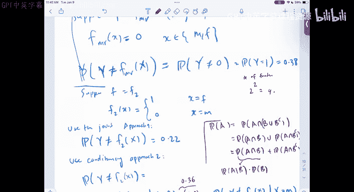

Doing that search okay the way it works is I start from this let's say f2 is unknown at this point。

 I don't know which one is like one of these four。😊，This step is true。

And these probabilities are not up to me， so they're determined by the joint distribution。

 but these conditional probabilities are up to me if I change F these are going to change。

And when I condition on x is equal to F。This is going to be a deterministic value and can take either zero or one and I can exactly determine which one I want by trying to minimize this okay the one decision that。

😊，Makes the smaller is the decision that's optimal for this。😊，So in this case。

 I'm going to set y not equal to zero， calculate the value y not equal to one， calculate the value。

 pick the one that's smaller。Right， the same goes here， so plug in in。For that one。

 set is equal to zero， set is equal to1， vectorta1 is smaller。😊，So if you think about this。

 this is exactly what this rule is doing， okay？😊，So the one that maximizes this。

It's equivalent to like minimizing。The probability of y is not equal B。

Because these are complement with each other and if you maximize this like minimizing。

 it's one minus there。😊，Right， so that little argument that I did there just shows that this is the optimal classifier。

😊。

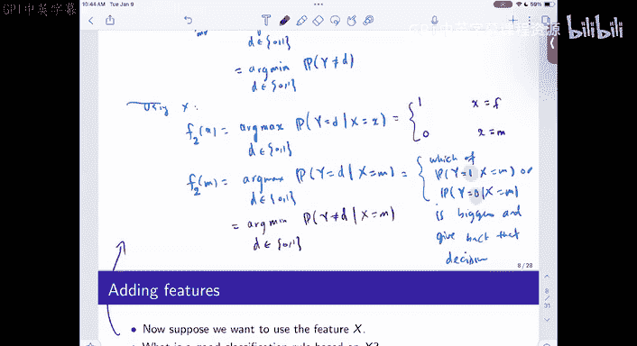

Okay， so by conditioning， there is this part。😊，Whi I。

Can't change and this part which is up to me I chose the best possible and minimize each of these terms this can't go further than that and so this gives you the general rule for the optimal classifier that's the general rule in this case and actually the same argument extends lay beyond this we get back to them and'm going to talk about it makes time but this is how you drive the optimal classifier so we proved that this classifier achieves the smallest possible error so in this problem with these two very like X and y。

😊。

You can't go beyond 0。22 no matter what you do。You can't beat this， this is like the best possible。

 sometimes called base error rate or like this is the optimal rate。😊。

This is the error that you pay because of the randomness and the distribution。😊。

So if you have infinite， so we have， you're assuming that at the population we have infinite sample size。

 basically。But he can't eat this， so this is then。This is sort of at the end of the story for this problem as far as as long as you have just x and y this is the end of the story。

 so how can I like improve this potentially by adding more features， let's say。😊，Any questions？

Okay I guess you're right on time so it's a good place to stop next time I'm going to come back and like formalize these a little bit more Okay thank you guys seamless。

😊。

