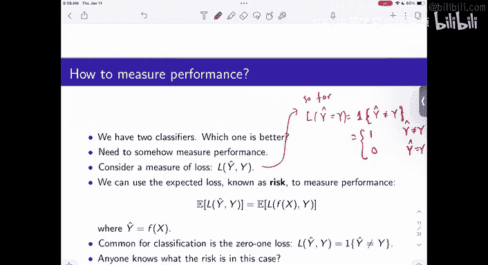

# UCLA《模式识别和机器学习｜Introduction to Pattern Recognition and ML Winter 2024》中英字幕 - P2：[02]Introduction to Pattern Recognition and ML -- Lecture 2 - Winter 2024.zh_en - GPT中英字幕课程资源 - BV167BfB8ETK

Okay， so let's start then last time we talked about。

And I started talking about for basicic prediction。And。So here we call。

We had this pythic data example。We嗯。嗯。😊，M。B out。So we did look at it。Try to predict。

I like the binary slides slide。十バ元即。So that was sort of the simplest classifier that you can imagine。

We talked about the probabilityistic framework work。So we model the teacher as x。

 the random variable and y the response or the target as y， another random variable。Their relation。

 there should be some relation between this， so we model this as a joint distribution。

And then we assume that we know this is drawing distribution first like as a first step。

 which is going to be。Or at least can be described by four numbers， so the probability is。

S is one of the levels and wises， one of the other laws。

 it gives you four combination then you have the probability of all the four。

Is that he can calculate。All the events in terms of these two random variables。走月。

I started off with the most basic classifier， which is the one that ignores all the features。

We call the majority rule， so if I don't see any features。I predict。

Why just based on the moral the of y。And it's easy to calculate from this， hopefully everyone。

Rememberers or like reviews， probability， so from this table， it's even distributional。嗯。Theyside。

 for example， because of the。With， the probability of knot are lining is higher。

So you always output not survive zero。And then he added the feature X here， and then intuitively。

 we already done。😊，Now we should look at the initial problems probably you have y so y。

 sorry y is1 or zero， given x is equal to x， because the response is binary。

 you just have to look at one of these probabilitybabil， the other one really one minuses。

So we looked at this probability Y it would be1 dimension minutes and the of the x。And they think。

 maybe you can calculate this？Conditional probability and it turns out that if x is female。

 the conditional probability of survival is like 0。72 if their male is 0。19。And again intuitively。

 so when they're female you're going to predict that they're going to survive because the probability of survival is higher。

😊，And if theyre male all critic that they're not going to surviveice because they probably will not surviving is。

The name probably is available probably answer the opposite。So this gave us this。

That's to classifier and we saw that you can think of this as the。R max of this quantity。

 the probability of y equals d given x is equal to x as d varies in all the decisions and decisions here are like the set of decisions is。

Zero one。So we have just two decisions。But you can also imagine if you could have multiple decisions the same idea actually applies there。

 but that's this focus on the binary case。So I hope this presentation is clear。A math。

Like the mathematical to use to say that we choose the decision， which has the。Gives us the maximal。

Conditional probability here why being includedd at this genuine vinegar。嗯。

Alternative data can minimized probability is why not opposed to the decision but in this case。

Why even general this is the case and why is not in me。

And they probably why not equal to be in one nice probably not wire。So minimize。This probability。

And the decision that minimizes it is just the optimal but dis classifier。😊。

And within we discuss how to。Evaluate the classifier。😊，And a natural measure is accuracy。

Which is saying if I pick verendum。Pair features and the target from the probability so usually what is the chance that prediction which is what I have this size square f？

5 x。My greatest people forth away that the probably。Correct。

 classification sometimes you refer to as accuracy is a good measure equivalently you can look at one minus。

😊，The accuracy， which is misclassification risk or the error rate。

And then he calculated this for the majority rule。😊，Which turned out to be simple Woody 。

38 and for the。Other rule， using two approaches， I think one was using joint the may against yes。

 so that was very significant。The conditional one， someone else mentioned the the。Okay。

 so what's your name again， natural natural， Okay， so I'm going to learn your names but but like more like it's like I'm training that way who there is not。

So going works to get more samples， so natural proposed to do the other areass like condition or cogni of tanks and they。

Interesting in the sense that it also reveals。What the optimal fifier should be。Okay。

 so we condition an x we condition an x with the the probability。诶。And。

The reason why it's useful is because once I condition an X， the decision is completely determined。

 so let's say mentioned an X。For not being he know whatever you fact by you doing。

 this is going to be either zero or what。As on the side of which he trade goes。

And so this is the deterranistic and this would be the condition how of y not equal to something given an x which can calculate from the joint。

Does anyone remember why this is useful to me？诶。Yes， or like are you like the optimal to work as far。

啊对。Get from this kind of expansion to the optimal classifier。The this is like you go out in。不。嗯。

Anyone remember it how we argued？What an optimal taskifier should be。Anymin in the expression？

exactlySo you want to minimize that picking the F2 of F that minimizes that probability。Right， okay。

 so we have these like just say two pairs。And。So the thing to notice is that these mean part that are changes this。

 these are not up to us and these two terms the conditional ones are sort of independent in each other because this depends on what value you to for F of F this depend on what value you to for F2 ofM。

And so。And。I can deal with these separately and then for this one I'm just going to pick the value for F2。

对。😊，百 application呗这姑年。The value of F2 P now is either one or0。

 I'm going to choose whatever one that minimizes this one。Okay。

 then I'm assured that this is small as possible and I'm going to do it for this as well going to be male which has nothing to do it to a female so I can do it separately for each for each time we minimize the。

And if you argue it this way， think about it， it gives you in general， what you should do is。

Who exactly this。So。For big， you're going to go。诶。Maximize or minimize basically。

 but only of why and not be to read。Okay， so the optimal rule would be。嗯。What we up one rule。嗯。

The above。Shows。That's the optimal rule。Or like optimal classification rule。Or classifier。

Is the one that。Let's call it a star。And minimizes。The probability then y is not equal to D。

 given x is equal to x。For any。Possible decision so given x is equal to x I'm going to look at the probability that y is not equal to D。

D is just a dummy variable。Sts for decision， let's see。

That would be like the value of basically this stands for the value of。Ffa。Thanks。Okay。

All right Starex。So it's the only variable and we shape all possible choices and then the one that minimizes has make a decision for that2。

Okay。Sounds good。So if you understand this， the same argument applies even if x was continuous as more complicated。

Because that law of。Total probabilitybil so。What if？X was continuous。Slash like more complicated。

So let's say it's continuous has a density。As density。Yes。What happens is that I can still condition。

So probability the y not equal to f of x， this is the error that I want to minimize。

 I can write it as integral。P y not equal to f of level x。Condition on x is equal to x。And then what？

Thanks。And thanks key team， this is the。Density right， so the density。

 this is like the probability like this part is like the probability。That。

R manual x takes value near little x， so this is just a weighted average。

 so in the discrete cases would be like。😊，continuous case。Okay。This would be just。啊。Yeah， X。

 this would be PMmF， probably Ts function。Here this would be density， probability density function。

So continuous case。Disreet case。Same thing probability。Yes。This is this。

So this one is exactly what we had before。嗯。So this is the PMf basically R these2。

 so if you're summing over all possible values the probability bit。嗯。Yeah。This thing is。

ProWe can mass function the probability that as x is equal to rule x。So this is the discrete case。

 you know， this is a continuous burden and is very similar this a belief the celebrate that they they grow and then theses。

😊，啊都要。The probability that you observe at x basically in the continuous case。

You probably know that's probably overserv immunityity， particular value zero。

But that's where the density， like then the math comes in， probability of being very close to X。AndP。

 V， and then so it's integrated。Is that？Bring your bell。

So this formula is both of them are like laws of total probability。嗯。Laugh as a parties。

If you look at the notes， I actually write it in a way that covers boths if you know measure here you can write an integral。

With the general measure。Maybe you can't do that at some point。

 but you know we have to worry about that。So this formula， for example。It's。

Each territory is off to us， so this part is up to us。

This other part is not up to us so I can't control this I can control the yellow part and for the yellow part I can like pointwise minimize it for every x again I'm going to choose F x that minimizes this so then if you think about this is just it can give you this exactly。

Okay， the exact rule applies in this case， so there's this argument that we did。😊。

Cre usess the structure， the optimal rule or sometimes bees rule。In the very general aesthetic。

Does that sort of make sense？Yeah。So if it doesn't make sense， just go back to this argument。

Here we just have two cases。呃。Here we just have infinitely many cases。

 but we deal with each like one separate so what I should choose for this particular x。😊，嗯。

The decision to minimize those things but evidence the same thing or another it's the same thing。

And so you deal with them separately and then。It's easy to argue that this should minimize the probability error because we are minimizing every possible character want take every possible term this sun。

对对。Okay。长这个。P sense。Comments。I we ask questions but before before we move on so this might be a little bit abstract but hopefully you understand where this comes from so this is what i'm going to focus on for a lot。

😊，The only thing that you need to be able to calculate this is this conditional probability。

If we assumed we know because we know the joint， then it's easy to calculate this。

So our job will be to actually approximate it or estimate it in practice。But before we move on。

 I just want to point out that。The notion of how good a classifier is is， as I mentioned。

 is sort of subjective。嗯。If you want to optimize your accuracy。U。You can specific gain rate。

 this is what you get， but you can change your measure of。Performance。Okay。

 so you can do something with more general， for example。I can define a general loss。So。嗯。

I can have a general function。It tells me how much I lose。If why is the true？

Label and what I had is my prediction。Okay， so the one that we've seen so far that leads to accuracy is actually called the zero1 loss。

😊，So far。We looked at this loss， I'm going to write it as indicator。Y had not equal to Y。

So it's like one。嗯。And then。Bces and in the braces y had equal to one。

 so this means whenever this condition holds y had not equal to one。

 this is one and otherwise which means if y is equal to。Y hat is equal to y。It's your。Okay。

 so you don't pay any price if you correctly is specified。The label， but you pay price of one。

 if you don't。So if you pick this loss。Then。嗯。What do you think I can like？

Can anyone tell me what the。嗯。The accuracy or like the misclassification error would be in terms of this loss。

 how can I write？Yes， the one that we saw previously， yes。This one。

So this is like probability of y not equal to y hat。Can I write it in terms of this loss？

Law of total probability sorry， law of total probability， which would be。In this case。

 what would it be？Well， also a probably。There's already a probability so you want to condition and so usually like with love photo probability if you condition。

And something。You can say， okay， so the thing that I wanted to like do is like。😊，嗯。

And maybe you can like。Elaborate。So how do you like， let's say I have like LF。

Why and why hat is equal to。Why not equal to Y hat， How can I write this？In terms of this guy。

Sleep expectation okay， yes， okay， that was what I was looking for so if you think about this。

This guy is another random variable because they're both random values and y might have random variables so this is another binary random value and so it's either one or zero and expectation of this random variable would be。

😊，What， so expectation of。L of Y and hatth。Is。So it's a binary value。

 so how faculty get the digital binary value？One times the probability y y right， Okay。

 so one times the probability that this guy is equal to， let's say I did like this is equal to one。

Which is， which is just y not equal to Y hat plus。Zero， right。

 times the probability that LYY hat is equal to zero。😊，喂。It is just y is equal to Y hat。

But this part is zero， definitely。So you get that the expectation of this loss is really to probability few there。

And generally the expectation of indicator they valuable is the probability that takes value one。嗯。

So。Our measure。Thank you， Miss mis classificationification we can is the expected value of this01 lives。

😊，Okay， so the terminology loss is what。Like peers in statistics or decision theory or like theoreticalethical machine learning。

 you pick a measure of loss and then you look at the expectation。😊，After loss。

 which is sometimes called risk。And then your major hormone impairment would be this risk。

Michigan Ra as yellow Fx and what？Because why hat is this so this is this is going to be our measure so this is a bit more general now I can change L and I get a different measure。

😊，Okay。

And then it does zero one last。I get the misclassification rate that we have。Okay。

 but this is that is more general。Does that make sense to people？So how this how you can generalize？

Like the zero1 loss you can think of it as because these are binary losses。

So I have either why here and why hat。It's like01，01， I have to specify what values。

Like what costs or what losses I assign if I'm correct that these are going to be zero and these are going to be one so when they mismatch results so this is this。

😊，Okay， compact version of writing day。01 loss， but I mean， in practice there's。But then。

 usually you don't want to assign losses， you can assign losses if you make correct decisions。

 that's also possible you can make these non zero， but usually you don't do that。See these are zero。

 but they can have different costs here so this guy can be like zero one。😊，Let I say cost one。

 cost two， two different numbers here。like if they're the same， it's be them as sort of do this。

 but if they're different I assign asymmetric losses to。The kind of error that I have so for example。

 in this case。I could have。Let's see。0int one here，09 here。

 or they don' have to sum to one or so let's say this is seven， this is three。对。啊。

Whats not it's saying that。If the true neighbor was Le and I credit it is why。

 they could probably seven， if the true labor would one。We zero pay price of three。

 so it's less costly to。Make a mistake on her right。The right decision and and the right decision。嗯。

Okay。对嗯。I made it so it's more costly to the symptoms that fall alarm。

 so if there's nothing there zero usually condition none so let's say we trying to predict the disease like cancer。

Yeah。There's no cancer and I declare that if there is cancer and there's a significant cost。

 they have to go through chemotherapy like the entire life is going to be like。嗯。Okayllpen。

 but if they have it。诶。there is cost to it， but if they have then I don't maybe like subsequently there are some other tests are going to pick it up okay。

嗯。嗯。二枚もてちす。Because in some other situation might be different， okay。Sos in practice usually。

The cost of this classificationification of zero versus one is not the same。

 so this is cost sensitive learning if you incorporate this cost。Then you can say， okay。

 now what is my optimal classifier？And。Then you have to redo there。嗯。NoAguments。

And it turns out that nothing really changes except when I'm going to replace this with。

They're going to replace this guy。With the expectation。LY and。F of x。啊啲系诶诶。I usually put my hat here。

 so let's do。It's going to be。L F of x y doesn't matter which way you write it but be consistent so this is this is that in general and then the same integral like the same decomposition applies so law of I think they this time they call it law of total expectation if you want to expect it。

L of FOX。And why。Even x is equal to x。Okay， and this is still holds and then I'm going to minimize this slide。

But I'm going to try to minimize that quantity。That's like the conditional cost。

So the optimal classifier turns out to be。Classifier。Thereurns out to be the one。That minimizes。

Dis conditional。Ha sometimes referred to as。Asteror。Risk because it's expectation。吃饭。You。嗯。嗯。

So I'm going to do like LF replaces with a decision。And Y， given that x is equal to x。

N then D in0 to one。The conditioning of。This is replace place order for YA or MLX so it's true the decision that minimizes this cost and this cost we can be calculated。

And this is the exact same procedure that we did。Here。

 so here you replace this with a D and choose the lamb。Minimize us here I'm replacing this with a D。

And so if you follow this argument it's exactly the same way say exact argument for you that not passport in general state the minimizes the possibility to risk。

And this one you can calculate， you the area just random this y conditional。

 so if you know the conditional distribution y given x。嗯。You plug in decision zero。

 you calculate this， you plug in decision one， you calculate this。

 and whichever pro cost is the minimum it gives you D。decisioncision that you have to make okay？

And this is an exercise for you in the book that and the director notes that I'm going to assign and you end up showing that。

With a minimal change to what we had before。We get。We we can do this as well。

 so if you go through this for the binary case， it's very simple。And like hopefully a good exercise。

But that's how you calculateal in general。Opttimal classifiedifier。Okay， sort of clear。

It's a little abstract， right。Nothing very do好。It's just like this is not variable。

It takes the variance like in y equal to zero。So it takes expectation and this little business and throwing way of the consumer。

L D and0 and L D and1 and it takes them the probability y equal to one given x and y equal to zero given x so you plug in y fix D。

 you plug in y equals zero。It gives you LVF。Zero ties the probability that y is zero given x plus。

LD one。That is probability that y is equal to y given x。And then you manipulate the。

 try to see which one of them is smaller， it can do it abstractly and if something interesting comes out。

Okay， so this is just an aside that you can do it more generally for now we're going to focus on。

The misclassification rates， okay？嗯。So。Cos sensitive。And just one little。

Hitbit is that this concept learning usually comes up alongside another concept which is imbalance in classes。

 so usually the two classes are imbalance in the sense that。嗯。

The fraction of people that have conditioned y equals zero is very different than the people that have condition y y equal one so for example in our case。

They're probably a survival， if you can see right。Prob not so value is higher， they're not like 50。

50。And in practice， usually。嗯。In many interesting examples likes say cancer example。

 like the majority of people don't have cancer， they're any tiny fraction that have so this would be very very small。

 this would be very large so you're doing the extreme imbal as a patient with the practices and there' are going to be problems。

And one way people deal with this is they revaate the error to account for that。

 so they train classifiers to treat the errors different。诶Because you only have诶。

Great few examples here。But I'm not going to go into that。Apoint practical interest。

This guy comes in with like class in balance。It's not necessarily the best way to deal with this。

 and I would say is that conceptual enough。Related necessarily， but that's how people do it well。

Okay， questions。Okay， let's go back。To。The original problem。What was the original problem。

 the original problem was that。We just had this table。Right。In practice。

 you're not going to be given。诶。Joint crawl distributionion so you can't do any of these calculations。

So how do you actually do this in practice？That's the next step。I'm giving you this data。

 how do I go and。Find something like like try to approximate。That optimal class5 W。Drive。

I don't have this。No one gives me this。I think give us this guy。ok冇。With all the data。Yes。

 you can use proportion as an estimator of the product great yes。

 so that's the simplest the most natural thing to do is that use proportions to actually like recover this table。

Or an estimate at this table。In fact， what they did is actually drove this table out of those proportions so there is an like population level。

But I can approximate it by the fact that there's this frequent。

Interpretational probability so what is this probability。

 the probability that X is female and they survive in practice it's close to how many in the that the sample。

 how many females actually survive。Okay， so the proportion of all the。Look at all the samples here。

 for example we have。Let's say 982。And your look cat， for example。And。All the pairs that。

Hows me to thrive， survive in their kingdom。嗯。When though with give you。Before P。

 we count how many of those cases are divided by the total number。

That gives you an SW right how many or male and did not survive here you have a lot by one， two， one。

 two， three， four， five。So let's say my data was just this one， two， three， four，5， six，7，8，9。

 I have1s， let's say that's the most I have。To base on this。What would be our estimate at the table？

So it's Mike。呃。你没有没有。0ero，1。So how do I do that so female？And。Survivveed with the。

Point one like one or10。Right。Female， oh sorry， this is some way。So one one over 10。

 female and not so live。It's also one of right。That true。Actually， more。Nail and not survive。1。Okay1。

 two， one。喂。哎， so be。And。Six over 10 and then mail and survive。Just one right， oh that two， no， two。

 two over。Right。So， that's our table。Is that correct？It sum to10， so like0101。int6。2。Okay。

 once I have this estimate then all the machinery works， now I can compute conditional probabilities。

 I can compute the optimal classifier that would be all an estimate。😊。

But everything works and I have it my classifier。Right。So the steps to go from like knowing。

 not knowing to knowing is this calculation。诶。And you can see that this is not necessarily that。

House。It's very interesting。This is what I have。Say compared。喂。There' are some discrepancies。

This actually calculated based on being very paper。Go housingous。Yeah。It's not that accurate。

 but it's not too far off。So there is some error。They are of the sampling。

 so you just use 10 samples。嗯。But it would be interesting if you。For example。

 you can go and calculate the。Sort of optimal rule in that case it would be called pluginin rule because we plugged in。

These estimated probabilities。And then you can calculate like it may end up being the exact optimal rule here because of the errors。

 like there are a lot of errors like maybe。😊，They don't change so I don't have to have to suddenly we hear this anything about 05。

We give me the same decision， anything you0。5 here would give me the same excuse。

 although I make a lot of errors。An estimation as long as they don't change。

Theres boundary basically and I'm going to be I enable go to like actually。

Weconstruct the optimal classifier just by1 sample。

So let me encourage you to go through the calculation and see if it's going to change or not。

So there is a certain on robustness。To through the classification education。And。诶。

You may not need very data， but in any case， as you get more and more data。

 if I compute it based on this entire table like 0。9。

Like 992 I think this is a training sample that's going to get very close to this at some point it's going to it's not going to matter you have more data your classification is not going to change。

Sounds great。These are tricky issues， though， by the way。

 but if you understand it if you go through this。It gives you a lot of insight how many data you actually need to compute this classifier。

It might turn out that you don't need the entire table， just maybe 20。30 sample ist it。

If you only care about。Thanks and so why。Okay。😊，Thatund was great。So then we did the classification。

 we just did machine learning and。The rest is like basically tweaks on this idea。嗯。So。😊。

The first thing that I want to do there no question。

Is to write it a little more formally so what we did by calculating the portions I want to use math to write it down a little more precisely the same idea。

 so you go and count how many combinations of different lines you observe。😊。

So for each combination we record how many observeds divided total number so this we can use indicators to represent so。

This is the idea of optimal classifier I'm going to come back maybe through this so that's that's this so in supervised learning。

😊，You actually， have access to training data， so you observe I the sample from the key to each compare。

Is an independent draw from key， you can think of it as one row of that table。

And then by the law of large numbers， so this is。This is the patient that they have here heard this。

Expression is basically what we just did。So indicator Y I equal little y and X equal little x。

 so I fixed little x and little y， so let's say this is。females。So why？

And then count so this this is count so this is going to be like if if the eye sample is survived and is female this is going to be one otherwise it's going to be zero so this is that indicator notation and so this counts。

😊，How many of my sampleshole are？嗯。Match this criteria。Okay。

 so that indicator just selects like there's one when the condition holds zero， otherwise。

 so you count and then divide by n。That would be mind。Estimate。

U there so Ill be and Im maybe put in the key hat here so the note there Okay， so the key hat of。😊。

A generic y from the population is equal to y x is equal to x。

 so that's the joint estimate of the joint。And an estimate that the marginal would be similar。

 so the marginal of x is what fraction？😊，Of exc size。iss equal to。

L X by hand you can also get this by marginalizing out this so you can sum overall ys here。

And this gives you the same thing。Because this is a talker probably usual。

Is the marginal and then divide。The joint by the margin， I get this conditional probability。Okay。

 and then one over n， you can't see the one over ends go away， you just decide the counts。

And this is also what you do in practice what this is doing is I'm going to go look at for example。

 if I'm going to compute the conditional probability I'm going to look at all the samples that have x no equal to I ignore everything else。

That's the total number of those samples and within those they're just going to count how many I have this as well。

Again， it's just。So if you do it， for example， in R or I panda as you group by。X。

 and then you like take the average within that group。啊，这 is kind的。这个按定入。

Of the response select like proportion。Haveviants of wise。We give you a proportion。

Within each group so that's the conditional probability and then the optimal rule is going a very x check this and y here y equal plus0 y01 and minimizes right this it maximize maximizes it that would be here。

So I can estimate with a base Archs of this or。Argued man。He had。Why not equal。

The why I'm calling it plug in because we plug in the estimate。

 so this was the rule to here that plug in my estimate just calculated。

So it's a plug estimate or like。Com made it Israel，And。

And then you can do the calculations for yourself。Maybe i'm not going to repeat that it's just that for the data you can do。

嗯。So our table was like this， you can actually go and calculate point one point to one。Point6 point。

To my guess。And so this would be like so if。For example， this was。Y equals 1。

 given that x is equal to I don't know male。This would be。嗯。Yeah。

 the counts wouldn I' here we have the counts， which would be like one。One，6， two， this is counts。

This is proportions。So this is I'm counting how many are。保's样。I think this was。Not survived。

 this is survived。嗯。啊 no female。你没有咩有。This is。Not survived， survived。So this would be。One。

 this would be oh sorry， this would be two divided by 10。All。

 so this movie it is the total number is 10， oh sorry， the total number is eight。Two divided by it。

 two out of eight。Their eight meals， two out of them are this is going to be 0。

2425 and so they still decide。Because P had y equal to one， given then x equal to and was 025。

The other decision which going equal to 0 given x equal to enemiess 。75。

 it decided to 0 to the third survive。actually for the male， for the female it's very interesting。

 I remember now。So what happens for the female case， thank you？Probably that they survived。

This was a good example actually now the there。The decision would be。Beecside。0。In this case。

 it would be。Sorry。50 at one over two， so there's just one that's out of two， so it's going to be 0。

5。Which means that the probability that did not survive all would happen here。What should they do？

This is a great example of another exercise that you're going to do so what happens if this probably is 50% if it's like below 50% or about 50%。

😊，You're good。And this is R like。If we gathered more data， this will't happen。

But as it turns out in this case is happened and so this is a corn case。

Sometimes referred to as the decision boundary， so we hit the decision boundary and I'll let you decide like later think about。

What should you do this in this case？没有。Side。喂。Exerci。In any case。

 the idea is that hopefully you have enough data， maybe you don't runthuss you can in like 0。

58 or something and then you decide one and then you have your classifier。Okay。Sounds good。

I'm going to come back to this formula later and then try to massage it into something。嗯。

Gradually more interesting。I sense。Comments。Is this clear？So you know。

 I can do binary classification using a binary feature。Right。So I want to introduce a couple of nots。

 so this is for the end story for this problem。But I want to introduce the implementation ofs later。

One is that we will give this guy a name， so this is for the actual。

So this is another problem if at this probability that y is equal to one given x。

Thereurs out to be important。As you can see。Where I can write it as this。

 I'm going to give you a name， I'm writing it as Ata。

You can write it like that given x is equal to little x。

 so this would be a function of x if I plug into random x is need。😊，Edirect x。

 so this is the same as it is literally compact， so this function in probability y is equal to one given x is a function of x only。

And like so thisian would call it the regression function。

Why they would call it regression function because it turns out as you show。

 it's also very simple because。Or you get something like that but just is also the expectation of why I can next。

An expectation of why given Exodus 76 is the regret life。So in binary classification。

A deigation function would be just the probability of y is equal to one given x and if I have that I also have the like1 minus a of x is the probability that y is equal to0 given x so I have all the information I need to calculate the optimal rule so the optimal rule then you can actually show you might already have it。

' seeing it， but it's formal， it can show that you can be them forget。啊。

If the a on eggs is bigger than what happens？I decide one。

 if if it's less than one half I decides you， this is the optimal thing to do so once you're estimate。

With regression by1 in of your Ocommo rule， you plug in the red by like a beta half。啊。Okay。

So estimate。Aint a hat。X is equal to like P hat， that's the。From those。诶。

Like proportion calculations and then plug it in there。In class。

 the Apple has Apple plus by class twice based on the value of the regression function and the decision boundary is very very different times equal to what。

There's a space of x， there's a set。Sci by this a of x is1 half sometimes this might not be there。

 but if it's there， this is called a de boundary and then you're going to think about what you should do so I'm not specify what you should do at that case。

But decide needs to be done and the way to think about it is we are minimizing the probability of error。

嗯。So does it matter if。I choose one or the other， or if I want to minimize， what should I do？

So that's what we want。So what should develop be。To minimize the error。嗯。You have。没你mo。

Orbeian error or like this classification rate。minimal你冇。Mes， waits。Okay。

So this regression function going to come up frequently later。In this case。

 it's just going to be very x I'm going to give you like a probability and the problems that we looked at the two values of x so this would be be me。

嗯。5。72 and 19 something like that。But in general it would be a proper function if an x is continuous。

 this would be a function， continuous function， more or less。ok。

So regressionion function in this CC2。All the information you need to calculate the optimal will classifier。

And up on classifier just thresholds this， this is like a threshold threshold ir regression functioning。

That's the deal。Questions。我们。Okay， one more just。Comment is this is for example。

 how you can do it in R， as I mentioned， if you group by the teacher and I take a meaning of survival in that group。

This also kind ofates how many there are， so this needs you look people。If you don't know the empire。

 it's fine just。反正对。Very easy to calculate these proportions in R or by R。诶电时你佢哋所讲呢啲系电视。呃， the高的的。

I is。Taking these two values and then this can be summarized。

This is again an output in R the package I think R so the output can be summarized like this。

You the没睡。What I have。But the root is what happens if I don't use the features that's the majority rule classified 100% of the samples are at the root and then this 38 is saying 38% are。

Have survive is the probability of survival。Esimate the probability and this is the decision because the probability of survival is less than。

 so this is really me。Eta Alex， which is the probability of。Y equal one given x here， there is no x。

 so it's just。And。Here should say this is really this。Here is just the probability。A y equal to one。

Estimate。theer all probabilitybilities of survival， a Li as effective label one。

And so here you decide zero the decision， and that's why happened。嗯。你给我爱。Or in this case。

 there's no x。So at the root， you decide like this now if I add one feature。

Since then the decision displays depending on whether're male or female when we are male。

 like this is saying 64% of the population lands here， this is again。E ahead of。没有。

Which is like the probability of y equal one given x is equal to male。

And this is eight ahead of female。嗯。Right these are the things that we calculated after the miracle hair that we added at 0。

72。19 and so 0。72 is bigger than than1 that so we decide one。Yeah。And here we decide zero。ok。

So this is an example， a very simple decision they call it decision trees。😊，U。And。

It's one of the big most basic classifiers that you can imagine。嗯。

And then as we gather more features， this can be more complicated so then for example I have another feature here and then let just split more based on that feature。

Yeah， it just like more than their whole feelings。And then every data point that you want to classify you to go and follow it so it's here and make it the place which is like now you land here because I to make sure you' land there and so on。

And then at the end， you decide at each point it tells you what your decision should be。

It's a very nice way of summarizing。This type of classifiers and it generalizes more。

 we might not have time to talk about that most likely。But even if your features are continuous。

 what you can always do is like disretex so if I have like age I can say okay， I'm going to look at。

😊，Everyone that's above 20， everyone that's below20。

 okay that gives me a binary feature now I can classify using this。So where should I cut off。

 then you can also like try to optimize that。诶。Like2 any might not be the best。

 so I'm going to marry that and choose that， how do I choose it based on the loss that we have to probably give there。

So you have the probability of error， you try to estimate the probability of error as you vary that threshold。

And then decide the threshold and which feature actually you want to be but what you doing practice they doing by agree agree pick one of the features and then choose the threshold。

You get this plant for that feature choose another feature do it and see which one does better。

And then pick the feature that does better first and then repeat。Maybe we'll talk about that later。

 but the basic idea is very simple once you understand this。

 they're trying to approximate this for for the like binary animals there's no threshold going on it's perfect。

😊，So you say the first classifiers that you should learn are majority classifiers。

 majority of classifiers and decision trees okay。😊，Or c mを 갑자기 to getて excess sense。

But this basically summarizes these conditional properties as you go along。

An example of decision tree。A decision tree。Immerize us。Additionalal probabilities。

And decisions as you go along。Epeially useful when you deal with categorical variables。😊，Questions。

 comments。好贵。Okay， now a glimpse of local averaging so this is another exercise that may assign it so you've seen the regression function you've seen this。

It's the regression function。And。This is this， we did this calculation。The indicator。

I'm going to read it the other way around X I equal to x， y I equal to y call y， the by， bye。

Iphone 1 to end。N is equal to next， so I wrote it like this。😊，U，But in the binary case。

 you can show the thing you just as well rewrite this part as as this because why only takes value。

 okay， so yeah， so this is。This is for a general why。So if I says y equal to one。

 this is going to be one。Yhy I equal to one is really Y I。

And then we think a little bit about it and just write it about that。Its like a very easy exercise。

 so re writeite it like that and then I can。😊，What they can do。嗯。Is。This thing is like a constant。

 they can bring it inside。U。And I don't want to do it for you， so an exercise， very simple exercise。

 you can rewrite this。InIn this format， so there is one of the asation。嗯。

And there are these weights here。If you specify just this goes to this。

 that depends only on x and then save yI。😊，So what this is saying is this for E。Of their mainson。

I had some wayss， how I made。The training data YI， and that gives me my cr for this quality。

But I might estimate probably so different Xs would just different different y。

 different ys differently。And as we see， this is kind like a similarity image。

 how similar this particular。X is to the X I and y。嗯。Tn that， just if I want to say it。

 it's just that that's the weight。U。Let's bring it in so like this just measures how much x is similar to the x of the I sample and it is very similar and then I'm going to include that Y I if it iss not too similar and really downd。

So this calculation that me is really a greater averaging estimator and it's a local averaging because。

😊，It just depends on the particular x the v landscape and not just averaging on the one for different x may the training data different。

And we begin this we'll come back to the same thing once you do this。

 this is really measuring this sort similarity in this case the exact similarity if my x little x is actually equal to that particular X I includes。

喂呀也可知道啊。I would not include it well once you view a like and you can generalize。

 you can make relaxed to same exact approximate and also the interesting。Come out of it。Okay。

Sounds good。Just do this exercise for yourself it's very simple but very useful we'll come back to this formula。

😊，嗯。Basically， if you replace this with something else you get a different yes。

 I just clarify if I understand what you're saying with the x is as translated to weights here so so you have a binary x yes and the weight would either be one over the number of。

yes actually equal that value or is your yes so you'd weigh all like relevant activities equally。

In this part can you just do right， yeah， so let's say。You fix up。Yeah， we face little x， right。

 all the X Is in them that have the same x。We'll have the same name one over what over。

So basically this in this particular I gives you this average。好的。The usual average。

 all the Y I from this X is inly。But you can do more mistakes later you later。Yeah。

 but that's exactly what happens so you go。In your data， let's say I give you mail。

 you go look at all the males， you just average the YI that's what we did actually that gives you the conventional probability。

If you have actually more levels that's exactly what you do again so you have like multiple the feature has multiple we're going to do that in a few seconds。

 but let's say you have four levels you go from each level。If it's like I want to predict。

 for example。嗯。Based on the P class that a class one。

 two a three if I measure a class two I want to predict class two。

 I'm going to look at everyone that has class two and hours while。If Im going to个。

Prettyically class three I'm going to look at all the ones that have class three and our of Y eyes so everyone like yeah。

 everyone gets the same way in this screen。嗯。But the general form is more interesting。

So later when x is continuous， there's no exact correspondent。

 so it's not like I'm going to find exactly the same x in my data so then I have to decide who I should average or and then need to find a similarity matter。

 the people that are close in x on the average。And that needs to be like in your neighbors。

 like other estimators。Sounds good。Okay， so as you can see this example is simple that there are a lot of。

That glimpses off all the more complicated stuff。More interesting stuff in there。Okay。

 so what I want to do now is。So we have the estimate， we have the estimated the。嗯。

Join and then we estimated the regression points and estimated we like got the bargain rule so now the question is how do I estimate the error Okay。

 so I want to also have an estimate of the performance。I want to also assign the baseline there。Data。

So what is the obvious way of doing it？So if I have what I want。

 basically an estimate of this quantity， probably of error。Remember this PY， not equal to I hat？

How do we estimate？Or the risk。In general。Actually we estimate something like that。

It's a probability an expectation and so you can use your estimated probabilitybabilities to calculate this as if you recall。

😊，Calculating this two way based on two ways based on the joint distribution or the conditionals and you not have all of those so you can go use your tables if you estimate probably these from。

And then calculate this based on that by the conditioning or from the joint and so what will happen is。

Effectively， you replace this with the averaging again， so you want over and summ i one to end。嗯。

Indicateator。嗯。This is going to be Y I not equal to f of X。

So you're going to go look at all of your data。嗯。Apply F these Xi and see if it matters the what higher account how many times you make clear。

觉得是应该较。In here estimates。So that's going to be this。

But there's an issue here which we have to be careful。嗯。

So this is this is going to be referred through endzopreia if you're going to use。

 so this is natural， right， so you replace your estimate of。嗯。Like the probability。

 the estimate probability based on fractionions。You can imagine isn't exactly interview。

The probably estimate the probability the issue is this。A hat is also。Using those same samples。え。啊。

Why this would be an issue。嗯。Anyone knows why this life this is。

Perhaps the most interesting or tree keepinging。In obviously radiation of machine learning。

 supervised machine learning， but this training is an estimate of the error。

 but this might not be it usually underestimate the risk， the actual population risk。嗯。

Nothing this I think you like case。Anyone has seen this。This called a training error。

Because I'm evaluating the classifier。On the same data that I used to write， okay。

 so let's say I give me the table。You use all that information tab to joint。

It's pretty good as the joint calculated the rules that this is eventually be whatever that we had。

 now you're using the same data to evaluate。And they apply our rule to each row again。

And count how many times you make Eric divided total number。So that would be an estimate of the risk。

 it is an estimate but。We have to be careful。Anyone？Yes，Overshooting。诶。你诶。

What is the term it's going to overshoot or undershoot and generally undershoot or underestimate。

But what they're saying usually they overfitting， right， is that the term usually they say is overfi。

So， but overfitting is related to this。The overfitting is when you choose your classifier based on trying to minimize this。

 then people saying you off an overfi。Maybe I'll get to that， but at this point。So technically。

 if you think about it， we actually chose our classifier to try to minimize minimize this。

We can really think about it。The procedure that they went through tries to minimize the need。

Probleably of error what i'm actually doing in practice I'm trying to minimize this estimated probability of error by doing the calculations that I do so I really chose to classifier to minimize。

This why。U。This is a little bit subtle right so we didn't go through this directly。

 but if you do all the arguments that I did for optimal classifier replace PVP hat。

Really the estimator that I got out of this， this guy or this guy。

 the decision rule that is based on this is going to minimize this quantity。

And whenever I try to minimize。This， if you're functioning like in this case。

 the function is the function class。The number of functions that we work with is small。

 if you recall， how many functions you we deal with。How many classifiers？

Potential pacifiers we're looking at for for yeah two to the two， you're looking at four。

And that's fine， but if I was looking at two to the like 10，000。

There are too many function that I might be able to drive this to zero and I going to minimize it I might be actually able to make equal to zero。

 but that's not what I want to do because。嗯。The actual thing that I want to do is the population risk and I haven't seen all the data I haven't seen all the data if I minimize this maybe in the future data I'm going to divorce okay because there is some noise this I think value this is not the exact probability is approximately probability because because of the error and the number of like finite samples so this is not the thing that I want to do this is a true thing plus some error on sound and if I drive this to zero I'm actually driving in the noise they're trying to fit to the noiseisy bar as well and that's what you think we fitting on campus。

Again， so this quantity is sorry just for what I want to do。

 and so you really don't want to drive this down to zero。But that's what will happen if。

You do this procedure and you actually the function the number of function is large in this particular example which is very interesting because there are not that many functions I can't overfit that much so if n is large let's say00 here。

😊，This is still going to be good。Um but that's very subtle so I don't want you to that's like level three or four like level level one is understanding that this is。

 so you do then try to in life this example。And。Okay， so you're out of time。

 I'll come back next time and talk about what you guys。你白。This a big。

